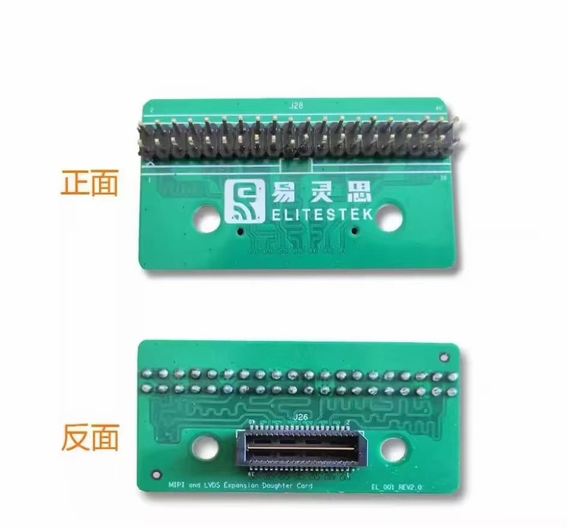

# third-party

引用的第三方图片与出处。用到哪张图，就在引用它的幻灯片页或报告图注里写同样的署名。

| 文件 | 内容 | 作者 / 来源 | 许可 | 链接 | 用在 |
| --- | --- | --- | --- | --- | --- |
| `taisei_stage.png` | Taisei Project 1.3 游戏画面（游戏区 + HUD） | Taisei Project | CC BY 4.0 | https://commons.wikimedia.org/wiki/File:Taisei_1.3_Shootem_up_20190425_16-50-29-232.png | `figures/task.png` |
| `taisei_danmaku.png` | Taisei Project 弹幕画面 | Taisei Project | CC BY-SA 4.0 | https://commons.wikimedia.org/wiki/File:Danmaku_in_Taisei_Project.png | 未使用 |
| `tearing_simulated.jpg` | 画面撕裂模拟图 | Vanessaezekowitz | CC BY-SA 3.0 | https://commons.wikimedia.org/wiki/File:Tearing_(simulated).jpg | `figures/framebuffer.png` |
| `tearing_dosv.png` | DOS/V 下的画面撕裂截图 | Darklanlan | CC0 | https://commons.wikimedia.org/wiki/File:Screen_tearing_on_DOSV.png | 未使用 |
| `alpha_compositing.png` | Porter–Duff 合成算子示意（由 SVG 导出 1920 px） | Wereon | 公有领域 | https://commons.wikimedia.org/wiki/File:Alpha_compositing.svg | `figures/blend.png` |
| `porterduff_add.png` | Porter–Duff ADD 示意 | Philiprbrenan | CC0 | https://commons.wikimedia.org/wiki/File:PorterDuffAdd.png | 未使用 |
| `tpu_v3.jpg` | Google Cloud TPU v3 板卡照片 | Zinskauf | CC BY-SA 4.0 | https://commons.wikimedia.org/wiki/File:Tensor_Processing_Unit_3.0.jpg | 未使用 |
| `ti60f225_board_photo.jpg` | Ti60F225 DEMO 板连屏幕与摄像头的实拍 | 易灵思 / 钛金 Ti60F225 DEMO 板 V4 软硬件设计说明，第 2 页 | 厂商资料，随板提供 | 资料包 `Efinix/02_.../TI60F225I3-V4 DEMO板软硬件设计说明-260813-1.pdf` | `figures/platform.png`；报告 3.1 节（图10）|
| `ti60f225_board_annotated.jpg` | 同一板卡带器件标注的正面图 | 同上，第 6 页 | 同上 | 同上 | 未使用 |
| [el_001_rev2_front_back_20261025.jpg](el_001_rev2_front_back_20261025.jpg) | EL_001 REV2.0 扩展卡正反面照片 | 2026-10-25 用户会话附件，图中带易灵思 ELITESTEK 丝印 | 原图未附许可说明 | 归档说明见下文 | 扩展卡型号与接口外观核对，尚未用于报告或幻灯片 |
| `app_ui_medical.jpg` | 医疗监护仪界面实拍 | Petty Officer 1st Class James Stenberg（美国海军） | 公有领域 | https://commons.wikimedia.org/wiki/File:Vital_signs_monitor_display.jpg | `app_ui_samples.jpg` 左半；报告 1.2 节（图 2）|
| `app_ui_cluster.jpg` | 丰田 Yaris 数字仪表实拍 | Acgskup | CC BY 4.0 | https://commons.wikimedia.org/wiki/File:Digital_instrument_cluster_of_a_Toyota_Yaris_Hybrid_GR_Sport.jpg | `app_ui_samples.jpg` 右半；报告 1.2 节（图 2）|
| `app_ui_samples.jpg` | 上两张按等高并排的合成图（本仓库合成，仅裁剪与缩放） | 同上两行 | 同上 | — | 报告 1.2 节（图 2）|

厂商资料里的图只在本项目的参赛材料里使用；资料包本身不入库（见仓库根 `README.md`）。

## EL_001 REV2.0 扩展卡照片

用户于 2026-10-25 在游戏机产品化调研会话中提供此图，2026-11-10 归档。
原附件名为 `bc03a934624c500ae90130bb5587fa7c.jpg`，从工作区临时目录按原字节复制，
尺寸为 944×878，文件大小为 93626 字节，未裁剪或重压缩。
SHA-256：`1752983da58a60a80507820950490b473f8089004ad6e23008a0aace813445a1`。

照片可见 `EL_001 REV2.0`、`MIPI and LVDS Expansion Daughter Card`、
正面排针接口 `J28` 与反面连接器 `J26` 丝印。
配套资料为厂商资料包中的
[QSE转排针.pdf](../../../Efinix/02_Ti60F225_DemoBoard_v4_赛题1-3/子卡原理图/QSE转排针.pdf)，
该 PDF 仍按仓库约定单独准备。照片用于核对板卡外观与标号；接线电压和引脚映射需结合原理图确认。
