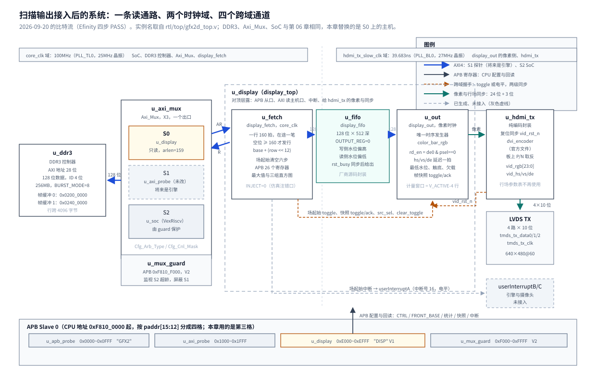

# 01 从 DDR3 帧缓冲到 HDMI 的扫描输出

## 一、动机

本工程在易灵思钛金 Ti60F225 上做 2D 渲染加速引擎，帧缓冲放在板上 256MB 的 DDR3 里。
第 06 章之后，`Axi_Mux` 的三个端口是 S0 扫描输出、S1 引擎（由测量主机 `u_axi_probe` 占位）、
S2 SoC；S0 上跑的还是一个替身 `scanout_stub`，它按行节拍发 160 拍的读、记录首拍等待与整笔时间，
读回的数据直接丢掉，屏幕上的画面来自 `hdmi_tx` 内部那个厂商彩条发生器 `color_bar_rgb`。
**DDR3 与 HDMI 之间没有任何数据通路**（`rtl/top/gfx2d_top.v` 文件头当时就是这么写的）。

这一条通路不做，会挡住四件事：

1. 引擎画的东西看不见。 引擎把结果写进 DDR3，没有扫描输出就只能在串口上看 CRC——
   CRC 能说明对不对，说明不了错在哪一层；一幅错位或颜色反了的画，一眼就能定位。
2. E5 的第四节做不了。 真正的最低水位取决于扫描输出自己的取数节奏与突发长度，
   替身只能给出总线延迟的上界（第 06 章 5.3 节），FIFO 深度也就无法定价。
3. 赛题基础要求 1 与 3 没有落点：HDMI 输出至少 640×480@60、双缓冲防撕裂。
4. SW9 的后半被挡住：板上的帧节拍要由场同步驱动，而场同步只有扫描输出能产生。

### 继承下来的约束

这些在第 06 章与总体设计文档里已经定死，本章不重新讨论，只列出来作为设计的边界：

| 约束 | 值 | 出处 |
| --- | --- | --- |
| 总线端口 | `Axi_Mux` 的 S0，只读，写通道不发起 | 第 06 章 3.2 节 |
| 在途事务 | 最多一笔：上一笔 `rlast` 握手之前不拉高下一笔 `arvalid` | 第 06 章 3.2 节措施一 |
| 帧缓冲 | 帧缓冲 0 `0x0200_0000`，帧缓冲 1 `0x0240_0000` | 总体设计 2.1 节 |
| 行跨 | 4096 字节，一行正好一个 4KB 页，永不跨页 | 总体设计 2.1 节 |
| 像素格式 | XRGB8888 `0x00RRGGBB`，小端；一个 128 位拍 4 个像素 | 总体设计 3.5 节、spec 第 01 章 |
| 一行一笔 | 640 像素 = 160 拍，`arlen = 159` | 总体设计 2.1 节 |
| 视频时序 | 640×480@60，H 16/96/48、V 10/2/33，同步低有效，一行 800 像素、一场 525 行 | `rtl/hdmi/hdmi_tx.v` |
| FIFO 预算 | 128 位 × 512 深（约 3 行），7 块片上 RAM | 总体设计 2.3 节 |
| 厂商文件 | `rtl/hdmi/` 下三个官方文件不改，适配放在扫描输出一侧 | 总体设计 3.5 节 |
| 时序余量 | `core_clk` 的 hold 只有 0.026 ns，每次改动都要复核 | 第 06 章 5.1 节 |

### 在途一笔够不够：先把账摊开

这是本工作点最容易被怀疑的约束（一行只允许一笔在途），所以先用第 06 章的板上数据算一遍：

| 量 | 值 | 来源 |
| --- | --- | --- |
| 行周期 | 3175 个 `core_clk` 周期（31.75 微秒） | 视频时序：800 像素 × 39.683ns × 100MHz |
| 一笔 160 拍读的最坏整笔时间 | 236 个周期 | 第 06 章 5.3 节 `MAX_FULL_TXN` |
| 总线占用率 | 7.4% | 236 / 3175 |
| 像素侧消耗速率 | 1 拍 / 15.9 个周期 | 160 拍摊进 640 像素的可见期 |
| 供给与消耗之比 | 10.8 倍 | 1.48 拍/周期 对 0.063 拍/周期 |

供给是消耗的十倍以上，余量不成问题；本工作点的风险落在跨时钟域与场起始清空的正确性上。

### 两个时钟域之间没有关系

`core_clk` 来自 25MHz 晶振（`PLL_TL0`），像素时钟 `hdmi_tx_slow_clk` 来自 27MHz 晶振（`PLL_BL0`），
频率比不是整数、相位也不固定。**这是本工程第一条真正有数据穿过的跨时钟域路径。**
`fpga/gfx2d_ti60/sdc/gfx2d_ti60.sdc` 里 `core_clk` 自成一组 `-exclusive`、像素时钟一组 `-asynchronous`，
跨域路径在 STA 里被整体切掉：同步器写错了，时序报告一个字节都不会报。
这条决定了后面两件事：跨域的正确性只能靠结构审查加仿真判据，而结论必须到综合后的网表里核对一次。

## 二、为什么是这几步

这一条通路两头都是活的（一头是已经验证过的 `Axi_Mux` 与控制器，另一头是已经上板验证过的 HDMI 编码通路），
要补的是中间一段。拆成九步，每一步的产物都是下一步的前提：

1. 量 FIFO 的水位与复位语义（不写生产 RTL，只写一个探针测试台）。
   取数策略（阈值 160 拍）与清空协议（两侧怎么复位）都是从这两个语义推出来的，
   而仓里那个厂商异步 FIFO 的 `datacount` 端口既没说含不含在途、也没说滞后几拍。
   先量再写：量错的代价是一个测试台，猜错的代价是每次上板一轮。
2. 取数侧 `display_fetch`：AXI 读主机、按水位发行、场起始清空、APB 寄存器与统计。
   它是唯一知道行号、基址与「在途一笔」这件事的地方。
3. 异步 FIFO 的封装 `display_fifo`：把厂商源码收成扫描输出要用的几个端口，
   并把跨域纪律（唯一复位、水位方向、复位窗口不拦写）写在文件头。
4. 像素侧 `display_out`：唯一一份视频时序、拍拆像素、与 FIFO 读出对齐、水位与欠载观测、帧快照。
   「场」这个事件的真源在这里，取数、切换、中断、快照都要用它。
5. 把 `hdmi_tx` 改成纯编码封装（D10 取 B′）：彩条搬进 `display_out`。
   两个时序发生器会造出两个「场」的真源，而场是全设计的同步基准。
6. 仿真 `sim/display`：跨域路径 STA 看不到，只能仿真；总线一侧需要一个带随机反压的从机，
   还要有一组把逻辑改错就报红的注错用例。
7. 编译与时序：FIFO 能不能推断成片上 RAM、hold 余量有没有变负、同步器结构有没有被综合改掉，
   只有编译报告与综合后的网表能回答。
8. 顶层换接：撤替身、把场起始中断接到 `userInterruptA`、`display_top` 与 `hdmi_tx` 对接。
9. 上板：把图案写进帧缓冲看屏幕、切双缓冲、读水位与统计、跑回归。

少一步不成立的地方有三处：第 1 步不做，第 2、4 步里的阈值与相位就是猜的（而且下面会看到，
厂商 wrapper 的两个辅助复位端子其实没有接进 FIFO，照文档接会白写一层握手）；
第 4 步的对齐相位不做推导，画面会整体横移一个像素组；
第 7 步的网表核对不做，跨域就只能拿「STA 没报错」当结论，而 STA 恰恰被 SDC 切掉了。

## 三、每一步做了什么

### 3.1 量 FIFO 的水位与复位语义

仓里已经有厂商的异步 FIFO 源码 `rtl/vendor/ddr3_controller/common/efx_fifo_v2.3/efx_fifo_wrapper.v`
（1376 行明文，不例化任何原语，已经在 `gfx2d_ti60.xml` 的设计文件列表里），
参数正好覆盖需求：`SYNC_CLK=0`（真异步）、`DATA_WIDTH=128`、`DEPTH=512`、
`FAMILY="TITANIUM"`、`RAM_STYLE="block_ram"`、两侧水位端口 `wr_datacount_o` / `rd_datacount_o` 现成。
代价是这些端口的精确语义要自己读代码确认，并用判据钉死。探针测试台先写在仓库外，
后来按流转规则搬进 `Main/sim/display/tb_fifo_semantics.v`（源码不在这里重复，判据见 3.7 节）。

探针做成**判别性实验**：把 wrapper 的 `a_wr_rst_i`、`a_rd_rst_i` 两个端子全程置 1。
如果它们真的接到了 FIFO 内部，FIFO 会一直停在复位，探针里任何一次收发都不会成功。

| 量 | 实测 | 对设计的含义 |
| --- | --- | --- |
| 读延迟 | `rd_en` 在沿 N 采样且 `empty=0` → `rdata`、`rd_valid_o` 在沿 N+1 有效 | 恰好 1 个 rd 周期，像素侧对齐取 D=1 |
| 写入 → `rd_datacount_o` | 写沿 t=345ns，水位在第 3 个 rd 沿（456ns）更新，本域监视器第 4 个沿（496ns）才看到 | 1 个 wr 周期 + 3 个 rd 周期；读侧水位偏低 |
| 读出 → `wr_datacount_o` | 读沿 t=694ns，水位在 755ns 更新（+61ns），监视器 765ns 看到 | 1 个 rd 周期 + 3 个 wr 周期；写侧水位偏高 |
| 水位含不含在途 | 不含，两个水位都是 RAM 里的指针差；`wr_datacount_o` 满值 512（10 位够） | 「空位 ≥ 160」加「在途 ≤ 160」才等于不会溢出 |
| 连写连读 160 拍 | `n_out=160`，逐拍相同 | 没有额外重排 |
| 写满 512 后再写 | `overflow_o` 单拍脉冲 | 写侧要自己防溢出 |
| 空时读 | `underflow_o` 单拍脉冲，指针不动 | 读侧要用 `empty` 压 `rd_en` |
| `a_rst_i` 撤销 | 上电长复位 +65ns（wr 域观测）/ +99ns（rd 域观测）；10ns 脉冲 +45/+82ns；40ns 脉冲 +60/+100ns | 最坏约 100ns ≈ 10 个 `core_clk` 周期，两域一起复位 |
| `a_wr_rst_i` / `a_rd_rst_i` | **常置 1 时 FIFO 照常收发 160 拍且顺序全对** | 这两个端子在 wrapper 里没有接进 FIFO |
| 复位窗口里的写 | `full_o` 为 0、`wr_ack_o` 不响应、写指针钉在 0 | FIFO 自己不拦写，`we=0` 要主机保证 |

两处结论直接改了原方案。第一，**两侧复位用一个 `a_rst_i` 就够了**：厂商在内部对每个域各有一套两级同步器，
`rst_busy = wr_rst[1] | rd_rst[1]` 就是「两个域都退出复位」的回执，不必自己再补一次 toggle/ack。
第二，`we=0` 必须由取数侧保证——复位窗口里 FIFO 不会替人拦住写进来的拍，
「等 `rlast` 再复位写指针」这条纪律因此不能省。

`rst_busy` 还有一个容易踩的地方：它是两个时钟域寄存器的组合，`rd_rst_int` 在像素域，
在 `core_clk` 里直接用它就是一条没有同步器的跨域路径，而 SDC 又把它切掉了。
落地做法是在写侧过两级同步器，判它连续为低 4 拍再恢复写入。

另外记一条工具上的坑：用整数变量做 128 位数据的位选（`i[127:0]`，`i` 是 `integer`）在 iverilog 里取到的是 `x`，
而 `x !== x` 为真，逐拍比对会静默通过——探针第一版因此报出过假的 `order_err=0`。
数据图案一律用 128 位寄存器自增；测试台里凡是比对都要意识到这一点。

### 3.2 取数侧 `rtl/display/display_fetch.v`

AXI 读主机，接 S0，只发起读；写通道由顶层接成不发起。发行条件用实测出来的水位语义写成：

```
!in_flight && (row < V_ACTIVE) && en && (DEPTH - wr_datacount_o) >= 160
```

`wr_datacount_o` 是写侧水位，它用滞后的读指针，占用偏高、空位算小，判据因此保守；
稳态偏高只有 1~2 拍。在途的 160 拍不计入水位，所以「空位 ≥ 160」与「在途 ≤ 160」两条同时成立才等价于不会溢出。

场起始清空按六步走，顺序不能换：

| 步 | 动作 | 为什么 |
| --- | --- | --- |
| 1 | 停发新读，锁存本场要用的配置（`EN`/`SRC`/`BACK_BASE`/`SWAP_REQ`） | 配置在场起始生效，中途改会切出撕裂帧 |
| 2 | 等在途那笔的 `rlast`，丢掉它的数据（`wr_en=0`，`r_re_ady` 仍为 1） | 不等它就把写指针复位，剩下的拍会落进新场的队头，错位由自愈动作自己造出来 |
| 3 | `a_rst_i` 拉高，保持 2 个 `core_clk` 周期 | 两侧一起复位，实测 1 个周期也够，留一倍余量 |
| 4 | 等同步后的 `rst_busy` 连续为低 4 拍 | 见 3.1 节的跨域纪律 |
| 5 | 锁存本场基址（`SWAP_REQ` 置位时把 `BACK_BASE` 变成本场基址，`SWAP_COUNT` 加一） | 一场的 480 行都从同一个基址取 |
| 6 | 回到运行态，开始预取 | 场消隐有 45 行约 1.43 毫秒，预取只占几十个周期 |

第二步要等的那一笔，除了「已经在途」还包括「`arvalid` 已经拉高、但还没被接走」的那一种：
`arvalid` 一旦拉高就不能撤回（AXI 没有取消语义），它迟早会被接走，拍子随后流进新场。
所以进入排空的条件是 `in_flight || ar_valid`。

APB 寄存器表（窗口 `0xF810_E000~0xF810_EFFF`，偏移即窗口内偏移）。
替身 `scanout_stub` 的三个配置寄存器（`BASE`/`LINE_PERIOD`/`FIELD_LINES`）在新模块里没有意义，
正好把 `0x00C`/`0x010`/`0x014` 三个洞让给 `FRONT_BASE`/`BACK_BASE`/`SWAP_REQ`，
其余量测寄存器的偏移与定义原样搬过来，这样 E5 时代的上板程序只改 ID 判断与几处等待还能继续用：

| 偏移 | 名称 | 读写 | 复位值 | 内容 |
| --- | --- | --- | --- | --- |
| `0x000` | `ID` | 只读 | `32'h4449_5350`（"DISP"） | 替身是 `"SCAN"` |
| `0x004` | `VERSION` | 只读 | 1 | |
| `0x008` | `CTRL` | 读写 | 0 | bit0 `EN`，bit1 `SRC`（0 彩条 / 1 帧缓冲），bit2 `CLEAR`（清两侧统计） |
| `0x00C` | `FRONT_BASE` | 只读 | `0x0200_0000` | 本场在扫的基址 |
| `0x010` | `BACK_BASE` | 读写 | `0x0240_0000` | 下一次切换的目标 |
| `0x014` | `SWAP_REQ` | 读写 | 0 | 写 1 请求在下一个场起始切换，切换后硬件清零；写 0 撤销 |
| `0x018` | `MAX_FIRST_WAIT` | 只读 | 0 | AR 握手到首个 R 拍的最大周期数 |
| `0x01C` | `MAX_FULL_TXN` | 只读 | 0 | AR 握手到 `rlast` 的最大周期数 |
| `0x020` | `MAX_R_GAP` | 只读 | 0 | 相邻 R 拍之间的最大周期数 |
| `0x024` | `TXN_COUNT` | 只读 | 0 | 完成的读事务数 |
| `0x028` | `LINE_COUNT` | 只读 | 0 | 场内行序号 0~479 |
| `0x02C` | `R_BEAT_COUNT` | 只读 | 0 | 收到的 R 拍数（含排空丢弃的） |
| `0x030` | `SKIP_COUNT` | 只读 | 0 | 保留偏移，按水位取数不跳行，恒读 0 |
| `0x034` | `RESPERR_COUNT` | 只读 | 0 | 非 OKAY 读响应计数 |
| `0x038` | `STATUS` | 只读 | 0 | bit0 `BUSY`、bit1 `AR_PENDING`、bit2 `STARTED` |
| `0x03C`~`0x0C8` | `HIST_FIRST` / `HIST_FULL` / `HIST_GAP` 各 12 个 | 只读 | 0 | 分桶同替身：桶 k 计 `[2^k, 2^(k+1)-1]` |
| `0x0D0` | `IRQ_EN` | 读写 | 0 | bit0 场起始 |
| `0x0D4` | `IRQ_STAT` | 读写 | 0 | bit0 场起始，写 1 清除 |
| `0x0D8` | `FRAME_COUNT` | 只读 | 0 | 场计数（`core_clk` 域） |
| `0x0DC` | `SWAP_COUNT` | 只读 | 0 | 完成的切换次数 |
| `0x0E0` | `SNAP_FRAME` | 只读 | 0 | 最近一次像素侧快照的帧号 |
| `0x0E4` | `SNAP_MIN_LEVEL` | 只读 | 0 | 该场计量窗口内的最低水位（拍） |
| `0x0E8` | `FIFO_ZERO_HITS` | 只读 | 0 | 累计触底次数 |
| `0x0EC` | `FIFO_UNDERFLOW_BEATS` | 只读 | 0 | 累计没有像素可读的拍数 |
| `0x0F0` | `FRAME_BEATS` | 只读 | 0 | 最近一场弹出的拍数，正常恒为 76800 |
| `0x0F4` | `SNAP_END_LEVEL` | 只读 | 0 | 最近一场场末、清空之前的残留水位，正常恒为 0 |

两个细节是给老程序留的：`FRONT_BASE` 的写按「忽略且不报错」处理
（替身时代它是可写的 `BASE`，`ddrBurstProbe` 会往这里写，报 `PSLVERROR` 有触发总线异常的风险）；
`ID` 从 `"SCAN"` 改成 `"DISP"`，程序里的 ID 判断要跟着改，这一条写进了第六节。

### 3.3 异步 FIFO 的封装 `rtl/display/display_fifo.v`

这一层只做三件事：把定死的参数写在一处、把厂商端口收成扫描输出用得到的那几个、
把 `rst_busy` 在写侧同步一次。`BYPASS_RESET_SYNC` 显式写 0——置 1 会把内部复位接到 wrapper
根本没有连线的两个端子上，同时把 `rst_busy` 写死成 0。三条实测出来的纪律写在文件头：
唯一复位用 `a_rst_i`、复位窗口里 `we` 必须为 0、`rst_busy` 同步后再判。

水位方向也写在文件头，因为它决定了两个判据怎么读：
写侧水位偏高（用滞后的读指针），发行条件用它；读侧水位偏低（用滞后的写指针），最低水位判据用它，
量到的是真实水位的下界。

### 3.4 像素侧 `rtl/display/display_out.v`

像素侧要给出全设计唯一的视频时序，并把 FIFO 里的 128 位拍拆成 4 个像素、与 `de` 对齐。
`color_bar_rgb` 在这里例化一次：既当行场时序发生器，又当 `SRC=0` 的画面。
它的 `de` 与 `o_vid_data` 是同拍的寄存器输出，但 `h_cnt`、`v_cnt` 是状态机计数器、
每进一个状态清零、比 `de` 早一拍，不能拿来当行号；行号用像素侧自己的计数器，在 `de` 的上升沿加一。

对齐相位由 3.1 节量到的读延迟推出来。`psel`（0~3）只在 `de0` 有效时计数，`rd_en` 在每组的第一个
像素周期发出，数据在下一拍到达，正好是延迟一拍的 `de` 的第一个像素周期：

```
rd 沿          t_j       t_j+1    t_j+2    t_j+3    t_j+4 (= t_{j+1})
de0             1         1        1        1          1
psel            0         1        2        3          0
rd_en           1                                      1        ← psel==0 时弹这一组的拍
rdata        beat_{j-1}  beat_j   beat_j   beat_j    beat_j      ← 新拍在 t_j+5 到达
psel_d1         x         0        1        2          3
de1             0         1        1        1          1
输出            黑       4j+0     4j+1     4j+2       4j+3
```

`hs1/vs1/de1` 与 `psel_d1` 都延迟一拍，像素由 `rd_data[psel_d1]` 组合选出。
这个相位下每行恰好 160 次弹出、每场恰好 76800 次，与从机供给的拍数一样多，
既不用在场首预弹、也不用在末组压掉一次。**先写的相位不是这个**：按「`psel==3` 时弹下一组的拍」推，
每场会弹 76801 次对 76800 拍供给，场末必然假欠载一次，而且第一行的第 0~3 像素要靠额外预弹才不是上一场的残留。
两处都试过，见 4.5 节。

欠载时的输出与计数：某一组没弹到（`empty`）时，这一组的 4 个像素输出黑色，
`FIFO_UNDERFLOW_BEATS` 加一。`miss_sh` 是一个 4 位移位寄存器，在组首装载、
每拍左移，输出第 k 个像素的那一拍上 `miss_sh[k]` 正好是「这一组当时有没有弹到」。

**最低水位的计量窗口排除每场最后 4 行。** 一场取 480 行、弹 480 行，场起始清空过，
所以两端都是 0，**场末水位必然排到 0，这是守恒，不是故障**：取数侧发完最后一行（`row` 到 480）就停发，
剩下的水位只够约 3 行（512 / 160）。把排水段算进去，任何正确的设计都会被判失败。
按 `MEASURE_LINES = V_ACTIVE - 4` 计量，仿真里（640×8 的小帧）最低水位 351 拍，
板上整帧 347 拍，都落在发行阈值的补数（512−160=352）附近，与设计预期一致。

跨域的量一律按结构化通道走，没有裸打拍：

| 方向 | 信号 | 形式 |
| --- | --- | --- |
| 像素 → core | 场起始 | toggle，两级同步后取边沿 |
| 像素 → core | 帧号、最低水位、触底、欠载、弹出拍数、场末水位 | 场起始锁存成一组，toggle/ack 握手；接收侧确认前源侧不变 |
| core → 像素 | `SRC` | 电平，只在场起始变化，两级同步后在像素侧再锁存一次 |
| core → 像素 | `CLEAR` | toggle，两级同步后取边沿清零累计值 |

### 3.5 把 `hdmi_tx` 改成纯编码封装

改动前 `hdmi_tx` 是密封的：`color_bar_rgb`、`dvi_encoder`、板级 P/N 取反与 `pll_locked` 复位同步
都在它里面，顶层没有把像素送进编码器的入口。可选的做法有三条：让 `hdmi_tx` 一行不改继续当彩条通路，
`display_top` 自带彩条与编码器、顶层按 `SRC` 在 TMDS 上二选一（A′）；
把 `color_bar_rgb` 从 `hdmi_tx` 搬进 `display_out`、`hdmi_tx` 变成纯编码封装（B′）；
让 `hdmi_tx` 退休、`display_top` 独占 TMDS（C）。

取 B′。A′ 会造出两个视频时序发生器，而场是取数、切换、中断与帧快照共同的同步基准，
两个真源会让「彩条模式下 `FRAME_COUNT` 指的是哪一场」变成一个需要解释的问题。
B′ 下两条通路共用同一个编码器，唯一的差别就是像素来源，画面出问题时锅落在哪一侧一目了然。
C 会让已经上板验证过的 TMDS 侧代码变成死代码，`sim/hdmi` 也就失去对象。
B′ 还顺带满足 `Main/rtl/README.md` 里「官方文件不改」的要求：三个官方文件一个字节都没动。

落地后 `hdmi_tx` 新增输入 `vid_rgb[23:0]`、`vid_hs`、`vid_vs`、`vid_de` 与输出 `vid_rst_n`
（复位同步的结果，给像素侧共用，避免两个模块各写一套复位同步器而在释放时刻上差几拍），
`dvi_encoder` 例化与 P/N 取反一行未动。行场参数表保留在它的参数表里但已不再使用，
真正生效的一份在 `display_out`。

`Main/sim/hdmi/tb_hdmi_tx.v` 随之改成自己例化一个 `color_bar_rgb` 驱动 `hdmi_tx` 的新输入、
用被测模块导出的 `vid_rst_n` 复位，三个用例（正常、`inject_hbp`、`inject_noinv`）的判据一条没改。

### 3.6 顶层换接与工程登记

`rtl/top/gfx2d_top.v` 撤下 `u_scanout`（`rtl/bus/scanout_stub.v` 留档，
`sim/axi_mux_guard/` 仍拿它当 S0 替身），换上 `u_display`；
`userInterruptA` 从常量 0 改成扫描输出的场起始中断（中断号 16，电平，复位后 `IRQ_EN=0`）。
S0 的 AXI 信号接到 `u_display`，APB 窗口 `0xF810_E000` 的译码不变。
`fpga/gfx2d_ti60/gfx2d_ti60.xml` 登记 `rtl/display/` 四个文件；
顶部管脚一个都没动，`gfx2d_ti60.peri.xml` 因此不用改——这也是选 B′ 的一个附带好处。



### 3.7 仿真 `Main/sim/display/`

跨域路径 STA 看不到，这一段的正确性靠仿真。从机用 `sim/axi_probe/axi_ram_model.v`：
带随机反压与读地址队列，`hold_ar` 可以停住地址通道。
它的存储是 4096 拍（64KB），按 `(addr>>4) % 4096` 取模，而两个帧缓冲的真实间隔 4MB 正好是它的整数倍，
所以仿真里改用 `0x0200_0000` 与 `0x0200_8000`（分别落在 0..2047 与 2048..4095 拍），
期望值按同一取模从模型存储里取。整帧用例里图案每 16 行重复一次，
**行地址的正确性由 AR 监视器逐笔核对**（`arlen` 恒 159、偏移依次 0、4096……到 `V_ACT` 回绕）。

| 用例 | 做什么 | 判据 |
| --- | --- | --- |
| `fifo` | 只测 `display_fifo`：单拍写、单拍读、连写连读 160 拍、复位一次 | 读延迟 1 个 rd 周期；写入到读侧水位 3~4 个 rd 沿；读出到写侧水位 4~8 个 wr 沿；复位后两侧归零且 `empty=1`；160 拍顺序逐拍相同。注错 `inj_no_reset` 时复位那一条必须 FAIL |
| `image` | 帧缓冲 0 放一幅每个像素都不同的图案 | 连续 3 场逐像素全对、行宽恒 640；`FRAME_BEATS` 恒 76800、`SNAP_END_LEVEL` 恒 0、`FIFO_ZERO_HITS`/`FIFO_UNDERFLOW_BEATS` 为 0、`SNAP_MIN_LEVEL` ≥ 160。另有像素时钟偏 ±0.5% 两组、整帧 640×480 一组 |
| `swap` | 第 1 场中途写 `SWAP_REQ`，帧缓冲 1 放另一幅图 | 切换后的三场逐像素全对（按 TB 自己维护的基址期望），`SWAP_COUNT` 加一、`FRONT_BASE` 变成帧缓冲 1 |
| `inflight` | 从机带监视器 | 任意时刻未完成读不超过 1 笔、`arlen` 恒 159、地址恒为 `base + (y << 12)` |
| `level` | 正常反压，连续 6 场 | 计量窗口内最低水位不低于 160 拍；触底与欠载为 0 |
| `starve` | 可见区里用 `hold_ar` 停住取数直到下一个场起始 | 这一场有错且欠载计数非零；**下一场逐像素恢复**；写 `CLEAR` 之后两个累计值读回 0 |
| `snapshot` | 连续 20 场 | 快照帧号逐场加一，不跳不重 |
| 注错 | `inj_lag0`（D=0）、`inj_order`（拍内顺序反）、`inj_phase`（相位 `psel==3`）、`inj_no_drain`（跳过排空）、`inj_no_clear`（不清 FIFO）、`inj_inflight2`（允许两笔在途）、`inj_swap_now`（切换立刻生效） | 每一个都必须红在对应判据上 |

`starve` 的注入方式与判据的写法有两处是踩过才定的：停住取数必须停在场消隐之后的**可见区**里
（消隐有 1.43 毫秒，在那边停多久都能被预取补回来，第一版就是这么写的，测出来零效果）；
`inj_no_drain` 必须与 `starve` 配对，因为正常场在场起始时取数侧早就取完了（见 4.5 节）。
另外补了一条不依赖「恰好撞上」的不变量判据：**复位 FIFO 的那一拍不能有在途读、也不能有挂起的 `arvalid`**。

注错要改内部行为，做成 `parameter integer INJECT`（默认 0，综合时是常量、分支被优化掉），
没有用 `ifdef`：Efinity 是单编译单元，宏有外泄到综合的风险。

### 3.8 编译、时序与跨域结构核对

Efinity 2026.1，单独一次编译（不与别的网表改动搭车，第 06 章的搭车规则第 1 条要求这样做，
因为每次改动都会扰动布局，而 `core_clk` 的 hold 只剩 0.026 ns）。四步的实测数字与
网表里跨域结构的逐条核对见 5.2 节；这一步本身要回答三个问题：FIFO 有没有被推断成片上 RAM 块、
hold 有没有被挤薄、同步器结构有没有被综合改掉。

**map 阶段抓出两个仿真放过的问题**：同一个寄存器被两个 always 块驱动（`VDB-1000`），
第一次是 `swap_req_sh`（场起始清零与软件写各一处），改完又露出 `snap_seen`（同步块与快照复位各一处）。
iverilog 允许这种双驱动且行为确定，map 不允许。详见 4.1 节。
另有一条本项目新增的位宽截断告警（`display_out` 的三目里 32 位赋给 24 位），显式写 `[23:0]` 修掉。

### 3.9 上板

上板分两轮。第一轮（2026-09-21）只烧比特流、读寄存器、跑 DDR 回归，
用的是 `tools/board/board_run.py`（烧 SRAM，不动 Flash）：

| 项 | 读回 | 判读 |
| --- | --- | --- |
| `0xF810_E000` | `44495350` | `"DISP"`，新模块在跑 |
| `0xF810_E008` | `00000000` | `EN=0`、`SRC=0`，上电画面是彩条 |
| `0xF810_E00C` | `02000000` | `FRONT_BASE` 复位值 |
| `0xF810_E0D8` | `0000000D` → 1 秒后 `00000049` | `FRAME_COUNT` 每秒 +60，像素域时序与跨域场事件都活着 |
| `0xF810_F000` | `4D555847 00000002 00000003 00000007` | guard 完好，上电默认值与第 06 章一致 |

`ddrAliasTest` 打 `base 0x0c800000 fail 0`；`ddrBurstProbe` 里扫描那几行是新模块的真实负载，
`TRI rd ... scan txn=2301 beat=368160 skip=0 resperr=0`（`beat = txn × 160` 成立）、`TRI rd/wr ok`，
只有 `IDENT scan` 一行 FAIL——那是程序还在按 `"SCAN"` 比 ID，见第六节。

第二轮（同日的复核）做了前一版没做的那件事：把图案写进真实帧缓冲、切到 `SRC=1`、读全部统计寄存器、
让用户看屏幕。**取数、字节序与双缓冲在真硬件上全对**：

| 判据 | 读回 | 结果 |
| --- | --- | --- |
| `FRAME_BEATS` | `0x12C00` = 76800 | 恰好 480 × 160 |
| `SNAP_END_LEVEL` | 0 | 场末无残留 |
| `SNAP_MIN_LEVEL` | 347 拍 | ≥ 160，与仿真的 351 吻合 |
| `FIFO_ZERO_HITS` / `FIFO_UNDERFLOW_BEATS` | 0 / 0 | 稳态无欠载 |
| `RESPERR` / `SKIP` | 0 / 0 | 读响应全 OKAY，不跳行 |
| `MAX_FULL_TXN` | 259 个周期 | 占行周期 8.2%，第 1 节预算 7.4% |
| 屏幕（用户确认） | 从上到下红、绿、蓝、白 | 内存里的 `0x00FF0000` 一路到显示器仍是红的 |
| 双缓冲 | `SWAP_COUNT` 0→1、`SWAP_REQ` 自清、`FRONT_BASE` `0x0200_0000`→`0x0240_0000`、屏幕上色带反序且没有上下两半不一样的帧 | 切换在场起始生效，不撕裂 |

屏幕那一条是整条链路的端到端判据：它验证的是 DDR3 控制器与 upsizer 没有额外搅动字节通道；
「扫描输出接帧缓冲不需要字节重排」这个推导（总体设计 3.5 节第 7 条、spec 第 01 章 3.7 节）
到此有了板上证据。

第三轮在 4.2~4.4 三处修复之后：重编译（数字见 5.2 节）、重烧、把判据全套复现，
并用「故意造欠载再写 `CLEAR`」在硬件上验证了缺陷三的修复。这一轮的表格在 5.3 节。

## 四、遇到的问题

### 4.1 同一个寄存器被两个 always 块驱动

**第一现场。** 编译到 map 阶段失败，错误日志两行：

```
[EFX-0010 VERI-ERROR] net 'swap_req_sh' is constantly driven from multiple places (VDB-1000) (display_fetch.v:374)
[EFX-0010 VERI-ERROR] found another driver here (VDB-1001) (display_fetch.v:545)
```

**解读。** `swap_req_sh` 是 `SWAP_REQ` 的请求位。它有两个驱动源：场起始那一拍锁存并清零
（FSM 块），以及 APB 写（寄存器块）。iverilog 对这种写法取了「最后一个赋值生效」的语义，
仿真里看不出异常；综合器按多驱动处理，直接拒绝。

**定位。** 修完第一处（把软件写搬进 FSM 块）之后重编，同一类错误在另一个寄存器上又出现一次：
`snap_seen` 在同步块里更新、在快照复位分支里清零。
两次都说明同一件事：只要一个寄存器同时被「状态机复位」与「寄存器写」碰，就容易写成两处赋值。

**根因与修法。** 每个寄存器只留一个 always 块驱动：`swap_req_sh` 与 `snap_seen` 都收进各自的状态块，
复位分支也放在同一个块里；块内的先后顺序决定优先级（场起始清零优先于同拍的软件写）。
原判据为什么没有覆盖到它：仿真工具允许双驱动且行为确定，
`sim/display` 全过；这一条只能由综合或一份 lint 抓，这也是第 2.4 节要求单独编译一次的理由。

### 4.2 场起始与发行同一拍时会绕过排空

**第一现场。** 这一条没有错误输出，是复核读代码时发现的：清空六步的第二步要等「在途那一笔」，
但 `case` 语句用的是**旧的** `in_flight` / `ar_valid` 判断要不要进排空态。
若同一拍既来 `fs_event` 又满足 `can_issue`，就会一边把 `arvalid` 拉起、
一边因为「当时既没有在途也没有挂起」直接跳过排空去复位 FIFO；那笔 AR 随后才被接走，
它的拍落在恢复运行之后，进新场的队头。

**解读。** 触发要同时满足「本场还有行没取」与「恰好在 `fs_event` 那一拍空闲」，
窗口只有一个 `core_clk` 周期。这恰恰是欠载自愈的场景：正常场在场起始时取数侧早就取完了，
只有欠载过、还在追赶的场才会在起始附近仍在发行。

**定位。** 先按「是不是 `ar_valid` 的边沿采样问题」查了一轮，把条件改成 `in_flight || ar_valid`，
那解决的是「已经挂起但还没被接走」的情形；这一拍竞态是另一个来源：
`can_issue` 与本拍的 `fs_event` 同时成立。

**根因与修法。** 给 `can_issue` 加 `!fs_event`：场起始那一拍不再发行，竞态窗口消失。
测试台同时补了一条不变量判据——**复位 FIFO 的那一拍不能有在途读、也不能有挂起的 `arvalid`**——
它不依赖「恰好撞上」，`inj_no_drain` 因此也多红一条。
原判据为什么没有覆盖到它：`inj_no_drain` 注的是「不等 `rlast` 就复位」，
而这一条是「根本没进排空」，是同一后果的另一条路径；判据只覆盖了前一条。

### 4.3 欠载时每组的第一个像素不是黑色

**第一现场。** 复核时做的判别性实验（临时测试台，不入库）：让 `rd_empty` 恒 1、`SRC=1`，
`rd_data` 低 32 位填 `0x00AABBCC`，看有效区里有多少像素不是黑：

```
有效区 928 个像素，读到 aabbcc 的有 232 个 —— 每 4 个像素一次，正好是每组的第 0 个
```

**解读。** 规格写的是「空读时输出黑色」。232 个非黑像素说明每组的第一个像素没有被黑化，
输出的是 FIFO 上一拍的残留值；后三个像素因为是移位铺满的所以是对的。

**定位。** 黑化由 `missed` 控制，而 `missed` 取的是 `miss_d1[sel]`：
`miss_sh` 已经在正确的拍上，又多打了一级 `miss_d1`，于是整体晚一拍。
判别性实验里每 4 个一次、只在第 0 个上出错，正好对应「晚一拍」这个形状。

**根因与修法。** 改成 `miss_sh[sel]`（`miss_sh` 在组首装载、每拍左移，输出第 k 个像素那一拍上
`miss_sh[k]` 就是这一组当时的状态）。改回之后同一实验 `nonblack=0`。
原判据为什么没有覆盖到它：`starve` 只判「这一场有错、下一场全对」，
从来没有判过欠载期间输出的是不是黑；而判据本身要求欠载为 0，正常情况下这条路径根本不走。

### 4.4 `CTRL.CLEAR` 清不掉像素侧的累计值

**第一现场。** 双缓冲那一轮读到 `FIFO_ZERO_HITS=1`、`FIFO_UNDERFLOW_BEATS=77266`——
后者约等于一整场的拍数。

**解读。** 77266 接近 76800，说明有一次「整场都在帧缓冲模式下读空 FIFO」的事件。
两个域的复位不对称：core 复位（每次上板流程里的 `reset halt`）不会复位像素域
（像素域的复位来自 `pll_locked`），于是像素侧的 `src_eff` 还留着上一次会话的 1，
从 core 复位到下一个场起始之间一直在帧缓冲模式下读空 FIFO，把整场的空读记进了欠载计数。
设计本身在一个场之内会自己纠正（`src_sel` 在 core 复位时为 0，下一个场起始就锁存回 0），
真正的问题是**软件清不掉**：`CLEAR` 原先只清 core 侧，而像素侧的累计值只认像素域复位。
而判据要求这两个数恒为 0、标准上板流程每次加载程序前都要 `reset halt`——那它们永远判不过。

**定位。** 先怀疑是欠载本身（水位、深度、反压），把 `SNAP_MIN_LEVEL` 与 `MAX_FULL_TXN` 一起读出来，
都在正常范围；再把「整场量级」这个数字对上 `FRAME_BEATS`，才确认是复位不对称而不是真欠载。

**根因与修法。** 寄存器表里 bit2 写的本来就是「清统计」，没有写「只清 core 侧」，
是实现把规格收窄了。修法是 `display_fetch` 在写 `CLEAR` 时翻一个 `clear_toggle`，
像素侧两级同步后取边沿清零两个累计值；`starve` 用例补了对应判据（写 `CLEAR` 之后两个计数器必须读回 0）。
原判据为什么没有覆盖到它：仿真里 `CLEAR` 从来没有进过判据，两个域的复位也是同时给的，
不对称只在「只复位 core」的上板流程里出现。

### 4.5 判据自身的坑

四处判据问题，都不是 RTL 的错，但都会让判据失效或报假红：

- **整数位选让比对静默通过。** 见 3.1 节的工具坑：`i[127:0]` 取到 `x` 而 `x !== x` 为真。
  测试台的比对函数现在把 `^got === 1'bx` 判为失败（此前读回 X 时 `got < lo` 与 `got > hi` 都是假，
  判据会静默通过）。
- **`starve` 第一版停错了地方。** 在场消隐期用 `hold_ar` 停住取数，零效果——
  消隐有 1.43 毫秒，取数侧随便都能把预取补回来。改成在可见区停、一直停到下一个场起始才放开。
- **`inj_no_drain` 与 `image` 配对测不出东西。** 正常场里最后一行早就取完，
  场起始时取数侧是闲着的（`in_flight=0`、`ar_valid=0`），跳过排空与不跳过没有差别，第一版是 PASS。
  它只能与 `starve` 配对：那种场里取数侧是「还欠着账」进场的，跳过排空才会把残留拍灌进新场
  （实测下一场 5119/5120 个像素错，行地址整体偏一行）。
- **最低水位不能按整场量。** 见 3.4 节的守恒解释：把场末排水段算进去，
  任何正确设计的「每场最低水位 ≥ 160 拍」都不成立。计量窗口改成排除最后 4 行。

### 4.6 `ddrBurstProbe` 串口日志缺尾：原“`age64_wr` 卡住”结论撤回

**第一现场。** 三次运行都在同一行之后停住，串口不再输出：

```
INJECT age64_rd age=64 hits=0x0000155c probe_done
（此后再无输出，三次运行的串口日志都是 3419 字节）
```

不 `reset halt` 直接挂 OpenOCD 读回现场：`PC=0x00001068`；探针主机 `0xF810_1000` 区
`STATUS=0x2`、`ADDR=0x0d000000`、`LEN=0xff`、`COUNT=0x1000`、`MODE=1`（写）、
偏移 `0x2C` 的错误计数 0。

**2026-09-21 复核订正。** 上面的观测保留，但原解读不成立。现场所用
`ddrBurstProbe.bin` 的 SHA-256 前 16 位为 `b31871c65b8e3fea`；对应反汇编明确给出
`0x1068 <mainDone>`，其指令是跳回自身。也就是说 CPU 已从 `main()` 返回，正在程序正常结束后的
自循环，并未卡在 `stage_inject()` 的轮询里。探针 `STATUS=0x2` 按 RTL 定义同样表示
`DONE=1、BUSY=0`，不是“写突发进行中”。

因此撤回“`age64_wr` 使 `axi_probe_master` 写通路死锁”以及由此推导出的 AW/W 时序猜测。
后续 JTAG 已完成 4096 笔满负载写，E5 2.4 的前期研究也量到写压力下 display 连续取数且错误计数为 0；
当前没有已证实的写方向故障阻塞 E5 开工。

**2026-09-21 再订正：缺尾的原因查到了，在采集侧。** E5 第四节按第六节改完 `ddrBurstProbe`
（扫描 ID 改 `"DISP"`、两处等待 1 ms → 20 ms）之后重跑，第一次仍用 `--stop-on done`：两次都在
`INJECT age1_rd age=1 hits=0x00044008 probe_done` 那一行之后停止，日志 3366 字节、没有 `fail`、
没有 `done`。原因是 `board_run.py` 的 `--stop-on` 是**子串**匹配，`"done"` 落在 `"probe_done"` 里，
采集窗口在程序还在跑的时候就关了。换成只出现在末行的 `--stop-on "fail "` 之后，两轮都完整跑到 `done`，
六个阶段全过（`Main/sw/apps/probe/ddrBurstProbe/logs/e5_display_run{1,2}.log`，3535 字节），
`age64_wr` 之后的 `mask_s0` 反例这一轮才被观测到（`txn 13440 13771 13771 13771 14362 ok`）。
本节原来那三次的采集参数已不可考，但同一类截尾现在有了一条可复现的路径，再加上现场证据
（`PC` 在 `mainDone` 的自循环、探针 `STATUS=0x2` 是 DONE、错误计数 0），**这组现象应当归到采集侧，
不是硬件写通路缺陷**。教训只落在工具用法上：`--stop-on` 要取只在末尾出现的标记，别用 `done`
（本仓多个程序会打 `xxx_done`）。

`ddrBurstProbe` 按第六节的交接清单改完并完整复跑了两轮（`fail 0`、`done`），
替换替身前后逐项对照见 platform 第 06 章 5.4 节；所有轮询保留有界等待，
但不再把它写成针对既有硬件死锁的绕行。

### 4.7 其余三处

- **位宽截断告警。** `display_out` 里 `wire [23:0] px_fb = (de1 && !missed) ? fifo_pixel : 24'h0;`
  三目的两个分支位宽不同，综合把 32 位截成 24 位并告警。显式写 `fifo_pixel[23:0]`。
  官方的 `encode.v` 里本来就有 9→8 的同类告警，与本工作点无关。
- **上电那一次清空会用到没有复位值的锁存器。** `lat_en`/`lat_src`/`lat_back`/`lat_swap`
  原先没有复位值，而上电那次 `S_RESET → S_WAIT` 发生在第一个 `fs_event` 之前，
  那时会拿它们去写生效值、还会用 `lat_swap` 选分支：仿真里是 X，板上有上电值，两边对不上。
  四个都补了复位值。
- **上电没有清 FIFO。** 厂商 FIFO 的指针在第一次 `a_rst_i` 之前是 X，快照读回一堆 X。
  复位后 FSM 从清空态起，先清一次再进运行态。

## 五、结果

### 5.1 仿真

`bash sim/display/run.sh`（`FULL=1` 时含整帧 640×480），本机 iverilog 12.0，用时约 4 分钟（含整帧 6 分 40 秒）：

```
fifo/semantics: RESULT: PASS checks=23
fifo/inject_no_reset: RESULT: FAIL errors=7 checks=23
display/image: PASS   display/image_clk_plus: PASS   display/image_clk_minus: PASS
display/swap: PASS    display/inflight: PASS         display/level: PASS
display/starve: PASS  display/snapshot: PASS         display/image_full: PASS
display/inj_lag0 / inj_order / inj_phase / inj_no_drain / inj_no_clear / inj_inflight2 / inj_swap_now: 全部 FAIL
SIM OK
```

`sim/hdmi` 在 `hdmi_tx` 改造成纯编码封装之后仍然 3/3：`normal` PASS（两帧 614400 个像素）、
`inject_hbp` FAIL（`line length: got 799 expect 800`）、`inject_noinv` FAIL（时钟通道不对）。
三个用例的判据一条没改。

### 5.2 编译与时序

Efinity 2026.1，四步（map / interface / pnr / pgm）PASS。`Missing Interface Pins` 仍是已知的 6 项
（本章没有动顶层管脚，`gfx2d_ti60.peri.xml` 未改）。与 2026-09-19（SoC IP 定型后）的对比：

| 项 | 改动前 | 本工作点 | 差值 |
| --- | ---: | ---: | --- |
| XLR | 21653（35.61%） | 21807（35.87%） | +154 |
| 片上 RAM | 65 块 | 71 块 | +6：FIFO 实测推断成 6 块，在 D4 的 7 块预算内 |
| DSP | 4 | 4 | 0 |
| `core_clk` setup | 3.405 ns | 3.898 ns | 变好 |
| `core_clk` hold | 0.026 ns | 0.026 ns | 0（全设计最紧的一条，没有被挤薄） |
| `hdmi_tx_slow_clk` setup / hold | — | 33.807 / 0.071 ns | 新增的像素域，余量充足 |

本模块比它替掉的 `scanout_stub`（3298 XLR）大 154 个 XLR：取数侧的量测端口与三组直方图与替身同量级，
多出来的是像素侧、跨域握手与 APB 寄存器。片上 RAM 的 +6 块是本工作点唯一动到 RAM 的地方，
推断结果落在预算内，D4 里「没推断成片上 RAM 块就退回手写」这个条件因此不触发。

自写代码没有位宽截断告警（`rtl/hdmi/encode.v` 里 9→8 那条是官方文件、改动前就有）。
三组直方图（每个 12 × 32 位）被映射进逻辑存储（`EFX-0657`），这一点与替身时代相同，不占片上 RAM。
其余时钟（`sdram_clk`、`rx_cal_clk`、`tx_cal_clk`、`tx_cal_clk_90edge`、`jtag_inst1_TCK`）setup、hold 全为正，无负 slack。

跨域结构按第 2.4 节的要求到综合后的网表 `outflow/gfx2d_ti60.map.v` 里逐条核对
（两个时钟域在 SDC 里互不分析，这一条不能用「STA 没报错」代替）：

| 通道 | 网表里的结构 |
| --- | --- |
| 场起始 `fs_toggle`（像素 → core） | `u_display/u_fetch/fs_sync[1:0]`：两级 `EFX_FF`，`async_reg="true"`，都在 `core_clk` |
| 帧快照 `snap_toggle`（像素 → core） | `u_display/u_fetch/snap_sync[1:0]`：同上；`snap_ack` 的 D 直接取 `snap_sync[1]` |
| `src_sel` 电平（core → 像素） | `u_display/u_out/dff_59`：两级移位，`async_reg=TRUE`，D 接 `u_display/src_sel`，时钟 `hdmi_tx_slow_clk` |
| `snap_ack` 电平（core → 像素） | `u_display/u_out/dff_123`：同型结构，D 接 `snap_ack` |
| `CLEAR`（core → 像素） | `u_display/clear_toggle` 与像素侧的两级 `clr_sync` 加边沿检测 |
| FIFO 格雷码指针 | `u_display/u_fifo/.../xefx_fifo_ctl/genblk7.xrd2wr_addr_sync` 与 `wr2rd_addr_sync` 各一组，两级、`async_reg`，综合压成 `EFX_SRL8` 纯移位链 |
| FIFO 复位 | `u_display/u_fifo/.../genblk2.wr_rst[1:0]` 与 `rd_rst[1:0]`，`async_reg="true"`、`SR` 接 `fifo_rst`（异步置位、同步释放） |

CDC 报告是 `No Synchronizer warnings to report`。

### 5.3 上板

板上共三轮：烧比特流读寄存器（3.9 节）、往帧缓冲写图案并验双缓冲（3.9 节）、
以及三处修复之后的复验。第三轮做了两件事。

**缺陷三的修复在硬件上验证。** 故意造欠载：写 `CTRL=0x2`（`SRC=1`、`EN=0`，
像素侧在帧缓冲模式下读空 FIFO），300 毫秒后读回

```
FIFO_UNDERFLOW_BEATS = 0x13EC00 = 1305600 = 17 × 76800
```

17 场正好对应 300 毫秒的 60Hz，说明累计逻辑按场在走；再写 `SRC=0` 停止累加、写 `CTRL.CLEAR`，
两个计数器都读回 0。修复前这两个数清不掉（4.4 节）。缺陷一、二没有对应的板上可观测现象，
它们的判据在仿真里（4.3 节的判别性测试台与 4.2 节的排空不变量）。

**修复后的比特流上判据全部复现。**

| 判据 | 修复前 | 修复后 | 判读 |
| --- | ---: | ---: | --- |
| `FRAME_BEATS` | 76800 | 76800 | 恰好 480 × 160 |
| `SNAP_END_LEVEL` | 0 | 0 | 场末无残留 |
| `SNAP_MIN_LEVEL` | 347 拍 | 347 拍 | ≥ 160，与仿真的 351 吻合 |
| `FIFO_ZERO_HITS` / `FIFO_UNDERFLOW_BEATS` | 0 / 0 | 0 / 0 | 稳态无欠载 |
| `RESPERR` / `SKIP` | 0 / 0 | 0 / 0 | 读响应全 OKAY，不跳行 |
| `MAX_FULL_TXN` | 259 周期 | 239 周期 | 占行周期 7.5%，与第 1 节预算 7.4% 基本重合 |
| `FRAME_COUNT` | +60/秒 | +61/秒 | 场节拍 |
| 屏幕（用户确认） | 红绿蓝白 | 红绿蓝白 | 像素通路没有被修复改坏 |
| `ddrAliasTest` | — | `fail 0`、`done` | SoC、DDR 地址译码与缓存通路未受影响 |

放在整章尺度上，第 3 节判据的当前状态：

| 判据 | 状态 |
| --- | --- |
| 取舍确认、仿真、编译、时序、资源 | 已过 |
| 上电画面是彩条（`SRC=0`，不依赖软件） | 已过，用户看过 |
| 图案与字节序（四条横向色带红绿蓝白） | 已过，用户看过 |
| 拍数、水位、欠载（76800、347 拍、0 / 0） | 已过 |
| 双缓冲切换（`SWAP_COUNT`、请求自清、`FRONT_BASE`、无撕裂） | 已过（单次切换） |
| `CLEAR` 清累计值 | 已过（故意造欠载 1305600，清后 0） |
| 帧率（软件在后缓冲画动画打到串口） | 未做，要 `displayTest` |
| 中断（1 秒 60 次、不清除时的现象） | 未做，要 `displayTest` |
| 水位 120 场统计与探针满负载那一组 | 已过（2026-09-21，E5 2.4 节独立复现修复后）：`idle` / 满负载读 / 满负载写三组各 120 场，最低水位 347 / 331 / 327 拍，欠载 0，见 [platform 第 08 章](../platform/08-扫描FIFO的压力矩阵与深度定值.md) |
| 定位图案四角、四条纯色列、两条 1 像素线 | 未做（字节序已由横向色带确认，这几条判的是行跨与边界差一） |
| 600 次切换的长跑、场中途改 `SRC`/`BACK_BASE` | 未做 |

测量方法与误差来源：仿真用 iverilog，两个时钟取板上名义值（10ns 与 39.683ns），另有两组 ±0.5% 的偏移；
板上数字用 `tools/board/board_run.py` 读寄存器，`FRAME_COUNT` 的 ±1 来自读数的取整；
`MAX_FULL_TXN` 随仲裁与控制器状态有约 2% 的波动（第 06 章已记），
所以第 1 节 7.4% 的预算与板上 7.5% 的实测按量级对齐，不当成精确复现。

## 六、还欠什么

1. **三项判据要软件侧的程序。** 帧率（在后缓冲画一个移动的方块、每场切换一次，把帧率打到串口）、
   中断（`IRQ_EN` 与清除处理函数，再补一次「故意不清除」）、以及定位图案（四角方块、四条纯色列、
   两条 1 像素线，用来判行跨与边界差一）。这三项都要 2.5 节说的 `sw/apps/test/displayTest`，属 SW9 的后半；
   `board_present`/`board_wait_frame` 还是空实现，也要在那里接起来。
   水位的连续 120 场统计与探针满负载那一组已经由 E5 的 `sw/apps/probe/displayFifoProbe` 做完，见下一条。
2. **E5 的第四节（真实扫描 FIFO 水位）已于 2026-09-21 做完。** 新程序 `sw/apps/probe/displayFifoProbe`
   在 `idle` / 满负载 `read` / 满负载 `write` 三组下各收 120 场连续快照：独立复现修复后的最低水位 **347 / 331 / 327** 拍
   （都远高于 160 拍的下界），触底与欠载计数 0、`FRAME_BEATS` 76800、场末残留 0，五个有效完整会话 `fail 0`；
   另一次完整启动在压力前报 `no_frame` 并留档，下一次重烧恢复，不计入压力数据。
   结果表与解释见 [platform 第 08 章](../platform/08-扫描FIFO的压力矩阵与深度定值.md)；本章量到的 347 拍与它逐项吻合。
   CPU 拷贝倍数一并重测（`SHARE` 1.64 倍、三方并发读 1.70 倍、写 1.92 倍），与替身时代同量级。
3. **`ddrBurstProbe` 已改并完整复跑（2026-09-21）。** 扫描 ID 改 `0x4449_5350`、两处等待 1 ms → 20 ms、
   注释补上「`S_CTRL=1` 已是完整取数负载」；重新编译后两轮都跑到 `fail 0` 与 `done`，六个阶段全过
   （`logs/e5_display_run{1,2}.log`）。4.6 节缺尾的原因也一并查清：`--stop-on done` 撞上了 `probe_done`，属采集侧。
4. **FIFO 深度的定值已经定下（2026-09-21）。** 深度 512 是由「空位不少于一行才发行」这条策略推出来的（约 3 行），
   不是带宽推出来的；实测推断 6 块片上 RAM、预算 7 块。E5 2.4 的三组压力矩阵给出 120 场最低水位 347 / 331 / 327 拍，
   按 E5 2.5 节：三组全过则 M2 保持 512，不因为「看起来很高」改浅；256 / 1024 都算新设计，
   要重算 `MEASURE_LINES` 并重跑仿真、编译与整套板测。这条已写进总体设计 3.3 节。
5. **600 次切换的长跑与场中途改 `SRC`/`BACK_BASE`** 还没有做，这两条判的是「不撕裂」在长时间与
   中途改配置两种条件下的成立。
