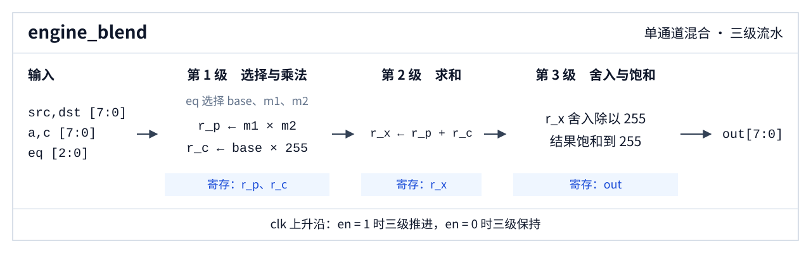

# 01 计算核心：设计与验证记录

主体记录 2026-09-29～30 的 B1 开发；B1 于 2026-09-30 验收，后续维护另标日期。
当前源码为 `Main/rtl/engine/core/engine_blend.v`，接口与方程见
[随码手册](../../../Main/rtl/engine/engine-manual.md#2-六方程编码engine_blend)，
运行方法见 [blend 验证目录](../../../Main/sim/engine/blend/README.md)。

历史文字中的 INJECT、尚未集成状态和旧路径属于当时版本。
第 3.2～3.3、3.7～3.8 节保留独立实验的测量记录；当时的九个小工程和板上自检工程未随仓库归档，
这些数据不作为当前源码的可复现综合或板测证据。较新的仓内证据见第 4.7 节。

## 一、设计目标

单通道混合核把源颜色、目的颜色、alpha、常量系数和方程号转换为一个 8 位结果。
五个数据输入合计 35 位，另有 clk/en；输出为 8 位。颜色运算采用 255 满量程，
先合并两项，再舍入并饱和到 255。六种方程及数值定义见 Main 的引擎手册和总体设计 3.5 节。

B1 为像素通路提供固定延迟的计算单元，B4 按四像素、RGB 三通道例化 12 份。
该阶段要确定代入方式、乘法器映射和流水切点，并把延迟及暂停条件写入接口 I6。

## 二、实现选择

本章比较单乘法器恒等变换、DSP 映射及四种流水切法。
仿真使用与 RTL 快速式独立的精确商参考值；综合用于比较映射和时序。
D9、D24～D28 记录当时采用的实现及其依据。

## 三、设计与实验

### 3.1 代入表：六个方程落成同一条数据通路

通用写法可以选择 `Fs/Fd` 后计算两项乘积；本实现利用六种方程的因子关系，
进一步收成只有一个变量乘法的整数恒等式：

```
x = base × 255 + m1 × m2
```

系数按 255 满量程代入后，六个方程各有一组 `base`、`m1`、`m2`：

| 方程 | Fs, Fd | base | m1 | m2 |
| --- | --- | --- | --- | --- |
| COPY | 255, 0 | src | 0 | 0 |
| ALPHA（预乘） | 255, 255−a | src | dst | 255−a |
| ADD | 255, 255 | src+dst | 0 | 0 |
| CONST | c, 255−c | dst | src−dst | c |
| MUL | dst, 0 | 0 | src | dst |
| ALPHA（非预乘） | a, 255−a | dst | src−dst | a |

`base` 乘的 255 是满量程的 1。CONST 行把 `dst×255 + (src−dst)×c` 展开就是
`src×c + dst×(255−c)`，等式两边逐位相同。这样六个方程共用一条数据通路：
一个选择器给出 `base`、`m1`、`m2`，后面只有一次乘法和一次加法。

`tools/check/check_subst.c` 对六个方程的**全定义域**逐一比较
`base×255 + m1×m2` 与 `src×Fs + dst×Fd`：合计 50462976 组，0 处不同。
同一支程序也给出实测的取值范围，据此定下位宽与符号：

| 量 | 位宽与符号 | 取值范围 |
| --- | --- | --- |
| base | 9 位无符号 | 0 ~ 510（ADD 要 src+dst） |
| m1 | 9 位有符号 | −255 ~ 255（CONST 与非预乘 ALPHA 要 src−dst） |
| m2 | 8 位无符号 | 0 ~ 255，进乘法器前零扩展成 9 位有符号 |
| p = m1×m2 | 有符号，实现取 18 位 | −65025 ~ 65025 |
| base×255 | 无符号 17 位 | 0 ~ 130050 |
| x = p + base×255 | 无符号 17 位 | 0 ~ 130050 |
| t = x + 128 | 数学最小为无符号 17 位；RTL 取 18 位 | 128 ~ 130178 |

`m2` 零扩展后按非负有符号数参与乘法，`m1` 可以为负。这里要求操作数的类型一致，
不要求两个数值同号。`x` 的数学范围可用 17 位无符号表示，RTL 的累加器实际声明为 19 位有符号；
`t+(t>>8)` 上限为 130686，数学最小同样为 17 位，RTL 显式使用 19 位以避免隐式截断告警。

除以 255 用快速式，在 17 位域上算完再 clamp：

```
t   = x + 128
out = min(255, (t + (t >> 8)) >> 8)
```

`check_subst.c` 同时校了这一条：快速式与精确商 `round(x/255)` 在六方程全定义域上 0 处不同。

### 3.2 乘法器：一块 DSP 能装几个

Ti60F225 的 DSP 块有四种模式。NORMAL 是一块 19×18 乘法器加一个 48 位加法器，
DUAL 是一块 11×10 加一块 8×8，QUAD 是一块 7×6 加三块 4×4，BFLOAT 是 BF16 的乘加。
厂家给了三个原语：`EFX_DSP48` 覆盖四种模式，`EFX_DSP24` 是 DUAL 里那条 8×8
（一块 DSP 可以放两个），`EFX_DSP12` 是 QUAD 里那条 4×4（一块可以放四个）。
两个端口细节决定了本层的写法：NORMAL 的 C 口是 18 位，进 48 位加法器与乘积累加；
DUAL 把 C 口切成 `C[17:8]` 与 `C[7:0]`，走 11×10 那条只拿得到 10 位。

综合手册给的推断规则按宽度分档：两个算子都不超过 4 位推 `EFX_DSP12`、
不超过 8 位推 `EFX_DSP24`、不超过 19 与 18 位推 `EFX_DSP48`。
手册里还有一个例子写明：`p = a*b; o = p + c` 在 c 是 18 位时能压进一块 `EFX_DSP48`，
因为 C 的宽度放得下。

以上依据：Ti60 数据手册的 DSP Block 一节，Quantum Titanium Primitives 用户手册的表 24、27~32，
Efinity 综合手册的 Figure 2~5 与 `syn_use_dsp` 条目；原语的端口与参数另外对过
Efinity 安装目录里的仿真模型 `sim_models/verilog/efx_dsp48.v`。

**一块 DSP 能放几个乘法。** 本层的 `m1` 是 9 位有符号，进不了 DUAL 的 8×8 那条；
11×10 那条能放 9×8，但一块只有一条。所以按这个代入，一条通路 12 个乘法要 12 块。
实验证实：12 通道的工程一律报 12 个 `EFX_DSP48`（`SIGNED = 1`），一块 `EFX_DSP24` 都没有。

还有一个能省一半的代入。按 `src` 与 `dst` 谁大来选：

```
src >= dst   base = dst   m1 = src-dst   m2 = c（非预乘 ALPHA 时是 a）
src <  dst   base = src   m1 = dst-src   m2 = 255-c（255-a）
```

这两个分支在整数上恒等，乘数均在 0～255；`check_subst.c` 保留了等价性检查。
这提供了尝试 8 位乘法映射的候选，但本文没有该候选实际压到 6 DSP 的综合对照。
当时未采用，保留了实现较直接的有符号代入；所选 12 通道实现实测使用 12 DSP。
当时整机基线另用 4 DSP，16/160 是该阶段的资源背景，不代表所有后续构型。

**DSP 里的加法器能不能吃掉 `base×255`。** 能。NORMAL 的 C 口 18 位，
而 `base×255` 最大 130050，小于 2^17 且恒正，放得下。默认综合不会用它：
直接写 `p = m1*m2; x = p + c255` 时，综合报告里 DSP 的 O 列是 `(A*B)`，加法器留在 LE 里。
在加法器输出上标 `(* syn_use_dsp = "yes" *)` 之后 O 列变成 `(A*B)+C`，
`EFX_ADD` 从 874 掉到 670、XLR 从 1715 掉到 1549。代价是时序变差：
setup 余量 3.806 降到 3.079 ns、Fmax 从 161.4 降到 144.5 MHz，
关键路径的终点从 `r_x` 的 D 端变成 DSP 的 `C[17]`——`base×255` 进 C 口这条路变长了。
省下的 166 个 XLR 占器件 0.27%，换掉 0.73 ns 余量，不划算（D28）。

### 3.3 流水切法与固定延迟

从输入到输出要依次经过选择器、乘法、加法、加 128、求商与饱和，全放在一级里余量很薄。
四种切法各有取舍，在 12 通道、100 MHz（Ti60F225，I3 模型）下实测：

| 切法 | 级点 | L | XLR | DSP | EFX_ADD | EFX_FF | setup(ns) | hold(ns) | Fmax(MHz) |
| --- | --- | --: | --: | --: | --: | --: | --: | --: | --: |
| PIPE=0 | 只有输出寄存 | 1 | 1798 | 12 | 898 | 215 | 1.724 | 0.098 | 120.8 |
| PIPE=1 | 乘与 base×255 后寄存，加与舍入一级 | 2 | 1752 | 12 | 898 | 212 | 3.930 | 0.110 | 164.7 |
| PIPE=2 | 乘加一体后寄存，舍入与饱和一级 | 2 | 1715 | 12 | 874 | 277 | 3.806 | 0.097 | 161.4 |
| PIPE=3 | 乘 / 加 / 舍入与饱和三级 | 3 | 1748 | 12 | 898 | 428 | 4.461 | 0.104 | 180.5 |

1 通道的同一张表照出每通道的底：XLR 95 / 93 / 90 / 94，都是 1 个 DSP，
setup 4.009 / 5.371 / 6.540 / 7.007 ns。

PIPE=0 在该独立工程的 100 MHz 约束下也能通过。PIPE=3 的 setup 余量最大，
与 PIPE=1 的 XLR 相近，因此选择三级实现；独立工程的差异不能直接预测 B4 或整机时序。

关键路径：PIPE=0 是 `lfsr → o[8]`，36 级逻辑、7.916 ns；PIPE=1 是 `eqr → r_c[16]`，
28 级、5.811 ns；PIPE=2 是 `lfsr → r_x[17]`，31 级、5.935 ns；
PIPE=3 是 `eqr → r_c[16]`，28 级、5.280 ns。四者的最长一级都是
**判定选 base/m1/m2 再算 base×255**，乘法器不是瓶颈。

四种切法（4.2 节的错修掉之后）各用 iverilog 跑一遍全定义域穷举，50462977 拍（含收尾一拍），
全部 0 处不符。单次墙钟 PIPE=0 321.4 s、PIPE=1 363.8 s、PIPE=2 350.4 s、PIPE=3 409.9 s
（WSL Ubuntu，iverilog 12.0）。一种配置 6~7 分钟，全输入穷举跑得动，正式测试台不必为了省时间缩域。

定案取 PIPE=3，固定延迟 **L = 3**（D24）。这一条回写进层间契约 I6。
另外两条接口约定一并定下：保留 `en` 时钟使能（B4 的行缓冲没就绪时要能停住流水，
不用时接 `1'b1`，实测接常 1 时 DSP 的 P 寄存器照样推断得出来）；
**核心的五个输入必须由寄存器直接驱动，前面不得有组合逻辑**——
第一级实测 5.280 ns、起点是寄存器，B4 的像素旋转器直接接上来会吃掉这一级的余量。

3.1~3.3 节的研究在 2026-09-29 收成五条定案，编号接在引擎 P1 的 D1~D23 之后
（D1~D23 的归属见[第 00 章](00-P1路线与层间契约.md)第一节）。D9 是拆批之前定下的方向，归本批，原文一并列在这里：

| 编号 | 定案 | 依据 |
| --- | --- | --- |
| D9 | 一条通路，每拍 4 像素。六个方程都写成 `x = 基数 × 255 + m1 × m2`，每通道一个有符号乘法器，一条通路 12 个。乘法先让综合推断 DSP，时序不够再按厂商原语例化 | 2026-09-26 定案；其中的「整数恒等」由 3.1 节的全定义域穷举补证 |
| D24 | 流水级数 L=3：判定与乘、求和、舍入与饱和 | 四种独立工程中 PIPE=3 的 setup 余量最大，XLR 与两级方案相近 |
| D25 | 让综合推断 DSP，不手写原语 | 所选 12 通道实现推断出 12 个 EFX_DSP48，且完成当时的板上抽样；本文没有手写原语的面积对照 |
| D26 | 保留有符号代入，不采用 8 位乘数候选 | 当前代入已验证；替代代入的整数等价性成立，但 6 DSP 映射及额外选择逻辑的时序未在本章实测 |
| D27 | 区分数学最小位宽与 RTL 声明；求商后饱和到 255 | x、t 和求商加法结果的范围均能放入 17 位无符号数；RTL 显式扩展为 18/19 位。16 位模截断错误，16 位饱和与最终 8 位饱和组合在该定义下等价，但本实现未采用 |
| D28 | **`base×255` 的加法留在 LE 里，不加 `syn_use_dsp`** | 3.2 节：加了省 166 个 XLR（器件 0.27%），但 setup 余量掉 0.73 ns、Fmax 掉 17 MHz；而且流水寄存器会被吸进 DSP，「L 拍」的边界就要依赖综合行为 |

设计文档 3.5 节把像素流水线画成五级，与本层的三级不冲突：设计文档的级 2「乘（DSP，输出寄存）」
就是本层的 `r_p`，级 3「加与舍入、饱和」在本层拆成「加」与「舍入饱和」两级，合起来仍在级 3 之内。

### 3.4 借鉴来源：别人的混合怎么舍入

开工前读了两份现成的混合实现与厂商的 DSP 资料，要回答两件事：它们在精度与延迟上怎么取舍，
有没有可以直接照搬的舍入口径。ORGFX 的 Verilog 源码这次没有取到
（opencores 的 websvn 服务端返回 `No template file found`），读的是同一项目的 DIVA 硕士论文；
它的代码级阅读（模块边界与 Wishbone 形态）在[第 00 章](00-P1路线与层间契约.md)第四节的跨层来源里已经做过，这次没有重复。

| 来源 | 形态与许可 | 借鉴什么 | 用在 | 不借鉴什么 |
| --- | --- | --- | --- | --- |
| Porter & Duff 1984；OpenGL `glBlendFunc`；Blinn 1995 | 论文与 API | `src×Fs + dst×Fd` 的一般形式与预乘 alpha；除以 255 的移位快算 | 本层的方程表与舍入（spec 第 01 章已按这些定稿） | — |
| ORGFX（[DIVA 论文](https://www.diva-portal.org/smash/get/diva2:556520/FULLTEXT01.pdf) 5.3.8、6.2.11 节） | 硕士论文加 Verilog，LGPL-3 | alpha 与全局 alpha 两个因子相乘的形状（与 Fs/Fd 表同构：全局 alpha 就是 CONST 行的 `c`）；混合可整层关掉以省带宽 | 方程表、B4 的读写避让 | 除以 256 截断（`alpha = a_f×a_g` 后右移 8 位，混合后再右移 8 位，全程不四舍五入）；一次一像素的混合状态机；在混合里读目标像素 |
| Xilinx Video Mixer v3.0（[PG243](https://japan.xilinx.com/content/dam/xilinx/support/documents/ip_documentation/v_mix/v3_0/pg243-v-mix.pdf)「Alpha Blending」一节与 Layer Alpha 寄存器） | IP 手册 | 多像素每拍的并行分级（每拍 1、2、4 个样本，本设计取 4）；alpha 关掉即按全不透明叠加 | 4 像素通路、方程表的 COPY 行 | Layer Alpha 是 **0~256** 的尺度（按 1/256 缩放、纯移位）；当时查阅的章节未明确给出舍入策略 |
| Efinix 官方（3.2 节列的数据手册、原语手册、综合手册与 `efx_dsp48.v`） | 厂商手册与仿真模型 | 推断分档规则、乘加压进一块的条件、原语参数与端口 | D25、D26、D28 | — |

上述来源是当时的结构和精度取舍参考。它们没有替本项目确定“合并两项、除以 255、舍入、饱和”的数值契约；
本实现采用项目规格，并用精确商检查该快速式。表中阅读结论属于历史记录，本次维护未重新逐页核验外部手册。

### 3.5 RTL

`rtl/engine/engine_blend.v` 一个文件、一个模块，接口就是 I6：

```
engine_blend
  clk  en                     时钟与时钟使能
  src[7:0] dst[7:0]           源、目的通道
  a[7:0]  c[7:0]              源 alpha、CONST 的常量系数
  eq[2:0]                     方程号 0~5
  out[7:0]                    结果，固定延迟 3 拍
```

内部三级：

```
级 1  判定 + 乘 + base×255        case(eq) 选 base/m1/m2 -> EFX_DSP48 -> r_p
                                  base×255 用移位相减      -> r_c
级 2  x = r_p + r_c                                       -> r_x
级 3  t = x + 128、(t + (t>>8))>>8、min(255, q)            -> out
```

`base×255` 显式写成 `(base << 8) - base`，表达常数乘法；变量乘法只有 `m1×m2`。
级 1 的两个寄存器必须**同一拍**更新：只寄存乘积、让 `base×255` 仍取当前输入的话，
级 2 会把两拍的操作数相加。这一条踩过，见 4.2 节。

当时模块使用 `parameter integer INJECT` 做注错，正式配置为 0。
它后来先迁为条件编译，再迁到外部变异；当前 RTL 没有注错参数或分支，见
[platform 第 16 章](../platform/16-注错机制改为外部变异.md)与[第 17 章](../platform/17-变异测试全量迁移.md)。

### 3.6 单元仿真

以下为 2026-09-30 的旧套件记录（规格自检、三个正常用例与五个内置注错）。
当前用例和入口以 [blend README](../../../Main/sim/engine/blend/README.md) 为准。

穷举测试台每拍送一个向量，输入的延迟链给出同一拍的期望值，比较在 negedge 做，
所以总周期数约等于向量数。期望值在测试台里用**精确商** `(2x+255)/510` 现算、
输入按 Fs/Fd 直接代入，与被测的快速式互相独立。方程用不到的输入（COPY 的 `dst`、`a`、`c`，
ADD 与 MUL 的 `a`、`c` 等）不固定成 0，跟着循环变量变，输出必须与它们无关。
停顿用例随机拉低 `en`，停顿期间输入换成乱值，延迟链用同一个 `en` 一起停。结果：

| 用例 | 内容 | 结果 |
| --- | --- | --- |
| exhaustive | 六个方程全定义域，50462976 个向量 | 0 处不同，单次约 6 分钟 |
| golden | 抽样 1024 条，对 `check_round255.c` 导出的金标准 | 0 处不同 |
| stall | 步长 5 抽样，约 1/8 的拍拉低 `en` | 427284 个向量、61076 个停顿拍，0 处不同 |
| inject_wrong_eq | CONST 行的代入写错 | FAIL（编号 #1 的向量见红，从 0 数） |
| inject_trunc16 | `t` 模截断到 16 位 | FAIL（ADD，`src+dst ≥ 257` 处，#767） |
| inject_unreg_c | 乘之后只寄存乘积 | FAIL（ALPHA，#65791） |
| inject_copy_dst | COPY 的 `base` 误取 `src+dst` | FAIL（COPY，#0） |
| inject_x_no_en | 级 2 的 `r_x` 不看 `en` | FAIL（第一次停顿之后，#1） |

后两个注错专门证明「用不到的输入在变」与「停顿真的被检查」这两件事，来历见 4.5 节。

`check_round255.c` 加了一个可选模式 `--golden <文件>`，导出 1024 条抽样向量
（前 96 条是每个方程的边界组合，其余每个字段各取一次线性同余的最高 8 位，来历见 4.6 节），
每行一个 43 位十六进制字 `{eq,src,dst,a,c,out}`，`out` 用的是它自己那条快速式。
不带这个选项时它的输出与改前逐字节相同（`diff` 校过）。
这样两个独立实现互相对了一次：测试台用精确商，C 程序用快速式。

复核时把 `engine_blend.v`、测试台、`run.sh`、`check_round255.c`、`check_subst.c` 拷进一个空目录重跑 `run.sh`：
9/9，exhaustive、golden、stall 三个 PASS，五个注错全 FAIL，见红位置与上表相同；
整套墙钟 7 分 23 秒（WSL，iverilog 12.0，同时宿主上还在跑一次单独综合）。

### 3.7 板上的抽样验证

单独仿真对不上「综合推断出来的 DSP 在硅片上是否算得对」。另做一个自检顶层：
128 条宿主侧算好的向量（COPY 34、ALPHA 28、ADD 19、CONST 12、MUL 17、非预乘 18）
逐条喂给混合核并与期望值比对，结果经 UART 每 1 ms 上报一帧十六进制。
烧进 Ti60F225 之后主机在串口收到：

```
B1 5E NV=128 err_cnt=0 first_err=0
```

连续复现。自检工程资源：`EFX_DSP48` 1、`EFX_ADD` 117、`EFX_LUT4` 211、
`EFX_FF` 133、`EFX_RAM10` 3。烧的是 `.bit`，掉电丢失，没有动 Flash。

这 128 条只覆盖当时的抽样输入，用于核对映射和板上数据路径，不能证明全部输入在硅片上正确。
算术完整域的证据来自仿真。

### 3.8 单独综合

仓库外的工作区里建了 9 个最小 Efinity 2026.1 工程：PIPE 0/1/2/3 乘 1/12 通道八个，
外加一个 `syn_use_dsp` 探针。工程参数从主线 `fpga/gfx2d_ti60/gfx2d_ti60.xml` 原样抄，
顶层只有 `clk` 与 8 位输出，宽数据由内部 LFSR 生成、各通道输出异或回 LFSR 的反馈，
既不让综合删掉通道，也不给关键路径额外加料。`efx_run` 四步全 PASS。

12 通道的资源与时序见 3.3 节。1748 XLR 包含 12 个核与该观测顶层；
除以 12 得到的约 146 XLR 是算术分摊，不是单核综合值。每核使用 1 DSP。
独立工程的 hold 为 +0.097～+0.110 ns，不能据此推断 B4 或整机的 hold。

仓库里的 `rtl/engine/engine_blend.v` 定稿之后又单独综合核对过一次
（同样的 12 实例顶层，只是源文件指向仓库里的那一份）：四步 PASS，
12 块 `EFX_DSP48`、1732 XLR、setup 4.301 ns、hold 0.113 ns，
核对顶层的激励写法与上表不同，两组数字不作为相同输入下的面积/时序对照。
告警全部落在核对用的那个临时顶层上，`engine_blend.v` 自身 0 条。
这样做的原因：它还没被例化、不进网表，整机编译要等到 B6，
先确认综合器能接受它、推断结果与前期研究一致。
复核时给 RTL 加了两个注错位（4.5 节），在 `INJECT = 0` 时是常量分支；同一个核对工程重跑，
资源与时序数字不变，网表去掉源码行号注释与模块名哈希之后逐行相同。



**图 1** 单通道输入经选择与乘法、求和、舍入与饱和三级产生 8 位颜色。
每级末尾寄存，`en` 统一控制三级推进或保持。方程表、位宽和调用方关系在正文分别说明。

## 四、开发中的问题

以下为 B1 开发时的失败记录。错误输出保留当时字段、路径和用例名；当前发现者已迁到外部变异。

### 4.1 输入域取窄，漏掉预乘 ALPHA 的截断错误

第一版把源色限制为 `src_pm≤a`，只检查 8421376 组，观察到预乘 ALPHA 的 16 位截断错数为 0。
该域满足 `src_pm×255≤a×255`，因此 `x≤a×255+255×(255−a)=65025`，本来就观察不到溢出。

素材预乘约束不能直接用作混合核的端口约束：命令层只检查 ALPHA FILL 常量，
BLIT 从表面读入的像素不逐个校验，软件执行器也按同一公式处理任意输入。
把预乘 ALPHA 扩展到 16777216 组后，补入 8355840 组，`x` 上限变为 130050：

| 方程 | x 上限 | 16 位模截断与正确结果不同的组数 |
| --- | ---: | ---: |
| ALPHA 预乘 | 130050 | 4113532 / 16777216 |
| ADD | 130050 | 32385 / 65536 |
| COPY、CONST、MUL、非预乘 ALPHA | 65025 | 0 |

最早的 `check_subst.c` 还曾要求六个方程的截断变异都见红，导致后四种误报；后来按方程分别断言。
ADD 的输入域较小，因此用它作截断缺陷的定向发现者，预乘 ALPHA 的完整域仍保留。

旧测试台把收尾一拍计入总数，记录从 42107137 增到 50462977，墙钟约从 5 分钟增到 6 分钟。
当前测试台按实际向量计数为 50462976；这些计数口径不混用。

### 4.2 乘积和 base×255 来自不同拍

PIPE=1/3 的第一版在 COPY 上得到下一个输入的结果；PIPE=2 同台比较为 0 处不同。旧输出摘录：

```
== tb_blend_exhaust PIPE=1 LAT=2 STRIDE=1 ==
  MISMATCH eq=0 src=0 dst=0 a=0 c=0 got=1 want=0
  MISMATCH eq=0 src=1 dst=0 a=0 c=0 got=2 want=1
  检查向量 42107137 个，不一致 33618694 处
RESULT: FAIL
```

原因是 `x=r_p+c255` 中，`r_p` 已寄存，`c255` 却直接取当前输入。
增加与 `r_p` 同拍更新的 `r_c`，改为 `x=r_p+r_c` 后，四种切法均为零差异。

连续变化的少量向量就能检出这种错拍；相邻输入相同可能掩盖它。
完整穷举覆盖算术域，定向序列检查流水对应关系，两者目的不同。

### 4.3 测试台初始化没有触发首轮组合求值

金标准首个向量的旧输出为：

```
MISMATCH #0: eq=0 src=0 dst=0 a=0 c=0 got=x want=0
检查 1024 个向量，不一致 1 处
RESULT: FAIL
```

当时的 Icarus 运行中，输入声明初值和首个向量均为全零，观察到判定块未执行首轮求值，
`c255_comb/r_p/r_c` 因而保持 X。将测试台 `eq` 初值设为 7，保证首个合法向量带来变化，
金标准检查随后通过。ADD 单例的首个 `eq=2` 本来就不同于初值，因此没有暴露该问题。
这是测试台启动过程的订正，不能从单个方程正常推断启动条件正确。

### 4.4 显式加宽求商加法，消除截断告警

历史 12 通道工程报告：

```
[EFX-0011 VERI-WARNING] expression size 19 truncated to fit in target size 18 (VERI-1209)
   (rtl/engine/engine_blend.v:129)
```

`t` 上限 130178，`t+(t>>8)` 上限为 `130178+508=130686<131072`，
数学最小均为 17 位。RTL 当时的操作数声明为 18 位，工具对赋值提示 19→18 位截断。
改成显式 19 位 `qs={1'b0,t}+{11'd0,t[17:8]}`，再取 `qs[17:8]`，数值不变且告警消失。
这里的 19 位是声明和扩展选择，不是数值范围的最低要求。

### 4.5 正常穷举没有覆盖端口独立性和停顿

旧测试台只穷举方程使用的输入，其余输入固定为 0，`en` 恒为 1。注错后仍得到：

```
INJECT=8  ONLY_EQ=0   COPY 的 base 误取 src+dst   检查 256 个向量，不一致 0 处       RESULT: PASS
INJECT=16 ONLY_EQ=2   r_x 不看 en               检查 65536 个向量，不一致 0 处     RESULT: PASS
INJECT=16 ONLY_EQ=1   r_x 不看 en               检查 16777216 个向量，不一致 0 处  RESULT: PASS
```

COPY 的错误被 `dst=0` 掩盖；忽略 `en` 的错误在始终推进时不会表现。
后来让未用输入随循环变量变化，例如 COPY 的 `dst=src^0xA5`，参考式仍不使用这些端口；
增加停顿用例，停顿期间改变输入，参考延迟链与 DUT 使用同一个 `en`，并检查停顿次数非零。
COPY 注错在第 0 个向量出现 `dst=165 got=165 want=0`，忽略 en 的注错在首次停顿后检出。

当时的 INJECT 位 3、4 后来迁出生产 RTL。当前测试覆盖有效操作数完整域及未用输入的变化，
不宣称穷举了全部输入端口的笛卡尔积。

### 4.6 金标准采样的字段只有 7 位

第一版从同一个 32 位状态切字段：`eq=(s>>29)%6`、`c=(s>>25)&0xff`。
前者只有 8 个可能值，0/1 出现率为其它方程两倍；后者只剩 7 位，c 最大为 127。
字段位段还互相重叠。对 96 条边界向量之后的 928 条随机部分统计如下：

| 版本 | eq0～5 的数量 | CONST 数量 | CONST 中 c≥128 | c 最大值 |
| --- | --- | ---: | ---: | ---: |
| 修改前 | 214 / 266 / 110 / 116 / 119 / 103 | 116 | 0 | 127 |
| 修改后 | 150 / 170 / 137 / 147 / 148 / 176 | 147 | 76 | 254 |

改为每个字段独立推进一次线性同余状态、取最高 8 位，避免重用重叠位段和低位短周期。
新的 golden 检查仍为零差异，不带 `--golden` 的数学检查输出不受此次生成器修改影响。
抽样对账通过本身不说明覆盖均衡；完整域检查继续保留。

### 4.7 2026-11-14 排版复核

2026-11-14 只整理 `Main/rtl/engine/core/engine_blend.v` 的注释和空行。
与提交 `12db1db2` 对比，去除注释与空白后的 680 个 Verilog 词法单元完全一致；
端口、位宽、符号、六个方程、三级寄存赋值和 `en` 保持条件均未改变。

COPY 分支删除空行后，外部变异 `blend.copy_dst` 的字面规则不再匹配。
同步删除 `Main/sim/mutation/mutants.yaml` 中 find/replace 的对应空行，保持缺陷模型与检查器不变。
修正后全仓 79 条规则的只读审查通过。

本轮选择 quick：blend 原有穷举/金标准/停顿、五条 blend 外部变异、pix 与整帧消费者，
以及 B0 独立构型的整机四步、全时钟时序和网表检查。

| 检查 | 本轮结果 |
| --- | --- |
| blend | 7/7；全定义域 50462976 向量、金标准 1024 向量均零差异；停顿检查 427284 向量、61076 停顿拍零差异 |
| pix | 原有回归通过，包含 B1～B4 真实通路与随机反压 |
| frame | 16/16；11 个整帧 CRC 全部匹配 |
| 五条外部变异 | 5 条普通基线通过；COPY 目的依赖、16 位截断、流水错拍、CONST 恒等式和停顿推进五条均 KILLED，匹配各自具体检查器 |
| B0 整机 | map/interface/pnr/pgm、全时钟时序与关闭态网表通过；36681 XLR / 105 RAM / 16 DSP，core setup +0.275 ns、hold +0.026 ns，自写 RTL 位宽告警 0 |

以下为该轮检查输出摘录，保留各检查的原有结果，省略重复的正常中间输出：

<details>
<summary>2026-11-14 检查输出</summary>

```text
# blend
SIM OK: 7/7 cases as expected
# pix
SIM OK: 17/17 checks as expected
# frame
CRC OK: 11/11
SIM OK: 16/16 checks as expected
# mutation
MUTANT 1/5 blend.copy_dst KILLED
MUTANT 2/5 blend.trunc16 KILLED
MUTANT 3/5 blend.unreg_c KILLED
MUTANT 4/5 blend.wrong_eq KILLED
MUTANT 5/5 blend.x_no_en KILLED
MUTATION PASS
# B0
map : PASS
interface : PASS
pnr : PASS
pgm : PASS
```

</details>

构型、资源、时序和检查范围见上表；既有历史原始文件保持原地，不续写。
不替换冻结快照，不部署板卡，不改 Flash；其它构型和板上现象不在本次结论范围。

### 4.8 2026-11-15 配套文件整理

修正规格自检与仿真失败的退出状态，将代入检查接入 blend 默认入口。
默认回归保留完整算术域、金标准与停顿；定向发现者不重复加入默认回归，
ALPHA/CONST 的定向用例改用包含端点的 4096 组采样，参考式和检查器不变。
五条 blend 变异按代码 token 唯一匹配，空白与普通注释不再影响定位。

修正文档中的位宽说明和对比对象，标明历史实验的版本及未归档输入，
删去流程模板文字，保留测量表、失败输出与订正依据。原始归档不改写。
本轮 quick 检查结果：

- workflow 33 项、mutation-tools 11 项通过；前者包含真实 shell 的规格/编译/导出/仿真失败反例。
- 两项 C 检查与默认三个 RTL 用例通过：有效操作数域 50462976 向量、1024 条金标准、427284 个停顿用例向量均零差异。
- 五条普通基线均 PASS，五条 blend 变异均 KILLED；ALPHA/CONST 定向基线本轮各约 0.2 秒，原记录为 137.1/155.7 秒，范围分别为采样/完整单方程域。
- 全仓规则审查 79 条通过；四构型迁移核对为生产文件 19/19、历史反演 75/75、非空激活 79/79。
- pix README 的两条定时从机命令实跑通过，输出分别为 17668、17304 周期。

运行编号为本地 `Main/sim/build/check-runs/blend-cleanup-20261115/` 下的 `tools`、`normal`、`mutations`，
目录内保留计划、输入身份、结果和原始日志；规则审查与迁移核对另存于同一父目录。
本轮是可重跑的日常工具/文档检查，按验证流程不再新增一套原始日志归档，不重做综合或板测。
本轮 11 份正常检查原始日志集中到运行目录并核对 SHA256 后，清理 blend 的 47 个可再生编译缓存文件，
其中包括已退役的 INJECT 产物；不清理其它模块的运行和板测材料。

同日继续整理输出记录与图示：禁止在 Engineering 新增独立输出目录，命令、对象身份、必要输出和结论直接记入对应 TechReport。
导出入口新增拦截反例，quick 的 workflow 34 项通过；输出摘录如下，完整运行位于本地 `blend-doc-20261115/workflow`：

```text
test_archive_does_not_create_engineering_output_directories ... ok
Ran 34 tests in 14.371s
OK
```

图 1 重绘为单核的输入、三级流水与输出，移除父模块状态、图例和规格表旁注；1280×400 PNG 渲染目检通过。
本次未改 RTL、测试台或 Deliverables，未新增 Engineering 输出目录，未改写历史原始文件。

## 五、B1 阶段结果

以下汇总属于 2026-09-30；不同实验顶层的数字不合并，当前源码复核见第 4.7 节：

| 项 | 判据 | 实测 |
| --- | --- | --- |
| 混合核 | 六个方程全输入穷举与参考值 0 处不同，用不到的输入跟着变 | 50462976 个向量，0 处不同 |
| 停顿 | 随机拉低 `en` 后逐值仍 0 处不同 | 427284 个向量、61076 个停顿拍，0 处不同 |
| 代入表 | C 程序对代入表穷举与精确商 0 处不同 | `check_subst.c` 一轮跑完（不到 1 秒），0 处不同 |
| 抽样对账 | 与 `check_round255.c` 的输出对一次 | 1024 条，0 处不同 |
| 注错 | 五处改错都要见红 | 五处都 FAIL，见红位置见 3.6 节 |
| 单独综合 | 1 个与 12 个通道的 DSP、XLR、100MHz 下 setup 与 hold | 见 3.3 节的表；12 通道 12 块 DSP、1748 XLR、setup 4.461 ns、hold 0.104 ns |
| 板上抽样 | 128 条向量在硅片上全对 | `err_cnt=0`，连续复现 |
| 延迟 | `L` 回写第 00 章第三节 I6 | `L = 3` 已回写 |

测量的口径与误差来源：

- 综合的资源与时序数字来自 Ti60F225、I3 模型的单层工程，
  不是整机编译的结果。整机的 XLR、DSP 与 hold 要在 B6 接入后复测。
- 仿真耗时是 WSL Ubuntu、iverilog 12.0 的墙钟，随宿主负载波动。
- 板上的 128 条是抽样，不是全量；它证明的是「推断出来的 DSP 在硅片上算得对」，
  全量的正确性由仿真承担。
- 100 MHz 下的余量只覆盖本层。B4 的像素旋转器、色键比较与写回选择在同一个时钟里，
  它们与本层之间按 I6 的约定（输入由寄存器驱动）隔开。

## 六、后续集成

B1 结束时尚未例化、未做整机编译；这些工作随后由 B4、B6 完成，见
[计算阵列](04-计算阵列与片上缓存.md)与[顶层集成](06-顶层集成与上板.md)。
色键、源格式和四像素通路属于 B4，B1 的 L=3、en 与寄存器输入约束进入 I6。

当前机制和测试命令维护在 Main；本章保留设计、失败尝试和分版本的结果。
未验收的配套整理见 [Todo](../../Todo/hw/blend配套文件整理.md)。
