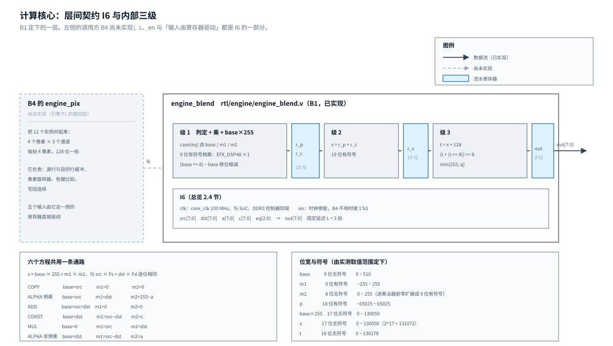

# 01 计算核心：一个颜色通道的混合怎么算

这一章讲易灵思 Titanium 系列 Ti60F225 上的一块 RTL：`rtl/engine/engine_blend.v`。
它做一件事——把一个颜色通道的源值、目的值、源 alpha 与方程号算成一个结果值，
给 2D 渲染引擎的像素通路用。颜色通道指 R、G、B 里的一条，8 位。
它是引擎 P1 五层里最小的一层，也是唯一能单独拿出全部输入穷举的一层。

## 一、动机

2D 渲染引擎要做「直通 BitBlt」：CPU 写一张 32 字节一条的命令表，引擎按表把纹理块
画到帧缓冲上。每画一个像素，颜色都要按一条方程混一次：

```
out = src × Fs + dst × Fd          每个通道，结果饱和到 255
```

`src` 是纹理上的源颜色，`dst` 是帧缓冲上原有的目的颜色，`Fs`、`Fd` 是两个权重。
方程表六行——COPY、ALPHA（预乘）、ADD、CONST、MUL、ALPHA（非预乘）——
权重取不同的值，就得到拷贝、半透明、发光、淡入淡出、变暗五种效果与一条对照路径。

赛题高阶要求 1 要「用 DSP 计算 `fg×a + bg×(1−a)`」，指的就是这一步。
引擎的五层里，搬运层只管把数据搬进搬出，几何层只管算坐标，控制层只管解析命令，
真正动颜色算术的只有计算核心；它不做，像素通路拼不起来，要求 1 也没有落点。

这一层先做，理由与它的大小有关。引擎 P1 的六个批次里它最小：输入输出一共 35 位，
没有总线、没有状态机、没有跨时钟。它同时又是唯一能从数学上穷举干净的一层——
六个方程各自的输入域合起来 5000 万组，主机的 C 程序几分钟能跑完一轮。
先把它做出来，可以把「研究、定案、实现、仿真、单独综合」这套流程走一遍，
后面五批照同一套节奏做。

从上到下是一条完整的因果链：整机要跑弹幕游戏 → 瓶颈在软件执行器（一帧 805 ms）→
引擎要把这部分搬到硬件 → 引擎按五层切开 → 颜色算术单独成核 → 这个核的接口与延迟
被冻结进层间契约 I6，B4 拿它拼 12 个实例（4 个像素 × 3 个通道）。

## 二、为什么是这几步

这个工作点拆成六步：前期研究、定案、写 RTL、单元仿真（含注错）、单独综合、写文档。

规格早已定稿：方程表、`x = src×Fs + dst×Fd` 的形式、除以 255 的舍入、
饱和到 255 的顺序，都在设计文档 3.5 节与逐像素规格第 01 章里写死，
有 `tools/check/check_round255.c` 对六种写法的穷举背书。所以本章不再讨论规格本身。

没定的东西在实现一侧，共四项：代入方式（六个方程怎么落成同一条数据通路）、
乘法器用几块、流水切在哪几处、固定延迟多少拍。四项里前三项决定第四项，
第四项又是接口 I6 的一部分——B4 要用它做流水线对齐。接口没冻结，B4 开不了工。

六步各自解决一个问题，缺一不可：

- **前期研究**：把上面四项从「D9 的一句结论」变成有数据的选项。
  D9 写的是「先让综合推断 DSP，时序不够再按厂商原语例化」，这是一条方向，
  没有代入表、没有位宽、没有流水切点。照着这句话写不出代码。
- **定案**：把选项收成唯一解，写进接口契约。研究给出的是数据与取舍，定案是选择。
- **写 RTL**：把定案落成一个文件。
- **单元仿真**：证明它算得对。六个方程合起来 5000 万组输入，
  穷举能给出「0 处不同」这种硬结论；期望值在测试台里用精确商现算，
  与被测的快速式互相独立，两个实现不能共用同一个错误。
- **单独综合**：测出资源与时序。延迟 `L`、DSP 块数、100 MHz 下的余量都要数字，
  B4 与 B6 要照这些数字排布；一层一综合也比整机编译快得多。
- **文档**：把过程、数据与解释留下来，供后面五批与验收查阅。

判据里还有一条专门要求「注错见红」：把一处逻辑改错，判据必须报 FAIL。
只跑正常用例的判据说明不了它在检查东西。

## 三、每一步做了什么

### 3.1 代入表：六个方程落成同一条数据通路

六个方程的 `Fs`、`Fd` 取值各不相同，直接实现要么写六条通路，要么在通路上放六个乘法。
用整数恒等可以把它们收成同一个形状：

```
x = base × 255 + m1 × m2
```

系数按 255 满量程代入后，六个方程各有一组 `base`、`m1`、`m2`：

| 方程 | Fs, Fd | base | m1 | m2 |
| --- | --- | --- | --- | --- |
| COPY | 255, 0 | src | 0 | 0 |
| ALPHA（预乘） | 255, 255−a | src | dst | 255−a |
| ADD | 255, 255 | src+dst | 0 | 0 |
| CONST | c, 255−c | dst | src−dst | c |
| MUL | dst, 0 | 0 | src | dst |
| ALPHA（非预乘） | a, 255−a | dst | src−dst | a |

`base` 乘的 255 是满量程的 1。CONST 行把 `dst×255 + (src−dst)×c` 展开就是
`src×c + dst×(255−c)`，等式两边逐位相同。这样六个方程共用一条数据通路：
一个选择器给出 `base`、`m1`、`m2`，后面只有一次乘法和一次加法。

`tools/check/check_subst.c` 对六个方程的**全定义域**逐一比较
`base×255 + m1×m2` 与 `src×Fs + dst×Fd`：合计 50462976 组，0 处不同。
同一支程序也给出实测的取值范围，据此定下位宽与符号：

| 量 | 位宽与符号 | 取值范围 |
| --- | --- | --- |
| base | 9 位无符号 | 0 ~ 510（ADD 要 src+dst） |
| m1 | 9 位有符号 | −255 ~ 255（CONST 与非预乘 ALPHA 要 src−dst） |
| m2 | 8 位无符号 | 0 ~ 255，进乘法器前零扩展成 9 位有符号 |
| p = m1×m2 | 有符号，实现取 18 位 | −65025 ~ 65025 |
| base×255 | 无符号 17 位 | 0 ~ 130050 |
| x = p + base×255 | 无符号 17 位 | 0 ~ 130050 |
| t = x + 128 | 无符号 18 位 | 0 ~ 130178 |

`m2` 进乘法器时零扩展成 9 位有符号，是为了让两个乘数同号，综合才按有符号乘法处理。

除以 255 用快速式，在 17 位域上算完再 clamp：

```
t   = x + 128
out = min(255, (t + (t >> 8)) >> 8)
```

`check_subst.c` 同时校了这一条：快速式与精确商 `round(x/255)` 在六方程全定义域上 0 处不同。

### 3.2 乘法器：一块 DSP 能装几个

Ti60F225 的 DSP 块有四种模式。NORMAL 是一块 19×18 乘法器加一个 48 位加法器，
DUAL 是一块 11×10 加一块 8×8，QUAD 是一块 7×6 加三块 4×4，BFLOAT 是 BF16 的乘加。
厂家给了三个原语：`EFX_DSP48` 覆盖四种模式，`EFX_DSP24` 是 DUAL 里那条 8×8
（一块 DSP 可以放两个），`EFX_DSP12` 是 QUAD 里那条 4×4（一块可以放四个）。
两个端口细节决定了本层的写法：NORMAL 的 C 口是 18 位，进 48 位加法器与乘积累加；
DUAL 把 C 口切成 `C[17:8]` 与 `C[7:0]`，走 11×10 那条只拿得到 10 位。

综合手册给的推断规则按宽度分档：两个算子都不超过 4 位推 `EFX_DSP12`、
不超过 8 位推 `EFX_DSP24`、不超过 19 与 18 位推 `EFX_DSP48`。
手册里还有一个例子写明：`p = a*b; o = p + c` 在 c 是 18 位时能压进一块 `EFX_DSP48`，
因为 C 的宽度放得下。

以上依据：Ti60 数据手册的 DSP Block 一节，Quantum Titanium Primitives 用户手册的表 24、27~32，
Efinity 综合手册的 Figure 2~5 与 `syn_use_dsp` 条目；原语的端口与参数另外对过
Efinity 安装目录里的仿真模型 `sim_models/verilog/efx_dsp48.v`。

于是三个问题有了答案。

**一块 DSP 能放几个乘法。** 本层的 `m1` 是 9 位有符号，进不了 DUAL 的 8×8 那条；
11×10 那条能放 9×8，但一块只有一条。所以按这个代入，一条通路 12 个乘法要 12 块。
实验证实：12 通道的工程一律报 12 个 `EFX_DSP48`（`SIGNED = 1`），一块 `EFX_DSP24` 都没有。

还有一个能省一半的代入。按 `src` 与 `dst` 谁大来选：

```
src >= dst   base = dst   m1 = src-dst   m2 = c（非预乘 ALPHA 时是 a）
src <  dst   base = src   m1 = dst-src   m2 = 255-c（255-a）
```

两个分支上都恒等，`m1`、`m2` 都落在 0~255，于是能按 `EFX_DSP24` 一块放两个，
12 个乘法压到 6 块。没有取它的原因在 D26 与 3.3 节：代价是本来就最长的第一级
要多一个比较器与选择器，而 DSP 不紧张——主线现用 4/160，加上本层 12 块是 16/160。

**DSP 里的加法器能不能吃掉 `base×255`。** 能。NORMAL 的 C 口 18 位，
而 `base×255` 最大 130050，小于 2^17 且恒正，放得下。默认综合不会用它：
直接写 `p = m1*m2; x = p + c255` 时，综合报告里 DSP 的 O 列是 `(A*B)`，加法器留在 LE 里。
在加法器输出上标 `(* syn_use_dsp = "yes" *)` 之后 O 列变成 `(A*B)+C`，
`EFX_ADD` 从 874 掉到 670、XLR 从 1715 掉到 1549。代价是时序变差：
setup 余量 3.806 降到 3.079 ns、Fmax 从 161.4 降到 144.5 MHz，
关键路径的终点从 `r_x` 的 D 端变成 DSP 的 `C[17]`——`base×255` 进 C 口这条路变长了。
省下的 166 个 XLR 占器件 0.27%，换掉 0.73 ns 余量，不划算（D28）。

### 3.3 流水切法与固定延迟

从输入到输出要依次经过选择器、乘法、加法、加 128、求商与饱和，全放在一级里余量很薄。
四种切法各有取舍，在 12 通道、100 MHz（Ti60F225，I3 模型）下实测：

| 切法 | 级点 | L | XLR | DSP | EFX_ADD | EFX_FF | setup(ns) | hold(ns) | Fmax(MHz) |
| --- | --- | --: | --: | --: | --: | --: | --: | --: | --: |
| PIPE=0 | 只有输出寄存 | 1 | 1798 | 12 | 898 | 215 | 1.724 | 0.098 | 120.8 |
| PIPE=1 | 乘与 base×255 后寄存，加与舍入一级 | 2 | 1752 | 12 | 898 | 212 | 3.930 | 0.110 | 164.7 |
| PIPE=2 | 乘加一体后寄存，舍入与饱和一级 | 2 | 1715 | 12 | 874 | 277 | 3.806 | 0.097 | 161.4 |
| PIPE=3 | 乘 / 加 / 舍入与饱和三级 | 3 | 1748 | 12 | 898 | 428 | 4.461 | 0.104 | 180.5 |

1 通道的同一张表照出每通道的底：XLR 95 / 93 / 90 / 94，都是 1 个 DSP，
setup 4.009 / 5.371 / 6.540 / 7.007 ns。

三条读法。完全不流水的 PIPE=0 在 12 通道下只剩 1.724 ns 余量，
100 MHz 过得去，但 B4 还要在同一个时钟里放像素旋转器、色键比较与写回选择，
余量不够用，所以本层必须有流水。PIPE=3 的 XLR 比 PIPE=1 还低 4 块、余量多 0.53 ns，
多出来的那一级被 DSP 的 P 寄存器与 XLR 的 adder+FF 单元吸收掉了，多一级几乎不花钱。
PIPE=2 的 XLR 最低，比 PIPE=3 少 33 块（器件 0.05%），余量少 0.66 ns。

关键路径：PIPE=0 是 `lfsr → o[8]`，36 级逻辑、7.916 ns；PIPE=1 是 `eqr → r_c[16]`，
28 级、5.811 ns；PIPE=2 是 `lfsr → r_x[17]`，31 级、5.935 ns；
PIPE=3 是 `eqr → r_c[16]`，28 级、5.280 ns。四者的最长一级都是
**判定选 base/m1/m2 再算 base×255**，乘法器不是瓶颈。

四种切法（4.2 节的错修掉之后）各用 iverilog 跑一遍全定义域穷举，50462977 拍（含收尾一拍），
全部 0 处不符。单次墙钟 PIPE=0 321.4 s、PIPE=1 363.8 s、PIPE=2 350.4 s、PIPE=3 409.9 s
（WSL Ubuntu，iverilog 12.0）。一种配置 6~7 分钟，全输入穷举跑得动，正式测试台不必为了省时间缩域。

定案取 PIPE=3，固定延迟 **L = 3**（D24）。这一条回写进层间契约 I6。
另外两条接口约定一并定下：保留 `en` 时钟使能（B4 的行缓冲没就绪时要能停住流水，
不用时接 `1'b1`，实测接常 1 时 DSP 的 P 寄存器照样推断得出来）；
**核心的五个输入必须由寄存器直接驱动，前面不得有组合逻辑**——
第一级实测 5.280 ns、起点是寄存器，B4 的像素旋转器直接接上来会吃掉这一级的余量。

3.1~3.3 节的研究在 2026-09-29 收成五条定案，编号接在引擎 P1 的 D1~D23 之后
（D1~D23 的归属见[总览](../../Todo/hw/引擎P1总览.md) 2.3 节）。D9 是拆批之前定下的方向，归本批，原文一并列在这里：

| 编号 | 定案 | 依据 |
| --- | --- | --- |
| D9 | 一条通路，每拍 4 像素。六个方程都写成 `x = 基数 × 255 + m1 × m2`，每通道一个有符号乘法器，一条通路 12 个。乘法先让综合推断 DSP，时序不够再按厂商原语例化 | 2026-09-26 定案；其中的「整数恒等」由 3.1 节的全定义域穷举补证 |
| D24 | **流水级数 L = 3**：判定与乘一级（乘积落进 DSP 的 P 寄存器，`base×255` 同拍寄存）→ 加一级 → `t`、除以 255 与饱和一级 | 上面的表：PIPE=3 余量最大（4.461 ns、Fmax 180.5 MHz），XLR 比 L = 2 的 PIPE=1 还少 4 块，多一级几乎不花钱 |
| D25 | **让综合推断，不手写原语** | 12 通道稳定推断出 12 个 `EFX_DSP48`；板上 128 条抽样全对（3.7 节）。手写原语要自己管 A/B/C 的位段与 `C_EXT`、`P_EXT`，收益只有 166 个 XLR |
| D26 | **不用 DUAL 模式** | 3.2 节：按现在的代入，`m1` 是 9 位有符号，一块只放一个乘法，12 个乘法要 12 块。换代入能压到 6 块，但本来就最长的第一级要多一个比较器与选择器；主线 DSP 现用 4/160，加上本层是 16/160，余量充足，不换 |
| D27 | **中间量位宽**：`x` 17 位无符号，`t` 与 `t + (t>>8)` 18 位（RTL 按 19 位写，见 4.4 节），算完商再 clamp 到 255；不用「把 `t` 饱和到 16 位」那种写法 | 3.1 节的实测范围。16 位饱和要多一个饱和加法器，而且只在 ADD 与 ALPHA 预乘上才与 17 位写法有区别 |
| D28 | **`base×255` 的加法留在 LE 里，不加 `syn_use_dsp`** | 3.2 节：加了省 166 个 XLR（器件 0.27%），但 setup 余量掉 0.73 ns、Fmax 掉 17 MHz；而且流水寄存器会被吸进 DSP，「L 拍」的边界就要依赖综合行为 |

设计文档 3.5 节把像素流水线画成五级，与本层的三级不冲突：设计文档的级 2「乘（DSP，输出寄存）」
就是本层的 `r_p`，级 3「加与舍入、饱和」在本层拆成「加」与「舍入饱和」两级，合起来仍在级 3 之内。

### 3.4 借鉴来源：别人的混合怎么舍入

开工前读了两份现成的混合实现与厂商的 DSP 资料，要回答两件事：它们在精度与延迟上怎么取舍，
有没有可以直接照搬的舍入口径。ORGFX 的 Verilog 源码这次没有取到
（opencores 的 websvn 服务端返回 `No template file found`），读的是同一项目的 DIVA 硕士论文；
它的代码级阅读（模块边界与 Wishbone 形态）在[总览](../../Todo/hw/引擎P1总览.md) 2.7 节的跨层来源里已经做过，这次没有重复。

| 来源 | 形态与许可 | 借鉴什么 | 用在 | 不借鉴什么 |
| --- | --- | --- | --- | --- |
| Porter & Duff 1984；OpenGL `glBlendFunc`；Blinn 1995 | 论文与 API | `src×Fs + dst×Fd` 的一般形式与预乘 alpha；除以 255 的移位快算 | 本层的方程表与舍入（spec 第 01 章已按这些定稿） | — |
| ORGFX（[DIVA 论文](https://www.diva-portal.org/smash/get/diva2:556520/FULLTEXT01.pdf) 5.3.8、6.2.11 节） | 硕士论文加 Verilog，LGPL-3 | alpha 与全局 alpha 两个因子相乘的形状（与 Fs/Fd 表同构：全局 alpha 就是 CONST 行的 `c`）；混合可整层关掉以省带宽 | 方程表、B4 的读写避让 | 除以 256 截断（`alpha = a_f×a_g` 后右移 8 位，混合后再右移 8 位，全程不四舍五入）；一次一像素的混合状态机；在混合里读目标像素 |
| Xilinx Video Mixer v3.0（[PG243](https://japan.xilinx.com/content/dam/xilinx/support/documents/ip_documentation/v_mix/v3_0/pg243-v-mix.pdf)「Alpha Blending」一节与 Layer Alpha 寄存器） | IP 手册 | 多像素每拍的并行分级（每拍 1、2、4 个样本，本设计取 4）；alpha 关掉即按全不透明叠加 | 4 像素通路、方程表的 COPY 行 | Layer Alpha 是 **0~256** 的尺度（按 1/256 缩放、纯移位）；手册通篇没写舍入策略 |
| Efinix 官方（3.2 节列的数据手册、原语手册、综合手册与 `efx_dsp48.v`） | 厂商手册与仿真模型 | 推断分档规则、乘加压进一块的条件、原语参数与端口 | D25、D26、D28 | — |

PG243 与 ORGFX **都没有**给出「两项之和再除以 255」的舍入口径，两边都是除以 256 的移位。
这反过来支持 spec 第 01 章把口径写死、并在报告里显式对照赛题公式的做法：
能照搬的是结构（因子相乘的形状、多像素并行），舍入只能按本项目自己的规格做。

### 3.5 RTL

`rtl/engine/engine_blend.v` 一个文件、一个模块，接口就是 I6：

```
engine_blend
  clk  en                     时钟与时钟使能
  src[7:0] dst[7:0]           源、目的通道
  a[7:0]  c[7:0]              源 alpha、CONST 的常量系数
  eq[2:0]                     方程号 0~5
  out[7:0]                    结果，固定延迟 3 拍
```

内部三级：

```
级 1  判定 + 乘 + base×255        case(eq) 选 base/m1/m2 -> EFX_DSP48 -> r_p
                                  base×255 用移位相减      -> r_c
级 2  x = r_p + r_c                                       -> r_x
级 3  t = x + 128、(t + (t>>8))>>8、min(255, q)            -> out
```

`base×255` 写成 `(base << 8) - base`，用移位相减而不是乘法器，省下一块 DSP。
级 1 的两个寄存器必须**同一拍**更新：只寄存乘积、让 `base×255` 仍取当前输入的话，
级 2 会把两拍的操作数相加。这一条踩过，见 4.2 节。

模块还带一个 `parameter integer INJECT`，是仿真注错口：0 是正式配置，
综合时是常量，对应分支被优化掉。位定义见文件头，用它的地方只有 `sim/engine/blend/run.sh`。

### 3.6 单元仿真

新目录 `sim/engine/blend/`，一个测试台加一个 `run.sh`，九个用例（含 `check_round255.c` 的规格侧自检）。

穷举测试台每拍送一个向量，输入的延迟链给出同一拍的期望值，比较在 negedge 做，
所以总周期数约等于向量数。期望值在测试台里用**精确商** `(2x+255)/510` 现算、
输入按 Fs/Fd 直接代入，与被测的快速式互相独立。方程用不到的输入（COPY 的 `dst`、`a`、`c`，
ADD 与 MUL 的 `a`、`c` 等）不固定成 0，跟着循环变量变，输出必须与它们无关。
停顿用例随机拉低 `en`，停顿期间输入换成乱值，延迟链用同一个 `en` 一起停。结果：

| 用例 | 内容 | 结果 |
| --- | --- | --- |
| exhaustive | 六个方程全定义域，50462976 个向量 | 0 处不同，单次约 6 分钟 |
| golden | 抽样 1024 条，对 `check_round255.c` 导出的金标准 | 0 处不同 |
| stall | 步长 5 抽样，约 1/8 的拍拉低 `en` | 427284 个向量、61076 个停顿拍，0 处不同 |
| inject_wrong_eq | CONST 行的代入写错 | FAIL（编号 #1 的向量见红，从 0 数） |
| inject_trunc16 | `t` 模截断到 16 位 | FAIL（ADD，`src+dst ≥ 257` 处，#767） |
| inject_unreg_c | 乘之后只寄存乘积 | FAIL（ALPHA，#65791） |
| inject_copy_dst | COPY 的 `base` 误取 `src+dst` | FAIL（COPY，#0） |
| inject_x_no_en | 级 2 的 `r_x` 不看 `en` | FAIL（第一次停顿之后，#1） |

后两个注错专门证明「用不到的输入在变」与「停顿真的被检查」这两件事，来历见 4.5 节。

`check_round255.c` 加了一个可选模式 `--golden <文件>`，导出 1024 条抽样向量
（前 96 条是每个方程的边界组合，其余每个字段各取一次线性同余的最高 8 位，来历见 4.6 节），
每行一个 43 位十六进制字 `{eq,src,dst,a,c,out}`，`out` 用的是它自己那条快速式。
不带这个选项时它的输出与改前逐字节相同（`diff` 校过）。
这样两个独立实现互相对了一次：测试台用精确商，C 程序用快速式。

复核时把 `engine_blend.v`、测试台、`run.sh`、`check_round255.c`、`check_subst.c` 拷进一个空目录重跑 `run.sh`：
9/9，exhaustive、golden、stall 三个 PASS，五个注错全 FAIL，见红位置与上表相同；
整套墙钟 7 分 23 秒（WSL，iverilog 12.0，同时宿主上还在跑一次单独综合）。

### 3.7 板上的抽样验证

单独仿真对不上「综合推断出来的 DSP 在硅片上是否算得对」。另做一个自检顶层：
128 条宿主侧算好的向量（COPY 34、ALPHA 28、ADD 19、CONST 12、MUL 17、非预乘 18）
逐条喂给混合核并与期望值比对，结果经 UART 每 1 ms 上报一帧十六进制。
烧进 Ti60F225 之后主机在串口收到：

```
B1 5E NV=128 err_cnt=0 first_err=0
```

连续复现。自检工程资源：`EFX_DSP48` 1、`EFX_ADD` 117、`EFX_LUT4` 211、
`EFX_FF` 133、`EFX_RAM10` 3。烧的是 `.bit`，掉电丢失，没有动 Flash。

这一条是 128 条抽样，不是全量；它的作用是把「推断出来的 DSP 会不会在硬件上算错」
这个风险先排掉，全量的证据仍然在仿真那一侧。

### 3.8 单独综合

仓库外的工作区里建了 9 个最小 Efinity 2026.1 工程：PIPE 0/1/2/3 乘 1/12 通道八个，
外加一个 `syn_use_dsp` 探针。工程参数从主线 `fpga/gfx2d_ti60/gfx2d_ti60.xml` 原样抄，
顶层只有 `clk` 与 8 位输出，宽数据由内部 LFSR 生成、各通道输出异或回 LFSR 的反馈，
既不让综合删掉通道，也不给关键路径额外加料。`efx_run` 四步全 PASS。

12 通道的资源与时序就是 3.3 节那张表。按每通道折算（PIPE=3，1748 ÷ 12）：1 个 `EFX_DSP48`、
约 146 个 XLR，占 Ti60F225 的 60800 个 XLR 的 0.24%、160 块 DSP 的 0.63%。
hold 余量 0.097~0.110 ns，与主线那份 0.026 ns 的薄余量同类，
说明这一层单独看也不宽裕，B6 接入后必须复测。

仓库里的 `rtl/engine/engine_blend.v` 定稿之后又单独综合核对过一次
（同样的 12 实例顶层，只是源文件指向仓库里的那一份）：四步 PASS，
12 块 `EFX_DSP48`、1732 XLR、setup 4.301 ns、hold 0.113 ns，
与上表的差别来自核对顶层用了略不同的激励写法。
告警全部落在核对用的那个临时顶层上，`engine_blend.v` 自身 0 条。
这样做的原因：它还没被例化、不进网表，整机编译要等到 B6，
先确认综合器能接受它、推断结果与前期研究一致。
复核时给 RTL 加了两个注错位（4.5 节），在 `INJECT = 0` 时是常量分支；同一个核对工程重跑，
资源与时序数字不变，网表去掉源码行号注释与模块名哈希之后逐行相同。



**图 1** 本章定下的一层。左边是 B4 的像素通路（尚未实现，用虚线表示），
它把 12 个实例（4 像素 × 3 通道）并起来；右边是核心内部的三级与它们各自的寄存器。
图上的 `L = 3`、`EFX_DSP48 ×1`、`en` 与「输入由寄存器驱动」四条都是接口 I6 的一部分。

## 四、遇到的问题

### 4.1 代入表的输入范围取窄了，漏掉 ALPHA 的 16 位截断

**第一现场。** 第一版穷举工具把 ALPHA 预乘限制在 `src_pm ≤ a`，输出是：

```
方程 1  ALPHA 预乘
  组合数 8421376
  整数恒等 ... 不同处数              0  ok
  快速式输出与精确商不同处数                           0  ok
  16 位模截断注错版与正确输出的不同处数              0  ok（x 上限 65025 + 128 < 65536）
```

另外四个方程也都是「截断是空操作」，只有 ADD 报出 32385 处。
据此写下的结论是「16 位模截断只有 ADD 方程能观测到，用 ADD 验注错」。

**解读。** `8421376` 是 256×257×256÷2，也就是 `src_pm ≤ a` 这一片三角域的组数。
`x 上限 65025` 是这一片的产物：`a` 只取到 `src_pm`，`Fd = 255−a` 就小，
两项之和到不了上限。关键字段是那个 0——它让「截断是空操作」看起来成立。

**定位。** 复核时问的是「硬件收到的输入范围到底是什么」。查了三处：
`spec` 第 01 章的 `src_pm ≤ a` 写在素材约束那一节；
spec 第 02 章的十步检查只对 ALPHA FILL 的常量做 `BAD_PREMULT` 校验，
BLIT 从表面读进来的源像素没有逐个检查；
`sw/lib/gfx/exec_sw.c` 对任意输入都按同一条规则算。
运行时画出来的表面再拿去当源，就是这种情形。
硬件要和软件执行器逐位一致，这个范围就必须覆盖到。

**根因与修法。** 把 ALPHA 的循环从三角域改成满 2^24。补上的 8355840 组里代入式与
快速式仍然 0 处不同，但 `x` 上限到了 130050——`a = 0` 时 `Fd = 255`，
`x = src×255 + dst×255` 与 ADD 一样能到顶。全定义域上的 16 位截断错处数变成：

| 方程 | x 上限 | 16 位模截断的错误处数 |
| --- | --: | --: |
| ALPHA（预乘） | 130050 | 4113532 / 16777216 |
| ADD | 130050 | 32385 / 65536 |
| COPY、CONST、MUL、ALPHA（非预乘） | 65025 | 0 |

判据改成「用 ADD 验，ADD 的输入域最小、最容易覆盖到顶」，能观察到它的还有 ALPHA 预乘。
仿真测试台的 ALPHA 循环相应跑满 2^24，向量总数从 42107137 变成 50462977，
单次仿真从约 5 分钟涨到约 6 分钟。

`check_subst.c` 在这之前还出过一次错：最早一版对六个方程都断言「截断注错版必须见红」，
在 COPY、CONST、MUL、非预乘 ALPHA 上报 FAIL。那四个方程上截断本来就是空操作，不红才是正确行为，
错在断言而不在被测对象；已改成按方程分别给期望值，也就是上面第一现场里的 `0  ok`。

原判据为什么没有覆盖到它：判据写的是「中间量模截断的注错版必须见红」，
没有写**在哪个输入域上见红**。工具的循环范围是自己定的，
它不会质疑自己扫的那片是不是硬件的真实输入域。

### 4.2 乘之后只寄存乘积，级 2 把两拍的操作数相加

**第一现场。** PIPE=1 与 PIPE=3 的第一版 RTL 在最小域穷举下的输出：

```
== tb_blend_exhaust PIPE=1 LAT=2 STRIDE=1 ==
  MISMATCH eq=0 src=0 dst=0 a=0 c=0 got=1 want=0
  MISMATCH eq=0 src=1 dst=0 a=0 c=0 got=2 want=1
  MISMATCH eq=0 src=2 dst=0 a=0 c=0 got=3 want=2
  ...
  检查向量 42107137 个，不一致 33618694 处
RESULT: FAIL
```

**解读。** COPY 的期望值是 `src`，实际输出是 `src+1`，也就是**下一个向量**的结果。
`got = want + 1` 这个规律说明输出整体错位了一格，而不是算术算错。
PIPE=2 在同一个测试台上 0 处不符。

**定位。** 三个切法的差别只有寄存器放在哪。PIPE=2 把乘与加放在同一级、
一起寄存；PIPE=1 与 PIPE=3 在乘之后寄存，第二级再做加法。
对着 RTL 看：`x = r_p + c255`，`r_p` 是上一拍的乘积，
而 `c255` 是从**当前**输入直接算出来的，两项来自不同的向量。

**根因与修法。** 在乘之后寄存时，加法的另一个操作数也必须一起寄存。
新增 `r_c` 与 `r_p` 同拍更新，级 2 改成 `x = r_p + r_c`。
改完四个切法全部 0 处不符。这一条也写进了文件头注释：
「同一拍参与加法的两个操作数一起寄存器化」。

原判据为什么没有覆盖到它：这条错在动手之前不会被想到——
「乘与舍入分成两级」这句话只说了一半，另一半（加法的两个操作数要同拍）
要靠穷举才暴露出来。这也是判据要求「全输入穷举」而不是「抽样」的原因：
抽样如果只抽相邻两个向量相同的输入，这个错会被掩盖。

### 4.3 测试台的初值让整条流水线带 X

**第一现场。** 抽样金标准用例的第一处比较：

```
  MISMATCH #0: eq=0 src=0 dst=0 a=0 c=0  got=x want=0
  检查 1024 个向量，不一致 1 处
RESULT: FAIL
```

同一份 RTL 在只有 ADD 的用例里 65536 个向量全对。

**解读。** `got=x` 表示被测输出是未知态。金标准文件的第一条向量是全零，
而测试台把输入寄存器也初始化成全零，第一个向量与初值完全相同。

**定位。** 用探针看被测内部的前八个时钟，`c255_comb`、`r_p`、`r_c` 全是 x，
说明那个 `always @(*)` 的判定块一次都没有求值。iverilog 的 `always @(*)`
在 0 时刻不会自己求值，要等敏感表里的信号变化才第一次求值；初值与第一个向量相同就没有变化，
块一次都不执行。一个十几行的小例子可以直接看到：寄存器声明时赋初值、`always @(*)` 里计数，
1 ns 时计数是 0、输出是 x；把同一个值再写一遍，计数仍是 0；写一个不同的值，计数才变成 1。
FPGA 上的查找表是组合的，不存在这个问题，这是仿真特有现象。

**根因与修法。** 把测试台里 `eq` 的初值改成 7（不是任何方程号），
保证第一次送向量时 `eq` 一定变化、判定块随之求值。
改完金标准用例 0 处不同。

原判据为什么没有覆盖到它：这个错在测试台里，被测对象是对的。
它只在「第一个向量恰好等于初值」时出现，ADD 用例的 `eq=2` 与初值 0 不同，
所以逃过了。测试台自己也需要一个「输入一定有变化」的前提。

### 4.4 综合对 `t + (t>>8)` 报 19 位截断告警

**第一现场。** 12 通道工程的综合告警：

```
[EFX-0011 VERI-WARNING] expression size 19 truncated to fit in target size 18 (VERI-1209)
   (rtl/engine/engine_blend.v:129)
```

**解读。** `t + (t>>8)` 的两个操作数都是 18 位，和的上限是 130686，
小于 2^18，18 位放得下。综合把加法器的进位算成第 19 位，
再按赋值目标宽度截掉。数值上没有问题，但这是一条新告警，
而仓库的编译判据里「新增告警」要回到改代码那一步。

**定位。** 逐条读告警指的行，确认它指的是 `t + (t>>8)` 这一项。
用 C 程序算过上界：`130178 + 508 = 130686 < 262144`，18 位确实够。

**根因与修法。** 把中间量按 19 位写：`qs = {1'b0,t} + {11'd0,t[17:8]}`，
取商时仍取 `qs[17:8]`（第 18 位恒为 0）。数值不变，告警消失。
这条写法上的让步记在 RTL 的注释里，理由是「免得综合报截断」。

原判据为什么没有覆盖到它：这不是判据漏了，是告警本身不指向错误，
但仓库要求不留新告警，所以按宽度显式写出来。

### 4.5 复核：两件事判据没在检查

**第一现场。** 复核时在 RTL 里加了两个注错位，用当时的测试台跑：

```
INJECT=8  ONLY_EQ=0   COPY 的 base 误取 src+dst      检查 256 个向量，不一致 0 处       RESULT: PASS
INJECT=16 ONLY_EQ=2   级 2 的 r_x 不看 en            检查 65536 个向量，不一致 0 处     RESULT: PASS
INJECT=16 ONLY_EQ=1   同上                           检查 16777216 个向量，不一致 0 处  RESULT: PASS
```

两个明显的错，全定义域穷举都说 PASS。

**解读。** 第一个错是「抄行」：COPY 的 `base` 写成了 ADD 那一行的 `src + dst`。
它只在 `dst ≠ 0` 时出错，而测试台给 COPY 送的 `dst`、`a`、`c` 全是 0。
第二个错只在流水停住时出错，而测试台的 `en` 恒接 1。
两个 PASS 的原因一样：被测对象对某个输入的依赖，测试台从来没有让那个输入动过。

**定位。** 对着测试台逐个方程列出「送了什么」：六个方程各自跑满了**用到的**输入，
没用到的输入一律写成 `8'd0`；`en` 在例化处写死 `1'b1`。
「全定义域」说的是每个方程自己的定义域，没有覆盖「与其余输入无关」这一条；
`en` 是 I6 的一部分，B4 会用它停流水，却没有任何判据。

**根因与修法。** 两处都是测试台的输入没有覆盖到被测对象的全部端口。
没用到的输入改成跟着循环变量变（例如 COPY 送 `dst = src ^ 0xA5`），`expected()` 不看它们；
加 `-DSTALL` 开关，约 1/8 的拍拉低 `en`、同时把输入换成乱值，
期望值的延迟链用同一个 `en` 一起停，测试台再断言停顿拍数不为 0。
两个注错位留在 RTL 里（`INJECT` 的位 3、位 4），进了 `run.sh`：
改完之后 COPY 那个错在第 0 个向量见红（`dst=165 got=165 want=0`），`en` 那个错在第一次停顿后见红。

原判据为什么没有覆盖到它：判据写的是「六个方程全输入穷举」，
它自然会被读成「每个方程用到的输入全扫一遍」；「没用到的输入也要动」和「每个端口都要有判据」
是另一条要求，要单独写出来，并各配一个只有它才抓得到的注错。

### 4.6 复核：抽样金标准的 `c` 只取到一半

**第一现场。** 统计 `check_round255.c --golden` 的随机部分（第 96 条以后）：

```
方程号分布  0:214  1:266  2:110  3:116  4:119  5:103
c 的最大值  127
CONST 的随机样本 116 条，c ≥ 128 的 0 条
```

**解读。** 方程号 0、1 各是其余的两倍；`c` 的最高位从来不是 1，CONST 的另一半系数没被抽到。

**定位。** 第一版从同一个 32 位线性同余数里切五个字段：
`eq = (s >> 29) % 6`、`c = (s >> 25) & 0xff`。`s >> 25` 只剩 7 位，`c` 的最高位恒为 0；
`s >> 29` 只有 0~7 八个值，对 6 取余后 0 与 1 各被命中两次。几个字段的位段还互相重叠。

**根因与修法。** 每个字段各走一步线性同余、取最高 8 位（低位的周期太短：第 k 位周期是 2^(k+1)）。
改后随机部分的方程号分布是 150 / 170 / 137 / 147 / 148 / 176，CONST 的 147 条里 `c ≥ 128` 的 76 条，
`c` 最大 254；新金标准上 golden 用例仍 0 处不同。
不带参数时的输出不受影响，仍与加 `--golden` 之前逐字节相同。

原判据为什么没有覆盖到它：抽样对账只断言「对上了」，没有断言「抽到的样本覆盖了什么」。
这一处有全量穷举兜底，没有漏掉 RTL 的错，但抽样本身的覆盖要在生成时自己检查。

## 五、结果

这一层的判据与实测数字：

| 项 | 判据 | 实测 |
| --- | --- | --- |
| 混合核 | 六个方程全输入穷举与参考值 0 处不同，用不到的输入跟着变 | 50462976 个向量，0 处不同 |
| 停顿 | 随机拉低 `en` 后逐值仍 0 处不同 | 427284 个向量、61076 个停顿拍，0 处不同 |
| 代入表 | C 程序对代入表穷举与精确商 0 处不同 | `check_subst.c` 一轮跑完（不到 1 秒），0 处不同 |
| 抽样对账 | 与 `check_round255.c` 的输出对一次 | 1024 条，0 处不同 |
| 注错 | 五处改错都要见红 | 五处都 FAIL，见红位置见 3.6 节 |
| 单独综合 | 1 个与 12 个通道的 DSP、XLR、100MHz 下 setup 与 hold | 见 3.3 节的表；12 通道 12 块 DSP、1748 XLR、setup 4.461 ns、hold 0.104 ns |
| 板上抽样 | 128 条向量在硅片上全对 | `err_cnt=0`，连续复现 |
| 延迟 | `L` 回写总览 2.4 节 I6 | `L = 3` 已回写 |

测量的口径与误差来源：

- 综合的资源与时序数字来自 Ti60F225、I3 模型的单层工程，
  不是整机编译的结果。整机的 XLR、DSP 与 hold 要在 B6 接入后复测。
- 仿真耗时是 WSL Ubuntu、iverilog 12.0 的墙钟，随宿主负载波动。
- 板上的 128 条是抽样，不是全量；它证明的是「推断出来的 DSP 在硅片上算得对」，
  全量的正确性由仿真承担。
- 100 MHz 下的余量只覆盖本层。B4 的像素旋转器、色键比较与写回选择在同一个时钟里，
  它们与本层之间按 I6 的约定（输入由寄存器驱动）隔开。

## 六、还欠什么

- `engine_blend` 还没列进工程源文件列表，**尚未进网表**。
  12 个实例由 B4 的 `engine_pix.v` 例化，那时两个文件一起加进工程，整机编译在 B6。
  单层综合的数字不能代替整机的数字。
- 本批不做、留给 B4 的：色键比较、XRGB 源的 `a` 取 255、4 像素通路与 12 个实例的排布。
- 接口 I6 这一次加了两条约定（`en`、输入必须由寄存器驱动），它们对 B4 有约束力。
- 引擎 P1 的其余五批见 [`../../Todo/hw/引擎P1总览.md`](../../Todo/hw/引擎P1总览.md)。
