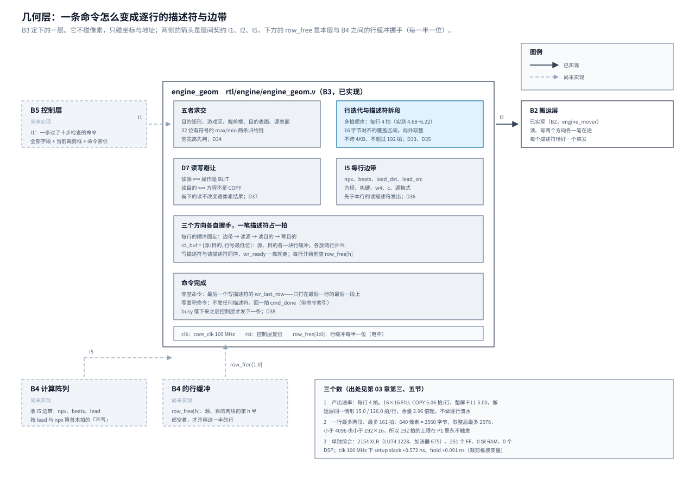
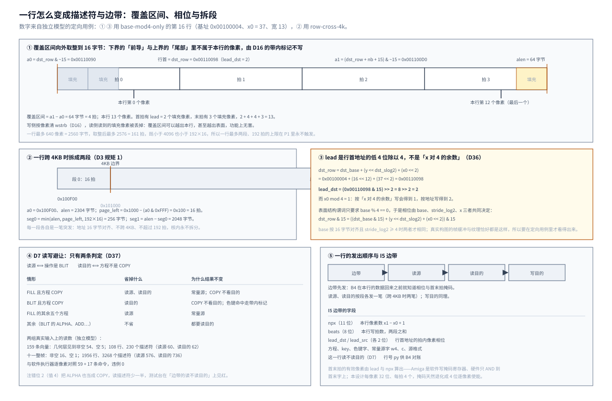

# 03 几何层：一条命令怎么变成逐行的描述符与边带

这一章讲引擎 P1 的第三层——几何层。它不碰像素，只碰坐标：接一条已经通过十步检查的
FILL 或 BLIT，算出这条命令实际要画的矩形，把它拆成行，每行给搬运层发读源、读目的、
写目的的描述符，给计算阵列发这一行的边带。

它在五层里的位置很特别：上不接总线、下不碰数据，但**它一错，错的都是地址**。
求交错一项，画面上就是越界写或该画的没画；描述符跨过 4KB 边界或超过拍数上限，
搬运层用的两个核会自己拆成两笔、而且不等上一笔，engine 第 02 章 3.8 节的注错用例
量到 **9120 个违例周期**——直接违反在途契约。所以这一层的规矩不是「算对就行」，
而是「算出来的每一个描述符都必须是合法的一笔突发」。

引擎 P1 分六批（B1~B6），本层是第三批。它定稿层间契约的 I1、I2、I5 三条，
B4 要用 I5 的每行边带，B5 要按 I1 下发命令。

这一章分两段。前一半（3.1~3.5 节）是**开工前的五项研究**：
产出速率、求交与描述符的算式与位宽、三份开源实现、独立模型、单独综合；
后一半（3.6~3.8 节）是**入库实现**——`rtl/engine/engine_geom.v` 本身、
`sim/engine/geom/` 的单元仿真与五个注错、以及入库实现的单独综合。
结论编号从 **D33** 起（接 B2 的 D32），定案到 **D41** 为止。

两幅图是这一层做完之后的样子：图 1 是它在五层里的位置与内部四件事，
图 2 是一行怎么变成描述符与边带（覆盖区间、相位、拆段与边带的字段）。
它们放在第三节的末尾。

## 一、动机

引擎画一行像素的完整动作是「读源行 → 读目的行 → 写目的行」，这三笔的地址与拍数
由几何层给。这一层要做四件事：

1. **五者求交**。一条 BLIT 实际能画的像素是五个矩形的交：命令的目的矩形、
   游戏区 `[0,639]×[0,479]`、`SET_CLIP` 的裁剪框、目的表面的有效范围、源表面的有效范围。
   FILL 没有源，是四项。第五项（源表面）不是可有可无的补充——spec 第 01 章
   3.6 节第 5 步写「源越界只跳过该像素」，把它在矩形级做掉之后，像素通路就不必
   逐像素判源越界（总览 2.2 节 D2）。
2. **行迭代**。交出的矩形逐行走。行与行之间只差一个 stride，这一层的面积几乎全在
   求交与拆段上，不在计数器上。
3. **描述符**。每行按 16 字节对齐的覆盖区间发，一行跨 4KB 时拆成两段。
   每段恰好一笔突发、不跨 4KB、不超过 `AXI_MAX_BURST_LEN`（192 拍）。这是 D3 规矩 1。
4. **读写避让**（D7）。按 spec 第 01 章第 6 条允许的方向，只做结果逐像素不变的三处：
   FILL 且 COPY 不读源也不读目的；BLIT 且 COPY 不读目的；FILL 的其余方程不读源。

**不做会怎样。** 第三件不做，总线挂住（上面那 9120 个周期）；第一件不做，
画面上是错的；第四件不做不会错，只是白白多占一半读带宽——而 SW7 的背景、
HUD 底图、机体与文字恰好都落在避让能省掉的那两类上。

**为什么这一层原先没有研究。** 2026-09-26 开条目时，十个前期研究问题里有四个
（第 1、2、6、10 问）落在搬运层，其余四层只有定案、没有研究。几何层的求交与
十步检查的硬件结构一句话都没写过，照着 D2 那句「五者求交」写不出代码。
所以 2026-09-28 按层拆成六批时，给每一批补了「开工前要补的研究」。

## 二、为什么是这几步

B3 开工前列了五项研究，各自解决一个「照着定案写不出代码」的缺口。五项不是并列的，
它们有依赖：第 1 项定实现的**形态**（多拍还是流水），第 2 项定**算式与位宽**，
第 4 项定**怎么验**，第 3、5 项给前四项提供外部参照与本层自己的数。

| 研究项 | 回答什么 | 不做会怎样 |
| --- | --- | --- |
| 1 产出速率 | 几何层每行、每条命令最多能花几拍 | 写出来的行迭代可能比搬运层还慢，引擎的瓶颈从总线挪到几何层，而 B2 之前量到的数一个都用不上 |
| 2 算术与位宽 | 求交、覆盖区间、拆段、边带的逐项算式与位宽 | 中间量取 16 位会溢出，取错符号会算错矩形；位宽说不清就没法写 RTL，也没法写判据 |
| 3 开源实现 | 别人怎么分这个工、怎么处理边界 | 容易重新发明一套错的，尤其是「4KB 拆分」与「首末拍掩码」这两处 |
| 4 独立模型 | 测试台的期望值从哪来 | 期望值只能手写。手写的期望值只能证明实现与手写一致，不能证明它对（spec 第 02 章 4.4 节吃过一次这个亏：手写期望值一度给出七个假答案） |
| 5 单独综合 | 32 位比较链与加法链在 100 MHz 下的余量 | 求交是这一层最宽的组合逻辑，不量就不知道要不要切级；切错了要么费面积要么不收敛 |

第 1、5 项合起来回答 D2 拆分时留下的一个悬案：几何层是「多拍顺序实现」还是「流水实现」。
两项的答案一致（3.1、3.5 节），所以这是一条有两条独立证据的定案。

研究之后要定的（编号 D33 起）：多拍还是流水；独立模型的语言与格式；
与 B5 一起定零面积命令怎么通知控制层。三条都定了，见 3.9 节。

研究完之后的四步与 B1、B2 相同：写 RTL（3.6 节）、单元仿真与注错（3.7 节）、
单独综合（3.8 节）、写文档（本章）。研究阶段留下的三样东西直接变成了实现阶段的工具：
独立模型给了测试台的期望值，探针的算术直接搬进 `engine_geom.v`，
探针的单独综合工程给入库实现的工程当了模板。

## 三、每一步做了什么

### 3.1 产出速率：几何层每行能花几拍

**参照数从哪来。** engine 第 02 章 3.8 节把从机校准到 E4 的板上数之后，用真实的两个
DMA 核与仓内 `Axi_Mux` 跑了一个事务模型，量到四种情形的每行周期数（每档 200 颗弹幕或
480 行，`viol=0/0`）：

| 情形 | 一行的描述符 | 搬运层实测 | 每条命令 |
| --- | --- | --: | --: |
| 16×16 FILL COPY（`MODE=2`） | 1 笔写（4 拍） | **15.0** 拍/行 | 240.0 拍 |
| 16×16 COPY BLIT（`MODE=1`） | 1 笔读源 + 1 笔写 | **34.3** | 548.3 |
| 16×16 ALPHA BLIT（`MODE=0`） | 1 笔读源 + 1 笔读目的 + 1 笔写 | **68.3~70.3** | 1092.2~1124.3 |
| 整屏 FILL，一行 400 像素（`MODE=3`） | 1 笔写（100 拍） | **126.0** | — |

几何层是搬运层的上游，所以**几何层的每行产出时间必须短于同情形的搬运层每行时间**，
否则瓶颈从总线挪到几何层。最紧的是 16×16 FILL COPY：只有 15.0 拍。

那条模型还量到两件与几何层直接相关的事：`CMD_GAP` 取 0 与 2 结果完全相同
（命令之间几个周期的几何层开销被每笔读约 28 拍的固定开销盖住）；命令批量从
每条单取（1136.1）换到每批 2 条（1121.1）、4 条以上（1107~1114）都有收益。
两件事都说明：**几何层的每命令启动开销只要在几十拍以内，就看不见。**

**怎么量。** 研究探针 `sim/engine/geom/probe_geom.v` 里写了最朴素的一种行迭代：
一个多拍顺序状态机，每行算覆盖区间、拆段、按顺序发读源/读目的/写目的描述符、发边带。
`tb_probe_geom.v` 把消费者接成**恒 ready**（量的是几何层自己的吞吐，不含反压），
从 `start` 数到 `done`。跑法 `bash sim/engine/geom/run.sh`，结果：

```text
  FILL  COPY 16x16  : 命令 81 拍，16 行，每行 5.06 拍；写 16 读 0 边带 16
  COPY  BLIT 16x16  : 命令 81 拍，16 行，每行 5.06 拍；写 16 读 16 边带 16
  ALPHA BLIT 16x16  : 命令 97 拍，16 行，每行 6.06 拍；写 16 读 32 边带 16
  整屏 FILL 400px   : 命令 2401 拍，480 行，每行 5.00 拍；写 480 读 0 边带 480
  跨 4KB 一行 640px : 命令 49 拍，8 行，每行 6.12 拍；写 16 读 0 边带 8
  base%16=4 相位     : 命令 21 拍，4 行，每行 5.25 拍；写 4 读 0 边带 4
```

对照（几何层拍/行 ÷ 搬运层拍/行）：

| 情形 | 搬运层 | 几何层 | 余量 |
| --- | --: | --: | --: |
| 16×16 FILL COPY | 15.0 | 5.06（命令 81 vs 240） | **2.96×** |
| 16×16 COPY BLIT | 34.3 | 5.06 | 6.8× |
| 16×16 ALPHA BLIT | 68.3 | 6.06 | 11.3× |
| 整屏 FILL 400px | 126.0 | 5.00 | 25.2× |

**结论：多拍顺序实现足够，不需要逐行流水。** 最紧的一种还有 2.96 倍余量，
而且这是**恒 ready**（最有利于搬运层）下量到的：真跑起来几何层会被搬运层的 `ready`
压住，只要每行的产出时间短于搬运层的每行时间，几何层就不会成为瓶颈。
**入库实现做完之后按同一口径复测过，见 3.7 节：每行 4.68~6.22 拍。** 定案见 D33。

**首版为什么慢一倍。** 第一版的行迭代在发射描述符时用「先寄存 `valid`、下一拍再看
`ready`」的写法，一笔描述符要两拍，边带也要两拍，每行 12.06 拍。改成 valid 与数据
组合驱动、握手当拍完成之后是 5.06 拍。两者的差别不是「能不能过」（12.06 也还在
15.0 以内），而是余量从 1.24 倍变成 2.96 倍——1.24 倍的余量在整机里不敢用。
入库实现把边带从行的最后挪到最前（3.6 节），又省掉一次状态切换。

### 3.2 求交与描述符的算术与位宽

这一节把 3.1 节那个探针里的每一行算式写清楚，它同时是 `tools/check/geom_model.py`
的规则、也是 B3 的 RTL 要照着写的东西。

**五者求交（FILL 四项）。** 中间量一律 32 位有符号，空宽高先判（避免 `w − 1`
在无符号下溢）：

```text
 1  if (w == 0 || h == 0)                              整条跳过
 2  dx1 = dst_x + w − 1 ;  dy1 = dst_y + h − 1         32 位有符号
 3  x0 = max(0, dst_x, clip_x0)                        目的矩形、游戏区、裁剪框
    y0 = max(0, dst_y, clip_y0)
    x1 = min(639, dx1, clip_x1, dst_w − 1)             目的表面
    y1 = min(479, dy1, clip_y1, dst_h − 1)
 4  BLIT: x0 = max(x0, dst_x − src_x)                  源表面（第五项）
          x1 = min(x1, dst_x − src_x + src_w − 1)
          y0 = max(y0, dst_y − src_y)
          y1 = min(y1, dst_y − src_y + src_h − 1)
 5  if (x1 < x0 || y1 < y0)                            整条跳过
 6  npx = x1 − x0 + 1 ;  nrows = y1 − y0 + 1
```

第 4 步是总览 2.2 节 D2 说的「源越界只跳过该像素」在矩形级的等价写法：
`src_x + (px − dst_x)` 落在 `[0, src_w−1]` 等价于 `px` 落在
`[dst_x − src_x, dst_x − src_x + src_w − 1]`。**「源越界只跳过该像素」因此不是逐像素
分支，而是一次矩形求交**——这也是全帧用例 `blit-clip-partial` 第三条的形态
（源 `-10,-10`、宽高 100、纹理 64×64 → 交成 `[310,110]–[373,173]`，64×64）。

位宽逐项（出处：spec 第 01 章 3.6 节的位宽表）：

| 量 | 位宽 | 符号 | 范围 | 说明 |
| --- | --: | --- | --- | --- |
| `dst_x`、`dst_y` | 16 | 有符号 | −32768 ~ 32767 | 命令 `w2` 两个半字 |
| `w`、`h` | 16 | 无符号 | 0 ~ 65535 | 命令 `w3` 两个半字 |
| `src_x`、`src_y` | 16 | 有符号 | −32768 ~ 32767 | 命令 `w1` 两个半字 |
| `dx1`、`dy1` | 32 | 有符号 | −32768 ~ 98302 | `dst + w − 1`，超 16 位 |
| `dst_x − src_x` | 32 | 有符号 | −65535 ~ 65535 | 第五项的偏移 |
| `dst_x − src_x + src_w − 1` | 32 | 有符号 | −65535 ~ 131069 | 仍在 32 位内 |
| `x0`、`y0` | 32 | 有符号 | 0 ~ 32767 | 下界链，非负 |
| `x1`、`y1` | 32 | 有符号 | −1 ~ 98302 | 空时取 −1 |
| `npx` | 11 | 无符号 | 1 ~ 640 | 游戏区截断，640 = `2^10` 差 1 位 |
| `nrows` | 16 | 无符号 | 1 ~ 480 | |

规格**完整接受命令字段的全部范围**，不需要新增「`dst_x + w` 要放进 17 位有符号」
之类的限制——spec 第 01 章 3.6 节已经把那条错限制删掉了（`w ≤ 65535` 推不出
`dst_x + w ≤ 65535`）。

**逐行的地址与覆盖区间。**

```text
 7  dst_row = dst_base + (y << dst_slog2) + (x0 << 2)
    BLIT: sy  = src_y + (y − dst_y)
          sx0 = src_x + (x0 − dst_x)
          src_row = src_base + (sy << src_slog2) + (sx0 << 2)
 8  nb  = npx << 2
    a0  = dst_row & ~15                      覆盖区间下界，向下取整
    a1  = (dst_row + nb + 15) & ~15          上界，向上取整
    alen = a1 − a0
 9  page_left = 0x1000 − (a0 & 0xFFF)
    seg0 = min(alen, page_left, 192 << 4)
    seg1 = alen − seg0                        P1 里 seg1 ∈ [0, 2560]
10  lead_dst = dst_row[3:2] ;  lead_src = src_row[3:2]
    beats = (seg0 + seg1) >> 4
```

第 9 步的两条约束顺序无关（都取 min），第 10 步的 `lead` 是**这一节最重要的一处订正**，
下面单独说。

拆段结果对应的描述符字段（I2，B2 已经冻结的口）：

| 描述符 | 字段 | 一条命令里发几次 |
| --- | --- | --- |
| 读源 | `rd_addr`、`rd_bytes`（= 拍数 × 16）、`rd_buf`、`rd_cidx` | 每行 0 或 1~2 次（BLIT 才有） |
| 读目的 | 同上 | 每行 0 或 1~2 次（方程不是 COPY 才有） |
| 写目的 | `wr_addr`、`wr_bytes`、`wr_cidx`、`wr_last_row` | 每行 1~2 次 |

**一行最多两段，最多 161 拍。** 一行最多 640 像素 = 2560 字节。行首地址是 4 字节对齐的
（`base % 4 == 0`、`x0 << 2`、`1 << stride_log2` 都是 4 的倍数），所以行首的低 4 位
只可能是 0、4、8、12；16 字节覆盖区间向外取整之后**最多 2576 字节 = 161 拍**
（行首 16 字节对齐时是 160 拍，**161 是取到非零相位的上界**，穷举过 640 种宽度 × 4 种相位）。
2576 < 4096（4KB）且 2576 < 3072（192 拍），所以两个约束各自最多切一刀，合起来最多两段，
192 拍的上限在 P1 的矩形上永不触发。

**边带（I5）带什么。** 每行一条，字段：

| 字段 | 位宽 | 值 |
| --- | --: | --- |
| `npx` | 11 | 本行像素数 `x1 − x0 + 1` |
| `lead_dst` | 2 | 目的行首地址的拍内像素相位 |
| `lead_src` | 2 | 源行首地址的拍内像素相位（FILL 无意义） |
| `beats` | 8 | 本行写拍数（两段之和） |
| 方程、`key`、色键字 `w5`、常量源字 `w4`、`c`、源格式 | — | 每条命令一次，随每行边带重复 |
| 这一行读不读目的 | 1 | D7 |

**`lead` 不是「x 对 4 的余数」。** B3 的仿真清单与总览 2.4 节的 I5 原先写的是
「源与目的 x 对 4 的余数（D15）」。这句话在 `base % 16 == 0` 且 `stride_log2 ≥ 4`
时才对；spec 第 02 章规范条款 §2 对表面结构只要求 `base % 4 == 0`，于是行首地址的
16 字节相位由三样共同决定：

```text
dst_row & 15  =  ((dst_base & 15) + (y << dst_slog2) + (x0 << 2)) & 15
```

`y << dst_slog2` 在 `slog2 ≥ 4` 时是 16 的倍数，于是相位退化成
`(base + x0*4) & 15`；但 `slog2` 取 2 或 3（结构谓词允许，只要 `width*4 ≤ 1<<slog2`）
时每一行的相位都不同。`base % 16 == 4` 这一类表面更是让相位与 `x0 & 3` 差一位。

一个能直接看到差别的例子（独立模型的定向用例 `base-mod4-only`，目的基址
`0x00100004`、`x0 = 37`、第 16 行）：行首地址
`0x00100004 + (16 << 12) + 37*4 = 0x00110098`，`0x98 & 15 = 8`，
所以 `lead_dst = 8 >> 2 = 2`；而 `x0 mod 4 = 1`。按「x 对 4 的余数」写会得到 1，
按地址写得到 2。模型对这一行给出的是 `写[0x00110090/4] lead=2/0`。

**这条要回写总览 2.4 节的 I5**（定案 D36）：边带带的是**行首地址的拍内相位**
`lead = (row & 15) >> 2`，不是 x 对 4 的余数。两者在真实构图下数值常常相同
（十一整帧用例里只有 `(0,0)` 与 `(2,0)` 两种组合，见 3.4 节），所以在定向用例
造出来之前看不出来。

**覆盖区间可能越出本行、甚至越出表面。** 第 8 步把下界向下、上界向上取整到 16 字节，
于是覆盖区间里会有不属于本行的字节：

- 行首：`lead` 个像素是上一行（或表面之外）的；
- 行尾：最多 3 个像素是下一行的；
- `stride_log2` 取 2 或 3（一行 4 或 8 字节）时，一行 16 字节的覆盖区间会盖住后面的
  好几行；
- 最后一行最后一像素之后，覆盖区间可能伸到表面之外最多 15 字节。

前三样无害：写侧由 D16 的带内标记按像素清 `wstrb`，读侧读到别的像素也会被丢掉。
第四样要留意：spec 第 02 章的结构谓词只保证
`base + (h−1)*(1<<slog2) + (w−1)*4 + 3 ≤ 0xFFFFFFFF`，那个「+3」不含取整后的 15 字节。
P1 里合法表面的 base 落在 DDR 窗口 `0x0000_1000~0x0FFF_FFFF`，越出的十几个字节仍在
32 位内（且 DDR 在 `0x1000_0000` 以上按 256MB 回绕，读到的是别名，写侧 `wstrb=0`），
所以这一版不做处理。**建议 B5 的结构谓词补一条**：表面末像素取整到 16 字节之后仍要
落在合法 DDR 窗口内，或者在几何层把覆盖区间的上界截到 4KB 页末——两条都行，
但要写下来（见第六节）。

### 3.3 读过哪些实现

条目 2.2 节第 3 项要求「至少读两份，读到代码或手册级」。实际读了三份，
另外为了对齐「首末拍掩码」这一处又补了一份 FPGA 实现。

**iDMA（PULP/ETH，SHL-0.51，可按 Apache-2.0 处理）。** 读到源码级：
三段职责是 front-end 产生请求、**mid-end 把 N 维请求展开成一维**、back-end 只吃
`(src_addr, dst_addr, length)` 并负责合法化。三条对我们有用的判断：

1. **mid-end 完全不做对齐与 4KB 切分。** `src/midend/idma_nd_midend.sv` 里没有
   `PageSize`、没有 `OffsetWidth`，地址更新就是一句
   `src_addr_d = src_addr_q + nd_req_i.d_req[stride_sel_q].src_strides;`（`:176`）。
   切分全在 back-end 的 legalizer，而且 4KB 是**编译期钳位**而不是运行时比较器：
   `page_addr_width = page_addr_width > 'd12 ? 'd12 : page_addr_width;`
   （`src/backend/idma_legalizer_page_splitter.sv:40`），
   `PageSize = min(max_beats*StrbWidth, page_size)`（`idma_legalizer.sv.tpl:100-101`）。
   这条「把 4KB 写成常量约束」的思路直接可用：16 字节对齐下，到页边界的余量就是
   `0x1000 − a0[11:0]`，一个 13 位减法。
2. **每一维一个计数器，使能串进下游 `ready`**：
   `stage_en[d-2] = &(stage_done[d-2:0]) & burst_req_ready_i`（`:124`）——
   天然反压，不需要额外的 FIFO。我们的行迭代同样是「下一行推进要等本行描述符被收走」，
   这个写法可以照搬。
3. **末笔标记 `opt.last`**（`:205`、`:215`）：上一层不维护「还剩几行」的全局完成逻辑，
   由标记收尾。我们的 I2 里对应的是 `wr_last_row`，B2 已经实现了。

不借鉴的：任意非对齐带来的 barrel shifter + 每字节一条 FIFO 的
`idma_dataflow_element`、错误处理器的 CONTINUE/ABORT/REPLAY 状态机、
多协议后端、六个 PULP 仓库的依赖、以及一整套 SystemVerilog 构造
（`parameter type`、`typedef struct packed`、`` `IDMA_TYPEDEF_* `` 宏、`cc_popcount`）。
我们只有一层、只有 AXI、只要求 16 字节对齐，这些复杂度可以全部删掉。
**一处要反着用**：iDMA 把合法化放在 back-end，是因为它有多协议后端；我们只有一层，
所以 D3 规矩 1 必须收在几何层，而不是假装下游会处理。iDMA 的 `req_ready_o` 也是
「一次只收一个 1D 描述符」（`idma_legalizer.sv.tpl:693`），靠 back-end 的乱序缓冲兜吞吐；
我们的搬运层每方向一笔在途，几何层必须**先算好再等**，不能「发一条算一条」。

**ORGFX（OpenCores，LGPL-3，Verilog）。** 裁剪分成两级：
矩形光栅器里把 bbox 钳到 clip rect（`gfx_rasterizer.v`），独立模块 `gfx_clip.v` 再
逐像素丢弃，判定是 `outside_target | (clipping_enable_i & outside_clip)`——
**目标物理边界永远生效、用户 scissor 可开关**，这个分层可以照搬。
两处值得学：`empty_raster` 的单拍短路（`rect_p0 > rect_p1` 时不产生像素、
直接 ack，注意判据用严格 `>`，1 像素宽的矩形不会被误判为空）；
丢弃像素时立刻 ack 上游，不占下游带宽。
不借鉴的：坐标是 16 位**无符号**，「负坐标」靠回绕成巨值被 `>= target_size` 兜住——
这是副作用不是处理，我们应该在求交时显式用有符号比较；
它每写一个像素就要一次 32 位单次 Wishbone 事务（`cti=0`、`bte=0`），
与我们 128 位/拍的行内打包差一个数量级；空 clip rect 要逐像素空转，
我们应该在命令级就短路。

**Amiga blitter（AHRM 第 6 章 + MAME `src/mame/amiga/amiga_m.cpp`（BSD-3）
+ Minimig `agnus_blitter.v`（GPL-3））。** 这一份纠正了一个容易想当然的说法：
**硬件不从 shift 推导首末字掩码**。`BLTAFWM`/`BLTALWM` 是软件写的寄存器，
硬件只把它们 AND 到该行第一个字与最后一个字上，且在 barrel shift **之前**；
宽度只有一个字时两个掩码**同时**作用。Minimig 专门为这个特例写了
`if (first_word && last_word) bltamask = bltafwm & bltalwm;`，其修订记录还记着
「修过 1 word wide blit 的掩码 bug」。对我们的直接结论：**我们不需要 16 位位串掩码，
也不需要「由移位量生成掩码表」**——像素是 32 位宽、每拍 4 个，掩码天然退化成
4 位逐像素使能，由边带的 `lead` 与 `npx` 算出。要保留的只有两条：
使能施加在拼接**之前**；整行落在**同一拍**时首末使能取交（AND）——
这与 `npx` 很小（≤ 4 且 `lead` 不为 0）时的情形是同一件事。
AHRM 的「大位移分解为指针前移整字 + 余数进移位器」也正是我们
`x0 >> 2` 与 `lead` 的分解。

**借鉴来源表：**

| 来源 | 形态与许可 | 借鉴什么 | 用在 | 不借鉴什么 |
| --- | --- | --- | --- | --- |
| iDMA | SystemVerilog，SHL-0.51（可按 Apache-2.0） | 中端把多维请求拆成一维；把 4KB 与最大拍数写成常量约束；每维计数器使能串下游 ready；末笔标记 | 本层与搬运层的分工、D35 的拆段写法、D33 的推进行为 | 任意对齐的 shifter/byte-FIFO、错误处理状态机、多协议后端、PULP 仓库依赖、SystemVerilog 构造 |
| ORGFX | Verilog，LGPL-3 | 裁剪分「目标边界」与「scissor」两级；空结果单拍短路；丢弃时立刻 ack | D34 的空矩形判定、I5 的「不写」语义 | 无符号坐标靠回绕兜负值；每像素一次 Wishbone 事务；空 clip 逐像素空转 |
| Amiga blitter（AHRM、MAME、Minimig） | 手册 + C++ 行为模型（BSD-3）+ Verilog（GPL-3） | 掩码 AND 在移位之前；单拍覆盖时首末取交；「整拍偏移走地址、余数走相位」的分解 | D36 的 `lead`、B4 的首末拍「不写」标记 | 16 位位串掩码本身；由 barrel shift 硬件推导掩码（Amiga 本来就不这么做）；逐字功能级模拟结构 |

### 3.4 独立模型

**用什么写、吃什么。** 定案 D39：**Python 3**，`Main/tools/check/geom_model.py`。
理由：159 条向量的生成器 `tools/check/check_cmd_semantics.py` 本身就是 Python，
它的 `--emit` 记录格式现成、已经被 spec 第 02 章验收过；模型要跑的两组输入里，
一组直接吃它，另一组（十一个整帧用例）只要几十行 C 就能导成同一格式。
用 C 写模型要跟着 `sw/lib` 一起编，还要把向量的解析逻辑再写一遍。

输入就是 `check_cmd_semantics.py --emit` 的文本记录，只解析几何层要的四种：
`[vector]`、`[surf]`、`[list]`、`[cmd]`。十一个整帧用例经
`tools/check/geom_cases_dump.c` 导出：它**链接 `sw/lib/gfx` 的 `cases.c` 与 `list.c`**，
直接调 `gfx_case_build()`，不在 Python 里照抄一遍命令表——照抄会与真源分叉
（spec 第 02 章 4.3 节吃过一次「重复副本把规则写成另一套」的亏）。
`tools/check/geom_cases_dump.sh` 负责编译与运行。

**模型算什么。** 与 3.2 节逐条同规则：五者求交、逐行地址、16 字节覆盖区间、
4KB 与 192 拍拆段、D7 的读写避让、每行的 `lead`、`npx`、`beats` 与逐拍掩码。
`--selftest` 是模型自己的 **23 项**单元检查（含拆段、覆盖区间取整、五者求交的边界、
D7 的四条、SET_CLIP 取 `w1`、裁剪框跨表继承、出错处截断、首末拍掩码），
`--directed` 是 34 条定向用例，`--vectors` / `--cases` 吃两组真实输入，
`--dump-records` / `--dump-directed` 出测试台的期望值记录。

**走命令表的口径与参考实现一致。** 模型的 `run_vector()` 对齐
`check_cmd_semantics.py` 的 `run_lists()`：SET_CLIP 的左上角取 `w1`（不是 `w2`）；
裁剪框**跨命令表继承**，不随表复位（spec 第 02 章规范条款 §4.4）；向量出错时截在
出错那一条之前，之后的记录与表根本到不了几何层。这三条在 2026-10-01 的复核里
各是一个真实的错误，见第四节。

**模型不只和自己一致。** `--vectors`/`--cases` 另做两项外部对照：每条 FILL/BLIT 按
**软件执行器**的写法（四者求交的窗口里逐像素判源越界，裁剪框在对照里独立重放）逐行比，
并打印执行器口径的 `pixel_total` 与 `src_oob`；向量带参考实现的末态裁剪框（`clip=`）时，
模型走完之后的框必须与它相同。这一条是被逼出来的：原来的判据只查模型内部一致
（规矩 1、D7、掩码），没有一项与外部的参考比，于是三个错误一个都没抓到。

**先补一个几何层的判据：掩码的有效像素数必须等于 `npx`。** 这条判据是模型的
第一版自己撞出来的：`masks()` 里把行首地址写成了 `覆盖区间基址 − lead*4`
（应当是 `+ lead*4`），于是每行的有效像素少了几个——`--selftest` 的
「掩码有效像素 = 本行 29」当场见红。这条判据后来成了模型对每一行的固定检查
（首末拍掩码的有效像素数 = `npx`、中间拍必须全有效、覆盖区间必须盖住整行）。

**两组真实输入的覆盖。** 跑法（在 `Main/` 下）：

```bash
python3 tools/check/check_cmd_semantics.py --emit /tmp/geom/vectors.txt --no-selftest
bash tools/check/geom_cases_dump.sh /tmp/geom/cases.txt
python3 tools/check/geom_model.py --vectors /tmp/geom/vectors.txt
python3 tools/check/geom_model.py --cases   /tmp/geom/cases.txt
```

```text
输入：/tmp/geom/vectors.txt
  向量 159、命令表 161（出错后不提交 0 张）、命令 181（几何层见到的 FILL/BLIT：非空 54、空 5）
  行 108、描述符 230（写 108 / 读源 60 / 读目的 62）、写拍 108
  跨 4KB 拆成两段 0 次、单行最多 3 个描述符（三个方向合计）、单行最多 1 拍
  见过的 (lead_dst, lead_src) 组合 5 种：[(0, 0), (0, 3), (1, 0), (1, 3), (2, 0)]
  与执行器逐像素对照：59 条 FILL/BLIT，违例 0；执行器口径 pixel_total 408，其中源越界 6
  末态裁剪框与参考实现对照：159 个向量
  规矩 1、D7、逐像素对照与裁剪框：违例 0
RESULT: PASS

输入：/tmp/geom/cases.txt
  向量 11、命令表 12（出错后不提交 0 张）、命令 32（几何层见到的 FILL/BLIT：非空 16、空 1）
  行 1956、描述符 3268（写 1956 / 读源 576 / 读目的 736）、写拍 179704
  跨 4KB 拆成两段 0 次、单行最多 3 个描述符（三个方向合计）、单行最多 160 拍
  见过的 (lead_dst, lead_src) 组合 2 种：[(0, 0), (2, 0)]
  与执行器逐像素对照：17 条 FILL/BLIT，违例 0；执行器口径 pixel_total 724208，其中源越界 5904
  规矩 1、D7、逐像素对照与裁剪框：违例 0
RESULT: PASS
```

（上面两段是 2026-10-01 验收时在干净克隆里重跑的原样输出。早先这里贴的是模型修好之前的版本，
相位组合一项写的是 `(0, 2)` 而不是 `(1, 3)`，措辞也与现在的输出不同。）

| 输入 | 向量 | 命令表 | 命令 | 几何层见到非空 | 空 | 行 | 描述符 | 写 | 读源 | 读目的 | 写拍 |
| --- | --: | --: | --: | --: | --: | --: | --: | --: | --: | --: | --: |
| 159 条一致性向量 | 159 | 161 | 181 | 54 | 5 | 108 | 230 | 108 | 60 | 62 | 108 |
| 十一个整帧用例 | 11 | 12 | 32 | 16 | 1 | 1956 | 3268 | 1956 | 576 | 736 | 179704 |

两组输入在规矩 1、D7、与执行器的逐像素对照、末态裁剪框上**违例都是 0**。
读源合计 60+576=**636** 笔、读目的 62+736=**798** 笔，与逐情形列举的三种避让一致。

**两组输入都没有覆盖到的东西**（这直接决定了 B3 的定向用例清单）：

1. **一行跨 4KB：一次都没有**（两组输入合计 2064 行，`一行拆两段 0 次`）。
   与 B4 前期研究的结论一致（166 个表面里没有一个行跨 4KB）。
2. **拍内相位不成体系**：整帧用例只有 `(0,0)` 与 `(2,0)` 两种，
   159 条向量也只有 5 种，`lead ∈ {0,1,2,3}` 的 4×4 组合远远没跑满；
   `base % 16 ∈ {4,8,12}` 的表面一个都没有（两组输入里的合法表面 base 都是 4KB 对齐的）。
3. **`192` 拍的上限永远不触发**：一行最多 161 拍（整屏 FILL 的 640 像素一行，
   行首非零相位时取整到 2576 字节）。
   要逼出它只能造比游戏区宽的行，P1 里不可达——所以这条判据在 P1 的输入上
   只能靠注错验，不能靠用例验。

所以 B3 仿真清单第 1 条列的定向用例一条都不能省。模型现在就能生成它们
（`--directed`，34 条），并且每条都有自带的检查点：

```text
  base-not-4k         目的基址 0x100FF0：4KB 边界落在行中间，行首相位随 y 变      行 100 写段 100
  base-mod4-only      目的基址 0x100004：base%16=4，相位随 x0 与 base 一起变      行 6   写段 6
  row-cross-4k        基址 0x100E00 + x0=64：2560 字节跨过 0x101000，拆两段        行 8   写段 16
  rem4-src{0..3}-dst{0..3}   源、目的相位 4×4 共 16 条                          各 9 行
  width-mod4-{0..3}   宽度 29+wr，末拍有效像素 1~4 个                            各 2 行
  src-oob             源 -10,-10、宽高 100：第五项把 100×100 收成 64×64          行 64  写段 64
  eq{0..5}-readdst    六个方程的读目的开关                                        各 4 行
  blit-cross-4k-both  ALPHA BLIT：目的拆 16+128 拍、源拆 64+80 拍，读目的也拆      行 4   写段 8 读源 8 读目的 8
  blit-src-cross-only COPY BLIT：只有源拆 47+3 拍，目的一段 50 拍                  行 3   写段 3 读源 6
  blit-src-base-mod8  ALPHA BLIT：源基址 0x200008，源相位 3、5 拍，目的相位 0、4 拍  行 3   写段 3 读源 3 读目的 3
  zero-area-src-oob   源表面完全在矩形之外，交成空                                行 0
  用例 34 条，RESULT: PASS
```

`blit-*` 三条是 2026-10-01 验收时补的（第四节「读源、读目的两个方向的拆段一条用例都没走到」）：
原来跨 4KB 的只有 `row-cross-4k` 一条，它是 FILL COPY，只走写目的的拆段；RTL 里读源、读目的的拆段
是另外两套算式，一条用例都没走到。

**期望值的记录格式**（定案 D40）。测试台的期望值由模型 `--dump-records` 导出，
定长十六进制、`$readmemh` 直接读：

```text
// vector <名字> order=<序号>            注释行，$readmemh 里当注释
0 cidx op eq flags nrows y0 x0 y1 x1 key_en sfmt c src_base src_w src_h src_slog2
  dst_base dst_w dst_h dst_slog2 src_x src_y dst_x dst_y w h clip_x0 clip_y0 clip_x1 clip_y1 key w4
                                        一条命令的头（33 个字，一行）：期望的矩形、行数、flags
                                        （位 0 读源、位 1 读目的、位 2 空）加 I1 的全部字段
3 cidx row py npx lead_dst lead_src beats   每行边带
2 cidx row dir buf addr beats           读描述符；dir 0=源、1=目的，buf 是 rd_buf
1 cidx row addr beats last              写描述符；last=1 只打在最后一行的最后一段上
F                                       文件结束
```

字段顺序以模型里的 `REC_CMD`/`REC_SB`/`REC_RD`/`REC_WR` 为准，上面照抄的是 2026-10-01 的版本。
定向用例导出 1089 行、159 条向量导出 718 行、十一个整帧用例导出 5265 行（含注释行与结束行）。
**这个格式只写到「描述符与边带」，
不写逐像素的期望**——逐像素要等计算阵列（B4），那时由另一个导出“整帧”的小程序给
（B4 条目 2.2 节第 1 项已经写了这件事）。

### 3.5 单独综合（研究探针）

**工程。** `sim/engine/geom/syn/probe_geom_syn.xml`，设备与工程参数从主线的
`fpga/gfx2d_ti60/gfx2d_ti60.xml` 原样搬，源文件只有 `../probe_geom.v` 一个，
时钟约束一条 `create_clock -period 10.000 clk`（100 MHz，对应 `core_clk`）。
顶层 `probe_geom_top` 用一个 128 位 LFSR 造激励，被测的每一个输出按位异或进
128 位观测寄存器，观测寄存器再回灌 LFSR——照 B1 3.8 节与 B2 3.13 节的做法，
否则综合会把没人看的逻辑整块删掉。

与 B1/B2 不同的一点：**这个小工程留在仓库里**，路径全相对。
B2 的单独综合建在仓库外，事后无法复现整机资源对账（engine 第 02 章第六节）。

**三个坑，各踩过一次**（细节在第四节）：求交的组合块漏默认值推断出锁存器；
观测总线比观测寄存器宽、Verilog 不报错直接截断（改了两次才对）；
拆段里写 `12'h1000` 被截成 12 位（0x1000 要 13 位），4KB 判定恒假。

**四步（map、interface、pnr、pgm）全 PASS。** 资源与时序（I3 时序模型，100 MHz）：

| 层次 | XLR | 其中 LUT4 | 其中加法器 | FF | 块 RAM | DSP |
| --- | --: | --: | --: | --: | --: | --: |
| `u_int` 五者求交 | 248 | 113 | 135 | 0 | 0 | 0 |
| `u_row` 行迭代 | 638 | 262 (+84 LUT4&FF) | 278 | 14 | 0 | 0 |
| `probe_geom_top` 顶层（含 128 位 LFSR 与 128 位观测寄存器） | 1916（`place.rpt` 的整片统计是 1934） | 1056 (+214 LUT4&FF) | 505 | 141 | 0 | 0 |
| 整片 Ti60F225 | 60800 | — | — | — | 256 | — |

时序：`clk` 约束 10.000 ns，**setup slack +1.999 ns**（关键路径 8.001 ns，
最高可分析频率 **124.984 MHz**），hold slack **+0.097 ns**。
块 RAM 与 DSP 都是 0——这一层没有存储、没有乘法，片上 RAM 的账（总览 2.4 节
「现用 71 块 / 89 块，总共 256 块」）不受它影响。
修掉第四节那三处之后，`warn.log` 里只剩两条「冗余信号被删」的信息性告警。

**关键路径在哪里。** 最长的一条是 `lfsr → 求交的组合链 → iy0 → 行首地址加法
→ u_row/dst_cur`，也就是**求交的比较链**，不是行迭代的计数器。
所以「多拍顺序」这个选择在时序上也是便宜的：一个多拍的实现里，求交只在每条命令
开头做一次，行迭代的每拍只有一次地址加法。

**订正（2026-10-01 验收）**：探针顶层的 `clip_x1`/`clip_y1` 接的是常数 639/479，
求交里「裁剪框右下角」那一级比较恒不成立、被常量折叠掉了，所以上面这组 setup 余量偏乐观。
入库实现的综合顶层原先四项都接常数，偏得更多；改成四项都由 LFSR 驱动之后，
同一条比较链的余量只剩 +0.6 ns 左右（3.8 节）。探针这一组数保留原样，作研究过程的记录。

整机的 XLR 是 21935（`Main/README.md`），本层两个模块合计 886 XLR，约占 4.0%。
这个数是单独综合的，整机里的数要等 B6 接进去之后按同一口径对账
（B2 转过去的那笔 590 XLR 的账也一起）。

**余量够不够切级。** 8.001 ns 对 10 ns 约束、有 1.999 ns 余量，hold 只有 0.097 ns。
按 platform 第 06、10 章记的整机 `core_clk` hold 余量 0.026 ns，本层的 hold 是按
同一套工具同一种布局风格量出来的 0.097 ns，看起来更松，但这不能替代整机复测——
**整机接进去之后要重测一次 hold**，这条归 B6。

### 3.6 入库实现 `rtl/engine/engine_geom.v`

一个文件一个模块，接口就是 I1、I2、I5，加两个本层自己加的：`row_free`（与 B4 的行缓冲
握手）与 `cmd_done`（D38 的完成脉冲）。实现与 3.2 节的算式逐条对应，下面只写结构与
几处必须落下来的选择。

**I1 在 `start` 那一拍锁存。** 求交是纯组合的，输入是端口值；`start` 有效那一拍把求交的
结果（行数、像素数、首行的源与目的行首地址）连同 I1 的其余字段一起打进寄存器。
这条比较链两头都是寄存器（上游是控制层 B5 的 I1 寄存器，单独综合里是 LFSR），
与 3.5 节量到的「比较链」形态一致；命令执行期间本层不再看 I1，控制层可以改它。

**行迭代是一个五态状态机。** `S_IDLE → S_ROW（逐槽发射）→ S_ADV（等下一行那一半的 row_free）→ S_DONE`，
另有 `S_GATE`：命令的第 0 行要用的那一半还没空时在这里等（2026-10-01 验收时加的，见下面的表与第四节）。
每行七个槽：0 是边带，1/2 是读源的两段，3/4 是读目的的两段，5/6 是写目的的两段。
槽有没有货由本行的覆盖区间组合决定；发完跳到下一个有货的槽，没有就进 `S_ADV`。
每行固定 4 拍：边带 1 拍、每笔描述符 1 拍、推进 1 拍。空槽不占拍；`row_free` 一直是高的时候
`S_GATE` 不占拍。

**发出顺序与 I2/I5 的三处约定**（回写总览 2.4 节）：

| 约定 | 值 | 为什么 |
| --- | --- | --- |
| 每行的顺序 | 边带 → 读源 → 读目的 → 写目的 | 边带先发，B4 在本行的数据回来（每笔读约 28 拍）之前就知道相位与首末拍掩码 |
| `rd_buf` 的编码 | `{源/目的, 行号最低位}`：位 1 = 0 源 / 1 目的，位 0 是行缓冲的两半 | 源、目的各一块行缓冲、各放两行乒乓（D23），两半按行号最低位翻转 |
| 行开始的条件 | `row_free[1:0]` 每一半一位（电平，`row_free[h]` 高 = 源、目的两块的第 h 半都空着）；**每一行**发边带之前查 `row_free[行号最低位]`，包括每条命令的第 0 行 | 没有它，下一行的读会把还在用的那一半盖掉。行号每条命令从 0 起，所以命令边界上同一半可能被连着用（上一条命令的行数是奇数时），第 0 行也必须查 |
| `row_free` 的约定 | B4 只在第 h 半的边带握手之后才把 `row_free[h]` 拉低 | 本层在 `S_ADV`/`S_GATE`/`S_IDLE` 里看到它高、下一拍才发边带，中间它不能掉 |

**`row_free` 原先是一位，而且第 0 行不查**（「高 = 本层即将写入的两半都空着」，只在 `S_ADV` 里用）。
验收复核时加了一个 B4 行缓冲的替身（3.7 节）去量它：命令边界上，上一条命令的最后一行如果落在
第 0 半，下一条命令的第 0 行不等就把读描述符发进同一半。把原版 RTL 按最保守的读法接上
（两半都空才算 `row_free`），定向用例在 `+RFSTALL` 下报 17 处「开在占用的那一半上」。
改成每一半一位、每一行都查之后 0 处；这一改动不动 `rd_buf` 的编码，只动 `row_free` 的位宽与含义（D41）。

**写描述符与 `wr_last_row`。** 写描述符与读描述符同序发（不刻意推迟），`wr_ready` 一高就走；
真正压住它的是 B4 什么时候能出写流的第一拍，那一段不得长过超时门限 `T`（I2 的注）。
`wr_last_row` 只打在本命令**最后一行的最后一段**上——最后一行跨 4KB 拆成两段时
第一段不打，否则控制层会收到两次完成（2026-10-01 订正）。

**命令的完成（D38 落成两个机制）。**

| 命令 | 怎么算做完 |
| --- | --- |
| 非空 | 最后一个写描述符被收走，它的 `wr_last_row = 1`；控制层凭它计完成 |
| 零面积 | 请求交之后没有一行，本层一个描述符都不发，回一拍 `cmd_done`（带 `done_cidx`） |

两种完成的先后不保证：空命令的脉冲可能早于它前面那条非空命令最后一笔写的状态，
控制层按「完成计数等于已下发的 FILL/BLIT 条数」判断整张表做完，不能按到达顺序推进。

**五个注错位**（综合时 `INJECT = 0`，对应分支是常量、被优化掉）。位序与
`sim/engine/geom/run.sh` 的 `-DINJECT_VAL` 一一对应，改的都是本文件里真实的逻辑：

| 位 | 值 | 改动 | 期望被谁抓住 |
| --- | --: | --- | --- |
| 0 | 1 | 求交跳过第五项（源表面） | 与模型的逐条比对：矩形变大，边带、读写描述符都不同 |
| 1 | 2 | 跨 4KB 不拆 | 规矩 1 的「不跨 4KB」判据 |
| 2 | 4 | ALPHA 也按 COPY 走「不读目的」 | 边带的「读不读目的」与读描述符的条数 |
| 3 | 8 | COPY 也发读目的描述符（边带仍说不读） | 握手监视器的「握手条数」：消费循环看不见多发的描述符 |
| 4 | 16 | 行开始之前不看 `row_free` | 行缓冲替身的「开在占用的那一半上」（要 `+RFSTALL` 把排空拉长才露出来） |

位 3、4 是验收时补的：原来的三个注错都让描述符**变了或少了**，没有一个让它**多出来**，
也没有一个碰 `row_free`；第四节「测试台放过了三种错」一节是它们的来历。

**一处刻意的取值**：FILL 没有源行，`sb_lead_src` 固定发 0（独立模型也按 0 记）。
它在 FILL 上没有意义，但两边必须一致，否则逐条比对会红。

### 3.7 单元仿真 `sim/engine/geom/`

同一目录里现在有两样东西：研究探针（3.1、3.5 节，保留为回归）与入库实现的单元仿真。
`run.sh` 一次跑完：先用独立模型现算三组期望值，再跑探针，再跑单元仿真、握手用例与注错。

**期望值全部由模型现算**，测试台只做「驱动 + 比对」，不在 Verilog 里重算一遍：

| 输入 | 记录文件 | 命令 | 期望记录 | 行 |
| --- | --- | --: | --: | --: |
| 定向用例 34 条 | `build/directed.hex` | 34 | 1020 | 364 |
| 159 条向量里几何层见到的命令 | `build/vectors.hex` | 59 | 338 | 108 |
| 十一整帧用例的全部命令 | `build/cases.hex` | 17 | 5224 | 1956 |

**判据。** 每条期望记录逐字段比：边带的行号、`py`、`npx`、`beats`、两个 `lead`；
读描述符的命令索引、`buf`、地址、拍数；写描述符的命令索引、地址、拍数、`wr_last_row`。
另有四项整体检查：每个描述符过 D3 规矩 1（16 字节对齐、不跨 4KB、不超过 192 拍、
拍数非零，违例直接记为失败）、边带条数等于模型的 `nrows`、读源与读目的的有无与 D7 一致、
命令发完之后 `busy` 落下来。零面积命令另查 `cmd_done` 的脉冲与命令索引。

**消费循环之外的两样东西**（2026-10-01 验收时补的，来历在第四节「测试台放过了三种错」）：

| 部件 | 做什么 | 抓什么 |
| --- | --- | --- |
| 握手监视器 | 与消费循环无关，逐拍数三个通道的握手与 `cmd_done` 脉冲；每条命令结束时与消费循环收下的条数比；三个 `valid` 不许同时为高 | 多发的描述符（`PROTO`）、非空命令也回 `cmd_done`（`DONEERR`） |
| B4 行缓冲替身 | 两半各一位占用：第 h 半在它的边带握手那一拍占上，这一行的写拍数收齐之后再过 `drain` 拍放掉，`row_free = ~占用`。默认 `drain = 0`，`+RFSTALL` 时 23 拍 | 行开在还占着的那一半上、读描述符的 `rd_buf` 与当前行的那一半不一致（`BUFERR`） |

要单独的监视器，是因为消费循环只看它正在等的那个通道，另外两个通道的 `ready` 照样是高的，
多发出来的描述符会被悄悄收走，逐条比对根本见不到它。

**两个握手用例**（判据都是「序列与恒 ready 时逐条相同」，上面两样的检查同时生效）：

| 用例 | 做法 | 结果 |
| --- | --- | --- |
| `+STALL` | 三个方向的 ready 各按 8 拍压 1 拍，互相错开 | 定向用例与整帧用例 PASS，序列不变 |
| `+RFSTALL` | 行缓冲替身的排空拉长到 23 拍，下一行与下一条命令的第 0 行都必须真的等 | 三组输入 PASS，序列不变，每行 13.8~14.5 拍 |

`+RFSTALL` 原先是把一位的 `row_free` 按 16 拍里低 6 拍压住，判据只有「序列不变」。
行推进改成完全不看 `row_free`，序列照样不变，它照样 PASS——它其实没验「行推进等 `row_free`」。

**五个注错各自见红，而且红在对应的判据上**（`run.sh` 逐个查标记，不是「随便什么错」）：

```text
inj_nosrc  INJECT=1            FAIL：MISMATCH sideband row / read descriptor / write descriptor
inj_no4k   INJECT=2            FAIL：RULE1 addr 00100f00 len 144 beats crosses 4KB
inj_alpha  INJECT=4            FAIL：MISMATCH sideband read-dst vs D7（读描述符少一半）
inj_extra  INJECT=8            FAIL：PROTO handshake count cidx 0: sb 100/100 rd 100/0 wr 100/100
inj_norf   INJECT=16 +RFSTALL  FAIL：BUFERR row 2 started on busy half 0
```

正常构建的八份日志里另查一遍不许出现任何 `RULE1` / `MISMATCH` / `DONEERR` / `PROTO` / `BUFERR`——
注错的 FAIL 不是空转，正面也要有证据。全套 `SIM OK: 27/27 checks as expected`。

**变异实验**（验收时在干净克隆里做，脚本不入库）。注错只证明「放进去的那几种错会红」，
不证明「别的错也会红」，所以另把 RTL 逐处改错、看测试台红不红：

| 变异 | 补之前的测试台 | 现在的测试台 |
| --- | --- | --- |
| 读源第二段的地址用目的的段长 | 九种组合全绿 | 定向用例红（`MISMATCH`、`RULE1`） |
| 读源的页余量用目的的 | 全绿 | 定向用例红（`MISMATCH`、`RULE1`） |
| 读目的第二段的地址用源的段长 | 全绿 | 定向用例红（`MISMATCH`） |
| COPY 也发读目的（边带照旧） | 全绿 | 三组输入都红（`PROTO`） |
| 非空命令也回 `cmd_done` | 全绿 | 三组输入都红（`DONEERR`） |
| 行推进不看 `row_free` | 全绿 | `+RFSTALL` 下三组输入都红（`BUFERR`） |
| `rd_buf` 的半号恒为 0 | 红 | 红（`MISMATCH`，另加 `BUFERR`） |
| 第 0 行不看 `row_free` | — | `+RFSTALL` 下三组输入都红（`BUFERR`） |
| 读源覆盖区间的长度借目的的 | — | 定向用例与整帧用例红 |
| `wr_last_row` 打在最后一行的每一段上 | — | 定向用例红 |

「九种组合」是三组输入各跑恒 ready、`+STALL`、`+RFSTALL`。前三种补之前全绿，是因为跨 4KB 的定向用例
只有一条 FILL COPY，读源、读目的两个方向的拆段一条都没走到；补了三条 `blit-*` 定向用例之后才红（3.4 节）。

**产出速率（入库实现，实测）。** 恒 ready 下的拍数：

| 输入 | 行 | 周期 | 拍/行 |
| --- | --: | --: | --: |
| 定向用例 | 364 | 1816 | 4.98 |
| 159 条向量 | 108 | 672 | 6.22 |
| 十一整帧 | 1956 | 9170 | 4.68 |

对照搬运层最紧的 15.0 拍/行（16×16 FILL COPY），余量 2.4~3.2 倍，
与 D33 的结论一致；比研究探针的 5.06 还快一点，因为探针把边带放在行的最后、
入库实现放在最前，省掉一次状态切换。`row_free` 一直是高的时候 `S_GATE` 不占拍，
所以加了它之后后两行的数一拍不差；定向用例这一行变了是因为多了三条用例。

### 3.8 单独综合（入库实现）

`sim/engine/geom/syn/` 里现在有两个工程：研究探针的 `probe_geom_syn.xml`（3.5 节）
与入库实现的 `engine_geom_syn.xml`。后者含 `rtl/engine/engine_geom.v` 与顶层
`syn/syn_engine_geom.v`（LFSR 激励 + 253 位观测折进 128 位），
工程参数与时钟约束同前一份。**四步 map、interface、pnr、pgm 全 PASS。**

| 层次 | XLR | 其中 LUT4 | 其中加法器 | FF | 块 RAM | DSP |
| --- | --: | --: | --: | --: | --: | --: |
| `u_geom` = `engine_geom` | **2154** | 1228 (+193 LUT4&FF) | 675 | 251 | 0 | 0 |
| `syn_engine_geom` 顶层（含 128 位 LFSR 与 128 位观测寄存器） | 2619 | 1436 (+323) | 675 | 508 | 0 | 0 |
| 整片 Ti60F225 | 60800 | — | — | — | 256 | — |

FF 一列取 `res.csv` 的 `EFX_FF`（与 engine 第 01 章同一口径）。`hier_util.rpt` 的 `xlr_ff` 一列只数
没和 LUT、加法器合装进同一个 XLR 的那些（这里是 58），早先这一节把它当成 FF 总数写成了 59。

时序：`clk` 约束 10.000 ns，**setup slack +0.572 ns**（关键路径 9.428 ns，
最高可分析频率 **106.067 MHz**，32 级逻辑），hold slack **+0.091 ns**。
关键路径从 LFSR 出发，经求交的比较链到 `i_empty`，终点是首行锁存寄存器的时钟使能（CE）。
`warn.log` 里只剩一条「冗余信号被删」（`for` 循环用的 `k`），
观测拼接 253 位折进 128 位没有截断告警（3.5 节踩过这个坑）。

**这一组数与早先登记的差很多，原因是顶层。** 早先的顶层把裁剪框四个字段接成常数 `(0,0,639,479)`，
求交里「裁剪框」那两级比较恒不成立、被常量折叠掉，比较链短了两级。三次综合对照：

| RTL | 顶层的裁剪框 | `u_geom` XLR | setup | hold |
| --- | --- | --: | --: | --: |
| 验收前的版本 | 常数 | 2057.5 | +1.925 ns | +0.095 ns |
| 验收前的版本 | LFSR | 2192 | +0.630 ns | +0.090 ns |
| 现在的版本（`row_free` 两位 + `S_GATE`） | LFSR | 2154 | +0.572 ns | +0.091 ns |

前两行只差顶层，余量差了 1.3 ns；后两行只差 RTL，差别在布局的抖动量级（XLR 反而少了 38）。
所以 `S_GATE` 不是变慢的原因，早先的 +1.925 ns 是常量折叠出来的。整机里裁剪框来自控制层的
`SET_CLIP` 状态，是变量，现在这一组才是可比的数。

**与探针的对比。** 探针两个模块合计 886 XLR，入库实现一个模块 2154 XLR，
多出来的部分是 I1 的锁存、七槽发射队列、完整的 I5 边带（探针只发四个字段）、
`cmd_done` 与裁剪框的两级比较。整机的 XLR 是 21935（`Main/README.md`），本层约占 **9.8%**；
这个数是单独综合的，整机里的数要等 B6 接进去之后按同一口径对账
（B2 转过去的那笔 590 XLR 的账也一起）。

**余量。** 9.428 ns 对 10 ns 约束，余量 0.572 ns，正的，但不宽。关键路径是求交的比较链：
32 位有符号的五者求交一路比到 `i_empty`，再扇出到两百多个锁存寄存器的时钟使能。
**整机里如果这条路径不过**，现成的改法是把求交拆成两拍：`start` 那一拍只把求交的矩形与 `i_empty`
打进寄存器（加一个 `S_CALC` 态），下一拍再算行数、行首地址与跳转——每条命令多 1 拍，
16 行的命令约 75 拍里多 1 拍，D33 的余量不受影响。单独综合是正余量，所以这一步先不做，
留给 B6 按整机的数定。hold 只有 0.091 ns，按 platform 第 06、10 章记的整机 `core_clk`
hold 余量 0.026 ns，这不能替代整机复测，**整机接进去之后要重测一次 setup 与 hold**，这条归 B6。

### 3.9 定案一览

D33~D41 是本批新定的，编号接在 B2 的 D32 之后。

| 编号 | 定案 | 依据 |
| --- | --- | --- |
| D33 | **几何层的行迭代用多拍顺序实现，不做逐行流水。** 每行 4 拍；探针量到 5.06~6.06 拍/行，入库实现量到 4.68~6.22 拍/行，对应搬运层最紧的 15.0 拍/行（16×16 FILL COPY），余量 2.4 倍以上；整屏 FILL 25 倍 | 3.1 节与 3.7 节的逐拍测量（`sim/engine/geom/run.sh`）与 engine 第 02 章 3.8 节的搬运层实测数 |
| D34 | **五者求交写成「下界取最大、上界取最小」两条归约链**，中间量与输出一律 32 位有符号，空宽高先判；源表面那一项用 `dst − src` 的偏移在矩形级做完，像素通路不逐像素判源越界 | 3.2 节的算式与位宽表；spec 第 01 章 3.6 节。探针的求交实测 248 XLR（3.5 节），入库实现整块 2154 XLR、setup 余量 +0.572 ns（3.8 节，裁剪框接变量之后）。没有采用：按 16 位分两次算（省不下面积，还要处理 `dst_x + w` 的 32 位溢出） |
| D35 | **描述符按 16 字节对齐的覆盖区间发**，加「不跨 4KB」与「不超过 `AXI_MAX_BURST_LEN`（192 拍）」两条拆分约束；下界向下、上界向上取整，不属本行的像素由 D16 的带内标记不写。**P1 里一行最多两段、最多 161 拍**，192 拍的上限永不触发 | D3 规矩 1、engine 第 02 章 3.8 节的 9120 个违例周期；3.2 节的「一行最多两段」证明（穷举 640 种宽度 × 4 种行首相位）。`rd_bytes` 沿用 B2 的 12 位（字节数 = 拍数 × 16） |
| D36 | **I5 的边带带「行首地址的拍内像素相位」`lead = (row & 15) >> 2`，不是「x 对 4 的余数」**；源、目的各一个 2 位字段，另外带 `npx`（11 位）与 `beats`（8 位）。**回写总览 2.4 节的 I5** | 3.2 节的算式：spec 第 02 章 §2 只要求 `base % 4 == 0`，相位由 base、`stride_log2`、x 三者共同决定；定向用例 `base-mod4-only` 里 `x0 mod 4 = 1` 而相位是 2 |
| D37 | **D7 的读写避让收敛成两条判定**：读源 ⟺ 操作是 BLIT；读目的 ⟺ 方程不是 COPY。FILL 的六种方程里只有 COPY 两笔读都省 | 3.2 节与第一节第 4 条的三种避让；独立模型在两组真实输入上得到读源 636 笔、读目的 798 笔，与逐情形列举一致 |
| D38 | **零面积命令（裁剪后没有一行）的完成通知**：几何层对空命令不发任何描述符，用一条独立的「命令完成」单拍脉冲（带 I1 的命令索引）通知控制层；控制层凭它推进命令索引与完成计数。**与 B5 一起确认**，本层的接口按此预留 | 总览 2.4 节末段要求 B3 与 B5 一起定；159 条向量里有 9 条空命令、整帧用例里有 1 条，它们不能靠「发了描述符」来判定完成 |
| D39 | **独立模型用 Python 3**（`Main/tools/check/geom_model.py`），输入是 `check_cmd_semantics.py --emit` 的文本记录；十一个整帧用例由 `tools/check/geom_cases_dump.c` 链接 `sw/lib/gfx` 导成同一格式 | 3.4 节。没有采用 C：向量生成器是 Python，用 C 要把解析逻辑再写一遍；没有采用「在 Python 里照抄整帧用例的命令表」：那会与真源分叉 |
| D40 | **测试台的期望值用定长十六进制记录**（`--dump-records` / `--dump-directed`），`$readmemh` 读进 Verilog 数组；类型 0 带 I1 的全部字段与期望的矩形、行数、flags，类型 3/2/1 是按发射顺序排的边带、读描述符、写描述符；字段表 `REC_CMD`/`REC_SB`/`REC_RD`/`REC_WR` 是唯一真源 | 3.4 节的格式与 3.7 节的用法；B4 条目 2.2 节第 1 项（逐像素的期望值另由整帧导出给） |
| D41 | **几何层与计算阵列之间的两处接口**：① 读描述符的目标缓冲号 `rd_buf = {源/目的, 行号最低位}`；② `row_free[1:0]` 每一半一位（电平，`row_free[h]` 高 = 源、目的两块的第 h 半都空着），本层在**每一行**（含每条命令的第 0 行）发边带之前查这一行那一半；B4 只在第 h 半的边带握手之后才把 `row_free[h]` 拉低。B4 还没开工，编码由它确认；**回写总览 2.4 节的 I2、I3 与 I5 的反向** | 3.6 节的实现；3.7 节的行缓冲替身与 `+RFSTALL`（排空 23 拍下三组输入 0 处开在占用的那一半上，注错位 4 见红）；B4 条目 2.2 节第 2 项把「这一半空出来由谁告诉谁」列成它的研究项。**2026-10-01 验收订正**：原定「一位、只在行推进时查」，命令边界上第 0 行不查，上一条命令行数为奇数时第 0 行会盖掉还没写完的第 0 半（原版 RTL 在替身下报 17 处） |

### 3.10 判据

B3 的判据（2026-10-01 验收，全部已过）：

| 项 | 判据 | 结果 |
| --- | --- | --- |
| 描述符与边带 | 定向用例 34 条 + 159 条向量 + 十一整帧用例的全部命令，描述符序列与每行边带与独立模型逐条相同 | 三组输入全 PASS：1020 + 338 + 5224 条期望记录，逐字段比，0 处不符（3.7 节） |
| 规矩 1 | 每个描述符 16 字节对齐、不跨 4KB、不超过 192 拍，违例 0 | RTL 侧违例 0（三组输入 + 两个握手用例）；模型侧另在同一个输入集上违例 0 |
| 读写避让 | D7 三种情形没有对应的读描述符；其余方程都读目的 | 逐命令查读源/读目的的有无，与模型的 flags 一致；读源 636、读目的 798；握手监视器另查没有多发的描述符 |
| 零面积与完成 | 空命令不发描述符、回一拍 `cmd_done` 且命令索引正确；非空命令不回 `cmd_done` | 1 + 5 + 1 条空命令全对，`cmd_done` 的脉冲数与空命令数相同（`DONEERR` 0） |
| 反压与握手 | 三个方向各自握手，压住任一个序列不变；每一行都开在空着的那一半行缓冲上 | `+STALL` 在两组输入、`+RFSTALL`（排空 23 拍）在三组输入上 PASS，`PROTO`、`BUFERR` 0 |
| 注错 | 漏掉第五项求交、跨 4KB 不拆、ALPHA 误开读目的避让、COPY 多发读目的、行开始不看 `row_free`，五种各自见红，且红在对应判据上 | 五种都 FAIL，标记分别是逐条比对、`RULE1 ... crosses 4KB`、`sideband read-dst vs D7`、`PROTO handshake count`、`BUFERR ... busy half` |
| 产出速率 | 16×16 FILL COPY 与 COPY BLIT 下几何层不是瓶颈 | 入库实现 4.68~6.22 拍/行 vs 搬运层 15.0 / 34.3（D33）；整机复测归 B6 |
| 单独综合 | 资源与时序登记；整机接进去之后复测 setup 与 hold | 入库实现 2154 XLR、251 FF、0 块 RAM、0 个 DSP，setup +0.572 / hold +0.091 ns（3.8 节，裁剪框接变量）；整机复测归 B6 |
| 文档 | 本章 | 本章 |

这一层做完之后的样子放在下面两幅图里。



**图 1** B3 定下的一层。左边是 B5 控制层（尚未实现，虚线），它按 I1 下发一条过了
十步检查的命令与当前裁剪框；右边是 B2 搬运层（已实现），收 I2 的读描述符与写描述符；
下边是 B4 的计算阵列与它的行缓冲，收 I5 的每行边带、回 `row_free[1:0]`（每一半一位）。
模块内部是四件事：五者求交、行迭代与描述符拆段、D7 读写避让、每行边带；
再往下是三个方向的握手与命令完成（D38）。图上的数字来自 3.7、3.8 两节。



**图 2** 一行到一组描述符与一条边带的算术。① 是覆盖区间向外取整到 16 字节之后，
首拍与末拍里不属于本行的填充像素（由 D16 的带内标记不写）；② 是一行跨 4KB 时拆成两段；
③ 是相位 `lead` 由行首**地址**决定、不是「x 对 4 的余数」（D36）；
④ 是 D7 的四种情形（D37）；⑤ 是每行的发出顺序与 I5 的字段。
数字取自独立模型的定向用例 `base-mod4-only` 与 `row-cross-4k`，与 3.2 节的算式一一对应。

## 四、遇到的问题

### 「源与目的 x 对 4 的余数」不足以定首末拍

**第一现场。** 3.2 节按条目原文把边带写成「源与目的 x 对 4 的余数」，
独立模型也照这个写。跑定向用例 `base-mod4-only`（目的基址 `0x00100004`、`x0 = 37`）时，
模型算出的 `lead_dst` 是 2，而 `x0 mod 4` 是 1。

**为什么会差。** 拍内相位是行首**地址**的低 4 位除以 4，而行首地址是
`base + (y << stride_log2) + x0*4`。三样都进相位：`base & 15`、`(y << slog2) & 15`、
`x0 & 3`。「x 对 4 的余数」只在 `base` 是 16 的倍数、且 `slog2 ≥ 4` 时才等于相位。

**为什么不看代码就发现不了。** 真实构图把这个差掩掉了：帧缓冲基址 `0x0200_0000`、
纹理基址 `0x0020_0000` 都是 1MB 对齐，`stride_log2` 是 12 与 8，都 ≥ 4，
于是相位恰好等于 `x0 & 3`。十一整帧用例跑出来只有 `(0,0)` 与 `(2,0)` 两种组合，
更看不出问题。

**怎么改的。** 定案 D36：边带带 `lead = (row & 15) >> 2`，并在 3.2 节写明要回写
总览 2.4 节的 I5。定向用例 `base-mod4-only` 与 `rem4-src*-dst*` 16 条把它钉死。

### 覆盖区间会越出本行，最后一行的还可能越出表面

`a0` 向下、`a1` 向上取整到 16 字节，于是覆盖区间里有三种不属于本行的字节：
行首 `lead` 个像素、行尾最多 3 个像素，以及 `stride_log2 ∈ {2,3}` 时盖住后面好几行。
前两样是设计的一部分（D16 的带内标记按像素清 `wstrb`），第三样是结构谓词允许的
边角（`base % 4 == 0`、`2 ≤ stride_log2 ≤ 31`、`width*4 ≤ 1<<stride_log2`）。

真正要留意的是最后一行：结构谓词只保证
`base + (h−1)*(1<<slog2) + (w−1)*4 + 3 ≤ 0xFFFFFFFF`，
取整之后最多再多 12 字节。P1 里合法表面的 base 在 DDR 窗口内，越出的十几个字节
仍在 32 位内、且 DDR 在 `0x1000_0000` 以上按 256MB 回绕（E2，platform 第 02 章），
所以不处理。**但这是一条没有写进任何判据的自由度**，建议 B5 的结构谓词补一条
（表面末像素取整到 16 字节后仍落在合法窗口内），或者几何层把上界截到 4KB 页末。
两条都行，但要选一条写下来。

### 求交的组合块漏了一条默认赋值，综合推断出锁存器

`probe_geom_intersect` 是纯组合的，第一版只在 `else` 分支里给 `dx1`/`dy1` 赋值，
`if (w == 0 || h == 0)` 那一支没有。iverilog 不报错（仿真里那段值确实不被用），
Efinity 报 `latch inferred for net 'dx1[31]'`。

**教训**：这一层的组合块必须**在开头把所有中间量与输出赋默认值**，
不能依赖「这条路径上不会被读」。仿真看不出来的问题，综合会看出来。

### 观测总线比观测寄存器宽，Verilog 不报错直接截断

单独综合的顶层要把被测的每个输出都异或进观测寄存器，否则综合会把没人看的位删掉
（B2 踩过一次，engine 第 02 章第四节）。第一版的观测拼接是 248 位，直接异或到
128 位的 `obs` 上，Efinity 报 `expression size 248 truncated to fit in target size 128`。

第二版想把高位折进来，写成 `obs ^ obsv[127:0] ^ {120'b0, obsv[247:128]}`——
`obsv[247:128]` 是 120 位，前面补 120 位零是 240 位，还是超。第三版补 8 位零
（`{8'b0, obsv[247:128]}` = 128 位）才对。

**教训**：拼接位宽要数着写；`$bits()` 之类在 Verilog-2001 里没有，
但可以把折叠写成显式的 128 位表达式让编译器帮你查。

### `12'h1000` 被截成 12 位，4KB 边界判定恒假

拆段里写到页边界的余量，第一版写 `b0 = 12'h1000 - a0[11:0]`。
0x1000 是 4096，需要 13 位，`12'h1000` 是 0。iverilog 只给一条
`Numeric constant truncated to 12 bits` 的告警，`vvp` 照样跑——
于是所有「跨 4KB」的判定都算错，`xcross` 那一支永远走不到。

**怎么发现的**：`tb_probe_geom.v` 的跨 4KB 用例断言「拆成两笔写」不过，
回头才看到编译告警。

**教训**：4096 是这一层最容易差一位的常数。凡是要和 4KB 打交道的中间量
（余量、比较），位宽至少给 13 位。

### 独立模型的 `lead` 符号写反，每行少算三个像素

模型的 `RowPlan.masks()` 要把每个写拍的 4 个像素标出「属不属于本行」，
行首地址写成了 `first_addr − lead*4`（覆盖区间基址减去前导填充）。
`lead` 的定义是 `(行首 & 15) >> 2`，行首 = 覆盖区间基址 **加** 前导填充，
所以应当是 `+`。写反之后每行的有效像素少了 `lead` 个，`--selftest` 的
「掩码有效像素 = 本行 29」当场见红。

**教训**：这条判据（掩码有效像素数 = `npx`、中间拍全有效）后来成了模型对每一行的
固定检查，也是 B3 的 RTL 测试台要有的一条。

### 两组真实输入都没有覆盖到 4KB 拆分

2064 行、3498 个描述符（108+1956 行、230+3268 个描述符），`一行拆两段` 一次都没有。159 条向量里也没有一个
`base % 16 ∈ {4,8,12}` 的合法表面（非法表面有两个，`0x9002` 与 `0xFFFFFFF0`，
前者连 4 字节对齐都不满足）。这与 B4 前期研究的结论一致（166 个表面里没有一个行跨 4KB）。

**所以 B3 仿真清单第 1 条的定向用例一条都不能省**，而它们现在由独立模型的
`--directed` 提供（当时 31 条，验收时补到 34 条），每条带自带的检查点。第 3 条「规矩 1 与避让」还要
注意：192 拍上限在 P1 里不可达（一行最多 161 拍），只能靠注错验。

### 独立模型走命令表有三个错误，而原来的判据一个都没抓到

2026-10-01 的复核按软件执行器的写法逐像素对照了模型，查出三个错误：

1. SET_CLIP 的左上角取了 `w2`，而 `exec_sw.c` 的 `apply_set_clip` 与参考实现都取 `w1`；
2. 每张命令表都把裁剪框重置成游戏区，而 spec 第 02 章规范条款 §4.4 规定它**跨命令表继承**；
3. 不看向量里的出错位置，出错那一条与之后的记录照样规划，而这些记录根本到不了几何层。

后果：7 条命令的矩形错（4 条向量各一条、整帧 `set-clip-state` 两条），另有 61 条
执行器不会执行的 FILL/BLIT 被算进统计；`--dump-records` 给测试台的期望值也跟着错。

**原来的判据为什么没抓到。** 模型只查了自己内部一致（规矩 1、D7、掩码），
没有一项与外部的参考比——一个自洽的错误可以一直自洽下去。这正是 spec 第 01 章 4.1、
4.7 两节那条教训：**工具不能自己判自己**。

**修法与补上的判据。** `run_list()` 的 SET_CLIP 改取 `w1`；新增 `run_vector()`，
与 `check_cmd_semantics.py` 的 `run_lists()` 同口径；`--vectors`/`--cases` 加两项外部对照
（逐像素对执行器、末态裁剪框对参考实现）。把三个错误与「漏第五项」分别放回去，
四种都在向量上见红，裁剪框的两种与漏第五项在整帧用例上也见红。

修好之后统计数从 2508 行 / 4018 个描述符变成 2064 行 / 3498 个描述符（3.4 节）；
规矩 1 与 D7 的结论不变。同一次还修了模型自己的三处：`--verbose` 引用不存在的 `p.eq`，一开就抛异常；
自检里「中间拍全是有效像素」写成 `all(True for …)`，恒真，改成真的检查；自检原记「20 项」实际是 19 项，
补了 SET_CLIP 取 `w1`、跨表继承、出错截断、首末拍掩码 4 项之后是 23 项。**注意 `--dump-records` 的格式也在这一次一并扩了**：
类型 0 现在带 I1 的全部字段（测试台要拿它驱动 DUT），发出顺序改成 RTL 的
「边带 → 读源 → 读目的 → 写目的」。

### 研究探针的第三条注错是空转的

探针的第三条注错（ALPHA 误开读目的避让）原先写成「测试台里写一个错误表达式
`rdst_bad = (eq == 0)`，再断言它和正确表达式不同」——恒成立，什么都没验。
探针 RTL 里压根没有 D7 的判定（`rsrc`/`rdst` 是测试台直接给的输入）。

**修法**：`probe_geom.v` 新增 `probe_geom_d7`（op、eq → 读不读源、读不读目的），
注错位真的改这段逻辑；测试台先按 D7 表核对 2 种操作 × 6 个方程，
性能测量的前三条命令改用它的输出，注错版的输出接进行迭代重跑 ALPHA BLIT，
由原有的「每行两笔读」判据抓出来（读描述符 32 → 16）。反向核对：把注错撤掉，
同一条判据报 FAIL，不是恒真。

**教训**：注错必须改**被测逻辑**，而判据必须是**另一份实现**给的期望值。
在测试台里另写一个错的表达式去和对的比，是恒真的空转。

### FILL 的 `lead_src` 两边不一致，第一次跑就红

入库实现第一次跑单元仿真时，31 条定向用例里有 32 处「边带行号/像素/相位/拍数与模型不符」，
全部落在 FILL 上：RTL 发 `lead_src = 1`，模型记 0。

原因是 RTL 无条件用 `src_cur[3:2]` 算 `lead_src`，而 FILL 没有源行，
`src_cur` 是从 `src_base = 0` 之类的字段算出来的垃圾；模型在 FILL 上直接记 0。

**修法**：RTL 里 `sb_lead_src = (r_op == OP_BLIT) ? src_cur[3:2] : 2'd0`，
与模型一致。**教训**：接口里「这一项在某种情形下没有意义」的字段，
两边约定一个固定的取值（这里是 0），否则逐条比对会红在一个没有意义的数上。

### 测试台的「比较 → 等一拍 → 前进」在反压下与 RTL 脱节

单元仿真第一版每条记录按这个顺序消费：等到 `valid` → 比较 → `@(posedge clk)` → 前进到下一条。
恒 ready 时没问题，`+STALL` 一压 `rd_ready` 就崩：描述符还压在 DUT 的 `valid` 上没被收走，
测试台已经去比下一条了，于是从第一处被压住的读描述符起全部错位。

**修法**：消费循环改成「只在握手真正发生的那一拍之后才前进」——
`valid` 在就比（`cmp` 只比一次），`valid && ready` 同时为真才算收走。
这个 bug 本身就是 `+STALL` 用例的价值：没有它，三个方向的独立握手是不验的。

**教训**：判据的写法要和被测的握手语义对齐；「等一拍」隐含了「一拍必握手」，
那是恒 ready 才有的性质。

### 边带槽没看 `sb_ready`，压住时会重复发同一条边带

写 RTL 时自查发现：`S_ROW` 里 `seg_i == 0`（边带槽）那一支原先直接跳到下一个槽，没有等 `sb_ready`，
B4 压住边带时同一条边带会被当成已经收走、或者重复发。补上 `if (sb_ready) seg_i <= nxt_i;`。
守住这一条的是 `+STALL`（它每 8 拍压一拍 `sb_ready`）：把这一句改回去，恒 ready 与 `+RFSTALL` 都 PASS，
`+STALL` 报 741 处。开发日志里一度写成「由 `+RFSTALL` 守住」，验收时按这个反向实验订正。

### 期望值文件不能放 WSL 的 `/tmp`

`run.sh` 最早把模型导出的记录写在 `/tmp`，分两次 `wsl -e bash -c` 调用时第二次读不到：
WSL 在两次调用之间空闲关机，`/tmp` 随之清空。记录文件改落在 `sim/engine/geom/build/`（`build/` 不入库）。
3.4 节的手工跑法用 `/tmp/geom/`，要在**同一个** shell 里连着跑完。

### `PIXEL` 计数器的口径与 D2 矛盾

B6 的计数器对账原写「`PIXEL` 等于软件执行器的 `pixel_total`」。但执行器的 `pixel_total` 是四者求交窗口的面积，
含源越界的像素（执行器逐像素判源越界、跳过，另计 `src_oob`）；硬件按 D2 在矩形级做五者求交，
源越界的像素根本见不到。十一整帧里两者差 5904 个（`blit-clip-partial`）。
按推荐改成 `PIXEL == pixel_total − src_oob`，B6 条目与总览 I8 已写明；`KEY_SKIP` 不受影响
（执行器先判源越界、再判色键，越界像素不计色键）。模型的 `--vectors`/`--cases` 现在把两个数都打出来（3.4 节）。

### 整帧用例的导出脚本把相对路径按 `Main/` 算，干净克隆里第一次就红

2026-10-01 验收时在 WSL 里新克隆一份仓库、叠上本批的改动跑 `run.sh`，第一步就停了：
`--dump-records build/cases.txt` 报文件不存在。`geom_cases_dump.sh` 开头先 `cd` 到 `Main/`，
再按 `Main/` 去解释调用者传进来的 `build/cases.txt`，于是写到了 `Main/build/cases.txt`，
`sim/engine/geom/build/` 里没有。作者的工作区里 `sim/engine/geom/build/cases.txt` 是更早一次手工导出留下的，
内容恰好与新导出的逐字节相同，所以一直是绿的。

**修法**：脚本在 `cd` 之前把相对路径转成绝对路径（按调用者的当前目录算），不传参数时默认仍是
`Main/build/geom_cases.txt`。**教训**：生成物在作者树里会掩盖漏掉的步骤，验收要在干净克隆里从零跑一遍
（SW 系列的云端批次验收也是这么抓到「漏打包」的）。

### 测试台放过了三种错

验收时把 RTL 逐处改错（3.7 节的变异实验），原来的测试台对其中六种九个组合全绿。归成三类：

1. **多发的描述符看不见。** 消费循环只等它当前要的那个通道，另外两个通道的 `ready` 照样是高的。
   让 COPY 也发读目的描述符，测试台在等写描述符的时候，多出来的读被悄悄收走，逐条比对一处都不报。
   D7 的「读目的有无」也查不出来：那个计数只数消费循环收下的。
2. **非空命令的 `cmd_done` 没人查。** D38 说非空命令的完成由 `wr_last_row` 带出、`cmd_done` 只给空命令；
   测试台只在空命令上等 `cmd_done`，非空命令也打一拍它照样 PASS。控制层收到两次完成就会多算一条。
3. **`+RFSTALL` 只验了「序列不变」。** 行推进改成完全不看 `row_free`，序列本来就不会变，它照样 PASS；
   测试台的注释与条目却写着「验证行推进确实等它」。

**修法**：加一个与消费循环无关的握手监视器（逐拍数三个通道的握手与 `cmd_done`，每条命令结束时对账，
三个 `valid` 互斥），和一个 B4 行缓冲的替身（占用、排空、`row_free = ~占用`，查每一行都开在空着的那一半上）；
RTL 加注错位 3、4 证明这两样会红。顺手修了两处：规矩 1 的违例原来只计数不记为失败（单独违例时 RESULT 仍是 PASS，
只靠 `run.sh` 事后 grep 兜底）；结果行原来写「`bad` of `total` checks failed」，注错时出现过「193 of 120」，
两个数不是分子与分母，改成分开写。

**教训**：注错只证明放进去的那几种错会红。原来的三个注错都让描述符**变了或少了**，
判据也就只长成了「比对得上」的样子；描述符**多出来**、完成信号**多出来**、握手**没等**这三类，
要另有一份不依赖消费循环的观察。

### 读源、读目的两个方向的拆段一条用例都没走到

变异实验的前三种（读源第二段的地址、读源的页余量、读目的第二段的地址）在 RTL 里是与写目的分开的
另外两套算式，原来全绿。原因在用例：跨 4KB 的定向用例只有 `row-cross-4k` 一条，它是 FILL COPY，
不读源也不读目的；两组真实输入一次拆段都没有。

**修法**：模型加三条定向用例（3.4 节）：`blit-cross-4k-both`（ALPHA BLIT，源、目的都拆两段而且拆点不同，
读目的也拆）、`blit-src-cross-only`（只有源拆）、`blit-src-base-mod8`（源基址只按 8 字节对齐，源与目的拍数不同），
各带自查的拆段与相位。补完之后前三种变异都在定向用例上红。

### 命令边界上第 0 行不看 `row_free`

原来的 `row_free` 是一位，只在 `S_ADV`（推进到本命令的下一行）里查；新命令从 `S_IDLE` 直接进第 0 行，
不查。行号每条命令从 0 起，`rd_buf` 的半号是行号最低位，于是上一条命令的行数是奇数时，
它的最后一行在第 0 半，下一条命令的第 0 行紧接着又往第 0 半里读——而上一行的写流可能还在从这一半往外读。

**怎么发现的**：行缓冲替身把排空拉长到 23 拍之后，原版 RTL（`row_free` 按最保守的读法接成「两半都空」）
在定向用例上报 17 处「开在占用的那一半上」，都在命令边界上。两组真实输入在同样条件下不报，
因为它们的命令行数恰好全是偶数（159 条向量里 54 条非空命令都是 2 行，十一整帧是 20~480 行）；
定向用例里 9 行、3 行的命令才把它露出来。奇数行的命令在规格里是合法的（例如被裁剪框截掉一部分的精灵），
只是还没出现在这两组输入里。

**修法**（D41 订正）：`row_free` 改成每一半一位，每一行发边带之前查它那一半，命令的第 0 行也查
（不空就进 `S_GATE` 等）；`rd_buf` 的编码不动。`row_free` 一直高的时候 `S_GATE` 不占拍，产出速率一拍不变。
**没有采用**：半号跨命令连续翻转。那样单行命令能交替用两半、不必等上一条写完，但边带要多带一位半号，
B4 也要跟着改；P1 的游戏命令多是 16 行（偶数），边界上本来就是交替的，等 B4 有了实测再定。
B4 定案 D49（2026-10-01）：维持不翻转。按 B4 前期研究的探针估算，16 像素宽的行从读完到写流被写核收走约 15 拍，每个奇数行命令边界多等这么多，对一颗 16×16 弹幕的 1092 拍约 1.4%，而且只有被裁剪框截成奇数行的精灵才有；B6 用真实命令表实测（[B4 条目](../../Todo/hw/引擎P1-B4-计算阵列与片上缓存.md) 2.1 节）。

### 单独综合的顶层把裁剪框接成常数，余量虚高 1.3 ns

`syn_engine_geom.v` 的 `clip_x0..clip_y1` 原先接 `(0, 0, 639, 479)`。求交里「与裁剪框比」那两级对常数恒不成立，
综合把它们折掉了，比较链短了两级。改成由 LFSR 驱动之后，同一份 RTL 的 setup 余量从 +1.925 ns 掉到 +0.630 ns
（3.8 节的三行对照）。研究探针的顶层也有一半这个问题（右下角接常数），3.5 节加了订正。

同一次还查出 FF 数读错了列：早先写的「59 FF」是 `hier_util.rpt` 里没和 LUT、加法器合装的那些，
`EFX_FF` 是 261（现在的版本 251）。

**教训**：单独综合的顶层不只要「每个输出都被观测」（3.5 节那条），**每个输入也都要是变量**；
接成常数的输入会把它后面的逻辑一起折掉，资源与时序都偏乐观。

### 3.4 节贴的模型输出与记录格式是旧的

验收时逐行对了一遍：3.4 节贴的 `--vectors` 输出是模型修好之前的版本（相位组合写的是 `(0, 2)`，现在是 `(1, 3)`），
记录格式的类型 0 写成 `y0 x0 x1 y1`（实际是 `y0 x0 y1 x1` 再接 I1 的全部字段）、读描述符漏了 `buf`，
导出行数 922 / 5913 也是扩格式之前的。都按干净克隆里重跑的原样输出改了。

## 五、结果

**四项数字，四处出处。**

1. **产出速率**（`sim/engine/geom/run.sh`，iverilog 12）。
   研究探针：FILL COPY 5.06 拍/行、COPY BLIT 5.06、ALPHA BLIT 6.06、
   整屏 FILL 5.00，对照搬运层的 15.0 / 34.3 / 68.3 / 126.0；
   入库实现：定向用例 4.98、159 条向量 6.22、十一整帧 4.68 拍/行。
   余量 2.4 倍起，`busy` 从不卡住，全套 27/27。
2. **独立模型**（`tools/check/geom_model.py`）：自检 23 项、定向用例 34 条、
   159 条向量（几何层见到非空 54 条、108 行、230 个描述符）与十一个整帧用例
   （非空 16 条、1956 行、3268 个描述符、179704 写拍），
   规矩 1、D7、与软件执行器的逐像素对照、末态裁剪框违例全 0。
3. **单元仿真**（`sim/engine/geom/`）：三组输入 1020 + 338 + 5224 条期望记录逐字段比，
   0 处不符；每个描述符过规矩 1；1 + 5 + 1 条零面积命令的 `cmd_done` 全对，非空命令不回；
   握手监视器与行缓冲替身在全部八份正常日志里 0 处违例；
   `+STALL` 在两组输入、`+RFSTALL`（排空 23 拍）在三组输入上 PASS；
   五个注错各自 FAIL 且红在对应判据上；变异实验十种全部见红。
4. **单独综合**（`sim/engine/geom/syn/`，Efinity 2026.1，两个工程各四步 PASS）。
   探针：求交 248 XLR、行迭代 638 XLR，setup +1.999 / hold +0.097 ns（裁剪框右下角接常数，偏乐观）。
   入库实现：`engine_geom` **2154 XLR**、251 FF、0 块 RAM、0 个 DSP，
   关键路径 9.428 ns、最高 106.067 MHz，setup slack **+0.572 ns**、hold **+0.091 ns**（裁剪框接变量）。

**回写的地方**（同批已做的同步，以及留给 B5、B4 的两条）：

| 回写到哪 | 改什么 | 状态 |
| --- | --- | --- |
| 总览 2.4 节 I5 | `lead = (行首地址 & 15) >> 2` 取代「源与目的 x 对 4 的余数」；补 `npx`、`beats` 的位宽（D36） | 已回写 |
| 总览 2.4 节 I2 | 一行最多两段、最多 161 拍；读描述符的发出顺序 | 已回写 |
| 总览 2.4 节 I2/I3 与 I5 的反向 | `rd_buf = {源/目的, 行号最低位}` 与 `row_free[1:0]` 的行缓冲握手（D41；验收时由一位改成每一半一位、每一行都查） | 已回写（B4 已确认，D45、D49，2026-10-01） |
| 总览 2.4 节 I1/I8 | 零面积命令的「命令完成」脉冲（D38）与两种完成的先后约定 | 已回写（D38 标为「与 B5 一起确认」） |
| 总览 2.4 节 I2 的注 | 写描述符握手到写流首拍那一段（I2 已写明不得长过门限 `T`）由 B3 的发出时机与 B4 的像素延迟共同决定，B3 定为「与读描述符同序、`wr_ready` 一高就走」 | 已回写 |
| 总览 2.3 节批次表 B3 行 | 归属加 D33~D41；状态改「实现与单元仿真完成，待验收」 | 本次回写 |
| 总览第 4 节开发日志 | 加一节记本次研究与实现 | 本次回写 |
| engine 系列 README | 篇目表加第 03 章（含配图）；判据与工具表、当前状态段 | 本次回写 |
| `Todo/README.md`、`Main/README.md` | 引擎那条的状态加 B3 的实现与仿真 | 本次回写 |
| `tools/` 与 `sim/` 的 README | 登记 `geom_model.py`、`geom_cases_dump.*`、`sim/engine/geom/` 的两样东西 | 本次回写 |

## 六、还欠什么

按 B3 的六步流程（研究 → 定案 → RTL 与单元仿真 → 单独综合 → 文档 → 验收），
六步都做完了（2026-10-01 验收），剩两处要与邻居确认的接口与几项整机侧的复测。欠的：

1. **D38 与 B5 确认**：零面积命令的「命令完成」脉冲要在 B5 开工时定死，连同 I8 的完成事件。
   B5 的命令下发还要按 `busy` 握：`start` 是单拍脉冲、没有 ready，本层不在 `S_IDLE` 时来的 `start` 会被丢掉；
   `busy` 从 `start` 的下一拍起为高，一直到最后一笔描述符发完。
2. **D41 与 B4 确认**：已确认（2026-10-01，[B4 条目](../../Todo/hw/引擎P1-B4-计算阵列与片上缓存.md) 2.1 节的 D45、D49）。`rd_buf` 的编码不动；
   `row_free[h]` 在第 h 半的边带握手之后拉低、该半的写流末拍被写核收走那一拍拉高；半号不跨命令翻转。
3. **写描述符的被压窗口**。I2 的注写明：写核的 `awvalid` 要等写流的第一拍
   （`axi_dma_wr.v:509`），所以「写描述符握手 → 写流首拍」这一段两侧都没有总线握手，
   **不得长过超时门限 `T`（4096 拍，D30）**。B3 侧的发出时机已定，
   真正压住它的是 B4 的像素通路什么时候能出第一拍。B4 前期研究复核过：这段间隔是本行余下的读加像素通路，
   无争用时最长的一行（读源、读目的各 161 拍）按 E4 公式约 414 拍，是 `T` 的十分之一；满负载下的实测归 B6。
4. **一行最多两段是 P1 的性质。** 依据是「游戏区 640 像素」。P2、P3 若改 beat 宽度
   （比如 256 位一拍 8 像素）或者放宽游戏区，`192 拍 = 3072 字节` 就可能先于 4KB 触发，
   拆段数要重算。这一条写在 D35 的适用范围里。
5. **整机复测**。单独综合量到 setup 余量 0.572 ns、hold 0.091 ns（裁剪框接变量之后；
   早先登记的 +1.925 ns 是常量折叠出来的，3.8 节），那是在只有本层的空片工程里量的。
   B6 接进整机之后要按真实布局复测 setup 与 hold（总览 2.4 节记着整机 `core_clk` 的 hold 余量只有 0.026 ns）；
   **setup 若不过**，按 3.8 节末段把求交拆成两拍（加 `S_CALC`，每条命令多 1 拍）。
   同时按同一口径对账资源（本层 2154 XLR 占整机 21935 的 9.8%，
   还有 B2 转过去的那笔「写核 XLR 差 590」）。
6. **整机里的产出速率**。单元仿真里消费者恒 ready，量的 `engine_geom` 自己的速率；
   接进 `engine_mover` 与 `Axi_Mux` 之后，每方向的在途反压才真正生效，
   要在 B6 按 engine 第 02 章 3.8 节的同一口径复测一次（D33 的整机侧那一半）。
7. **B5 的结构谓词要不要补一条**（第四节「覆盖区间会越出本行」那段）：
   表面末像素取整到 16 字节之后仍要落在合法 DDR 窗口内，或者几何层把上界截到
   4KB 页末。选一条写下来。

## 附：这一章的产物清单

| 文件 | 是什么 | 入库 |
| --- | --- | --- |
| `Main/rtl/engine/engine_geom.v` | **B3 的入库实现**：五者求交、行迭代、描述符拆段、D7、I5 边带、`row_free[1:0]`、完成脉冲、五个注错位 | 是（还没列进工程源文件列表，B5 例化时一起加） |
| `Main/tools/check/geom_model.py` | 几何层的独立模型：求交、行迭代、描述符、边带、判据、定向用例、自检、两组记录的导出 | 是（B3 的单元仿真与它逐条比） |
| `Main/tools/check/geom_cases_dump.c` | 把十一个整帧用例导成模型能吃的记录（链接 `sw/lib/gfx`） | 是（B4 的整帧导出会另写一个，这个只导几何输入） |
| `Main/tools/check/geom_cases_dump.sh` | 编译并运行上面那个；相对的输出路径按调用者的当前目录算 | 是 |
| `Main/sim/engine/geom/tb_engine_geom.v` | **入库实现的单元仿真**：逐字段比对、规矩 1、D7、完成脉冲、握手监视器、B4 行缓冲替身、两个握手用例 | 是 |
| `Main/sim/engine/geom/run.sh` | 现算期望值 + 探针 + 单元仿真 + 握手用例 + 五个注错，一次跑完 | 是 |
| `Main/sim/engine/geom/probe_geom.v`、`tb_probe_geom.v` | 研究探针（求交、D7、行迭代）与它的逐拍测试台，保留为回归 | 是（不是入库实现） |
| `Main/sim/engine/geom/syn/probe_geom_syn.xml` 等 | 研究探针的单独综合工程与 SDC | 是 |
| `Main/sim/engine/geom/syn/engine_geom_syn.xml`、`syn_engine_geom.v` | **入库实现的单独综合工程**与它的顶层（LFSR 驱动全部输入 + 观测寄存器） | 是 |
| `Main/sim/engine/geom/README.md`、`syn/README.md` | 上面这些是什么、怎么跑 | 是 |
| `Engineering/TechReports/engine/fig/03-几何层.svg`、`03-一行描述符与边带.svg` | 本章的两幅配图 | 是 |
