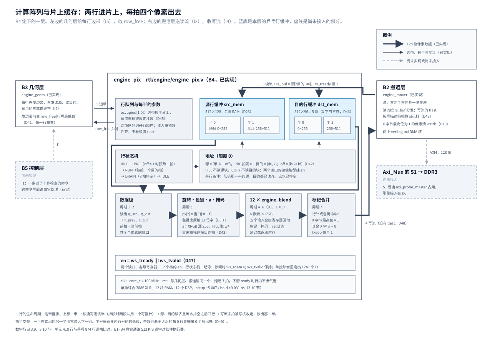

# 04 计算阵列与片上缓存：两行进片上，每拍四个像素出去

这一章讲引擎 P1 的第四层——计算阵列与片上缓存，入库实现是 `rtl/engine/engine_pix.v`。
几何层每行先发一条边带，搬运层随后把这一行的源、目的读回来；本层把两行放进片上，
按边带逐拍算出 4 个像素，喂给搬运层的写流。它只碰像素，不碰地址：
**它一错，错的是颜色、相位或「写不写」**，地址与突发都还是对的，总线侧的判据一个都不会红。

它夹在两个已验收的层中间，又直接决定总线上的一件事：写核只在第一拍流数据到了之后才发写地址，
之后流一断，W 通道就挂在 `Axi_Mux` 的 S1 上，扫描输出与 SoC 跟着等（D23）。
所以这一层的规矩不只是「每个像素算对」，还有「写一开始就能每拍给一拍、写核停的时候整条流水跟着停」。

引擎 P1 分六批（B1~B6），本层是第四批。它确认 B3 留下的两处接口（`rd_buf` 与 `row_free[1:0]`，D41），
定稿层间契约 I4，并让 B2 改了一处：写流的 `tlast` 改由搬运层自己打（D48）。
做完这一批，数据通路 B1~B4 就能由测试台直接喂命令、逐像素对软件执行器。

这一章分三段。3.1~3.7 节是**开工前的研究与复核**：旋转器与首末拍、行缓冲、流水与反压、
四份参考实现、研究探针的仿真与综合与板上基线、复核改掉的八处、D48 对搬运层的改动；
3.8~3.11 节是**入库实现**：`engine_pix.v` 本身、三组仿真、单独综合与主工程编译、上板；
3.12、3.13 节是定案一览与判据。结论编号从 **D42** 起（接 B3 的 D41），到 **D49** 为止；
首稿在原条目里定的 D15、D16、D23 落在本层的那一半也在这里收口。
第四节有三处是验收时查出来的：FILL 的 alpha 取错了来源、测试台放过的七种变异、跨命令的写后读。

## 一、动机

B3 做完之后，引擎画一行的「地址一侧」已经齐了：几何层算出这一行的覆盖区间与相位，
搬运层把它变成合法的突发。还缺的是「数据一侧」：读回来的两行怎么放、怎么对齐、怎么算、怎么送出去。
这一层要做四件事：

1. **行缓冲**。读回来的源行、目的行要先放进片上。搬运层的读流消费者必须恒 ready（D23）：
   `Axi_Mux` 按读地址的顺序回数据，S1 的 `rready` 一低，排在后面的扫描输出与 SoC 的读数据也跟着停。
   所以读描述符只能在目标那一半空出来之后才发，「空出来」要由本层告诉几何层。
2. **对齐**。描述符一律按 16 字节对齐的覆盖区间发（D15 取 `ENABLE_UNALIGNED = 0`），
   源与目的的行首拍内相位不同时，读回来的源拍与目的拍在像素位置上错开 0~3 个像素，要在片上旋转回来。
3. **四像素通路**。每拍 4 个像素、12 个 B1 的混合核；色键比较源的原始存储字；
   XRGB 源的 alpha 取 255；FILL 的源是常量。
4. **「不写」标记**。色键命中、行首行尾不属于本行的像素，在 X 字节最高位打 1，由 B2 清掉对应的 `wstrb`（D16）。

**为什么不是另一种分法。** 首稿想过三个行缓冲（源、目的、输出各一），写描述符等输出行整行算完再发。
这样写流天然不断，但 128 位宽的 RAM 在 Ti60 上深 512 以内一律 7 块，三块是 21 块，
而写核自带 32 深的 FIFO，只要「写一开始就能每拍给一拍」就够了（3.2 节）。
另一种是 `ENABLE_UNALIGNED = 1`，让两个核自己做字节移位、省掉旋转器：B2 研究量到它把搬运层从 1515 XLR 涨到 3198 XLR、
把非对齐地址发上总线（随机用例 800 笔里 578 笔），一行跨 4KB 拆成两段时两段在像素位置上还是接不上，旋转器省不掉（D15）。

**不做会怎样。** 高阶要求 2 的色键在这一层；每拍喂不上一拍时，写核会把 W 通道挂在 S1 上；
写核停的时候流水不停，拍子就丢了——这一条在恒 ready 的测试台里看不见（3.3 节、第四节）。

## 二、为什么是这几步

拆批时（2026-09-28）这一批只有 D15、D23 两条首稿定案和一行文件名，照着写不出代码。
开工前列了五项研究，各自补一个缺口：

| 研究项 | 回答什么 | 不做会怎样 |
| --- | --- | --- |
| 1 旋转器与首末拍 | 两拍窗口怎么拼、旋转放在行缓冲之前还是之后、首末拍掩码与旋转谁先谁后 | 相位一错整行错一个像素；掩码跟着旋转走错，行首行尾的邻居像素被写坏 |
| 2 行缓冲的乒乓与空闲握手 | Efinity 上 128 位 RAM 的推断写法与块数；「这一半空出来」由谁在什么时刻告诉谁 | 块数估错，B6 的片上 RAM 总账不准；握手的时刻错了，下一行的读入会盖掉正在读出的那一行 |
| 3 流水线的拍对齐 | 源拍、目的拍、色键、掩码与 B1 的延迟 `L` 怎么对齐，出口怎么保证每拍一拍 | 延迟像差一级，掩码就提前或落后一拍，只在非零相位的首末拍上红 |
| 4 开源实现 | 前景/背景两路输入、桶形移位与首尾字掩码、色键的位置、行缓冲乒乓，别人怎么做 | 容易重新发明一套错的，尤其是「掩码打在移位前还是后」 |
| 5 实验 | 单独综合行缓冲、旋转器与一条 4 像素通路，RAM 与 D23 对账，看最差路径的余量 | 不知道旋转与色键会不会吃掉 B1 第一级的余量 |

第 1、3 项定**结构**，第 2 项定**接口**，第 4 项给前三项外部参照，第 5 项给本层自己的数。
研究之后要定的是旋转器的位置、乒乓的空闲握手、流水级数；复核又加了三项：写流反压下的停顿、
写流两段的段界从哪来、半号要不要跨命令翻转。八项编成 D42~D49（3.12 节）。

研究完之后的四步与 B1~B3 相同：写 RTL（3.8 节）、仿真与注错（3.9 节）、单独综合与主工程编译（3.10 节）、
上板（3.11 节）。研究阶段的探针保留为回归：它的参考模型、两拍窗口与延迟链规则直接搬进了入库实现。

## 三、每一步做了什么

### 3.1 旋转器与首末拍（研究第 1 项）

**参照：Amiga 原版芯片组的 blitter。** 读的是硬件手册第 6 章（node011F~node012A）。
对照按「word ↔ 128 位拍、桶形移位器 ↔ 像素旋转器、node0127 的流水寄存器 ↔ 两拍窗口」映射：

| 手册原文（节点） | 结论 | 对本设计的含义 |
| --- | --- | --- |
| node011F：A、B 通道各一个 0~15 位桶形移位器；移位量写在 BLTCON0/1，不是硬件从地址差算的；「a shift of 100 bits would require the destination pointer to be advanced 6 words, and a right shift of the remaining 4 bits」 | 移位量 = 相位差，超出字宽的部分并入指针 | 本设计 4 像素一拍，相位差 `ls − ld` 落在 −3~3，**全部在旋转器内**，没有指针修正这一层 |
| node011F：首字、尾字掩码「anded with the source data, **before** any shifts are applied」；node0121 的例子里掩码由目的相位与宽度算出 | 掩码在移位前、按源字边界打（1bpp 位平面格式的产物） | 本设计掩码的单位是 32 位整像素，**按目的拍在旋转后打**更合适：只依赖 `ld` 与 `npx`，不依赖 `ls`；每行重置窗口，没有手册里「行尾移出的位串进下一行首字」的跨行污染 |
| node0127（Pipeline Register）：「the first two sets of sources are fetched before the first destination is written」 | 两字窗口：目的的第一个字由源的头两个字拼出 | 两拍窗口 `{前拍, 当前拍}` 的依据；每行的窗口都重置，行首的前拍没有合法数据，引出下面的预热拍 |
| node011F：右移时第二个字由「the second word fetched from A, shifted right, with the least significant four bits of the first word shifted in」构成 | 窗口拼接方向与移位方向绑定 | 本设计两个方向都要：`ls ≥ ld` 时窗口是 `{第 k 拍, 第 k+1 拍}`，`ls < ld` 时是 `{第 k−1 拍, 第 k 拍}`，由 `off` 选 |
| node011F：掩码为 0 处经 C 通道写回旧目的（cookie-cut） | 超界位不写新数据、旧值保持 | 与 D16 的带内标记等价：行外像素清写使能，目的原值不动 |
| node012A：一次 copy 周期 A+D 四拍、B+D 六拍、B+C+D 八拍；移位零开销 | 吞吐按数据通道数计费 | 本设计每拍一次混合，没有按通道计费的问题 |

**逐像素公式。** 目的拍 k（从 0 起）槽 t（0~3）的像素号 `j = 4k + t − ld`，属于本行 ⟺ `0 ≤ j < npx`，
行外槽打「不写」。源像素 j 在源行缓冲的第 `(ls + j) / 4` 拍、槽 `(ls + j) mod 4`。读地址超前量与窗口起始槽：

| 相位关系 | `off`（源读地址超前） | `st`（窗口起始槽） | 窗口 | 拼接 |
| --- | --- | --- | --- | --- |
| `ls ≥ ld` | 1 | `ls − ld`（0~3） | `{第 k 拍, 第 k+1 拍}` | `px[t] = 窗口[st + t]`：`st + t < 4` 取前拍，否则取当前拍 |
| `ls < ld` | 0 | `ls − ld + 4`（1~3） | `{第 k−1 拍, 第 k 拍}` | 同一个式子：`st + t < 4` 取前拍（只喂行外槽），否则取当前拍 |

两种情形合成一个式子：`off = (ls ≥ ld)`、`st = (ls − ld) mod 4`，旋转器就是 4 个 32 位的 4 选 1。

**预热拍。** `off = 1` 时第 0 拍的前拍也要真数据（`st > 0` 的槽是行内像素），
所以行首先走一拍 `PS_PRE` 把地址 0 压进读口，再进 `PS_RUN` 连发 `ceil((ld + npx) / 4)` 拍。
`off = 0` 不用预热：第 0 拍的前拍只喂 `j < 0` 的行外槽，读到上一行的旧数据也被掩掉。
行尾多读的一拍（`off = 1` 时源地址最多到 `ceil((ld + npx) / 4)`）落在 256 拍的半内，那几个槽都是行外。
这条规则是研究探针踩出来的：探针首版漏了预热，`ls ≥ ld` 且 `st > 0` 的行首像素整片错（第四节）。

**`tkeep` 与宽度不是 4 的倍数（原条目第 4 问，2026-09-26 的前期研究）。** 当时在 B2 的研究测试台里对两种构型逐个操作核对过：

- `ENABLE_UNALIGNED = 1`：读流第一个像素在 0 号通道，最后一拍 `tkeep` 恰好是低 `len mod 16` 个字节；写核只在最后一拍看 `tkeep`，
  宽度不是 4 的倍数时最后一拍多余的通道由 `tkeep` 截掉。但一行跨 4KB 拆成两段时，第二段的流又从 0 号通道开始，
  第一段最后一拍只有 `(len1 / 4) mod 4` 个像素，两段要按像素重新拼。
- `ENABLE_UNALIGNED = 0`：每拍 `tkeep` 全 1，拍内像素位置与地址一致；本行的像素落在哪几个通道由相位与宽度算出，其余通道打「不写」标记；
  4KB 边界是 16 字节的整数倍，两段按拍直接接上。测试台里这一步按下标换算，相当于旋转器，两个种子都过。

这就是 D15 取 0 的像素一侧的依据：取 0 之后 `tkeep` 不携带信息，本层不看它，掩码全由边带算。

**掩码在哪一级算。** 首拍只有头部行外、末拍只有尾部行外、中间拍恒满拍，
所以在边带握手时预算出首拍、末拍两个 4 位常量，像素通路按拍号三选一；
一拍的行把行尾也并进首拍掩码。探针里逐槽比较只是为了可读，两者等价，定案取预算（D43）。

### 3.2 行缓冲：推断写法、块数、乒乓与空闲握手（研究第 2 项）

**Efinity 2026.1 的 RAM 推断规则**（`efinity-synthesis.pdf` 的「RAM」章，原样摘录）：
读写口都是寄存的，不支持异步读；Titanium 映射为 `EFX_RAM10`（简单双口）或 `EFX_DPRAM10`（真双口）；
宽度档位 512×16、1024×8、2048×4、4096×2、8192×1、512×20、1024×10、2048×5；
字节使能只在写宽度 16/20 时可用；同钟读写同地址时可选 READ_FIRST（默认）、WRITE_FIRST、READ_UNKNOWN。
行缓冲用最普通的写法（读写分立的 `always`、非阻塞、同步读），读延迟恒 1 拍。
乒乓的两半不会同地址读写，读写模式对本设计没有差别。

**深度与块数。** `efx_map_ramest --family Titanium`（Efinity 2026.1.132，area、speed 两种模式结果相同）：

| 形状 | 块数 | 说明 |
| --- | --: | --- |
| 512×128 | 7 | 6 块 512×20 加 1 块 1024×8 |
| 256×128、162×128 | 7 | 深度在 512 以内不花钱，位宽才花钱 |
| 512×120 | 6 | |
| 512×96、256×96 | 5 | 目的块只存 RGB（D46） |

原条目首稿估「各 3 块」，是按 10 Kbit 一块折算、没考虑位宽：Ti60 的块在这里最宽只取到 20 位，
128 位就要 7 块并排。D23 的「一行 161 拍的缓冲与两行乒乓的缓冲一样贵」由此成立。
一行最多 162 拍（161 拍加 `off = 1` 的尾拍），深 256 也够，取 512 是为了让地址最高位直接选半。

**目的块只存 96 位。** 目的像素的 X 字节不参与混合，输出的 X 字节也恒为 0 或标记位，读侧只有 96 位有效。
研究探针的目的块写口仍是 128 位，Efinity 把 32 个死位折掉之后映射成 6 块（map 网表里 `u_lbd` 6 个 `EFX_RAM10`，
逐实例查过 READ_WIDTH 与 RDATA 位段）；入库实现把写口也收成 96 位，`efx_map_ramest` 给 512×96 是 5 块，
收窄只是不接 4 个 X 字节、不花逻辑（D46）。源块不能收：色键比较整字（含高字节），a 取源字的高字节。

**一半的生命周期与 `row_free`。** 定为：**边带握手占上 → 读流写进该半 → 像素通路读出 → 该半写流的末拍被写核收走，放出**。
B3 测试台的行缓冲替身（握手占上、写拍数收齐后过 `drain` 拍放掉）与这个模型一致。
`rd_buf = {源/目的, 行号最低位}` 照 B3 的 D41；每半的写指针在该半的边带握手时清零，
一行跨 4KB 拆成两段时两段之间不清——边带先于本行的读发出（I2 的发出顺序），握手时清零不会抹掉本行的数据（D45）。

**半号不跨命令翻转。** 几何层的半号是**命令内**行号的最低位（`engine_geom.v` 里 `row_i` 每条命令从 0 起），
每条命令的第 0 行都在第 0 半。上一条命令的行数是奇数时，下一条的第 0 行要等第 0 半放出来；
D41 保证的是这时不会读进占着的那一半（正确性），不是两半交替。改成跨命令翻转要动 B3（一位跨命令的翻转寄存器），
估算代价：16 像素宽的行从读完到写流被收走约 15 拍（预热 1、流水 7、出拍 5、首拍停 1、握手 1），
每个奇数行命令边界多等这么多，对一颗 16×16 弹幕的 1092 拍约 1.4%，而且只有被裁剪框截成奇数行的精灵才有。
定为维持（D49）。验收时发现跨命令还有一个更大的问题（写后读），它让这一笔账的意义变了，见第四节。

### 3.3 流水线的拍对齐与写流反压（研究第 3 项）

**实际级数。** 研究探针实现并逐拍验证，延迟 7 拍，下游 ready 时行内没有气泡。周期编号从地址发出那一拍起：

```
周期 0    地址：源 = {半, k + off}（PS_PRE 时发 0），目的 = {半, k}
周期 1    两块 RAM 的输出寄存器出数 q_src / q_dst（同步读，1 拍）
周期 2    r_cur ← q_src、r_prev ← 旧 r_cur、r_dst ← q_dst（数据级）
周期 3    旋转 {r_prev, r_cur} → 4 像素、色键、a 选择、掩码，落 r_px / r_a / r_keys / r_mask
周期 4~6  engine_blend 三级（I6 的 L = 3：判定 + 乘 → 加 → 舍入饱和）
周期 7    合并「不写」标记，落 ws_tdata / ws_tvalid
```

与设计文档 3.5 节的五级概念流水对照：级 0 取数是周期 0~2，级 1 判定是周期 2~3（色键与 Fs/Fd 的选择），
级 2 乘是周期 4，级 3 加与舍入是周期 5~6，级 4 写回是周期 7。五级落在七拍上，与 B1 3.3 节「设计文档的级 3 拆成两级」的读法一致。
7 拍延迟本身无害：B2 3.8 节量过 `PIX_LAT` 4 与 12 每颗弹幕周期数完全相同，被「写与下一行的读并行」盖住。

**写描述符握手到写流首拍的间隔。** I2 的注要求它不长过超时门限 `T`（4096 拍）。这段间隔是本行余下的读加像素通路：
无争用时最长的一行（读源、读目的各 161 拍）按 E4 的公式约 `2 × (27.41 + 1.086 × 161) ≈ 405` 拍，
加预热 1、流水 7、写核首拍停 1，约 414 拍，是 `T` 的十分之一；满负载下的实测归 B6（D30 的同一口径）。

**I6 的两条约定得到综合证据。** 混合核的五个输入全由寄存器直接驱动（`r_px`、`r_a`、`r_c`、`r_eq`、`r_dst2`）。
研究探针单独综合的最差路径是 `r_eq` → 混合核 DSP 的 B 口，正是 B1 第一级的判定选择链，与 B1 单独综合的形态一致：
旋转与色键**没有**吃掉第一级的余量。

**延迟链对齐。** 与数据链并行的三条延迟像——色键与掩码标记、拍号、valid——必须逐级贴着数据链，
差一级就是提前或落后一拍。行缓冲的输出寄存器比地址晚一级，所以拍号链要有 `r_k`（与 `q_src` 同级）、
`r_k2`（与 `r_cur` 同级）两级，掩码用 `r_k2`。探针先后踩过两次，第四节。

**写流反压：整条流水挂一个时钟使能。** 研究初稿写的是「地址发生器行内连发、不看下游 ready，写核的 32 深 FIFO 吸收反压」，
测试台的 `ws_tready` 恒为 1。复核时读写核源码：`s_axis_write_data_tready` 是寄存器，
在 `STATE_START` 里看到 `tvalid` 才发 AW、下一拍才拉高（`axi_dma_wr.v` 第 509、515 行），**每个写描述符的首拍至少停一拍**；
输出 FIFO 半满就拉低（`m_axi_wready_int = !out_fifo_half_full_reg`，第 905 行），对上游只开放 16 拍，
W 通道一慢，长行的行中也会停。照初稿接真写核，每一行的首拍都会丢。
改成一个时钟使能 `en = ws_tready || !ws_tvalid`：两个读口的读使能、各级寄存器、12 个核的 `en`（I6 留的口）、
行状态机都按它走，停顿时 `tvalid` 保持为 1（D47）。式子里的 `|| !ws_tvalid` 不能省：
写核在看到 `tvalid` 之前 `tready` 恒为 0，只看 `tready` 的话流水永远等不来第一拍（验收的变异实验里只有接真写核的那组能抓到它，3.9 节）。
没有采用的做法：输出端加滑动缓冲、地址发生器按余量发——流水 7 级，要不丢拍就得 8 深以上 × 128 位，约 1000 个 FF 或再占 7 块 RAM。

### 3.4 读过哪些实现（研究第 4 项）

| 来源 | 形态与许可 | 借鉴什么 | 用在 | 不借鉴什么 |
| --- | --- | --- | --- | --- |
| STM32 DMA2D（[AN4943](https://www.st.com/resource/en/application_note/an4943-how-to-use-chromart-accelerator-to-refresh-an-lcdtft-display-on-stm32-mcus-stmicroelectronics.pdf)、[RM0090 第 11 章](https://www.st.com/resource/en/reference_manual/rm0090-stm32f405415-stm32f407417-stm32f427437-and-stm32f429439-advanced-armbased-32bit-mcus-stmicroelectronics.pdf)） | 厂商手册 | 前景、背景两路输入缓冲；R2M、M2M、M2M_BLEND 与 FILL、BLIT 一一对应；R2M 填充「none of the FIFOs is activated」——常量源从寄存器广播，一次存储器都不读 | D23 的源、目的两块行缓冲；FILL 的源常量不读源块 | 一次一个矩形、寄存器直写（本设计是命令表）；输出缓冲（D23 不设）；它没有逐像素「不写」能力（D16 超出它），也没有相位重排（每拍 1 像素） |
| Amiga 原版芯片组的 blitter（[硬件手册第 6 章](http://www.amigadev.elowar.com/read/ADCD_2.1/Hardware_Manual_guide/node011F.html)，node011F~node012A） | 手册 | 桶形移位加首字、尾字掩码；node0127 的两字窗口流水寄存器；移位零开销 | D15 的像素旋转器（两拍窗口、4 个位置）与首末拍的「不写」标记 | 位平面格式；掩码在移位**前**按源字边界打（本设计按目的拍在旋转后打）；跨行串位（本设计每行重置窗口） |
| ORGFX（[DIVA 论文](https://www.diva-portal.org/smash/get/diva2:556520/FULLTEXT01.pdf)；opencores 的 websvn 取不到源码，B1 时读过同一论文） | 硕士论文加 Verilog，LGPL-3 | 色键在片元级比较、命中像素不产生下游写事务；反面对照：每拍 1 像素、无行缓冲（blender 现读目的、读仲裁优先级最高），50 MHz 下 5.1 Mpix/s，论文自评瓶颈在带宽 | D23 行缓冲 + 每拍 4 像素的取舍论证（E4 实测每行两笔读 65.6 周期、固定开销 54.8，行缓冲正是绕开「每像素一次总线事务」的手段） | 一次一像素的混合状态机；在混合里读目的像素 |
| jotego jt1942（[jt_gng 公开镜像](https://github.com/bibou42/jt_gng)，`modules/jtgng_objpxl.v` 等） | Verilog 街机核心，jotego 非商业许可 | 两块单口 RAM 乒乓（`pxlbuf_line` 逐行翻转）；精灵非透明才写——色键跳过落在行缓冲写口使能上 | D23 的两行乒乓；色键「不写」标记的位置（混合前比较，就地转成写使能） | 「读出即清空」（本设计帧缓冲在 DDR、写核整行覆写，行缓冲不用清）；后写赢的优先级（本设计逐像素混合） |

ST 社区对 DMA2D FIFO 深度的实测帖（[F427 DMA2D FIFO](https://community.st.com/stm32-mcus-products-25/stm32f427-dma2d-fifo-depth-and-fmc-behavior-166179)）
给了输出侧 8×32 位的参考，RM0090 正文没写 FIFO 深度。

### 3.5 研究探针：仿真、单独综合与板上基线（研究第 5 项）

研究探针 `sim/engine/pix/probe_pix.v` 不是入库实现，四个模块：`probe_pix_linebuf`（128 位 × 512 简单双口行缓冲）、
`probe_pix_rot`（两拍窗口旋转器）、`probe_pix_mask`（首末拍掩码）、`probe_pix_path`（两块行缓冲 → 旋转 → 色键 → a 选择
→ 12 个 `engine_blend` → 标记合并 → 写流，整条流水按写流 `tready` 停）。
测试台 `tb_probe_pix.v` 的参考模型照抄 `sw/lib/gfx/exec_sw.c` 的 `blend_px`/`r255`。

**用例。** sweep 400 行（`npx` 1~25 × `ls` 0~3 × `ld` 0~3 全组合，六方程、三种源格式滚动，色键 2/3 的行开，两半交替），
FILL 六方程，拆段 4 行（`tlast` 双位置、段间不断流），长行 8 行（253、640 像素，相位轮换；640 像素、`ld ≠ 0` 就是 161 拍的最长行）。
每行都查：拍数 = `ceil((ld + npx) / 4)`、首个 valid 到末拍握手之间 `tvalid` 不落、`tlast` 只在段末、`tkeep` 恒全 1。
两种下游：默认 `ws_tready` 恒 1；`-DREALWR` 接真写核 `axi_dma_wr`（参数与 `engine_mover` 例化的相同）
与 `axi_ram_model` 的定时模式（E4 校准 `WR_BUB = 6`、`B_LAT = 1`）。

```text
  probe_normal: RESULT: PASS (10216 slots checked)          ws_tready 恒 1；418 行写流一次没停、一次没断
  probe_realwr: RESULT: PASS (10216 slots checked)          422 个写描述符，停顿 段首 426 拍、段中 36 拍
  probe_inj_rot: RESULT: FAIL (inject 1: 5220 mismatches)   旋转错一个位置（st+1）
  probe_inj_key: RESULT: FAIL (inject 2: 274 mismatches)    跳过色键
  probe_inj_msk: RESULT: FAIL (inject 4: 652 mismatches)    丢首拍掩码
  probe_inj_rdy: RESULT: FAIL (inject 8: 9412 mismatches)   不看 ws_tready（真写核下）
  probe_inj_core: RESULT: FAIL (inject 16: 3392 mismatches) 12 个混合核不随流水停（真写核下）
  probe_inj_rdy_const: RESULT: NOT_RED                      位 3，恒 ready 的测试台看不见
  probe_inj_core_const: RESULT: NOT_RED                     位 4，同上
PROBE OK: 9/9 checks as expected
```

最后两行是故意留的判据：同样两个错，恒 ready 的测试台**必须不红**——它们证明恒 ready 看不见反压，
复核之前的 4/4 就是这样过的。（`inj_rdy` 与 `inj_core` 的计数在验收时从 9388、3380 变成 9412、3392，
原因是探针测试台 FILL 的 ALPHA_STRAIGHT 改按直通格式给，第四节。）

**接真写核之后的停顿**（逐行统计）：

| 行 | 拍数 | 段首停 | 段中停 | 首拍到末拍握手 |
| --- | --: | --: | --: | --: |
| sweep 与 FILL（406 行，各一个描述符） | 1~8 | 每行 1 | 0 | 拍数 + 1 |
| 拆段 4 行（各两个描述符） | 6~8 | 每行 3（段 1 首拍 1、段 2 首拍 2） | 0 | 拍数 + 3 |
| 253 像素（4 行） | 64 | 1 | 0 | 65 |
| 640 像素（4 行） | 160~161 | 1 | **9** | 170~171 |

段首停顿合计 406 + 12 + 8 = 426 拍、段中 4 × 9 = 36 拍，与汇总行对得上。
每个写描述符的首拍都至少停 1 拍（`STATE_START`；段 2 多停一拍，写核收完段 1 的末拍之后才接下一个描述符）；
行长了之后，输出 FIFO 被 W 通道的气泡（定时从机每 6 拍空 1 拍）积到半满，行中开始停：
64 拍的行还没积满，160 拍的行停了 9 拍。两种停顿像素通路都得接住。

**单独综合**（`syn/probe_pix_syn.xml`，Efinity 2026.1.132，I3 模型，100 MHz）。顶层 `syn_probe_pix.v` 用 128 位 LFSR
驱动全部输入（含 `ws_tready` 与行缓冲写口），四步 PASS、告警 0：

| 项 | 数 | 说明 |
| --- | --: | --- |
| `u_path`（两块行缓冲 + 旋转 + 色键 + 12 核 + 写流） | 3341 XLR、1387 FF、13 块 RAM、12 个 DSP | 顶层 3668 XLR 减观测与 LFSR 的 327；FF 取 `res.csv` 的 FFs 列 |
| 其中 12 个 `engine_blend` | 1816 XLR（层次和） | 每个 43 FF，与 B1 单独综合的 1748 同量级 |
| 其中本层自身 | 约 1525 XLR | 3341 − 1816 |
| 行缓冲 RAM | 源 7 + 目的 6 = 13 | 目的块的 32 个死位被折掉（3.2 节） |
| 时钟使能 `en` 的扇出 | 1256 个 FF + 13 块 RAM 的读使能 + 12 个 DSP | `map.rpt` 的 CE 表；不在最差 10 条路径里 |
| `core_clk` | setup +4.898 ns、hold +0.071 ns | 最差路径 `r_eq` → 混合核 DSP B 口，4 级逻辑 |

加停顿之前的一版是 3289 XLR、setup +4.560 ns、hold +0.083 ns，最差路径相同；
那一版登记的「728 FF」是 `hier_util.rpt` 的 `xlr_ff` 列（只当寄存器用的 XLR 个数），不是 FF 总数。

**板上基线**（SOP 0.6，比特流为 2026-09-25 的版本，本次没有新 RTL 上板）。验的是本层结论依赖的 S1 环境：

| 步骤 | 结果 |
| --- | --- |
| `ftdi_pgm.bat --scan_usb` | 器件 ID `0x10660a79`、IR 宽 5 |
| `board_run.py --check-only`（含重新烧写比特流） | 两次 OpenOCD 会话各读一次 PC，均 OK（`0x00009008`） |
| APB 探针 `--cmd "mdw 0xf8100000 3"` | `47465832 00000001 00000000`（ID、VERSION 1、SCRATCH 复位值） |
| `displayFifoProbe` | `fail 0`、`done`；三组 120 场最低水位 idle 347、read 331、write 329 拍，落在 platform 第 08 章五轮有效会话的登记范围内（347、331、327~329）；write 组 `max_first = 353`、`max_full = 538` 也在登记的 353~378、521~544 内；`beat = txn × 160` 成立；欠载与错误计数全 0。日志 `b4research_20261001.log` |

结论：E5 的仲裁、在途契约与扫描 FIFO 水位在当前比特流上与登记基线一致——
「消费者恒 ready 时 S1 不会被引擎拉停」（D23）的板上对照面就是这份基线；引擎接入后的复测按同一判据走（B6）。

### 3.6 复核：前期研究的八处修正

开发前对着 `axi_dma_wr.v`、`engine_geom.v` 与登记数据把研究结论逐条复核了一遍，改了八处。
3.1~3.5 节写的已经是改正之后的结论，这里记哪里改了、为什么。

1. **写流反压（结论错，影响 RTL 结构）**：初稿不看 `tready`、测试台恒 ready，见 3.3 节末段与第四节。
   修法是整条流水挂时钟使能，测试台加 `-DREALWR` 与两个注错，两个新注错在恒 ready 下都不红，`run.sh` 把这一点也留作判据。
2. **写流两段的段界（接口缺口）**：探针的 `seg1_beats` 是测试台给的，入库实现拿不到——I5 的边带只有两段之和
   `sb_beats`（`engine_geom.v` 第 354 行），段界只在 I2 的写描述符上；本层要自己算就得知道写地址的低 12 位。
   三个做法见 D48，定的是改已验收的 B2（3.7 节）。
3. **半号跨命令翻转（结论错）**：初稿写「由几何层按行号最低位自然完成」，`row_i` 却是命令内行号，见 3.2 节末段。
4. **超时门限 `T` 的余量（数字用错）**：初稿写「约 28 拍以上的余量」，28 拍是每笔读的固定开销、不是余量；按 E4 公式重算是约 414 拍（3.3 节）。
5. **板上登记值（措辞）**：初稿写「write 差 2 拍」；第 08 章登记的 write 组是五轮 327~329，本次 329 落在范围内。
6. **综合 FF 数（口径）**：「728 FF」是 `xlr_ff` 列，FF 总数看 `res.csv`，加停顿之后是 1387。
7. **长行没跑**：初稿宽度只到 25 像素，161 拍的最长行「由代数一致性覆盖」；补了 253、640 像素各四行，
   640 像素这四行正是真写核下行中停顿的那四行。
8. **综合顶层接常数**：`probe_pix.v` 里原有一个 `probe_pix_top`，输入全接常数（`ls = 3`、`ld = 1`、`npx = 37`、行缓冲写口恒 0），
   注释却写「LFSR 激励」，也没有工程用它。B3 验收刚踩过「顶层输入接常数，综合把逻辑折掉、余量虚高」，这个模块已删除。

### 3.7 D48：搬运层改打写流 `tlast`

写核在突发拍数用完而流上还没见到 `tlast` 时进 `STATE_DROP_DATA`（`axi_dma_wr.v` 第 682~685 行），
一路丢流上的数据直到 `tlast`；这期间写状态照常回来、门控放行下一个描述符，下一行的写流就被吞掉（D29）。
所以每个写描述符的最后一拍都必须带 `tlast`，而一行跨 4KB 拆成两个写描述符时，段界本层算不出来（3.6 节第 2 条）。

三个做法：

| 做法 | 改哪 | 取舍 |
| --- | --- | --- |
| **搬运层按自己记的描述符拍数打**（`tlast = (wr_beats_left == 1)`，排空补拍本来就这么打） | B2 一行逻辑、去掉一个端口 | **定案**。I4 的「末拍必须带 `tlast`」与 D29 的隐患一起消失；计算阵列给也给不进来 |
| I5 加一个「写方向第一段拍数」字段 | B3 的 RTL、`geom_model.py` 与测试台 | B3 已经算出 `seg0`，但要改一个已验收层的接口与独立模型 |
| 本层旁听 I2 的写描述符握手并排队 | 两层多一组耦合 | 计算阵列与搬运层之间多一条隐含的时序约定 |

`rtl/engine/engine_mover.v` 改了三处：`ws_core_tlast` 从「排空时按剩余拍数、平时直通 `ws_tlast`」改成一律 `wr_beats_left == 1`
（`wr_beats_total` 在写描述符握手那一拍装入，写核在 `STATE_START` 里至少停一拍才收流的第一拍，第一拍到来时剩余拍数已经是新描述符的）；
去掉 `ws_tlast` 输入口；加注错位 5（值 32）：正常写流不打 `tlast`。`sim/engine/mover/run.sh` 加一个注错用例与一条判据，17/17：

```text
inject_no_tlast: RESULT: FAIL (看门狗：仿真没有自己结束)
inject_no_tlast: FAIL 由写核卡在 DROP_DATA（只有第一笔写上了总线）引起
SIM OK: 17/17 checks as expected
```

`normal` 用例发 4 笔写，注错版只有第一笔上了总线（`aw=1`）：第一笔的拍数用完时流上没有 `tlast`，写核在 `DROP_DATA` 里一直等。
`inject_nodrain` 的收尾从「85 errors」变成看门狗，红的仍是「排空没有完成」那条判据：原来测试台按自己的拍数在中途送出一个 `tlast`，
写核提前收尾；现在 `tlast` 只在描述符真的送满时出现，写核一直等。两种都是注错版的坏行为。

单独综合（B2 的两个工程直接引用仓里的 RTL，综合顶层只删掉 `ws_tlast` 一处连线）重跑，四步 PASS，`engine_mover.v` 自身告警 0：

| 构型 | `u_mover` XLR | 片上 RAM | `u_rd` XLR / 块 | `u_wr` XLR / 块 | setup (ns) | hold (ns) |
| --- | --: | --: | --: | --: | --: | --: |
| 与主线同参数 | 1173.5（改前 1171.5） | 16 | 353 / 8 | 547 / 8 | 5.126（改前 5.187） | 0.027 |
| `use-logic-for-small-mem = 0` | 901.5（改前 898.5） | 19 | 258 / 9 | 371 / 10 | 4.925（改前 5.206） | 0.029 |

最差 setup 路径的起点从 `wr_beats_sent` 换成 `wr_beats_total`（`tlast` 现在每拍都看剩余拍数），余量仍在 4.9 ns 以上。
engine 第 02 章 3.2 节、3.9 节、3.11 节与第五、六节已同步。

### 3.8 入库实现 `rtl/engine/engine_pix.v`

文件头列了五件事、四条接口与五个注错位；结构见图 1。按数据流向：

- **每半的参数与读入计数。** 边带握手那一拍，把这一行的方程、色键、常量、`c`、源格式、相位、拍数、
  源要读的拍数 `ceil((ls + npx) / 4)`、首末拍两个掩码装进该半的寄存器，读入计数清零，`occupied[h]` 置 1。
  FILL 的「源已读齐」与不读目的的行的「目的已读齐」在握手时就置 1。
- **行缓冲的写口。** 读流按 `rs_buf` 落进源块或目的块的对应半，地址是该半的读入计数；读齐按拍数判，
  不看 `rs_tlast`（拆段时一行有两个），`rs_tkeep` 恒全 1 也不看。`rs_tready` 恒为 1。
- **行队列。** 两项，记边带握手的先后，像素通路按这个顺序开行。一行开始处理时离开队列，
  但它的那一半要等写流末拍被写核收走才放（`last_out`），所以队列里的两项总是两个不同的半。
- **开行条件与行状态机。** 队头那一半的源、目的都读齐且状态机在 `PS_IDLE`：装入当前行参数，
  `off = 1` 先走 `PS_PRE`，然后 `PS_RUN` 每个有效拍发一个目的拍，发完进 `PS_DRAIN` 等 8 拍，流水里的这一行全部出去之后才回 `PS_IDLE`。
  当前行参数（方程、`c`、色键等）只在开行时换，排空保证换的时候流水里没有上一行的拍；这段时间另一半的读入照常进行。
- **流水**按 3.3 节的七拍；a 的来源是 BLIT 的 XRGB 源取 255、其余取源字高字节，**FILL 一律取 `w4[31:24]`**（第四节第一个问题，验收时改的）；
  不读目的的行（只有 COPY）给混合核的目的通道送 0。
- **反压**按 D47 的一个时钟使能。`sb_ready` 除了查这一半没被占，还查行队列没满；几何层照 D41 先查 `row_free` 再发边带时它恒为 1。

`row_free` 有一个结构上的余量值得记下：命令内部，几何层发第 r+2 行（与第 r 行同一半）的边带之前，
要先把第 r+1 行的写描述符发出去，而搬运层每方向只有一笔在途，第 r+1 行的写描述符要等第 r 行的写状态回来才收——
所以命令内部同一半再被占用时，上一次占它的那一行早已写完。`row_free` 真正起作用的只有命令边界：
奇数行命令的最后一行在第 0 半，下一条命令的第 0 行也要第 0 半，而这时几何层已经空闲、不再被写描述符挡住。
验收的变异实验印证了这一点：把放出时机提前到开行（`rel_at_start`）之后，按几何层节奏跑的真实通路照样 PASS，
只有行与行之间不等的乒乓测试台在成串停顿下抓得到（3.9 节）。

### 3.9 单元仿真与真实通路 `sim/engine/pix/`

`run.sh` 先跑 3.5 节的九项研究探针，再跑 `run_formal.sh` 的十六项入库判据，**25/25**。入库判据分三组，期望值都不取自被测。

**一行一行（`tb_engine_pix.v`）。** 用例与研究探针相同（sweep 400 行、FILL 六方程、拆段 4 行、长行 8 行，共 418 行、10216 个槽），
每行「发边带 → 喂读流 → 收完写流 → 等这一半放出来」，逐槽对照 `exec_sw.c` 的像素公式，查拍数、行内不断拍、停顿时数据保持、
`tkeep`、边带握手前后 `row_free` 的电平。验收时补了三样：FILL 的参考按规范条款 §4.2 解释常量，送给被测的 `sfmt` 故意不按方程给
（ALPHA 与 ALPHA_STRAIGHT 偏给 XRGB）；FILL 行打开色键位、色键字等于常量（FILL 没有色键，必须照写）；
每行再放一个「RGB 与色键字相同、高字节不同」的近似字（色键比的是整字，必须照写）。

**乒乓与流水（`tb_engine_pix_pipe.v`，验收时新写）。** 一行一行的测试台里两半从来不同时有货，
排空、行队列、放出时机都看不到。这个测试台按 I5 允许的最快节奏驱动：一行的边带与读流喂完就发下一行，只在 `row_free` 说那一半占着时等；
期望值按行排进一个队列，检查端在写流上按握手逐拍出队比对，两端互不等待。命令结构照几何层（每条 1~5 行，半号 = 命令内行号最低位），
所以奇数行命令之后的第 0 行要等第 0 半。读流偶尔断一拍；写流下游三种：恒 ready、每 7 拍停 1 拍、成串停顿（偶尔一停 20~275 拍）。
另查 `row_free` 说那一半占着时 `sb_ready` 必须为 0。

**B1~B4 真实通路（`tb_engine_path.v`）。** 几何层、计算阵列、搬运层、两个 DMA 核与随机反压的 AXI RAM（`STALL = 3`、地址随机停 0~3 拍）
真正连起来，测试台按解码之后的 I1 逐条提交、等上一条的末行写状态回来再提交下一条，跑完把 512 KiB 存储逐 128 位对期望内存。
期望内存由 `tools/check/pix_cases_dump.c` 链接 `sw/lib/gfx` 经软件执行器导出。定向用例 30 条：目的表面每行都跨 4KB（基址 `0x1ff4`）；
六个方程的 FILL（验收时把 ALPHA、ALPHA_STRAIGHT 的常量 alpha 改成 `0x80`，原来是 `0xff`，a 取错来源也看不出来）；
源、目的相位 4×4 的 BLIT；验收时补的 XRGB 源配 ALPHA、ALPHA_STRAIGHT 两条（源字高字节随机，a 必须取 255）；
色键字与验收时补的近似字（`0x7fabcdef`）；源越界；验收时补的三条多行命令（2、3、4 行）。
实现阶段的定向用例是现在的前 25 条（当时 FILL 的常量 alpha 都是 `0xff`、没有近似字；54 笔读、46 笔写、284 拍写流停顿，色键注错 35 个字不符），
验收补了 5 条，变成 30 条。

```text
B4 入库像素单元（一行一行）：
  unit_ready: RESULT: PASS (418 rows, 10216 slots checked)
  unit_stall: RESULT: PASS (418 rows, 10216 slots checked)
  unit_inj_rot: RESULT: FAIL (inject 1: 5185 mismatches, as expected)
  unit_inj_key: RESULT: FAIL (inject 2: 274 mismatches, as expected)
  unit_inj_mask: RESULT: FAIL (inject 4: 668 mismatches, as expected)
  unit_inj_ready: RESULT: FAIL (inject 8: 1236 mismatches, as expected)
  unit_inj_core: RESULT: FAIL (inject 16: 2876 mismatches, as expected)
B4 入库像素单元（乒乓与流水，行与行之间不等）：
  pipe_ready: RESULT: PASS (874 rows, 28340 slots checked)
      pipe: cmds=300 rows=874 long=25 beats=7085 slots=28340 waits=470 stall=0 overlap=1539 gap=0 proto=0
  pipe_stall: RESULT: PASS (874 rows, 28340 slots checked)
      pipe: cmds=300 rows=874 long=25 beats=7085 slots=28340 waits=490 stall=1131 overlap=1667 gap=0 proto=0
  pipe_burst: RESULT: PASS (874 rows, 28340 slots checked)
      pipe: cmds=300 rows=874 long=25 beats=7085 slots=28340 waits=569 stall=49164 overlap=2378 gap=0 proto=0
  pipe_inj_ready: RESULT: FAIL (inject 8: 20009 mismatches, as expected)
  pipe_inj_core: RESULT: FAIL (inject 16: 12762 mismatches, as expected)
  directed_export: PIX CASES: commands=31 pixels=1494 written=1431 key=49 src_oob=14
B1~B4 真实通路与随机反压 AXI RAM：
  path_golden: RESULT: PASS (B1-B4, software executor golden)
      PATH stats commands=30 read=78 write=61 stalls=334 mem_bad=0 errors=0
  path_inj_key: RESULT: FAIL (B1-B4 integration)
  hazard_export: PIX CASES: commands=5 pixels=2592 written=2592 key=0 src_oob=0
  path_hazard_wait: RESULT: PASS (B1-B4, software executor golden)
      PATH stats commands=4 read=10 write=10 stalls=327 mem_bad=0 errors=0
  path_hazard_nowait: RESULT: FAIL (B1-B4 integration)
SIM OK: 16/16 RTL checks as expected
SIM OK: 25/25 checks as expected
```

逐行读：

- `pipe` 一行里 `waits` 是驱动端真正等过 `row_free` 的行数（470~569 行，成串停顿下更多），`overlap` 是写流与读流同拍有效的周期数
  （1539~2378）——这两个数不为 0，说明两半确实同时有货、命令边界上的等待确实发生了；`gap = 0` 是行内写流一次没断，`proto = 0` 是 `sb_ready` 一次没在占用的那一半上拉高。
- `directed_export` 的 `commands=31` 含末尾的 END；`pixels`、`written`、`key`、`src_oob` 是软件执行器的统计，
  1494 − 1431 = 63 = 49 个色键跳过 + 14 个源越界。真实通路一侧 30 条命令、78 笔读、61 笔写、334 拍写流停顿，512 KiB 0 处不符。
- 最后一组是跨命令的写后读（第四节）：`--hazard` 那组用例在「等上一条写回」时对，在「几何层一空闲就提交」（`-DNOWAIT`）时必须见红，
  红的是两处内存不符（第 27、29 行的尾部各 5 个 128 位字）。B1~B4 自己不挡这种冲突。

**整帧金标准。** `run_frames.sh` 把 SW3 的十一个整帧用例导出成同样的格式（`--frame 0..10`），帧缓冲 CRC 11/11 与入库的 `golden.txt` 相同，
供 B6 的整帧仿真复用；本批不跑整帧 RTL（要经 APB 提交整张命令表，B5/B6）。

**期望值怎么进 Verilog（原条目第 9 问，2026-09-26 的前期研究）。** 两组现成输入当时都量过：

```text
check_cmd_semantics.py --emit：159 [vector]、161 [list]、181 [cmd]、166 [surf]、1194 [mem]、906 [exp]，116744 字节
mem=1 的向量 141 条；[mem]/[exp] 地址范围 0x00001000 ~ 0x0000D004
166 个表面里没有一个的行跨 4KB；基址不按 4KB 对齐的两个（0x9002、0xFFFFFFF0）都是非法描述符用例
```

- 159 条向量归 B5 用：转换脚本把标签文本展开成定长十六进制记录，每条记录前面一个类型字（向量头、表面、表、命令、内存初值、期望），
  向量头带 `lists`、`reads`、`code`、`errlist`、`erridx`、`errtag`、clip 四个数与 `mem` 位；测试台 `$readmemh` 读进数组按类型字解释；
  64 KiB 的从机存储够用，命令表放在向量不用的地址（例如 `0xE000`），`reads` 之后的地址回 `SLVERR`。
- 十一个整帧用例是 C 代码现场生成的（`sw/lib/gfx/cases.c`，帧缓冲在 `0x1000`、纹理在 `0x0020_0000`、设备内存 `0x0021_0000` 字节），
  所以写一个链接 `sw/lib/gfx` 的主机程序导出——这就是现在的 `pix_cases_dump.c`；期望值用 `golden.txt`，按 sw 第 03 章 3.6 节的口径
  （480 行、每行 2560 字节拼起来算 CRC32）比对。
- 两组输入都没有一行跨 4KB，源、目的相位的组合也不成体系（整帧用例里只有 `blit-clip-partial` 第三条是 0 对 2），
  所以几何层拆分与像素旋转另加定向用例：几何层那一侧是 engine 第 03 章 3.4 节的定向用例，像素一侧是本节的定向用例（目的表面每行都跨 4KB、相位 4×4）。

### 3.10 单独综合（入库实现）与主工程

**单独综合**（`syn/engine_pix_syn.xml`，顶层 `syn_engine_pix.v`：全部输入由 128 位 LFSR 驱动，全部输出折进观测寄存器，Efinity 2026.1，100 MHz）。
验收时按改过的 RTL 重跑，四步 PASS：

| 项 | 实现阶段 | 验收重跑 | 说明 |
| --- | --: | --: | --- |
| 顶层 XLR | 3874 | 3886 | 含 LFSR 与观测 331 |
| `u_path`（本模块）XLR | 3543 | 3555 | 12 个 `engine_blend` 合计 1806，本层自身 1749 |
| `u_path` FF | — | 1611 | `res.csv` 的 FFs 列 |
| 片上 RAM | 12 | 12 | 源 7 + 目的 5，与 D46 对上 |
| DSP | 12 | 12 | 每个核 1 个 |
| setup | +5.287 ns | +5.007 ns | 最差路径 `r_eq[0]` → 混合核乘法器 B 口，3 级逻辑 |
| hold | +0.027 ns | +0.031 ns | |
| `en` 的扇出 | — | 1247 个 FF | `map.rpt` 的 CE 表（另有 12 块 RAM 的读使能与 12 个 DSP） |

多出的 12 XLR 是 a 选择多了一个 `r_blit` 条件；setup 的 0.28 ns 差别在同一条路径上，是布局波动。
告警只有三类：未用的接口位被删（`sb_row[15:1]`、`sb_eq[3]`、`rs_tlast`、`rs_tkeep`）、函数局部中间量被删、
十五个不超过 64 位的小数组（行队列与十四组每半参数）映射成逻辑（`EFX-0657`），外加单独综合工程固有的 IO 未分配管脚。没有 RAM 推断失败或截断告警。

**主工程。** `fpga/gfx2d_ti60/gfx2d_ti60.xml` 加了 `engine_blend.v` 与 `engine_pix.v` 两个源文件。
当前顶层的 S1 仍接探针主机，两个文件只被分析（`VERI-1482`）、不被例化，不进网表——资源与时序以单独综合为准，
不能把主工程的数当成本模块的开销。验收重编一次，四步 PASS：21935 XLR、71 块 RAM、4 个 DSP；
最差 setup 是 `sdram_clk` 的 +0.354 ns，`core_clk` setup +3.516 ns；最差 hold 是 `core_clk` 的 +0.026 ns；
与实现阶段登记的一致。片上 RAM 总账：行缓冲 12 + 两个核 16（B2）+ 命令缓冲 7（B5）= 35 块，D23 原估 37；
加现行 71 块是 106 块（16KB 缓存构型 124 块），256 块之内。

### 3.11 上板

比特流是验收重编的这一版（本模块不在网表里，上板验的是加了源文件之后整机行为不变）：

| 步骤 | 结果 |
| --- | --- |
| `board_run.py --check-only`（含烧写） | 两次会话各读一次 PC，均 OK（`0x00009030`） |
| APB 探针 `--cmd "mdw 0xf8100000 3"` | `47465832 00000001 00000000` |
| `displayFifoProbe` | idle、read、write 三组各 120 场全部 `ok`，最低水位 347、331、329 拍；write 组 `max_first = 353`、`max_full = 521`；欠载与错误计数全 0；`fail 0`、`done`。日志 `b4accept_20261001.log` |

实现阶段在 14:46 那一版比特流上也跑过同样三步（`displayFifoProbe` 日志 `b4formal_20261001.log`，347/331/329），
另跑过 APB SCRATCH 写回、未映射页读 0、GPIO 空闲 `0000000f`、`memTest`、`ddrAliasTest`、`ddrBurstProbe` 与 `cacheCoherencyTest`，
都是 `fail 0`；这几份原始日志没有入库。其中 `cacheCoherencyTest` 输出全部落在 `board_run.py` 的分隔线之前，
脚本因此报超时退出 1，这是 [`Bugs/` 里登记的那个分隔线问题](../../Bugs/board_run的stop-on分界线会落在程序输出之后.md)，不是测试本身失败。

### 3.12 定案一览

本层落地的首稿定案与本批新定的 D42~D49：

| 编号 | 定案 | 依据 |
| --- | --- | --- |
| D15 | **`ENABLE_UNALIGNED = 0`，像素通路自带旋转器**：描述符一律按 16 字节对齐的覆盖区间发，总线地址恒对齐；行首、行尾拍里不属于本行的像素按 D16 不写；源与目的的行首地址拍内相位不同时用两拍窗口、4 个位置的旋转器对齐；4KB 边界是 16 字节的整数倍，拆开的两段按拍直接拼接。没有采用：维持 1 并另加 4KB 拆分时的像素重排与一条控制器接收非对齐地址的上板验证 | 第一节；B2 研究的 1515 → 3198 XLR 与 578/800 笔非对齐地址（engine 第 02 章 3.1 节） |
| D16（像素一侧） | 本层按边带与色键在 X 字节最高位打「不写」标记，清 `wstrb` 的一半在 B2 | engine 第 02 章 3.7、3.9 节 |
| D23 | **源、目的各一块行缓冲，各放两行乒乓，不设输出行缓冲**；两行都在片上之后流水每拍出 1 拍直接喂写核，写核的 32 深 FIFO 吸收总线反压（仍要按 `tready` 停，D47）；读描述符只在目标那一半空出来之后发，读流消费者恒 ready。没有采用：首稿的三个行缓冲（21 块），写描述符等输出行整行算完再发 | 3.2 节的块数；`axi_dma_wr.v` 第 509 行 |
| D42 | 旋转器放在行缓冲读出之后（数据级，4 个 32 位 4 选 1）；两拍窗口，`off = (ls ≥ ld)`、`st = (ls − ld) mod 4`、`px[t] = 窗口[st + t]`；`off = 1` 的行首先走一拍预热 | 3.1 节；探针 418 行在两种下游下全对；漏预热即错（第四节） |
| D43 | 首末拍掩码按目的拍在旋转之后打：槽有效 ⟺ `0 ≤ 4k + t − ld < npx`；边带级预算首拍、末拍两个 4 位掩码，中间拍满拍 | 3.1 节；掩码只依赖 `ld` 与 `npx` |
| D44 | 流水 7 拍（地址 → 行缓冲读出 → 数据级 → 旋转、色键、a 选择 → 混合核三级 → 标记合并），下游 ready 时行内无气泡；色键、掩码、拍号、valid 的延迟像逐级贴着数据链 | 3.3 节；差一级的两个错（第四节） |
| D45 | `row_free[h]` 在第 h 半的边带握手之后拉低，该半的写流末拍被写核收走之后拉高；`rd_buf = {源/目的, 行号最低位}`；每半的写指针在边带握手时清零，一行的两段读之间不清 | 3.2 节；与 B3 行缓冲替身的模型一致；乒乓测试台在成串停顿下抓得到放早了（3.9 节） |
| D46 | 目的行缓冲读、写口都只用 96 位：512×96 是 5 块，行缓冲合计 12 块 | 3.2 节的 `efx_map_ramest`；单独综合 12 块对上 |
| D47 | 写流反压下整条流水停住：`en = ws_tready \|\| !ws_tvalid`，读口、各级寄存器、12 个核、行状态机都挂它，停顿时 `tvalid` 保持。没有采用：输出端滑动缓冲（8 深以上 × 128 位） | 3.3 节；真写核下 422 个描述符段首停 426 拍、640 像素行段中停 9 拍；不看 `tready` 与核不停两个注错只在真写核或停顿下红 |
| D48 | 写流的 `tlast` 由搬运层按写描述符拍数打（`tlast = (wr_beats_left == 1)`）；计算阵列不出 `tlast`，按边带的 `sb_beats` 出拍 | 3.7 节；I5 只有两段之和 |
| D49 | 半号不跨命令翻转，每条命令的第 0 行都用第 0 半；奇数行命令边界多等的拍数在 B6 用真实命令表实测 | 3.2 节的估算（约 1.4%）；engine 第 03 章第四节；第四节「跨命令的写后读」 |

### 3.13 判据

| 项 | 判据 | 结果 |
| --- | --- | --- |
| 几何（逐像素） | 几何定向用例（行跨 4KB、宽度余数、相位 4×4、源越界）逐像素与软件执行器相同 | 真实通路 30 条命令、512 KiB 逐 128 位 0 处不符 |
| 写掩码 | 首末拍三种偏移与色键稀疏掩码逐像素正确 | 单元 418 行与乒乓 874 行逐槽 PASS；近似字照写、FILL 不受色键位影响 |
| 每拍一拍 | 两行在片上之后写流 `tvalid` 不落、写核不 ready 时按 `tready` 停（下游接真写核）；读数据阶段 `rready` 恒为 1 | 探针接真写核 PASS；乒乓三种下游 `gap = 0`；真实通路 `I3_BACKPRESSURE` 0 |
| 乒乓 | 两半同时有货、命令边界等半时逐槽正确；`row_free` 占用时 `sb_ready` 为 0 | 乒乓测试台 874 行三种下游 PASS，`proto = 0` |
| 注错 | 跳过色键、旋转错位、丢首拍掩码、不看 `tready`、混合核不随流水停各自见红 | 单元五个、乒乓两个、真实通路一个全部 FAIL；另有 32 种变异的实验（第四节） |
| 单独综合 | 行缓冲 RAM 与 D46 的 12 块对账；`en` 的扇出与最差路径、100 MHz 余量登记 | 12 块、12 个 DSP；`en` 扇出 1247 FF；setup +5.007 / hold +0.031 ns |
| 文档 | 本章 | 本章 |

这一层做完之后的样子：



**图 1** B4 定下的一层。左边是 B3 几何层（已实现），按 I5 发每行边带、收 `row_free[1:0]`；
左下是 B5 控制层（尚未实现，虚线），跨命令的写后读归它处理；右边是 B2 搬运层（已实现），送 I3 读流、收 I4 写流，
写流的 `tlast` 由它按描述符拍数打；右下是 `Axi_Mux` 的 S1（尚未接入）。模块内部上排是行队列与两块乒乓行缓冲（蓝底），
中排是行状态机与地址，下排是七拍流水的四段，底部是贯穿全部各级的时钟使能 `en`。图上的数字来自 3.9、3.10 两节。

### 3.14 可读性重构（2026-10，验收后的源码整理）

B4 验收后，`engine_pix.v` 按用户要求做了一轮只动组织与命名的整理（2026-10-26 授权修改、
10-27 补注释规范、10-29 统一验证成轮并经用户验收）。动机：原文件混用资源管理、RAM 对象
与流水阶段三种排列方式，行控制器位于文件末尾，数据与对应 valid 分散在不同段，逐行阅读
需要频繁跳转。边界：保持端口、逐拍采样、复位/保持、行内拍数、七拍通路、八次推进排空、
特性宏与五个注错分支（`INJ_ROT_OFF/SKIP_KEY/DROP_MASK/EN_NOTREADY/CORE_NOEN`）含义
不变；不要求综合网表相同；本节不修改上文 B4 历史记录，历史仿真/综合/板测证据也不作为
新源码的通过证据。

组织改动五条：行资源的声明、接收事件与状态更新收拢，开行/行完成成为显式跨段事件
（`row_accept`/`row_take`/`write_fire`/`row_done`/`row_done_half`，完成半号只加组合别名，
未新增状态）；当前行参数快照与执行状态机分离，调度器提前到 RAM 读地址之前；数据、拍号、
valid 按 S1~S7 事务阶段命名并归组，S4/S5/S6 的标记各自成块，色键命中显式化为
`s3/s4/s5/s6_key_hit`；四槽旋转改成 `{s2_src_cur,s2_src_prev}` 的一次 128 位固定切片选择，
FILL 用四次常量复制，alpha 从各槽高字节提取；保留 RAM 同步读写模板、接收端独立推进、
计数与占用位的同沿优先级，RAM 数组与读输出仍无复位，12 核 `pixel[].channel[].u_blend`
实例层级不变。

注释写法同步整改：块前一行「学名：含义」，特殊处只在行尾加一句（与注错注释同款），
文件头压成一句描述加 5 条输入前提；剥掉注释后 467 行逐行一致，全文 569 → 555 行。
当前机制说明同步到 `rtl/engine/engine-manual.md` 与 `rtl/README.md`。

命名转换表（旧名 → 新归属）：

| 旧名 | 新归属 |
| --- | --- |
| `pst/cnt_k/running` | `row_state/issue_beat/issue_valid` |
| `r_half/r_blit/r_read_dst/r_key_en` | 当前行 `row_*` 快照 |
| `r_eq/r_key/r_w4/r_c/r_sfmt/r_ls/r_ld/r_beats/r_first_mask/r_last_mask` | 当前行 `row_*` 快照；系数/源格式/目的拍数为 `row_const_coeff/row_src_format/row_dst_beats` |
| `q_src/q_dst/r_k/r_v1` | S1 RAM 返回、拍号与 valid |
| `r_cur/r_prev/r_dst/r_k2/r_v2` | S2 两拍窗口、目的、拍号与 valid |
| `r_px/r_dst2/r_a/r_keys/r_mask/v_d1` | S3 核输入与 valid，色键命中为 `s3_key_hit` |
| `key_d1/mask_d1/v_d2` | S4 标记与 valid，色键命中为 `s4_key_hit` |
| `key_d2/mask_d2/v_d3` | S5 标记与 valid，色键命中为 `s5_key_hit` |
| `color/key_d3/mask_d3/v_d4` | S6 颜色、标记与 valid，色键命中为 `s6_key_hit` |
| `ws_tdata/ws_tvalid/ws_key_lanes` | S7 输出，原名保留 |
| `occupied` | `half_occupied` |
| `row_queue/q_rd/q_wr/q_count` | `row_queue/row_queue_read_ptr/row_queue_write_ptr/row_queue_count` |
| `h_*` | `half_*`；`h_w4/h_c/h_sfmt/h_ls/h_ld/h_beats/h_src_need` 对应 `half_fill/half_const_coeff/half_src_format/half_lead_src/half_lead_dst/half_dst_beats/half_src_beats` |
| `out_count` | `out_beat_count`，输出交接计数 |

验证分静态与运行两路。静态：逐个旧寄存器核对新归属、位宽、复位值/条件、更新条件、
沿前右值和优先级；位宽截断、首/末 mask 优先级、完整 32 位色键、FILL alpha 与带内不写
标记逐项保持。运行：quick 档 `paths pix frame instances bin` 成轮 VALIDATION PASS
（run 20261029-012638-d100b5c8；pix 五个注错变异全部见红，instances/bin 为完整引擎级
消费者）；整机综合四步 map/interface/pnr/pgm PASS——RAM 105 / DSP 16 与登记逐位一致，
hold core_clk +0.026 逐位一致，setup +0.602 ns 全域非负（较历史 +0.882~1.132 偏紧，属
重映射正常波动），XLR 35948 对登记 36780 差 −832，在 2~3% 同源码波动带内。位流为本机
构建产物，不部署、板测不做（部署对象未变）。统一验证前两轮曾因并行会话编辑触发输入
身份变化被验证系统拒绝出证，第 4 轮在对方收尾后成轮。配套的 Temp 学习页按当前源码重写
两版（含 iverilog 独立用例 `tb_timeline.v` 五用例逐沿时间线），只驱动端口不改 RTL。

## 四、遇到的问题

### FILL 的 alpha 取自源格式，ALPHA 与 ALPHA_STRAIGHT 的 FILL 都可能写错（验收）

**第一现场。** 验收时另写的一组 20 颗多行精灵在真实通路上（等上一条写回再提交）就红了：

```text
MEM_MISMATCH addr=0000a480 got=0040201700402017006e07b300c1184f want=00688b9600478356006e07b300c1184f
MEM_MISMATCH addr=0000a490 got=00402017004020170040201700402017 want=0065594500ad9486004a467500a93857
```

**解读。** 地址 `0xa480` 在目的表面（基址 `0x1ff4`、stride 4096）的第 8 行、x = 291~294，是那组里第 7 颗之后补画的一条
FILL ALPHA（常量 `0x80402017`）。`got` 里行内的两个像素恰好是常量的 RGB `0x402017`，说明 a 被当成了 255（Fd = 0，等于 COPY）；
`want` 是 a = `0x80` 时的混合结果。

**定位。** RTL 里 a 的式子是 `(r_sfmt == XRGB) ? 255 : 源字高字节`，`r_sfmt` 来自边带的 `sb_sfmt`，即 I1 的源格式。
FILL 没有源表面，测试台按命令字的源表面号（FILL 恒为 0）取格式，那是目的表面的 XRGB。规范条款 §4.2 与 `exec_sw.c` 第 337~339 行写的是：
FILL 的常量源字按方程解释，ALPHA 按预乘、ALPHA_STRAIGHT 按直通、其余按 XRGB。
再查测试台：研究探针与单元测试台的 FILL 用例都按「ALPHA 用 PM、其余 XRGB」给 `sfmt`，注释还写着「exec_sw.c 337 行」——
ALPHA_STRAIGHT 被读漏了，参考模型与被测一起把它算成 a = 255，两边一致，单元测试一直 PASS。
真实通路的定向用例本来能抓到，但六条 FILL 的常量 alpha 都是 `0xff`，a 取哪里结果都一样。

**根因与修法。** 本层按 `sfmt` 取 a，而 FILL 的 `sfmt` 在 I1 上没有定义。改成 BLIT 才看 `sfmt`，FILL 一律取 `w4[31:24]`：
ALPHA、ALPHA_STRAIGHT 两个方程的 alpha 都是它，其余方程不看 a，这就是 §4.2 的原文，也不再要求上游给 FILL 填一个特定的 `sfmt`。
测试台三处跟着改：单元测试台的 FILL 参考按 §4.2 解释、送给被测的 `sfmt` 偏给 XRGB；研究探针测试台的 ALPHA_STRAIGHT 改给 ST；
定向用例的 ALPHA、ALPHA_STRAIGHT 常量 alpha 改成 `0x80`。改后原 RTL 在单元测试台上 36 处不符，新 RTL 全过。
**原判据为什么没覆盖到**：参考模型与被测出自同一个误读，自洽地错；唯一独立的金标准（软件执行器）恰好喂了一个让两种取法相等的输入。

### 测试台放过了七种变异（验收）

**第一现场。** 照 B3 验收的做法，对入库 RTL 做了 32 种变异（每种改一处，都是写 RTL 时容易犯的错），
拿实现阶段的两组判据（一行一行的单元测试 U、真实通路 P）去跑；基线是修掉 FILL alpha 之后的 RTL，U 的 FILL 参考也已按 §4.2 改过。
有八种在 U 与 P 上都 PASS（其中一种是等价变异），另有两种只有 U 抓得到：

| 变异 | 改了什么 | U | P | 补的判据之后 |
| --- | --- | --- | --- | --- |
| `rel_at_start` | 一半在开行时就放出，不等写流末拍 | pass | pass | 乒乓、成串停顿下红 |
| `drain_short` / `drain_none` | 排空 3 拍 / 不排空就开下一行 | pass | pass | 乒乓两种下游都红 |
| `queue_lifo` | 行队列按后进先出取队头 | pass | pass | 乒乓、真实通路红 |
| `sb_ready_noocc` | `sb_ready` 不查这一半占没占 | pass | pass | 乒乓的协议检查红 |
| `key_ignore_x` | 色键只比 RGB 24 位 | pass | pass | 近似字：单元、乒乓、真实通路都红 |
| `key_fill_too` | FILL 也做色键 | pass | pass | FILL 打开色键位：单元、乒乓红 |
| `dst_no_zero_copy` | COPY 行的目的通道不清零 | pass | pass | 等价变异：COPY 不看目的，任何输入都观察不到 |
| `fill_a_from_sfmt` | 即上一个问题的原 RTL | 红（靠改过的参考） | pass | 定向用例 alpha 改 `0x80`：四组全红 |
| `xrgb_a_src` | BLIT 的 XRGB 源也取源字高字节 | 红 | pass | 定向用例补 XRGB 源配 ALPHA 类方程：四组全红 |

**解读。** 前五种都与「两半同时有货」有关：U 一行跑完才发下一行，P 的命令按几何层的节奏走、命令之间等写回，
两者都碰不到排空、行队列与放出时机。`key_ignore_x` 是规格上的要求（spec 第 01 章 3.5 节：比原始存储字）却没有一个输入能区分；
`key_fill_too` 在合法命令里不会出现（十步检查要求 FILL 的色键位为 0），但本层的防护没有被测过。

**根因与修法。** 补了三样判据（3.9 节）：乒乓测试台 `tb_engine_pix_pipe.v`、单元与定向用例里的近似字、FILL 行打开色键位。
补完之后 32 种变异里 31 种至少一组见红，剩下的 `dst_no_zero_copy` 是等价变异。几个只有一组抓得到的值得记：
`rel_at_start` 只有乒乓测试台在成串停顿下抓得到（3.8 节末段的结构余量）；`en_ignores_valid`（`en` 只看 `ws_tready`）
只有接真写核的真实通路抓得到——测试台的下游在 `tvalid` 为 0 时也会给 ready，写核不会；`src_done_early` 只有单元与乒乓抓得到。
**原判据为什么没覆盖到**：注错只证明放进去的那几种错会红；判据的结构（一行一行、命令之间等写回）把整类错误排除在外。

### 跨命令的写后读（验收，待 B5 定）

**第一现场。** 把真实通路的提交方式改成「几何层一空闲就提交下一条」（B5 最自然的写法），
前一条两行 640 像素的 ALPHA、后一条一颗画在第二行尾部的 16 像素 ALPHA_STRAIGHT：

```text
MEM_MISMATCH addr=0001d950 got=00c6bf9d005eaf540064b13600fc91df want=00d5e6f700cda6cc0068b63900fc91df
MEM_MISMATCH addr=0001d960 got=0042d6c700dbd49100c3cb7c008204e7 want=0076fee300d9dd8c00d5c4d5008418ed
...
PATH stats commands=4 read=10 write=10 stalls=350 mem_bad=10 errors=10
```

**解读。** 十处不符全在两组用例后一条命令画的那 16 个像素上（第 27 行与第 29 行的尾部）。
`want` 是在前一条写完之后的目的上混合，`got` 是在前一条写回之前的旧目的上混合——后一条的读目的跑到了前一条的写前面。
同一组用例「等上一条末行写状态回来再提交」时 0 处不符（`path_hazard_wait`）。

**定位。** 几何层发完一条命令的最后一个写描述符就回 `S_IDLE`，这时那一行的像素可能还在流水里、写核还没收完，
更没有写响应。读、写是两个独立的核、各自一笔在途，下一条命令的读描述符照常发出。前一条最后一行在第 1 半时，
下一条的第 0 行用第 0 半，连 `row_free` 都不用等，读源之后马上读目的；前一条那一行 640 像素的 W 拍要一百六十多拍才送完，
读到尾部时新值还没写进去。AXI 本身不保证读、写两个通道之间的先后，主机要在写响应回来之后才能发依赖它的读。
命令内部没有这个问题（不同行地址不同，同一表面上的 BLIT 源、目的重叠由十步检查拒掉）。

**根因与处理。** B1~B4 没有跨命令的写后读保护，这是控制层下发命令时要处理的，B4 不改 RTL。
处理的做法有三种，等 B5 定（第 00 章第三节与 B5 条目已登记）：

| 做法 | 代价 |
| --- | --- |
| 控制层等上一条命令的末行写状态回来再发下一条 | 16 颗互不重叠的 16×16 ALPHA：17668 周期，比不等的 17304 多 2.1%（每颗 1104.3 对 1081.5） |
| 几何层每条命令开头等写方向空闲 | 与上一种同价，放在 B3 |
| 只在新命令的矩形与上一条命令的目的矩形相交时才等 | 省下大部分 2.1%，要一组 32 位矩形比较 |

周期数是 `tb_engine_path.v -DTIMED`（从机换成 E4 校准的定时模式）配 `pix_cases_dump --sprites` 量的，两种提交方式各一次、内存都对。
这是同一份 RTL、同一个从机上两种提交方式的相对比较；16 颗弹幕的源、目的相位各不相同，绝对数不能与
engine 第 02 章 3.8 节事务模型的单个档位逐位对照（那个模型是前期研究的骨架，命令背靠背、不等写回）。
三种做法下第一种最省事，`row_free` 在它下面永远是空闲的（命令开始时上一条已经写完），D49 估的那 1.4% 也随之不存在。
**原判据为什么没覆盖到**：真实通路的测试台一直按「等写回」提交，碰巧就是安全的那种；乒乓测试台不经过总线，看不到写回的时刻。
`run_formal.sh` 现在把这一点留成两条判据：等写回必须对，不等必须红。

### 研究探针漏了行首预热，`ls ≥ ld` 的行首像素整片错

**第一现场与定位。** 探针首版 `off = 1` 时直接进 `PS_RUN`，第 0 拍的窗口前拍是上一行留下的旧值。
只有 `ls ≥ ld` 且 `st > 0` 的行错，而且只错在第 0 拍的 `st..3` 槽——这几个槽的像素来自源的第 0 拍，而第 0 拍从来没有被读进窗口。
**修法**：`off = 1` 的行先走一拍 `PS_PRE` 把地址 0 压进读口（D42）。**原判据为什么没覆盖到**：这是第一次跑，判据本身抓到了。

### 延迟链差一级，两次

**第一现场。** 第一次：两拍的行 `tlast` 提前一拍（373 条 `TLAST-POS`）；第二次：只在 `ld ≠ 0` 行的首末拍上红（1922 条 `MISMATCH`）。
**解读与定位。** 第一次是拍号链比 valid 链少一级寄存，拍号先到了末拍；第二次是掩码用的拍号距 `cnt_k` 一级，而窗口数据距 `cnt_k` 两级
（行缓冲的输出寄存器多一级），掩码相对数据提前一拍，`ld = 0` 时首末拍掩码碰巧是满拍，所以只红在非零相位上。
**修法**：拍号链加 `r_k2`，与 `r_cur` 同级（D44）。都修掉后逐槽 0 处不符。**原判据为什么没覆盖到**：同上，第一次跑就抓到了。

### iverilog 的截断与调度竞态，一度让人怀疑错了地方

**第一现场。** 探针的半 1 的行全错。**定位。** 先怀疑 iverilog 的拼接截断：预填地址 `{half, m[8:0]}` 是 11 位赋给 9 位口，
`half` 被静默截掉，半 1 的行写进了半 0——改了之后还错，前后查了三轮。真正的原因是调度竞态：预填任务在 posedge 唤醒的同一时刻
改写 `lb_src_sel` 与 `lb_wdata`，RAM 的 `always @(posedge)` 采到「旧 sel + 新数据」，目的数据写进了源缓冲
（检查点打印：源写完时 `lbs[256]` 正确，目的写完后变成了目的数据）。
**修法**：激励一律在 negedge 设置（geom 的测试台本来就这么写，探针首版没跟），截断那一处也顺手改对。
**原判据为什么没覆盖到**：这是测试台自己的错，判据如实报红；教训是激励与采样分开半拍。

### Efinity 不认 SystemVerilog 的截断写法

**第一现场。** 研究探针单独综合的 map 一步直接 FAIL，`VERI-1137`，指向 `8'(expr)`。
**根因与修法。** 工程按 `verilog_2k` 分析，不认 SystemVerilog 的类型转换截断；改成普通条件表达式。
另有三条位宽截断告警（`r_half` 2 位进拼接、`dst_beats` 中间量过宽），中间量按最大位宽算、取位用显式切片后清零。
**原判据为什么没覆盖到**：iverilog 用 `-g2012` 编，接受这个写法；只有综合会拒。

### 写流反压被恒 ready 的测试台盖住（复核）

**第一现场。** 研究初稿的结论是「不看 ready」，4/4 PASS。复核时读 `axi_dma_wr.v` 第 509、515、905 行，三处都会让 `tready` 拉低（3.3 节）。
**定位。** 给探针接上真写核与定时从机（`-DREALWR`），初稿的写法每一行的首拍都丢。
**修法**：整条流水挂 `en`（D47），加两个注错；两个注错在恒 ready 下必须不红，`run.sh` 把这一点留成判据。
**原判据为什么没覆盖到**：下游是恒 ready 的替身，替身比真写核「好」，好到看不见被测要接住的那种行为——
这与集成级验证里「测试台从机比真从机强就等于没验」是同一类错。

## 五、结果

**四组数字，四处出处。**

1. **仿真**（`sim/engine/pix/run.sh`，iverilog 12，WSL）：25/25。研究探针 9/9（两种下游各 10216 个槽、五个注错、两条「恒 ready 下不红」）；
   单元 418 行、10216 个槽，恒 ready 与周期停顿两遍 PASS，五个注错见红；乒乓 874 行、28340 个槽，三种下游 PASS，两个注错见红；
   真实通路 30 条命令、512 KiB 0 处不符，色键注错见红；跨命令写后读一组「等则对、不等则红」。整帧导出 11/11 CRC 与 `golden.txt` 相同。
   验收时在仓库的干净克隆里跑了全部常规套件（HDMI、APB、AXI 探针、仲裁保护、显示、B1、B2、B3、B4），全部 `SIM OK`。
2. **变异实验**：32 种，补判据之前 U、P 两组都放过的有八种（其中一种是等价变异），只有 U 抓得到的两种；补之后 31 种至少一组见红，剩一种等价变异。
3. **单独综合**（`sim/engine/pix/syn/`，Efinity 2026.1，四步 PASS）：入库实现 3886 XLR（本模块 3555）、1611 FF、12 块 RAM、12 个 DSP，
   setup +5.007 / hold +0.031 ns，最差路径 `r_eq` → 混合核 B 口；研究探针 3341 XLR、13 块 RAM、setup +4.898 ns。
   旋转与色键没有吃掉 B1 第一级的余量，行缓冲 RAM 与 D46 的 12 块对上。
4. **主工程与上板**：加源文件之后四步 PASS、余量与实现前相同（本模块不在网表里）；`check-only`、APB 探针、`displayFifoProbe` 三组 120 场全过，
   最低水位 347/331/329 拍与 platform 第 08 章的登记一致。

**回写的地方**：

| 回写到哪 | 改什么 |
| --- | --- |
| 第 00 章第三节 I2、I4、I5 与 I5 的反向 | `rd_buf` 与 `row_free` 由 B4 确认（D45、D49）；I4 没有 `tlast`、`tready` 会拉低、整条流水停（D47、D48）；I5 的源格式只对 BLIT 有意义（FILL 的 a 由本层按 §4.2 取）；跨命令的写后读登记为 B5 待定 |
| engine 第 02 章 | D48 改打 `tlast`：3.2 节、3.9 节、3.11 节注错表、第五节仿真与单独综合、第六节接口约束 |
| engine 第 03 章 | 第四节「半号跨命令翻转」与末节两项待确认 |
| B5 条目 | 跨命令写后读的三种处理与数据 |
| 第 06 章 | RAM 对账 37 → 35 块、B2 单独综合 900 XLR |
| `Main/README.md`、`fpga/`、`rtl/`、`sim/`、`tools/check/` 的 README、`doc/开发环境.md` | B4 的文件、跑法与状态 |

## 六、还欠什么

1. **跨命令的写后读**：B5 开工时定处理方式（第四节的三种，推荐第一种：控制层等上一条命令的末行写状态，实测代价 2.1%）。
   定了之后 `run_formal.sh` 的 `path_hazard_nowait` 那一条要跟着改成新的提交方式。
2. **整机接入**：本模块与 B1~B3 都还没进网表，B5 的 `engine_top.v` 例化、B6 整机编译。整机里要复测 setup 与 hold
   （整机 `core_clk` 的 hold 只有 0.026 ns），`en` 的 1247 个 FF 扇出放进整机布局之后要看是否进最差路径。
3. **整帧 RTL 仿真**：十一个整帧用例已导出（`run_frames.sh`），经 APB 提交整张命令表的整帧仿真与板上 CRC 在 B6。
4. **D49 的实测**：B6 用真实命令表量奇数行命令边界多等的拍数；若 B5 取「等写回」，这一笔为 0，不必再量。
5. **`board_run.py` 的分隔线**：短程序的输出全部落在分隔线之前时退出码报 1，见 `Bugs/` 的条目，不属本批。

## 附：这一章的产物清单

| 文件 | 是什么 | 入库 |
| --- | --- | --- |
| `Main/rtl/engine/engine_pix.v` | **B4 的入库实现**：两块乒乓行缓冲、行队列与 `row_free[1:0]`、两拍窗口旋转、首末拍掩码、色键、12 个 `engine_blend`、七拍流水与时钟使能、五个注错位 | 是（已列进工程源文件列表，尚未被顶层例化） |
| `Main/rtl/engine/engine_mover.v` | B2 的搬运层，D48 改由本层打写流 `tlast` | 是 |
| `Main/sim/engine/pix/run.sh` | 总入口：研究探针 9 项 + `run_formal.sh` | 是 |
| `Main/sim/engine/pix/run_formal.sh` | 入库判据 16 项：单元、乒乓、真实通路、跨命令写后读 | 是 |
| `Main/sim/engine/pix/tb_engine_pix.v` | 一行一行的单元测试台 | 是 |
| `Main/sim/engine/pix/tb_engine_pix_pipe.v` | 乒乓与流水测试台（验收时新写） | 是 |
| `Main/sim/engine/pix/tb_engine_path.v` | B1~B4 真实通路测试台；`-DNOWAIT`、`-DCASE`、`-DTIMED` 三个选项 | 是 |
| `Main/sim/engine/pix/probe_pix.v`、`tb_probe_pix.v` | 研究探针与它的测试台，保留为回归 | 是（不是入库实现） |
| `Main/sim/engine/pix/run_frames.sh` | 十一个整帧用例的导出与 CRC 自检 | 是 |
| `Main/sim/engine/pix/syn/` | 两个单独综合工程（研究探针、入库实现）与顶层 | 是 |
| `Main/tools/check/pix_cases_dump.c` | 金标准导出器：定向、`--hazard`、`--sprites`、`--frame N` | 是 |
| `Main/sw/apps/probe/displayFifoProbe/logs/b4research_20261001.log`、`b4formal_20261001.log`、`b4accept_20261001.log` | 研究、实现、验收三次的板上原始日志 | 是 |
| `Engineering/TechReports/engine/fig/04-计算阵列与片上缓存.svg` | 本章的配图 | 是 |
