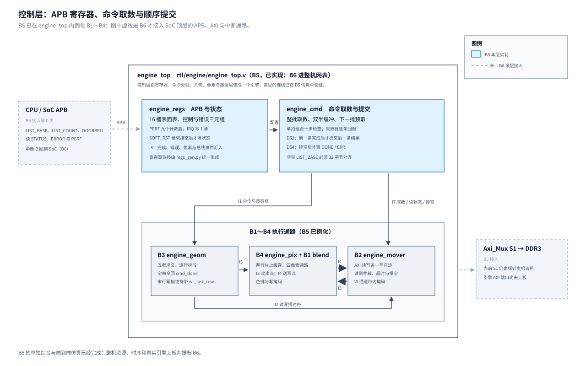
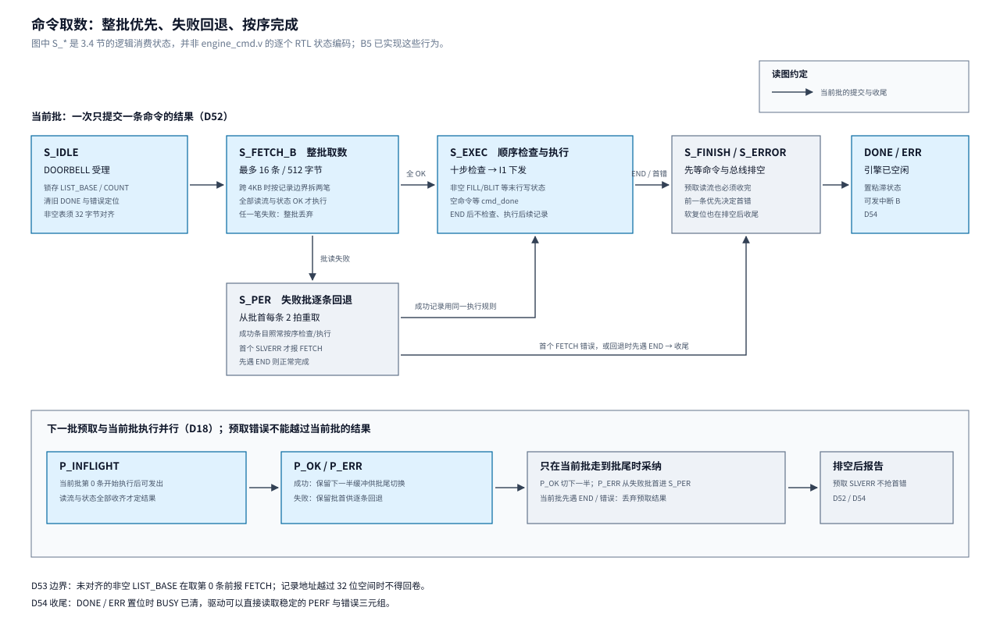

# 05 控制层：寄存器、命令取数与十步检查

状态：**B5 已验收（2026-10-02）**。研究在第三至五节，正式实现、复核、综合与上板证据在第六节；
原 Todo 条目已按仓库流转规则删除，
路线与层间接口见[总览](../../Todo/hw/引擎P1总览.md)；
研究之后要定的四件事（检查的结构、寄存器表的真源、完成判定、跨命令写后读）在第五节列成待定案清单。

## 一、动机

B1~B4 已验收：计算核心、搬运层、几何层、计算阵列都能在测试台上由「解码后的命令」直接驱动，
逐像素对软件执行器。但引擎还没有对外的入口——CPU 写什么寄存器、命令表从 DDR 怎么取进来、
一条 32 字节记录按什么顺序检查合法性、错了怎么报、做完了怎么通知，都还没有 RTL。
这是赛题基础要求 1「引擎解析指令」的落点，也是驱动（B6）与 SW9 的寄存器表依据。

B5 条目 2.2 节给开工前留了六项研究：

1. 十步检查的硬件结构（单拍组合还是多拍状态机，面积与 100 MHz 余量）；
2. 命令处理器的参考实现（至少读两份，读到代码级）；
3. 寄存器表的单一真源（一份表生成 Verilog 常量与 C 头文件，工具或手写脚本）；
4. 命令取数状态机（D18 的整批、预取、回退逐条、END 丢预取批四种路径画成状态图）；
5. 单独综合实验（给第 1 项出数字）；
6. 跨命令的写后读（B4 验收转来，三种做法选一）。

本章记这六项的过程、数据与结论，外加一次开工前的板卡基线（3.6 节）。

## 二、为什么是这几步

控制层的特殊之处是它的行为大部分**不在本层产生**：十步检查的语义是 spec 第 02 章定死的
（159 条一致性向量是判据），命令取数的周期数被 engine 第 02 章的事务模型量过（每批 16 条，
每颗弹幕分摊约 4 个周期），错误三元组与完成判定的接口在总览 2.4 节的 I1、I7、I8 里冻结。
本层自己能选的只有三件事：检查用什么结构实现（第 1、5 项）、寄存器表在三处副本
（RTL、C 驱动、设计文档）之间怎么保持一致（第 3 项）、命令下发的节奏——包括
B4 转来的跨命令写后读怎么挡（第 4、6 项）。参考实现（第 2 项）服务这三件事：
看同样的问题别人怎么解，把「整体形态」的借鉴范围限定在命令循环与寄存器前端。

## 三、每一步做了什么

### 3.1 十步检查的结构与单独综合（研究第 1、5 项）

**三种结构。** 行为的权威是 `sw/lib/gfx/check.c` 的 `gfx_cmd_check()`；第一步「取记录」
归取数状态机，检查本体产 0~8 九个错误码。三种结构写成研究探针
`sim/engine/ctrl/probe_check.v`（同一个 `probe_check` 模块，`MODE` 参数选结构）：

| 结构 | 形态 | 检查路径 |
| --- | --- | --- |
| 0 单拍组合 | 九个条件并行算、按顺序取首个（组合优先链） | 命令/表面表寄存器 → 全组合 → 结果寄存器，一拍 |
| 1 多拍状态机 | 每拍算一步（S_OP…S_OV 十个状态），首错锁存进 `have_err`，固定十拍出结果 | 单步条件 + 状态译码 → 首错锁存 |
| 2 SURF 预计算 | 每槽的结构谓词在写表面项时算好存一位（16 位），第五、六步只查这 16 位；其余同结构 0 | 查表 + 其余七条件 + 优先链 |

结构 2 的相容性（条目 2.2 节第 1 项要核对的）：预计算位随**每一次**表面项写按
「其余两字存储值 + 本次写入字」的视图重算，与存储同步更新，任意一拍都等于存储三字的现行谓词；
软复位与 `valid` 一起清零。spec 第 02 章 §2 的驱动契约（更新期间 `valid = 0`、最后写控制字置位）下，
三种结构对任何检查同判。这一条在仿真里有逐拍监视（判据 3）。

末像素溢出判断（条目里点名的最长项）的实现：原研究把非负三项截成 33 位，只看结果第 32 位；复核发现这不成立：`(h−1)<<sl` 可接近 2^47，
三项之和也能越过 2^33 后使第 32 位回到 0。现将行偏移保留 48 位，先判高 16 位是否为 0；
低 32 位与 `base`、行尾字节用 34 位相加，再判高 2 位是否为 0（第四节有反例与回归）。
BLIT 重叠判断用 18 位有符号（|坐标| < 2^15、宽高 < 2^16，|和| < 2^17）。

**仿真（判据先行）。** `sim/engine/ctrl/tb_probe_check.v` 三路判据：

1. **定向用例 54 条**，期望值逐条按 check.c 手推（文件头注释给出依据），
   覆盖：五种操作码的合法与非法、字段矩阵的每类违例（含 tint、`w0[15:14]`、w6）、
   方程 6、十个描述符失败位点（未登记、未对齐、宽零、`stride_log2 = 1`、stride 太小、
   末像素溢出、三段控制字保留位）、零面积仍走表面/格式/预乘三步、
   方程×源格式的匹配矩阵、两条优先级反例（字段先于表面、方程先于表面、表面先于 space、
   源格式后于目的 space）、同表面重叠（含负坐标与相接不相交）、零面积跳过重叠步、
   SET_CLIP 与 END 的字段规则；
2. **随机互比 3000 组**：随机表面表（一半按合法参数构造、一半全随机）与随机命令，
   三种结构的错误码两两相同；
3. **预计算位等价**：结构 2 的 16 位预测位在每一拍都等于存储三字的现行谓词
   （谓词复用 `check_struct_ok` 实例，不复制逻辑文本）。

结果：`SIM OK`——定向 54×3 全符合期望、随机 3000 组三路全同、预计算位 0 漂移。
判据有效性在这轮研究里被真实检验过：测试台首版有三个真 bug 被定向用例抓出
（`pack` 函数漏了 tint 位导致整条命令左移一位、两条预乘用例期望值手推反了、探针的
`check_fields` 漏了 tint 检查——第三条是探针错不是测试台错，由定向用例暴露后修在探针上）。

**单独综合（研究第 5 项）。** `sim/engine/ctrl/syn/` 三个工程（B4 同一套做法）：
顶层输入全部由 256 位 LFSR 驱动、不接常数，全部输出折进观测寄存器；
Efinity 2026.1、Ti60F225、约束 100 MHz、四步全 PASS。结果：

| 结构 | XLR（LUT4+LUT4FF+Adder） | FF | RAM | DSP | setup | hold | 最差路径 |
| --- | ---: | ---: | --: | --: | ---: | ---: | --- |
| 0 单拍组合 | 3079（2818+55+206） | 1786 | 0 | 0 | **+2.309** | +0.035 | LFSR → 错误码寄存器（全检查+优先链） |
| 1 多拍状态机 | 3232（2959+67+206） | 1791 | 0 | 0 | +1.750 | +0.035 | LFSR → `have_err` 首错锁存 |
| 2 SURF 预计算（逐槽版） | 6138（4754+240+1138+6） | 1787 | 0 | 0 | +3.223 | +0.035 | LFSR → `struct_ok` 预测维护路径 |

（另有三个工程共有的 4 个 SRL8，来自 LFSR 封装，不进对比。）

**读法。** 上表是修正地址谓词后用 Efinity 2026.1 重新跑三工程的 map/interface/pnr/pgm 四步结果；XLR 是 LUT4、LUT4FF 与 Adder 的合计，不含 FF。

- 三种结构在 100 MHz 下**都收敛**。结构 0 的最差路径就是条目担心的那两条：表面末像素
  完整溢出判断加 BLIT 的 32 位区间比较，串完整条优先链后仍有 +2.309 ns——
  单拍组合可行，多拍状态机不是必需的。
- 结构 1 没有省出时序或面积：首错锁存路径（单步条件 + 状态译码 + `have_err`）
  余量 +1.750 ns，小于结构 0 的 +2.309 ns；XLR 3232 对 3079，反而多约 5%。
- 结构 2 换来 +0.914 ns 余量（3.223 对 2.309），代价是面积约两倍（6138 对 3079）——
  但这是**逐槽版**的数：16 份谓词各配 33 位加法。共享版（一份谓词按下标读、按下标写）
  才是省面积的写法，而它触发了 efx_map 的崩溃（第四节），逐槽版是崩溃后的绕行写法。
- 结论（候选 D50）：**十步检查取结构 0（单拍组合）**。控制最简（无状态机握手、
  结果单拍出，159 条向量测试台的提交协议最简单），时序有余量；结构 1 留作实现备选，
  但本次数据没有显示面积或时序优势，若改用它还须锁存被检命令；结构 2 否决（干净的共享写法被工具崩溃挡住，
  逐槽写法的面积代价换来的余量并不需要——检查不在像素通路上，B4 的流水余量是 +5 ns）。

### 3.2 命令处理器的参考实现（研究第 2 项）

三份都读到代码级（文件、函数、寄存器名），原始件存档在 `Engineering/refs/`
（本地审查副本，不入库，出处以下列 URL 与版本为准）：

**CV1000 blitter（MAME `src/mame/cave/cv1k_v.{h,cpp}`，master；MAME 整体 GPLv2、
该文件头标 BSD-3-Clause）。** 命令循环在 `cv1k_blitter_device::gfx_exec()`（759~801 行）：
命令表在主 RAM，起始地址来自寄存器 `m_gfx_addr`，**逐字顺序取**，无跳转操作码；
操作码按命令字高 4 位分发，四类——`0x0/0xF` 结束（`return`，无错误码）、`0xC` clip
（一词参数，设或恢复裁剪窗）、`0x2` upload（16 字节头 + **像素内联在命令流里**）、
`0x1` draw（**定长 20 字节记录**，attr/alpha/src_xy/dst_xy(16 位有符号)/wh/tint，字段布局
见 403~436 行注释块）。未知操作码 `popmessage` 后停链——**没有错误码、没有表内索引、
没有出错后继续**。真实硬件的取数不是逐条：`cv1k_v.h:56` 定 `OPERATION_CHUNK_SIZE_BYTES = 64`
（每块 700 ns），`cv1k_v.cpp:451` 注释明确「按块读入 FIFO、取数与执行并发」（BREQ 窃总线）。
启动语义：写 kick 寄存器后做一遍 shadow walk 快照 clip/地址寄存器，在途作业期间改寄存器不影响
本作业（854 行）；blit 结束发 IRQ1（`cv1k.cpp:184` 的硬件笔记）。

**ORGFX（freecores/orsoc_graphics_accelerator，LGPL-3.0；论文 diva2:556520 的附录 A
即仓库 `doc/specification.tex`）。** 它**没有命令表 DMA**：CPU 逐个写坐标/颜色/格式寄存器，
最后写 CONTROL 的 trigger 位启动（`orgfx.c` 358~440 行）。寄存器前端 `gfx_wbs.v` 的
价值在工程化细节：忙时 32 位写整体进 64 项 FIFO（实现 10 项，注释与代码不一致）排队不丢
（31~39、552~567 行），管线空闲才落地；trigger 位硬件自动清零防重复触发（353~360 行）；
STATUS 的 [31:16] 放 FIFO 水位给软件流控（364~371 行）。两个已知缺陷要引以为戒：
读寄存器直通寄存器堆、不反映排队中的写（454 行注释自认）；驱动 `orgfx_wait()` 只等
BUSY、FIFO 余量检查被注释掉（`orgfx.c:84~88`）。错误通路只有一根总线 err 透传的中断线
（`gfx_wbm_read.v:75`），无码无索引。级间协议是单拍 write/ack 握手
（specification 第 130 行），上游忙时可多拍反压。

**iDMA（pulp-platform/iDMA，v0.5.1 + master，SHL-0.51）。** 只看寄存器前端。
v0.5.1（`src/frontends/register_32bit_2d/`，论文 2.1 节）：十个寄存器
（SRC/DST/NUM_BYTES/CONF/STRIDE_SRC/STRIDE_DST/NUM_REPETITIONS/STATUS/NEXT_ID/DONE）；
**读即发射**——软件读 `NEXT_ID` 发射，参数不合法（长度或重复数为零）读了也不发；
发射时参数组合定格成请求（寄存器页是快照源）；完成回报是**单调 ID 计数器**
（`issue` 递增 next_id、`retire` 递增 done_id，轮询 `done ≥ next` 判完成），
天然支持多笔在途与乱序确认。master 的 SystemRDL 版（`src/frontend/reg/idma_reg.rdl`）
加了两样：`launch_pending` 锁存（发射请求在仲裁器接收前不掉，`idma_reg.sv.tpl:175`——
v0.5.1 组合版在反压时会丢发射，这是两版之间最重要的工程修正）；
官方错误处理器（`error-handling.md`）的载荷 `{cause, err_type, burst_addr}`
与本设计的错误三元组（码/索引/标签）同构——本设计的索引是 `burst_addr` 的强化版；
但它的寄存器前端**没有错误状态寄存器**（文档 91 行明说留给系统集成者），错误页要自己定义。
寄存器前端默认 APB4（`IDMA_REG_CPUIF = apb4-flat`），形态与本层的 APB 第 0 页一致。

**借鉴来源表**（沿用总览 2.7 节的表头）：

| 来源 | 形态与许可 | 借鉴什么 | 用在哪 | 不借鉴什么 |
| --- | --- | --- | --- | --- |
| CV1000 blitter（MAME `cv1k_v.{h,cpp}`） | C++ 行为模型；MAME GPLv2，文件头 BSD-3-Clause | ① 64B 块批量取 + FIFO + 取/执并发的硬件证据（本设计的 16 条×32B 双批乒乓是它的放大版）；② 定长 draw 记录 + 变长 upload 的混合命令格式（本设计的 32 字节定长记录与 END 提前结束符同思路）；③ kick 时快照全局状态；④ 完成中断 IRQ1 先例；⑤ 命令字高位 opcode | D8、D11、D18 的形态佐证；`DOORBELL` 受理语义 | 错误处理（弹窗停机）；16 位 BREQ 总线；无跳转（本设计也不做 jump）；busy 靠时长估算 |
| ORGFX（freecores） | Verilog，LGPL-3.0 | ① 寄存器写排队 FIFO、忙时不丢；② trigger 位自动清零（`DOORBELL` 写后即清的先例）；③ STATUS 放队列水位；④ 级间单拍 write/ack | APB 寄存器页的工程细节；I1/几何层的握手风格 | 无命令表取数；寄存器读不反映排队写（本设计每个寄存器有真实寄存器，无此问题）；Wishbone 假设 |
| iDMA（pulp-platform） | SystemVerilog，SHL-0.51 | ① 读发射 + 参数定格；② 单调完成 ID 计数（本设计的完成计数 = 它的 done_id 的批量版）；③ launch_pending 锁存（提交受理后不掉）；④ 错误载荷三元组同构 | 完成判定（3.3 节）、错误通路寄存器的定义 | desc64 描述符链（另一路线）；stride/2D 语义（本设计在几何层）；它没有错误寄存器页 |

### 3.3 寄存器表的单一真源（研究第 3 项）

条目 2.2 节第 3 项给了两条路：手写小脚本，或 PeakRDL 一类工具（要看输出 iverilog 与
Efinity 能不能吃）。两条都实测了：

**PeakRDL 路线：工具可运行，但输出形态不适合本仓库。** 初次写的最小 RDL 在解析阶段报
`no viable alternative at input '<EOF>'`，当时误归因为 antlr4-python3-runtime 4.13.2 与 Python 3.14
不兼容。复核用 [PeakRDL 官方示例](https://peakrdl.readthedocs.io/en/latest/for-devs/rdl_gotchas.html)
的 `addrmap`、一个 `reg` 与两个 `field`，在本机 Python 3.14.4、PeakRDL 1.5.0、
`peakrdl-regblock` 1.3.1 下运行 `peakrdl regblock`，成功生成 `my_device.sv` 和
`my_device_pkg.sv`。原 EOF 报错只能说明初次输入未获解析，不能证明版本不兼容。
架构上仍不合：`peakrdl-regblock` 生成 SystemVerilog 的完整寄存器块
（自带 CPUif 层），而本仓库是 Verilog-2001 单编译单元（Efinity 工程
`def_veri_version="verilog_2k"`）、`` `default_nettype none `` 约定；
且引擎寄存器页的重头是**行为寄存器**——`DOORBELL` 受理、`PERF_*` 计数事件汇入、
软复位排空、粘滞错误与首错三元组锁存——通用生成的块表达不了这些，行为逻辑终归手写，
生成器能供的只有常量。

**手写脚本路线：选定。** 单一真源写在 `tools/check/` 的一个小脚本里（标准库、
~150 行），表 = 偏移、位域、复位值、读写属性的清单；一条命令生成两份产物：

- `rtl/engine/engine_regs_offsets.vh`：`localparam` 偏移与位域，`` `include `` 进 RTL；
- `sw/bsp/include/gfx_regs.h`：`#define`，驱动（B6）用；B6 前期研究发现 BSP 编译层看不到 `sw/lib/`，因此从 B5 原产物位置迁至此处。

另设 `--check` 模式：重新生成并与仓库内两份产物逐行比，不一致即非零退出，
挂进提交前检查（与 `localize_paths.py --check` 同一位置）。三处副本收敛成
「脚本生成两份、设计文档引用脚本」：设计文档 3.4 节的表改为「以脚本为真源的说明 +
语义注释」，偏移数字只在脚本里。实现与定案在 B5 开工时做（候选 D51）。

### 3.4 取数状态机与完成判定（研究第 4 项）

D18 定了批量与回退。图 2 把**当前批的消费状态**和并行预取分成两条路径；
下一批必须另有状态寄存器，不能把它的错误直接当成当前批错误。
符号：批长 `B = 16`，批首索引记 `bi`，已执行索引 `k`，`COUNT` 为本次提交的 `LIST_COUNT`。
与 B2 的接口全部走 I7（读核描述符/状态、排空、超时），与 B3 的接口走 I1/I2
（下发、`wr_last_row` 写状态、`cmd_done` 完成脉冲）。

| 状态 | 做什么 | 出口 |
| --- | --- | --- |
| `S_IDLE` | 等 `DOORBELL` 受理；受理时锁存 `LIST_BASE/COUNT`、清旧错误定位（spec §5） | `COUNT = 0` 直接 `S_FINISH`；否则发第一批（`B` 条或截到 `COUNT`）→ `S_FETCH_B` |
| `S_FETCH_B` | 取 `2×批长` 拍（16 条 = 32 拍）；跨 4KB 时在记录边界拆成两笔，按序写入同一缓冲半区，所有描述符的数据和状态收齐后才执行（D18） | 全部 OK → `S_EXEC`；任一描述符 `rresp` 非 OKAY → 整批丢弃（没有任何一条已执行）、从批首进 `S_PER` |
| `S_EXEC` | 从命令缓冲出命令：十步检查 → FILL/BLIT 按 I1 下发（几何层空闲时）、NOP 不下发、SET_CLIP 更新裁剪框；命令按表内顺序提交结果 | 见下 |
| `S_PER` | 回退逐条：从批首每条一笔 2 拍读（32 字节对齐保证单条不跨 4KB），取一条执行一条 | 首个 SLVERR → 报 `FETCH`（`ERROR_INDEX` = 该条、`ERROR_TAG` = 0）、`S_ERROR`；出错位置前先到 END → 正常结束、`S_FINISH`；到批尾 → 整批取下一批、`S_FETCH_B` |
| `S_FINISH` / `S_ERROR` | 已下发的 FILL/BLIT 都有完成回报，且无未排空的预取/读写事务后，置 `STATUS.DONE` 或锁存错误三元组、发中断 B（`IRQ_EN` 允许时） | 回 `S_IDLE`（新受理清错误定位）；软复位从任何状态进排空 |

**并行预取的状态。** 至少保存 `{批首索引、批长、缓冲半号、P_IDLE/P_INFLIGHT/P_OK/P_ERR}`。
当前批第 0 条通过并开始执行后可请求下一批；预取读流与状态都收完才标记 `P_OK` 或 `P_ERR`，
在此之前不能覆盖当前批的缓冲，也不能停住命令取数流的 `fs_tready`。
`S_EXEC` 到当前批尾时，`P_OK` 才切到下一半；`P_ERR` 才从失败批的批首进 `S_PER`；
`P_INFLIGHT` 则等它完成。当前批先遇 END 或更早的检查/执行错误时，丢弃预取结果，
等在途读事务排空，预取的 `SLVERR` 不上报。测试须覆盖「预取失败但当前批先遇 END」
以及「预取失败时当前批仍执行到尾」两条，防止重复执行或错序。

规范条款 §5 的逐条 `fetch` 是**逻辑执行次序**。D18 的整批读可能在 DDR 上物理读到 END 后的记录；
这些字不得检查、执行，也不得因预取失败而报 FETCH。命令表是 DDR 中的无副作用数据，
`PERF_RD_*` 按实际总线事务计；若以后允许有读副作用的命令来源，须先收紧 D18。

**搬运层边界（复核补充）。** B2 的读核关闭 `ENABLE_UNALIGNED`，未对齐描述符地址会向下取整；因此非空命令表要求 `LIST_BASE[4:0]=0`。若不满足，在取第 0 条前报 `FETCH/ERROR_INDEX=0/ERROR_TAG=0`，不能静默读错。一个批最多 512 字节、16 个 32 字节记录；按 4KB 剩余整条记录数把批分成最多两笔描述符，每笔按 16 字节对齐、不跨 4KB、不超过 192 拍。两笔的数据流与状态都属于同一**逻辑批**；任一笔失败，丢整批并从批首逐条重取。由 32 字节对齐可知逐条回退的一条记录不会跨 4KB。`LIST_BASE + 32×index` 用 38 位求值（或先作等价的 32 位上界比较）。批长还须截到 32 位地址空间末尾的完整记录数；没有可取记录时，只有逻辑执行实际走到该索引才报 `FETCH`，不得绕回 0 地址（先遇 END 则正常完成）。
B2 的 `fd_cidx/rd_stat_cidx/wr_stat_cidx` 和 B3 的 `done_cidx` 都只有 4 位，不能直接生成 32 位 `ERROR_INDEX`。D52 保证一次只提交一条 FILL/BLIT：像素状态归当前完整表内索引，低 4 位用来检查归属；命令取数流的 `fs_cidx` 只是描述符上下文（批首低 4 位），同一批的每拍相同；记录索引由保存的批首、已接收拍数及逐条回退索引重建。B5 仿真要在索引 16 之后分别注入 FETCH、BUS_WRITE，确认不发生 4 位回卷。

`S_EXEC` 的四条细路径：

1. **命令通过** → FILL/BLIT 等几何层空闲后用 `start` 单拍下发；非空命令等带
   `wr_last_row` 的写状态，空命令等 `cmd_done`（D38），NOP/SET_CLIP 不下发几何层、当拍完成。
2. **END** → 当前批执行到 END 时，已预取的下一批**不论成败都丢掉、出错不报**
   （D18；这正是 `S_PER` 里「出错位置前先到 END 不报错」的机制——END 之后的记录
   规范条款 §5 要求不检查、不执行）。
3. **十步检查报错** → 锁存首个三元组（错误码/表内零基索引/`w7`）、后续命令不读取、
   `S_ERROR`（检查类错误：失败命令无任何像素副作用）。
4. **完成推进与首错顺序** → 只有前一条命令完成后，后一条的检查结果才可提交为错误
   或下发几何层。命令检查可提前算候选结果，但不得提前置粘滞错误或中断：否则前一条
   `BUS_WRITE` 尚未返回时，后一条 `BAD_FIELD` 会抢成首错。当前活动命令任意一笔读/写状态报错或超时，要停止推进、按 D17 排空在途事务再结束；不能只等末行写状态，否则早期读错可能使等待永不完成。完成计数与下发计数仍作整表
   收尾的双重检查；D52 的串行提交下，完成顺序与命令顺序一致。

**预取**：当前批第 0 条开始执行后可发下一批描述符（若下一批批首 < `COUNT`）；
D32 的「命令取数优先」仲裁保证预取不被像素读饿死。**跨命令写后读的等待**
（3.5 节推荐 ①）挡住下一条命令的语义提交：非空 FILL/BLIT 等末行写状态，
空 FILL/BLIT 等 `cmd_done`，NOP/SET_CLIP 无写回可等。当前批的取数预取照常并行。

**完成判定确认 D38**：几何层对空命令不发描述符、回一拍带命令索引的 `cmd_done`，
控制层凭它推进计数——采纳 B3 的推荐，I1/I2/I8 的相关措辞在开工定案时回写。
`PERF_CMD` 在每条通过检查的命令提交时 +1（含 NOP 与空命令；`PIXEL` 按 I8 从 B4 上来，
口径是五者求交后的像素，B6 对账 `PIXEL == pixel_total − src_oob`）。

### 3.5 跨命令的写后读（研究第 6 项）

B4 验收查出：几何层发完一条命令的最后一个写描述符就空闲，读、写是两个独立核，
下一条命令的读可能跑到上一条最后一行的写前面（engine 第 04 章第四节，
`path_hazard_nowait` 十处不符、`path_hazard_wait` 逐字对）。三种做法与实测：

| 做法 | 代价（16 颗 16×16 ALPHA，`tb_engine_path.v -DTIMED`） |
| --- | --- |
| ① 控制层等上一条命令的末行写状态再发下一条 | 17668 周期，每颗 1104.3，比不等多 2.1% |
| ② 几何层每条命令开头等写方向空闲 | 与 ① 同价，改动在已验收的 B3 |
| ③ 只在新命令矩形与上一条目的矩形相交时才等 | 省下大部分 2.1%，多一组 32 位矩形比较 |

**定推荐 ①（候选 D52）**，理由：

- **B1~B4 的预算测量可接受，但 B5 仍须实测。** 已测路径的引擎侧上限按 145 万可用周期除以每颗 1104.3 周期约为 **1313 颗**，只比总览第 1 节「约 1300 颗」高约 13 颗。该测试尚未包含 B5 的检查、命令取数及控制开销；实现后必须在 B6 测整机，不能据此保证目标。省下 2.1% 的理想上限约 1341 颗，同样不是整机测量。
- **改动最小、语义最简。** 等待点在控制层下发处，一处实现；B1~B4 与 B3 的 `row_free`
  握手全不用动。①之下几何层开始一条命令时上一条必然写完，`row_free` 在命令开始时恒空闲，
  D49 估的「半号边界等待」随之不存在；B4 的判据 `path_hazard_wait` 就是引擎的原生行为。
- **②要改已验收的 B3**，只为同价；**③的省时不在关键路径上**（瓶颈是每行两笔读事务的
  固定开销，不是命令间等待），却引入「上一条目的矩形」状态与比较逻辑，还要处理
  END/空命令/软复位下的边界。

实现要点（3.4 节已并入状态机）：等待挡住下一条命令的语义提交与几何层 `start`，下一批取数预取照常推进；十步检查可以先算候选结果，但不得提前上报。已测路径多出的 2.1% 是每颗约 22.8 周期的末行写响应等待；B5 加入后的整机代价待实测。

### 3.6 开工前的板卡基线（SOP 0.6 节三步）

研究结束后按开发环境 0.6 节跑了回归表的前三步，复核时又在已接入的板卡上重跑并得到同样结果，确认板卡与当前网表健康（引擎不在网表里，
验的是加了 B1~B4 源文件之后整机行为不变，与 B4 验收同一口径）：

| 步骤 | 结果 |
| --- | --- |
| `ftdi_pgm.bat --scan_usb` | 器件 ID `0x10660a79`、IR 宽度 5 |
| `board_run.py --check-only`（含烧写今日比特流） | 两次会话各读一次 PC，均 OK（`0x00009018`） |
| APB 探针 `--cmd` 四条 | ID `47465832`、VERSION 1、SCRATCH `0`；`0xF810_0008` 写 `a5a55a5a` 读回一致；未映射的 `0xF810_8008` 读 0 |
| `displayFifoProbe`（完整烧写开始） | `fail 0`、`done`；IDENT 三行 `ok`；idle/read/write 各 120 场全 `ok`，最低水位 347/331/329 拍（与 B4 验收一致），bad 四计数全 0，`beat = txn × 160` 三组全对。日志 `sw/apps/probe/displayFifoProbe/logs/b5research_20261001.log` |

### 3.7 本层结构与命令路径

这一层做完之后的结构与两条取数路径见图 1、图 2。图 1 的实线只表示 B5 已在
`engine_top.v` 内连通并验证的模块；图中的 SoC APB、`Axi_Mux` S1 和中断 B 仍待 B6 接入。



**图 1** B5 的 `engine_regs` 接 APB 寄存器、表面表、错误与性能计数器，
`engine_cmd` 负责整批取数、十步检查和按序提交；两者由 `engine_top` 与 B1～B4 的执行通路连通。
I1 下发命令，I2 发读写描述符，I3/I4 交换像素流，I5 交付每行边带，I7 处理命令取数和排空，
I8 汇入完成、错误及性能事件。B5 的独立仿真与综合覆盖图内通路；虚线的 SoC 接入与整机验证归 B6。



**图 2** 3.4 节的逻辑消费状态，不是 `engine_cmd.v` 的逐个 RTL 状态编码。整批取数失败时从批首逐条回退；
下一批预取与当前批执行并行，只在当前批走到批尾时采纳结果。当前批先遇 END 或更早的错误，
预取结果丢弃，且必须等在途读写排空后才报告 DONE/ERR；这对应 D18、D52～D54。

## 四、遇到的问题

### Efinity 2026.1 的 efx_map 对一类寄存器结构崩溃（EXCEPTION_ACCESS_VIOLATION）

**第一现场。** 结构 2（SURF 预计算）的单独综合在 map 步崩溃：

```text
INFO  : ... Hierarchical pre-synthesis "probe_check(MODE=2)" begin
ERROR : EXCEPTION_ACCESS_VIOLATION reading memory at 0x30
```

同源文件的 MODE 0/1 四步全 PASS。隔离实验（只综合 `check_surf16(PRECALC=1)` 加最小封装）
同样崩溃，把触发范围钉在表面表模块的预计算部分。

**定位。** 排除法：数组化预测位（16 位向量 → 1 位数组）、拆 generate、换顶层
（跨模式常数三态选择改为 generate 分支）都绕不开；三个 `tab` 存储器在 MODE 0/1 下
带两个组合读口正常。触发形态是 **PRECALC = 1 时新增的那一路**：存储器的第三个
组合读口（按下标 `slot` 的旁路视图）喂 `check_struct_ok` 实例、实例输出再按同一
下标写预测位——「存储器变量下标读 → 实例 → 变量下标写」这条链让 efx_map 的
层次化预综合段崩掉。

**处理。** 改成**逐槽展开**：每槽一个 `check_struct_ok`，读自己那三字（genvar 常量下标）、
写自己那一位（常量位），共享的按下标读写全部消失，语义不变（仿真三路判据重跑仍 PASS），
综合通过——代价是 16 份谓词逻辑，这就是 3.1 节表里结构 2 面积翻倍的来源。

**教训**（写此表时值得记的）：单独综合的「四步 PASS」不是白给的，结构写法本身能触发
工具崩溃；研究期对每个候选结构都跑一次单独综合（而不是只跑选中的那个），崩溃才会在
研究期暴露、在实现期绕开。本条同时是给 B6 的输入：整机网表里若出现同类结构
（寄存器堆旁路 + 判定逻辑 + 变下标回写）要预先避开。

### 研究探针测试台首版的三个真 bug

定向用例的价值被这轮研究自证：首版三路全「同错」也被手推期望拦住。

1. `pack` 函数的 w0 拼接漏了 tint 位（31 位而非 32），整条 256 位命令左移一位，
   w7 标签的最低位落进 w6——所有过了操作码步的用例全部误报 BAD_FIELD。
   症状是「三路一致但与期望不符」，直接指向共享输入端。
2. 两条预乘用例的期望手推反了：`w4 = 0x8040_4040` 是 RGB ≤ A 的**合法**值
   （40 < 80），违例应为 `0x4080_4040`（R=80 > A=40）。check.c 的比较方向是
   `RGB > a` 才报错。
3. 探针 `check_fields` 漏了 tint 位检查（check.c 的 `must_zero_mask` 恒含 `F_TINT`），
   定向用例 `fill_tint_bit` 期望 2 实得 0 暴露——修在探针上。这验证了判据设计里
   「期望值独立于被测实现手推」这条规矩：探针和测试台先后都靠它抓错。

### 地址溢出判断截位错误（复核）

原探针把 `base + ((h−1) << stride_log2) + 4w−1` 截成 33 位，再用第 32 位判断越界。`stride_log2` 可到 31，行偏移可到 47 位；第 32 位回到 0 时会把越界误判为合法。新增三条独立期望的定向反例：`base=0,h=5,w=1,sl=31` 与 `base=0x80000000,h=4,w=1,sl=31` 必须报 `BAD_SURFACE`，`base=0xfffffffc,h=1,w=1,sl=31` 是合法边界。修复前仿真有两类错误；用 `check.c` 独立核过期望，再把行偏移扩到 48 位、低位三项和扩到 34 位后，54 条定向和 3000 组随机均通过。三工程也已重新跑完 Efinity 四步，数据以 3.1 节新表为准。

### 命令表取数与既有接口不匹配（复核）

D18 初稿把 16 条批次当成一笔 32 拍描述符，没有处理 `LIST_BASE` 未对齐或批次跨 4KB；但 B2 读核的 `ENABLE_UNALIGNED=0` 会把未对齐地址向下取整，而且一笔描述符不得跨 4KB。B2/B3 命令索引只传低 4 位，也不能直接填 `ERROR_INDEX`。3.4 节已给出对齐拒绝、跨页拆分、32 位地址越界与完整索引重建的实现契约；2.4 节验收用例已补。此项属于接口推导，正式 B5 RTL 尚未实现，开发时须用端到端仿真验证。

### PeakRDL 解析失败的归因错误（复核）

初次最小 RDL 报 EOF 后，研究记录把它归因为 Python 3.14 与 ANTLR 不兼容；
3.3 节的官方示例重跑已证实本机可以正常解析并生成 SystemVerilog。
保留初次失败的事实，撤销版本不兼容的断言。手写生成器的选择依据是本仓库只需常量、
RTL 使用 Verilog-2001、寄存器的状态行为仍须手写。

## 五、结果

### 5.1 研究数据汇总

| 测量项 | 结果 |
| --- | --- |
| 十步检查三结构仿真 | 定向 54×3 全符期望；随机 3000 组三路互同；预计算位 0 漂移（`SIM OK`） |
| 单独综合（100 MHz，四步 PASS） | 结构 0：3079 XLR / 1786 FF / setup +2.309 / hold +0.035；结构 1：3232 / 1791 / +1.750 / +0.035；结构 2（逐槽）：6138 / 1787 / +3.223 / +0.035；三工程 0 RAM 0 DSP |
| 检查通路单拍可行性 | 修正 48 位行偏移与 34 位低位和后，最差路径周期 7.691 ns，余量 +2.309 ns |
| 写后读 ①的预算影响 | B1~B4 已测路径每颗 1104.3 周期，上限约 1313 颗；未计 B5 控制开销，B6 须整机复测目标线约 1300 颗 |
| 参考实现 | CV1000 / ORGFX / iDMA 读到代码级，借鉴表见 3.2 节 |
| 寄存器真源 | PeakRDL 官方最小例子在 Python 3.14 可生成；因输出 SystemVerilog 完整寄存器块而选手写常量生成器（3.3 节） |
| 板卡基线 | 调试通路、APB 探针、displayFifoProbe 三步全过，水位与 B4 验收一致 |

### 5.2 待定案清单（B5 开工时确认，编号 D50 起）

| 候选 | 内容 | 本章依据 |
| --- | --- | --- |
| D50 | 十步检查 = 单拍组合（结构 0）；结构 1 为 B6 时序兜底；结构 2 否决 | 3.1 节 |
| D51 | 寄存器表真源 = `tools/check/` 手写生成器，产 `.vh` 与 `.h` 各一份，`--check` 挂提交前检查 | 3.3 节 |
| D52 | 命令结果按序提交；非空 FILL/BLIT 等末行写状态，空命令等 `cmd_done`，NOP/SET_CLIP 当拍完成；上一条完成前不得上报后一条错误 | 3.4、3.5 节 |
| （确认）| 完成判定按 D38：非空命令 `wr_last_row`、空命令 `cmd_done`、按完成计数推进 | 3.4 节 |

B4 验收遗留的另一条也归 B5 开工处理：两个方向同一拍超时时 `tmo_dir` 只报写方向
（engine 第 02 章第六节），控制层落 `TIMEOUT` 时按单一来源处理即可。

### 5.3 本期新增的仓库文件

```text
Main/sim/engine/ctrl/probe_check.v        三结构研究探针（含 efx_map 崩溃的绕行注释）
Main/sim/engine/ctrl/tb_probe_check.v     测试台：定向 + 随机互比 + 预计算位等价
Main/sim/engine/ctrl/run.sh               仿真入口（iverilog，不需要 EFINITY_HOME）
Main/sim/engine/ctrl/syn/                 三个单独综合工程（comb/fsm/pre）
Main/sw/apps/probe/displayFifoProbe/logs/b5research_20261001.log   板卡基线日志
```

研究期的原始报告（CV1000/ORGFX/iDMA 的代码级笔记与源码副本）在 `Engineering/refs/`
（`.gitignore` 已排除，出处以 3.2 节为准）。

## 六、实现、仿真与上板（2026-10-02）

### 6.1 定案 D50~D54 与 D38 的确认

开工首日把 5.2 节的候选落成定案，另补两条实现期定案：

| 编号 | 定案 | 依据 |
| --- | --- | --- |
| D50 | 十步检查 = 单拍组合（结构 0）；结构 1 不再保留为备选（数据无优势）；结构 2 否决 | 3.1 节 |
| D51 | 寄存器表真源 = `tools/check/regs_gen.py`，生成 `engine_regs_offsets.vh`（RTL `` `include ``）与 `sw/bsp/include/gfx_regs.h`（驱动；B6 前期研究从 `sw/lib/gfx/` 迁入），`--check` 挂提交前检查；ID=`0x4746_5801`（"GFX"<<8|版本 1），CAPS=色键/预乘/直通/MUL + [11:8] 通路数 4，CTRL=[0]EN/[1]SOFT_RST/[2]CNT_CLR（后两位置 1 自清读恒 0），STATUS=[3:0] 标志 + [7:4] 错误码，IRQ 写 1 清 | 3.3 节 |
| D52 | 命令结果按序提交：非空 FILL/BLIT 等末行写状态、空命令等 `cmd_done`、NOP/SET_CLIP 当拍完成；上一条完成前不上报后一条错误 | 3.4、3.5 节 |
| D53 | 取数边界契约（D18 的实现补充）：非空表 `LIST_BASE[4:0]=0`，违例在取第 0 条前报 `FETCH`（索引 0、TAG 0）；批最多 512 字节，跨 4KB 在记录边界拆两笔描述符、数据按序拼入同一批、全部状态 OK 才执行，任一笔失败整批丢弃从批首逐条回退；记录地址按 38 位求值，批长先截到 32 位空间末尾的完整记录数，越界记录不取不回卷、逻辑执行需要时才报 `FETCH`；B2 的 4 位 `*_cidx` 只是描述符上下文（批首），完整 `ERROR_INDEX` 由本层重建，低 4 位仅作一致性监视（`fe_cidx_err` 引到顶层供仿真） | 3.4 节复核、I7 |
| D54 | 完成与错误置位时机：检出时只挂 pending，等在途命令自然收尾、预取流收完（静止）才置 `done_set`/`err_set` 并回空闲——**DONE/ERR 置位即引擎已空闲**，驱动不必二次等 BUSY，D20 的「完成后读 PERF」直接成立；DOORBELL 受理清旧错误定位与 DONE（spec §5），忙/排空中/EN=0 时写 DOORBELL 回 PSLVERR，未映射偏移读写都回 PSLVERR | S_TERM 的实现、d12 的 PERF 抽样 |
| （确认）| D38 完成判定按 B3 推荐采纳：非空命令 `wr_last_row`、空命令 `cmd_done`、控制层按「完成计数 == 已下发 FILL/BLIT 条数」推进 | 3.4 节 |

读状态归属的实现约定（mover 每方向一笔在途 + 门控保证上一个状态脉冲先于下一个描述符被看见）：FE 在途（F_ISSUE/F_POLL/F_PULSE）期间的 `rd_stat` 全归取数，其余归像素读；写状态只来自像素通路，恒归活动命令。两个方向同一拍超时时 `tmo_dir` 只报写方向（engine 第 02 章第六节的遗留），控制层按单事件落 `TIMEOUT`，索引取检出时的活动命令/当前批首。

### 6.2 RTL 结构

三个文件共约 1500 行，接口即总览 2.4 节的 I1/I2/I7/I8：

- **`rtl/engine/engine_regs.v`**（约 330 行）：APB 第 0 页从口。表面表 16 槽 × 3 字为触发器阵列，两路组合读口（源/目的）供十步检查；槽号译码 = `(paddr−0x040)>>2` 除以 3（16 档比较链）。九个 32 位 PERF 计数器按 I8 事件汇入（PIXEL 按行边带握手加 `sb_npx`、RD_BURST/BEAT 把命令取数描述符也计入——`PERF_RD_*` 计实际总线事务、WAIT_DDR 是 AXI 五通道任一 valid 未握手的拍数、BUSY 是引擎忙拍数）。软复位 pending 举到 `drain_done` 才撤，撤时清全部 `valid`、错误定位与 DONE；顶层把 `rst_ctrl || soft_pending` 直连搬运层 `drain_req`，复位电平本身也是排空请求（D17 的「一次请求只完成一次」承接）。
- **`rtl/engine/engine_cmd.v`**（约 870 行）：取数引擎 FE（F_IDLE/F_ISSUE/F_POLL/F_PULSE）+ 主状态机（IDLE/FETCH/RD0~RD2/RUN/ISSUE/ACTIVE/ADV/SWITCH/PERW/PER_WAIT/TERM/EXEC）。命令缓冲 64×128 单写双读（两批乒乓 + 逐条回退共用，写口进取数流、读口进执行）；主状态机先摆 `rq_*` 再举一拍 `fe_start_q`，FE 空闲时受理。十步检查为组合（D50），`ec_struct_ok`/`ec_fields` 两个子模块与探针同构。
- **`rtl/engine/engine_top.v`**（约 300 行）：纯连线。两路复位（D17）：控制层挂 `rst_ctrl`，搬运层挂 `rst_ddr_n` 取反；`drain_req = rst_ctrl || soft_pending`。I8 汇聚在此接线：读突发计数 = 几何读描述符握手 + 命令取数描述符握手。

表面读端口、`dbg_fe_cidx_err` 引到顶层端口（仿真监视用，综合悬空）。

### 6.3 单元仿真

`sim/engine/ctrl/` 新增正式单元仿真（研究探针保留为回归），`run.sh` 四步：

| 步骤 | 内容 | 结果 |
| --- | --- | --- |
| 研究探针回归 | `probe_check` 三结构（第 05 章 3.1 节） | PASS |
| engine_top 主套件 | 159 条向量经 APB 端到端（`tools/check/vec_to_sim.py` 把 `--emit` 展开成定型记录流，测试台两阶段：整文件解析→逐向量执行；每张表提交后对错误三元组，`mem=1` 的对期望内存）+ 定向 D1~D16 | **6576 项检查 0 错，159 向量全对** |
| INJECT=1 | 对调 space/format | 3 条优先级向量见红（#75/145/148） |
| INJECT=2 | 关掉逐条回退 | 9 条见红（含 fetch-short-table 报索引 0 而非 1） |

定向 16 例对应 2.4 节判据：D1 批跨 4KB 拆两笔（批首 0xFE0：1 条 + 15 条）、D2 非对齐基址报 FETCH(0,0)、D3a/b 32 位末端 END 优先与越界 FETCH(1)（第 0 条先执行）、D4a 索引 17 的 FETCH（17 条已执行、17 号未执行，索引不回卷）、D4b 索引 17 的 BUS_WRITE（tag=0x11 完整保留）、D5/D6 总线错误端到端（三元组 + 中断 B 置位与写 1 清 + 失败命令之后的命令无像素副作用；D5 额外检查 BUS_READ 出错行的原值未被写坏）、D7 超时（按住 AR 4300 拍 > T=4096 → TIMEOUT，放行后回空闲可再提交）、D8 软复位（valid 全清、裁剪框从 8×8 恢复全游戏区、能再提交）、D9 跨命令写后读（别名表面先写后读逐字相同）、D10 首错顺序（BUS_WRITE 先于 BAD_FIELD）、D11 零面积/NOP/SET_CLIP 混排、D12 PERF 抽样（CMD=1、PIXEL=16、KEY_SKIP=8 精确）、D13 16 条 NOP 的单批 32 拍取数计数、D14 `LIST_COUNT=0x10000` 不得静默截成 0、D15 TIMEOUT 只在排空后报告、D16 APB 无效读写和 EN=0 DOORBELL 须回 PSLVERR；另核对 CAPS=`0x0000040F`。

完成语义（D54）由套件间接验证：submit 判据是「DONE/ERR 置位**且** BUSY=0」，多表向量（#153~156）在旧语义（END 即置 DONE）下全部挂死，新语义下全绿。

**改了两个既验收文件（各自回归重跑通过）**：
- `sim/axi_probe/axi_ram_model.v`：ERR_LO/ERR_HI 复制进运行时寄存器（复位取参数值，`in_err` 判寄存器）；B5 补「跨进窗口的突发（基址在窗外、末拍在窗内）也算命中」——命令表的批量预取是一笔大突发，FETCH 截断点落在突发中间。既有套件的窗口与描述符对齐（首拍命中），`axi_probe`/`axi_mux_guard`/`engine/mover` 三套件重跑逐字节不变。
- `rtl/engine/engine_pix.v`：加 `perf_key_lanes`/`perf_key_valid` 两个输出口；验收时将色键命中槽位与写流 `valid/data` 在同一输出级寄存，避免首拍 X 和末拍错位。I8 的 KEY_SKIP 在 D12 精确对账为 8，`sim/engine/pix` 25/25 回归通过。

### 6.4 单独综合

`syn/engine_top_syn.xml`（B3/B4 同一套做法：LFSR 驱动全部输入、输出折进 obs、100 MHz、四步）：
**map/interface/pnr/pgm 全 PASS**；验收修复后 XLR **15186**（LUT4 7871 + LUT4FF 3165 + Adder 1880 + AdderFF 273 + SRL8 1 + FF 1747 + Routing 249）、FF **5185**、**29 块 RAM**（命令缓冲 7 + 行缓冲 12 + 两个 DMA 核的内部存储 10）、**6 个 DSP**；setup **+0.984 ns** / hold **+0.026 ns**，最差路径为表面选择到错误码 CE（35 级逻辑）。旧测量 12824 XLR / setup +1.078 ns；完整 32 位 `LIST_COUNT` 与读错误抑制写入等修复后重新测得上述新值。RAM/DSP 与整机的差额在 B6 接入后对账。

主工程四步 PASS（引擎七文件 + 两个核已列进 `gfx2d_ti60.xml`、尚未被顶层例化，与 B4 同一状态）：资源与 2026-09-25 基线完全一致（XLR 21935 口径、71 块 RAM、4 DSP），setup +3.516 / hold +0.026 不变；Missing Interface Pins 仍是既有 6 项。新增告警只有 `engine_regs_offsets.vh` 被 efx_map 当独立单元扫描的 localparam root-scope 提示（无害，localparam 在包含处生效正确），自写代码无位宽截断告警。

### 6.5 上板

按 0.6 节回归表前三步（新比特流）：

| 步骤 | 结果 |
| --- | --- |
| `ftdi_pgm.bat --scan_usb` | 器件 ID `0x10660a79`、IR 宽度 5 |
| `board_run.py --check-only`（烧写本次比特流） | 两次会话各读一次 PC，均 OK（`0x00009018`） |
| APB 探针 `--cmd` 四条 | ID `47465832`、VERSION 1、SCRATCH 写回一致、未映射页读 0 |
| `displayFifoProbe` | idle/read/write 各 120 场 `ok`、四种 bad 计数全 0、`fail 0`、`done`、IDENT 三行 `ok`、最低水位 347/331/329。验收日志 [`b5accept_20261002.log`](../../../Main/sw/apps/probe/displayFifoProbe/logs/b5accept_20261002.log) |

引擎不在网表，上板验的是「加了引擎源文件后整机行为不变」（与 B4 同一口径）；引擎自身的上板判据在 B6。

### 6.6 验收复核与 B6 接续

验收重新读 RTL、生成器、规格和测试台后，先使新增判据见红，再修复并回归：

1. KEY_SKIP 输出与写流错拍且首拍可能为 X；寄存槽位与写拍同步后，16×1 BLIT 精确为 8。
2. D5 的 BUS_READ 失败行原值被覆盖；活动命令检出错误后，剩余写流保留握手但 `WSTRB=0`，D5 逐字核对原值。
3. 命令取数 512 字节单批的 `PERF_RD_BEAT` 只取了字节数的低 8 位；扩为完整 12 位并按 16 字节换算，D13 对账 32 拍。
4. `LIST_COUNT` 在 APB 层被截为 16 位，超过 65535 静默变 0；命令计数、索引及地址求值扩到完整 32/38 位，D14 验证 0x10000 不会误报成功。
5. APB 失败访问的 PSLVERR 晚了一个采样边沿，RO 写还会被接受为无错；改为 ACCESS 组合响应，D16 覆盖无效读写和被 EN 禁用的 DOORBELL。
6. 寄存器真源的 CAPS 三元组被误当作高/低位，C 掩码与 RTL 能力值错误；改成显式位起点/宽度/值，生成物一致，CAPS 读回 `0x0000040F`。
7. 超时错误原本在引擎仍忙时置 ERR；改成收尾后报告，D15 核对 ERR、BUSY 时序。

B6 接续：单独综合的 29 块 RAM/6 个 DSP 与整机对账；驱动分配或复制命令表时保证 `LIST_BASE` 32 字节对齐。引擎自身尚未进 SoC 网表，上板引擎功能在 B6 验收。

### 6.7 提交前判据核对

全部 10 个仿真套件回归通过（含从机模型改动后的 axi_probe/axi_mux_guard/engine_mover；控制层最后修复后单独重跑 `SIM OK: 4/4`）；主工程与独立综合四步 PASS、无负 slack；`regs_gen.py --check` 与 `localize_paths.py --check` 通过。板卡按 6.5 节复测通过。
