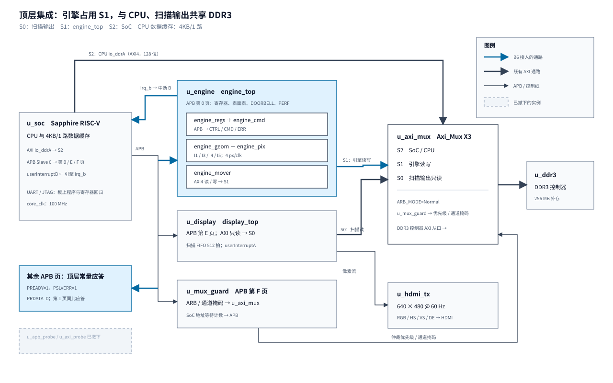

# 06 顶层集成与上板

钛金 Ti60F225 上的 2D 渲染引擎（引擎 P1，直通 BitBlt：填充、拷贝、色键与 Alpha 混合），
B1~B5 已把六层各自做到单元仿真、单独综合与验收，但整个引擎还不在这颗 FPGA 的网表里：
SoC 的 AXI 多路器给引擎预留的 S1 口被测量主机占着，寄存器页被 APB 探针占着，中断 B 接的是 0。
本章记录 B6：把 `engine_top` 接进 SoC 顶层，整机编译一次，写最小驱动与两个板上判据程序，
按判据上板。板上要回答的问题是 B1~B5 回答不了的：引擎进了带 CPU、DDR3 控制器、扫描输出
的真实系统之后，像素还逐位对不对，时序还收不收得拢，扫描 FIFO 在真实引擎负载下还剩多少水位。
跨批次路线与接口见[第 00 章](00-P1路线与层间契约.md)；前期研究、撤探针前基线与本批验收证据均归档在本章。



## 一、动机

B5 验收时留下三件事：`engine_top` 与两个 DMA 核已列进工程源文件清单但顶层没有例化；
单独综合的 29 块 RAM、6 个 DSP 与整机没对过账；写核 XLR 与 2026-09-25 一次已丢失的整机
记录差约 580 没有结论。三件都只能靠整机编译回答。

动机的另一面是撤探针的代价窗口。S1 探针主机与 `apb_probe` 是 E2~E5 的测量工具，
四个板上程序依赖它们；D6/D21/D22 定了在引擎接入的同一次编译里把它们撤下，撤之前必须在
现行比特流上留齐基线。两份 DDR 探针的复跑 2026-09-27 已完成；`cacheCoherencyTest` 与
`displayFifoProbe` 的现行比特流基线已于 2026-10-02 补齐（本章 3.0 节，
比特流 SHA256 `22f05df8…`，两次运行 `board_run.py` 全程有正面证据）。第 0 步闭环之后，
本章的任何一次编译都不再被探针相关义务阻塞。

SoC 基线（D14）在开工研究里裁决过：16KB/4 路数据缓存的采用条件里有一条「SW9 的真实游戏
与扫描压力确认」，而 SW9 的硬件后端又等引擎上板，构成依赖环；引擎上板前能做的两项
（收益重现、DDR 探针复跑）都已完成。结论取 D14 后半，引擎在 4KB/1 路主线上编译，
换缓存留作上板后的独立改动。

## 二、为什么是这几步

本批拆成八步：定案落地、顶层 RTL、整帧仿真、驱动、`engineTest`、改写
`cacheCoherencyTest`、整机编译、上板判据与回归。

从约束倒推，这八步少一步都不成立。搭车规则第 1 条要求进网表的改动攒一次编译，
所以顶层 RTL 与整机编译必须一前一后成对，中间隔着仿真——0.3 节的流程要求仿真过了才编译，
负 slack 或新增告警还要回到 RTL，这一对不能合并。上板判据需要两个程序：`engineTest`
承担整帧一致、写掩码、性能与 E5 复测；E3 复测按 D22 要用改写后的 `cacheCoherencyTest`
（引擎当外部写入者与第二个读者）——探针版在撤探针后跑不了，改写必须发生在上板之前。
驱动是两个程序共同的前置，单独成步是因为它要把 B5 定下的提交协议（D53 的对齐拒绝、
D54 的完成时机）落成接口，并处理一个分层冲突（候选定案 D55）。整帧仿真单独成步，
是因为它能在耗时的整机编译前先发现逐位错误；整机编译后仍可继续复跑仿真。
定案落地放最前，是因为 D55 改动头文件路径、D14 决定编译基线，两者都影响
后面每一步的输入。

## 三、每一步做了什么

### 3.0 开工研究与撤探针前基线

研究先核了三项前提。第一，`sw/mk/target.mk` 编 BSP 时只有 `-Isw/bsp/include`，
不能包含原先生成在 `sw/lib/gfx/` 的寄存器头文件；寄存器偏移不能在驱动里再抄一份。
因此 D55 将生成头文件迁到 BSP 的 include 目录，保持 `regs_gen.py` 单一真源。
`regs_gen.py --check`、软件层次七项检查及注错、xPack GCC `-Wall -Wextra -Werror`
的小程序编译均通过。第二，B5 主工程与 2026-09-25 `outflow` 同为 21935 XLR、71 RAM、
4 DSP、setup/hold +3.516/+0.026 ns；这才是 B6 增量基线。B5 的独立综合 15186 XLR
含观测封装，不能当整机增量预测值；35 块 RAM 是分模块预算，不是精确通过线。
第三，platform 第 10 章的 16KB/4 路采用条件含 SW9 真实游戏压力，SW9 的硬件后端又
等待引擎上板，故 D14 取 4KB/1 路主线，让 16KB 候选以后单独编译验证。

撤 S1 探针之前按 D22 保存对照组。E8 两份 DDR 探针已于 2026-09-27 在 4KB 与 16KB
构型复跑通过；本批在当前 4KB 比特流（SHA256
`22f05df8edd83a77b6bb29081c987a690086ea8d79de28319078527c6ca606b8`）上分别
重新烧写运行 [cacheCoherencyTest](../../../Main/sw/apps/test/cacheCoherencyTest/logs/b6_preintegration_20261002.log)
与 [displayFifoProbe](../../../Main/sw/apps/probe/displayFifoProbe/logs/b6_preintegration_20261002.log)。
前者 BIN SHA256 `98b875e0d3baa9f5effcdb6d7966afea3321f74c3cf18b3ff1466427b53215b5`，
P/A/B/C/D 共 19 行 `ok`、`fail 0`/`done`；后者 BIN SHA256
`17f2144c0d47f8b8e64ac04defccac4f76a60ec413658443d79c579c1a2544d8`，
idle/read/write 各 120 场，最低水位 347/331/329，三组 bad 与欠载均 0、`fail 0`/`done`。
两次运行均有 JTAG 配置、OpenOCD 检查、BIN 加载及 COM11 有效输出。采集工具曾把
“程序已加载”标记插在 `C invalidate_addr` 一行中，复核时仅移去标记并拼回该行，
原始日志保留。Flash 自动启动的 `assetTest SW5` 输出不计入判据。

撤探针前还用 OpenOCD 读到 APB 探针 `ID=0x47465832`、未映射地址
`0xF810_8008` 读 0，为 D21 替换后的 APB 回归保留比较点。四个曾依赖 S1 探针的
程序及替换方案见 `Main/sw/README.md`；引擎接入后不能将探针版程序原样复跑。

### 3.1 定案落地（D55、D14）

D55：寄存器真源 `tools/check/regs_gen.py` 的 C 产物从 `sw/lib/gfx/` 迁到
`sw/bsp/include/`。冲突在于 target.mk 给 bsp 层的 include 路径只有 `-Isw/bsp/include`，
驱动按本章 3.4 节放 `bsp/ti60/` 就 include 不到 lib 里的头文件；迁出的头文件当时没有
C 使用方，迁移零影响。`regs_gen.py --check` 与 `check_sw_layers.sh` 全过。

D14：按前期研究的结论取 4KB/1 路分支，本批全部编译都在 4KB 主线上；
16KB 候选留待引擎上板后按 platform 第 10 章第六节的采用条件单独决定。

### 3.2 顶层 RTL

`rtl/top/gfx2d_top.v` 的改动（进网表的改动只有这一处文件，管脚与 `peri.xml` 不动）：

- 删除 `u_apb_probe` 与 `u_axi_probe` 两个实例；新增 `u_engine`（`engine_top`，
  `INJECT` 综合常量 0，仿真观测口 `dbg_fe_cidx_err` 悬空）。
- APB 第 0 页：`apb_sel_eng = (paddr[15:12]==4'h0)` 门控 `psel`；未映射页
  （含探针主机撤下后的第 1 页）改为常量应答 `PREADY=1`、`PSLVERR=1`、`PRDATA=0`（D21）。
- AXI：引擎主口接 Axi_Mux S1，S1 的 `AWID/ARID` 维持 `8'h0`（引擎与探针主机都无 ID 口），
  控制器的 `bresp` 直接并接（Axi_Mux 无 BRESP 端口，E5 的既有做法）。
- 中断：`userInterruptB` 从 `1'b0` 换成引擎的 `irq_b`（电平 = `IRQ_STAT & IRQ_EN`，
  复位后不举）。
- 复位（D17）：控制层 `rst_ctrl` 接 `soc_system_reset`，搬运层 `rst_ddr_n` 接 `ddr_rstn`
  取反，与 Axi_Mux 同源；软复位经寄存器层变 `drain_req` 排空搬运层。

### 3.3 整帧仿真（`sim/engine/frame/`）

被测是 `engine_top`（B1~B5 六层整机），从机是补齐后的 `axi_ram_model`（262144 字 = 4 MiB，
随机反压 `STALL=3`，`STRB_EN=1`）。测试台经 APB 提交整张命令表：写表面表 16 槽、把命令表
写进从机存储的 `0x2400_0000`（在用例窗口之外）、`LIST_BASE/LIST_COUNT/DOORBELL` 提交、
按 D54 等「DONE/ERR 置位且不忙」。两表用例（`set-clip-state`）按导出的 `cnt.hex`
拆成两次提交，SET_CLIP 状态跨提交保持，与软件执行器一致。

判据有四组：

1. **内存逐 128 位**对软件执行器跑完的期望内存；
2. **帧缓冲 CRC**：测试台把从机存储导出成 hex，python 按 sw 第 03 章 3.6 节口径
   （逐行取前 640×4 字节、跳过行跨）算 CRC32，对 `sw/lib/test/golden.txt`；
3. **计数器对账**：`PIXEL == pixel_total − src_oob`（源越界的像素在五者求交时被裁掉，
   硬件见不到）、`KEY_SKIP` 精确相等、`RD_BEAT/WR_BEAT/RD_BURST/WR_BURST` 等于从机侧
   独立统计的拍数与事务数（命令取数计入读侧）；
4. **性能**：定时从机（E4 校准值 RD_LAT=23 RD_BUB=12 WR_BUB=6 B_LAT=1）下 16 颗
   16×16 预乘 ALPHA 的 `PERF_BUSY` 逐颗对账。

用例三组：SW3 十一个整帧金标准（`pix_cases_dump --frame` 导出）、SW6 场景 A 连续两帧、
弹幕与注错。SW6 帧来自新增的 `tools/check/sw6_frames_dump.c`：它链接游戏本体的
`sw6_scene_a.c`（SW6 验收时的同一份组表代码），每帧一条全屏 FILL 打底加 `sw6_a_build`
追加的方块命令，连续两帧（第二帧画在第一帧的结果上）；图集与棋盘的格子内容由导出工具
自生成的确定性图案填充——场景 A 只按格子号取源坐标，格子内容不影响命令形状，
这样仿真输入在任何机器上逐位可复现、不依赖素材打包。`pix_cases_dump.c` 增发了
`cnt.hex`（两表条数与用例窗口）与 `stats.hex`（`pixel_total/src_oob/key_skip`）两个
机器可读文件给测试台，`meta.txt` 补统计行供人读与 CRC 脚本。

注错用从机的 SLVERR 窗口（`ERRWIN=1` 时把帧缓冲区间设为 `ERR_LO/ERR_HI`）：
引擎的写必须以 `BUS_WRITE`（码 11）报错收场、期望内存随之全面失配；
测试台同时核对错误码、总线错误和内存失配，缺一项就判注错失败。ctrl 套件的 INJECT=1/2 是
检查优先级与回退的结构注错，只对带错的命令表见红，对全合法的整帧本来就不触发
（实测确认），帧级注错必须从总线打进来。

### 3.4 最小驱动（`sw/bsp/`）

接口 `sw/bsp/include/gfx_engine.h`，实现 `sw/bsp/ti60/gfx_engine.c`（D55 之后头文件在
bsp 可见的 include 路径里，偏移全部取生成的 `gfx_regs.h`，页基址对 `soc.h` 的
`IO_APB_SLAVE_0_INPUT` 编译期断言）。五个服务来自开工时的板上判据：

| 服务 | 协议约束 |
| --- | --- |
| `gfx_engine_present` | 读 `ID` 对 `0x47465801` 判模块在不在比特流里，不在则其余接口返回 `GFX_ENG_E_ABSENT`（沿用 `disp_present_in_bitstream` 的手法，配轮询上界防「无模块像死机」） |
| `gfx_engine_soft_reset` | 写 `EN\|SOFT_RST`（EN=0 时 DOORBELL 拒收），轮询 `BUSY/DRAINING` 落下；表面表 `valid` 全清 |
| `gfx_engine_surf_set` | 三字写入，`valid` 最后置 1；space 恒 DDR（v1） |
| `gfx_engine_submit` + `gfx_engine_wait` | 入口检查非空表 `LIST_BASE[4:0]==0`、忙/排空及 `CTRL.EN`；`LIST_COUNT` 完整写 32 位，不截成 16 位；wait 按「DONE/ERR 置位且不忙」返回并读错误三元组——D54 保证置位即静止，PERF 可立即读（D20） |
| `gfx_engine_perf_read` / `gfx_engine_perf_clear` | 计数器一次读全 9 个，按帧做差在软件；非零读取时空输出指针返回参数错误 |

中断不进本层（`IRQ_EN` 复位值 0，纯轮询；中断驱动的帧节拍属 SW9）。缓存失效也不进：
`board_dcache_invalidate_*` 已在 board.h，失效时机在 `wait` 返回之后、由调用方执行。

### 3.5 `engineTest`（`sw/apps/test/engineTest/`）

target.mk 构建（板上专用，同 `displayFifoProbe` 的做法）。判据分五段：

1. **金标准整帧 ×11**：`gfx_case_build` 对两个帧缓冲各画一遍初始内容（FB0 给引擎、
   FB1 给软件执行器），同一份记录流分别提交；CPU 读引擎面之前按 E3 规则整面失效；
   两面逐行 CRC（跳过行跨）必须相同。这一步的 CRC 同时对得上 `golden.txt`——
   软件面与 PC 金标准的一致性在 E7 已验过，两面相同即三点接通。
   复核补了一项 `COUNT32`：FILL 后紧跟 END，`LIST_COUNT=0x10000` 仍须写出目标像素；
   若驱动把计数截成 16 位，此项会变成零命令并见红。
2. **定向与写掩码**：目的 x 对 4 取余 1/2/3 的窄矩形（首拍部分掩码各不同）、
   首末拍都缺的整行、色键棋盘（中间拍按像素跳过的稀疏掩码）。S1 发出的这两种掩码
   在探针时代只发过全掩码，这一段是它们第一次上真控制器。
3. **INJ-COH（E3 注错）**：见 3.6 与第四节问题 5。
4. **PERF**：16 颗 16×16 预乘 ALPHA，`perf_clear` → 提交 → `perf_read`，
   `PERF_BUSY`/16 为每颗周期数。
5. **STRESS（E5 复测）**：整屏 FILL、整屏 BLIT、1000 颗弹幕三张表轮换跑 120 场，
   每场收显示快照的最低水位；末尾读欠载计数与 guard 的 SoC 最大地址等待。

### 3.6 改写 `cacheCoherencyTest`（D22）

E3 回归的外部写入者从探针主机换成引擎（FILL COPY 写被观测字），第二个读者换成引擎
（BLIT 读 CPU 写过的表面再拷一份）。组结构：P 前置、A1/A2（不失效读旧值，缓存遮蔽）、
A3（失效全部读新值）、B（失效全部）、C（失效单地址）、D（引擎当第二读者），A 组跑两遍验
反复性；三种失效方式各占一个函数（platform 第 05 章 T10：相邻失效指令会污染不失效路径）；
注错三构建的语义与探针版一致（A3 两行加 B、C 四行变红，自检版证明注错没生效不会假绿）。
装行、行号与常数的选择是本程序的全部难点，过程与两次返工在第四节问题 5~7。
复核时还发现本程序几百毫秒就跑完：启动等待两秒不足以等 `board_run.py` 的 OpenOCD 会话退出，
旧日志的 `done` 落在「程序已加载」标记之前。等待改为八秒后，三构建的全部判据均落在标记之后，
`--stop-on done` 有效匹配；新日志见 5.5 节。

### 3.7 整机编译与对照

按 2.2 节定下的七行对照表登记（基线 = B5 验收主工程编译，与 2026-09-25 outflow 逐项一致）：

| 项 | 基线 | B6 整机 | 对账结论 |
| --- | --- | --- | --- |
| XLR | 21935 | 36009（LUT4 15950、LUT4FF 8307、Adder 2776+1354、SRL8 756、FF 6571、Routing 295） | +14074；`u_engine` 整机 15747，单独综合 15186 含 obs/LFSR 封装，两者不再比总量 |
| 片上 RAM | 71 块 | 105 块 | +34：命令缓冲 7 + 行缓冲 12 + 两个核 15。D46 预算 35 差 1 块定位到读核：整机 `u_rd` 7、单独综合 8；`hier_util.rpt` 不能证明具体哪块存储被合并，写核 8 对 8 |
| DSP | 4 个 | 16 个 | +12 = 每核 1 块 × 12 个混合核，与 B4 单独综合一致；B5 整引擎单独综合的 6 是 8×8 乘法 DUAL 打包的产物 |
| `u_rd` XLR | （单独综合 353） | 360 | +7，见上 RAM 条 |
| `u_wr` XLR | （单独综合 547；2026-09-25 前整机记录 1126.5） | 595 | 比单独综合多 48，综合上下文不同；旧整机 1126.5 的工程与报告已丢失，**历史差额不能归因**。595 是当前可核验整机值，作为后续基线 |
| `core_clk` setup / hold | +3.516 / +0.026 ns | +1.067 / +0.026 ns | 收窄但为正，hold 逐时钟持平；B3 求交链（单独综合余量 +0.572 ns）没有成为整机瓶颈，未启用拆两拍的预案 |
| 告警 | B5 主工程基线 | 见下 | 逐条归因 |
| Missing Interface Pins | 既有 6 项 | 6 项 | 不多出，`peri.xml` 未动 |
| 四步与约束 | 全 PASS | 全 PASS，SDC parsed ×3 | — |

对 `warn.log` 最后一段 `Efinity Synthesis Started` 之后的 328 行告警按来源重新计数。
其中 327 行为具体诊断，另 1 行是末尾的「Found 13 warnings」汇总，不能当成独立故障：

| 来源 | 条数 | 归因 |
| --- | ---: | --- |
| `axi_dma_rd/wr`（第三方两核） | 59 | 与 B2 单独综合的已知清单同源 |
| `engine_regs_offsets.vh` root-scope | 79 | B5 已知：efx_map 把 `.vh` 当独立单元扫描 |
| 自写引擎文件 | 24 | 4 条位宽截断、2 条端口位宽、18 条小容量存储映射进逻辑；按文件路径核对，原稿写的 29 多计了顶层 5 条 |
| DDR3 厂商 RTL | 123 | 原有控制器与 PHY 的参数、端口和存储映射告警 |
| SoC IP 与内部网表 | 31 | 生成 IP 与网表的告警，含悬空信号 |
| display RTL | 3 | 既有扫描输出的存储映射告警 |
| 顶层 JTAG 端口 | 5 | `gfx2d_top.v` 的 5 个未连接 JTAG 输入，端口并非本批新增 |
| Axi_Mux 与 HDMI 厂商 RTL | 3 | 原有位宽截断告警 |
| 工具汇总行 | 1 | post-synthesis 的 13 条告警计数提示，不是新的独立诊断 |

B6 新接入连线没有单独产生诊断。以上是按最后一段告警的文件来源核对，
不能把既有模块的告警称作“B6 顶层 0 条以外全部已逐条消除”。

### 3.8 上板

比特流烧写后按固定顺序：调试通路两次会话 → APB 回归 → `engineTest` 正常/注错 →
`cacheCoherencyTest` 三构建 → 复位测试 → `displayTest` → `memTest`。
原始串口日志分别入 `sw/apps/test/engineTest/logs/`、`sw/apps/test/cacheCoherencyTest/logs/`、
`sw/apps/test/displayTest/logs/`。

## 四、遇到的问题

### 问题 1：整帧仿真的内存比对把命令表也算进去

第一现场：

```text
MEM addr=00204000 got=01e00280000000000000000000000001 want=00000000000000000000000000000000
FRAME cycles=126897 rd_burst=1 rd_beat=4 wr_burst=480 wr_beat=76800 pixel=307200 key=0 cmd=1 mem_bad=4
RESULT: FAIL (frame)
```

解读：4 处失配全部落在 `0x0020_4000` 起的 64 字节——那正是测试台写命令表的位置；
`want` 全零是因为导出器的期望内存对这一段本来就是零（`calloc`），命令表字节是测试台
自己写进去的。其余 135164 字全部比对通过。

定位：`tb_engine_path`（B4 的真实通路测试台）的比对是区域制（只对被测区域），整帧
测试台照搬时把「比对范围」误当成「整个从机」。

根因与修法：命令表挪到用例窗口之外（从机扩到 4 MiB，`LBASE = 0x2400_0000`），
比对范围改为按导出的 `cnt.hex` 第三行（用例窗口字数）限定。原判据没有覆盖到它：
B4 的比对制式隐含了「命令表不在比对区」的前提，换测试台时这个前提没有跟着走。

### 问题 2：帧级注错选错机制，注错构建全绿

第一现场：`INJECT=1`（对调 space/format）跑整帧，输出 `RESULT: PASS -- 注错构建全绿`。

解读：读 `engine_cmd.v` 的注错实现，INJECT&1 对调的是 `v_norm`/`v_swap` 两条错误
**优先级链**里 `fmt_bad` 与 `sp_bad` 的先后；整帧用例的命令全部合法，两条链都归约到
「无错」，对调不产生任何差异。

定位与修法：帧级注错改用从机的 SLVERR 窗口——`ERRWIN=1` 时把用例的帧缓冲区间设成
`ERR_LO/ERR_HI`，引擎的写必然撞上 `BUS_WRITE`，错误三元组、内存比对同时见红。
验证时又发现注错用例复用了 `frames/frame0` 前缀，测试台把帧缓冲导出到
`frames/frame0.got.hex`，把金标准导出覆盖了，后面 CRC 块对错误现场算——注错用例改用
独立前缀 `inject/frame0`。

根因与修法：0.3 节只要求「至少一个注错用例」，没有规定注错必须作用于被测层的输入；
ctrl 的结构注错搬进帧级时没核对它的作用对象。SLVERR 窗口从整机通路的边界打进来，
对整帧是普适的。

### 问题 3：iverilog 参数覆盖与 `$writememh` 注释行

两个小坑并入记录：iverilog 对同名 `-P` 参数取先出现的那个，`run.sh` 里写死的
`-P...INJECT=0` 让注错构建的覆盖失效（修法：一律从变量传入）；`$writememh` 会在
导出文件里插 `// 0x…` 地址注释行，CRC 解析按 `bytes.fromhex` 读会炸（修法：跳过含
`x/X` 与 `//` 的行）。

### 问题 4：判据常数带非零高字节，一致性测试全线读回「错值」

第一现场（改写版 `cacheCoherencyTest` 首次上板，加 `got=` 打印之前）：

```text
P FAIL
A1 ok
A2 ok
A3 FAIL
B FAIL
C FAIL
D FAIL
fail 6
```

解读：OpenOCD `mdw` 读 DDR，五个测试地址全部是引擎写入的新值（如 `0x00643000: 00de00f1`），
而程序读回的是 `0x00DE00F1`——**与写入值只差最高字节**。`blend_px` 的注释写着：
「只算 R、G、B 三个通道，输出的高字节恒为 0（写 XRGB8888 帧缓冲的规定）」。软件执行器
与硬件在这里一致（整帧仿真的逐 128 位比对早已证明），是判据的期望值 `0xC0DE00F1`
永远读不回来。

定位：先排写入丢失（mdw 对质）、写队列未排空（失效后加 1 ms 空转，仍失败）、
失效指令被编译掉（见问题 5，真实存在但只解释一部分），最后在诊断打印里发现所有
读回值的最高字节都是 0。

根因与修法：判据常数全部改为最高字节 0（`V_NEW = 0x00C0DEF1`，D 组源图案改
`0x00570000+i`）。原判据没覆盖到它：逐像素规格（spec 第 01 章）写明了 X 字节的处置，
写判据时没有回头核对常数的可回读性。

### 问题 5：失效调用被编译开关整个删掉

第一现场：正常构建的反汇编里，A3 的读回（`lw`）之前没有 `board_dcache_invalidate_all`
的调用；全 ELF 搜索 `jal 8cb8`（失效全部函数）为 0。

解读：`read_inv_all` 的守卫写成了 `#ifndef SKIP_INV`——而三构建的公共头部都会定义
`SKIP_INV`（注错构建为 1、其余为 0），`#ifndef` 测的是「定义与否」而不是「真假」，
于是**三个构建的失效调用全部被预处理删掉**。这正是 P/A3/B/C 读回旧值的直接原因之一。

定位：先怀疑非 volatile 的 `.word 0x500F`（sdk 宏）被 gcc 13 内联删除——反汇编干净
重编的产物后确认调用点缺失与优化无关，是预处理的问题。

根因与修法：改 `#if !SKIP_INV`。修完反汇编五处调用（P、C、D、两遍 A3）齐全。
原判据：注错自检版的存在恰是为了抓「注错没生效」，但它抓的是运行时判据失灵，
抓不了编译期连调用都没进网表的情况——反汇编复查是这一类错误的唯一判据。

### 问题 6：装行用 CPU 直写被观测地址，失效语义与探针基线对不上

第一现场：修完问题 4/5 之后，A1/A2（预期不失效读旧值）读回新值 `00c0def1`。

解读：装行（`arm_line`）最初是「CPU 直写旧值 + 读一次」。直写会在缓存里留下
「本程序写的」那一行，它相对于引擎的写入是否被失效、失效时是否写回，都与探针版的
读数序列不一致；探针版的第 0~2 步（换行读、别名写、装行读）就是为了绕开直写。

定位：把装行恢复成探针版的两步——别名写（翻转 bit28，同颗粒地址、不同缓存标签，
E2 实测）把 DDR 置成旧值，再读被观测地址装行——之后第一遍 A1/A2 立即读回旧值
`c0de00a1`。

根因与修法：还有残留——第二遍的 A1/A2 仍读新值：上一遍 A3 失效后读回的新值还留在
缓存行里，遮住了别名写。补上探针版读数序列的第 0 步（读 `a^0x2000_0000`，行号相同、
标签不同，把被观测行换掉）。原判据：platform 第 05 章的读数序列写明了这三步及其理由，
改写时被我当成探针特有的机制简化掉了。

### 问题 7：测试地址的缓存行号与栈、BSS 相撞

第一现场：别名加装行修复后，第二遍 A1/A2 依旧读新值；第一遍 A1 读回的也已是
别名写进去的旧值（`c0de00a1`），但 A2 的 64 次异标签访问之后 A1 的结论仍不稳。

解读：数据缓存 1 路直接映射 64 行，行号取地址 `[11:6]`。最初选的测试地址
`0x0064_0000/40/80/C0` 行号是 0~3；栈顶在 `0x1b020`（行号 0），BSS 全局区
`0xaa00~0xb018`（行号 0x28~0x2D），命令表拷贝目标 `0x0040_0000`（行号 0）——
`engine_fill` 一跑，栈与全局访问就把行号 0 上的被观测行逐出了。装行读进来的旧值在
引擎提交期间被换成了别的东西，A1 的「读旧值」读到的其实是引擎写入后的新值（缓存
未命中重新装行）。

定位：原版 E3 的条目里写着「栈顶随产物变化，换测试地址时要避开」并把每个测试地址
安排了互不相同、且避开栈的行号；改写时地址换到了共享池，没有重新核对行号。

根因与修法：行号改到 0x10~0x13（A 组）、0x18~0x1B（D 源）、0x20~0x23（D 目的）、
0x30（P），全部避开栈（0）、BSS（0x28~0x2D）与命令表（0）使用的行号。修完三构建
一次全过。原判据：探针版条目把这条当成地址选择的常识写进正文，没有对应的自动化判据，
换地址时只能靠人记得。

## 五、结果

### 5.1 整帧仿真（`sim/engine/frame`，16/16）

| 项 | 结果 |
| --- | --- |
| frames/frame0~10（SW3 金标准） | 内存逐 128 位 0 处不符；帧缓冲 CRC 11/11 与 `golden.txt` 相同（如 `fill-screen 9cd34cb7`、`blit-copy bc9be6ff`） |
| sw6/sw6a_f0、sw6a_f1（场景 A，102 条命令、356,864 像素/帧） | 0 处不符 |
| sprites_timed（16 颗 16×16 ALPHA，定时从机） | `PERF_BUSY` 17861 → **1116 拍/颗**（engine 第 02 章模型 1092~1124、B4 实测 1104.3） |
| inject_slverr | `BUS_WRITE` 报错、期望内存全面失配，见红 |
| 计数器对账 | 十三组用例 `PIXEL == pixel_total − src_oob`、`KEY_SKIP` 精确、`RD/WR_BEAT` 与 `RD/WR_BURST` 等于从机观测，0 处不符 |

### 5.2 整机编译（2026-10-02，四步 PASS）

| 项 | 基线（B5 主工程） | B6 整机 | 差与结论 |
| --- | --- | --- | --- |
| XLR | 21935 | 36009 | +14074（引擎整机 15747） |
| 片上 RAM | 71 块 | 105 块 | +34（D46 预算 35，差 1 定位到读核整机 7 对单独综合 8；具体映射无法由层级报告判定） |
| DSP | 4 个 | 16 个 | +12（每核 1 块） |
| `core_clk` | setup +3.516 / hold +0.026 ns | setup +1.067 / hold +0.026 ns | hold 逐时钟持平；setup 收窄仍为正 |
| 告警 | B5 主工程基线 | 最后一段 328 行，含 1 行工具汇总；自写引擎 24 条、顶层既有 JTAG 端口 5 条 | 按文件来源核对见 3.7 节 |
| Missing Interface Pins | 6 项 | 6 项 | — |

两核对账：`u_rd` 360 XLR / 7 块、`u_wr` 595 XLR / 8 块。写核与单独综合 547 差 48，
但不能从当前层级报告断定这 48 的内部归属；2026-09-25 前整机记录的 1126.5 缺工程与报告，
**约 580 的历史差额仍无法归因**。后续整机资源比较以可复核的 595 为基线。

### 5.3 上板（2026-10-02，比特流 SHA256 `b2118f54501cde5d6f3c8c8143aa45a578fa04aa32a797e37f4a2268d915cf63`）

| 判据 | 结果 |
| --- | --- |
| APB 回归（D21 形式） | 引擎 ID `0x47465801`、CAPS `0x0000040F`、`LIST_BASE` 写读一致、`0xF810_8008` 读 0；OpenOCD 的 `mdw` 不能单独证明 `PSLVERR` 已传到调试通路 |
| engineTest 正常版 | `fail 0`：十一金标准两面 CRC 相同且与 `golden.txt` 逐帧相同；DIR 两行 ok；INJ-COH ok；`PERF busy=0x4a10`（18960）→ **1185 拍/颗**；STRESS 最低水位 **336** ≥ 160、欠载 0、SoC 最大地址等待 ar=214 / aw=220 周期 |
| engineTest 注错版 | `fail 0`，INJ-COH `differ FAIL (inject)` |
| cacheCoherencyTest 正常版 | `fail 0`：A1/A2 两遍读旧值（`c0de00a1`/`c0de00a2`），P/A3×2/B/C/D 失效读新值（`00c0def1`），D 逐字相同 |
| cacheCoherencyTest 注错版 / 自检版 | `fail 0` 四行 `FAIL (inject)` / `fail 4` 四行 `NOT_RED (inject)` |
| 复位（D17） | engineTest 跑到 PERF 之后（引擎进入连续提交）`reset halt`、重载、resume，完整重跑 `fail 0` |
| displayTest / memTest | `fail 0` / `Test PASSED` |

性能对账（16×16 预乘 ALPHA 每颗）：事务模型 1092~1124（engine 第 02 章 3.8 节）→
B4 路径实测 1104.3 → 整帧仿真定时从机 1116 → 板上 1185。板上多出的约 70 拍来自
DDR 真实控制器相对定时从机的额外延迟与 `PERF_BUSY` 的口径（含引擎收尾），
方向与各项解释一致，未做单项拆分；第 00 章第二节「约 1100」的估算、硬件侧上限约 1300 颗
的结论不受影响。

### 5.4 回归

全部 11 个仿真套件在顶层改动之后重跑通过：`hdmi`、`apb_probe` 3/3、`display`、
`axi_probe` 5/5、`axi_mux_guard` 17/17、`engine/blend` 9/9、`engine/mover` 17/17、
`engine/geom` 27/27、`engine/pix` 25/25、`engine/ctrl` 4/4、`engine/frame` 16/16。
`regs_gen.py --check`、`localize_paths.py --restore/--check` 通过。

### 5.5 独立复核与修复（2026-10-02）

本轮从未提交的 B6 当前源码重新编译软件，没有复用旧 BIN。板卡加载本章 5.3 节哈希的同一份
比特流；顶层 RTL 的文件修改时间早于该次 `outflow`，本轮未改 RTL，因此不把软件修复冒充为新
综合结果。`sim/engine/frame/run.sh` 重跑 **16/16**，11 帧 CRC 再次对 `golden.txt`；注错项现在必须
同时见到 `BUS_WRITE=11`、AXI 错误响应和帧缓冲失配，结果为 `FAIL (BUS_WRITE confirmed)`。
`check_sw_layers.sh` 七项及注错检查通过，生成器 `regs_gen.py --check` 通过。

| 当前源码重编程序 | 板上证据与结果 |
| --- | --- |
| [engineTest 正常版](../../../Main/sw/apps/test/engineTest/logs/b6_review_20261002.log) | BIN SHA256 `482aaccf10cc2d0683b7d0a74891a4c8fa2818044bb86f79e152c436005ef013`；11 帧、`COUNT32` 与定向用例全 `ok`，`PERF busy=0x49f8`（每颗约 1184 拍），STRESS 最低水位 335、欠载 0、ar=211/aw=224，`fail 0` / `done` |
| [engineTest 注错版](../../../Main/sw/apps/test/engineTest/logs/b6_review_inject_20261002.log) | BIN SHA256 `699253ee80e55b215dafcb924f678f76b6d7a2d3c2264767fa634bb0c3f5b85e`；`COUNT32 ok`，INJ-COH 按预期 `differ FAIL (inject)`，其余判据过，`fail 0` / `done` |
| [cacheCoherencyTest 正常版](../../../Main/sw/apps/test/cacheCoherencyTest/logs/b6_review_20261002.log) | BIN SHA256 `08a61c0342ce8381cb5c2b1f55d2f56513269c52486aad60042c3ba477a7d66c`；P/A/B/C/D 判据均 `ok`，`fail 0` / `done` |
| [cacheCoherencyTest 注错版](../../../Main/sw/apps/test/cacheCoherencyTest/logs/b6_review_inject_20261002.log) / [自检版](../../../Main/sw/apps/test/cacheCoherencyTest/logs/b6_review_selftest_20261002.log) | 注错四行 `FAIL (inject)`、末尾 `fail 0`；自检四行 `NOT_RED (inject)`、末尾 `fail 4` |
| [displayTest](../../../Main/sw/apps/test/displayTest/logs/b6_review_20261002.log) / [memTest](../../../Main/sw/apps/test/engineTest/logs/b6_review_memtest_20261002.log) | 显示最低水位 347、欠载 0、`fail 0`；SDK memTest 为历史既有 BIN，本轮在 B6 比特流上重跑 `Test PASSED` |
| [APB OpenOCD 读写](../../../Main/sw/apps/test/engineTest/logs/b6_review_apb_20261002.log) | `ID=0x47465801`、`CAPS=0x0000040F`、`LIST_BASE=0x12345678` 回读一致，未映射页读 0；`PSLVERR` 的调试通路传播仍属既有未决问题 |

驱动复核修掉三处边界：`LIST_COUNT` 曾被静默截成 16 位，与硬件的 32 位 D53 不符，
已用板上 `COUNT32 ok` 验证 0x10000 的早停命令表；
`CTRL.EN=0` 时提交曾返回成功但 DOORBELL 会被拒收；非零计数器读取允许空指针。
表面宽高超出 16 位时也改为报参数错误，避免静默截断。`cacheCoherencyTest` 原先只停两秒，
新程序完整输出可能落在 `board_run.py` 的“已加载”分界之前；现停八秒，三构建的 `done`
均在有效窗口内被 `--stop-on` 捕获，工具退出码均为 0。旧日志保留为开发现场，以上新日志用于复核。

本轮未重复“执行中 reset halt”时序实验；5.3 节的复位结论仍引用原开发日志。
第 06 章的顶层图已按 engine 章节的 1280 像素画布、字体、蓝灰图例重绘，并渲染检查。

### 5.6 验收归档核对（2026-10-03）

本次验收以提交 `a832531` 所含源码、报告和 2026-10-02 板上原始日志为基线。
重新核对本地 `outflow/gfx2d_ti60.bit` 的 SHA256 仍为
`b2118f54501cde5d6f3c8c8143aa45a578fa04aa32a797e37f4a2268d915cf63`；
同目录的 `place.rpt` 报 36009 XLR、105 RAM，`hier_util.rpt` 报 16 DSP，
`timing.rpt` 的 `core_clk` setup/hold 为 +1.067/+0.026 ns。
5.5 节所列原始日志逐一核对：11 帧 CRC 与软件面相同、`COUNT32` 和写掩码定向用例为 `ok`，
`STRESS` 最低水位 335、欠载 0；正常版、注错版均 `fail 0`/`done`；
缓存注错四行预期见红、自检版预期 `fail 4`；显示 `fail 0`，memTest `Test PASSED`。
APB 原始记录只证明 ID/CAPS/寄存器回读与未映射页读 0，不证明调试通路传播 `PSLVERR`。
这次未生成新比特流、未重跑仿真或板上程序；验收结论限定在上述已入库且可追溯的
构建与固定负载。中断 B 的实际驱动、真实游戏完整帧率和 `N_max` 仍在第六节所列后续范围。

## 六、还欠什么

| 项 | 去向 |
| --- | --- |
| 本批整帧仿真用例窗口内的 SW6 命令表来自场景 A 的两帧；SW8/SW9 的整帧 `N_max` 与中断驱动帧节拍 | SW9 |
| 16KB/4 路缓存的采用决定（依赖环已解，引擎已上板） | 引擎上板后按 platform 第 10 章第六节单独成批 |
| B6 前的现行比特流（SHA256 `22f05df8…`，四个探针程序依赖）未归档文件，只留了哈希与日志；再跑需撤回引擎例化重编 | 需要时按 `Main/bit/` 的归档惯例补一份 |
| 改写版 `cacheCoherencyTest` 的测试地址行号依赖当前产物的栈顶与 BSS 布局（行号 0、0x28~0x2D 不可用），产物大改时需重新核对 | 重新上板时核对 |
| B6 已于 2026-10-03 验收，Todo 条目删除；本章和原始日志保留验收证据 | 已归档 |
