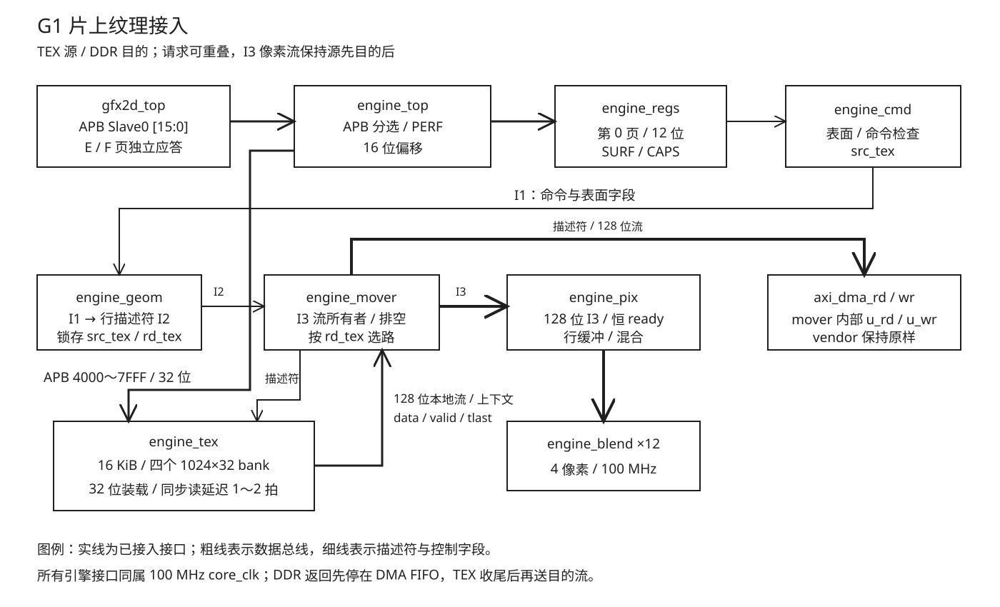

# 07 片上纹理

Efinix Ti60F225 上的直通渲染引擎已经完成 P1 上板。小精灵仍从 DDR3 逐行读源，
每次读都有固定事务开销。本章研究把热纹理放入 16 KiB **scratchpad**：由软件显式
装载、按偏移读取的片上存储。它不维护 cache 标签或替换策略。

本章包含 2026-10-07 的接口审查、研究探针与 P1 复测，以及 2026-10-08 的
正式 RTL、软件接入、性能修复和板上验证；G1 的收尾状态见第五、六节。
接续基线为 `fc41a8d`，
工作区原有 `engine_blend.v` 注释修改和报告临时目录未改动。

## 一、动机

[第 06 章](06-顶层集成与上板.md)把 P1 引擎接入 SoC；
[SW9](../sw/08-板上移植.md)给出真实游戏 `N_max=1014`（16×16）和当前引擎瓶颈。
`N_max` 是满足既定稳定 60 FPS 条件的最大活动精灵数，合成负载周期不能代替它。
P3 总览的 D57 已决定先在直通模式增加 TEX，保留 DDR 目的与既有像素混合通路，
为后续 BAND 条带合成提供片上读机制。

原 G1 条目把 16 笔源读从 1,183.5 周期中简单相减，得到约 660 周期；
实现清单只列 mover、regs、驱动，同时要求不改 cmd/geom。
审查必须先证明表面空间、地址和状态能从入口走到消费方，否则提前写 RAM
只能得到一个独立存储模块。第二步用实际像素通路测同步延迟，最后在本机板卡
复核用于比较的 P1 负载身份和性能。

## 二、为什么是这几步

研究依次核对已有决策与工作区、跟踪表面字段和 APB 地址、阅读两个流接口实现、
做延迟及 RAM 端口实验、综合 RAM 组织、重跑依赖路径和板上 P1，最后修正条目。
地址能被译码、命令能接受 TEX、几何能传来源、搬运能完成状态和排空、
软件能按同一逻辑输入对拍，这几项共同构成 G1 的最小闭环。

APB 装载是 32 位写，像素流是 128 位读，因此容量除以物理 RAM 大小不足以确定块数。
同步读把数据延后，因此首拍 valid、末拍 tlast 和描述符上下文必须同时推迟。
消掉源 AXI 事务以后，PERF 的读计数要改为实际 DDR 事务，否则性能解释会产生虚假事务。
游戏入口还要传递 space；仅修改 BSP API 无法使现行游戏使用 TEX。

前期研究先完成这些边界的定义与实验。命令表的 32 字节记录继续使用 v1 格式，
TEX 作为能力 profile 启用；ABI v2 实例列表仍归 G3。正式实现随后同步更新
spec、CAPS 和主 RTL，当前能力为 `CAPS=0x0000044f`。

## 三、每一步做了什么

### 3.1 决策与源码逐级核对

开工先读共用记忆的赛题二背景、路线台账、研究流转和工具规约；随后检查当前 Git
日志、Todo 状态和仓库 Engineering 规则。记忆中的 G1～G4 建条与 `fc41a8d`
吻合；板卡、性能与产物身份另行实查。

[`engine_cmd.v`](../../../Main/rtl/engine/engine_cmd.v) 的 `sp_src_bad/sp_dst_bad`
拒绝非 DDR，`ec_struct_ok` 只检查一般表面结构及 32 位地址溢出；
[`check.c`](../../../Main/sw/lib/gfx/check.c) 的 `space_step` 具有相同限制。
[`engine_geom.v`](../../../Main/rtl/engine/engine_geom.v) 的输入没有 space，
读描述符也没有片上位。`rd_buf[1]` 表示源/目的，不能代表该源是不是 TEX。
[`engine_mover.v`](../../../Main/rtl/engine/engine_mover.v) 把全部像素读和命令取数送给 DMA。

因此 G1 必须在 cmd 接受合法的 TEX 源，沿 I1 传 `src_tex`，geom 锁存它，
仅在源读描述符上置 `rd_tex`，再由 mover 的描述符入口选择本地流。
几何求交、源越界裁剪、行边带和 4KB 拆段继续保持 P1 纪律，减少改动面。
片上标记来自通过检查的 `space==1`，不能截取 space 的任意一位来通吃未知空间。

[`renderer.c`](../../../Main/sw/apps/game/gfx2dGame/src/renderer.c) 的 `renderer_prepare`
调用只接受 DDR 的 `gfx_engine_surf_set`，没有把表面控制字的 space 传下去。
[`gfx_mem`](../../../Main/sw/lib/gfx/gfx_abi.h) 又只有单个 DDR 映射。
正式实现须补软件 TEX 映射和含 space 的驱动登记入口，保留旧 DDR API 包装；
lib 只处理逻辑内存与命令，不包含 BSP 寄存器头。

### 3.2 APB 窗口与模块职责

[`gfx2d_top.v`](../../../Main/rtl/top/gfx2d_top.v) 只在地址高四位为 0 时选引擎，
并只向 `engine_top` 传低 12 位。因此 APB Slave0 的第 4～7 页虽然空闲，
仍落入默认应答。若仅把引擎 PSEL 范围扩大而保留 12 位接口，TEX 访问将别名到
第 0 页寄存器，写纹理可能误写控制寄存器。

下图表示正式 G1 接入后的模块边界；前期研究的未接入状态已在下面的改动前图保留。



改动前：

```text
APB Slave0[15:0]
       |
       +-- page 0 --> engine_top[11:0] --> engine_regs
       +-- page E --> display_top
       +-- page F --> axi_mux_guard
       +-- others --> default response
```

定义修正后：

```text
APB Slave0[15:0]
       |
       +-- page 0,4..7 --> engine_top[15:0] [改]
       |                       +-- page 0 --> engine_regs[11:0]
       |                       +-- 4..7 --> engine_tex [新]
       +-- page E --------> display_top
       +-- page F --------> axi_mux_guard
       +-- others --------> default response
```

顶层传完整 Slave0 偏移；引擎内部用 `paddr[15:14]==2'b01` 命中 TEX，
用高四位为 0 命中寄存器。现有 `engine_regs` 的比较链与窄接口保留，
RAM 和流状态归 `engine_tex/mover`，避免寄存器模块同时承载像素存储和控制语义。

研究脚本穷举 Slave0 全部 65,536 个字节地址：第 0 页 4,096 字节，
TEX 16,384 字节、4,096 个对齐字，E/F 两页与引擎均不相交。
原始计数见 [`definition_checks.json`](../../../Main/sim/engine/tex/logs/definition_checks.json)。
这证明候选译码集合无冲突；正式 APB 的 SETUP/ACCESS 协议尚须 RTL 验证。
窗口只允许 4 字节对齐的 32 位访问；SETUP 同步读，ACCESS 给结果，
写在 ACCESS 完成沿提交；未对齐访问回 PSLVERR，不能产生 RAM 写副作用。

### 3.3 两份开源实现与流延迟选择

2026-10-07 在线阅读
[verilog-axi 的 axi_ram.v](https://github.com/alexforencich/verilog-axi/blob/master/rtl/axi_ram.v)，
MIT。重点是 `READ_STATE_BURST` 的读使能、同步 RAM 输出与 `PIPELINE_OUTPUT`
的有效位处理。借鉴数据和 valid 同步寄存；本工程不需要搬入整个 AXI 从口。

同日阅读
[verilog-axis 的 axis_register.v](https://github.com/alexforencich/verilog-axis/blob/master/rtl/axis_register.v)，
MIT。`REG_TYPE=2` 使用输出寄存器、临时寄存器和 ready 提前量处理下游停顿。
借鉴反压出现时的在途拍容量分析，不复制其 skid buffer。
两份读取均为上游 master 当日页面，提交身份未固定；它们只提供结构参考，
本轮实验不依赖下载的第三方文件。

I3 的“消费者恒 ready”说明阵列每拍可以接收已有数据，允许生产者暂时没有数据。
同步 RAM 延迟本身由 valid 低电平表达，在 TEX 内将 data/valid/tlast 同步延后即可。
几何层仍先发边带再发描述符；提前描述符不能代替有效位对齐。
若以后改变消费者反压契约，再按读请求和输出级的在途拍数设计缓冲。

研究用 [`probe_tex_stream.v`](../../../Main/sim/engine/tex/probe_tex_stream.v)
锁存地址、拍数、缓冲号和命令索引，随后每拍读 128 位，输出末拍后报告状态，
保留上下文直到状态被消费。TEX 与 DDR 读串行化，首版不引入两个独立并发读所有者。

### 3.4 在真实像素通路上量延迟

[`g1_research.py`](../../../Main/tools/check/g1_research.py) 链接现有软件执行器，
由 `pix_cases_dump --sprites` 现算同一组 16 颗 16×16 ALPHA 的初始与期望内存。
随后复用 B4 的测试台，保留真实 geom、pix、blend、mover、DMA 和 E4 定时从机：
`RD_LAT=23/RD_BUB=12/WR_BUB=6/B_LAT=1`。只把源读描述符路由到探针，目的读写
继续经过真实 mover 和 DDR 模型；共享读所有者保持串行。

| 本轮实验 | 总周期 | 周期/颗 | 源 AR 握手 | 目的 AR 握手 | 内存不符 |
| --- | --: | --: | --: | --: | --: |
| 原 DDR 通路 | 17668 | 1104.25 | 256 | 256 | 0 |
| TEX，同步延迟 1 拍 | 11252 | 703.25 | 0 | 256 | 0 |
| TEX，同步延迟 2 拍 | 11508 | 719.25 | 0 | 256 | 0 |
| TEX 2 拍，valid 提前变异 | 11508 | 719.25 | 0 | 256 | 1206 |

结果由完整 512 KiB 存储逐 128 位比较得到；原始日志与机器可读数据见
[`tex/logs`](../../../Main/sim/engine/tex/logs/)。读状态计数仍是 512，
其中本地源状态 256 加 DDR 目的状态 256；只有 AR 握手代表 DDR 事务。
源流同步延迟每增加一拍，16 行总共多 16 周期。
本地流仍有请求、锁存、流水与收尾开销，消掉一笔 AXI 事务不等于消掉全部源阶段周期。

该实验不含命令取数、SoC 与扫描争用；使用完整 fixture 的源数组，按源/目的位
选路，尚未建立正式 16 KiB 地址空间，也不覆盖 APB 和排空。因此它支持接口方案
与相对周期分析，不能据此宣布板上 ≤750 或新的 `N_max` 达标。

### 3.5 32 位装载口的 RAM 组织

[`probe_tex_ram.v`](../../../Main/sim/engine/tex/probe_tex_ram.v) 用四个 `1024×32`
bank。APB 字地址低两位选择 bank，高十位选择行；宽读在相同行号读取四个 bank，
合成 128 位。这避免异步读和写整拍前的读改写。
空闲时 APB 读回复用该宽读口，正式实现还需锁存 SETUP 相的字选择；运行期
CPU 不得读写 TEX，驱动负责独占。RAM 内容不作全量复位。

端口级实验对每个字写入与地址相关的图案，两轮使用不同图案，再读全部 1024
宽行核对四个字。共 8,192 次写、2,048 次宽读比较，0 错；包括首末行及相邻字隔离。
原始输出见 [`ram_sim.log`](../../../Main/sim/engine/tex/logs/ram_sim.log)。

Efinity 2026.1.132 的 `efx_map_ramest` 给完整 `1024×128` RAM 13 块、单个
`1024×32` RAM 4 块；估算器没有包含整个 APB 端口组织。另一个 byte-enable
估算选项返回 10 块，因对应组织尚未实现和核对，未用于本轮预算。
实际四 bank 独立工程的 map/interface/pnr/pgm 全部 PASS：

| 本轮独立工程观测 | 结果 |
| --- | ---: |
| RAM 块 | 16 |
| 顶层 XLR，含 LFSR 与观测 | 161 |
| `u_ram` 的 XLR | 4 |
| DSP | 0 |
| 100 MHz setup slack | +7.298 ns |
| hold slack | +0.035 ns |

激励地址、数据、使能全部来自 LFSR，全部宽读输出参与观测；器件 Ti60F225，
I3 timing model，seed=1，模板沿用 B4 独立工程。资源、时序和四步输出保存于
[`ram_place.rpt`](../../../Main/sim/engine/tex/logs/ram_place.rpt)、
[`ram_hier_util.rpt`](../../../Main/sim/engine/tex/logs/ram_hier_util.rpt)、
[`ram_timing.rpt`](../../../Main/sim/engine/tex/logs/ram_timing.rpt) 与
[`ram_synthesis.log`](../../../Main/sim/engine/tex/logs/ram_synthesis.log)。
独立 RAM 不含 APB 译码和 mover，不能代表 G1 整机时序；总览预算据此增加 3 块。

### 3.6 表面、装载和软件对拍的边界

核对现行 `Main/assets/manifest.txt`、生成的 `assets.h` 和 `boot_surfaces_stg`：

| 热集 | 宽×高 | 行跨字节 | TEX 偏移 | 长度字节 |
| --- | --- | --: | --- | --: |
| BUL16 | 64×16 | 256 | 0x0000 | 4096 |
| BUL8 | 32×8 | 128 | 0x1000 | 1024 |
| SPARK | 32×40 | 128 | 0x1400 | 5120 |

总共 10,240 字节，装到 `0x2800`，剩余 6,144。图集保留原 width/height/stride，
命令中的源帧坐标不变，只替换表面空间和基址。

TEX 仅作 BLIT 源；目的仍为 DDR，BAND、未知空间和 TEX 目的按 `BAD_SPACE` 拒绝。
TEX 表面在一般结构检查上增加 base 16 字节对齐，以及用扩展位宽检查
`base + height * stride <= 0x4000`，完整行跨含 padding 分配与装载。
结构错误仍先于空间和格式错误；原方程/格式组合继续有效。

硬件没有装载互锁，故驱动只在引擎空闲且无 pending 命令表时装载或读回。
重载先清受影响槽 valid，写完与独立源 CRC 比较，成功后登记；失败不得提交该槽。
CRC 期望使用已校验素材条目的原始内容，包含行 padding，防止装载和读回
同时使用错误布局而得到相同的自算结果。
软复位只清槽 valid 和执行现场，TEX 内容保留并重新登记；FPGA 重配置后重新装载。
软件 `gfx_mem` 的 TEX 映射使用同内容 DDR 影子，以避免软件执行器读硬件 APB。
CPU 与 FPGA 使用同一命令和同一逻辑表面表，lib 不依赖板卡寄存器地址。

`renderer_prepare` 软复位以后按含 space 的入口登记表面；切后端和重载前先 flush。
保留 HW/DDR 与 HW/TEX 对照构型，上传不进入每帧循环；板测另记上传耗时，
不得靠把上传放到计时外得到不完整的帧性能。

### 3.7 状态、排空与计数边界

当前 mover 的读门控在状态已见、流末拍已握手后释放；增加 TEX 要把本地描述符
纳入同一个所有者纪律，不能在出口加 mux 后继续把同一源请求送 DMA。
命令取数继续有原优先级；TEX/DDR 像素和取数的上下文、状态不得覆盖或串线。
当前 cmd 按 FE 状态推断读状态归属；引入短延迟本地来源以后，应携带显式
`rd_stat_is_fetch` 来源位，并加入预取等待与本地末拍同拍的定向验证。
本轮没有证明当前 P1 已存在该状态缺陷，这里是扩展接口的约束。

控制复位期间 mover 仍负责已有 AXI 事务收尾；TEX 在途数据丢弃且流水排净，
`drain_done` 同时等待本地和 DDR 的空闲。不能只清本地 busy 而遗留 valid，
否则下一张命令表可能收到前一张的像素。

当前 `engine_top` 的 PERF 读事件来自所有几何读握手及取数握手。
G1 必须过滤本地读，保留真实 DDR 和命令取数；RD_BEAT/RD_BURST 与总线观测
对账。像素数、色键、写事务、忙周期仍按原口径，DDR 等待不得含本地 RAM 延迟。

### 3.8 本机板卡复核与依赖回归

先只读识别串口与已有进程，确认 UART COM11 可用，没有游戏控制进程占用；
JTAG 读到 `0x10660a79`。使用本地归档 B6 bit 与正常 `engineTest`，经
`board_run --bin` 重新配置 FPGA、`reset halt/load_image/resume`，从加载后的
日志分界检查本次输出。它们是既有产物，本轮没有重编整机。

| 2026-10-07 板上 P1 观测 | 结果 |
| --- | --- |
| 引擎 ID/CAPS | 0x47465801 / 0x0000040f，TEX 位为 0 |
| 11 帧 CRC | 软件与硬件全部相同 |
| COUNT32、两项 DIR、缓存、压力 | 全部 ok，fail 0 / done |
| PERF_BUSY | 0x49f8 = 18936，16 颗平均 1183.5 周期 |
| 扫描最低水位 | 336 拍 |
| 欠载计数 | 0 |
| SoC 最大地址等待 ar/aw | 211 / 216 周期 |
| TEX 4000/7000 页读取 | 0 / 0 |
| display ID/version | 0x44495350 / 1 |
| guard ID/version | 0x4d555847 / 2 |

原始输出见 [P1 板测日志](../../../Main/sw/apps/test/engineTest/logs/g1_research_p1_board.log)
和 [APB 观察日志](../../../Main/sw/apps/test/engineTest/logs/g1_research_apb_board.log)。
OpenOCD 读 0 与现有默认应答一致，不能单独证明 PSLVERR 传播。
末次执行 `reset run` 恢复运行，未写 Flash，也未重跑暂缓的 9208 帧回放。

bit 2,357,217 字节、BIN 43,210 字节；分别与第 06 章登记身份比较，两项相同。
完整 SHA256 只保存于
[`artifact_manifest.json`](../../../Main/sim/engine/tex/logs/artifact_manifest.json)。
这里的身份检查用于绑定 P1 对照，功能通过由 CRC、状态和压力判据给出。

依赖回归：mover 17/17、pix 正式路径 16/16，含各自预期注错；
寄存器真源从 Main 目录运行 `regs_gen --check` 通过。
本轮没有修改正式 RTL，不把这些依赖回归写成 G1 的 ctrl/frame/geom 验收。

### 3.9 接续会话与正式实现

2026-10-08 按指定 ZCode 会话接续开发。会话要求一次完成 G1，日志最后停在
控制层一致性向量修复；工作区已有 TEX、cmd/geom/mover/top、BSP、软件执行器
和游戏覆盖层的改动，尚无正式整机及板上验收。先核对已有改动，再补缺陷与验证，
没有恢复到研究基线重写。最初提供的 session 文件未在 Workspace 找到，
会话身份由指定日志和同一 session ID 的模型交互记录核实；其它会话未作开发依据。

`engine_tex` 使用四个 1024×32 bank。APB 低两位必须为 0，字选择来自地址 [3:2]，
行地址来自 [13:4]；写在 ACCESS 完成沿提交，SETUP 同步读并锁存字选择。
RAM 没有全量复位，控制复位只清流状态。默认读取延迟为一个 RAM 输出级，
`READ_LATENCY=2` 增加 q1，data/valid/tlast 始终对齐。

`engine_cmd` 的结构谓词对 TEX 源和目的统一检查 16 字节对齐、完整行跨的
16 KiB 上界，再按既有错误优先级拒绝 TEX 目的。I1 的 src_tex 由已检查的
space==1 产生，geom 与其它字段同拍锁存，I2 的 rd_tex 仅在源读描述符置位。
top 传递这些字段，在第 0 页和第 4～7 页分选 APB，并把实际 DDR 描述符计入 PERF。

### 3.10 串行方案的板上失败与请求重叠

第一版实际实现把 TEX 数据、状态收完后才允许 DDR 目的读。板上源 DDR 事务
已经消失，周期仍约 983～988/颗，未达到原 ≤750 门槛。前期研究的单读所有者
约束因此作了调整：I3 仍只有一个像素流所有者，DDR 请求可在 TEX 流在途时提前发出。

```text
初版：TEX 描述符 -> 本地数据 -> 状态 -> DDR 目的请求 -> DDR 数据 -> 混合
定稿：TEX 描述符 -> 本地数据 ---------> 状态
                      DDR 请求 -> DMA FIFO -> 目的数据 -> 混合
```

mover 只在上一笔 DDR 读完整收尾后开始新的 TEX 流；当前 TEX 流在途时可以接受
DDR 目的或命令取数。命令流独立走 fs。DDR 像素流先停在 DMA FIFO，直到 TEX 的
数据及状态结束才送 I3，避免共享行写指针在源/目的间交错。真实 AXI 读仍遵守
每方向一笔在途、不改 vendor 核的纪律。

两种来源的状态可能同拍，DDR 状态没有反压口，故 TEX 状态保持到 stat_ready；
DDR 优先，本地状态下一拍再发布。cmd 用 rd_stat_fetch 判归属，FE 不按自己当前
状态猜来源。排空期间丢弃本地流、排净 DMA，直到两路和写方向均空闲才完成。
板上定稿为 657.375 周期/颗；没有 DDR 内部波形，未把初版额外周期归因为某个
未经观测的控制器内部阶段。

### 3.11 正式仿真与独立软件判据

`sim/engine/tex/run.sh` 生成独立软件金标准，验证两种读延迟、APB 4096 字读写、
未对齐副作用、上下文、状态反压、渲染、PERF、错误与两种复位；四个变异分别
针对 valid 错配、未对齐写、状态丢失和源/目的流交错。缺少定向证据、异常退出
或单纯挂起均不能当作预期注错。

正式输入为 72 条 16×8 精灵命令及一条 640×1 长行，加 END 共 74 条。
前 24 颗使用 TEX，另 48 颗使用同内容 DDR。TEX 前 12 KiB 是 64×48 表面，
最后 4 KiB 为独立的长行表面，不违反不同表面的存储不重叠契约。
预乘图案各通道小于等于 alpha；导出器用 ASan/UBSan 检查数组与访问。

| 定稿回归 | 本轮结果 |
| --- | --- |
| TEX 正式套件 | 6/6，包括两种延迟与四个定向变异 |
| 同拍请求与长行反压 | 1 拍构型 AR 重叠 193 次、数据保持 133 拍；2 拍为 193 次/134 拍 |
| 像素流交错变异 | 实际 PIXEL_STREAM_COLLISION 见红 |
| geom / mover | 27/27 / 17/17 |
| pix / ctrl / frame | 25/25 / 4/4 / 16/16；控制层 159 向量 6576 项 0 错 |
| 软件执行器 | 64/32 位输出一致，64 位含 sanitizer；fail 0/done |
| 软件 TEX 正例 | 预乘/直通 ALPHA 配色键与独立 ref_exec 一致；影子缺失双方拒绝 |
| 寄存器生成物 | regs_gen --check 通过 |

74 条跨五个取数批，512 KiB 内存完整比对，PERF 与总线实际观测对账。
长行让 DDR 数据早于本地源收尾，确实触发 FIFO 反压；去掉等待即出现流碰撞。
成功与变异输出都保存于 `Main/sim/engine/tex/logs`，不靠标签或固定返回码判分。

### 3.12 驱动、游戏与对拍隔离

驱动增加含 space 的表面登记，旧 DDR API 包装保留。重登记先清 valid，忙或排空中
拒绝读写 TEX 和改表；未对齐偏移/长度/指针、空指针及范围错误在 MMIO 前拒绝。
TEX 能力缺失单独返回 GFX_ENG_E_CAPS。库层按逻辑 space 解析 TEX 影子，
应用负责提供相同内容，lib 没有引入 BSP 寄存器头。

游戏启动装载 BUL16/BUL8/SPARK，读回 CRC 同时对素材条目的已校验 CRC 比较。
校验成功才启用 HW/TEX，失败回退到 HW/DDR。上传不进每帧循环。

装载入口为 `gfx2dGame/src/main.c` 的 `boot_asset()` 与 `boot_tex()`。
前者调用素材包解析器，经 `board_asset_read()` 从 Flash 素材分区读取到 DDR；
后者从已校验条目的 `asset_dev + e.offset` 取原始像素字，调用
`gfx_engine_tex_write(src, off, bytes)`。驱动逐字执行 volatile MMIO 写入，
CPU 地址为 `0xF8100000 + 0x4000 + off + i*4`，每次搬运 4 字节。
三份热集共 10,240 字节，对应 2,560 次 32 位 APB 写；PNG 到像素字的转换
已在素材打包阶段完成，运行期不重新解码图片。

```text
Flash 素材包 --SPI/CPU--> DDR 素材区 --CPU 32 位 MMIO/APB--> engine_tex RAM
                                                             |
                                                引擎内部 128 位读流
                                                             v
                                                      engine_pix
```

`gfx2d_top` 将 Slave0 的第 4～7 页送入 `engine_top`，后者命中 TEX 窗口，
把低 14 位偏移传给 `engine_tex`。SETUP 相保持地址与写数据，ACCESS 完成沿
按 `paddr[13:4]` 选 bank 内行号、按 `paddr[3:2]` 选四个 bank 中的一组，
执行 `mem[apb_row] <= pwdata`。偏移 0/4/8/12 分别写四个 bank 的第 0 行，
偏移 16 写 bank 0 的第 1 行；渲染时四个 bank 同行读取，拼成一个 128 位拍。
四组 `reg [31:0] mem [0:1023]` 经综合推断为 FPGA RAM，实际占 16 块。
本模块没有 `$readmemh` 或 `.mem` 初值装载，纹理内容由启动程序写入。

读回校验按最多 256 字节分块，由 `gfx_engine_tex_read()` 经 APB 取回，
比较读回 CRC、DDR 内容 CRC 与素材条目的 `data_crc`。随后 `tex_overlay()`
将热集表面的 `space` 从 DDR 改为 TEX、`base` 从 DDR 地址改为片上偏移，
保留宽高与 stride；`renderer_prepare()` 才将这些字段登记到硬件表面表。
一次上传的图集可被不同位置的多个精灵重复引用，帧缓冲及目的读改写仍在 DDR。

SW、HW/DDR、HW/TEX 切换前 flush；TEX 表面仅覆盖游戏/压力场的 STG 热集，
SW6 演示使用另一套槽位，保留 DDR 表面。每个后端独立记录 FPS，CSV 用 hw-tex
标明来源；控制面板识别三个后端，收到中间状态后才继续第二次切换。

真实游戏对拍复用 SW9_COMPARE 的同一张命令表和软件影子，单独构建
G1_TEX_COMPARE 的连续 16 KiB 影子。诊断开始先将 display 源选为彩条并等一场，
两个帧缓冲均不参与扫描，场时钟仍运行；只对拍构型采用这一设置。
PC 参考按同一脚本运行 DDR 素材，板上同帧 CPU/TEX 与硬件/TEX 两面比较，
还统计真正引用 TEX 的游戏命令，禁止用只有标题的空热集轨迹冒充覆盖。
该构型不进入性能构建，不重跑暂缓的完整 9208 帧关卡。

### 3.13 单独与整机综合

单独工程使用变量激励和全位观测，100 MHz，Ti60F225/I3，seed=1；正式 module
的 RAM 与片上预算相符。整机仍采用现行 4KB/1 路 SoC 缓存，未重新生成 SDK 或 IP。

| 本轮 Efinity 四步观测 | 正式 TEX 单独 | G1 整机 |
| --- | ---: | ---: |
| XLR | 324，含激励；dut 为 69 | 36237 |
| RAM | 16 | 121 |
| DSP | 0 | 16 |
| core setup slack | +5.875 ns | +0.826 ns |
| core hold slack | +0.035 ns | +0.026 ns |

整机相对 B6 增加 16 RAM、228 XLR，DSP 不变，core hold 持平。
完整 place/timing/hier_util 与四步输出归入 TEX 日志目录；单独时序只代表本模块
及其观测包装，不能代替整机。其它时钟的实际 slack 保留在整机原始报告。

### 3.14 板上固定负载与真实 N_max

最终 engineTest 使用同一比特流测试 DDR 与 TEX，11 帧各自对软件与原金标准。
TEX-BUSY 在独立的整屏 FILL 中检查三种 API 拒绝，不向性能计时段插入额外工作。
六个错误用例核对错误码、完整索引和 w7，源 DDR 事务消失由 PERF 与仿真总线对账。

| 同轮板上固定负载 | 结果 |
| --- | ---: |
| DDR / TEX 的 CRC 对账 | 11/11 + 11/11 |
| DDR PERF_BUSY/16 | 0x49fa/16 = 1183.625 周期/颗 |
| TEX PERF_BUSY/16 | 0x2916/16 = 657.375 周期/颗 |
| TEX RD_BURST | 258；相对 DDR 少 256 笔源读 |
| 扫描最低水位/欠载 | 336 / 0 |
| SoC 最大等待 ar/aw | 211 / 218 周期 |
| 功能、拒绝、错误与压力 | 全部 ok，fail 0/done |

原始记录为 `engineTest/logs/g1_board.log`。这组数字只说明该固定 16 颗负载，
同一比特流可按表面 space 选择来源；没有把它外推成完整关卡的流水性能。

N_max 程序显式使用 PERF=1、GFX2D_PRESS_CLOCK=1、模式 3，与 SW9 同一套
N0/步进/120 场探针/3600 场确认/settle/retry 条件，使用真实场时钟与流水后端。
TEX 16×16 为 1460、8×8 为 1494；两项确认均为 3600 场、3600 帧、零掉帧。
全程 37742 帧/38282 场；高档探针与切换阶段有 540 次掉帧，确认档零掉帧。
最低水位 331、欠载 0、IRQ faults 0、swap retry 0，末尾 fail 0/done。
日志 `gfx2dGame/logs/g1_hw_tex_nmax.log` 已由 SW9 两个外部校验器复核。
此前被中断的一次只完成 16×16（1462）并开始 8×8，独立保留为 interrupted，
不用于完整战役结论；两次单项差 2 体现取样运行差异。

### 3.15 同一比特流对照与真实游戏验收

DDR 对照复用相同 G1 比特流、素材、程序源和真实时钟参数，只将启动后端从 2
改成 1。当前同板结果如下；旧 SW9 的 1014/1365 继续作为历史记录，不与本轮混用。

| 负载 | HW/DDR N_max | HW/TEX N_max | 相对提升 |
| --- | ---: | ---: | ---: |
| 16×16 | 1016 | 1460 | 43.7% |
| 8×8 | 1402 | 1494 | 6.6% |

四项均有 3600 场/3600 帧、零掉帧确认。DDR 全程 27018 帧/28446 场，
高档试探及切换阶段掉 1428 场；最低水位 331、欠载/IRQ faults/swap retry 为 0，
fail 0/done。8×8 的 TEX 确认窗口主要标为 CPU 瓶颈，故减少源事务的整体收益较小；
没有把固定 16×16 合成负载的周期降幅直接当成所有游戏负载的增幅。

真实游戏对拍完成 360 帧，逐帧 g 行与独立 PC 参考完全一致，每帧软件/TEX
与硬件/TEX 的后缓冲 CRC 相同；共实际执行 390 条 TEX 游戏命令，包含敌弹和粒子。
末尾 fail 0/done。完整录像关卡仍没有重跑，本轮只覆盖该 360 帧脚本。

切换程序按受控串口输入完成 TEX→SW→DDR→TEX→演示→游戏。1614 帧/1801 场，
软件段与切换期间掉 187 场，硬件段回到 60 FPS；最低水位 335、欠载和 IRQ faults
为 0，fail 0/done。控制面板离线判据同时核对正确的 n_bullet 列和确认后的多步切换。
故意改读回 CRC 的构型只有热集启用失败一项：回退到 HW/DDR，fail 1/done，
所有 CSV 均为 hw，拒绝使用未校验纹理。未将这一负例当正常通过日志。

`check_g1_logs.py` 统一复核固定负载、双后端搜索、PC/同帧、切换与负例，结果集中
保存于 `acceptance_results.json`。全部图、源码、原始输出与构建身份见各 README
及 `g1_artifacts.json`。CRC 功能判据、传输/产物身份与综合时序分别保留。

对拍专用源码更新后重建已验收的 TEX 搜索、切换、CRC 负例程序，三份 BIN
逐字节相同，结果为 rebuild_identity.json。交互构型单独登记，已以 HW/TEX
启动游戏并收到 60 FPS/零掉帧的启动窗口，采集结束后程序继续运行；
该短窗口不代替前面的长期搜索确认。

### 3.16 验收复核

2026-10-08 按 G1 判据复核源码与原始证据，再从当前源码复跑 TEX 6/6、geom 27/27、
mover 17/17、pix 25/25、ctrl 4/4、frame 16/16。软件测试的 64 位 sanitizer 与
32 位输出逐字节一致，独立金标准导出器 ASan/UBSan 通过；命令语义及注错、
寄存器生成真源、软件分层与控制面板离线判据通过。

当前八份 bit/BIN 的长度及 SHA256 与 `g1_artifacts.json` 原登记一致。
`check_g1_logs.py` 重新复核 22 个 CRC、双后端真实时钟 N_max、360 帧游戏参考与
同帧 CRC、切换及热集 CRC 失败回退，全部通过。复核保留既有四步综合与板测，
没有重新综合或接板；身份比较绑定现有产物，仿真和功能日志分别消费自己的判据。

装载说明补齐到 3.12 节，mover/top 的旧串行注释改为定稿的请求重叠、像素流隔离
及状态保持行为，逻辑未变。归档前 472 个本地文档链接有效，G1 范围空白检查通过。
源码与文档的空白检查通过，原始工具日志与报告保留排版。全仓机器路径检查仍有
报告区 7 处原有记录，本轮未修复，不能宣称全仓检查通过。
详细结果与复跑日志集中在 `Main/sim/engine/tex/logs/acceptance_review.json`；
完整产物摘要继续复用原清单。

## 四、遇到的问题

### 4.1 TEX 地址到不了引擎，扩大 PSEL 又会造成别名

第一现场：

```verilog
wire apb_sel_eng = (apb_paddr[15:12] == 4'h0);
.paddr(apb_paddr[11:0])
```

解读：TEX 第 4～7 页既没有 PSEL，也没有页内高位。定位时核对 top、engine_top
和 regs 三层端口，并穷举全地址集合；只在 regs 加窗口不能收到这些访问。
修法是扩大顶层引擎选择并传 16 位，在 engine_top 分选，regs 保持 12 位。
原条目只关注寄存器比较链，漏掉了上游页门控与截位。

### 4.2 实现清单禁止改动必经模块

第一现场为原 G1 清单：

```text
不动：engine_blend.v、engine_pix.v、engine_geom.v、engine_cmd.v
```

解读：当前 cmd 会拒绝 TEX，geom 无法携带片上来源。定位沿 SURF、I1、I2 到
mover，同时发现 renderer 的登记 API 丢弃 space。修法是补齐四层接线与软件
入口，保留求交和像素算法；补边界、CRC、复位和实际 DDR PERF 判据。
原清单把读流出口 mux 当成完整接入，未覆盖输入合法性和状态的闭环。

### 4.3 把宽 RAM 估算当成带装载口的实际块数

第一现场：

```text
1024x128 -> 13 block rams
1024x32  -> 4 block rams
Memory Blocks: 16 / 256 (6.25%)
```

解读：四个可独立写的 32 位 bank 分别映射，块数不能沿用单个宽 RAM 的估算。
定位用 RAM 端口实验与独立网表对账，实际 `EFX_RAM10` 为 16。
修法将 G1 及总览改成 16，整机预算由约 152/170 改成 155/173；
13 块保留为被修正的宽口估算。原条目未验证 32 位写口组织。

### 4.4 固定 RAM 延迟与 valid 错配

第一现场：

```text
PATH stats commands=16 read=512 write=256 stalls=256 mem_bad=1206 errors=1206
RESULT: FAIL (B1-B4 integration)
```

解读：命令和状态均完成，事务数也正确，但像素结果不符。定位将 RAM 输出保持
两拍而把 valid 提前，独立内存比对覆盖到 1,206 个宽字。
修法是将 valid/tlast 跟数据走相同级数，新增真实像素结果变异实验。
仅检查事务数、末尾 done 或周期数会漏掉这种错误。

### 4.5 研究工具的运行目录与 XML 顺序

第一现场：

```text
regs_gen --check: 产物与真源不一致： rtl/engine/engine_regs_offsets.vh, sw/bsp/include/gfx_regs.h
ERROR : Failed to parse the project XML file ... The file format is unexpected
```

解读：第一项从仓库根执行，但工具约定 cwd=Main，误把生成物视为缺失；
进入 Main 后通过，没有重生成。第二项的 XML 可被通用解析器读取，Efinity
schema 要求 design_file 在 top_vhdl_arch 之前；生成器最初将它追加到后面。
修正元素顺序后四步通过。失败属于研究工程装配，不是 RAM RTL 失败。
复现工具保留正确 cwd 与元素插入顺序，避免用改生产文件掩盖环境错误。

收尾检查还区分了本次改动和既有工作区：本次新增源码空白与文档链接检查通过，
受影响已跟踪文件的 `git diff --check` 通过。全仓空白检查另命中原有
`engine_blend.v` 注释尾空格；全仓路径检查报告交付物报告区 7 处机器路径，
其中 6 处在 HEAD 已存在，另一处在开工前已有的报告临时脚本。
这些对象不属于 G1，本轮保留原样；全仓检查未记为通过。

### 4.6 旧向量与新 profile 的反例冲突

第一现场：

```text
VEC-FAIL #81: code=4 idx=0 tag=00000000 exp=5/0/00000000
K1 coverage ... fmt=1863/0 ... FAIL
```

新增非法 space=3 槽被后面的地址溢出槽覆盖，源结构先失败；软件随机测试的
TEX 目的又使用 DDR 基址，结构检查提前返回 BAD_SURFACE，覆盖不到 BAD_SPACE。
定位同时核对 Python 导出、C 内建向量、独立参考和 RTL，保留槽 15 的溢出反例，
按单条向量覆盖非法空间；TEX 目的采用窗口内有效基址。修后 159 向量与软件
64/32 位对账通过，错误优先级保持原义。此前只改 C 向量没有改实际 RTL 激励来源。

### 4.7 旧测试台遗漏新接口与金标准越界

第一现场：

```text
TIMEOUT dir=1
CMD_TIMEOUT index=0
PATH stats commands=0 read=0 write=0 ... errors=648
```

几何层固定 DDR，但新 rd_tex 输出没有接入旧 B4 测试台，搬运层看到不定来源位。
补齐接线后真实像素通路恢复通过。源码审查还发现导出器 cmds[64] 声明却把
list.capacity 设为 96，原 73 条记录超过真实数组。数组改为 96，正式输入加长行
后为 74 条，命令 ROM 同步调整；ASan/UBSan 通过。
RGB 随机图案同时收敛到不超过 alpha 的合法预乘输入，避免模型对拍覆盖了
违反素材契约的数据。原正常输出没有验证数组实际容量或新接口的已连接性。

### 4.8 板上对拍误改目的表及错误输入拼装

第一现场：

```text
TEX-fill-screen 9cd34cb7 6ab1aca3 FAIL
TEXERR-BAND FAIL
TEXERR-DST FAIL
fail 18
```

TEX 对拍复制了整张硬件表到软件表，软件目的随之指向硬件缓冲。软件执行后
真正的 FB_SW 保持初值，硬件面还被重复合成。修法只复制源槽，保留两面独立目的。
错误助手把预期的引擎错误码当成驱动失败返回 FF；另把 stride 的数值 8 误写进
format 位段，驱动在提交前拒绝。助手改为保留硬件错误，控制字分别编码 format=0/1。
最终六个错误三元组和 22 个 CRC 对账全过。这里修复的是板测输入与判分，
没有用重新定义错误码或替换金标准掩盖失败。

### 4.9 串行等待造成性能门槛失败

第一现场：

```text
PERF tex busy=00003d6e rd=00000102
TEX-PERF FAIL
```

16 颗共 15726 周期，982.875/颗；源读事务已去掉，原 ≤750 门槛仍未达。
定位到本地数据/状态结束前不允许目的 DDR 请求。改为提前发请求、目的数据
等待本地流收尾，增加持有状态和长行反压判据，最终 657.375/颗。
原校准模型只能支持实验方案，实际 DDR 争用与请求相位必须由整机验证。

### 4.10 注错挂起误判与采集结束不完整

第一现场：

```text
TEX WATCHDOG (errors=0)
inj_stat: RESULT: FAIL (inject, as expected)
```

请求任务等的是受理后再次出现的 ready，状态丢失时永远到不了有界状态等待；
脚本又把没有 NOT_RED 的任意输出当作预期失败。修为在受理沿撤 valid，状态
判据检查数据/末拍正确但状态缺失，再以明确 STATUS_MISSING 结束。
脚本要求正常退出和对应证据。流交错变异同样必须由实际碰撞触发。

被中断的 N_max 记录和 240 秒采集仅到 281 帧的游戏对拍分别保留，均未算完整通过。
重新完整采集使用独立末行 done 的前导换行标记，避免 nmax done 提前匹配；
软件逐像素 CRC 对拍采用足够时间上界，最终以连续帧号、内容及 fail/done 判定。

## 五、结果

G1 已接入 APB 四页、cmd/geom 标记传播、mover 流所有者与排空、
实际 DDR 计数、软件 TEX 映射及游戏入口、空闲装载与失败登记、软复位和后端切换。
范围仍为 16 KiB scratchpad、TEX 源到 DDR 目的，像素算法和 vendor 不扩展。

研究实验的 DDR 对照为 1,104.25 周期/颗，1／2 拍本地源为 703.25／719.25；
源 AXI 事务消失，512 KiB 结果逐字一致，valid 错配变异见红。
四 bank RAM 16 块；正式整机 121 RAM、36237 XLR、16 DSP，core setup/hold
为 +0.826/+0.026 ns。板上同轮 DDR/TEX 为 1183.625/657.375 周期每颗，
TEX 通过原 ≤750 门槛，22 个 CRC 对账与六个错误三元组全部通过。
真实 TEX N_max 为 1460/1494（16×16/8×8），两项均有 3600 场零掉帧确认。
早期模型只留作研究依据；定稿结论使用原始日志与外部核对。

## 六、还欠什么

G1 已于 2026-10-08 按本章范围验收，研究、实现、失败过程、判据和复核证据均已收录。
BAND 数据面由 engine 第 08 章（G2，已验收归档）继续，条带控制与 ABI v2
由 G3 维护，整机条带 N_max 与 16KB 缓存对照归 G4。HDMI 和实体键现场观察及暂缓的完整 9208
帧回放仍沿 SW9 的既有边界，不能由本章固定负载或 360 帧诊断代替。
