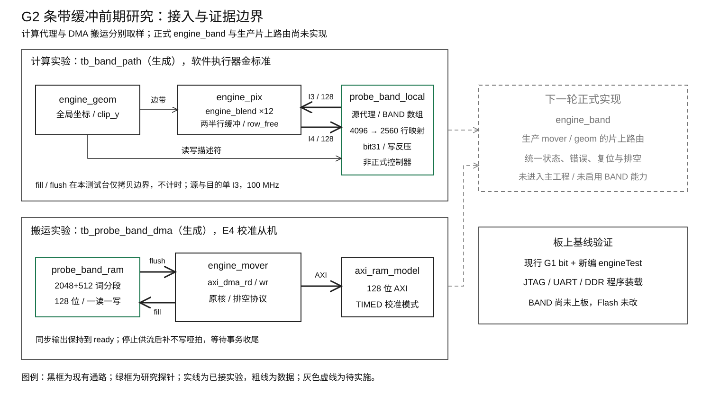
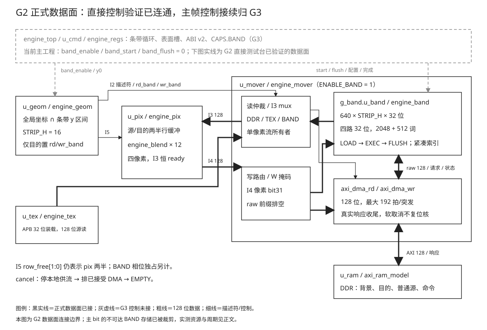

# 08 条带缓冲

本章记录 2026-10-08 的 G2 前期研究与正式开发。研究基线为 b762f3e，
研究快照为 a151bf4；正式数据面已实现并待验收。帧级条带控制仍归 G3。
实验源码、原始输出、综合报告与板测清单在
[`Main/sim/engine/band`](../../../Main/sim/engine/band/)。

## 一、动机

G1 将热纹理源读放入 TEX，目的帧缓冲仍在 DDR。完整 16×16 ALPHA 的每颗目的
读写仍有 16 行×读/写两类事务。G2 把当前 16 行目的画面留在 40 KiB BAND 中，
在同一条带内完成全部合成后写回，以减少随弹数增长的目的事务。

容量、逻辑地址和实际 RAM 推断是三个问题。640×16×4=40,960 字节只说明容量；
几何层沿用 4096 字节行跨度，不能直接拿它索引紧凑的 2560 字节行。
原约 32 块 RAM 预算也没有验证掩码和非二次幂深度的映射。
原约 80 周期/颗的模型只接近算术吞吐，没有计入 I3 的源/目的两份数据及行协议。
本轮先把这些边界变成可复现的地址、端口、资源与周期实验。

## 二、为什么是这几步

| 步 | 要确认什么 | 本轮产物 |
| --- | --- | --- |
| 1 | 当前 G1 能力与新注错基线是否可用 | 现行源码重编 engineTest、板上原始日志、唯一身份清单 |
| 2 | 多角色能否共用一读一写端口，同步读怎样接流 | 两份代码级参考与厂商原语依据 |
| 3 | 全帧逻辑地址怎样映射到当前 16 行 | 76,800 个有效拍的无别名枚举与边界说明 |
| 4 | 掩码和深度对 RAM 块数有什么影响 | 两种容量形态、两种掩码形态与分段实验；五组四步综合 |
| 5 | 现有像素消费者怎样与本地目的流相接 | 真实 geom/pix/blend、软件执行器金标准、跨条带/色键/反压及地址变异 |
| 6 | fill/flush 的真实核节奏及取消供流能否收尾 | 现有 mover/DMA、校准从机、RAM 端口与排空实验 |
| 7 | 正式数据面怎样接入并保持接口纪律 | engine_band、mover 路由、geom 求交和直接控制口 |
| 8 | 三相组合后取消、状态和数据是否成立 | 真实全部核、软件金标准、超时/取消/重试与八个定向变异 |
| 9 | 真实存储是否保留、整机原能力是否正常 | 独立/整机四步综合、全部仿真回归与新 bit 的 DDR/TEX 板测 |

地址和数据结果先成立，资源及时序才有意义。计算实验用本地代理隔离行协议，
搬运实验用真实核隔离 DMA 节奏，二者分别出数字；没有把两份探针写成已完成的
统一控制器或板上 BAND 功能。

## 三、每一步做了什么

### 3.1 当前源码与板上基线

读取 Todo、总体设计、engine 第 00/02/03/04/07 章、platform 第 03/11 章与
开发环境 SOP，逐级跟踪 `SURF → cmd → geom → mover → pix → blend`。
工作区只有原报告临时目录；没有覆盖它，也没有更改生产 RTL、SDK、SoC IP 或主工程。

新注错重构曾记录 17 项 TEX 失败，platform 第 11 章后来已定位为默认构建目录的
engineTest 产物陈旧。本轮不沿用该目录，显式指定 RISCV_BIN，从现行源码用
`make -B` 重编到 `engineTest/build_g2_research`，产物为 49,002 字节。
板卡重新列口：UART 仍为 COM11，板载 FT4232H 的 JTAG 通道可用。
当前 bit 配置后连续两次读 PC 均为 `0x00012080`；再先开串口、reset halt、
load_image、resume 运行新程序。

| 本轮板上基线 | 观测 |
| --- | --- |
| DDR 十一帧金标准 | 11/11，与原 golden.txt 一致 |
| TEX 十一帧金标准 | 11/11，与 DDR 和原 golden.txt 一致 |
| COUNT32、定向、缓存、忙期拒绝、六项错误 | 全部 ok |
| DDR PERF_BUSY/16 | 0x49ea/16=1182.625 周期/颗 |
| TEX PERF_BUSY/16 | 0x290e/16=656.875 周期/颗 |
| TEX RD_BURST | 258，仍少掉 256 笔源读 |
| 扫描最低水位/欠载 | 338/0 |
| 末尾 | fail 0 / done，无 serial lost |

原始输出为 `logs/g2_board_baseline.log`，外部复核为 `board_results.json`。
bit/BIN 完整摘要只在 `board_artifacts.json` 登记一次；它绑定当前源码和消费日志，
功能通过由 CRC、错误及压力判据给出。此处是 G1 板上基线，不是 BAND 板测。
没有修改 Flash，也没有重跑暂缓的完整 9208 帧关卡。

### 3.2 代码级借鉴与取舍

固定版本、许可、审查文件与入口保存在 `logs/source_refs.json`。本轮只借鉴设计，
上游 RTL 没有复制到生产目录，也没有链接进研究仿真。

| 参考 | 阅读到的具体代码 | 用于 G2 的结论 |
| --- | --- | --- |
| [RasterIX，9269a01](https://github.com/ToNi3141/RasterIX/tree/9269a01c9bd4c3342bfa70ef8e3cdd751c15c6d0/rtl/RasterIX) | `InternalFramebufferRam.v` 的 enablePort0/1 选择和 mask 门控；`InternalFramebufferCommandHandler.v` 的 COMMIT/READ/MEMSET、同步延迟旁带、skidBufferData/Valid/Last | 四种逻辑角色可以按阶段复用端口；读数据与 valid/last 一起延迟；写回输出在 ready 低时必须保留 |
| [verilog-axi，516bd5d](https://github.com/alexforencich/verilog-axi/blob/516bd5dadc3365b7f9e225d2af8fe0b8d804fe53/rtl/axi_ram.v) | 第 266 行附近的逐字节 masked write；第 287/315 行附近的 rvalid 保持；第 351 行附近的同步读和可选输出级 | 一读一写可以独立推进；读输出与握手缓存分开处理；不能把组合 RAM 读假设带进正式通路 |
| [Quantum Titanium Primitives UG v4.2](https://www.efinixinc.com/docs/efinity-quantum-ti-primitives-ug-v4.2.pdf) | 印刷页 24～28 的 EFX_RAM10 宽深组合、同步同址行为与输出级；32～36 的真双口碰撞约束 | 端口够用时优先简单双口；不依赖同址读写行为；块数由真实映射验证 |

RasterIX 面向 3D framebuffer、协议和像素格式不同，本项目仅采用其分相端口和
输出保持的设计思想。verilog-axi 的数据保持做法已与现用 DMA 核逐口核对，
正式 G2 仍复用仓内已验收版本，未升级 vendor。

### 3.3 地址空间：逻辑 stride 与紧凑存储

现有 geom 输出的是表面逻辑字节地址。640 像素×4 字节为 2560 字节，
但 `stride_log2=12` 表示逻辑行跨度 4096。BAND 每行只保留 160 个 128 位拍。

```text
逻辑目的地址 a（全帧布局，行间有 padding）
  off = a - frame_dst_base
  y   = off >> stride_log2
  xw  = (off & (stride_bytes - 1)) >> 4
  local_y = y - strip_y0
  BAND_word = local_y * 160 + xw
```

正式实现应在截断之前验证 a 不小于基址、local_y 位于 0～15、xw 位于 0～159，
以及描述符不跨本行有效范围。row×160 可写成移位相加，不需要 DSP。
Python 穷举 480 行×160 拍，共 76,800 个映射：按条带区分后无别名，
每条带的最大紧凑索引为 2559。原始结果为 `definition_checks.json`。

几何层仍用全局坐标进行求交和源坐标平移。研究测试台仅把 clip_y 限到当前条带，
不先改成局部 y，因此跨条带部分保持了正确的源偏移。正式 G2 可以在描述符入口
进行紧凑转换，不必把非二次幂行长塞进现有 stride_log2 字段。

### 3.4 端口、掩码与行缓冲职责

| 阶段 | BAND 读口 | BAND 写口 | 独占条件 |
| --- | --- | --- | --- |
| fill | 不使用 | 接 DMA 背景流 | fill 完成前不能开始像素合成 |
| exec | 输出目的像素流 | 接像素结果流 | 两口可异址并行，同址冲突必须由顺序和握手排除 |
| flush | 同步读取并送 DMA | 不接受像素写 | 末条命令的末行本地写完成、在途流清空后才能开始 |

单条带三相串行，因而不需要同时给四类访问各开一套端口。研究推荐一读一写
简单双口 RAM，按相位切换角色；本轮同步读/异址并发实验通过，没有依赖同址
旧值或新值的器件特性。flush 侧用一个可保持的预取字：只有输出空闲或 ready=1
才推进读地址，RAM 数据与 valid 对齐。真实写核首拍和 FIFO 反压均有实际覆盖。

目的写的掩码来自 mover 的现行约定：`ws_tkeep` 当前为全 1，**每个像素 bit31
才是不写标记**。正式本地写要按该标记禁止整像素更新，允许写的像素保留低 24 位、
X 字节清 0，与现有 AXI 写通路一致。fill 的原始背景装载与像素写应分别生成使能，
不能让色键或首尾边缘把邻像素覆盖，也不能将标记位当作颜色存进 BAND。

`engine_pix.row_free[1:0]` 是两半行缓冲的占用位，末拍被消费者接收后才释放。
BAND 出现以后 pix 仍使用这两半完成源/目的对齐和混合，故 I5 保持原义。
原 spec 中「改为 BAND 行槽」的说法已订正；BAND 的阶段独占用另一组 busy/done，
不是把两位扩成 16 行的空闲计数。

研究路径与下一轮接入边界如下。实线为本轮已有对象，灰色虚线为未实现对象。



### 3.5 RAM 组织、仿真与五组综合

`probe_band_ram.v` 是研究 RAM。先装载全部 2560 字，再读回、做逐像素掩码写，
最后同时读低半与写高半。6400 次顺序读和 1280 次异址并发均与独立数组一致；
掩码全放行和地址高位截断两种变异分别由 RAM-DATA 见红。分段形态另外完整复跑。

隔离工程使用 Ti60F225/I3、100 MHz，全部输入来自变量、全部输出参与观测；
未把地址、使能或数据接常数。以下是最终同一份探针源码的五组四步结果：

| 组织 | RAM | 总 XLR（含观测包装） | RAM 模块 XLR | DSP | setup/hold ns |
| --- | ---: | ---: | ---: | ---: | --- |
| 单个 2560 深，四像素掩码 | 64 | 175 | 0 | 0 | +6.506/+0.026 |
| 单个 2560 深，无掩码下界 | 64 | 176 | 2 | 0 | +7.042/+0.028 |
| 4096 深、保留行 padding、四像素掩码 | 64 | 173 | 0 | 0 | +7.123/+0.026 |
| 2048+512 分段、四像素掩码 | **36** | 273 | 3 | 0 | +6.746/+0.026 |
| 2048+512 分段、无掩码下界 | 33 | 271 | 5 | 0 | +6.545/+0.026 |

直接声明的容量是 40 KiB，映射网表却用了 64 个 READ_WIDTH=2 的 EFX_RAM10，
相当于按 4096 深组织。显式分段使深度可用 2048×4/5 与 512×16/20 模式，
带四像素独立使能的结果为 36。模式数量与 place 报告逐项相符，汇总在
`ram_physical_modes.json`；完整报告为五组 `*_place/timing/hier_util.rpt`。

33 块无掩码版本不能直接替代正式 BAND，因为色键和边缘像素需要保留原值。
建议默认采用 36 块分段组织，保留 D62 的 32 位像素，不提前使用 96 位压缩。
P3 总账由 121+32+约2 改为 121+36+约2=约159 块；额外控制及整机时序仍待正式综合。
单独 RAM 的正 slack 不能当成整机保证。

### 3.6 真实几何/像素通路的局部合成取样

`g2_research.py` 受控改写现行金标准导出器的测试输入，在忽略 build 中生成
16 颗 16×16 ALPHA、全部 TEX 源的三组用例。参考结果仍由现行软件执行器计算，
导出器挂 ASan/UBSan；初始数据在执行前导出，期望在执行后导出。
实际 geom/pix/blend 保持原样，测试台把当前条带限制作为 clip_y 输入，
本地适配器供源数据、目的数据并处理带内掩码。

| 输入 | exec 周期 | 片段/目的行 | 结果 |
| --- | ---: | --- | --- |
| 16×16，与条带对齐 | 3936，即 246/颗 | 16/256 | 512 KiB 全部相符、同址碰撞 0 |
| 16×16，从 y=10/28 开始跨条带 | 4160，即 260/颗 | 32/256 | 512 KiB 全部相符、同址碰撞 0 |
| 重叠、x=-3、有色键 0x40201008、每八拍一拍写反压 | 4212 | 24/256 | 3904 个有效像素，780 个色键跳过，3124 个写入；全部相符 |
| 目的映射错误，行乘 256 而非 160 | 预期失败 | 同一输入 | 内存不符或 BAND-BOUNDS 对应判据见红 |
| 本地写忽略 bit31 | 预期失败 | 有色色键输入 | MEM_MISMATCH 见红，证明保留像素判据敏感 |

所有命令按原相对顺序提交，每条命令等末行写完成，再执行下一条。
跨条带切割后仍按全局坐标求交，色键/局部裁剪和原 X 字节处理都经过实际 pix。
写反压使全流水保持，而 I3 仍恒 ready；两半行缓冲纪律没有更改。
色键取带非零 RGB 的合法预乘字，避免透明零在错误写入后仍碰巧得到原色。
收尾审查时补入该有色色键与本地写掩码变异，结果确实不同；没有把仅标记计数
或零透明色的巧合当成保留像素的覆盖。

这里的 BAND 与源是研究适配器，数据访问由数组模拟一拍读，fill/flush 在测试台中
作边界拷贝，未计时。它验证逻辑地址、顺序和现有消费者可用性，不证明正式
SRAM 端点的时序、APB/ABI、命令取数、排空或 SoC 争用。

### 3.7 fill/flush：真实核、校准 DDR 与排空

另一测试台连接真实 mover、两个原版 DMA 核、`axi_ram_model` 的 E4 校准设置
RD_LAT=23、RD_BUB=12、WR_BUB=6、B_LAT=1，以及推荐分段研究 RAM 的同步端口。
背景从 4096 stride 的 16 行装入紧凑 RAM，再从 RAM 写到另一份同 stride 表面。
全部 512 KiB 原始内存、目标有效区和 padding/其它区域与独立期望数组比较。

| 观测 | 数值 |
| --- | ---: |
| fill | 3249 周期，16 笔读，2560 个 128 位拍 |
| flush | 3152 周期，16 笔写，2560 拍，供流侧反压 160 拍 |
| 两相相加 | 6401 周期/条带 |
| 30 条带搬运模型 | 192030 周期/帧，100 MHz 下 1.9203 ms |
| 中途停止供流并软排空 | 接收前 10 拍后取消，195 周期收尾，捕获 drain_done，WLAST 错误 0 |
| 排空后的内存 | 只改变已供流前缀，剩余哑拍不写；完整内存相符 |
| 写回地址加 16 字节变异 | DMA-MEM 比对见红，正常退出 |

停止供流的实验不撤销已被 AXI 接受的事务。mover 按 D17/D48 补不写哑拍并等待
写响应，RAM 读输出清 valid，DDR 协议仍完整；没有用直接复位 AXI 从机来掩盖问题。
这证明现有搬运核可完成该过程，正式 BAND 控制器仍须把自己的在途/相位状态
纳入同一排空协议，并证明下一次提交可恢复。

使用平台原读事务固定开销 27.41、写 7.25 和校准气泡作独立估算：

```text
fill_est  = 16 × [27.41 + 160 × (1 + 1/12)] = 3211.893 周期
flush_est = 16 × [ 7.25 + 160 × (1 + 1/6 )] = 3102.667 周期
```

取样分别高 1.16% 和 1.59%，低于原 spec 的 20% 解释阈值。差异包含请求/状态
门控、首拍、读输出保持和测试台提交间隙；未把仿真开销归因到不可见的 DDR
内部状态。上述是模型与 TB 对账，30 条带模型不包含真实扫描、CPU 和命令流争用。

### 3.8 周期模型与 N_max 边界

每颗 16×16 ALPHA 的源和目的各有 256 个 32 位像素，即各 64 个 128 位拍。
二者共用 I3，单纯传数据就至少 128 拍；几何描述符、行缓冲和写后读握手还要时间。
原约 80 的数字不能表示现有接口的完整精灵执行。
研究取样为 246/260，不含命令取数与整机争用；关键量是它们对应的完整数据和行协议。

每帧固定 960 笔只包括背景读和结果写。非 TEX 素材仍有源 DDR 事务，命令表和
表头也需要 DDR；有色键、裁剪、不同背景或反压时开销还会改变。
总体设计的架构 C 用本轮 246～260 与 192030 周期更新纯引擎模型，约为
5700～6000 颗的理想预算上限，仍不是板测或整机 N_max。
CPU 更新、分桶和命令构造可能先成墙；G4 仍应以真实 CSV 和 3600 场确认判定。

### 3.9 背景来源与下一轮接口建议

实际游戏的 `stg_draw.c::draw_background()` 先 FILL 底色，再画滚动网格、星点等，
不是从一张现成的 640×480 静态图片开始。不能在没有生成该图片的情况下假设
BG_BASE 已存在，或把原背景绘制命令挪到另一阶段。

建议沿原 spec 的独立配置方向，用背景表面槽与帧目的槽描述装载/写回，复用
已有宽高/stride 校验。默认可令背景槽与当前 DDR 后缓冲相同，先装入其原始内容，
再按原序执行所有背景/精灵/HUD 命令；本轮梯度底色实验采用同样的初态保存方法。
已有真正背景表面时再选择独立槽。隐式清色、跳过冗余 fill 属后续优化，不改变首版语义。

| 建议接口 | 职责与稳定要求 |
| --- | --- |
| band_start / phase / band_done | G3 发起填充与写回；G2 提供状态，EXEC 不自动遍历命令 |
| frame_bg / frame_dst 描述符 | 逻辑表面布局；整条带在途期间不可更改 |
| strip_y0 / STRIP_H | 全局 y 求交与紧凑映射；默认 16，正式软件和 RTL 同一参数 |
| I2 的目的片上标记 | 只让目的读与结果写进入 BAND；源 TEX 标记独立保留 |
| I3 | 继续单个流所有者、恒 ready；BAND 目的流的 data/valid/last 同步 |
| I4 | 按 bit31/keep 保留原像素，末拍接受后才发布本地写完成 |
| I5 row_free | 保留 pix 两半；BAND 独占另计 |
| I7 drain / timeout / done | 先停止新操作，清本地有效数据，再排 DDR；不能提早复用下一条带 |

G2 的直接 TB 可驱动这些输入，不需要本轮修改 cmd/regs。G3 再规范空间/帧表面
语义、配置槽和条带循环，寄存器偏移仍由 regs_gen 真源生成。
条带内保持绘制相对顺序，DDR 精灵源在一帧内须不被目标写入改变；跨条带的
源/目的反馈依赖不能用「条带互不相交」自动证明等价，G3 要约束或单独验收。
不默认重排透明绘制命令。

### 3.10 正式数据面与三相状态

研究先以 a151bf4 单独保存，再修改生产数据面。新增 `engine_band.v`，由
`engine_mover.g_band.u_band` 例化；mover 的 `ENABLE_BAND` 默认 0，正式 G2
测试台设为 1。主 `engine_top` 已接目的读写标记并例化该构型，但 band_start、
band_flush 与 geom.band_enable 仍明确接 0，CAPS.BAND 仍为 0。主 bit 没有可用的
帧级 BAND 功能；其存储被裁剪，不能把主工程的 RAM 数当作正式模块的资源证据。



```text
EMPTY -- start / 配置合法 --> LOAD_REQ -> LOAD_DATA -> LOAD_WAIT
                              ^                         |
                              +------- 下一行 ----------+
                                        最后一行 -> EXEC
EXEC -- flush / 本地流与状态均空 --> FLUSH_REQ -> FLUSH_DATA
                                      ^              |
                                      +--- 下一行 ---+
                                      最后一行 B 完成 -> EMPTY / flushed
任意阶段 -- cancel --> 停止新请求与本地流 -> CANCEL
                                       DMA 已排空 -> EMPTY
```

start 接受时锁存背景基址/stride、目的基址/stride 和全局 y0。配置检查包括
16 字节对齐、有效行宽不超过 stride、完整条带位于帧内，以及 48 位扩展计算的
最后有效字节没有溢出 32 位地址。非法配置不发 DMA。默认 WIDTH_PIXELS=640、
STRIP_H=16；8/16/32 的参数已贯穿 geom、mover 和 BAND 并实际比较数据。
软件常量与运行时寄存器参数由 G3 统一，当前软件尚未增加条带模式。

LOAD 每行发 2560 字节读描述符，捕获状态并收完末拍才换行。原始 32 位内容直接
进入四路 RAM，不解释 X 字节。EXEC 保留全帧逻辑地址，在接受描述符时先查
条带 y 范围、列范围和本行字节数，再转换成 `(y-y0)*160+column_word`。
RAM 为四路 32 位、2048+512 两段；一个同步读口、一个写口分相复用。

本地目的读仍遵守 I3 消费者恒 ready，数据/valid/last/缓冲号同拍。读/写状态
保存命令索引、缓冲号或末行标记，保持到 ready；状态未消费时不接下一笔。
读口与像素写同址时读优先，ws_ready 暂停写入一拍，避免依赖器件的碰撞值。
异址可并行。FLUSH 等本地读写流和状态均空，同步预取一拍，ready 低时地址和
输出数据都保持；每行全部 W 与 B 收尾后才换行，最后一行发布 flushed。

像素写用 bit31 禁止更新整像素，可写像素的 X 清 0。I4 当前全 keep，首版明确
拒绝 `ws_keep != 0xffff`：该拍不改 RAM，并在本地写状态与 sticky 错误中报告。
不支持任意字节掩码的承诺没有引入；将来扩展 I4 时需要另立合同。背景与写回
是原始数据，绝不能将 bit31 当 kill 或清除 X；空条带全高字节保存用例单独覆盖。

| 错误码 | 意义 | 完成方式 |
| --- | --- | --- |
| 1 | 配置无效 | 无 DMA，保持 EMPTY，可重新 start |
| 2 | 本地描述符越出有效条带/行 | 返回对应错误状态，RAM 不访问，调用方决定 cancel |
| 3 | 背景 DMA 读错误 | 等当前读流与状态收尾，终止本次装载 |
| 4 | 写回 DMA 写错误 | 等写响应，终止本次写回 |
| 5 | 背景末拍长度错误或本地 keep 非全 1 | 置 sticky 错误；本地写按剩余描述符数据收尾 |

sticky 错误由 err_clr 或合法新 start 清除，不被后续错误覆盖。cancel 清本地
有效位，不复位 RAM 或 AXI 核；直到 mover 的两个 DMA 与 TEX 均空才可重用。
帧控制器如何把这些直接状态映射到 ERROR 三元组归 G3。

### 3.11 mover 路由、预取与原始写回排空

geom 新增 band_enable/band_y0，在原五者求交后再求条带区间；仍使用全局
目的坐标平移源坐标，仅目的读的 rd_band 和目的写的 wr_band 置 1。
源 rd_tex 独立，I5 row_free 两半语义和 pix/blend 本体没有改动。
mover 新增背景/写回内部上下文，复用原 DMA，不把内部完成冒充命令的读写状态。
命令取数仍走 fs，不流入 I3。

I3 在 DDR、TEX、BAND 间只有一个像素所有者。DDR 源请求可在本地读进行时
提前接受，但其输出 FIFO 等本地读/状态收尾；BAND 或 TEX 的下一笔像素读要等
已在途 DDR 全部完成。读取命令表的 fd 可并发返回到 fs。测试分别运行有取数
和无取数长行场景，避免 fd 的优先级恰好遮住 DDR 提前返回的危险。

取消 FLUSH 时停止从 BAND 供流，DMA 仍完成已接受事务。写核的整拍不保留
输入 keep，故仅给哑拍 keep=0 会写坏内存。正式 mover 记录合法数据进入 DMA
的拍数，并在 drain_enter 锁定前缀长度；另外计 AXI W 握手拍数，出口对超出
前缀的补拍置 WSTRB=0。前缀中已进入 FIFO 而尚未上总线的数据仍可正常写。
对齐、全拍、FIFO 一进一出的条件与当前 BAND 描述符相符；跨 4KB 的子突发
共用该前缀计数。原像素写仍沿原 bit31 外部掩码，vendor 源码未改。

超时只报告，不自动放弃。装载/本地读进入读方向，写回/本地写进入写方向；
已装载但空闲的 EXEC 不属于在途，不凭 busy 一直累计超时。控制测试让写数据
迟到 80 拍，先报告写超时，再完整送数据并成功完成；取消被按住的 AR 请求时
必须等待放开后的真实响应，随后能装载重试。

### 3.12 正式仿真、三相周期与参数

正式入口为 `bash Main/sim/engine/band/run.sh`，底层工具为 check_g2_band.py。
金标准由现行软件执行器独立导出，C 生成器挂 ASan/UBSan，不把 RTL 的期望
结果复制进测试台。全部真实 geom/pix/blend/mover/BAND/TEX/DMA 连到 AXI 从机。
输入是 16 颗 16×16 精灵（前八 TEX、后八 DDR），负 x、相互重叠、跨条带和
有色色键；末尾另有 640×2 的 DDR 源长行，保证提前返回与本地流实际重叠。
96 行分六条带，所有命令保持原序；初态 X 含 0xc0/0x80，整份 512 KiB 对拍。
共 5184 个有效像素，写入 4404、色键跳过 780；25 个非空片段、258 条目的行。

| 正式检查 | 原始判据/结果 |
| --- | --- |
| 单元 | 首尾和分段边界、全行、本地状态反压/标签、padding 拒绝、partial keep 拒绝、同址冲突恰好停一拍、LOAD 取消后背景/目的独立 stride 重试与完整写回；0 错 |
| 实际 mover/AXI 控制 | 基址末尾 0xff0，正常 AR/AW 各 32（4KB 拆分）；迟到数据、读取消、非 OK 读写与恢复；0 错 |
| 原始取消 | W 通道一致门控后先进入 DMA 10 拍再 cancel，出口仅写该前缀；WLAST 错误 0 |
| 随机完整通路/种子 7 | 512 KiB 逐 128 位全部相符；取数 128 拍/一个状态，标签 13，I3 无反压 |
| 校准定时完整通路 | 46841 周期，AR 227/AW 96，取数并发、提前 flush 被拒绝，全部内存相符 |
| 独立 DDR 提前返回 | 不发 fd，实际 preload 21 笔，目的/源流没有撞车，内存相符 |
| 空条带 | 0 命令仍装载/写回，原始高字节和 padding 保持，内存相符 |
| 8/32 行参数 | 同一输入全内存相符；41/17 个片段，目的行均为 258；数据正确性，不据此选性能构型 |
| 八个变异 | raw mask、drain mask、pixel mask、flush 地址、紧凑 stride、条带求交、提前 flush、DDR 流等待逐个命中对应 FAIL；挂起/编译失败不算见红 |

最终 9 个正常检查与 8 个变异，共 17 项全部符合预期。formal_results.json 保存
各组结果及每条带 phase 周期，formal_*.log 为原始输出。参数对照使用随机从机，
数值含不同的取数/反压安排，不能用 8/32 的总时间直接推导板上提速。

校准 TIMED 同前期设置。按正式模块相位逐拍计数，每条带 LOAD 为 3248，
FLUSH 为 3136，固定两相合计 6384；与独立事务估算分别相差 +1.12%/+1.07%，
与研究搬运探针 6401 相差 -0.27%。减少来自正式逐行自动提交取消了研究测试台
每行的人工间隙，不涉及对不可见 DDR 内部的推测。30 条带两相模型为 191520
周期（100 MHz 下 1.9152 ms），仍不含扫描和 CPU 争用。

| 条带号 | LOAD | EXEC | FLUSH |
| --- | ---: | ---: | ---: |
| 0 | 3248 | 893 | 3136 |
| 1 | 3248 | 6513 | 3136 |
| 2/3/4（各） | 3248 | 53 | 3136 |
| 5 | 3248 | 960 | 3136 |
| 合计 | 19488 | 8525 | 18816 |

三相合计 46829，加每条带 2 拍相位外的直接提交间隙为 46841。EXEC 包含
DDR 源、长行、命令逐条提交和零面积命令；研究的 246/260 是全 TEX 代理的
单精灵口径，二者输入不同，不能将 8525/16 冒充正式单精灵性能。
正式结果证明三相与实际全部核组合成立，N_max 仍需 G3/G4 的真实帧级路径。

### 3.13 综合、旧功能回归与板测

正式独立包装 syn_engine_band 的输入由变量驱动，所有有效输出参与观测。
工具核对四步、资源、100 MHz setup/hold 和网表物理模式；复制报告逐字节比较。

| 对象 | XLR | RAM | DSP | setup/hold ns |
| --- | ---: | ---: | ---: | --- |
| 正式 BAND（含观测包装） | 1638 | 36 | 0 | +3.579/+0.035 |
| 本次整机、BAND 控制仍关闭 | 37426 | 121 | 16 | core_clk +0.551/+0.026 |

独立网表模式为 READ_WIDTH=4/5/16/20 各 12/16/4/4，共 36，与 place 一致。
单独 hold 高于研究最薄的 +0.026。整机 RAM 与原 121 相同，因为帧级控制没有
激活 BAND；XLR 较研究前整机 36443 增 983，包含数据面接线及不可达存储裁剪后
仍保留的控制逻辑。没有据此宣称 G3 完整资源预算已经验证。
整机全部 setup/hold 为正，最薄 rx_cal_clk hold 为 +0.009 ns，余量比研究基线
薄，下一批集成必须继续监视；core_clk hold 保持 +0.026。
Missing Interface Pins 仍是登记过的五个 JTAG 未用输入和 hdmi_pll_fb，共六个。
只审查最新一次综合段，自写 BAND/mover/geom 无新增编译/位宽截断告警；
函数内联、像素 X 清 0 和主工程不可达信号的 EFX-0200 裁剪已有语义解释，
没有把裁剪告警一概当成功能证明。

按 SOP 回归原十二个仿真套件，逐套原始输出留 formal_regression_*.log。
display 套件按默认范围运行，额外的 FULL=1 整帧扩展未运行；新旧引擎 frame
套件的十一 CRC、SW6 两帧与定时场景均实际运行。寄存器生成物在 Main 下
--check 通过，SDK/vendor/软件源码没有改动。全仓路径检查仍报交付报告区原有
七处本机路径，本批改动文件不含新的机器路径；未覆盖原报告临时目录。
用新整机 bit JTAG 配置板卡，并将现行源码强制重编 engineTest 到独立 build_g2_formal，
程序 49002 字节。串口先开，再 reset halt/load_image/resume；只消费程序加载
标记之后的输出，启动前旧程序横幅不参与判定。板测得到 DDR/TEX 各 11 CRC、
COUNT32、定向、缓存、忙期拒绝、六错误与压力全部正常，fail 0/done；DDR/TEX
为 1182.75/657.5625 周期每颗，TEX 读突发 258，水位 335、欠载 0。
与前期基线的微小周期变化不构成 BAND 性能结论。
唯一身份清单为 formal_artifacts.json，功能结果为 formal_board_results.json，
原始串口为 formal_board_legacy.log。Flash 未改，完整 9208 帧仍暂缓。

## 四、遇到的问题

### 4.1 容量除以物理 RAM 大小给出错误预算

第一现场：五组报告中，直接 2560 深声明与 padded 4096 深都为 `Memory Blocks: 64`。
解读：40 KiB/10 Kbit 的 32 是容量下界，工具实际按 4096×2 组织，空间没有紧凑利用。
定位：关掉像素掩码仍为 64，说明不能仅归因于四 bank；映射 netlist 的 64 个
READ_WIDTH=2 与 place 一致。显式分段后分别为 36/33。
根因与修法：非二次幂深度的直接推断没有按数学容量拆分；研究采用 2048+512
固定段并保留像素掩码。原预算没有真实端口、使能和综合实验，故没有覆盖这项差异。

### 4.2 stride 与 row_free 被当成可直接替换的字段

第一现场：G2 原表将 160 词/行作为 BAND 组织，同时清单写「row_free 改 BAND 行槽」。
解读：逻辑行跨度仍是 4096，而物理行为 2560；row_free 属于 pix 两半，不属于 BAND。
定位：逐级跟踪 geom 的行求交、地址拆段和 pix 的 occupied/last_out；用行乘 256
替代 160 的变异在完整内存比对中见红。
根因与修法：表面逻辑布局、BAND 物理布局和消费行缓冲职责混在了一起。
保留逻辑 stride 与 I5，在局部端点转换地址；新增相位独占信号。原 spec 只列字段
改动，未反向演练接口消费者，因此遗漏了职责边界。

### 4.3 用像素算术吞吐代替完整执行

第一现场：P3 总览原写约 80 周期/颗，研究对齐/跨条带分别为 246/260。
解读：4 像素并行只给出 64 拍算术工作量，源和目的在单个 I3 上至少占 128 拍。
定位：真实 geom/pix、软件金标准、256 条目的行、源/目的各 256 条读描述符一同对账。
根因与修法：漏计接口数据量和行协议。周期模型已按实验回写，并保留原 CPU
预测的历史模型性质。原估算没有连接真实消费者，不能发现这项差异。

### 4.4 研究工具与采集过程的修正

首次板测采集因为 logs 目录未建立，串口线程报 FileNotFoundError，0 字节不构成
运行证据。建立目录后完整重采，得到 1159 字节与 fail 0/done。
研究脚本首次把 PASS 作为 run() 的位置参数传成 cwd，随后改为 expect/evidence
命名参数；该次未运行仿真，不计入通过项。
分段数组曾命名 large/small，与 Verilog 保留字冲突，map FAIL；改成
mem_large/mem_small 后五个最终工程均通过。失败输出保留 `segmented_parse_fail.log`。
时序解析首次遗漏表格行首空白，修正后按 setup/hold 两行核对；复制报告逐字节验证。
这些失败都没有被当成注错见红，也没有修改生产 RTL。

### 4.5 原始写回的哑拍 keep 没有变成 WSTRB

第一现场（对应变异在正式基准上重新复现，原始日志 formal_drain_mask.log）：

```text
CONTROL_MEM kind=2 addr=000500a0
DRAIN_MEMORY bad=150
CONTROL cancel raw-prefix=10 WL=0
RESULT: FAIL
```

解读：WLAST=0 错表示 AXI 长度收尾正确，但前十拍之后的 150 拍仍改变了内存。
定位：初版只把补拍的 keep 清 0，原像素排空用 bit31 的出口掩码，原始 BAND
通路旁路了该掩码。沿写核到中间拍 WSTRB 赋值确认，完整拍不采用输入 keep。
根因与修法：在 mover 的 AXI 出口用合法输入前缀/总线握手计数禁止哑拍写入，
保留 FIFO 中的真实数据并等待 B。禁止该出口门控的宏必须报上述 150 个错误。
原研究输入高字节为零，而且走的是普通像素写的既有 bit31 出口掩码，没有
经过正式 raw flush 的旁路分支，未覆盖这个新分支；正式控制用例补足了判据。

另一个原始格式陷阱用空条带定向复现：将 raw 当像素掩码后，0xc0/0x80 的字
被跳过、0x40 高字节被清除，formal_raw_mask.log 的 MEM_MISMATCH 直接显示
原值 40000503 变成 00000503。空条带高字节不能靠一般 ALPHA 场景代替检查。

### 4.6 取消激励没有真正建立 FIFO 前缀

第一现场：最初按住 AW 并等「供入十拍」时测试停在该阶段；该次输出未另存，
阶段判断依据测试台当时的门控和波形计数重建，不作为通过项。
解读：初始目的基址末尾为 0xff0，首个 4KB 子突发只有一拍。AW 未接受时，
核没有继续接受足够的数据，十拍等待前提不成立。
定位：正常 AR/AW=32 证明每行拆分确实发生；单独取消试验改为对齐行，让
核能排入 160 拍描述符。W ready 仍须在 DUT 与模型两端一致门控，否则一侧
认为握手、另一侧没接收，测试环境会自己丢数据。
根因与修法：用一致 W 门控建立十拍合法 FIFO 前缀，再 cancel 并释放 W；
4KB 拆分仍由正常构型覆盖，没有为迁就测试去修改生产 DMA。原取消用例把
AW 暂停等同于数据已积压，缺少对真实核接受节奏的检查。

### 4.7 将零面积 cmd_done 当成普通命令结束

第一现场：完整通路早期总周期曾为 1288609，数据已相符，但每个非空片段
等到测试台 50000 拍边界才继续；该初期输出被最终复跑覆盖，此数为当时记录。
解读：测试等待的脉冲没有出现，不代表像素通路需要这么多时间。
定位：回看 D38 与 geom 的 S_DONE，cmd_done 只发零面积命令；正常命令以
geom_busy 结束几何迭代，末行写状态才是整条完成。测试台遗漏超时失败判定
使等待上限被当成正常间隙；生产实现符合既有合同。
根因与修法：分零面积/非空两种等待，后者再等末行写状态；超时明确 FAIL，
最终校准场景为 46841。生产 cmd_done 语义未改。旧测试以固定循环等待代替
接口合同，没有发现“等待了错误事件”与“真实完成慢”的区别。

### 4.8 综合观测把两路同源输出抵消

第一现场（完整报告保留 formal_bad_observer_*）：

```text
XLRs: 1331 / 60800
Memory Blocks: 0 / 256
```

解读：四步 PASS、正 slack 不能说明存储被保留，40 KiB 数据面 RAM=0 无效。
定位：rs_data 与 dma_wdata 都取 ram_q，独立包装把二者不带有效位直接 XOR，
相同信号相消，综合裁剪了数据存储。输入确实是变量，错误在观测端。
根因与修法：分别用 rs_valid/dma_wvalid 门控观测，两相互斥时数据不会相消；
重新四步得到 1638 XLR/36 RAM，物理模式总数再次与 place 对上。此前只要求
输入接变量与输出接观测，没有检查观测函数是否会消去同源输出。本工具现强制
RAM=36 且模式数量一致，RAM=0 或时序不达门槛直接失败。

## 五、结果

G2 研究与正式数据面均完成，状态为待验收。首版使用 16 行、32 位像素、单 BAND、
简单双口和分相复用，紧凑地址另行转换，四像素掩码的 2048+512 分段实际为 36 块。
不改变 blend/pix 算法、vendor 核和 I5 两半行缓冲。

本轮正常与针对性变异合计 11 项全部符合预期，金标准导出器 sanitizer 通过。
正式依赖回归 geom 27/27、mover 17/17、pix 25/25；五组隔离综合均四步通过、
setup/hold 为正。现行源码重编的板上基线 22 个 CRC、六项 TEX 错误与压力全部通过。
研究结果、合成资源、板测结果和来源分别集中于 `research_results.json`、
`synthesis_results.json`、`board_results.json`、`source_refs.json`，完整摘要只在
`board_artifacts.json`。

正式 17 项正常/变异符合预期，三相已连成真实全部核的完整通路；独立综合
1638 XLR/36 RAM/0 DSP、setup +3.579/hold +0.035 ns。正式两相固定模型为
6384 周期/条带。新整机 bit 的 DDR/TEX 板测兼容性通过，BAND 帧模式尚未启用。
研究代理 246/260 仍保留其取样口径，不能当成板上单精灵周期或 N_max。

## 六、还欠什么

[G2 条目](../../Todo/hw/引擎P3-G2条带缓冲.md)保留待用户验收，未删除开发流水。
[G3](../../Todo/hw/引擎P3-G3条带控制与ABIv2.md)接背景/目的表面槽、参数和错误映射，
实现条带循环、寄存器/ABI v2 与软件分桶，再启用 CAPS.BAND。源/目的反馈与
SET_CLIP 的等价性必须单独约束，不可因条带不相交就自动成立。
[G4](../../Todo/hw/引擎P3-G4整机与N_max战役.md)验证真实 BAND 同帧 CRC、扫描争用、
性能与 N_max；32 行资源/CPU 对照及 16KB 缓存候选届时决定。整机 rx_cal_clk
hold +0.009 ns 仍是下一批监视项，Flash 和暂缓回放没有补证。
