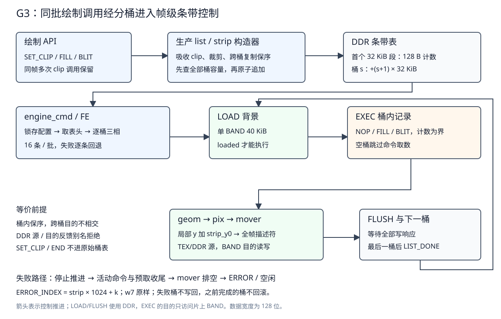

# 09 条带控制与 ABI v2

本章收录 2026-10-08 的前期研究与 2026-10-09 的 G3 正式实现、审查和验收证据。G2 已把条带数据面做成通路（engine_band、
mover 片上路由、geom 条带求交），本批把帧级控制接上：命令表从全帧平表变为
30 个条带子表，软件按条带分桶，软硬件对同一份条带表逐像素一致。帧级 BAND 已接入主工程。研究数字保留各自模型边界；正式软件、完整 RTL、综合和
板测结果分别登记在 3.9～3.12 节。研究工件在 [`Main/sim/engine/stripctl`](../../../Main/sim/engine/stripctl/)。

## 一、动机

G2 定案的两相搬运（每帧固定 960 笔、191,520 周期模型）只覆盖背景装载与
写回；条带循环、表头计数、SET_CLIP 语义、错误三元组的条带维与软件分桶
都是空白。条目第 3 节列了三个关键问题：表头取数与取数引擎（FE）的衔接、
桶内序与全局画序的等价性论证、每条带 flush 握手的组装。本轮把三问变成
数字与可执行判据，另抓出两处定案依据与仓库现状不符，在正式实现前修订。

## 二、为什么是这几步

| 步 | 要确认什么 | 本轮产物 |
| --- | --- | --- |
| 1 | 分桶先例怎么组织命令 | Skia SkTileGrid 交叉复制保序、NanoMig copper 硬件命令循环（代码级） |
| 2 | 真实帧分桶后的表规模与区容量 | 按游戏几何口径的桶分布、峰值桶、溢出边界（16/32 行对照） |
| 3 | 条带循环的取数开销是否成新墙 | 直通/条带取数批与模型周期对照 |
| 4 | 「加速但不改画」能否成立 | 对拍原型 1000 张逐字节一致＋4 变异见红；等价性论证与两个口径结论 |
| 5 | 现有定案是否与仓库一致 | D60 的依据与游戏现状矛盾；D61 表头布局自相矛盾，均给修订建议 |

## 三、每一步做了什么

### 3.1 代码级借鉴

| 参考 | 阅读到的具体代码 | 用于 G3 的结论 |
| --- | --- | --- |
| [Skia SkTileGrid](https://github.com/google/skia/blob/9250543c559bb756e7749a13bdea6c3be3861f2b/src/core/SkTileGrid.cpp)（历史版本 `9250543`，BSD-3-Clause） | `insert()` 把命令按 bbox 复制进所有交叉 tile（`fTiles[y*fXTiles+x].push(entry)`）；`search()` 对多 tile 命中做按插入序的 k 路归并去重 | 跨桶复制＝交叉复制；每条带只重放一次、无需查询与去重，桶内按调用序追加即保序，比 Skia 的归并场景简单 |
| [NanoMig agnus_copper.v](https://github.com/MiSTle-Dev/NanoMig/blob/b9c665c260c501df96928e3e1ad4af32811aee4b/src/minimig-aga/agnus_copper.v)（版本 `b9c665c`，GPL-3.0-or-later） | 五态（RESET/FETCH1/FETCH2/WAITSKIP1/WAITSKIP2）；`copjmp1` 由 COPJMP1 写或每帧 `sof` 置位重载指针；MOVE 3 个 DMA 周期、每字一个取指周期 | 硬件命令列表循环的节拍纪律：每条带固定几笔取数、flush 握手分离请求/完成，条带循环外层状态机保持与 copper 同量级的简单 |
| [PowerVR TBDR](https://docs.imgtec.com/starter-guides/powervr-architecture/html/topics/vertex-processing.html)（官方架构指南，概念参考） | TA 阶段按 tile 分桶命令、ISP 逐 tile 重放 | 分桶→逐桶重放是移动 GPU 的成熟路径；本项目把 tile 换成显示条带、重放器换成现有 geom/pix 通路 |

### 3.2 分桶分布：区容量与放大倍数（实验 A）

`g3_research.py` 按 `stg_draw.c`/`stg_pool.h` 的几何口径重放：场地 400×480、
背景＝1 全屏 FILL＋15 横线＋13 竖线＋60 星点（8×8 色键）、HUD 近似 38 条
（右侧 400..639）、弹均匀分布场地。裁剪后矩形进桶：

| 场景 | 平表条数 | 条带表条数 | 放大 | 峰值桶（16 行） | 空桶 |
| --- | ---: | ---: | ---: | ---: | ---: |
| 16×16，K896 | 1,015 | 2,327 | 2.29 | 89 / 1,024 | 0 |
| 16×16，K1055 | 1,177 | 2,628 | 2.23 | 101 / 1,024 | 0 |
| 16×16，K2000 | 2,121 | 4,420 | 2.08 | 166 / 1,024 | 0 |
| 16×16，K3000 | 3,117 | 6,276 | 2.01 | 235 / 1,024 | 0 |
| 8×8，K1365 | 1,491 | 2,553 | 1.71 | 101 / 1,024 | 0 |
| 8×8，K5000 | 5,101 | 7,677 | 1.51 | 290 / 1,024 | 0 |
| 16×16，K896（32 行） | 1,019 | 1,636 | 1.61 | 127 / 1,024（15 桶） | 0 |

- 放大主要来自背景：底色 FILL、竖线与 HUD 全高 FILL 各复制进全部 30 桶，
  星点与弹按覆盖复制。32 行把放大从 2.29 降到 1.61（横跨桶的弹变少），
  与 D58「32 行省一成分桶边际」方向一致，是否升 32 行仍归 G4 对照。
- 峰值桶余量大：K1055 只用 101/1,024。均匀假设下的溢出边界为 16 行
  15,191 颗、32 行 9,988 颗，远高于 CPU 预期墙（约 2,400～3,000），
  D61 的定长区容量成立；弹幕高度集中的 pattern 可能逼近边界，
  构造层按 D61 报错拒绝即可。
- 空桶 0 个：背景复制让每桶非空，「空条带快路径」在真实游戏帧不触发；
  保留该路径是为通用场景（无背景的窗口渲染）。

### 3.3 取数开销：不是新墙（实验 B）

批 16 条、读固定开销 27.41、校准气泡 1+1/12（E4 口径），表头 128 字节
一笔。K896：直通 64 批（6,192 周期）→条带 161 批（15,515 周期），多 9,323
周期/帧；K1055 多 10,097；K3000 多 20,352。占 G2 两相 191,520 的
5%～11%，命令取数不构成新墙。

两条边界要登记：一是条带表记录数放大 2.0～2.3 倍，EXEC 阶段每条记录
的 geom 求交与命令提交固定开销随之放大，其数值（B6 口径约每条十拍量级）
归 G4 以整机 CSV 实测；二是 32 行档取数批更少（桶数减半），与 3.2 的
放大下降同向。

### 3.4 等价性：对拍原型与两个口径结论（实验 C）

`tiling_fuzz.c` 用生产 lib（check/list/exec_sw 原样编译）对拍：同一批
绘制调用，直通（平表＋SET_CLIP）与条带（clip 吸收＋分桶＋逐桶 BAND 影子
执行）的最终帧逐字节比对。1000 张随机场景（含跨桶弹、负坐标、重叠、
色键、FILL 方程 0～3、BLIT 方程 0～5）全部一致；4 个定向变异——
漏桶复制、桶内序倒置、clip 吸收偏移 +1、BAND 不写回——逐一见红。
导出与执行同进程，未挂 sanitizer 的独立运行留作正式批。

桶内序论证（写进 spec 的口径）：不同条带的 y 区间不相交，任意两条命令
的像素交集只可能在同一条带内；跨条带命令按裁剪后片段复制进每个覆盖桶，
桶内保持调用序，桶间执行顺序与画序无关。SET_CLIP 若进条带表则破坏该
论证（无 y 语义的命令无法单桶归属，且直通/条带的生效范围不同），
见 3.6 的修订建议。

两个口径结论（原型调试中固化为设计约定）：

1. **桶表用条带局部 y**。首版原型把全帧绝对 y 写进桶表，BAND 影子表面
   只有 16 行，条带 1 起的片段全被目的表面求交裁掉（条带 1 全空）。
   硬件对应行为是 G2 已实现的紧凑映射——`band_start` 锁存 `strip_y0`
   后在端点转局部行，BAND 内只认局部行。软件分桶器必须做同一转换。
2. **桶表不含 END，计数数组是界**。直通模式的「END 后不读取」（spec §5）
   在条带模式由每区计数承担；构造层的 `gfx_list_end` 只服务平表。

### 3.5 条带循环的构型建议

在现有 `engine_cmd` 主状态机上扩展（不动 FE 的批机制与预取槽）：

```text
S_IDLE(kick) -> S_HDR(取表头 128B 一笔, FE 现有机制)
  -> 逐条带 s=0..LSTRIPS-1:
       cnt[s]==0 -> band_start+band_flush（快路径，不取数）
       否则 band_start -> band_loaded -> 区内取数/执行（现 S_FETCH..S_ADV，
         base=区基址, count=cnt[s]; 区内预取照旧, 跨条带不做预取）
       -> 末条末行写状态后 band_flush -> band_flushed -> 下一strip
  -> S_TERM(LIST_DONE)
```

- 表头 30 字计数取整为 128 字节一笔，走现有 fd 描述符（FE 已支持
  跨 4KB 拆分与错误回退），落 cbuf 半区按字读出。
- `band_start_ready` 在 mover 侧已要求总线全闲（G2 的 `b_bus_idle`），
  条带循环在执行完全区命令后天然满足；`band_flushed` 是下一条带的门。
- 错误映射：`ERROR_INDEX`＝条带号×区容量＋区内索引；表头取数失败的
  index 建议取条带 0 的区首（FETCH 码），tag 仍为 0；构造层默认标签
  改为条带号与区内索引的合成（D61）。
- 寄存器：`LSTRIPS`（0x02C，复位 30）与 `STRIP_H`（0x030，条带高 log2，
  复位 4）放 DOORBELL 与 SURF0 之间的空档；CTRL 加模式位；`CAPS.BAND`
  置 1；启用帧级 BAND 时 `engine_top` 的 PERF 读事件在 `!g_rd_tex`
  外加 `!g_rd_band`（G2 验收复核新列，已进 G3 条目实现清单）。

### 3.6 SET_CLIP：D60 的依据修订

D60 定案「条带模式下 SET_CLIP 仅允许作为条带 0 命令区首条」的依据是
「游戏本体当前无 SET_CLIP 调用（`Main/sw/apps/game` 无命中）」。本轮
逐文件核实：游戏每帧调用两次——`stg_game_compose` 先 `SET_CLIP(游戏区)`
画背景与弹幕、再 `SET_CLIP(全屏)` 画 HUD（`stg_draw.c:263/278`），
另一条组帧路径 `stg_field.c:211/226` 同样两次，`main.c:479` 与
`sw6_scene_b.c:163` 还有两处。依据不成立。

研究比较的两个候选如下，正式实现采用 b：

- a. 维持 D60 限定＋改造游戏：把帧中 SET_CLIP 全部去掉，游戏区裁剪由
  构造层吸收（`sprite()` 已有手工早退，需补成完整矩形裁剪）。
- b. **条带表整个禁止 SET_CLIP（BAD_FIELD）＋构造层吸收**：`gfx_set_clip`
  API 保留，只记录到 `gfx_list` 的当前裁剪框，分桶构造时把每条命令先
  裁进该框再入桶；直通模式语义不变，159 向量不动。对拍原型已按 b
  实现并通过（含 clip 场景），等价性论证因此保持无状态。

两案的硬件检查都极简；b 多一条 spec 规则（条带模式第十一步），a 需要
改游戏两条组帧路径。推荐 b 的理由：游戏零改动、条带执行无跨桶状态、
模糊测试可直接以「同批调用」为对拍单位。

### 3.7 D61 表头布局修订

D61 原文「区基址＝表基址＋区号×32 KB；30 字计数数组放表头」——区 0
从表基址 0 开始则表头无处安放（1024 条×32B 恰好占满 32 KB）。两个
自洽读法，正式实现采用 i：

- i. 表头占首段：表头＝表基址起 128 字节，区 s 基址＝表基址＋32 KB＋
  区号×32 KB。表 A/B 各 1 MB 预算不变（30 区 960 KB＋表头段 32 KB），
  区 0 从 +32 KB 起，全部区 32 KB 对齐。
- ii. 表头嵌在区 0 前 128 字节，区 0 容量降到 1,019 条，其余区 1,024 条
  （非均匀容量，构造层与引擎都要区分）。

推荐 i：容量均匀、基址计算一条移位加法、表头段剩余空间留给扩展
（如每区对齐字节、模式标记）。

### 3.8 ABI v2 的其余口径（本轮建议，随实现写入 spec §3.9）

- 表面 space 不变：源 0/1（DDR/TEX）、目的恒 0（DDR）；`GFX_OP_BAND`
  在 v2 仍不启用（条带是模式不是命令，与 v1「合法编码但不支持」一致）。
- 桶内序论证与局部 y、无 END、无 SET_CLIP 四条构成 v2 实例列表的
  新增检查；v1 的十步与 159 向量原样保留（直通模式）。
- 等价性对拍升级为「同批绘制调用」两级：构造层 API 序列（含 clip）为
  输入，直通表与条带表分别执行，最终帧与错误三元组逐一对应。

### 3.9 正式控制与软件实现

D60 采用条带表禁 SET_CLIP、构造层吸收；D61 采用表头独占首个 32 KiB 段。
两个推荐均成立，但必须补上坐标和反馈前提。原型的局部 y 只是软件 BAND 影子
的坐标；G2 geom 接收全帧 y，正式 cmd 在 I1 提交时加 band_y0，避免条带 1 起
被裁空。DDR 源与目的 backing 相交的反馈绘制、部分背景别名明确拒绝。
这些约束及错误优先级已进入 spec 第 02 章 3.9 节。

engine_cmd 在现有两批取数器外增加表头、配置和逐条带 LOAD/EXEC/FLUSH 状态。
表头 128 字节由 FE 一笔读入，再分拍保存 32 字计数；每桶仍按 16 条批量、
两半乒乓、错误逐条回退，不跨桶预取。空桶直接 LOAD/FLUSH，不取命令。
末次 flush 的写响应到达后才 LIST_DONE；出错桶停止绘制且不 flush，等待
活动命令、预取和搬运层排空后上报首错，随后可重新提交。



regs_gen 真源增加 CTRL.BAND、LSTRIPS/STRIP_H/BAND_SURF，CAPS.BAND=1；
STRIP_H 是编译参数，寄存器须与物理高度一致。背景/目的槽配置独立，默认
同为槽 0，可原地合成或使用不相交背景面。PERF 排除本地 BAND 读写并计入
背景 LOAD/FLUSH，通过真实 AR/AW 对账。

软件分桶已在生产 list/strip 库：原有 gfx_set_clip、gfx_fill、gfx_blit、
gfx_blit_run 和 gfx_list_end 调用可在 begin_strips 之后继续使用。
逐绘制调用先完整早检，再裁进目的与源有效区，按覆盖桶追加并保持桶内序。
默认 w7=strip*1024+k；全部覆盖桶先检查容量，溢出整次拒绝且 first_error
阻止提交，不自动拆帧。零面积也先验证内容；无损编码失败拒绝，避免源坐标截断。
软件 exec_sw_run_strips 使用独占 4096*STRIP_H 字节影子（含逻辑 padding，
默认 64 KiB），源始终从原始 DDR/TEX 视图读，逐桶执行后只写回 2560 字节/行。
物理 BAND 仍是紧凑 40 KiB，不能把软件影子大小写成硬件 RAM 容量。
Ti60 驱动增加 submit_strips；旧 submit 显式选直通，perf_clear 保留模式。

### 3.10 正式验证与复现审查

研究 A/B 原样复现，桶峰值、溢出边界和模型周期与研究记录一致。
原型 1000 张、4 变异也复现；审查修复研究与正式测试中未初始化的统计结构。
正式入口为 tools/check/check_g3_stripctl.py，证据在 stripctl/logs。

| 证据 | 判据与结果 |
| --- | --- |
| 生产库随机场景 | sanitizer 10000/10000，独立普通构建 10000/10000，0 跳过、逐字节 0 差；跨桶、负坐标、重叠、色键、六方程及同帧两次 clip |
| 软件错误边界 | 50 项，0 错；非法空命令早检、原始 clip/end、局部 y、反馈别名、容量 1024/1025、跨桶原子追加、FETCH/index/tag、坐标无损编码 |
| 完整 engine_top | 16/32 行均通过；整帧和 padding 0 差，空桶、错误三元组、批中 FETCH 回退、LOAD/FLUSH 错误、超时迟到、软复位与再提交 |
| 软件生产变异 | 漏跨桶、clip 偏移、倒序、漏 flush 各编一次，均检测到差异 |
| RTL 生产变异 | 漏局部 y 还原、漏表头段、虚计 BAND PERF 均触发对应像素/错误/计数判据 |
| 直通兼容性 | 159 向量和控制层定向回归通过，两项既有变异见红；十三套提交前仿真及 G2 正式数据面回归见 regression_results.json |
| 软件分层 | check_sw_layers.sh fail 0，含真实 RISC-V 构建、无软浮点、越层注错、重编与 sdk 未改 |

16 行完整帧有 67 笔命令读、1600 笔像素 DDR 读、480 笔写，读拍 86800；
32 行为 35/1600/480、读拍 86110。G2 数据面 17 项也全部符合预期；描述符入口分拍后，
定时 96 行场景 46931 周期，LOAD/FLUSH 仍为每桶 3248/3136，当前复跑证据
另存 logs/g2_recheck，未覆盖 G2 原归档。像素读包含 480 笔背景和 1120 笔 DDR 源，
不是 BAND 目的读；PERF 与真实 AR/AW 相等。此处不是游戏 N_max 场景。

### 3.11 综合与真实板卡

| 构型 | XLR | RAM | DSP | setup / hold（ns） |
| --- | ---: | ---: | ---: | --- |
| 独立完整引擎，变量驱动和输出观测 | 21622 | 88 | 12 | +0.191 / +0.026 |
| 主 SoC，4 KiB cache、条带 16 行 | 41476 | 163 | 16 | core +0.756 / +0.026 |

四步均 PASS，全部时钟关系无负 slack。独立包装修正为完整 16 位 APB 输入，
TEX 窗口也可被访问，避免 12 位包装把 TEX RAM 当只读零裁掉。
主工程 BAND 36 RAM、TEX 16 RAM，cmd 总 13 RAM；相比 G2 的 121，
主工程增 42 块，即 BAND 36 与计数控制 6。原约 159 是预算，实测 163。
最新综合段无新增自写位宽截断告警，厂商和历史累积告警按段区分。

新 bit 经 JTAG 配置 Ti60，stripTest-O2.bin 为当前源码重编产物。
混合 DDR/TEX、两次 clip、六方程的硬件与独立直通软件同帧 CRC 相同，
包括 padding：73069421。空桶不改画面；非法 SET_CLIP 为
2/1024/cafe005a，容量溢出为 2/1024/0；排空后条带重新提交和返回直通均通过，
程序 fail 0。原始输出在 sw/apps/test/stripTest/logs/g3_board.log。
兼容性 engineTest 新编产物在同一 bit 上 fail 0，十一整帧与 TEX 金标准、
错误、缓存失效和扫描压力均通过；最低水位 0x150=336 拍，欠载 0。
产物身份集中登记在 board_artifacts.json，板测没有写 Flash。

### 3.12 审查中定位并修复的问题

1. 原型与数据面坐标口径不同：软件窗口是局部 y，geom 是全帧 y。
   在 cmd 提交边界转换；全帧对拍和 INJ_STRIP_LOCAL_Y 验证转换不可省略。
2. 分桶保序没有自动覆盖源/目的反馈。对目的 backing 的任何 DDR 源别名
   均拒绝，背景部分别名也拒绝，补定向反例和错误优先级。
3. 独立初版 setup -0.123 ns：配置读口选择与结构检查串到状态迁移。
   读口选择寄存、检查与迁移分拍，独立最终 +0.191 ns。
4. 主工程初版 setup -0.173 ns：geom 行分段地址计算串到 BAND 地址检查。
   本地描述符先寄存，再检查和转紧凑地址；pending 进入 busy，flush/cancel
   的互锁覆盖这一拍。主工程最终 +0.756/+0.026 ns。
5. BUS_WRITE 测试台曾在同一 posedge 改从机窗口，结果受进程执行顺序影响。
   改为在 B 响应通道确定注入 SLVERR，保持读通道正常；16/32 行均重跑。
6. board_run 遇到新日志目录时，串口线程异常退出后误报 0 字节。
   主线程在烧写之前准备父目录，失败清楚报环境错误；新目录的真实板测复跑通过。
7. 对拍统计未初始化、裁剪后源坐标可能无法编码：分别清统计和整次拒绝
   无损编码失败，两者均进入正式软件重跑与边界检查。

8. 既有 frame/tex 两个测试台仍要求 CAPS=0x44f，G3 的 0x46f 触发陈旧期望。
   原像素和协议判据保持，更新能力位后分别重跑 16/16 与 6/6。
9. 提交路径检查发现旧报告绘图脚本的机器绝对路径。改为基于 __file__ 的仓库
   相对定位，输出目标和数据不变；检查工具增加 --tracked，覆盖暂存新增文件。
   本机未追踪的报告工作资料保持原位，未收入 G3 提交。

## 四、遇到的问题

### 4.1 场景重置把源内容重新随机化

第一现场：单命令最小复现里同一条 COPY BLIT 的 (318,0) 像素两路径不同。
解读：直通与条带执行之间二次 `setup_surfaces`，源表面内容被重新随机。
定位：把「重置帧」与「随机化源」拆成两个函数后逐字节一致。
根因与修法：对拍两侧必须共享同一份源内容；正式模糊测试的输入构造
要显式区分「每场景重置」与「两侧共享」。

### 4.2 绝对 y 进桶表把条带 1 起的片段全部裁空

第一现场：首版原型条带 1 的行全为初值，条带 0 正常。
解读：BAND 影子表面高 16 行，桶片段保留全帧绝对 y 后被目的表面求交
裁掉。定位：单条跨桶 BLIT 复现；桶表改条带局部 y 后一致。
根因与修法：这是硬件语义（G2 端点转局部行）在软件侧的对应义务，
固化为 3.4 口径 1。软件执行器影子若改用「每条带重指基址」也可等价，
但与硬件的紧凑映射口径不一致，不采用。

### 4.3 构造层早检把随机场景的三成打成构造错误

第一现场：首轮 1000 张全部跳过，direct=2（BAD_FIELD）。
解读：FILL 的常数 c 仅 CONST 方程可非 0、ALPHA 方程的 argb 要过预乘
检查（RGB 不得超 alpha）、ARGB_PM 源不可用 ALPHA_STRAIGHT，都是
spec §3.3/§4 的既有规则。定位：透传构造层返回码逐条修正生成器。
根因与修法：生成器按规则生成合法命令；这些「被拒场景」在正式批里
另成一组负样本（构造层拒的，条带路径必须同样拒）。

## 五、结果

G3 于 2026-10-09 验收归档，Todo 条目已删除。D60/D61 修订、寄存器、帧级条带控制、生产分桶与软件
执行器、驱动、错误和坐标语义已接成闭环。软件两套各 1 万张、完整引擎
16/32 行、定向错误和生产变异通过，独立和整机综合无负 slack，真实板卡
条带同帧 CRC、错误恢复和既有直通兼容性通过。最新验收摘要在
Main/sim/engine/stripctl/logs/acceptance_review.json。

## 六、还欠什么

G4 的真实游戏条带接入、长时间同帧对拍、扫描争用矩阵、N_max 搜索、
16 KiB cache 对照和作品材料数字更新仍未验收。本章板测是诊断场景，
不能替代游戏整帧吞吐、持续 60 FPS 或 G4 实测。Flash 内容没有因 G3 改写。
