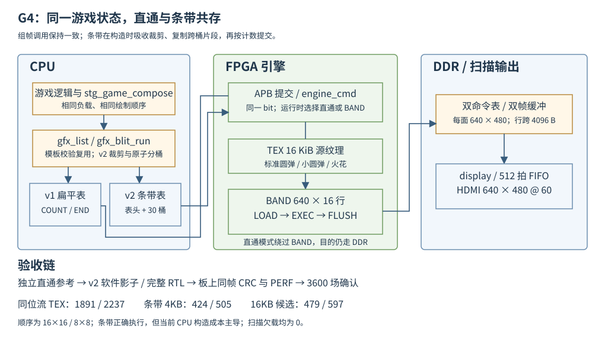

# 10 整机集成与 N_max 实测

本章收录 G4 的研究复现、正式实现与整机验证（2026-10-09）。G1～G3 已把 TEX、BAND 与条带控制接成
闭环（诊断场景级），本批回答两件事：条带模式在真实整机（真实游戏、真实 DDR
争用、真实扫描输出）下是否成立，以及 `N_max` 相对 P1 的 1,014/1,365 提升到
多少。研究阶段完成接入侦察、真实游戏帧分桶统计与两墙模型；正式阶段完成游戏条带
后端、同帧对拍、真实游戏整帧 RTL、整机四步与缓存对照。研究预测已被板上
周期分段推翻：当前分桶构造成本成为主导，不能用纯引擎收益代替整机收益。



## 一、动机

P3 总览的预期表把 G4 的 `N_max` 标为「以正式实现重测，可能移到 CPU」，但
三个模型参数仍是旧口径：EXEC 每条记录的固定提交开销（G3 第 3.3 节留给
G4 实测）、CPU 分桶增量的真实占比、16KB 候选在真实游戏边际下的收益。若
预期区间（4KB 约 2,400～3,000）的成色不足，实测跑完的数字无法解释「墙在
哪」。本轮先用 PC 宿主上的真实组帧把分桶统计做成实测，再把两墙模型算到
可对照的精度。

## 二、为什么是这几步

| 步 | 要确认什么 | 本轮产物 |
| --- | --- | --- |
| 1 | 游戏接条带模式要改多少处 | 接入点侦察：组帧器零改动，改动集中在 draw_frame 分派与执行提交 |
| 2 | 真实游戏帧分桶后的表规模 | 实验 A：生产组帧器双路组帧，60k+ 帧逐帧统计放大、峰值桶、对账 |
| 3 | 两墙（CPU/引擎）各在哪个 K | 实验 B：E8 缓存实测收益 + G2 两相模型合成周期曲线 |
| 4 | D61 定长区与 32 行档的容量 | 峰值桶随 K 的实测外推：16 行打满 K≈6,000、32 行 K≈4,400 |
| 5 | D58/D59 对照构型值不值得跑 | 预算核算：16KB +18 块（平台第 10 章实测）、32 行 BAND 约 +36 块 |
| 6 | 实测的复测工具是否现成 | S1/K 档、水位、PERF 对账、回放、CSV 分段全部已入库，只差条带后端分派 |

## 三、每一步做了什么

### 3.1 代码级借鉴

- **[LVGL v8.3.0 src/core/lv_refr.c](https://github.com/lvgl/lvgl/blob/v8.3.0/src/core/lv_refr.c)**：`refr_area` 把无效区按渲染缓冲
  容量切成 part，`refr_area_part` 在单缓冲模式等待 flushing 清零；每个 part 渲染后经 `call_flush_cb` 推给显示驱动，
  `draw_buf->flushing` 标志做渲染与传输的互锁（下一块渲染前等上一块
  flush 完成）。这是「条带渲染 + 渲染/传输重叠」在成熟软件图形栈里的
  组织先例。差异：LVGL 由脏区驱动、CPU 软渲，本项目是全帧条带、GPU
  三相（LOAD/EXEC/FLUSH）——互锁思想对应 BAND 的 phase 状态机。
- **[PPSSPP headless/Headless.cpp](https://github.com/hrydgard/ppsspp/blob/master/headless/Headless.cpp)**：无头自动化把「跑多久（timeout）、
  比什么（输出 `.expected` 与预期截图）、结果给谁（GitHub Actions 事件）」
  三件事拆开，长跑测试的组织方式与本次实测的确认档（3,600 场自动跑、
  零掉帧判据、日志进台账）同构。差异：PPSSPP 比对输出文件，本项目
  比对同帧 CRC 与逐帧掉帧计数。
- 沿用 G3 已读的 Skia SkTileGrid（交叉复制保序）、NanoMig
  `agnus_copper.v`（每条带状态重载）与 PowerVR TBDR（概念），本章不再展开。

### 3.2 接入点侦察：组帧器零改动

逐文件核实（引用行号以本日仓库为准）：

- `lib/gfx/list.c` 的 `append()` 已内置条带分支：`l->strip_table != 0` 时
  整条转发 `gfx_strip_append()`（list.c 第 28 行起）。游戏的组帧器
  `stg_draw.c` 只调 `gfx_fill`/`gfx_blit`/`gfx_set_clip`/`gfx_blit_run`
  等组帧 API，全部汇聚到 `append()`——**组帧器一行不改**。
- SET_CLIP 自动吸收：`gfx_strip_append()` 把 SET_CLIP 记进 `build_clip`
  并返回成功，不产生命令（D60 修订的构造层落地）。游戏每帧两次
  `gfx_set_clip`（`stg_draw.c` 263/278）可原样保留，实验 A 全程零拒绝
  实测通过。
- 分桶器吃全帧绝对坐标、桶内转局部 y 并裁源区，与游戏组帧坐标系一致，
  不需要调用方感知条带。
- 表内存零改动：`REGION_CMDLIST_A/B` 各 1 MiB（`bsp/memmap.c`），
  基址 0x0040_0000/0x0050_0000 都满足驱动的 32 KiB 对齐
  （`gfx_engine_submit_strips` 拒 `list_base & 0x7FFF`），放一张
  「表头 128 B＋30 桶×32 KiB」的 v2 表正好（D61）。
- 执行入口：模式 2/3 共用的 `draw_frame`（`stg_modes.c`）按
  `renderer_pipeline_enabled(ctx->hw)` 分派流水/串行。条带后端需要
  strips 版提交（`gfx_engine_submit_strips(基址, 30, 4, bg=dst, dst)`，
  驱动已入库），`renderer.c` 的在途管理（`s_pending`/flush/错误三元组）
  原样可用，改动集中在一处提交函数的分派。
- 普查对账：`gfx_census_run` 只认扁平命令数组，v2 条带表不能直接喂。
  替代判据两层：桶计数数组之和＝组帧计数（表头即数据）；执行后同帧
  CRC 对软件影子面（`exec_sw_run_strips`，G3 已入库）。
  SW9_PERF 板上口径本就在 `PRESS_CLOCK` 下跳过 census，不新增板上开销。
- nmax 状态机（`lib/core/nmax.c`）只吃活动元素数与帧周期，与渲染后端
  解耦，零改动。D63 的同比特流 A/B 切换落在现有 `s_backend` 框架：
  新增后端号（HW/STRIP），SWAP 键在 SW→HW-DDR→HW-TEX→HW-STRIP 间循环。

### 3.3 实验A：真实游戏帧的双路组帧统计

**方法**：PC 宿主构建（`make PLATFORM=host`，WSL gcc）上给
`stg_modes.c` 的 `draw_frame` 加研究开关 `GFX2D_STRIP_RESEARCH`（默认
关，与注错宏同风格）：同一份游戏状态先用生产路径组 v1 直通表，再用
生产分桶器组 v2 条带表两遍（16 行 30 桶、32 行 15 桶），只统计不执行。
逐帧输出 `rcsv` 行：直通条数、两种条带表条数、峰值桶（读表头计数数组）、
组帧周期（宿主口径）、错误计数、`by_eq` 对账标志。模式 3 用 nmax 全程
搜索（`GFX2D_START_MODE=3`）覆盖全部 K 档，再用 `GFX2D_PRESS_KNOB=<K>`
固定旋钮补 K=2,400/2,800/3,200/3,600 四档（各约 1,450 帧）；聚合脚本与
四份固定档日志入库在 [`Main/sim/engine/stripctl`](../../../Main/sim/engine/stripctl/)，
nmax 全程主日志（1.3 MB）不入库，复现命令同上。

**16×16 段（负载弹＝标准圆弹，全 TEX 源）逐档均值**：

| K 档 | 帧数 | 直通 u1 | 条带 u2 (16 行) | 放大 | 峰值桶 max (16 行) | u3 (32 行) | 放大 | 峰值桶 max (32 行) |
| --- | ---: | ---: | ---: | ---: | ---: | ---: | ---: | ---: |
| 64 | 720 | 352.5 | 1,057 | 3.00 | 67 | 731 | 2.07 | 82 |
| 256 | 720 | 775.4 | 1,861 | 2.40 | 126 | 1,348 | 1.74 | 169 |
| 1,024 | 416 | 2,364.4 | 4,886 | 2.07 | 382 | 3,671 | 1.55 | 512 |
| 1,744（确认档） | 4,919 | 1,959.8 | 4,108 | 2.10 | 338 | 3,073 | 1.57 | 451 |
| 2,400（固定档） | 1,487 | 2,849.0 | 5,806 | 2.04 | 440 | 4,373 | 1.54 | 601 |
| 2,800（固定档） | 1,486 | 3,288.8 | 6,643 | 2.02 | 508 | 5,015 | 1.53 | 688 |
| 3,200（固定档） | 1,487 | 3,729.0 | 7,480 | 2.01 | 572 | 5,658 | 1.52 | 780 |
| 3,600（固定档） | 1,475 | 4,167.3 | 8,314 | 2.00 | 639 | 6,298 | 1.51 | 870 |

8×8 段（PC 口径 N_max=4,688）：确认档 u1=5,585、u2=8,320（放大 1.49、
峰值桶 699/1,024）、u3=6,925（放大 1.24、峰值桶 980/1,024）。
模式 2 整帧（含 HUD/标题，低负载）：u1=197、u2=757，放大 3.84——全高
命令占比高时放大显著上升，实测判据以模式 3 为准，此数用于回放场景预估。

**四条读数**：

1. **放大稳定**：16×16 段二分档稳定在 2.07～2.10，与 K 基本无关
   （背景全高命令的复制份数固定，弹的贡献随 K 增大而被稀释，K=0 帧
   放大 3.31）。G3 按几何口径重放的 2.29（K896）与本实验同量级。
2. **峰值桶远高于均匀假设**：K≈1,000 时实测峰值桶 382/1,024，G3 重放
   的均匀分布估 89/1,024——真实弹幕向自机集中，均匀假设低估峰值约
   4 倍。容量结论必须用实测分布，不能用均匀外推。
3. **对账干净**：实测覆盖范围内（16×16 段全部档与 8×8 确认档）约 6 万帧的
   两遍组帧 rejected/overflow/first_error 全 0，`by_eq` 与直通 100%
   一致，SET_CLIP 吸收（D60）实测通过；8×8 高 K 的溢出档错误计数
   与对账失败如期出现（3.4 节），构造层行为符合 D61 定案。
4. **组帧开销**（宿主 x86 口径，只作相对参考）：v2 组帧在确认档
   约 7,000 周期/帧（16 行），随 K 近似线性（K=3,600 约 13,500），
   32 行与 16 行同量级。板上绝对数与 CPU 墙的占比归 G4 实测。

### 3.4 容量：D61 定长区与 32 行档的峰值桶

峰值桶随 K 近似线性，实测斜率与打满点外推：

| 档 | 峰值桶斜率（实测） | 打满 1,024 的 K（外推） |
| --- | ---: | ---: |
| 16×16，16 行 30 桶 | 0.166/颗 | ≈6,000 |
| 16×16，32 行 15 桶 | 0.224/颗 | ≈4,400 |
| 8×8，16 行 30 桶 | 0.096/颗 | 6,144 起极端帧打满（实测溢出 21,708 条） |

8×8 段在 K=4,096/8,192 档实测到桶打满与整帧溢出（错误条数十万量级）——
D61 的「任一桶溢出整次调用拒绝」路径在真实分布下被触发过，构造层行为
符合定案。**结论**：4KB 主线的预期墙（K≤3,000）下，16 行与 32 行的
峰值桶占用最高 63%，容量不构成新墙；但 32 行档的占用比例反而更高
（每桶覆盖弹多），若 16KB 构型把 16×16 推到 K≈4,500～5,000，32 行档会
先撞容量墙——**16KB 对照构型不建议同时升 32 行**。

### 3.5 实验 B：两墙模型与 N_max 预期

引擎侧（16 行、30 条带、16×16 全 TEX 源）：

```
T_eng(K) = 191,520（两相固定，G2 正式模型）
         + ~256 × K（EXEC 像素与混合，G2 研究代理 246/260 每颗）
         + ~10 × u2(K)（EXEC 每条记录提交，B6 口径十拍量级；u2 取实验 A）
```

CPU 侧（SW9 CSV 反推的固定 0.56M 周期/帧＋边际 360 周期/颗，其中
build≈208 与 E8 的 C 组 176 同量级；16KB 收益按 E8 实测比例：

| 构型 | CPU 边际 | CPU 墙（K） | 引擎墙（K） | N_max 预期（受哪堵墙） |
| --- | ---: | ---: | ---: | --- |
| 4KB/1 路，16 行 | 360 | ≈3,000 | ≈5,300 | **2,700～3,000，CPU 墙** |
| 16KB/4 路，16 行 | ≈223（−38%） | ≈4,800 | ≈5,300 | **4,500～5,000，双墙重合** |
| 8×8 档（两构型） | 略低于 16×16 | ≈3,100 / ≈4,900 | >10,000 | CPU 墙，条带后预期翻倍以上 |

三条读数：

1. **4KB 主线的预期区间收到 2,700～3,000**，落在总览旧模型（2,400～
   3,000）的上沿：条带把引擎从 94% 预算降到 ~55%（K=2,800 时
   T_eng≈0.99M），墙移到 CPU；CPU 分桶增量未计入（板上实测归 G4），
   实测值大概率落在区间下半段。
2. **16KB 候选的收益可兑现**：CPU 墙右移到引擎墙附近（4,800 对 5,300），
   N_max 预期 4,500～5,000，相对 4KB 约 1.6 倍——比总览旧模型
   （3,300～4,000）乐观，因为 E8 的 −38% 是合成负载实测而非估算。
   若实测落到区间上沿，16×16 档逼近 32 行容量墙（4,400），再次支持
   「16KB 不与 32 行同构型」。
3. **实测的判定口径**：板上 CSV 分段（`cyc_logic/cyc_build/cyc_exec`、
   `bottleneck`）逐档判墙，与本章模型对照；若实测低于 2,000，按条目
   第 4 节另立构造层优化条目。

### 3.6 D58/D59 对照构型的预算与判定建议

- **16KB/4 路（D59）**：整机 RAM 163＋18＝**181 块（70.7%）**（18 为
  platform 第 10 章 5.2 的整机实测增量，修正总览的「+18≈177」估算）；
  setup/hold 先例 +3.535/+0.026 ns。生成与回归路径照 platform 第 10 章
  3.5 节（`ipm_gen_soc.py --override DCacheSize=16384 DCACHEWAY=4`、
  同步 `soc.h` 两宏、DDR 回归＋九组对照）。
- **STRIP_H=32（D58）**：`engine_band` 已全参数化（WORDS=160×STRIP_H），
  分段从 2048+512 变 4096+1,024，RAM 36→约 72 块（综合实测归实现批），
  整机约 199 块（77.7%）。记录数按本章 K=1744 取样为 4108→3073，约 −25.2%；
  CPU 分桶边际收益尚待板测。2026-10-09 依据当前逐行 DMA 源码订正：全帧
  LOAD/FLUSH 字节数不随条带高度改变，191,520 周期不能直接减半；能减少的是
  条带级控制和部分边界片段，实际两相周期需重新仿真/板测；
  代价：峰值桶占用比例上升（K=1,744 时 451 对 338）＋16KB 构型下的
  容量墙。**建议**：4KB 主线上按条目「时间富余才做」执行；不与 16KB
  同构型。
- 是否转正 16KB 凭实测数据另定（D59），满足 platform 第 10 章第六节
  「真实游戏与扫描压力下确认资源、时序和帧预算」的采用条件。

### 3.7 复测清单与仿真用例盘点

条目第 2 节的复测清单逐项核对，工具全部已入库：

| 项 | 工具 | 状态 |
| --- | --- | --- |
| S1 过载档与 K 稳态档 | SW8/SW9 口径与日志 | 现成 |
| 扫描 FIFO 水位与欠载 | `board_display_diag`（min/zero/under） | 现成，主循环已打点 |
| PERF 对账 | engine 第 06 章口径；`g_rd_band` 过滤 G3 已修 | 现成 |
| 通关回放逐行一致 | `stg_clear` 录像＋replay 框架（SW7 口径） | 现成，条带模式复用 |
| CSV 分段 | `gfx2d_stats.c`（`cyc_logic/build/exec`、bottleneck） | 现成 |
| 整帧仿真条带用例 | `tb_engine_frame` 框架＋stripTest 的 submit_strips APB 序列 | 实现批补 v2 用例与注错 |

### 3.8 研究阶段边界

PC 宿主实验没有 DDR 争用、没有扫描输出、没有引擎真实执行；周期模型
的引擎项沿用 G2 研究代理系数，EXEC 提交开销仍是十拍量级的假设。
`N_max` 预期一律不作门槛（总览判据总原则），以板测为准。研究开关
`GFX2D_STRIP_RESEARCH` 保留在生产源码（默认关），正式条带后端组帧路径与它同构，研究开关保留为默认关闭的复现入口。

### 3.9 独立复现与研究审查

四个固定档各 1479 帧复现：K2400/2800/3200/3600 的 16 行放大为
2.038/2.020/2.006/1.995，峰值桶为 440/508/572/639，拒绝与溢出为 0，
by_eq 全通过。完整宿主搜索复现 2002@K1744 与 5321@K4688；K1744
平均直通 1959.8 条、条带 4107.8 条、峰值 338。宿主周期只登记组帧过程，
不用于板上性能结论。原始结果在 [G4 证据目录](../../../Main/sim/engine/g4/logs/)。

研究探针原先复用了 st2，最终只检查 32 行的 by_eq；补入 16 行独立检查，
两次结果共同决定 eqok。高 K 的拒绝路径按既有定案保持整次追加原子性。
研究模型没有量到板上分桶固定成本与随机桶写入成本，3.5 节的 2700～3000
和 4500～5000 仅保留为被实测推翻的历史预测。

### 3.10 游戏后端与提交

组帧器保持原调用序列。第四后端 HW/STRIP 将 gfx_list_begin_strips 绑定到
两张既有 1 MiB 表，SET_CLIP 在生产构造层吸收。renderer 统一串行、流水
与软件影子三条入口：依据 strip_table 分派 gfx_engine_submit_strips 或
旧直通提交；first_error、rejected 或 overflow 非零时拒绝提交部分表。
切换前显式收尾在途表，再恢复或覆盖 TEX 源表面，运行时保留 SW、DDR、
TEX、STRIP 四个后端。基础 Demo 沿直通模式提交，游戏与压力模式使用 v2。

CSV 的普查按表头计数逐桶执行，检查桶容量及计数和等于 used，不将表头或
桶间空洞解释为命令。CSV exec 明确区分 hw、hw-tex、hw-strip。条带
分片后的命令数不能与组帧器的原调用数直接相等；独立直通参考的同帧 CRC
作为像素语义判据，PERF_PIXEL/KEY_SKIP 与软件 v2 执行统计另行对账。

正式接入首测发现 gfx_blit_run 的条带分支退回逐颗 gfx_blit，丢失了
既有模板校验复用。修复将已完成十步检查的记录交给内部条带追加入口，
保留逐条坐标检查、同槽重叠回退、v2 源反馈、局部裁剪和原子容量检查。
1 万张 sanitizer 差分场景对逐条调用，表字节、成功计数、首错、拒绝、
溢出与关闭状态一致。首轮定位日志记录 200/217，正式为 424/505。首轮旧 BIN 未保留，
其日志仅用于诊断，不作发布性能或精确产物对照。

### 3.11 真实游戏、RTL 与同帧对拍

完整宿主 9208 帧 v1/v2 回放逐行一致，CLEAR 在第 9027 帧，末帧 9207
返回 READY，end frames 9208 hits 4 over 0。跨关卡采样每 600 帧加末帧，
共 17 帧，经板上软件条带影子、硬件条带与独立直通参考三方对账，CRC
完全一致；第 9000 帧有 2659 颗可见敌弹。逐帧 PIXEL、KEY_SKIP、
pixel_written 对账通过，失败会直接计入 compare engine。

真实游戏 RTL 工件来自生产终符 K1024、1200 次状态推进与当前素材包，
包含 1202 颗可见敌弹、3084 条分桶命令、668174 像素、13893 色键跳过。
完整 engine_top 在随机反压下与独立直通软件金标准比较整帧及 padding，
40782 项检查、0 差异；207 笔命令读、2801 笔像素读、480 笔写，
DDR 读拍 95376。局部 y、表头偏移、PERF 三种生产 RTL 变异均见红。

测试台初版沿用了诊断台的 12 位 APB 任务，TEX 页被截断；修成 16 位
后错误消失。诊断场景的看门狗还不足以容纳完整游戏事务量，按整帧规模
扩大上限，保留局部与全局超时。两次失败均定位于验证台，未据此修改 RTL。

### 3.12 整机资源与两种缓存

| 构型 | XLR | RAM | DSP | core setup/hold ns | 全域最小 slack ns |
| --- | ---: | ---: | ---: | --- | ---: |
| 4KB/1 路，16 行 | 41476 | 163 | 16 | +0.756/+0.026 | +0.026 |
| 16KB/4 路，16 行候选 | 40795 | 181 | 16 | +0.751/+0.026 | +0.026 |

两档 map/interface/pnr/pgm 全过。16KB 在忽略的复制工程中生成，除
DCacheSize/DCACHEWAY 外复用相同 RTL、时钟、引擎与软件 BIN；主线 SoC
和 SDK 保持 4KB。RAM 增量实测 +18，与 3.6 节修正预算相符。XLR 下降
是重新生成与布局的净结果，不将逻辑差额归为容量本身的功能收益。

缓存回归还发现一处仅适用直接映射的旧准备序列：cacheCoherencyTest 的
arm_line 用一个异标签读驱逐上一轮新值，16KB/4 路下第二轮 A1/A2 读到
旧缓存的新值而失败。改为按地址失效全部 way，再写 DDR 别名并装入
原标签；读回必须精确等于所准备的旧值，不能仅以“不等于新值”通过。
同一修复程序在 16KB 正常回归 fail 0，4KB 的正常、失效注错和判据
反例继续纳入板测矩阵。

旧 ddrBurstProbe 依赖 B6 前的 S1 探针，当前 bit 上首次访问旧页停住。
误纳矩阵的失败记录保留，不能充作突发验证；改用当前引擎缓存测试。
旧程序新增有效第 0 页前置检测，在引擎 bit 上明确输出 unavailable、
fail 1/done，避免静默停住。

### 3.13 板上 N_max 与模型订正

| 构型与后端 | 16×16 N_max / K | 8×8 N_max / K | 确认档 | 最低水位 |
| --- | --- | --- | --- | ---: |
| P1 DDR，SW9 历史 | 1014/896 | 1365/1216 | 各 3600 场零掉帧 | 332 |
| 4KB STRIP，正式 | 424/384 | 505/464 | 各 3600 场零掉帧 | 323 |
| 16KB STRIP，候选 | 479/432 | 597/544 | 各 3600 场零掉帧 | 321 |

4KB 正式整轮 24045 帧/24124 场，16KB 25120 帧/25565 场。搜索过程中
失败档出现掉帧属于预期；通过条件只引用最终确认档的 3600/3600。两档扫描
zero/under 与中断 faults 均为 0，输出日志无丢行，自动复核通过。

4KB 条带相对 P1 历史值下降 58.2%/63.0%，不能表述为整机加速；16KB
相对同程序 4KB 提高约 13.0%/18.2%，仍未达到历史预测。CSV 显示条带
引擎忙周期已下降，CPU 的组帧成本主导。确认档每帧逻辑加组帧约 1.3 M
周期，而引擎约 0.6 M；额外普查、日志与提交也必须占实际场预算，因此
ft_max 小于预算不能替代场数与切换次数对账。该结果推翻 3.5 节直接套用
旧直通 CPU 固定项和边际的推算。

等效混合吞吐按 N_max×面积×60 换算：4KB 为 6.513/1.939 Mpix/s，
16KB 为 7.357/2.292 Mpix/s。这是整机条件指标，不是像素阵列的固有吞吐。

## 四、遇到的问题

- **聚合脚本把对账标志误当错误**：`rcsv` 行尾两列是错误计数与
  `by_eq` 对账标志（1＝一致），首版 awk 把两列相加，得出「每帧一个
  错误」的假象。分开列并逐列核对后确认全程零错误。教训：研究探针的
  输出列先做一次正负样本自检再聚合。
- **nmax 全程日志两段搜索共用 K 值域**：16×16 段与 8×8 段的档位在
  K=64～2,048 重叠，首版聚合把两段并进同一桶，峰值桶与放大都被稀释。
  按 `nmax result` 行切段后重聚合（本表按段给出）。
- **WSL 的 `/tmp` 跨调用不保**：日志先落 `/tmp` 再聚合，跨调用读到
  空文件。改成一跑一聚合的单命令、日志落 `/mnt/e` 的临时目录。

## 五、结果

正式条带游戏后端、生产软件完整回放对拍、真实游戏整帧 RTL、跨关卡板上
同帧 CRC/PERF 与两种缓存的真实 N_max 已验证。4KB 为 424/505，16KB
候选为 479/597，均有 3600 场零掉帧确认，扫描欠载和中断故障为 0。
数据面收益没有转化为当前整机收益，研究预测被板测推翻；按 G4 spec
把更深入的构造优化另立条目。

## 六、证据边界与接续

16KB 保留候选构型，不据本轮结果替换主线 IP。STRIP_H=32 属可选对照，
本轮未编译或登记板测。PSLVERR 经 OpenOCD 的传播、HDMI 人工目视与实体
按键观察不由自动串口和 CRC 结果代替。JTAG 加载证据不宣称 Flash 自启动
已升级到条带版本。

完整硬件条带回放 9208 帧已与当前 PC 参考逐行一致，CLEAR 在 9027、
末帧 9207 返回 READY，end frames 9208 hits 4 over 0。四后端按
SW→DDR→TEX→STRIP 实际切换通过，普通游戏 600 帧短测仅预热窗口掉 1 场，
后续窗口均 60/60。缓存正常、失效注错与反例自检分别为 fail 0、预期
4 处 FAIL(inject) 且 fail 0、4 处 NOT_RED 且 fail 4，均符合判据。
旧探针在当前 bit 上明确 unavailable/fail 1/done，不计为突发测试通过。
报告 26 页、19 图/4 表及 19 页幻灯片已同步实测，历史稳态图的周期到
毫秒换算已修为 100000 周期/ms；压力档软件未稳态不再标作等负载加速比。
所有最终判据集中在 G4 logs/board_results.json。构造层接续范围见
[绘制前端总览](../../Todo/sw/绘制前端总览.md)。

本批于 2026-10-09 验收归档，后续构造与提交优化按绘制前端 F 系列单独实施。
