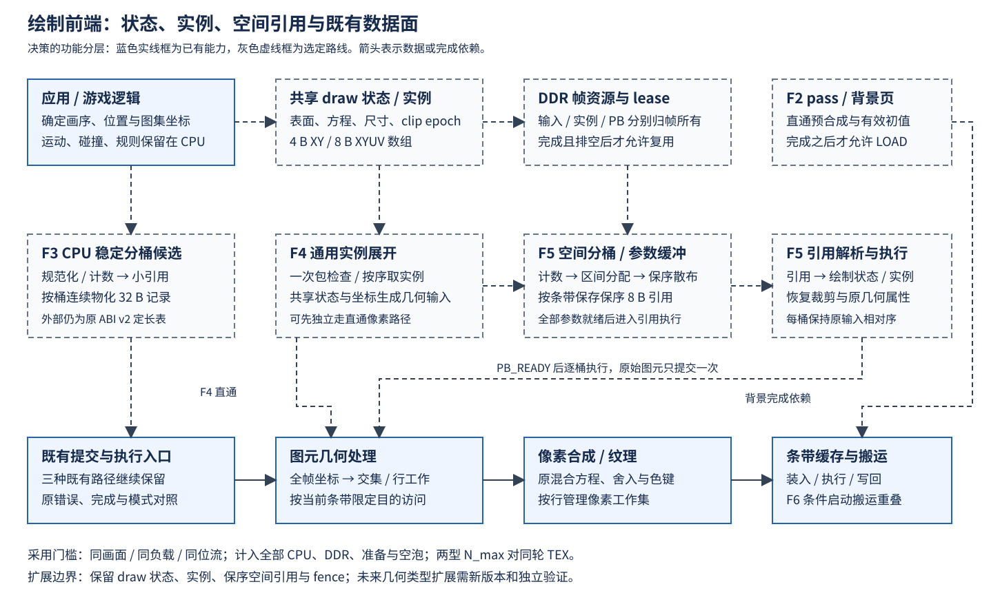

# 11 绘制前端方案研究

状态：**决策已归档（2026-10-10）**。本章记录 P3 收官后的选型依据、候选比较、
决策 D64～D76 及其成立条件。接口与实施契约由
[绘制前端 F 系列](../../Todo/sw/绘制前端总览.md)维护。

## 一、动机

G4 的 4KB 条带 N_max 为 424/505，低于同位流 TEX 直通的 1891/2237。
目的面访问已经转入片上条带，但裁剪、跨桶复制和表构造增加了 CPU 工作，
数据面收益未转化为整机收益。接续工作需要回答：哪些工作可以消除、哪些只能
搬到另一个阶段，以及怎样保证优化仍能服务一般图形负载。

本轮比较了背景面、稳定分桶、模板复用、实例化、硬件空间分桶和搬运重叠。
选择依据是当前生产语义、G4 的原始周期数据、真实游戏记录分布，以及工业图形
前端对共享状态、实例与空间列表的组织方式。优化的有效范围由这些证据决定。

## 二、为什么是这几步

先重建整机比较对象，再拆成本；先核对实际画序和状态，再考虑缓存或批处理；
先估算新增数据与依赖，再决定是否下沉。这样可以在动手前排除三种无效优化：
减少了桶里的记录却增加更贵的预合成、减少了 CPU 工作却制造更贵的取数、
增加了并行缓冲却没有缩短整机关键路径。

本轮读取了 G3/G4 初版和研究修订、E8 的受控测量方案、SW9 的真实游戏验收方案。
对应当前 Git 记录为 4dc4bf9、bad6b0a、0e9d60f、020ed91^、7b888cc^。
G3 曾把 SET_CLIP 的调用情况判断错，后续又补清表头占首段；E8 曾由同源错误
产生看似一致的摘要。这些记录说明：接口必须从实际调用确认，正确性必须由
独立消费者检查，研究模型必须与真实帧预算分开。

决策按成本口径、通用边界、软件候选、前端结构、状态/资源语义、采用门槛
六组展开。每个决策同时保留未选方案的理由和会改变选择的条件。

## 三、新的决策与制定依据

### D64 以同轮 TEX 为比较对象，成本分三本账

P3 已有同位流 TEX 直通对照，继续用历史 P1 的 1014/1365 作为目标，会把恢复
既有性能误写成新收益。本轮决定以同轮、同构型、同程序的 TEX 为采用比较对象；
1891/2237 保留为已登记的参考值，后续对照重新实测。

成本拆为固定项、实例数量项和空间放大项。定义 U 为输入绘制/状态包数、I 为
实例数组元素数、M 为跨带片段/引用数、S 为条带数。逻辑矩形数与编码包数、
物理片段数分别统计；把 32 B 换成更短编码不会减少应画的实例或像素。

G4 三份 N_max 原始日志按弹型切段，排除 warming/overflow 窗口，保留搜索失败档，
对每秒窗口的可见敌弹数拟合 C=a+b×n_bullet，得到：

| 构型/弹型 | build 固定项 a，周期 | build 边际，周期/敌弹 | CPU 全段边际 | 物理记录边际，条/敌弹 | build R² |
| --- | ---: | ---: | ---: | ---: | ---: |
| 4KB STRIP / 16 | 934957 | 634.766 | 778.331 | 1.919 | 0.996909 |
| 4KB STRIP / 8 | 929817 | 563.075 | 727.702 | 1.413 | 0.995564 |
| 16KB STRIP / 16 | 910453 | 599.243 | 729.051 | 1.923 | 0.997961 |
| 16KB STRIP / 8 | 904963 | 528.918 | 686.839 | 1.412 | 0.998413 |
| 4KB TEX / 16 | 380948 | 187.476 | 330.641 | 1.003 | 0.998691 |
| 4KB TEX / 8 | 373437 | 206.271 | 345.540 | 1.003 | 0.999297 |

固定项约 0.93M 说明低负载仍有大量构造工作，不能只优化逐颗循环。另一方面，
635/1.919≈331 周期只是两个拟合斜率的比值，没有隔离出一次片段写入的真实单价。
“1745 周期/颗”“每条贵 2.3 倍”不作为本轮定案参数。

这些是既有窗口的观测关系，包含不同搜索阶段与争用，适合确定调查顺序，
不能代替 F1 的同状态分段测量。流水中的 cyc_exec 还包含 CPU 收尾墙钟区间，
引擎忙时间另看 PERF_BUSY；不能把重叠区间与 CPU 时间相加。

### D65 选择通用绘制前端，应用规则留在 CPU

可迁移的共同输入是表面、矩形、图集坐标、方程、裁剪、实例数组与完成依赖。
这些信息也适用于文字、UI、图集动画和重复几何。弹种、纹理内容、K 值、速度、
寿命和关卡规则属于应用，不能成为硬件的必备输入。

本轮选择“共享绘制状态→实例属性→保序空间引用→既有几何/像素处理”的分层。
二维仿射、矢量片段或三角图元可以沿用提交、排序、资源和完成机制，再扩展
自己的几何类型；当前矩形编码不冒充任意图元或可编程指令集。

实例化参照 NVIDIA 的共享 geometry/state 与 per-instance attributes；空间列表
参照 PowerVR 的 tiler/parameter buffer；保序处理参照 Laine/Karras 的公开光栅化
研究。选择的是已被行业使用的数据组织边界，具体实现和性能仍由本项目验证。
若某候选必须知道固定纹理号、固定弹种或特定关卡才能有效，直接退出主线。

### D66 主线保持 4KB，缓存收益先按配置整体看待

16KB 候选在 G4 中相对 4KB 条带提高约 13%/18%，但容量和路数同时改变。
当前缓存的普通写缺失也不触发整行填充，因此“32 KiB 桶间距同组”不足以证明
CPU 在每次输出时反复读分配。

本轮决定保留 4KB/1 路、100MHz、16 行条带为主线；16KB/4 路保留候选。
F1 用相同地址集合、数据、存储次数和预热比较顺序/散写，再区分读、写及争用。
有明确计数或受控证据前，只报告配置整体收益。

这使软件组织、实例编码和空间分桶各自的效果可解释。代价是暂时不直接采用
已有较快缓存构型；若后续真实负载与资源对照证明值得采用，再单独变更配置。

### D67 背景面作为显式初值，静态缓存与动态预合成分别评估

现有背景和目的可以使用不同表面，独立背景面是已有能力。但实际背景含移动横线
和星点，HUD 含分数、弹数、帧率等变化值，整张画面不能生成一次永久复用。
竖线还画在横线之后，把竖线提前缓存会改变交叉点覆盖。

本轮增加了真实游戏的按阶段计数。两种弹型、七个固定 K 档，推进 1200 步后
连续取 120 帧，共 1680 份状态；观察版与未改生产入口的直通/条带表完整字节及
构造记账全部一致。代表性均值如下：

| 弹型/K | 可见敌弹 | 条带总记录 | 背景记录 | HUD 记录 | 全部移出条带的记录减少上界 |
| --- | ---: | ---: | ---: | ---: | ---: |
| 16 / 0 | 0 | 778.617 | 498.617 | 271 | 98.84% |
| 16 / 384 | 447.392 | 1641.142 | 498.617 | 283 | 47.63% |
| 16 / 1648 | 1923.225 | 4453.758 | 498.617 | 289 | 17.68% |
| 16 / 1744 | 2032.308 | 4660.550 | 498.617 | 289 | 16.90% |
| 16 / 2400 | 2794.142 | 6109.217 | 498.617 | 289 | 12.89% |
| 8 / 1744 | 1997.583 | 3595.467 | 498.617 | 289 | 21.91% |

低负载下背景/HUD 接近半数，高负载下比例明显下降。“减约 40%”不能成为所有
场景的承诺；这些固定档也与 G4 搜索确认档的历史不同，不能将 4660.550 与旧表
4107.8 直接相减。14 个全高背景 FILL 产生 420 个条带记录，两条 HUD FILL 再产生
60 条，重复确实存在，但动态实例仍贡献大量跨带工作。

决定同时保留两种候选：真正不变、且构成连续前缀的内容才做跨帧缓存；完整动态
背景则每帧直通预合成，再作为条带初值。当前游戏区与 HUD 的 x 区间互不相交，
可在依赖证明成立后分阶段组织；重叠 overlay 仍保持原先后关系。

预合成会新增 DDR 写入、提交、等待和资源占用，这些必须计入关键路径。
全高命令离开桶只说明表变短，不说明工作消失。若新增代价抵消构造收益，保持
原背景路径。完整计数参数与摘要见
[research_results.json](../../../Main/sim/engine/frontend/research_results.json)。

### D68 软件分桶采用稳定引用与连续物化候选

先计数再按原命令顺序写各桶，输出仍在多个桶地址之间跳跃。前缀和只确定每桶
区间，不会自动改变完整记录的写入顺序。逐桶扫描全部输入虽可连续输出，成本
却变成 O(S×U)，空间划分增多时会放大前端工作。

决定评估三阶段组织：规范化/计数→按原序散布小引用→按桶连续物化 32 B 记录。
每桶引用是输入的稳定子序列，总工作 O(U+M+S)。scan 采用顺序累加，桶数小，
没有另建前缀和专用算术单元的必要。

这仍有 plan、引用、额外读取和间接访问的代价；小引用散写也未消失。
因此它是与原追加路径对照的候选，不能因“连续”二字直接转正。最终对外仍生成
原 v2 表，字节与错误记账可直接差分，避免把软件实验绑到新硬件格式上。

### D69 模板只消除尚未复用的计算，不依赖旧槽位残值

当前批量接口已经复用共同字段和非同槽校验。重复做这一层模板不构成新增收益；
条带裁剪之后，源偏移、局部目的坐标、片段尺寸和标签还会变化。

决定只评估剩余几何模式的复用，以共享绘制字段、尺寸、源位置、描述符版本、
裁剪状态和条带相位为键。边界、负坐标和源越界保留完整求交，模板未命中时走
普通路径。它适用于不同矩形和图集位置，不以弹种作为底层缓存键。

实例移动后桶和桶内槽位都可能改变；没有稳定槽位与版本证明时，完整记录仍要
写入。跨帧只改两个字的方案暂不采用。模板生成、查找、失效和代码工作集一并
计时；只有新编码把共享字段从逐实例数据中分离后，传输量才真正改变。

### D70 实例化使用共享状态与紧凑属性数组

大量矩形具有相同表面、尺寸、混合方式，只是位置或图集位置不同。
为每个实例重复传输全部共享字段，既增加 CPU 打包，也增加命令数据量。
NVIDIA 的实例化数据组织与 Khronos 的 instanceCount 提供了明确参照。

决定新增可查询能力的通用实例 profile：固定源坐标的实例可使用 4 B XY，
源坐标逐项变化的图集实例使用 8 B XYUV。共享状态相同的连续区间才合包，
状态变化结束当前包。它既覆盖重复图像，也覆盖文字、米弹方向帧等可变源位置。

先做直通实例路径，使编码、展开、错误定位和数据生命周期可以独立验证，再
作为硬件分桶的输入。逐实例几何与像素工作仍然存在，数组取数与展开也有代价。
不把 32→4 B 的比例解释为八倍整机收益；普通标量路径继续保留。

### D71 硬件空间分桶保存引用，原始图元只提交一次

只把 CPU 交集计算换成“每条带重扫全表”，会把同一输入读取 S 次；只把完整
32 B 命令改由硬件复制，也仍然放大中间数据。PowerVR 的空间列表保存图元引用，
原参数独立保留；保序光栅化研究也把空间组织和确定性次序一起处理。

决定以原始绘制包和实例数组作为输入，通过计数、前缀和、稳定散布形成紧凑 PB。
引用只标识包与实例，共享描述和裁剪快照单独保存；逐条带只遍历自己的引用。
构建复杂度 O(U+I+M+S)，避免默认的逐桶全表重扫。

该选择将 CPU 分桶工作移到绘制前端，同时减少完整记录复制。它没有消灭 M：
跨带图元仍需在覆盖区域参与处理。两次坐标遍历、参数/引用写入、执行时再取数
都进入成本预算；若 PB 成为新瓶颈，按实际字节和周期重新判断。

首版按 y 条带组织，保留图元参数与空间引用分层。未来二维 tile 或三角前端
扩展自己的几何类型和版本，继续复用列表、排序和资源完成机制。

### D72 顺序、裁剪和错误按模式明确，既有语义保持

透明混合等操作依赖先后顺序。空间重排成立的条件是不同条带的目的像素不相交，
同一条带保持输入相对次序；共享材质并不自动意味着可以交换。

决定所有桶采用稳定子序列，实例按数组索引递增，不能为压缩批次再任意按纹理
排序。裁剪在对应 draw 被接受时形成快照，后续 SET_CLIP 不得追溯修改以前的 draw。

旧直通保留跨提交裁剪，旧 v2 保留构造时吸收裁剪；PB 帧从全屏开始，需要恢复
时显式给出 SET_CLIP，私有状态不回写旧直通。旧模式的格式和错误语义不随新
前端悄悄变化。新模式的包、实例、空间引用分别能够定位错误。

条带路径继续拒绝目的反馈和重叠 backing 别名。失败帧不呈现，不通过拆帧、
跳过坏实例或部分写入后静默切换来掩盖错误。正常画面等价和错误行为分别验证，
以免新格式只在无错样例里成立。

### D73 一帧拥有完整资源，完成后再复用

双命令表不足以保证流水安全：下一帧若改写仍被读取的实例、背景或 PB，前一帧
可能混入新数据。8 MiB 离屏区也已有基础 Demo 使用，不能默认所有模式同时占用。

决定以帧上下文管理输入、实例、计划、背景和 PB 的完整 lease；发布后只读，
完成并排空后才可复用。资源可以双份独立持有，或以明确的串行租约共享；
后端/模式切换先收尾，再恢复描述符与对应资源布局。

一个 stride=4096、480 行的背景页为 1966080 B，两页为 3932160 B，可以放入
离屏区，但需与既有预合成页按模式互斥。PB、实例和软件计划区也分别核算，
不把多个候选的最大工作区同时叠加后仍称“共享区足够”。

宿主对设备地址使用显式窗口映射和长度检查。现素材/帧面窗口不覆盖更低地址
的共享区，实例和 PB 不能靠隐式指针转换访问。这个边界同时服务后续 fence、
命令 ring 和驱动中的资源生命周期。

### D74 搬运重叠条件启动，两缓冲按实际可隐藏工作建模

当前全帧 LOAD/FLUSH 的数据量为 2×640×480×4=2457600 B，合计 153600 个
128 位数据拍。16 行改 32 行不会改变行数和字节数；191520 周期是带事务间隙的
历史模型值，不能直接除二。条带高度可能减少控制和边界片段，收益需单独测量。

决定先解决构造关键路径，搬运成为新的限制后才启动重叠。两缓冲的首版组织为
一套执行，另一套先写回前一条带、再装入下一条带；稳定阶段先按 max(E,F+L)
加首尾/争用建模。三阶段各保留一个完整条带时需要三份活跃存储，或另有经过
证明的细粒度复用，不能把双缓冲自动等同于 max(E,F,L)。

现每套条带存储为 36 RAM；增加一套后，4KB/16KB 构型约为 199/217，再加
前端增量；三套约为 235/253 再加前端。三缓冲进入资源高风险候选，默认不排期。
这些是资源预算，采用时以实际综合为准。

即使成功重叠，数据量也不减少；CPU 仍主导时，局部搬运变快不必然提高 N_max。
后续只有实际关键路径缩短、扫描压力与资源都满足条件，才采用该候选。

### D75 批次按依赖推进，候选可以得到负结果

将所有想法一起实施会丢失对照，也会让格式、调度和像素问题互相掩盖。
决定采用六批边界：F1 量成本；F2/F3 独立验证背景与软件组织，再测组合；
F4 独立验证通用实例；F5 接空间引用；F6 根据新的关键路径决定是否启动。

F2/F3 的成本较低，先尝试，但没有“纯软件一定不能超过 TEX”的预设。
若软件组合已完成整机目标，F4/F5 可以按通用前端的演进价值后续推进，不强塞
进本轮性能验收。若软件候选无净收益，保留负结果并维持原后端。

同样，实例化和硬件分桶也不凭架构名称转正。研究完成、实现正确、净收益成立、
采用为默认路径是四个不同结果。每批必须能够在自己的边界停止，而不靠降低
负载、删掉动态内容或改变确认口径继续推进。

### D76 以完整关键路径和独立验收决定采用

所有转移的工作都计账：CPU 的逻辑/属性/构造/发布，GPU 的预合成/分桶/装入/
执行/写回，以及真实依赖空泡、交换和统计。周期不能因移到别处而从表里消失。

正确性采用独立直通像素基准、确定性随机场景、错误反例和完整回放；字节兼容
另对原 v2 构造，不能用同一个展开器证明自身正确。性能采用同状态、同地址、
同预热和同争用对照，包含新增准备与传输，候选组合单独测量而非把收益相加。

最终采用要求两种弹型都超过同轮 TEX，确认档各 3600 场零掉帧、扫描欠载和
故障为零，资源与时序合格。K、实际活动数、CPU/GPU 分段、流量和水位一起报告。
未过门槛时如实保留候选结果，不把编码减少或局部单元变快记作整机加速。

## 四、未采用的方案与原因

| 方案或假设 | 未采用原因 | 允许重新评估的条件 |
| --- | --- | --- |
| 固定纹理/弹种专用硬件 | 应用参数侵入前端，无法覆盖一般矩形与图集绘制 | 重新表述为可独立组合的通用绘制操作，并通过非游戏场景 |
| 整个背景/HUD 一次生成永久复用 | 动态内容和覆盖顺序会改变画面 | 只缓存证明不变的连续前缀，变化时按依赖重建 |
| 高负载记录数固定减少约 40% | 实际占比随负载下降，且预合成仍有代价 | 同状态测出实际占比和完整关键路径净收益 |
| 计数＋前缀和就能顺序写完整表 | 输出遍历顺序未改变，仍是散写 | 加入引用组织和按桶物化，计入额外流量 |
| 每桶重扫全部输入 | O(S×U) 随划分数放大 | 仅保留为负对照或经测量证明适合的极小负载 |
| 模板每帧只改两个字 | 裁剪、标签和槽位变化，旧内容没有可靠版本保证 | 稳定槽位/版本可证明，且优于紧凑实例编码 |
| 32 行或双缓冲自动省一半搬运 | 字节不变，两份存储也不自动满足三阶段同时存活 | 明确时间线、活跃工作集、资源和实测重叠量 |
| 直接用 16KB 对照证明散写机理 | 容量与路数共同变化，写策略也不支持该单一推断 | 加入受控访问与独立计量证据 |

## 五、归档结果

本轮形成 D64～D76 十三项决策，落实为 F1～F6 六份可独立执行的 spec。
成本口径、候选边界、顺序/资源语义、启动条件和采用门槛已明确；本章归档的是
这些选择的制定过程。实现细节和后续验收分别由对应工作点维护。

本轮实证包括既有 G4 CSV 的重新分析和 1680 份真实状态的观察点等价计数。
研究工具与原始数据引用见
[frontend 研究目录](../../../Main/sim/engine/frontend/README.md)。

决策来源如下，访问日期为 2026-10-09~10-10；只采用相关组织原则，不移植其性能结论。

| 来源 | 支持的决策 |
| --- | --- |
| [Imagination：Vertex Processing (Tiler)](https://docs.imgtec.com/starter-guides/powervr-architecture/html/topics/vertex-processing.html) | D65/D71，按空间保存图元引用 |
| [Imagination：The Parameter Buffer](https://docs.imgtec.com/performance-guides/graphics-recommendations/html/topics/the-parameter-buffer.html) | D71，参数与空间列表分离，计入中间存储 |
| [NVIDIA：Inside Geometry Instancing](https://developer.nvidia.com/gpugems/gpugems2/part-i-geometric-complexity/chapter-3-inside-geometry-instancing) | D65/D70，共享状态与逐实例属性 |
| [Khronos：vkCmdDraw](https://docs.vulkan.org/refpages/latest/refpages/source/vkCmdDraw.html) | D70，显式实例数量与有序绘制输入 |
| [Khronos：Render Pass](https://docs.vulkan.org/spec/latest/chapters/renderpass.html) | D67/D73，attachment 初值与阶段依赖 |
| [Blelloch：Prefix Sums and Their Applications](https://www.cs.cmu.edu/~guyb/papers/Ble93.pdf) | D68/D71，计数、区间分配与稳定散布 |
| [Laine、Karras：High-Performance Software Rasterization on GPUs，HPG 2011](https://research.nvidia.com/publication/2011-08_high-performance-software-rasterization-gpus) | D65/D71/D72，空间阶段与确定性画序 |
| [Arm：Cramming Software onto Mobile GPUs](https://developer.arm.com/cfs-file/__key/communityserver-blogs-components-weblogfiles/00-00-00-20-66/siggraph2015_2D00_mmg_2D00_andrew_2D00_notes.pdf) | D68/D71/D74，重复遍历、跨 tile 图元与工作集的代价 |

## 六、后续工作边界

决策研究已收口。F1 的受控测量是实施入口，F2/F3 的采用依赖实测，F4/F5 按通用
前端路线推进，F6 条件启动。其测量、实现与验收结果进入后续专题章节，不继续
把本章扩写成实施日志。若新证据推翻本章某项决定，回到对应决策注明依据并订正，
保留原证据的适用范围。
