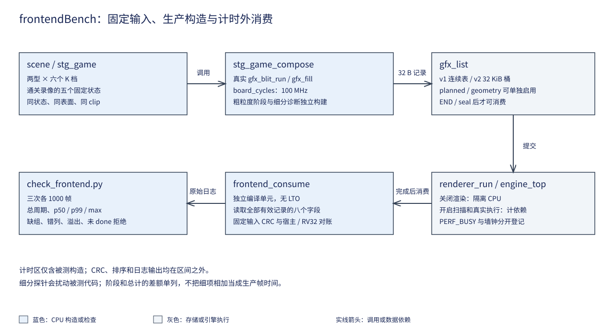
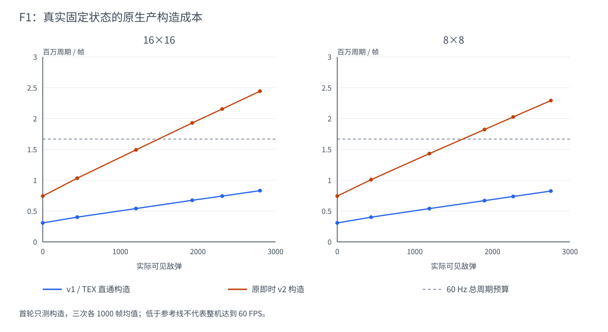

# 11 绘制前端研究：选型与成本分解

状态：**决策已归档（2026-10-10）**。本章记录 P3 收官后的选型依据、候选比较、
决策 D64～D76 及其成立条件；第七节收录 F1 的受控测量与成本分解（原第 12 章）。
接口与实施契约由
[绘制前端 F 系列](../../Todo/sw/绘制前端总览.md)维护。


## 一、动机

G4 的 4KB 条带 N_max 为 424/505，低于同位流 TEX 直通的 1891/2237。
目的面访问已经转入片上条带，但裁剪、跨桶复制和表构造增加了 CPU 工作，
数据面收益未转化为整机收益。接续工作需要回答：哪些工作可以消除、哪些只能
搬到另一个阶段，以及怎样保证优化仍能服务一般图形负载。

本轮比较了背景面、稳定分桶、模板复用、实例化、硬件空间分桶和搬运重叠。
选择依据是当前生产语义、G4 的原始周期数据、真实游戏记录分布，以及工业图形
前端对共享状态、实例与空间列表的组织方式。优化的有效范围由这些证据决定。

## 二、为什么是这几步

先重建整机比较对象，再拆成本；先核对实际画序和状态，再考虑缓存或批处理；
先估算新增数据与依赖，再决定是否下沉。这样可以在动手前排除三种无效优化：
减少了桶里的记录却增加更贵的预合成、减少了 CPU 工作却制造更贵的取数、
增加了并行缓冲却没有缩短整机关键路径。

本轮读取了 G3/G4 初版和研究修订、E8 的受控测量方案、SW9 的真实游戏验收方案。
对应当前 Git 记录为 4dc4bf9、bad6b0a、0e9d60f、020ed91^、7b888cc^。
G3 曾把 SET_CLIP 的调用情况判断错，后续又补清表头占首段；E8 曾由同源错误
产生看似一致的摘要。这些记录说明：接口必须从实际调用确认，正确性必须由
独立消费者检查，研究模型必须与真实帧预算分开。

决策按成本口径、通用边界、软件候选、前端结构、状态/资源语义、采用门槛
六组展开。每个决策同时保留未选方案的理由和会改变选择的条件。

## 三、新的决策与制定依据

### D64 以同轮 TEX 为比较对象，成本分三本账

P3 已有同位流 TEX 直通对照，继续用历史 P1 的 1014/1365 作为目标，会把恢复
既有性能误写成新收益。本轮决定以同轮、同构型、同程序的 TEX 为采用比较对象；
1891/2237 保留为已登记的参考值，后续对照重新实测。

成本拆为固定项、实例数量项和空间放大项。定义 U 为输入绘制/状态包数、I 为
实例数组元素数、M 为跨带片段/引用数、S 为条带数。逻辑矩形数与编码包数、
物理片段数分别统计；把 32 B 换成更短编码不会减少应画的实例或像素。

G4 三份 N_max 原始日志按弹型切段，排除 warming/overflow 窗口，保留搜索失败档，
对每秒窗口的可见敌弹数拟合 C=a+b×n_bullet，得到：

| 构型/弹型 | build 固定项 a，周期 | build 边际，周期/敌弹 | CPU 全段边际 | 物理记录边际，条/敌弹 | build R² |
| --- | ---: | ---: | ---: | ---: | ---: |
| 4KB STRIP / 16 | 934957 | 634.766 | 778.331 | 1.919 | 0.996909 |
| 4KB STRIP / 8 | 929817 | 563.075 | 727.702 | 1.413 | 0.995564 |
| 16KB STRIP / 16 | 910453 | 599.243 | 729.051 | 1.923 | 0.997961 |
| 16KB STRIP / 8 | 904963 | 528.918 | 686.839 | 1.412 | 0.998413 |
| 4KB TEX / 16 | 380948 | 187.476 | 330.641 | 1.003 | 0.998691 |
| 4KB TEX / 8 | 373437 | 206.271 | 345.540 | 1.003 | 0.999297 |

固定项约 0.93M 说明低负载仍有大量构造工作，不能只优化逐颗循环。另一方面，
635/1.919≈331 周期只是两个拟合斜率的比值，没有隔离出一次片段写入的真实单价。
“1745 周期/颗”“每条贵 2.3 倍”不作为本轮定案参数。

这些是既有窗口的观测关系，包含不同搜索阶段与争用，适合确定调查顺序，
不能代替 F1 的同状态分段测量。流水中的 cyc_exec 还包含 CPU 收尾墙钟区间，
引擎忙时间另看 PERF_BUSY；不能把重叠区间与 CPU 时间相加。

### D65 选择通用绘制前端，应用规则留在 CPU

可迁移的共同输入是表面、矩形、图集坐标、方程、裁剪、实例数组与完成依赖。
这些信息也适用于文字、UI、图集动画和重复几何。弹种、纹理内容、K 值、速度、
寿命和关卡规则属于应用，不能成为硬件的必备输入。

本轮选择“共享绘制状态→实例属性→保序空间引用→既有几何/像素处理”的分层。
二维仿射、矢量片段或三角图元可以沿用提交、排序、资源和完成机制，再扩展
自己的几何类型；当前矩形编码不冒充任意图元或可编程指令集。

实例化参照 NVIDIA 的共享 geometry/state 与 per-instance attributes；空间列表
参照 PowerVR 的 tiler/parameter buffer；保序处理参照 Laine/Karras 的公开光栅化
研究。选择的是已被行业使用的数据组织边界，具体实现和性能仍由本项目验证。
若某候选必须知道固定纹理号、固定弹种或特定关卡才能有效，直接退出主线。

### D66 主线保持 4KB，缓存收益先按配置整体看待

16KB 候选在 G4 中相对 4KB 条带提高约 13%/18%，但容量和路数同时改变。
当前缓存的普通写缺失也不触发整行填充，因此“32 KiB 桶间距同组”不足以证明
CPU 在每次输出时反复读分配。

本轮决定保留 4KB/1 路、100MHz、16 行条带为主线；16KB/4 路保留候选。
F1 用相同地址集合、数据、存储次数和预热比较顺序/散写，再区分读、写及争用。
有明确计数或受控证据前，只报告配置整体收益。

这使软件组织、实例编码和空间分桶各自的效果可解释。代价是暂时不直接采用
已有较快缓存构型；若后续真实负载与资源对照证明值得采用，再单独变更配置。

### D67 背景面作为显式初值，静态缓存与动态预合成分别评估

现有背景和目的可以使用不同表面，独立背景面是已有能力。但实际背景含移动横线
和星点，HUD 含分数、弹数、帧率等变化值，整张画面不能生成一次永久复用。
竖线还画在横线之后，把竖线提前缓存会改变交叉点覆盖。

本轮增加了真实游戏的按阶段计数。两种弹型、七个固定 K 档，推进 1200 步后
连续取 120 帧，共 1680 份状态；观察版与未改生产入口的直通/条带表完整字节及
构造记账全部一致。代表性均值如下：

| 弹型/K | 可见敌弹 | 条带总记录 | 背景记录 | HUD 记录 | 全部移出条带的记录减少上界 |
| --- | ---: | ---: | ---: | ---: | ---: |
| 16 / 0 | 0 | 778.617 | 498.617 | 271 | 98.84% |
| 16 / 384 | 447.392 | 1641.142 | 498.617 | 283 | 47.63% |
| 16 / 1648 | 1923.225 | 4453.758 | 498.617 | 289 | 17.68% |
| 16 / 1744 | 2032.308 | 4660.550 | 498.617 | 289 | 16.90% |
| 16 / 2400 | 2794.142 | 6109.217 | 498.617 | 289 | 12.89% |
| 8 / 1744 | 1997.583 | 3595.467 | 498.617 | 289 | 21.91% |

低负载下背景/HUD 接近半数，高负载下比例明显下降。“减约 40%”不能成为所有
场景的承诺；这些固定档也与 G4 搜索确认档的历史不同，不能将 4660.550 与旧表
4107.8 直接相减。14 个全高背景 FILL 产生 420 个条带记录，两条 HUD FILL 再产生
60 条，重复确实存在，但动态实例仍贡献大量跨带工作。

决定同时保留两种候选：真正不变、且构成连续前缀的内容才做跨帧缓存；完整动态
背景则每帧直通预合成，再作为条带初值。当前游戏区与 HUD 的 x 区间互不相交，
可在依赖证明成立后分阶段组织；重叠 overlay 仍保持原先后关系。

预合成会新增 DDR 写入、提交、等待和资源占用，这些必须计入关键路径。
全高命令离开桶只说明表变短，不说明工作消失。若新增代价抵消构造收益，保持
原背景路径。完整计数参数与摘要见
[research_results.json](../../../Main/sim/engine/frontend/research_results.json)。

### D68 软件分桶采用稳定引用与连续物化候选

先计数再按原命令顺序写各桶，输出仍在多个桶地址之间跳跃。前缀和只确定每桶
区间，不会自动改变完整记录的写入顺序。逐桶扫描全部输入虽可连续输出，成本
却变成 O(S×U)，空间划分增多时会放大前端工作。

决定评估三阶段组织：规范化/计数→按原序散布小引用→按桶连续物化 32 B 记录。
每桶引用是输入的稳定子序列，总工作 O(U+M+S)。scan 采用顺序累加，桶数小，
没有另建前缀和专用算术单元的必要。

这仍有 plan、引用、额外读取和间接访问的代价；小引用散写也未消失。
因此它是与原追加路径对照的候选，不能因“连续”二字直接转正。最终对外仍生成
原 v2 表，字节与错误记账可直接差分，避免把软件实验绑到新硬件格式上。

### D69 模板只消除尚未复用的计算，不依赖旧槽位残值

当前批量接口已经复用共同字段和非同槽校验。重复做这一层模板不构成新增收益；
条带裁剪之后，源偏移、局部目的坐标、片段尺寸和标签还会变化。

决定只评估剩余几何模式的复用，以共享绘制字段、尺寸、源位置、描述符版本、
裁剪状态和条带相位为键。边界、负坐标和源越界保留完整求交，模板未命中时走
普通路径。它适用于不同矩形和图集位置，不以弹种作为底层缓存键。

实例移动后桶和桶内槽位都可能改变；没有稳定槽位与版本证明时，完整记录仍要
写入。跨帧只改两个字的方案暂不采用。模板生成、查找、失效和代码工作集一并
计时；只有新编码把共享字段从逐实例数据中分离后，传输量才真正改变。

### D70 实例化使用共享状态与紧凑属性数组

大量矩形具有相同表面、尺寸、混合方式，只是位置或图集位置不同。
为每个实例重复传输全部共享字段，既增加 CPU 打包，也增加命令数据量。
NVIDIA 的实例化数据组织与 Khronos 的 instanceCount 提供了明确参照。

决定新增可查询能力的通用实例 profile：固定源坐标的实例可使用 4 B XY，
源坐标逐项变化的图集实例使用 8 B XYUV。共享状态相同的连续区间才合包，
状态变化结束当前包。它既覆盖重复图像，也覆盖文字、米弹方向帧等可变源位置。

先做直通实例路径，使编码、展开、错误定位和数据生命周期可以独立验证，再
作为硬件分桶的输入。逐实例几何与像素工作仍然存在，数组取数与展开也有代价。
不把 32→4 B 的比例解释为八倍整机收益；普通标量路径继续保留。

### D71 硬件空间分桶保存引用，原始图元只提交一次

只把 CPU 交集计算换成“每条带重扫全表”，会把同一输入读取 S 次；只把完整
32 B 命令改由硬件复制，也仍然放大中间数据。PowerVR 的空间列表保存图元引用，
原参数独立保留；保序光栅化研究也把空间组织和确定性次序一起处理。

决定以原始绘制包和实例数组作为输入，通过计数、前缀和、稳定散布形成紧凑 PB。
引用只标识包与实例，共享描述和裁剪快照单独保存；逐条带只遍历自己的引用。
构建复杂度 O(U+I+M+S)，避免默认的逐桶全表重扫。

该选择将 CPU 分桶工作移到绘制前端，同时减少完整记录复制。它没有消灭 M：
跨带图元仍需在覆盖区域参与处理。两次坐标遍历、参数/引用写入、执行时再取数
都进入成本预算；若 PB 成为新瓶颈，按实际字节和周期重新判断。

首版按 y 条带组织，保留图元参数与空间引用分层。未来二维 tile 或三角前端
扩展自己的几何类型和版本，继续复用列表、排序和资源完成机制。

### D72 顺序、裁剪和错误按模式明确，既有语义保持

透明混合等操作依赖先后顺序。空间重排成立的条件是不同条带的目的像素不相交，
同一条带保持输入相对次序；共享材质并不自动意味着可以交换。

决定所有桶采用稳定子序列，实例按数组索引递增，不能为压缩批次再任意按纹理
排序。裁剪在对应 draw 被接受时形成快照，后续 SET_CLIP 不得追溯修改以前的 draw。

旧直通保留跨提交裁剪，旧 v2 保留构造时吸收裁剪；PB 帧从全屏开始，需要恢复
时显式给出 SET_CLIP，私有状态不回写旧直通。旧模式的格式和错误语义不随新
前端悄悄变化。新模式的包、实例、空间引用分别能够定位错误。

条带路径继续拒绝目的反馈和重叠 backing 别名。失败帧不呈现，不通过拆帧、
跳过坏实例或部分写入后静默切换来掩盖错误。正常画面等价和错误行为分别验证，
以免新格式只在无错样例里成立。

### D73 一帧拥有完整资源，完成后再复用

双命令表不足以保证流水安全：下一帧若改写仍被读取的实例、背景或 PB，前一帧
可能混入新数据。8 MiB 离屏区也已有基础 Demo 使用，不能默认所有模式同时占用。

决定以帧上下文管理输入、实例、计划、背景和 PB 的完整 lease；发布后只读，
完成并排空后才可复用。资源可以双份独立持有，或以明确的串行租约共享；
后端/模式切换先收尾，再恢复描述符与对应资源布局。

一个 stride=4096、480 行的背景页为 1966080 B，两页为 3932160 B，可以放入
离屏区，但需与既有预合成页按模式互斥。PB、实例和软件计划区也分别核算，
不把多个候选的最大工作区同时叠加后仍称“共享区足够”。

宿主对设备地址使用显式窗口映射和长度检查。现素材/帧面窗口不覆盖更低地址
的共享区，实例和 PB 不能靠隐式指针转换访问。这个边界同时服务后续 fence、
命令 ring 和驱动中的资源生命周期。

### D74 搬运重叠条件启动，两缓冲按实际可隐藏工作建模

当前全帧 LOAD/FLUSH 的数据量为 2×640×480×4=2457600 B，合计 153600 个
128 位数据拍。16 行改 32 行不会改变行数和字节数；191520 周期是带事务间隙的
历史模型值，不能直接除二。条带高度可能减少控制和边界片段，收益需单独测量。

决定先解决构造关键路径，搬运成为新的限制后才启动重叠。两缓冲的首版组织为
一套执行，另一套先写回前一条带、再装入下一条带；稳定阶段先按 max(E,F+L)
加首尾/争用建模。三阶段各保留一个完整条带时需要三份活跃存储，或另有经过
证明的细粒度复用，不能把双缓冲自动等同于 max(E,F,L)。

现每套条带存储为 36 RAM；增加一套后，4KB/16KB 构型约为 199/217，再加
前端增量；三套约为 235/253 再加前端。三缓冲进入资源高风险候选，默认不排期。
这些是资源预算，采用时以实际综合为准。

即使成功重叠，数据量也不减少；CPU 仍主导时，局部搬运变快不必然提高 N_max。
后续只有实际关键路径缩短、扫描压力与资源都满足条件，才采用该候选。

### D75 批次按依赖推进，候选可以得到负结果

将所有想法一起实施会丢失对照，也会让格式、调度和像素问题互相掩盖。
决定采用六批边界：F1 量成本；F2/F3 独立验证背景与软件组织，再测组合；
F4 独立验证通用实例；F5 接空间引用；F6 根据新的关键路径决定是否启动。

F2/F3 的成本较低，先尝试，但没有“纯软件一定不能超过 TEX”的预设。
若软件组合已完成整机目标，F4/F5 可以按通用前端的演进价值后续推进，不强塞
进本轮性能验收。若软件候选无净收益，保留负结果并维持原后端。

同样，实例化和硬件分桶也不凭架构名称转正。研究完成、实现正确、净收益成立、
采用为默认路径是四个不同结果。每批必须能够在自己的边界停止，而不靠降低
负载、删掉动态内容或改变确认口径继续推进。

### D76 以完整关键路径和独立验收决定采用

所有转移的工作都计账：CPU 的逻辑/属性/构造/发布，GPU 的预合成/分桶/装入/
执行/写回，以及真实依赖空泡、交换和统计。周期不能因移到别处而从表里消失。

正确性采用独立直通像素基准、确定性随机场景、错误反例和完整回放；字节兼容
另对原 v2 构造，不能用同一个展开器证明自身正确。性能采用同状态、同地址、
同预热和同争用对照，包含新增准备与传输，候选组合单独测量而非把收益相加。

最终采用要求两种弹型都超过同轮 TEX，确认档各 3600 场零掉帧、扫描欠载和
故障为零，资源与时序合格。K、实际活动数、CPU/GPU 分段、流量和水位一起报告。
未过门槛时如实保留候选结果，不把编码减少或局部单元变快记作整机加速。

## 四、未采用的方案与原因

| 方案或假设 | 未采用原因 | 允许重新评估的条件 |
| --- | --- | --- |
| 固定纹理/弹种专用硬件 | 应用参数侵入前端，无法覆盖一般矩形与图集绘制 | 重新表述为可独立组合的通用绘制操作，并通过非游戏场景 |
| 整个背景/HUD 一次生成永久复用 | 动态内容和覆盖顺序会改变画面 | 只缓存证明不变的连续前缀，变化时按依赖重建 |
| 高负载记录数固定减少约 40% | 实际占比随负载下降，且预合成仍有代价 | 同状态测出实际占比和完整关键路径净收益 |
| 计数＋前缀和就能顺序写完整表 | 输出遍历顺序未改变，仍是散写 | 加入引用组织和按桶物化，计入额外流量 |
| 每桶重扫全部输入 | O(S×U) 随划分数放大 | 仅保留为负对照或经测量证明适合的极小负载 |
| 模板每帧只改两个字 | 裁剪、标签和槽位变化，旧内容没有可靠版本保证 | 稳定槽位/版本可证明，且优于紧凑实例编码 |
| 32 行或双缓冲自动省一半搬运 | 字节不变，两份存储也不自动满足三阶段同时存活 | 明确时间线、活跃工作集、资源和实测重叠量 |
| 直接用 16KB 对照证明散写机理 | 容量与路数共同变化，写策略也不支持该单一推断 | 加入受控访问与独立计量证据 |

## 五、归档结果

本轮形成 D64～D76 十三项决策，落实为 F1～F6 六份可独立执行的 spec。
成本口径、候选边界、顺序/资源语义、启动条件和采用门槛已明确；本章归档的是
这些选择的制定过程。实现细节和后续验收分别由对应工作点维护。

本轮实证包括既有 G4 CSV 的重新分析和 1680 份真实状态的观察点等价计数。
研究工具与原始数据引用见
[frontend 研究目录](../../../Main/sim/engine/frontend/README.md)。

决策来源如下，访问日期为 2026-10-09~10-10；只采用相关组织原则，不移植其性能结论。

| 来源 | 支持的决策 |
| --- | --- |
| [Imagination：Vertex Processing (Tiler)](https://docs.imgtec.com/starter-guides/powervr-architecture/html/topics/vertex-processing.html) | D65/D71，按空间保存图元引用 |
| [Imagination：The Parameter Buffer](https://docs.imgtec.com/performance-guides/graphics-recommendations/html/topics/the-parameter-buffer.html) | D71，参数与空间列表分离，计入中间存储 |
| [NVIDIA：Inside Geometry Instancing](https://developer.nvidia.com/gpugems/gpugems2/part-i-geometric-complexity/chapter-3-inside-geometry-instancing) | D65/D70，共享状态与逐实例属性 |
| [Khronos：vkCmdDraw](https://docs.vulkan.org/refpages/latest/refpages/source/vkCmdDraw.html) | D70，显式实例数量与有序绘制输入 |
| [Khronos：Render Pass](https://docs.vulkan.org/spec/latest/chapters/renderpass.html) | D67/D73，attachment 初值与阶段依赖 |
| [Blelloch：Prefix Sums and Their Applications](https://www.cs.cmu.edu/~guyb/papers/Ble93.pdf) | D68/D71，计数、区间分配与稳定散布 |
| [Laine、Karras：High-Performance Software Rasterization on GPUs，HPG 2011](https://research.nvidia.com/publication/2011-08_high-performance-software-rasterization-gpus) | D65/D71/D72，空间阶段与确定性画序 |
| [Arm：Cramming Software onto Mobile GPUs](https://developer.arm.com/cfs-file/__key/communityserver-blogs-components-weblogfiles/00-00-00-20-66/siggraph2015_2D00_mmg_2D00_andrew_2D00_notes.pdf) | D68/D71/D74，重复遍历、跨 tile 图元与工作集的代价 |

## 六、后续工作边界

决策研究已收口。F1 的受控测量见第七节，F2/F3 的采用依赖实测，F4/F5 按通用
前端路线推进，F6 条件启动。其测量、实现与验收结果进入后续专题章节，不继续
把本章扩写成实施日志。若新证据推翻本章某项决定，回到对应决策注明依据并订正，
保留原证据的适用范围。
## 七、成本分解：F1 的受控测量

第七节起为原第 12 章全文迁入：建立真实生产调用的测量入口，把构造一项拆成固定背景、HUD、
参数检查、裁剪、片段生成与 DDR 存储的分段账，为 F2/F3 软件候选的采用与 F4/F5 硬件路线
提供预算。内容原文保留。

### 7.1 动机

易灵思 Ti60F225 上的 Sapphire RISC-V 核与 2D 合成引擎共用 DDR3。
CPU 以 100 MHz 生成绘制命令，FPGA 执行混合并把结果交给 640×480、60 Hz
扫描输出。[第 10 章](10-整机与Nmax实测.md)已经证明，条带合成减少了引擎
工作时间，但每个矩形被复制到多个空间桶后，整机性能受 CPU 构造限制。

历史 CSV 把游戏逻辑、命令构造和执行墙钟分开，构造一项仍混合了固定背景、
HUD、参数检查、裁剪、片段生成和 DDR 存储。用活动敌弹拟合出的固定项不能
说明这些工作分别占多少，更不能把 16KB 候选的整体收益归为一种缓存冲突。
F1 因此先建立真实生产调用的测量入口，再给软件候选和后续硬件前端提供预算。

### 7.2 为什么是这几步

第一步冻结绘制输入。相同 K 不保证相同可见实例，K 是压力控制参数，实际
活动数受寿命、边界和状态推进影响。固定状态、表面描述符、裁剪框与坐标后，
才可以把周期差解释为构造或执行组织的差异。

第二步测量完整生产函数，再做阶段观察。游戏已经使用 `gfx_blit_run` 复用
公共字段检查，改成逐颗标量调用会增加基线成本。完整调用给出实际总计；
阶段探针只解释组成，细分探针另行量其干扰。

第三步控制访存次序。保持记录、地址集合和存储次数相同，分别按物理地址、
桶顺序和逐片段散写；再把读、写、读写与冷、热缓存分开。这样可以检验
“散写更慢”的现象，不将它直接解释为写分配或单一缓存原因。

第四步加入扫描输出和真实引擎执行，按完成依赖计算候选成本。背景预合成与
BAND 在同一个引擎上串行占用资源，不能只比较动态表缩短了多少。

最后由外部检查器核对完整矩阵、输出与重复性，保留失败探针的原因，再分别
记录正确性、净收益和采用结论。

### 7.3 每一步做了什么

### 3.1 源码与来源核对

基线提交为 `1e2cd8d`。核对对象是 `sw/lib/gfx/list.c`、`strip.c`、游戏的
`stg_draw.c`、`stg_modes.c` 与 `renderer.c`。`strip.c` 在写任何桶之前先
检查本次覆盖的全部桶；批量入口在模板层完成公共检查后，仍逐颗保留坐标、
关闭状态、源反馈与原子容量检查。后续计划分桶沿用这些顺序。

来源复核包括 [GPU Gems 3 第 39 章](https://developer.nvidia.com/gpugems/gpugems3/part-vi-gpu-computing/chapter-39-parallel-prefix-sum-scan-cuda)、
[LVGL v8.3 Drawing](https://docs.lvgl.io/8.3/overview/drawing.html) 与
[Mesa Panfrost 文档](https://docs.mesa3d.org/drivers/panfrost.html)。前者提供
紧凑引用区间的 exclusive scan，即每个桶之前的计数和；30 桶在单核上采用
线性扫描，未移植 CUDA 的并行实现。LVGL 的完成后复用缓冲约束用于检查帧
资源生命周期；Mesa 用于区分前端组织与像素执行。来源不提供本机性能数字。

### 3.2 固定输入与计时外消费

新增 `sw/apps/probe/frontendBench`。两个弹型分别取 K=0、384、1024、1648、
1984、2400；每个状态都从同一种子初始化并推进 1200 步后冻结。另从入库
通关录像取第 0、5000、9000、9027、9207 帧之后的状态，覆盖起始、Boss、
终符、CLEAR 与返回标题。

每个状态重复调用真实 `stg_game_compose`，状态本身不推进。v1 和 v2 使用
同一输入与同一张命令区，先做八帧预热，再测 1000 帧，共三次。每帧用
32 位模减求区间，累计采用 64 位；排序、日志与 CRC 均在计时区之外。

`consume.c` 是独立编译单元，没有 LTO，读取每条有效记录的八个字。v2 先读
32 个计数，再只消费有效桶内容，避免把未使用空间当成绘制输出。
首轮测量源码冻结在 `Main/sim/engine/frontend/baseline`，与 `1e2cd8d` 的
生产源码隔离重建。124430 B BIN 与实际部署文件全字节相同，差异为零；
`rebuild_frontend_baseline.py` 还独立对比唯一登记身份。后续候选不会反向
改变该轮研究的被测对象。
固定输入保存在 [`Main/sim/engine/frontend/inputs`](../../../Main/sim/engine/frontend/inputs/manifest.json)
所登记的 34 份文件：192 B 表面描述符、4 B 记录数，然后是 v1 记录，或
v2 计数与紧凑有效记录。板端有效输出 CRC 与这些宿主文件全部一致。



### 3.3 首轮无渲染基线

原始数据为 [`f1_baseline_4k.log`](../../../Main/sim/engine/frontend/logs/f1_baseline_4k.log)，
逐组摘要为同目录的 `f1_baseline_4k.json`。该轮加载 G4 的 4KB 主线 bit，
只构造命令，不执行渲染。表中周期是三次各 1000 帧的均值，原始 p50、p99、
max 与每次总周期保留在日志中。

| 场景 | K | 可见敌弹 | v1 记录 | v2 片段 | v1 周期/帧 | v2 周期/帧 |
| --- | ---: | ---: | ---: | ---: | ---: | ---: |
| 16×16 | 0 | 0 | 207 | 778 | 307690 | 742850 |
| 16×16 | 384 | 444 | 657 | 1636 | 401707 | 1032927 |
| 16×16 | 1024 | 1202 | 1417 | 3084 | 540832 | 1492095 |
| 16×16 | 1648 | 1927 | 2143 | 4458 | 674770 | 1929067 |
| 16×16 | 1984 | 2313 | 2529 | 5187 | 742851 | 2155503 |
| 16×16 | 2400 | 2799 | 3015 | 6109 | 830904 | 2444102 |
| 8×8 | 0 | 0 | 207 | 778 | 307708 | 742851 |
| 8×8 | 384 | 436 | 649 | 1400 | 400966 | 1008878 |
| 8×8 | 1024 | 1187 | 1402 | 2483 | 540086 | 1431787 |
| 8×8 | 1648 | 1898 | 2114 | 3448 | 669592 | 1822508 |
| 8×8 | 1984 | 2268 | 2484 | 3964 | 737301 | 2026003 |
| 8×8 | 2400 | 2753 | 2969 | 4639 | 824992 | 2292407 |
| 回放 0 | — | 0 | 197 | 756 | 295148 | 709550 |
| 回放 5000 | — | 195 | 429 | 1157 | 379506 | 924147 |
| 回放 9000 | — | 2659 | 2895 | 5794 | 1345950 | 2953227 |
| 回放 9027 | — | 0 | 2199 | 3616 | 1294151 | 2474442 |
| 回放 9207 | — | 0 | 197 | 756 | 295144 | 709550 |

34 组的最大重复偏差为 0.00954%，错误数均为零。零敌弹压力状态仍有 Boss、
自机、背景与 HUD，因而 v1 的 207 条与 v2 的 778 条不能当成“空循环”。
第 9027 帧的敌弹为零，但粒子与通关绘制仍使构造成本很高，这也说明活动敌弹
一个自变量不足以解释完整关卡。



曲线的横轴使用实际可见敌弹，原 K 保留在每个数据点的 SVG 提示与原始输入
表中。灰线只表示 100 MHz、60 Hz 的总周期预算；构造低于这条线仍需容纳
逻辑、执行、提交和交换，不能由此判断整机帧率。

游戏 v1 的两个 SET_CLIP 和一个 END 不属于逻辑绘制矩形，故本批的逻辑
矩形数为 v1 记录数减三。每逻辑矩形、每输出片段和每输出字节的成本分别
用这一逻辑数、v2 `used` 和 `32×used` 作分母。实例数和物理片段数单列，
不把 K 代入其中任何一个分母。

以首轮 v2 原值归一化，周期仍包含相同生产构造函数的全部工作：

| 状态 | 周期/逻辑绘制 | 周期/物理片段 | 周期/有效输出 B |
| --- | ---: | ---: | ---: |
| 零敌弹 | 3641.42 | 954.82 | 29.84 |
| 16×16 K1984 | 853.33 | 415.57 | 12.99 |
| 8×8 K1984 | 816.61 | 511.10 | 15.97 |

分母分别为 204/2526/2481 个逻辑绘制、778/5187/3964 个物理片段及其
32 倍字节数。这些比值包含固定项摊销，不能当成单颗实例的独立增量成本。

### 3.4 分阶段与受控访存

`GFX_FRONTEND_PROFILE` 在背景、角色、三个池、后置效果、HUD 和封表之间
记录粗粒度边界。`GFX_FRONTEND_DETAIL` 单独观察字段检查、反馈、裁剪、
容量预检和片段存储；默认生产构建不包含这些回调。模板检查只在批次开头
运行一次，逐实例打点不能把这项成本重复乘以实例数。

访存探针用相同的 3840 条 32 B 记录，每个桶占用相同的 128 个槽位。
物理地址升序、置换桶序与逐片段散写均使用同一地址集合和相同八字段输入。
单独检查每个桶的 4096 B 与原输入完全相同，再检查读结果的累计值。
RV32 反汇编显示记录复制包含偏移 0、4、8、12、16、20、24、28 的八条
目的存储；不能把函数的栈保存指令也算成输出字段。

SoC 生成逻辑的 `when_DataCache_l1009` 包含普通写请求，即使未命中也走
写请求分支；`stageB_loaderValid` 只在未进入这一分支时启动。写命中更新
缓存的同时，`io_mem_cmd_valid` 仍向外发写。结合既有平台机理实验，本构型
为写穿透、普通写缺失不分配。访存次序的差异因此不能直接归为写分配冲突。
复制实验还包括源读取和索引计算；读、写与同组/不同组对照用于限制归因范围。

`f1_memory_v2_4k.log` 的 54 次运行均为 1000 次访问、错误零。下表每项是
三次总周期的均值，输入为同一组 3840 条记录，实际有效工作集 122880 B。

| 操作 | 准备状态 | 地址升序周期 | 置换桶序周期 | 逐片段散写周期 |
| --- | --- | ---: | ---: | ---: |
| 记录复制 | 预热 | 315930 | 335173 | 475279 |
| 记录复制 | 每次先失效 | 316030 | 335316 | 475335 |
| 读取求和 | 预热 | 578488 | 610372 | 710456 |
| 读取求和 | 每次先失效 | 578484 | 610305 | 710389 |
| 读改写 | 预热 | 599483 | 633965 | 734130 |
| 读改写 | 每次先失效 | 599451 | 633984 | 734245 |

复制的散写次序比地址升序贵约 50.4%，但冷、热差别很小。该工作集大于缓存，
复制还同时读取输入记录，循环索引和外层次数也随次序改变；此结果只能证明
同数据与地址集合下的组织成本，不单独证明目的写入的缓存冲突。纯写与缓存
组映射由另一个 64 行机制矩阵分开观察。

后者明确选择彩条关闭帧缓冲扫描，原值在 `f1_sets_isolated_4k.log`。
每次访问相同的 64 个字；不同组按 64 B 行距，同组按 4096 B 行距，
三个操作各做冷/热与三次 1000 次重复，共 36 次运行。

| 映射与准备 | 读取周期 | 纯写周期 | 读改写周期 |
| --- | ---: | ---: | ---: |
| 不同组、预热 | 859 | 1189 | 1515 |
| 不同组、每次先失效 | 5414 | 1187 | 6119 |
| 同组、预热 | 5408 | 1189 | 6149 |
| 同组、每次先失效 | 5412 | 1188 | 6129 |

不同组的预热读取约为同组的六分之一；失效后两者接近。纯写在四种准备
下均约 1188 周期，差别低于 2% 门槛。该结果与生成逻辑的写穿透、写缺失
不分配一致，读访问和元数据局部性需要单独计账。不能把最终 32 B 记录的
散写地址直接当成目的写分配冲突的证明。

粗阶段在同一冻结状态内给出如下原值，包含各自打点。背景和 HUD 在零敌弹
时已形成约 0.71 M 周期的条带固定项；高负载另外增加敌弹构造。其它角色、
粒子、后置效果、封表与初始状态仍保留在原始逐段账中。

| 状态 | 路径 | 背景周期 | 敌弹周期 | HUD 周期 | 总构造周期 | 阶段和以外 residual |
| --- | --- | ---: | ---: | ---: | ---: | ---: |
| 零敌弹 | v1 | 151397 | 1083 | 212458 | 381719 | 3333 |
| 零敌弹 | v2 | 319931 | 1059 | 391173 | 736956 | 6330 |
| 16×16 K1984 | v1 | 151471 | 442321 | 230062 | 841920 | 3270 |
| 16×16 K1984 | v2 | 320295 | 1600341 | 421528 | 2367979 | 6346 |
| 8×8 K1984 | v1 | 151555 | 436000 | 229900 | 835576 | 3293 |
| 8×8 K1984 | v2 | 320271 | 1451284 | 421548 | 2218939 | 6339 |

本构建的空计时对平均 20 周期，另存扣除这一对读取后的总值；阶段表保留
原值。阶段计数之和与有效记录数分别核对，residual 包括列表初始化、首次
clip、调用边界及未分摊的打点。细分诊断与逐片段存储探针又改变指令和数据
布局，须比较各自完整总计；不把细项相加充当未插桩的生产帧时间。

逐片段存储探针最终结束，三状态各三次、每次 1000 帧均为 `fail 0/done`。
`check_frontend.py --summarize` 检查阶段覆盖、重复数、粗阶段输出总数和
存储次数等于物理记录数，生成唯一的 `logs/cost_results.json`。
下表来自包含存储探针的同一构建，单位均为周期/帧；字段检查合并标量和批次
两种入口，emit 包含其内嵌的 store，不能把两列再次相加。

| 状态 | 反馈/目的检查 | 全局裁剪 | 容量预检 | 字段检查 | emit 含 store | 内嵌 store | 总计与非重叠细项之差 |
| --- | ---: | ---: | ---: | ---: | ---: | ---: | ---: |
| 零敌弹 | 66469 | 54239 | 66704 | 233066 | 263959 | 79873 | 430614 |
| 16×16 K1984 | 310625 | 1323867 | 586998 | 273693 | 1602482 | 534234 | 2318044 |
| 8×8 K1984 | 310027 | 1296359 | 561002 | 272423 | 1269249 | 407685 | 2283754 |

emit 减 store 分别为 184086、1068248、861564 周期，仍包含循环控制和
嵌套回调开销，不能解释为未插桩的纯几何成本。空计时对为 20 周期；逐事件
按 `20×count` 扣除只能扣掉时钟读取下界，不能消除调用、64 位累加或布局变化。
粗阶段、细分、增加 store 三种构建的总计分别为：

| 状态 | 粗阶段总计 | 细分总计 | 加 store 后总计 |
| --- | ---: | ---: | ---: |
| 零敌弹 | 736956 | 1013371 | 1115051 |
| 16×16 K1984 | 2367979 | 4920344 | 6415708 |
| 8×8 K1984 | 2218939 | 4723403 | 5992814 |

高负载增加 store 后相对细分总计增长约 27%～30%。因此细分账只定位检查、
裁剪和物化工作，不反推原生产精确占比；净收益以未插桩候选和生产流水为准。

### 3.5 候选预算与真实依赖

软件候选仍提交相同 ABI v1/v2。背景预合成的新增 GPU 工作与 BAND 必须
相加；原生产流水允许 CPU 构造与上一帧引擎执行重叠，故它的下界取二者
最大值。新候选不能用“CPU 下降”减去这些完成依赖。

F3 计划模式最多分配 1.5 MiB Plan 和 120 KiB refs；两帧各拥有独立工作区。
额外逻辑流量包括 `48×U` 的 Plan 写入、`4×M` 引用写入、引用读回、
Plan 读取，以及与原实现相同的 `32×M` 最终输出。这是软件访问量口径，
实际 DDR 事务还受缓存影响，不用它替代总线计数。

正式生产流水的独立对账见软件第 09 章，原值由
`check_frontend.py --production` 生成 `logs/production_results.json`。
16×16 K1984 下 TEX、即时条带和 B2 分别为 30、20、20 fps。B2 减少 CPU
构造，但同步预合成和同引擎依赖仍在关键路径内，不能按 CPU 下降比例推算帧率。

后续启动预算使用当前同 BIN、关闭扫描的 F3 矩阵。16×16 K1984 的 TEX/P0
构造为 831878/2387997 周期；8×8 为 826400/2238998 周期。两型相差
1556119/1412598 周期，是本轮分桶相对直通的观测差额，不是 F4/F5 的保证收益。

| 候选 | 已知规模与流量口径 | 尚待测的周期 | 启动与停止条件 |
| --- | --- | --- | --- |
| F2 | 两型每帧 prepass 约 1.52 MB 写入，另有 BAND 1.2288 MB 写回 | 已有冻结三次矩阵和一型生产复测 | 当前保留研究开关；帧率未提高，不转正 |
| F3 | 16×16 的 U/M=2526/5187，8×8 为 2481/3964；Plan 写 48U、refs 写/读各 4M，最终写 32M | 两缓存实测均有高负载退化 | 当前保留 P0，不用更多布局试验强行采用 |
| F4 | 可见敌弹坐标的最低输入量：XY4 为 9252 B，XYUV8 为 18144 B；还须加其它实例、包、padding 和状态 | 打包、DMA、共享检查、逐实例展开均待实现；CPU 上界目标为少于当前完整直通构造，不预填收益比例 | 优先实现通用实例；若准备和展开不能降低完整关键路径，停止性能采用 |
| F5 | 双遍坐标读取为 2BN，执行额外取数为 B×实例引用数；另计 64 B metadata、8 B/ref、目录和 padding | 两次裁剪遍历、scatter、发布、引用读取、BAND 执行均待测 | 在 F4 和独立分桶模型之后；只降低 CPU 而增加完整关键路径时不采用 |

若 F5 仍用标量输入的 2529/2484 个槽，按每槽 64 B、每引用 8 B 加 512 B
目录和 480 B 条带 padding 预算，分别约为 204344/191680 B；原 v2 有效
输出为 165984/126848 B。空间引用本身并不保证字节更少，实例包共享才可能
减少 metadata 槽；这些是软件/协议字节预算，不是实测 DDR 事务。
F4/F5 的实现前周期区间仍为未知，不据此填写新的 N_max 预测。
F6 继续以搬运成为关键路径为前提，当前不启动。

### 7.4 遇到的问题

### 4.1 同值回写可以被删除

**第一现场。**

```text
if(rewrite) p[k] = v;
```

**解读。** 读取后把同一个值写回普通指针没有可观察的数据变化，编译器可以
删除存储。该循环不能代表读写混合负载。

**定位。** 在检查实际存储指令时发现该表达式缺乏必须保留写入的语义。首轮
采集中止，保留 `f1_memory_same_value_diagnostic.log`，缺少结束标记的记录
不进入正式结果。

**根因与修法。** 改为每轮异或 `0x01010101`，1000 次后数据恢复，计时外
逐字段比较并检查读累计值。原消费者只验证最终内容，无法证明每轮发生写入，
因此增加反汇编检查。

### 4.2 随机场景数不等于成功封表数

**第一现场。**

```text
PASS: 10000 planned/template scenes; valid seals=3
```

**解读。** 原夹具把别名错误和不匹配的源格式频繁混入每帧，绝大多数场景只
验证了首错、关闭状态和不发布，整表字节验证不足。

**定位。** 为成功 seal 增加单独计数后，检查生成器中每第 17 项的反馈别名、
提前 END 与 ALPHA_STRAIGHT 的源格式。

**根因与修法。** 保证前 10000 场景使用正确源格式、合法调用且成功封表，
后 1000 场景专测错误；另保留原子溢出和模板失效反例。判据改为明确要求
至少一万张成功封表。原判据只统计循环次数，未约束实际进入字节消费者的数量。

### 4.3 可选几何入口增加了默认调用成本

**第一现场。**

```text
if(gfx_geometry_full(l,c,&r)) goto clipped;
```

**解读。** 即使没有绑定几何缓存，每个矩形仍进入另一个编译单元，再检查
空指针。该调用属于新引入的默认开销。

**定位。** 在首次候选板测中核对默认路径，发现可选函数调用仍存在。该轮
保留为诊断记录，采用数据改由修复后的同程序对照提供。

**根因与修法。** 调用方先判断 `l->geometry`，未启用时直接走原求交。
原字节判据只证明结果相同，不能发现额外函数调用造成的成本。

### 4.4 Windows 读取编码错过部署边界

**第一现场。**

```text
default_encoding= cp936
IndexError: list index out of range
```

**解读。** 原始串口日志是 UTF-8，Windows Python 的默认文本读取使用
cp936，中文装载分界被解码成另一组字符，按该标记切分得不到本次程序区域。

**定位。** WSL 检查器能读到完整 30 组候选成本，而 Windows 的相同标记
查找失败；原生解释器明确报告默认编码 cp936。

**根因与修法。** 日志读取统一显式指定 `utf-8-sig`，合成反例也明确写 UTF-8，
Windows 原生日志自检与完整成本检查通过。长测原始文件保持原样，续跑只
复用已完成且部署产物身份未变的记录。原检查只在 WSL 运行，未覆盖本机
默认编码与带中文的部署边界。

### 4.5 隔离重建缺少录像生成工具

**第一现场。**

```text
python3: can't open file '.../tools/check/replay2c.py': [Errno 2] No such file or directory
make: *** build/replay/stg_clear.h Error 2
```

**解读。** 导出旧软件与 SDK 仍不足以构建，录像头文件依赖仓库的生成工具。

**定位。** 完整基线副本能够重现已部署字节，缩小归档范围后的工具却在
REPLAY 阶段失败，编译日志指向缺少的 `replay2c.py`。

**根因与修法。** 隔离导出同时包含原提交的录像转换工具，重建再次命中
唯一登记身份。首个失败日志保留为 `baseline_rebuild_missing_replay_tool.log`。
原手工验证导出了整个仓库，未暴露最小构建依赖缺口。

### 7.5 结果

固定输入、真实构造、独立字段消费与日志矩阵检查已经形成可复现入口。首轮
34 组、102 次各 1000 帧的板上构造测量全部成功；宿主固定输入与 RV32
输出一致。完整原值和部署身份集中在 `Main/sim/engine/frontend/logs`，
新 BIN 登记只写唯一 `artifacts.json`，已有 bit 的身份复用 G4 清单。

阶段/存储成本账、最终同 BIN 两缓存矩阵和正常流水日志已经完成消费。
统一板端结果 `board_results.json` 覆盖 510 组同帧检查、七种候选各 17 帧、
缓存失效反例、忙态 SURF 保护、UART 三模式四后端以及错误后的零交换。
本轮软件研究阶段完成，候选不转正，F1～F3 保留 Todo 供验收。

后续软件候选的同状态成本与采用结论分别归入
[软件第 09 章](../sw/09-背景面与绘制阶段.md)和
[软件第 10 章](../sw/10-保序分桶与模板复用.md)。本章不把构造微基准的变化
写成整机 N_max 提升。

### 7.6 还欠什么

硬件实例与空间引用前端继续由 F4/F5 承担，条带搬运重叠由 F6 的启动条件
约束。新的实例/PB 总线成本只有正式实现并测量后才能收口。本批不修改 RTL、
SDK、时钟或 Flash，也不产生新的综合资源或人工 HDMI/实体键观察结论。
