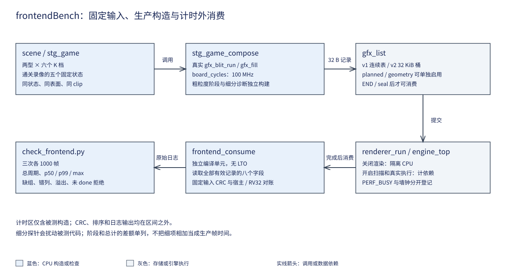
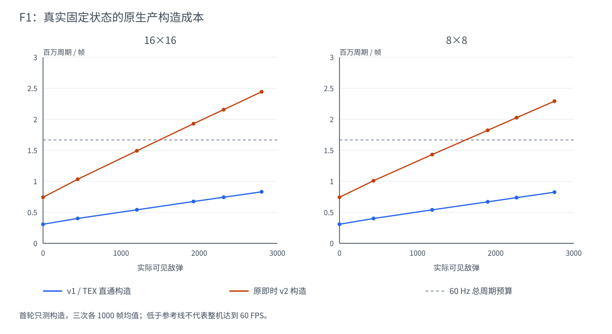

# 12 绘制前端成本分解

## 一、动机

易灵思 Ti60F225 上的 Sapphire RISC-V 核与 2D 合成引擎共用 DDR3。
CPU 以 100 MHz 生成绘制命令，FPGA 执行混合并把结果交给 640×480、60 Hz
扫描输出。[第 10 章](10-整机与Nmax实测.md)已经证明，条带合成减少了引擎
工作时间，但每个矩形被复制到多个空间桶后，整机性能受 CPU 构造限制。

历史 CSV 把游戏逻辑、命令构造和执行墙钟分开，构造一项仍混合了固定背景、
HUD、参数检查、裁剪、片段生成和 DDR 存储。用活动敌弹拟合出的固定项不能
说明这些工作分别占多少，更不能把 16KB 候选的整体收益归为一种缓存冲突。
F1 因此先建立真实生产调用的测量入口，再给软件候选和后续硬件前端提供预算。

## 二、为什么是这几步

第一步冻结绘制输入。相同 K 不保证相同可见实例，K 是压力控制参数，实际
活动数受寿命、边界和状态推进影响。固定状态、表面描述符、裁剪框与坐标后，
才可以把周期差解释为构造或执行组织的差异。

第二步测量完整生产函数，再做阶段观察。游戏已经使用 `gfx_blit_run` 复用
公共字段检查，改成逐颗标量调用会增加基线成本。完整调用给出实际总计；
阶段探针只解释组成，细分探针另行量其干扰。

第三步控制访存次序。保持记录、地址集合和存储次数相同，分别按物理地址、
桶顺序和逐片段散写；再把读、写、读写与冷、热缓存分开。这样可以检验
“散写更慢”的现象，不将它直接解释为写分配或单一缓存原因。

第四步加入扫描输出和真实引擎执行，按完成依赖计算候选成本。背景预合成与
BAND 在同一个引擎上串行占用资源，不能只比较动态表缩短了多少。

最后由外部检查器核对完整矩阵、输出与重复性，保留失败探针的原因，再分别
记录正确性、净收益和采用结论。

## 三、每一步做了什么

### 3.1 源码与来源核对

基线提交为 `1e2cd8d`。核对对象是 `sw/lib/gfx/list.c`、`strip.c`、游戏的
`stg_draw.c`、`stg_modes.c` 与 `renderer.c`。`strip.c` 在写任何桶之前先
检查本次覆盖的全部桶；批量入口在模板层完成公共检查后，仍逐颗保留坐标、
关闭状态、源反馈与原子容量检查。后续计划分桶沿用这些顺序。

来源复核包括 [GPU Gems 3 第 39 章](https://developer.nvidia.com/gpugems/gpugems3/part-vi-gpu-computing/chapter-39-parallel-prefix-sum-scan-cuda)、
[LVGL v8.3 Drawing](https://docs.lvgl.io/8.3/overview/drawing.html) 与
[Mesa Panfrost 文档](https://docs.mesa3d.org/drivers/panfrost.html)。前者提供
紧凑引用区间的 exclusive scan，即每个桶之前的计数和；30 桶在单核上采用
线性扫描，未移植 CUDA 的并行实现。LVGL 的完成后复用缓冲约束用于检查帧
资源生命周期；Mesa 用于区分前端组织与像素执行。来源不提供本机性能数字。

### 3.2 固定输入与计时外消费

新增 `sw/apps/probe/frontendBench`。两个弹型分别取 K=0、384、1024、1648、
1984、2400；每个状态都从同一种子初始化并推进 1200 步后冻结。另从入库
通关录像取第 0、5000、9000、9027、9207 帧之后的状态，覆盖起始、Boss、
终符、CLEAR 与返回标题。

每个状态重复调用真实 `stg_game_compose`，状态本身不推进。v1 和 v2 使用
同一输入与同一张命令区，先做八帧预热，再测 1000 帧，共三次。每帧用
32 位模减求区间，累计采用 64 位；排序、日志与 CRC 均在计时区之外。

`consume.c` 是独立编译单元，没有 LTO，读取每条有效记录的八个字。v2 先读
32 个计数，再只消费有效桶内容，避免把未使用空间当成绘制输出。
首轮测量源码冻结在 `Main/sim/engine/frontend/baseline`，与 `1e2cd8d` 的
生产源码隔离重建。124430 B BIN 与实际部署文件全字节相同，差异为零；
`rebuild_frontend_baseline.py` 还独立对比唯一登记身份。后续候选不会反向
改变该轮研究的被测对象。
固定输入保存在 [`Main/sim/engine/frontend/inputs`](../../../Main/sim/engine/frontend/inputs/manifest.json)
所登记的 34 份文件：192 B 表面描述符、4 B 记录数，然后是 v1 记录，或
v2 计数与紧凑有效记录。板端有效输出 CRC 与这些宿主文件全部一致。



### 3.3 首轮无渲染基线

原始数据为 [`f1_baseline_4k.log`](../../../Main/sim/engine/frontend/logs/f1_baseline_4k.log)，
逐组摘要为同目录的 `f1_baseline_4k.json`。该轮加载 G4 的 4KB 主线 bit，
只构造命令，不执行渲染。表中周期是三次各 1000 帧的均值，原始 p50、p99、
max 与每次总周期保留在日志中。

| 场景 | K | 可见敌弹 | v1 记录 | v2 片段 | v1 周期/帧 | v2 周期/帧 |
| --- | ---: | ---: | ---: | ---: | ---: | ---: |
| 16×16 | 0 | 0 | 207 | 778 | 307690 | 742850 |
| 16×16 | 384 | 444 | 657 | 1636 | 401707 | 1032927 |
| 16×16 | 1024 | 1202 | 1417 | 3084 | 540832 | 1492095 |
| 16×16 | 1648 | 1927 | 2143 | 4458 | 674770 | 1929067 |
| 16×16 | 1984 | 2313 | 2529 | 5187 | 742851 | 2155503 |
| 16×16 | 2400 | 2799 | 3015 | 6109 | 830904 | 2444102 |
| 8×8 | 0 | 0 | 207 | 778 | 307708 | 742851 |
| 8×8 | 384 | 436 | 649 | 1400 | 400966 | 1008878 |
| 8×8 | 1024 | 1187 | 1402 | 2483 | 540086 | 1431787 |
| 8×8 | 1648 | 1898 | 2114 | 3448 | 669592 | 1822508 |
| 8×8 | 1984 | 2268 | 2484 | 3964 | 737301 | 2026003 |
| 8×8 | 2400 | 2753 | 2969 | 4639 | 824992 | 2292407 |
| 回放 0 | — | 0 | 197 | 756 | 295148 | 709550 |
| 回放 5000 | — | 195 | 429 | 1157 | 379506 | 924147 |
| 回放 9000 | — | 2659 | 2895 | 5794 | 1345950 | 2953227 |
| 回放 9027 | — | 0 | 2199 | 3616 | 1294151 | 2474442 |
| 回放 9207 | — | 0 | 197 | 756 | 295144 | 709550 |

34 组的最大重复偏差为 0.00954%，错误数均为零。零敌弹压力状态仍有 Boss、
自机、背景与 HUD，因而 v1 的 207 条与 v2 的 778 条不能当成“空循环”。
第 9027 帧的敌弹为零，但粒子与通关绘制仍使构造成本很高，这也说明活动敌弹
一个自变量不足以解释完整关卡。



曲线的横轴使用实际可见敌弹，原 K 保留在每个数据点的 SVG 提示与原始输入
表中。灰线只表示 100 MHz、60 Hz 的总周期预算；构造低于这条线仍需容纳
逻辑、执行、提交和交换，不能由此判断整机帧率。

游戏 v1 的两个 SET_CLIP 和一个 END 不属于逻辑绘制矩形，故本批的逻辑
矩形数为 v1 记录数减三。每逻辑矩形、每输出片段和每输出字节的成本分别
用这一逻辑数、v2 `used` 和 `32×used` 作分母。实例数和物理片段数单列，
不把 K 代入其中任何一个分母。

以首轮 v2 原值归一化，周期仍包含相同生产构造函数的全部工作：

| 状态 | 周期/逻辑绘制 | 周期/物理片段 | 周期/有效输出 B |
| --- | ---: | ---: | ---: |
| 零敌弹 | 3641.42 | 954.82 | 29.84 |
| 16×16 K1984 | 853.33 | 415.57 | 12.99 |
| 8×8 K1984 | 816.61 | 511.10 | 15.97 |

分母分别为 204/2526/2481 个逻辑绘制、778/5187/3964 个物理片段及其
32 倍字节数。这些比值包含固定项摊销，不能当成单颗实例的独立增量成本。

### 3.4 分阶段与受控访存

`GFX_FRONTEND_PROFILE` 在背景、角色、三个池、后置效果、HUD 和封表之间
记录粗粒度边界。`GFX_FRONTEND_DETAIL` 单独观察字段检查、反馈、裁剪、
容量预检和片段存储；默认生产构建不包含这些回调。模板检查只在批次开头
运行一次，逐实例打点不能把这项成本重复乘以实例数。

访存探针用相同的 3840 条 32 B 记录，每个桶占用相同的 128 个槽位。
物理地址升序、置换桶序与逐片段散写均使用同一地址集合和相同八字段输入。
单独检查每个桶的 4096 B 与原输入完全相同，再检查读结果的累计值。
RV32 反汇编显示记录复制包含偏移 0、4、8、12、16、20、24、28 的八条
目的存储；不能把函数的栈保存指令也算成输出字段。

SoC 生成逻辑的 `when_DataCache_l1009` 包含普通写请求，即使未命中也走
写请求分支；`stageB_loaderValid` 只在未进入这一分支时启动。写命中更新
缓存的同时，`io_mem_cmd_valid` 仍向外发写。结合既有平台机理实验，本构型
为写穿透、普通写缺失不分配。访存次序的差异因此不能直接归为写分配冲突。
复制实验还包括源读取和索引计算；读、写与同组/不同组对照用于限制归因范围。

`f1_memory_v2_4k.log` 的 54 次运行均为 1000 次访问、错误零。下表每项是
三次总周期的均值，输入为同一组 3840 条记录，实际有效工作集 122880 B。

| 操作 | 准备状态 | 地址升序周期 | 置换桶序周期 | 逐片段散写周期 |
| --- | --- | ---: | ---: | ---: |
| 记录复制 | 预热 | 315930 | 335173 | 475279 |
| 记录复制 | 每次先失效 | 316030 | 335316 | 475335 |
| 读取求和 | 预热 | 578488 | 610372 | 710456 |
| 读取求和 | 每次先失效 | 578484 | 610305 | 710389 |
| 读改写 | 预热 | 599483 | 633965 | 734130 |
| 读改写 | 每次先失效 | 599451 | 633984 | 734245 |

复制的散写次序比地址升序贵约 50.4%，但冷、热差别很小。该工作集大于缓存，
复制还同时读取输入记录，循环索引和外层次数也随次序改变；此结果只能证明
同数据与地址集合下的组织成本，不单独证明目的写入的缓存冲突。纯写与缓存
组映射由另一个 64 行机制矩阵分开观察。

后者明确选择彩条关闭帧缓冲扫描，原值在 `f1_sets_isolated_4k.log`。
每次访问相同的 64 个字；不同组按 64 B 行距，同组按 4096 B 行距，
三个操作各做冷/热与三次 1000 次重复，共 36 次运行。

| 映射与准备 | 读取周期 | 纯写周期 | 读改写周期 |
| --- | ---: | ---: | ---: |
| 不同组、预热 | 859 | 1189 | 1515 |
| 不同组、每次先失效 | 5414 | 1187 | 6119 |
| 同组、预热 | 5408 | 1189 | 6149 |
| 同组、每次先失效 | 5412 | 1188 | 6129 |

不同组的预热读取约为同组的六分之一；失效后两者接近。纯写在四种准备
下均约 1188 周期，差别低于 2% 门槛。该结果与生成逻辑的写穿透、写缺失
不分配一致，读访问和元数据局部性需要单独计账。不能把最终 32 B 记录的
散写地址直接当成目的写分配冲突的证明。

粗阶段在同一冻结状态内给出如下原值，包含各自打点。背景和 HUD 在零敌弹
时已形成约 0.71 M 周期的条带固定项；高负载另外增加敌弹构造。其它角色、
粒子、后置效果、封表与初始状态仍保留在原始逐段账中。

| 状态 | 路径 | 背景周期 | 敌弹周期 | HUD 周期 | 总构造周期 | 阶段和以外 residual |
| --- | --- | ---: | ---: | ---: | ---: | ---: |
| 零敌弹 | v1 | 151397 | 1083 | 212458 | 381719 | 3333 |
| 零敌弹 | v2 | 319931 | 1059 | 391173 | 736956 | 6330 |
| 16×16 K1984 | v1 | 151471 | 442321 | 230062 | 841920 | 3270 |
| 16×16 K1984 | v2 | 320295 | 1600341 | 421528 | 2367979 | 6346 |
| 8×8 K1984 | v1 | 151555 | 436000 | 229900 | 835576 | 3293 |
| 8×8 K1984 | v2 | 320271 | 1451284 | 421548 | 2218939 | 6339 |

本构建的空计时对平均 20 周期，另存扣除这一对读取后的总值；阶段表保留
原值。阶段计数之和与有效记录数分别核对，residual 包括列表初始化、首次
clip、调用边界及未分摊的打点。细分诊断与逐片段存储探针又改变指令和数据
布局，须比较各自完整总计；不把细项相加充当未插桩的生产帧时间。

逐片段存储探针最终结束，三状态各三次、每次 1000 帧均为 `fail 0/done`。
`check_frontend.py --summarize` 检查阶段覆盖、重复数、粗阶段输出总数和
存储次数等于物理记录数，生成唯一的 `logs/cost_results.json`。
下表来自包含存储探针的同一构建，单位均为周期/帧；字段检查合并标量和批次
两种入口，emit 包含其内嵌的 store，不能把两列再次相加。

| 状态 | 反馈/目的检查 | 全局裁剪 | 容量预检 | 字段检查 | emit 含 store | 内嵌 store | 总计与非重叠细项之差 |
| --- | ---: | ---: | ---: | ---: | ---: | ---: | ---: |
| 零敌弹 | 66469 | 54239 | 66704 | 233066 | 263959 | 79873 | 430614 |
| 16×16 K1984 | 310625 | 1323867 | 586998 | 273693 | 1602482 | 534234 | 2318044 |
| 8×8 K1984 | 310027 | 1296359 | 561002 | 272423 | 1269249 | 407685 | 2283754 |

emit 减 store 分别为 184086、1068248、861564 周期，仍包含循环控制和
嵌套回调开销，不能解释为未插桩的纯几何成本。空计时对为 20 周期；逐事件
按 `20×count` 扣除只能扣掉时钟读取下界，不能消除调用、64 位累加或布局变化。
粗阶段、细分、增加 store 三种构建的总计分别为：

| 状态 | 粗阶段总计 | 细分总计 | 加 store 后总计 |
| --- | ---: | ---: | ---: |
| 零敌弹 | 736956 | 1013371 | 1115051 |
| 16×16 K1984 | 2367979 | 4920344 | 6415708 |
| 8×8 K1984 | 2218939 | 4723403 | 5992814 |

高负载增加 store 后相对细分总计增长约 27%～30%。因此细分账只定位检查、
裁剪和物化工作，不反推原生产精确占比；净收益以未插桩候选和生产流水为准。

### 3.5 候选预算与真实依赖

软件候选仍提交相同 ABI v1/v2。背景预合成的新增 GPU 工作与 BAND 必须
相加；原生产流水允许 CPU 构造与上一帧引擎执行重叠，故它的下界取二者
最大值。新候选不能用“CPU 下降”减去这些完成依赖。

F3 计划模式最多分配 1.5 MiB Plan 和 120 KiB refs；两帧各拥有独立工作区。
额外逻辑流量包括 `48×U` 的 Plan 写入、`4×M` 引用写入、引用读回、
Plan 读取，以及与原实现相同的 `32×M` 最终输出。这是软件访问量口径，
实际 DDR 事务还受缓存影响，不用它替代总线计数。

正式生产流水的独立对账见软件第 09 章，原值由
`check_frontend.py --production` 生成 `logs/production_results.json`。
16×16 K1984 下 TEX、即时条带和 B2 分别为 30、20、20 fps。B2 减少 CPU
构造，但同步预合成和同引擎依赖仍在关键路径内，不能按 CPU 下降比例推算帧率。

后续启动预算使用当前同 BIN、关闭扫描的 F3 矩阵。16×16 K1984 的 TEX/P0
构造为 831878/2387997 周期；8×8 为 826400/2238998 周期。两型相差
1556119/1412598 周期，是本轮分桶相对直通的观测差额，不是 F4/F5 的保证收益。

| 候选 | 已知规模与流量口径 | 尚待测的周期 | 启动与停止条件 |
| --- | --- | --- | --- |
| F2 | 两型每帧 prepass 约 1.52 MB 写入，另有 BAND 1.2288 MB 写回 | 已有冻结三次矩阵和一型生产复测 | 当前保留研究开关；帧率未提高，不转正 |
| F3 | 16×16 的 U/M=2526/5187，8×8 为 2481/3964；Plan 写 48U、refs 写/读各 4M，最终写 32M | 两缓存实测均有高负载退化 | 当前保留 P0，不用更多布局试验强行采用 |
| F4 | 可见敌弹坐标的最低输入量：XY4 为 9252 B，XYUV8 为 18144 B；还须加其它实例、包、padding 和状态 | 打包、DMA、共享检查、逐实例展开均待实现；CPU 上界目标为少于当前完整直通构造，不预填收益比例 | 优先实现通用实例；若准备和展开不能降低完整关键路径，停止性能采用 |
| F5 | 双遍坐标读取为 2BN，执行额外取数为 B×实例引用数；另计 64 B metadata、8 B/ref、目录和 padding | 两次裁剪遍历、scatter、发布、引用读取、BAND 执行均待测 | 在 F4 和独立分桶模型之后；只降低 CPU 而增加完整关键路径时不采用 |

若 F5 仍用标量输入的 2529/2484 个槽，按每槽 64 B、每引用 8 B 加 512 B
目录和 480 B 条带 padding 预算，分别约为 204344/191680 B；原 v2 有效
输出为 165984/126848 B。空间引用本身并不保证字节更少，实例包共享才可能
减少 metadata 槽；这些是软件/协议字节预算，不是实测 DDR 事务。
F4/F5 的实现前周期区间仍为未知，不据此填写新的 N_max 预测。
F6 继续以搬运成为关键路径为前提，当前不启动。

## 四、遇到的问题

### 4.1 同值回写可以被删除

**第一现场。**

```text
if(rewrite) p[k] = v;
```

**解读。** 读取后把同一个值写回普通指针没有可观察的数据变化，编译器可以
删除存储。该循环不能代表读写混合负载。

**定位。** 在检查实际存储指令时发现该表达式缺乏必须保留写入的语义。首轮
采集中止，保留 `f1_memory_same_value_diagnostic.log`，缺少结束标记的记录
不进入正式结果。

**根因与修法。** 改为每轮异或 `0x01010101`，1000 次后数据恢复，计时外
逐字段比较并检查读累计值。原消费者只验证最终内容，无法证明每轮发生写入，
因此增加反汇编检查。

### 4.2 随机场景数不等于成功封表数

**第一现场。**

```text
PASS: 10000 planned/template scenes; valid seals=3
```

**解读。** 原夹具把别名错误和不匹配的源格式频繁混入每帧，绝大多数场景只
验证了首错、关闭状态和不发布，整表字节验证不足。

**定位。** 为成功 seal 增加单独计数后，检查生成器中每第 17 项的反馈别名、
提前 END 与 ALPHA_STRAIGHT 的源格式。

**根因与修法。** 保证前 10000 场景使用正确源格式、合法调用且成功封表，
后 1000 场景专测错误；另保留原子溢出和模板失效反例。判据改为明确要求
至少一万张成功封表。原判据只统计循环次数，未约束实际进入字节消费者的数量。

### 4.3 可选几何入口增加了默认调用成本

**第一现场。**

```text
if(gfx_geometry_full(l,c,&r)) goto clipped;
```

**解读。** 即使没有绑定几何缓存，每个矩形仍进入另一个编译单元，再检查
空指针。该调用属于新引入的默认开销。

**定位。** 在首次候选板测中核对默认路径，发现可选函数调用仍存在。该轮
保留为诊断记录，采用数据改由修复后的同程序对照提供。

**根因与修法。** 调用方先判断 `l->geometry`，未启用时直接走原求交。
原字节判据只证明结果相同，不能发现额外函数调用造成的成本。

### 4.4 Windows 读取编码错过部署边界

**第一现场。**

```text
default_encoding= cp936
IndexError: list index out of range
```

**解读。** 原始串口日志是 UTF-8，Windows Python 的默认文本读取使用
cp936，中文装载分界被解码成另一组字符，按该标记切分得不到本次程序区域。

**定位。** WSL 检查器能读到完整 30 组候选成本，而 Windows 的相同标记
查找失败；原生解释器明确报告默认编码 cp936。

**根因与修法。** 日志读取统一显式指定 `utf-8-sig`，合成反例也明确写 UTF-8，
Windows 原生日志自检与完整成本检查通过。长测原始文件保持原样，续跑只
复用已完成且部署产物身份未变的记录。原检查只在 WSL 运行，未覆盖本机
默认编码与带中文的部署边界。

### 4.5 隔离重建缺少录像生成工具

**第一现场。**

```text
python3: can't open file '.../tools/check/replay2c.py': [Errno 2] No such file or directory
make: *** build/replay/stg_clear.h Error 2
```

**解读。** 导出旧软件与 SDK 仍不足以构建，录像头文件依赖仓库的生成工具。

**定位。** 完整基线副本能够重现已部署字节，缩小归档范围后的工具却在
REPLAY 阶段失败，编译日志指向缺少的 `replay2c.py`。

**根因与修法。** 隔离导出同时包含原提交的录像转换工具，重建再次命中
唯一登记身份。首个失败日志保留为 `baseline_rebuild_missing_replay_tool.log`。
原手工验证导出了整个仓库，未暴露最小构建依赖缺口。

## 五、结果

固定输入、真实构造、独立字段消费与日志矩阵检查已经形成可复现入口。首轮
34 组、102 次各 1000 帧的板上构造测量全部成功；宿主固定输入与 RV32
输出一致。完整原值和部署身份集中在 `Main/sim/engine/frontend/logs`，
新 BIN 登记只写唯一 `artifacts.json`，已有 bit 的身份复用 G4 清单。

阶段/存储成本账、最终同 BIN 两缓存矩阵和正常流水日志已经完成消费。
统一板端结果 `board_results.json` 覆盖 510 组同帧检查、七种候选各 17 帧、
缓存失效反例、忙态 SURF 保护、UART 三模式四后端以及错误后的零交换。
本轮软件研究阶段完成，候选不转正，F1～F3 保留 Todo 供验收。

后续软件候选的同状态成本与采用结论分别归入
[软件第 09 章](../sw/09-背景面与绘制阶段.md)和
[软件第 10 章](../sw/10-保序分桶与模板复用.md)。本章不把构造微基准的变化
写成整机 N_max 提升。

## 六、还欠什么

硬件实例与空间引用前端继续由 F4/F5 承担，条带搬运重叠由 F6 的启动条件
约束。新的实例/PB 总线成本只有正式实现并测量后才能收口。本批不修改 RTL、
SDK、时钟或 Flash，也不产生新的综合资源或人工 HDMI/实体键观察结论。
