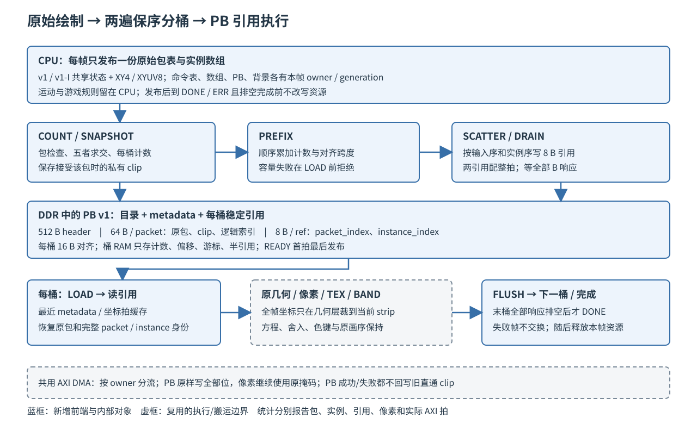

# 14 硬件分桶与引用列表

F5 把空间分桶与保序引用构建下沉到硬件，输入沿用 v1 标量包和 F4 的 v1-I
实例包，输出为引擎内部 PB v1。CPU 仍负责游戏状态与原始绘制发布，几何、像素、
TEX/BAND 和 AXI DMA 沿原通路执行。本章记录参数选择、研究复现、实现、错误与
生命周期修复，以及正确性、资源和净收益的独立证据。当前验收与采用状态在第五、六节。

## 一、动机

G4 的整机实测（第 10 章）已经把 P3 条带模式的失败原因钉在 CPU 组帧上：引擎忙从
直通的约 1.9M 降到约 0.6M 周期每帧，但分桶、逐条 EXEC 提交与普查把 CPU 抬到
约 1.3M 周期，成为整机关键路径。F1~F3 的软件候选全部未获得净收益，F4 的实例化
把 K1984 档构造从 320378 降到 168506 周期（批入口），但 CPU 仍要为每条记录打包。

F5 的假设是：CPU 只发布一份原始绘制与实例数组（接近 F4 批入口的成本），由硬件
完成计数、前缀和与稳定散布，生成紧凑保序的 PB。本章研究在正式开发前给出三本账：
PB 在真实负载下有多大、PB 路径的取数拍数与 v2 表相比如何、两遍构建放 CPU 上
要多少周期。三本账共同决定容量参数的首版取值与采用门槛的预期。

## 二、为什么是这几步

spec第02章3.11.2/3.11.3 的规格已经把 PB v1 的字节布局（512 B header、64 B metadata 槽、
16 B 对齐的 8 B 引用）和七阶段构建流程定死，研究不再重新设计，只验证规格本身
可执行。验证的顺序与 F4 相同：先在宿主建立与生产语义对齐的独立模型，把模型
与已验收的 v2 构造做逐场景交叉验证；再写第二个独立实现做像素级对拍，证明 PB
语义（快照 clip、稳定子序列、按桶路由）端到端成立；最后把同一语义放到板上，
量出"软件两遍"的真实周期，作为硬件化的对照。

选择与 v2 表交叉验证而不是自己对自己证明，是因为 M（引用数）在两种组织下
应该是同一个数：v2 的条目是"跨带后的片段"，PB 的引用是"跨带后的图元身份"，
两者来自同一个求交语义（第 11 章 D72）。17 组冻结输入的 v2 表由已验收的
G3/G4 生产构造生成（第 09/10 章），是现成的独立真值。

## 三、每一步做了什么

### 3.1 编码空间核对

对照 `gfx_abi.h`、`engine_regs_offsets.vh` 与 `regs_gen.py` 的当前生成物：

| 契约项 | 要求 | 开工前现状 | 结论 |
| --- | --- | --- | --- |
| `CAPS.BIN` 位 13 | 空闲 | 位 0~12 已定义（INST 占 12），EC_CAPS_VALUE=0x0000146F | 可用 |
| `CTRL.BIN` 位 4 | 空闲 | 位 0~3 已定义（EN/SOFT_RST/CNT_CLR/BAND=3） | 可用 |
| `ERROR_STAGE` 0x03C | 空闲 | 0x038 ERROR_INSTANCE 与 0x040 SURF0 之间空闲 | 可用 |
| PB_BASE 0x140 起 | 空闲 | PERF 区 0x100 起，PERF_COUNT=10 止于 0x124；追加 REF_COUNT/BIN_CYCLES/PB_RD_BEAT/PB_WR_BEAT 到下标 13 止于 0x134 | 可用，0x138/0x13C 两个字空闲 |
| 操作码 | 引用不新增 | PB 引用只指向已有包（NOP/FILL/BLIT/SET_CLIP/BLIT_INST），构建期拒绝 BAND，END 终止且不保存槽 | 无冲突 |
| PERF 追加 | 下标 10~13 | F4 已用 0~9（EC_PERF_COUNT=10），驱动按能力取数 | 可用 |

ERROR_STAGE 编码 0 旧路径/1 包级/2 实例/3 分桶计数容量/4 PB 写/5 引用执行/6 BAND
与spec第02章3.11.1 一致，4 位字段够用。

### 3.2 独立 PB 构建模型与 v2 表交叉验证

模型为 [f5_pb_analysis.py](../../../Main/sim/engine/frontend/f5_pb_analysis.py)，
输入是 F1 冻结的 17 组 `inputs/scene*_mode0.bin`（v1 直通流）。模型按 F4 共享状态键
（w0 全部、key 值、宽高、clip epoch）合包成 v1-I 包流，再按spec第02章3.11.3 的两遍构建
计算每桶引用。求交语义对齐 `strip.c` 即时 v2：目的矩形与 clip、屏幕、目的表面高、
源有效区（反推）求交，SET_CLIP 截断到屏幕后保存快照，空框规范化为全裁。

交叉验证的口径：`M_model + NOP数 == M_v2`。NOP 在 v2 进桶 0 占位，PB 只对绘制包
产生引用。17 组场景全部精确相等，峰值桶也逐场景与 v2 表一致：

| 场景 | recs | U | I | M（=M_v2） | 峰值桶 PB（=v2） | 空桶 |
| --- | ---: | ---: | ---: | ---: | ---: | ---: |
| 0（K0） | 207 | 57 | 172 | 778 | 37 | 0 |
| 2（K1024） | 1417 | 58 | 1382 | 3084 | 204 | 0 |
| 4（K1984） | 2529 | 58 | 2494 | 5187 | 355 | 0 |
| 5（K2400） | 3015 | 58 | 2980 | 6109 | 423 | 0 |
| 13（回放 5000） | 429 | 61 | 394 | 1157 | 57 | 0 |
| 14（回放 9000，Boss） | 2895 | 61 | 2860 | 5794 | 370 | 0 |
| 其余 11 组 | — | 56~58 | 162~2449 | 756~4639 | 38~356 | 0 |

三个结构性事实：

1. **U 极小而 M 很大**。合包后每帧只有 56~61 个包（背景 30 桶复制 + HUD + 每池
   一个实例包），M 是 U 的 14~106 倍。PB 写侧 64 U + 8 M + 512 B 在 K1984 档是
   44.78 KB，v2 表写侧 32 M 是 162.22 KB（−72%）；写拍数（128 位）2866 对 10382。
2. **执行读取侧 PB 也占优**。v2 执行直读完整 32 B 条目（全帧 10382 拍）；
   PB 执行读引用 + metadata + 实例区间共 6295 拍（−39%），其中 metadata 因
   顺序引用可缓存最后一个包，全帧只需 605 段（每桶平均约 20 个不同包），
   实例区间合并后 19.89 KB。
3. **H=32 对照**（15 桶）引用数下降约 25%（K1984 3911 对 5187），峰值桶升到
   494，PB 进一步缩小到 34.75 KB；与第 10 章"32 行容量墙更早"的结论同向。
   首版维持 H=16 与 v2 同构对照，H=32 走既有 STRIP_H 参数化对照。

PB 的双帧上限按spec第02章3.11.2 公式为 6.002 MiB；17 组场景的最大 PB 是 49.69 KB
（K2400 档 51.95 KB），容量参数不需要按上限取（定案见 3.5、3.6 节）。

### 3.3 宿主对拍原型

原型为 [f5_pb_fuzz.c](../../../Main/sim/engine/frontend/f5_pb_fuzz.c)（WSL gcc，
链接生产 `exec_sw.c`/`check.c` 等，ASan/UBSan）。`pb_build` 按spec第02章3.11.2 的真实
字节布局构造 PB（header 目录、64 B metadata 含 clip 快照、16 B 对齐引用区），
`pb_exec` 只读 PB 内存与实例数组独立解析（目录→引用→metadata→实例），按快照
clip 吸收坐标、窗口与桶 y 区间求交后交给生产执行器；直通侧把同一输入流按序
展开执行。判据：两份帧缓冲逐字节一致 + SCATTER 写出数与 COUNT 计数对账。

随机场景生成器覆盖六方程、色键、负坐标、源越界、零面积、跨带全高图元、
跨 3+ 桶大图元、透明交叠、clip epoch 序列、空框全裁、NOP/END 边界、单条带
集中分布。复现审查修复之后，ASan/UBSan 下 10000 张固定种子全部通过、零跳过；
六类变异各在至少一张正常控制成功的场景见红，缺少任一消费者则退出非零。
原始 882/118/0 输出只作为修复前证据，118 包含合法零引用，不能称为容量不足。

| 变异 | 注入点 | 消费者 |
| --- | --- | --- |
| clip_last | metadata 快照替换为场景末次 clip | 像素差 |
| ref_reverse | 桶内引用倒序存放 | 透明交叠场景像素差 |
| skip_inst | SCATTER 跳过实例包引用 | SCATTER/COUNT 对账见红 |
| inst_scalar | 实例引用的 instance_index 置 0xFFFFFFFF | 引用身份与包类型检查 |
| ready_early | 末桶最后一条引用不写、目录 count 不变 | 展开侧解析出全零引用见红 |
| stale_pb | 双帧复用只残留目录、其余重置 | 展开侧读到上一帧 stale 目录见红 |

本原型覆盖正常场景与上述不变量。正式实现另以独立标量构造为像素基准，
将 10000 张 PB 字节金标准交给真实 RTL 构建器逐字比较；原型不替代非法字段、
地址/容量边界、DMA、复位和资源租约的正式判据。

### 3.4 板上软件 binner 两遍测量

[f4Bench](../../../Main/sw/apps/probe/f4Bench/) 增加 `bin` 路径：软件完整执行两遍
遍历（COUNT/SNAPSHOT、PREFIX、SCATTER，逐条口径，每条绘制一个引用候选），
语义与 3.2 的宿主模型一致。加载 G4 4KB 主线 bit，纯构造不执行渲染，
原始日志 [f5_board_softbin.log](../../../Main/sim/engine/frontend/logs/f5_board_softbin.log)
（2026-10-11）：

| 场景 | base，周期/帧 | instb，周期/帧 | bin（软件两遍），周期/帧 | mbin |
| --- | ---: | ---: | ---: | ---: |
| scene00（K0） | 80985 | 23082 | 236281 | 778 |
| scene04（K1984） | 352721 | 199280 | 1483026 | 5187 |
| scene14（Boss） | 404092 | 259289 | 1672989 | 5794 |

两条结论：

1. **mbin 与宿主模型的 M 逐场景相等**（778/5187/5794）。板上软件 binner 与
   宿主 Python 模型、生产 v2 构造三方在真实输入上给出同一个 M，交叉验证
   在板上闭环。
2. **当前软件两遍候选不具备采用成本**。K1984 档构造约 1.48M 周期，
   比同轮标量发布贵约 4.2 倍，与 G4 的 CPU 组帧墙同量级。这个测量说明逐条
   求交并散写引用的原型不能直接用于生产，并支持探索硬件构建；它不排除其他
   CPU 实现，也不证明硬件路径有净收益。CPU 原型、实例输入硬件与完整渲染的
   工作层级不同，不能直接相除声称硬件加速倍数。

研究复现日志 [f5_board_research.log](../../../Main/sim/engine/frontend/logs/f5_board_research.log)
在验收位流上再次得到 M=778/5187/5794，K1984 软件 bin 为 1481076~1481078 周期，
标量为 345759~345760、批实例为 202241~202431；开发最终轮为 1481076~1481077、
345759~345760、202242~202430，两轮逐位一致到 ±2 周期。更早部署轮的 1482621 与
1499371~1499372 周期保存在 f5_board_research_pre_final.log；跨轮绝对周期不合并，
收益使用同轮对照。

### 3.5 取数与容量建模

研究模型先给出字节账，再由实现验证事务和周期：

- 理想连续合包模型在 K1984 得到 U=58、I=2494、M=5187，PB 写 2866 拍、
  执行读 6295 拍。这是输入组织和缓存假设下的模型值，不能当作生产计数。
- 正式生产 API 对批绘制使用实例包，背景/HUD 仍含标量包。K1984 完整帧实际为
  234 个非 END 包、2313 个实例、5187 个引用；M 与研究模型相等，U/I 不同。
  不能把理想合包的 U=58 混入这份生产输入的 metadata 成本。
- 实现的 PB 写账为 metadata 234×64 B、引用区含 padding 41632 B、header
  512 B 与 BUILDING 首拍 16 B，共 57136 B，即 3571 个 128 位拍。引用写
  2602 笔、metadata 234 笔、header/BUILDING 33 笔；加 480 笔 BAND FLUSH，
  总写事务 3349，与完整引擎总线监视器对账。
- 定时 DDR 模型（RD_LAT=23/RD_BUB=12/WR_BUB=6/B_LAT=1）完整帧给出
  BIN_CYCLES=113119、PB_RD_BEAT=12724、PB_WR_BEAT=3571；PB_RD 包括两遍
  构建及引用执行的所有 FD 读取。原“构建小于 1 万拍”的估算漏掉散写往返、
  第二遍 64 B metadata 重读、实例解码与状态机等待，已撤回。该模型下构建约
  1.13 ms，不是板上周期或整机帧率结论。
- 容量按可配置上限分配，按实际使用范围写入。默认 DRAW_CAP=1024、REF_CAP=8192，
  单 PB 向上对齐到 128 B 后为 0x20400 B，双 PB 为 258 KiB；编码上界保持
  32768/131072。容量失败在 LOAD 前拒绝，不能借自动拆帧维持表面上的帧率。

生产输入与周期日志为 [f5_game_golden_16.log](../../../Main/sim/engine/frontend/logs/f5_game_golden_16.log)
和 [f5_game_16_1.log](../../../Main/sim/engine/frontend/logs/f5_game_16_1.log)。

### 3.6 正式数据通路与所有权

图 14-1：CPU 发布原始输入；空间引用在硬件生成，再交给既有条带执行路径。

原始包只发布一次。COUNT 按输入序检查并保存裁剪快照；PREFIX 对至多 30 个桶
顺序累加；SCATTER 重读 metadata/坐标，把同一输入序投影为每桶的稳定引用序。
槽号等于原 packet_index，标量引用 instance=FFFFFFFF，实例引用保存包内编号。
每桶半拍身份压缩为 16+16 位，写入 DDR 时恢复为 32+32 位，标量哨兵完整恢复。

桶的 count/cursor/offset/半引用放在 32×96 位同步 RAM 中：可表达总容量最多
131072 引用，内部合法范围计数保存 18 位、偏移 21 位，比较使用扩位结果后再
保存；外部目录/PERF 仍为 32 位。header 顺序收集两个桶后写一个 16 B 拍，
最终 READY 首拍在全部 metadata/ref/padding/header 响应成功后发布。

[engine_pb_dma.v](../../../Main/rtl/engine/engine_pb_dma.v) 复用同一搬运层读写核，
读拍直接进入包、快照或引用/坐标缓存；写生产者持有 payload 到响应，不再
在生产者和桥中重复存 64 B。PB 写 owner 绕过像素 X 字节抑制，取消后仍按
在途前缀排空；普通像素的写掩码不变。

执行每桶依次 LOAD、引用、metadata/坐标、原几何/像素路径、FLUSH。坐标始终
为全帧坐标，只在几何层裁到当前 strip。metadata 缓存最近一个包；引用顺序
读取，每拍低/高半各消费一次；坐标缓存按实际对齐地址检查，跨页与 stride=12
的 XYUV8 不依赖固定纹理或弹种。

共享区保持实例 A/B 在 +0x400000/+0x480000，各 0x80000 B；默认 PB A/B 在
+0x500000/+0x520400，各 0x20400 B，末端 +0x540800。命令表、实例、PB、背景
分别保持本帧所有权，成功或错误且排空后释放；切模式前显式 flush。压力搜索
可配置REF_CAP=32768，此时单PB 0x50400 B（321KiB），B起点+0x550400，
末端+0x5A0800，仍低于prepass区；不能沿用默认129KiB长度。

### 3.7 软件接口、普查与组合路径

驱动 gfx_engine_submit_pb 配置PB和条带参数，再以BIN+BAND门铃提交；错误阶段与
实例身份一起读回。PERF计数数目按能力为9/10/14，clear操作保留BIN模式。
renderer_list_begin 在编码前查询BIN/INST；不满足则走既有v2，不能在提交后回退。
GFX_FRONTEND_BIN 保持显式开关，PB大小由 gfx_pb_bytes 计算；宿主通过只读
PB/实例view解析，不在素材 gfx_mem 窗口内暗取工作区。

普查遍历原始实例输入，按逻辑draw给出六方程、像素与色键口径；编码包、数组元素、
物化引用和像素分别统计。main.c 不再把带实例/PB的raw输入误当成v2表头。
F2 的多pass plan 将PB和数组各自登记成依赖资源，背景/命令/PB/数组保持同帧
owner；组合12/13分别为PB+B1/PB+B2，单独做CRC和计数验证，收益不与单项相加。

双帧租约测试拒绝忙时复用和过期generation；四种能力组合none/INST/BIN/both
验证发布前的v2回退与PB选择。前帧错误时未提交的下一帧也回收，切后端先flush。
Nmax同一程序先完成TEX两型搜索，保留统计/错误结果后重置游戏再做PB两型搜索；
搜索步长、涨潮、确认场数沿 core/nmax.c 原参数，不用缩短确认换取通过。

## 四、遇到的问题

### 4.1 求交语义要与 strip.c 逐项对齐

交叉验证第一轮 M 与 v2 表相差数倍。逐场景对比桶条目后找到三处口径偏差：
源/目的表面号必须从 w0 解码而不是按下标假定（不同弹种用不同图集表面）；
BLIT 的源有效区裁剪（`strip.c` 的 xmin/ymin 反推）必须同时作用于 x 与 y；
NOP 在 v2 进桶 0 占位而 PB 不产生引用，交叉验证公式必须加 NOP 数。三处修正后
17 组场景全部精确相等。这个过程的副产物是一份求交语义的逐字段参照，开发轮
的 bounds helper（spec第02章3.11.4 的 18 位有符号端点模型对账）可以直接引用。

### 4.2 复用 exec_sw 的窗口是单一窗口语义

原型最初给每个表面一个 `gfx_mem` 窗口，`exec_sw` 的窗口检查却按传入的
`gfx_mem` 单一窗口算（板上恒等映射整块 DDR 时恒成立，走不到），宿主上全部
BLIT 被拒。与 G3 原型一致的修法是把所有表面放进同一块连续设备窗口：
直通与 PB 各一份帧缓冲区、源图集共享，base 是窗口内偏移。

### 4.3 stride_log2 是字节对数

表面控制字的 stride_log2 按字节对数解释（行距 = 1<<log2 字节）。8/16/32 像素
宽的图集需要 log2=5/6/7，按像素对数设置会让 `gfx_cmd_check` 全部报
BAD_SURFACE。s0 的 log2=12（4096 B）装 640 像素同理。这条写成原型注释，
开发轮的 RTL 不受影响（寄存器直传）。

### 4.4 v1-I 包展开成标量 BLIT 时 w4/w5 互逆

F4 把色键值从 w5 移到 w4、w5 放 stride/layout；标量 BLIT 的 w4 必须为 0、
色键在 w5。直通侧与 PB 展开侧都要做这次互逆，漏做时两侧对称地拒掉全部实例
绘制（BAD_FIELD），对拍"通过"但实例像素全程缺失——第一版变异 inst_scalar
不红暴露了这一点（变异注入同样落进被拒路径）。修好后 6 类变异全部见红。
教训与 F4 的"对拍两侧共享同一份源内容"同类：判据的有效性要用变异证明，
不能靠通过样本数。

### 4.5 开发前复现审查（2026-10-11）

原始宿主输出 882 通过、118 跳过、六变异见红可复现，但存在对拍两侧
对称拒绝的缺陷：XY4 固定源坐标留在标量 w6，执行器报 BAD_FIELD，原型
丢弃返回值后把两份未绘制的画面判成一致。两侧展开清 w6、逐次检查返回值
后，结合源有效区求交、READY 状态、真实双帧 stale 控制及变异退出码修复，
ASan/UBSan 一万张场景全部通过、零跳过。原来的 118 跳过包含合法零引用，
不能称为容量不足。17 个冻结输入另以每桶完整计数（含桶 0 的 NOP 差异）
对账，均精确一致。日志与复现命令见 frontend 的 f5_research_review.log
和 tools/check/check_f5_bin.py --research。

容量定案为默认 1024 槽、8192 引用；编码上限保留 32768/131072。
PB 字节数按寄存器容量预留，不是按 U 实际槽数紧缩；原 44.78 KB 为写入量
估算，不能作为 PB 分配长度。单 PB 0x20400 B，双 PB 258 KiB。共享区
的实例 A/B 保持 +0x400000/+0x480000，各 0x80000 B；PB A/B 位于
+0x500000/+0x520400，各 0x20400 B，末端 +0x540800。已有 F3 工作区
截止 +0x3C0000，prepass 从 +0x800000 开始，逐区检查无重叠。

[Imagination PB 文档](https://docs.imgtec.com/performance-guides/graphics-recommendations/html/topics/the-parameter-buffer.html)
支持引用与参数保留于系统内存的组织原则；[Arm 中间几何内存说明](https://developer.arm.com/community/arm-community-blogs/b/mobile-graphics-and-gaming-blog/posts/memory-limits-with-vulkan-on-mali-gpus)
说明必须核算中间输出的写回及重读。两者都不证明本机的容量默认值或帧率。
本项目按最大实测 M=6109 与可配置容量选择 8192，容量不足明确拒绝，
不采用工业驱动的自动拆 pass 或增长策略，以保留本批失败帧语义。

原“构建 <1 万拍”的估算没有计入按桶散写的描述符往返、metadata 第二遍
64 B 重读、实例解码与状态机等待，不能作为硬件预算上界或已验证收益。
本批以完整定时从机和板上 BIN_CYCLES/PB_RD_BEAT/PB_WR_BEAT 重新计量。

### 4.6 模式返回与错误排空破坏了旧 clip

**第一现场** 以下两条由开发调试输出整理，未单独保留失败轮串口日志；反例已固化
到 tb_engine_pb.v TEST12/13，最终原始输出另存 f5_protocol_12/13.log。

~~~text
TEST12：PB 成功后再提交 v1，36 个像素与独立标量结果不同
TEST13：PB 失败排空后再提交 v1，20444 个像素不同
~~~

**解读** PB 自身的 CRC 成功不能覆盖后续旧入口；失败后的大面积差异表明全局
裁剪被清掉，而不是某条引用排序出错。单帧结束时检查 PB 不会发现状态泄漏。

**定位** 先检查外部包选择与旧命令取数：external_mode 原先跟随 pb_active，
PB 结束后仍把末条外部包当作下一张 v1 表。改为只由 pb_command_go 脉冲选择后，
成功返回恢复；失败返回仍错误，进一步定位到排空时 cmd 复位清掉旧私有状态。

**根因与修法** 外部入口使用有效提交脉冲；PB abort 只取消工作，保留旧 clip，
真正 SOFT_RST/全局复位仍清 clip。新增有颜色变化的直通绘制消费者，同时覆盖
成功与失败返回。原测试只检查 PB 画面，且旧回归的同值回写不能区分误执行。

### 4.7 预检读取了错误的目标区间

**第一现场** 按调试记录还原：目标在槽 1、PB 与目标别名时，本应 stage=3 且
零目的写，初版却进入执行并报告 stage=5，10242 个目的字发生变化。TEST14 将
错误阶段、写拍数与完整目的内存同时作为消费者。

**解读** 不是执行检测不足，而是渲染前的范围检查失效。槽 0 配置刚好会遮住
该错误，所以常规目标槽和正确工作区的测试都能通过。

**定位** CFG_DST 读表后状态切到 VALIDATE，surface 读口随状态切回包号；
目标 id 尚未恢复，组合 cfg_dst_end 变成槽 0 的值。仅锁存目标 base/stride 不够。

**根因与修法** 在 CFG_DST 同拍锁存完整 target_end，VALIDATE 使用锁存范围，
与背景范围同生命周期。COUNT=0 的输入区间另加非空判断，避免把零长度地址
判成重叠。原判据使用目标槽 0，没有让配置读口切换改变范围值。

### 4.8 错误身份与分类也需要独立消费者

**第一现场** 按调试记录还原：非法实例包误报 instance=0；COUNT 达边界后
PREFIX 容量错误报 index=2（输入总数也是 2）、tag=11、instance=1；输入与 PB
metadata 读错曾归为 BUS_READ。TEST15/17/18/20~24 比较完整 code/index/instance/tag/stage。

**解读** instance=0 会误指向尚未读取的数组元素；超出输入的 index 不能定位原包。
FETCH 与 BUS_READ 决定是前端数据不可取得，还是已经关联绘制的坐标/像素总线错。
不能仅检查 STATUS.ERR 就认为错误通路正确。

**定位** 包检查沿用了实例游标默认值；PREFIX 沿用了最后一个包的上下文；
读写桥仅给出通用 io_error，调用状态没有细分消费者。错误后本应抑制的目的写
也在同一组反例中监视，避免错误码正确而失败帧仍被呈现。

**根因与修法** 包级 instance 固定 FFFFFFFF；无可靠关联的总量容量错固定
index/tag=0、instance=FFFFFFFF；输入、快照与执行 metadata/ref 读失败报 FETCH，
执行坐标/像素读失败报 BUS_READ。ERROR header 在排空后尽力写入，非法工作区
不发写。原判据只覆盖单包正常实例和一类 DMA 错，缺少各状态的身份四元组。

### 4.9 资源预算逼出了存储与握手边界

**第一现场** 初版整机映射为 70906 XLR，超过 60800；计数改同步 RAM 后一轮
为 60480 XLR，但 core setup=-0.498 ns。该轮报告保存在 f5_ram_v1_*。
后续曾出现 60437 XLR/-0.070 ns，以及能布局但自写代码仍有隐式位宽告警的版本。

**解读** 数据正确并不意味着能部署；把数组标成 RAM 也不保证组合读口和长路径
消失。不能以负时序位流的板测为验收依据。计数的实际合法域与外部编码宽度
不同，压缩必须保留进位比较和标量哨兵的恢复。

**定位** 层次报告显示多读口桶表、包重复暂存、桥与生产者各持 512 位数据，
以及包/表面组合校验链贡献了资源与关键路径。逐次保留对外不变量，缩减内部
合法域、改同步单口顺序访问、寄存实例范围校验，随后重新映射和布局。

**根因与修法** 桶表收敛到 32×96 RAM；半引用压为 16+16 位并恢复外部32+32，
读拍直接交消费者，写生产者保持到响应，header 每次16 B。最后显式写出16位
包游标加法和18位前缀结果扩展，消除自写位宽告警。最终60064 XLR、core
setup/hold=+0.104/+0.022 ns，hold 比 +0.026 ns 基线少0.004 ns，仍为正。
原判据缺少整机布局与所有时钟检查，单模块预算不能替代它们。

### 4.10 背景组合的影子消费者漏掉了 LOAD

**第一现场** 原始失败轮保存在 f5_board_combo_bad_shadow.log，27组中18组失败；
PB单独模式11均通过，模式12/13的fverify返回3。例如K1984硬件CRC=172087439，
B1影子=1347697192，B2影子=2484515338，三轮重复一致。

**解读** 相同硬件结果在模式11/12/13保持一致，失败只随背景分离发生；
不能据此跳过组合判据或把诊断失败当作允许的差异。

**定位** verify.c 对原v2走 exec_sw_run_strips，自动LOAD背景；PB的原始输入带
实例，走独立标量展开，已经省略的底色/prepass却没有拷到影子。B2虽然独立执行
了prepass，但写的是背景槽15，动态标量随后直接绘制到未初始化的影子。

**根因与修法** PB且有frame plan时，先用独立构造/重画后的背景完成可见行LOAD，
再执行原始标量展开；保持padding哨兵，继续比较每行4096B与累计PERF。没有复制
硬件目的帧来生成期望，也没有改PB数据通路。修复轮27组像素和统计重新消费。
原判据把“有实例”视作普通直通，遗漏了PB内部LOAD这一帧级步骤。

旧入口提交检查另发现SW6_JUDGE的重复s_tex_ready声明报未使用；状态声明按
!SW6_MODE_JUDGE限定并删除重复项。SW6十项重新通过，三份生产压力/搜索/回放
程序重建后与此前登记SHA相同，源码修复不改变这些生产执行逻辑。

### 4.11 参考构建器的预检也不能改坏输入

**第一现场** 最终C审查增加工作区/输入host指针别名反例，旧构建器没有返回
BAD_FIELD，断言在test_pb_bounds.c失败，原始输出为f5_bounds_alias_before.log。

**解读** 先memset PB再读输入会把输入清成NOP，随后模型仍可能返回成功；
正常分配的随机像素场景不会触发它，不能用万张成功替代工作区拒绝检查。

**定位** build_core只有设备工作区范围，没有检查真实host缓冲与输入重叠；
ERROR包装层又以缓冲里残留的magic/BUILDING判断是否可以写错误，无法区别本次
是否已经开始构建。后者在预检拒绝时可能修改上次的对象。

**根因与修法** 用不溢出的uintptr差值在首次写前拒绝host区间重叠；由本次
started状态决定是否发布ERROR，不读取旧BUILDING猜所有权。新增“拒绝前输入
不变”和“非法配置不改旧BUILDING”消费者。修复后ASan/UBSan一万像素、边界
与真实RTL一万字节重新通过；普通生产不调用CPU binner，正常性能BIN按摘要核对。
原边界判据只覆盖设备地址和容量，没有让C参考实现的实际host对象重叠。
补充REF_CAP=0非空标量后，另复现C模型把包内循环j=0误报成实例号；标量错误
统一为FFFFFFFF、实例保留j，失败原始输出为f5_bounds_identity_before.log。
这一项不改变RTL，但改变链接代码，最终正常BIN统一重新构建和整机验证。

## 五、结果

### 5.1 正确性与生命周期

| 层次 | 实际消费者与结果 |
| --- | --- |
| 研究复现 | 17个冻结输入每桶计数精确一致；10000张ASan/UBSan像素对拍、0跳过，六变异红 |
| 独立字节/像素模型 | test_pb.c 的10000张逐像素标量真值；容量/地址/END/ERROR/READY边界检查通过 |
| 构建RTL | 10000张header、metadata、clip、引用、padding逐字一致；六个真实RTL变异均由消费者检出 |
| 完整引擎 | 正常像素与总线拍对账；20个错误/模式/复位/超时反例，8/32行参数检查通过 |
| 真实生产帧 | K1984完整640×480，16行随机反压/定时DDR与32行随机反压，0像素差、PB与分类/总AXI计数一致 |
| 所有权 | 双帧独占、忙时重用与过期generation拒绝；宿主stub驱动真实构造入口检查四种BIN/INST能力组合 |
| 旧通路 | F4万张模型、144组完整RTL及七个协议边界；旧ctrl/TEX/frame/geom/mover/pix/BAND/v2回归通过 |
| 最终位流板测 | PB74组独立CRC/字节/PERF与旧实例122组通过；17状态×3模式×3轮共153组，另3状态×3背景组合×3轮27组CRC/PERF/padding通过 |

最终RTL显式位宽修订后再次运行一万张、六变异、20反例及8/32行；最终位流重新
部署，早期三份板测日志另存 *_pre_final，不用其替代新结果。组合失败及修复
分别保存，原始证据入口为 frontend/logs/f5_*，命令在 frontend/README。

2026-10-11 验收会话独立复现全部判据：宿主万张与边界、RTL 万张逐字对拍、六
变异、20反例、8/32行、真实生产帧三组、9208帧宿主回放、lease与能力组合、
F4 144组与legacy八件套、platform全套；板测九批（74组CRC/4组PB错误、legacy、
stripTest、research mbin对账、verify 153组、ab 17状态、combo 27组、压力600场、
双型N_max四配置、9208帧回放）在验收重建位流上重跑全过。验收期间一次空格级
RTL重排按「改RTL必重建」规则重建位流并重跑九批板测，词法等价由穷举混合仿真
（9/9）与逐位一致的综合结果覆盖。

### 5.2 综合与时序

| 对象 | XLR | RAM | DSP | core/clk setup ns | hold ns |
| --- | ---: | ---: | ---: | ---: | ---: |
| F4已验收整机 | 43956 | 165 | 16 | +0.588 | +0.026 |
| F5动态独立观察壳 | 8933 | 7 | 3 | +0.552 | +0.035 |
| F5最终整机 | 60064 | 172 | 23 | +0.104 | +0.022 |

观察壳使用变量激励并观察完整输出，只作综合测量，不作握手/协议证明。
独立7RAM满足≤8预算，含F4实例缓存；主工程层次报告u_pb合计10825.5XLR、7RAM，
u_bin子树6743.5XLR。8933是整壳根数，不是裸binner。整机净增16108XLR包含
命令、寄存器、搬运分派及布局变化，不能全部归到单模块。

整机剩736/60800 XLR，RAM172/256；所有时钟均无负slack，自写新增RTL无位宽
截断告警。core hold比+0.026基线少0.004ns，已显式登记。验收会话重建bin与main
综合，复得同表全部数值，P&R对词法等价输入逐位一致。唯一综合汇总为
[f5_synthesis.json](../../../Main/sim/engine/frontend/logs/f5_synthesis.json)，原始
place/timing/hier/warnings为f5_final_main_*与f5_final_bin_*。位流与部署程序
只在[f5_artifacts.json](../../../Main/sim/engine/frontend/logs/f5_artifacts.json)登记身份。

### 5.3 同轮冻结状态成本

同一BIN、同一最终位流，模式0 TEX、10 INST、11 PB；扫描开启，各预热8帧后
测30帧、重复3轮。下表取三轮构造p50和执行平均的中位数，单位为100MHz周期；
CPU是生产compose与其统计工作，不与纯打包研究微基准混比。诊断verify的周期
不进入此表。数值为验收复现轮。

| scene | CPU构造 TEX / PB | 实际执行 TEX / PB | PB执行变化 |
| --- | ---: | ---: | ---: |
| 0 | 452994 / 453728 | 311114 / 561977 | +80.63% |
| 2 | 713241 / 693819 | 1120033 / 1107794 | -1.09% |
| 4 | 934486 / 895517 | 1855054 / 1600123 | -13.74% |
| 5 | 1028447 / 979703 | 2182378 / 1816292 | -16.77% |
| 10 | 926688 / 887917 | 1074701 / 1130711 | +5.21% |
| 14 | 1564660 / 1511847 | 2500275 / 2072347 | -17.12% |

这六状态三轮构造p50的最大跨度为0.136%，小于2%。带扫描探针的构造计时跨轮
漂移：K1984档962391（开发早期轮）→934677（开发最终轮）→934486（验收轮），
后两轮差0.02%，执行平均跨轮差≤0.05%。K1984执行下降约13.7%，与K0和8×8负载
变慢同时存在。PB的CPU构造与同轮INST接近；节约来自执行组织，不能把CPU不分桶
直接写成整机收益。冻结串行探针不代替生产流水Nmax。

K1984板上每帧I=2313、M=5187，验收轮三轮BIN_CYCLES为120642~122282；
PB_RD/WR_BEAT严格为12724/3571，复现了定时模型的字节账，周期由113119变为
板上实测值。PB内部构建约1.22ms，读约198.8KiB、写约55.8KiB；这个流量包含
两遍构建及引用执行，不能只按8B/ref计开销。raw、分位数、重复跨度与每帧分类
量在f5_cost_results.json；原始日志为f5_board_ab.log。背景组合只作本次正确性
检查，不把PB和B1/B2单项收益相加。

### 5.4 整机长时门槛

同一程序在同一最终位流上先完成TEX16/8再PB16/8，N0=64、STEP_MIN=16、T_PROBE=120、
T_CONFIRM=3600、SETTLE_MIN/MAX=300/600、CONFIRM_RETRY=3等参数逐字复核，均沿
core/nmax.c。每型最终确认3600场、3600帧、drops=0；活动数取该确认期最小值。
完整搜索共进行三轮：开发早期过程轮（C模型边界修复前）、开发最终轮（最终正常
BIN）与验收复现轮（验收会话重建位流），各轮位流与当轮程序配对，搜索参数不变。

过程轮（最后C模型边界修复前）：

| 后端/弹型 | K | Nmax | CPU / GPU周期（末确认窗口） | RD / WR拍每帧（末窗口） | 窗口关键路径 |
| --- | ---: | ---: | ---: | ---: | --- |
| TEX 16x16 | 1584 | 1816 | 1250464 / 1600100 | 158379.1 / 231909.8 | engine |
| TEX 8x8 | 1680 | 1897 | 1295783 / 999379 | 65043.8 / 138435.5 | cpu |
| PB 16x16 | 1856 | 2131 | 1336490 / 1555607 | 101606.0 / 80241.0 | engine |
| PB 8x8 | 1872 | 2110 | 1362076 / 1123166 | 100295.1 / 79682.4 | cpu |

TEX16首个K1600长确认掉1帧，退到K1584通过；PB8的K1920/1904/1888长确认分别
掉26/22/2帧，第四次K1872才通过，不能采用最初120场探针的2189活动数。
这是原搜索器的三次允许退步，不是缩短确认或修改门槛。后两轮的探针与退步序列
保留在f5_board_nmax.log与f5_nmax.json，不以过程轮数值替代。

开发最终轮与验收复现轮（窗口数据取验收轮）：

| 后端/弹型 | K（开发 / 验收） | Nmax 开发轮 | Nmax 验收轮 | 验收轮 CPU / GPU周期（末确认窗口） | 验收轮 RD / WR拍每帧 | 关键路径 |
| --- | ---: | ---: | ---: | ---: | ---: | --- |
| TEX 16x16 | 1632 / 1632 | 1872 | 1873 | 1250421 / 1634145 | 162194.2 / 235619.9 | engine |
| TEX 8x8 | 1728 / 1728 | 1947 | 1947 | 1299786 / 1019115 | 66298.7 / 139576.4 | cpu |
| PB 16x16 | 1904 / 1920 | 2189 | 2206 | 1340152 / 1589589 | 101836.5 / 80314.4 | engine |
| PB 8x8 | 1936 / 1936 | 2187 | 2185 | 1366312 / 1140983 | 100501.6 / 79735.3 | cpu |

同轮双型PB高于TEX的方向在三轮独立成立：过程轮+17.35%/+11.23%、开发最终轮
+16.93%/+12.33%、验收轮+17.78%/+12.22%。总览3.2的采用门槛——候选两型均超
同轮TEX、完整硬件9208帧回放、资源与扫描诊断——全部满足。流量用相邻
累计项按模2^32差分、除该窗口60帧；各行处于各自Nmax，工作量不同，不能据此
计算等工作量压缩比。全轮FIFO最低322拍，zero/under/faults/swap_retry全部0。
完整搜索的失败探针和涨潮超时保留，不能把它们从原始日志裁掉。600场固定K1024
压力为599帧/600场，启动掉1帧，去首窗口后稳态掉帧0；它与四次3600场确认分别
记录。

COM11异常经USB重新插拔恢复；诊断日志租用迁至共享区尾部并以board_ddr_log.h
为真源，JTAG抓取仅作功能诊断备用通道，不用于性能。开发轮与验收轮的板测证据
均全部走UART。

来源与借鉴边界：第11章D64～D76的来源表继续记录早期研究。本轮容量与采用
结论由本机输入、字节账和板测产生；Imagination的PB组织、Arm对中间输出写回/
重读的说明只提供成本核算原则（链接见4.5）。没有移植驱动代码或工业性能数字。
早期Mesa Panfrost的main链接没有固定版本，本轮获取受限，原表关于heap同构、
hierarchy启发式和具体GPU型号的描述没有作为独立复核结论保留，也不用于容量定案。
保序语义继续由生产v2交叉验证、独立标量像素和引用倒序变异共同消费。

## 六、还欠什么

本工作点验收收口：总览3.1/3.2的全部判据已在验收会话独立复现通过，同轮双型
N_max、完整硬件9208帧回放与资源/时序门槛满足，F5 的采用条件成立。

生产开关GFX_FRONTEND_BIN保持默认0：切换默认后端会联动总体设计、数据台账、
作品报告与幻灯片（总览3.3），作为独立决策另行推进，不在本条目内翻转。
F6没有自动启动；是否继续搬运重叠须按切换后的关键路径单独立项。本轮没有改
时钟、SDK、缓存或Flash，自动CRC/串口判据不代替HDMI画面与实体键人工观察。
