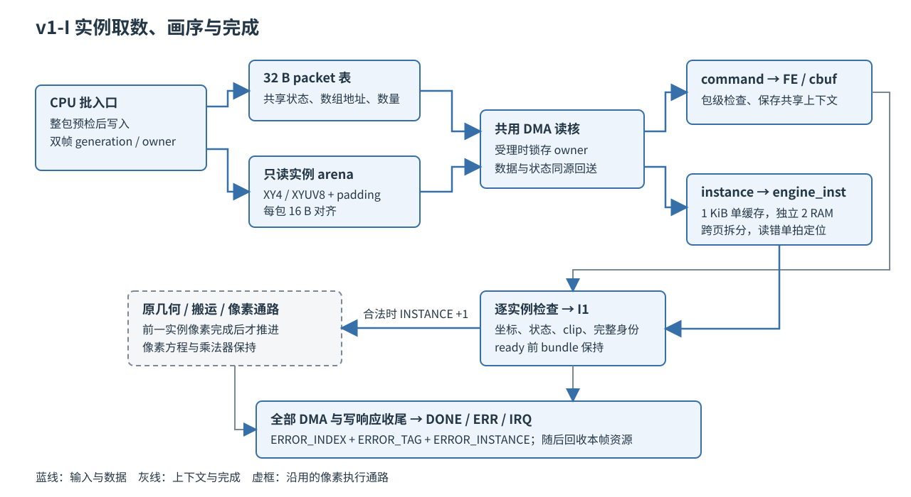

# 13 通用实例命令

状态：**正式实现、仿真、综合与板测完成，待验收（2026-10-10）**。
本章包含研究复现、审查修复、v1-I 正式实现及仿真、综合与板上证据。
规范见 [spec 第 02 章 3.10 节](../spec/02-命令语义.md)，方案依据 D65/D70/D72/D73
见[第 11 章](11-绘制前端方案研究.md)。

## 一、动机

F4 的主张是：把重复出现的共享绘制状态与逐实例属性分开，减少 CPU 打包与
命令传输量。第 11 章 D70 定下了编码方向（32 B 标量 BLIT → 32 B 实例包加
4/8 B 属性数组），第 12 章 3.5 给出了理论字节下界（K1984 弹坐标 XY4 为
9252 B），但三个问题在当时无法回答：

1. 编码契约（v1-I 字段布局、stride/layout、错误定位、零实例与拆包）在现有
   ABI 与寄存器空间里是否可执行，有没有位冲突；
2. 真实游戏负载里"共享状态相同的连续区间"到底占多少，XY4 与 XYUV8 的
   实际比例，编码字节能压到什么程度；
3. 实例化构造在 RV32 上的真实 CPU 成本是否低于现有 `gfx_blit_run` 路径
   ——第 12 章明确"CPU 上界目标为少于当前完整直通构造"，这一条不成立
   则性能采用没有起点。

研究先用宿主原型与板上测量回答三项问题；正式开发再以独立标量像素金标准、真实 DMA 和板卡重新确认。

## 二、为什么是这几步

先核对编码空间再写任何代码：CAPS 位、寄存器偏移、操作码、PERF 下标四项
如果有一项冲突，契约要改在动手之前。再用 F1 冻结的 34 组固定输入做合包
统计，避免用合成负载回答"真实负载长什么样"。然后建宿主对拍原型，把契约
中每一条可执行性断言（拆包上界、坐标无损、零实例、坏 layout 拒绝）变成
可运行的检查。最后上板测成本——实例化的全部收益主张都在 CPU 侧打包与
DMA 传输上，宿主测不出 RV32 的真实开销。

板上测量设计了三条路径同轮对照：

```text
base  生产 gfx_blit_run 按共享状态分段重放   = 现有模板批量接口的最佳用法
inst  f4_build 整流重放（逐记录分派+逐实例调用）= 实例 API 的最重形态
instb f4_append_batch 批入口（共享检查段级一次）= spec 里 gfx_instances_append 的形态
```

inst 与 instb 的差把"编码本身"与"API 形态"两个因素分开。计时口径沿用
F1：预热 8 帧、每轮 300 帧、共 3 轮、32 位模减，CRC 消费在计时外，同一
BIN 内三路径可比。

## 三、每一步做了什么

### 3.1 编码空间核对

对照 `gfx_abi.h`、`engine_regs_offsets.vh` 与 `regs_gen.py` 的当前生成物：

| 契约项 | 要求 | 现状 | 结论 |
| --- | --- | --- | --- |
| `CAPS.INST` 位 12 | 空闲 | 位 0~11 已定义（LANES 占 8~11），CAPS 值 0x0000046F | 可用 |
| 操作码 0x05 | 空闲 | NOP/FILL/BLIT/SET_CLIP/BAND/END 之外空闲 | 可用 |
| `ERROR_INSTANCE` 0x038 | 空闲 | 0x034 BAND_SURF 与 0x040 SURF0 之间空闲 | 可用 |
| PERF 下标 9 | 追加不越界 | `EC_PERF_COUNT=9`（0~8），下标 9 起 0x124 | 可用，驱动按能力取数 |
| v1-I w4=key | 移位 | 旧 BLIT w5 是 key、w4 未使用，v1-I 把 key 移到 w4、w5 放 stride/layout | 与旧布局无冲突 |
| 展开身份 | 包零基+包内零基 | 旧 v1 的 w7=记录零基索引，实例化后由 (packet_tag, ERROR_INSTANCE) 还原 | 语义可映射，标量 fallback 保留映射表 |

### 3.2 真实负载的合包量化

分析脚本为 [f4_instance_analysis.py](../../../Main/sim/engine/frontend/f4_instance_analysis.py)，
输入是 F1 登记的 17 组 v1 直通固定输入。合包规则与 F4 契约一致：共享状态
键为 w0 全部、key 值、宽高与裁剪 epoch，只有连续且全同才合入一包；源坐标
全同的区间计为 XY4，否则整段计为 XYUV8（保守口径）。合计 803680 B 的
标量 BLIT 编码可压到 129204 B（16.1%）。

| 场景 | 记录 | BLIT | 连续区间 | XY4 实例 | XYUV8 实例 | 字节比 |
| --- | ---: | ---: | ---: | ---: | ---: | ---: |
| 16×16 K0 | 207 | 172 | 23 | 34 | 138 | 35.9% |
| 16×16 K1024 | 1417 | 1382 | 24 | 1215 | 167 | 15.8% |
| 16×16 K1984 | 823801 | 780650 | −5.24% | 1853124 | 1838817 |
| 16×16 K2400 | 3015 | 2980 | 24 | 2812 | 168 | 14.0% |
| 回放 5000 | 429 | 394 | 27 | 168 | 226 | 26.5% |
| 回放 9000（Boss） | 2895 | 2860 | 27 | 1542 | 1318 | 19.2% |

三个结构性事实：

1. inst_share=1.000 表示全部 BLIT 都可编码，包含单例，不等于全部获得合包收益。
   复核得到 25115 颗 BLIT 中 59 颗是单例，25056 颗处于长度至少 2 的连续区间，
   有效合包覆盖为 99.77%。游戏按角色/弹池分组的画序提供了这个条件。
2. K1984 档的 2494 颗 BLIT 中 2313 颗属于敌弹池的同一段：同方程、同表面、
   同尺寸且源坐标全部相同（2313×4 B=9252 B，与第 12 章 3.5 的 XY4 下界
   逐字节吻合，交叉验证了两轮统计）。
3. XY4 是主压力档的绝对主导（93% 以上）；Boss 战的图集方向帧把 XYUV8
   推到 46%。两种布局都有真实负载，砍掉任何一个都会丢场景。

### 3.3 宿主对拍原型

原型核心为 [f4_core.c](../../../Main/sw/apps/probe/f4Bench/src/f4_core.c)
（构造器与独立展开器），宿主对拍器为
[f4_inst_proto.c](../../../Main/sim/engine/frontend/f4_inst_proto.c)。
展开器不引用构造器的任何内部状态，按包级检查顺序（opcode→保留位/布局/
stride/count/地址→逐实例）独立重放。

17 组输入全部通过：展开流与原 v1 流按语义字段（w0/w1/w2/w3/w5）逐字相等，
非实例命令透传逐字相同，展开总数守恒，每颗 BLIT 的 (pkg,inst) 身份落在
包流范围内且原 w7 等于记录零基索引。定向边界样例覆盖：

- 同状态 70000 颗 BLIT 按 65535 上界拆成两包，续包实例数与顺序正确；
- 32768 与 −32769 坐标在 append 层被拒（v1 记录本身是 i16 编码，无损检查
  只作用于 int32 入参，这一层界线在原型里明确分开）；
- layout=2、stride 非 4 的倍数、XYUV8 的 fixed 字段非零三类坏包被展开器
  按契约拒绝；
- arena 预填垃圾后展开仍等价（取数不越界）。

研究原型只覆盖编码和展开的部分规则。正式复核发现它没有实施 16 B 包基址
与 DMA padding 检查，身份检查还误用了 BLIT 计数索引，修复见 4.5 节。
修复后 17 组及定向边界在 ASan/UBSan 下通过；共享语义、构造原子性和像素
正确性由独立的正式实现与判据确认，不能由这份原型代替。

### 3.4 研究轮裸构造测量及复现

测量程序为 [f4Bench](../../../Main/sw/apps/probe/f4Bench/)，加载 G4 的
4KB 主线 bit，纯 CPU 构造不执行渲染。输入嵌入 scene00（零负载）、
scene04（16×16 K1984）、scene14（回放 9000，Boss）三个冻结状态，批路径
与基线路径使用相同的段划分。原始日志为
[logs/f4_bench_proto4.log](../../../Main/sim/engine/frontend/logs/f4_bench_proto4.log)。

| 场景 | base，周期/帧 | inst，周期/帧 | instb，周期/帧 | instb/base |
| --- | ---: | ---: | ---: | ---: |
| scene00 零负载 | 43953 | 46808 | 17005 | 0.387 |
| scene04 K1984 | 320378 | 587443 | 168506 | 0.526 |
| scene14 Boss | 367635 | 669987 | 227503 | 0.619 |

首次数据属于未修复 padding 的研究原型，测量仅覆盖 BLIT 段。正式复现的
原始记录为 [f4_research_review_board.log](../../../Main/sim/engine/frontend/logs/f4_research_review_board.log)：
三场景批入口仍为 17005、168506、227503 周期，标量最多差 2 周期。
这些数字确认 API 形态方向，不能视作完整生产构造收益。两条结论：

1. **批入口形态的实例化构造比生产标量路径快 1.6~2.6 倍**。K1984 档每帧
   构造从 320378 周期降到 168506（−47%）；Boss 战 −38%；零负载 −61%。
2. **API 形态是决定性因素，不是编码本身**。逐实例函数调用形态（inst）
   比标量基线慢 1.6~1.9 倍：每实例一次调用、每实例读回包流比较、每实例
   回填 instance_count，这些开销吞掉了从 8 字存储降到 1 字存储的节省。
   spec 把 `gfx_instances_append` 定为一次接收整段的批入口、构造原子性
   先检查后写，与实测方向一致；实现必须坚持批形态，不做逐实例调用入口。

将研究的 BLIT 段节省外推为完整构造约快 20%，缺少同一实现的证据。
正式实现还要验证整包原子性、表面、别名、容量与全部坐标，游戏又按 128 颗批次
调用并保留非池绘制。3.8 节以同一 BIN 的完整构造实测替代该外推。

### 3.5 编码字节与 DMA 建模的口径修复

研究统计的 803680→129204 B 是 BLIT-only、连续共享区间的逻辑编码下界，不含
DMA padding。加入每包 16 B 对齐与末拍 padding 后是 131120 B，即 16.31%。
原型采用“先 XY4，遇源位置变化再开 XYUV8”的混合拆包，另保留全部标量控制
命令，口径也与上述下界不同。修复后的 scene04 为 75 条记录、10912 B 数组，
合计 13312 B；scene14 为 80 条记录、15936 B 数组，合计 18496 B。

原执行侧估算把 32 B 命令算成一个 128 位拍，还把每条命令算成一次取数。
实际 B5 按 16 条一批预取：scene04 的 2529 条合法标量记录需要 5058 拍，
页对齐表下为 159 批；修复后的原型编码为 150 拍包流加 682 拍数组，共 832 拍。
数组按包独立请求，不能把全部数组字节一次除以突发上限、写成约四笔。
减少编码字节不能直接等同减少整机时间，预取与像素执行本就可以重叠。

Ti60 的一个 RAM 块是 10 Kbit。研究的“约 2～4 个 18 Kb RAM”不适用于本器件，
预算由 3.7 节的独立综合确认。数组内存由共享区双帧 lease 持有，不能把这项
DDR 分配与 FPGA 片上 RAM 计数混用。

### 3.6 正式批构造、宿主消费者与 fallback

生产实现位于 Main/sw/lib/gfx/instances.c，不链接研究原型。批入口先检查整段
坐标、共享字段、CLOSED、包容量、源/目的别名与 arena 容量，再写数组和包。
连续输入超过 65535 时保序拆包，每包独立预留 16 B padding。失败保持表、used
和 arena.used，只有容量错误加 overflow。旧 gfx_blit_run 仍保留逐项返回语义。

宿主执行与普查经只读 view 取数组；实例 arena 低于原 gfx_mem 的素材/帧窗口，
因此独立换算设备地址。exec_sw_run_instances 的 packet/instance 错误身份与
硬件一致，旧执行入口保持标量语义。普查统计逻辑 draw，PERF_CMD 统计编码包，
两项不混比。能力缺失时 renderer 在构造前选择标量批接口；已编码表可以先经
 gfx_instances_expand 原子展开，同时保留逐条 packet/instance 映射。

游戏的 stg_draw_pool 按共享状态与实际源位置选择 XY4/XYUV8，整批直调 API。
其它 sprite、字形和 FILL 保留原标量入口。两张命令表分别绑定共享区中的实例
arena，generation 在表内留快照，owner 持有至完成或成功排空。忙时重用与旧
表持有新 generation 均拒绝，过期表不能释放新帧的资源。排空失败保持租约，
后续成功软复位才回收；独立异步消费者模型检查了这条恢复路径。

### 3.7 RTL 展开、完成与资源



engine_cmd 先完成包级检查，保存共享 packet，再启动 engine_inst。搬运层在
描述符受理时锁存 command/instance owner，并随数据和状态回送；实例字不写
命令 cbuf。engine_inst 缓存最多 64 个 DMA 拍，遇 4 KiB 边界拆分。坐标读出后
在 ready 前保持 bundle；每颗先走原 BLIT 检查，再串行进入几何和像素通路。

数组突发出错先回退单拍，定位首个无法可靠取得的实例。包级或标量错误的
ERROR_INSTANCE 为 FFFFFFFF，实例错误补足包内索引；ERROR_INDEX 始终是编码
packet 的完整零基索引。错误和超时取消新请求、收齐在途数据与状态，完成或
错误对外可见时，命令、数组及像素写均已收尾。旧九项 PERF 保持原偏移，新
INSTANCE 在合法实例送几何时计数，包括最后裁空的实例。

首版四 bank 缓存独立综合占 8 RAM，超过预算。改成 256×32 单缓存，每个 DMA
拍分四个整字写入，以 tready 反压读核 FIFO；独立实测收至 2 RAM。该代价已
包含在板上 GPU 周期中，没有将理想无反压吞吐当作整机结果。

| 对象 | XLR | RAM | DSP | setup / hold，ns |
| --- | ---: | ---: | ---: | --- |
| engine_inst 独立、全输入动态可观察 | 1364 | 2 | 1 | +3.763 / +0.026 |
| F4 整机 | 43956 | 165 | 19 | core +0.588 / +0.026 |
| G4 主线基准 | 41476 | 163 | 16 | core +0.756 / +0.026 |

整机增加 2480 XLR、2 RAM、3 个地址计算 DSP，像素混合核和像素乘法器未增加。
所有时钟 setup/hold 均非负，rx_cal hold +0.029 ns；自写新接口的位宽告警为 0。
原始报告与汇总位于 logs/f4_final_* 和 f4_synthesis.json。

### 3.8 正式正确性与同轮净收益

独立金标准直接从 int32 输入位置调用原标量构造器和像素执行器，不调用实例
展开器生成期望。10000 张、六方程、双布局、DDR/TEX、双 clip epoch 和负坐标
逐像素相同，ASan/UBSan 通过。完整引擎 144 组另核对像素、padding、包数、实例
数及真实总线读写计数；合法 N=0/1/15/16/17/31 均覆盖。

六类变异为 stride、XYUV 字序、共享状态提前覆盖、实例跳号、DMA owner 错路、
末写前完成，均在定向用例见红；相同变异的零实例对照仍通过。附加判据覆盖
stride=12 的跨 4 KiB entry、packet=18/instance=19 的完整重叠身份、数组
RRESP 错的首失败实例、超时排空与软复位恢复。ready 前 bundle 稳定，AXI 突发
长度与 4 KiB 边界另有监视。原 v1/TEX/几何/搬运/像素/BAND 回归通过；v2 的
两套 10000 张、16/32 行 RTL 与七个变异在隔离目录通过。

板上正式测试有 122 组六方程、双布局、DDR/TEX 的 CRC/PERF 与包错误身份，
另执行 65535+4465 拆包，INSTANCE=70000、CMD=2、PIXEL=0。真实游戏 17 状态
各三轮、两模式的诊断构建共 102 组，像素、行 padding 和 PERF 全部相符。

完整构造与执行使用同一 BIN、相同冻结状态、预热八帧、三轮各三十帧。下表
为三轮均值，数组与命令都由独立消费者在计时外消费：

| 状态 | 标量构造 | 实例构造 | CPU 变化 | 标量 GPU busy | 实例 GPU busy |
| --- | ---: | ---: | ---: | ---: | ---: |
| 16×16 K1984 | 785918 | 766508 | −2.47% | 1853007 | 1838567 |
| 8×8 K1984 | 816851 | 774056 | −5.24% | 1072210 | 1058746 |
| Boss 回放 9000 | 1453767 | 1396325 | −3.95% | 2498301 | 2482925 |

K1984 的池实例为 2313 颗 XY4，拆成 19 个批包，数组含 padding 为 9264 B，
整表 235 条、7520 B，合计 16784 B，对标量 80928 B 为 20.74%。Boss 的池
实例为 2054 颗 XY4、627 颗 XYUV8，8 B 布局占池实例 23.39%；数组 13248 B、
整表 7616 B，合计 20864 B，对标量 92640 B 为 22.52%。保留的标量绘制与
每 128 颗一批的包头都计入，不能用研究的 BLIT-only 下界替代生产字节账。

同输入的 TIMED 小矩形模型另测数组 DMA、坐标解析和像素出口：标量总计
1830 周期，实例为 1926；实例取数等待 250、解析 496 周期，两者都输出 231
有效像素和 80 个像素出口拍，几何忙区间分别为 775/716 周期。这些区间可能
重叠，不能直接相加，也不当作板上分段时钟。该例的实例路径反而慢 5.25%，
说明减少读字节并不保证通用小片段负载更快。原始值在 f4_profile.json。

完整构造收益约为 4%～5%，GPU busy 缩短约 0.6%～1.3%。零池负载无实例可合包，
变化低于 0.1%，按测量波动处理。两项均显著小于原研究从裸 BLIT 段推算的收益。
完整构造仍包含池遍历、位置采集、布局判断、原子预检与其它绘制，F4 没有消除
这些工作；实例至空间列表的下沉属于 F5。

## 四、遇到的问题

### 4.1 逐实例调用形态在板上反向

**第一现场。**

```text
round0 base=320378 inst=689353
```

**解读。** 初版原型按"每实例一次 append 调用"实现，编码字节压缩了 6 倍，
CPU 周期反而翻了倍。

**定位。** 反汇编与结构对照：每实例一次函数调用、四段状态比较读回包流、
每实例回填 `instance_count`，合计超过省下的七条存储指令。

**根因与修法。** 这不是编码的失败，是 API 形态的失败。spec 的批入口
（共享检查段级一次、循环在函数内）实测快 1.6~2.6 倍。研究结论因此把
"必须批形态"写成定案依据；逐实例入口即使做了寄存器缓存与整字存储优化
仍慢于基线，不保留。

### 4.2 memcpy 对字节指针生成逐字节访存

**第一现场。**

```text
inst=689353 -> 589150（仅改存储方式）
```

**解读。** arena 声明为 `uint8_t *`，4 字节 `memcpy` 在 RV32 -O2 下展开为
lbu/sb 序列，一次 entry 写入变成八次访存。

**定位。** 合法布局里 stride 与 entry_bytes 都是 4 的倍数，arena 内偏移恒
4 字节对齐，逐字节保守毫无必要。

**根因与修法。** 改为整字存储，对拍与展开器语义不变。写字宽度要按布局的
对齐保证来选，不能按指针类型默认。

### 4.3 批路径对拍口径漏掉透传命令

**第一现场。**

```text
verify=172 vbatch=4294967293
```

**解读。** 批重放只包含 BLIT 段，对拍却按整流守恒（透传 FILL/SET_CLIP）
比较，展开条数对不上。

**定位。** 两条计时路径都不含非 BLIT 命令的构造，批路径对应 renderer 直调
实例 API、适配层另行提交 FILL 的真实形态。

**根因与修法。** 批路径对拍目标改为"原流按序的 BLIT 语义字段"，条数守恒
只对 BLIT 计。对拍口径必须与被测对象的真实边界一致，不能复用另一路径的
守恒式。

### 4.4 构建分层的源文件边界

**第一现场。**

```text
ld: cannot find build_f4/app/sim/engine/frontend/f4_core.o
```

**解读。** target.mk 的应用源规则要求全部 APP_SRCS 位于 APP_SRCDIR
（Main/sw）之下，sim 树里的共享核心进不了应用构建。

**定位。** 分层靠 -I 与源路径双重约束，宿主可以跨树 include，target 不能。

**根因与修法。** f4_core 落在 f4Bench/src 内（sw 层），宿主对拍器跨目录
引用同一份实现；两侧编译产物指向同一段代码，成本与正确性结论同源。

### 4.5 原型与展开器同时漏掉 DMA 约束

第一现场是 f4_open 直接把 arena_used 写入包基址，f4_expand 也只查有效 entry
长度，两侧同时接受 4 B 对齐而不满足 16 B 对齐的包。于是“展开等价”掩盖了
真实 DMA 不能照此取数的问题。修复在封包时补 padding、续包保持对齐，并在
展开器独立拒绝未对齐基址和末拍越界。scene04 的完整编码从 12960 改为
13312 B，语义字段与画序保持一致。

审查还修复了布局由 XY4 转 XYUV8 后仍按旧 4 B 预检容量、坐标加法的有符号
溢出、合法零实例包无法新建，以及宿主复现程序的内存泄漏。身份判据改用
输出记录索引，再检查包类型、包内索引及 packet_tag。修复后 17 组和边界
在 ASan/UBSan 下通过。研究原型仍只代表编码实验，生产构造另有完整共享语义
与原子性检查。

### 4.6 串口子串匹配提前收口

第一轮 N_max 已打印两个结果，采集器却在 nmax done 子串处关闭，漏掉最后
一场之后的 fail/done。这份记录保留为 f4_board_nmax-base_partial.log，不作为
完整验收记录。board_run 新增 --stop-line，只有完整 done 行才结束；原
--stop-on 子串模式保留。消费者回归依次喂入 nmax done、fail 0、跨块 done 行，
确认前三次读取继续、完整换行后结束，再完整重测双型 N_max。

### 4.7 真实游戏每秒统计仍走旧解析器

首次实例搜索虽然打印了两型 OK，末尾却是 fail 629；CSV 的 cmd/pixel 只剩
背景前缀。原因是 main.c 的每秒抽样只在条带模式使用 profile 普查，其余仍调
旧 stats_sample_list，遇到操作码 5 即停止。失败结果保留在
f4_board_nmax-inst_stats_failure.log，不纳入净收益。

stg_mode_out 现在携带当前实例 arena 与 generation，sample_frame 经显式 view
调用 profile 普查。完整 view 的范围与共享字段按包检查，逐实例只消费目的
坐标与裁剪求交；部分可读 view 仍按原前缀语义失败。10000 张普查与标量结果
等价，短压力 600 场先确认逻辑 draw/面积完整、fail 0，再重新执行双型搜索。

### 4.8 数组预取与当前像素同时在途的超时归属

定向用例把 packet 18 的第二个数组突发停住，当前实例 3 已送入几何，取数
等待的是实例 4。旧控制分支统一取活动实例号，报成 3；像素前缀相同，但完整
身份判据见红。修复将搬运层锁存的 instance owner 与超时方向送入该分支，
数组读超时使用首个待取实例号，像素超时仍用活动实例号。新用例同时核对
TIMEOUT、packet/tag/instance、已执行前缀、计数及全部 DMA 收尾。

## 五、结果

F4 的正式直通实例 profile 已交付：原子批 API、紧凑数组、显式宿主 view、
标量 fallback 身份映射、DMA owner、完整实例错误定位与双帧 lease 均实现。
研究原型的对齐/padding、布局切换容量、身份索引与内存安全问题已修复；
统计与资源模型的口径已更正。10000 张独立像素差分及 ASan/UBSan、144 组
完整引擎、六类变异、七组协议边界、原路径与 v2 回归、独立综合、整机时序、
新旧位流板测和同状态测量全部通过。汇总是
[f4_results.json](../../../Main/sim/engine/frontend/logs/f4_results.json)。

最终位流、4KB/1 路、100MHz、相同显示争用下，两个测量构建只以实例开关区分。
每型都经过最终 3600 场、零掉帧确认，显示最低水位 332，zero/under/faults 与
swap_retry 均为 0，末尾 fail 0 / done 齐全：

| 路径 | 16×16 N_max / K | 8×8 N_max / K |
| --- | ---: | ---: |
| 同轮标量 TEX | 1889 / 1648 | 2154 / 1904 |
| 直通实例 TEX | 1931 / 1680 | 2476 / 2192 |
| N_max 相对变化 | +2.22% | +14.95% |

N_max 包含游戏逻辑、完整构造、实例消费、每秒完整普查、提交和显示竞争。
它不是单独的数组压缩比例，也不把不同代码/位流轮次的指标合并。开发阶段
1929/2508 等旧轮数值各自保留在原始日志中，当前结果以上表与最终登记 BIN 为准。文本诊断解码另外核对包基址、数量、stride/layout 与标签；
该格式化入口不处于测量调用链。

122 组板上 CRC/PERF、70000 实例拆包和 v2 拒绝实例命令通过；旧 CAPS 位流
上的 122 组提交前展开、身份映射与 CRC 也通过。修复后的研究板测三场景
批入口为 19979、196260、256219 周期，标量为 62089、333524、382680 左右；
这仍是 BLIT 裸段口径，生产收益用 3.8 节。部署身份集中登记在
[f4_artifacts.json](../../../Main/sim/engine/frontend/logs/f4_artifacts.json)。

## 六、还欠什么

F4 本条的实现与判据已闭环，Todo 保留待验收。直通实例通过
GFX_FRONTEND_INST=1 显式启用，默认值保持 0，供 F5 消费通用输入。最终候选
默认采用仍按总览 3.1 节的完整硬件 9208 帧门槛执行；本次 17 状态诊断、随机
差分与压力确认不代替该项，也不更新作品的默认路径性能数字。
F5 的独立软件分桶模型与 F6 均未开工。板卡最终已恢复 F4 位流并通过正式测试，
操作仅涉及 JTAG/DDR，Flash 未改。
