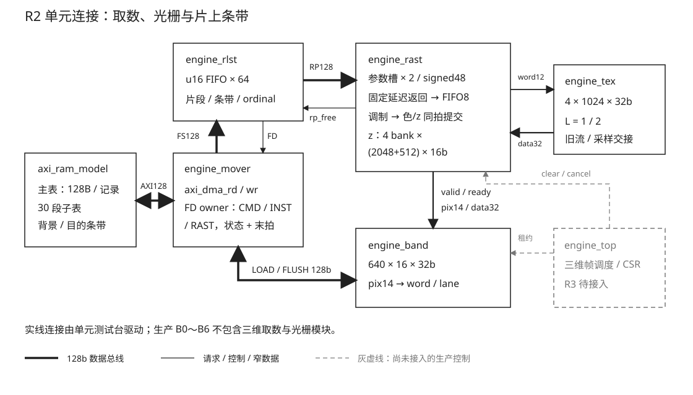

# 17 三角列表、光栅核与 B7 集成对拍（R2/R3）

## 一、动机

R1 已于 2026-10-22 验收。CPU 负责变换、裁剪和 setup，输出固定 128B 记录；
两份 C 参考器和独立 Python 数学模型已经闭合像素中心、绕序、top-left、两级舍入、
UV 比例和有符号 48 位属性。接下来需要用硬件消费同一份记录，把像素写入片上条带。
这里沿用 CPU setup，不在 FPGA 内重新做面积归一化或增加除法器。

R2 首轮实现提交 `d060e28`、`ead734c` 后，全链 smoke 停在 152 次退休。
日志曾把注意力放在 `j_cur=j_end+1` 和 TLAST 上。用户先要求只读复查，随后授权接手完成。
复查证明停点由取数器的事务计数产生，数值核、纹理口和测试台另有独立错误。
若只消除这一次死锁，既不能保证图像正确，也不能把旧 smoke 当成验收。

本章记录单元硬件、输入、检查与收尾。B7 三维 CSR、生产帧控制、三维板测归 R3，
场景与性能归 R4。原有未提交的 engine_pix、host board.c 和报告工作目录保持原样。
当前生产默认构型仍为 B0，既有二维功能由直接消费者回归和 B0/B3 综合覆盖。

## 二、为什么是这几步

工作分为六步：冻结消费者接口；独立验证取数器；实现 L1 数值与深度；实现 L2 与
新 BAND/TEX 口；在真实搬运层上对拍并注错；最后核对关闭态、旧消费者、RAM/DSP 和时序。

取数需要独立索引 FIFO 和记录槽：把索引与随机 gather 的 128B 记录放进一个缓存会相互
覆盖。光栅需要独立于取数的检查：流能完成不说明边缘符号和插值正确。TEX 是同步 RAM，
提交反压不能阻止已经发出的读取返回，因此需要明确容量预留。原子提交只能保证本像素
的颜色和深度同写，不能解决下一三角形提前读到旧深度；边界必须排空。最后，能仿真不
代表 HDL 会映成预期 RAM，也不能用独立壳的资源直接代替三维整机预算。

永久机制与端口在 [engine-manual 第 8 节](../../../Main/rtl/engine/engine-manual.md)，
字节 ABI 在 [三维数值契约](../../../Main/doc/三维数值契约.md)。本章保存过程、反例与证据边界。



## 三、每一步做了什么

### 3.1 研究：从真实消费者推出实现边界

前期研究的脚本、算例与 RAM 估算归档已按 2026-10-28 证据收编裁决撤销，本章承接其结论，
不把研究算例标成 RTL 或综合通过。

| 研究对象 | 实际机制 | 实现决定 |
| --- | --- | --- |
| R1 setup/ref | 128B、小端、原点 Q12.4、属性 s48、两级舍入 | 保留软件 ABI，不改 golden 来迁就硬件 |
| engine_inst | 128b 拍缓存后逐时钟写 RAM | u16 FIFO 每拍一项，不能假定一拍有八个写口 |
| mover / AXI DMA | UNALIGNED=0 起址向下对齐；状态可能早于末拍 | 子表取对齐包络；返回种类和完整事务现场必须锁存 |
| engine_cmd | 接收非 instance 的命令流 | raster 增独立 FS，不能让记录写入旧 cbuf |
| BAND | 描述符式 128b 连续流、四 lane 分段 RAM | 增随机单像素口，14b 像素号，独占相位租约 |
| TEX | 16KiB、四个 1024×32 bank、同步读 | 新地址用 texel 词号，bank/valid 与 RAM 返回一起延迟 |
| engine_blend | 乘积后精确 /255 舍入 | 借整数方程，独立三路乘法，不共享二维执行现场 |

研究查阅 Efinix Primitives UG v4.2 的 RAM/DSP 模式和 Arm IHI0022H 的 4KB/事务纪律，
以仓内实际 vendor 源码、估算器和仿真作为本机证据；没有移植外部 RTL。
原初立项中的 48B/96B 方案在 R1 已扩为 128B；“无除法器、一拍顶点 setup”被 CPU setup
替代。第二次评审曾认为原子提交可以代替三角形排空，下面的 RAW 反例推翻了该判断。

首轮 bring-up 的五项修复也保留在这里：FIFO 指针从 6 位改 7 位，防止 64 项满时被当空；
表头从四次字节解析改为两个 u16，避免多吃索引；测试台去掉 rp_wd 回接 fs_data 的零延迟
组合环；主表装载从数组零起点复制到 TRI_BASE 对应地址；帧头步长由误写的 32 个宽词改为
实际八个。以上来自当时开发日志，本轮没有重新运行这些修复前的初稿，不能当作新证据。
当时“五模块×四宏构型零告警”只是编译结果，stub 退休能递增也只是局部链路推进。
旧日志把 152 与 200 个唯一记录直接相比；本轮重建子表统计后确认还应区分 249 次条带引用。

当时还记录 JTAG 读到 Ti60 ID 10660a79、两次调试会话可读 PC；完整功能采集被位流 mtime
护栏阻止，原因是并行 engine_pix 修改未冻结，未绕过护栏。这是历史下载链路记录，
没有三维功能板测或本轮部署结论。本轮从新的真实 AXI 单元判据和综合证据完成 R2。

### 3.2 取数：字节游标、批次容量和完整事务

每带子表为 `[u16 count,u16 zero]+count*u16 index`，30 段紧接，基址 16B 对齐，
SUB_BYTES 是真实偶数长度。count=1、2 后的下一些头部可落在偏移 6、14，不能按 u32
或拍边界直接解释。物理包络为 `[a&~15,(a+n+15)&~15)`，尾部只作物理 padding。
描述符受 4KB 与缓存容量限制；本实现每笔最多 128B，比研究中的 1024B 上限更保守。

研究重组了 20480 个偶数起点/长度组合和 8192 个主表基址/索引组合；64 个索引从
偏移 14 起需 144B、9 拍，不能固定成八拍。记录基址仅要求 32B 对齐，跨页有
96+32、64+64、32+96 三种情况。本轮把这些边界转成真实 RTL 检查。

```text
SUB 字节流 -> 锁存描述符 -> 128b 拍缓存 -> u16 FIFO64 -> 头/索引解析
                                 [改]容量按项预留            |
                                                             v
主表 FD -> 片段/拍序验证 -> 参数槽 A/B -> rp_valid -> engine_rast
              [改]字节偏移                 [改]等待槽确实捕获
```

旧结构把动态剩余量重新用于当前事务：

```text
SUB 字节流 -> 发描述符 -> 每拍 env_left-- -> 重算 s_chunk_beats -> 等 s_recv 相等
主表 FD    -> 片段长度又乘16 -> 参数槽交付 -> 未等槽退休便 strip_done
```

改后按上一图把描述符现场、逻辑游标和槽生命周期分开。
`engine_rlst.v` 锁存 s_beats、s_rel，只在整笔事务完成时推进 sub_p/env_left。
FIFO 占用分实际存储和待序列化项；读取 fifo_q 必须以实际写指针为准，预留容量则把
待写项也算入。64 个 u16 对应 128B，不能把字节直接加到项计数。主表分片按实际字节
长度推进地址，不再把片段长度又乘 16；槽在全部片段、状态和协议验证后才交付。

新增 fs_keep、fs_cidx、st_cidx 检查；流末拍位置、拍数、tag 和完整记录范围均检查。
状态先到不能释放 owner。取消阻止新 FD，已发事务继续接收后丢弃；请求状态本身也能
响应取消，避免“fd_valid 被 cancel 挡住，FSM 永远等 fire”。

错误分为 BAD_FIELD(2)、FETCH(9)、BAD_INDEX(13)，13 已由 regs_gen 真源追加，旧值不重排。
完整 index、strip 和 ref_ordinal 贯穿槽接口，tag=`{11'd0,strip,ordinal}`；头错误用 FFFF。
TIMEOUT(12) 的整机监视、ERROR_STAGE=7 和 CSR 映射由 R3 接入，不在这里虚构已存在的 CSR。

条带完成由“最后一个索引交付”改成“本带全部引用完成且两个槽都已释放”。
strip_ack 是电平：LOAD/clear 双完成后拉高；strip_done 后控制者执行 FLUSH，再撤 ack。
读者等 ack 低才前进，避免新带清深度时旧像素还在提交。第 30 带同样经过这个边界。

### 3.3 位置求值和 L1：符号、行首与深度屏障

研究给出的范围是 dx∈[-14335,14320]、dy∈[-11775,11760]、|g|<2^30。
梯度拆成 `signed(g[30:16])*65536 + unsigned(g[15:0])`；低位补零后作为有符号乘法
输入。六属性 24 个部分积、三条边 6 个乘积，总共 30 项由四个 19×18 DSP 分八拍发射，
再归并。不是一拍初始化，也没有按 DSP 输出宽度推断 32×16 可单块完成。

研究种子 52323026 的十万组分解与直接整数式相同，CRC b3d27523，观测最大
|acc|=1622550816571，小于 2^41；这只证明算式范围。本轮独立综合另检查实际四个 DSP。

`engine_rast.v` 把边缘改为 signed32、属性和 gx/gy 改为 signed48。初值先对 x/y
乘积和作一次 /16 舍入，再与同为 signed48 的基值相加，防止 unsigned 基值把 >>>
变成逻辑移位。保留六个行首属性：换行取 row_start+gy，内列才累加 gx。
局部像素号从交集首行乘 640 起算，不再一律从条带第零行开始。
梯度校验覆盖整个界外区间，空 bbox∩strip 合法退休。

深度初值 FFFF，严格 LESS。研究反例中 A=100、B=200，A 于第 3 拍提交：

```text
A read=0 -> commit=3
B read=1 或 read=3(READ_FIRST) -> 读到 clear -> 错误 final_z=200
B read=4                    -> 读到 A     -> 正确 final_z=100
```

因此本实现等三角形所有像素退休才释放活动槽；深度拒绝和 KEY 跳过也要退休。
下一份记录可以预取，但下一三角形不能提前发射深度读取。
独立核测试用两槽、256 拍提交停顿和相同像素近远关系检查该条件。

### 3.4 L2 与新端口：固定返回和弹性提交

TEX 仍是原来的四 bank RAM，无额外纹理副本。新 samp_word 的低两位选 bank，
其余位选行；L=1 在 RAM 输出后用延迟的 bank 选择，L=2 再寄存选出的 32 位词。
响应与 credit 同周期周转，稳态可以每拍接收。legacy 描述符有明确优先级，同拍不会
同时接受描述符和采样；双方等在途清空后交接。APB 空闲期装载纪律保留。

光栅核的 RAM 返回不能随输出 ready 停住，改为固定延迟元数据管线接八项寄存器队列，
后面两级调制/提交可停顿。在途计数覆盖发射、未返回、已缓存和提交现场，总量不超过八。
L=2 时 z 返回再延迟一级。TEX_EN=0 不采样，VCOLOR_EN=0 取白，KEY_EN 在无 TEX 时忽略。
KEY 比较原始 32 位 texel，命中同时取消色和 z。RGB 先乘后按 `(t*c+127)/255` 精确量化。

BAND 的像素号为 14b，最大 10239；11b 会把每五个相隔 2048 的位置折叠。
新写口在 EXEC、有效范围与租约同时满足时才 ready，只开一个 lane 的 WE，输出高八位为零。
整个 RAST 相位屏蔽 legacy 与 flush，不能因某拍 valid 低就交回端口。
色/z 共用唯一提交事件；取消当拍即挡住发射和写回，旧返回继续退休。

v1 atlas 是 64×64、行距 64 词；R4 四张 32×32 图放四象限，通过 UV 原点偏移选择，
原点写 Q12.4 时乘 16。局部 UV 应落 [0,31]，硬件只做整个 atlas 的 CLAMP。
不能把四张图逐张线性串接后当成图集，也不能把单纹理端点 32 当成最后一个 texel。
R4 切换回二维热集前需等引擎完成后重装。

### 3.5 输入和真实全链判据

旧测试台标称全链但使用 FD 替身，BAND start/flush 均为零；又只初始化四个 texel，
最后把同一带 RAM 与 30 带期望反复比较。修复死锁后它仍不能给出有效图像结论。
本轮重建 `tb_engine_rast.v`，实例化真实 mover、内部 BAND、未改的厂商 DMA 与随机反压
AXI RAM，每带独立 LOAD/clear/RAST/FLUSH，并在覆盖前比较 BAND/z、写回后比较 DDR。
额外施加连续 96 拍和随机提交反压，检查所有 AXI 突发不跨页以及色/z 原子写事件。

`rast_stream.py` 保留 R1 同种子、同随机调用顺序；前 16 条记录与 Main 内冻结 fixture
逐字节比较，缺失或不符直接失败，不再运行时读取 Engineering。共享条带的初始色为
12345678、深度 FFFF，图集确定初始化；Python 期望在同样配置/画序下再交叉两份 C 参考器。
R1 的逐条隔离随机旧像素不能直接拿来当共享帧终态，二者场景不同，记录本身保持一致。

十万条唯一记录拆两帧，每帧五万条，子表索引保持 u16；条带引用数允许大于记录数。
文件解析按真实 nframes、变长 SUB_BYTES 与下一帧记录偏移推进，不再无条件回放第二帧。
未覆盖背景保留完整 12345678，只有真正写入的颜色高八位为零。

单独的取数器 scoreboard 检查 30 个空头、偏移 14、100 个重复引用、65534/非法65535、
三种主表跨页、子表跨页、早状态、RRESP错误、缺/多/早 last、keep/tag、逻辑尾部、取消
与重启；取消扩到 15 个可达状态，并检查零记录帧不发 FD。核心与真实 TEX 组合在 L=1/2
分别检查 64 点连续提交、双槽 RAW 与提交沿取消，L1 同样检查；另外拒绝界外梯度与字段，
独立采样口覆盖 4096 地址连续换 bank、固定延迟及 legacy 交接。

全链启动前先作 CMD/RAST/INST/CMD 四次 owner 交接：阻住末拍 32 个时钟、改变请求侧
类别和 tag，检查旧流的数据、last、tag、状态和返回类别仍正确。参考提交数由生成器
输出 stats.json，测试台结束时与实际 commits 自动比较，防止只对终态而漏掉提交次数。

23 条定向记录在真实全链中覆盖共享边、跨带、严格 LESS、KEY、半值舍入、负梯度、
guard 原点、CLAMP、非零局部行与连续采样。十三类变异的宏和 witness 列在 Main 手册第 8 节，
每类重新编译并必须触发明确 FATAL 判据；编译失败或看门狗不算检出。
最初定向集合没有半值输入，ROUND 变异竟能通过；补入 z 的 0.5 步长后被深度比较检出。

### 3.6 存储推断、关闭态与消费者

前期 `efx_map_ramest` 得到以下估算，保留估算与实际映射的边界：

| 逻辑存储 | 估算 RAM10 |
| --- | ---: |
| 10240×16 / 8192×16 / 2048×16 | 20 / 16 / 4 |
| 2560×16 / 512×16 / 64×16 | 8 / 1 / 1 |

直接四个 2560×16 会估到 32 块，因此每 bank 显式拆 2048+512，预算 4×(4+1)=20。
首轮 HDL 将四 bank 放进二维数组并动态读写，综合规模异常；改为 generate 内各自独立
存储、各段 q 输出和延迟段选，才映出 20 个 z RAM。浅的 8×88 返回数组又被工具映成四块
RAM，改成逐项寄存器写使能后去掉这四块；加一块索引 FIFO，独立单元共 21 RAM。

独立观察壳以动态移位寄存器驱动所有输入、折叠观察所有输出；测资源和内部时序，
不作为协议证明。L1/L2 四步分别核对 21 RAM、4/7 DSP、z 的 20 个 RAM 实例及非负 setup/hold。
随后自建隔离 B0/B3 源树，使用本次工作区真实消费者 RTL 完成整机四步与全时钟关系检查。
生产预设均排除 rlst/rast；L1 保留旧 TEX。三维完整 B7 总资源不能把独立壳和历史 B3 数字
直接相加当验收，R3 需要实际整机映射。

清零每拍四个深度，2560 拍/带，30 带共 76800 拍；按 100MHz 算术折算 0.768ms。
LOAD 与 clear 是否隐藏开销由帧调度的双完成屏障决定。空 count 仍有头部/已启动清零成本，
只有 TRI_COUNT=0 的全帧绕过才称零开销。

R3 还需锁存 TRI_BASE/SUB_BASE/SUB_BYTES/TRI_COUNT/RAS_KEY/TEXCFG，保持到事务排尽。
B3 CAPS 为 146F，保留 INST 再置 bit14/15 的 B7 应为 D46F；早稿 C46F 丢了 bit12。
RAST_TEX→RAST/TEX、RAST→BAND 的依赖、PB 与 RAST 的互斥由 R3 的生产配置真源接入。
本轮没有改变默认后端，也没有用关掉二维 TEX 冒充 L1。

## 四、遇到的问题

### 4.1 152 次退休的停点与错误方向

第一现场（旧源码，以下三行即失败诊断归档的决定性输出，归档已按证据收编裁决撤销）：

```text
DIAG_STOP retire=152 strip=19 state=2 ... beats=7 recv=8 stat=1 bv=0
DIAG_LATCHED captured=8 live=7 received=8 completion_if_captured=1
DIAG_SCAN illegal_fires=0 terminal_counter_cycles=760 early_strip_done=19
```

解读：已发描述符八拍，实际收齐八拍和状态；动态表达式却变成七拍，所以等式永远
不成立。760 次终止计数观测中非法 fire 为零，说明 `j=end+1` 本身不是额外扫描。
19 次 strip_done 发生时槽或像素尚未释放，另有跨带污染风险。

定位：分别记录已锁存 s_beats、动态 s_chunk_beats、s_recv、b_v 和状态。旧实现每收一拍
就修改 env_left，同时又拿据此重算的 s_chunk_beats 作完成条件。对比捕获值立即得到
完成条件为真，排除所谓最后一行继续发射是本次死锁原因。

根因与修法：描述符现场在发出后保持，游标按整笔完成推进；条带完成等槽与流水。
原 smoke 只有进度计数，没有不可变事务元数据断言，也没有条带边界断言，因此没覆盖。

### 4.2 五处彼此独立的数值和地址错误

第一现场：

```text
negative_edge=fffffff0 actual_cov=1 expected=0
negative gradient actual_acc=4301455360 expected=6488064
row start actual_acc=7274496 expected=7208960
initial offset pix=200 expected=6600 jms=10
negative init actual=0fffffffffff expected=ffffffffffff
```

解读：负边被视为大正数；负增量被零扩展；行首多出上一行 gx；非零局部行被丢失；
初值负偏移的高位全零。这五项不能靠修复取数器互相解决。

定位：用窄微探针隔离覆盖、负梯度、两行插值、局部像素和负初值；对照 R1 数值契约
逐个检查声明和表达式上下文。无须先等全帧跑完才能证实这些错误。

根因与修法：显式 signed32/48，基值也作 signed 转换，保存行首属性，初始化局部行号。
原台没有可靠的每带金标准和确定初值，能推进退休数也无法发现这些数值错误。

### 4.3 TEX bank/延迟和信用周转

第一现场：

```text
word1 expected=22000002 actual=X
word2 expected=33000003 actual=11000001
word3 expected=44000004 actual=11000001
```

解读：非零 bank 读回的仍是 bank0 或旧 RAM 输出；既不是 texel 内容问题，也不是 UV
换算足以解释的问题。只测 word0 会掩盖它。

定位：将四 bank 初始化为不同标记，在 L=1/2 下逐笔轮换；旧代码把 128 位 bank_q
隐式缩成 32 位，并在 RAM 更新前捕获。ready 还未允许返回周期补充 credit，无法持续 II=1。

根因与修法：延迟 bank 后选择同步数据，第二拍再寄存选定词，返回和发射同时更新计数。
完整地址域检查和时戳 scoreboard 现在同时验证数据、固定延迟与每拍吞吐。
原四 texel 但不覆盖所有 bank/连续请求的检查没有验证实际端口契约。

### 4.4 TLAST 的旧判断订正

第一现场：

```text
DMA_STREAM beat=6 last=0
DMA_STREAM beat=7 last=0
DMA_STREAM beat=8 last=1
DMA_LAST_SUMMARY beats=8 last_count=1
```

解读：真实 vendor 核的 128B 描述符产生八拍，只有第八拍有 last。
“每个不超过16B片段都 last，所以不应以 last 为据”的旧日志不成立。

定位：直接实例化仓内未改的 axi_dma_rd，发一笔 128B 请求，逐拍统计流，而不是从旧
替身或内部循环粒度推测端口语义。状态可能早于流结束这一点仍成立。

根因与修法：正常事务同时等拍数/last 和状态，协议异常另外报 FETCH。
旧测试台未连接真实 mover/AXI，因此对实际读核的推断没有被检查。

### 4.5 研究预算不等于 RAM 推断，缩位也要明确

第一现场：首次综合在二维 z 数组的展开阶段消耗明显异常；分段后 map 为
25 RAM/4 DSP，其中 20 z、1 FIFO、4 返回队列。L2 随后报出
`13 truncated to 12` 的采样地址和 `9 truncated to 8` 的 /255 结果告警。

解读：存储总位数和仿真正确均不能约束推断结构；浅 FIFO 被自动映成 RAM 会吃掉
额外四块。两处缩位在合法范围内，但应明确写出位选并保留范围说明。

定位：查每个 EFX_RAM10 的实例名，区分 z/FIFO/返回数组；检查综合告警的源行。
独立工程最初还因 design_file 插到 top_vhdl_arch 后而被 XML 解析器拒绝，按模板规定
顺序插入后才进入实际综合。这是工程生成错误，不归为 RTL 功能通过或失败。

根因与修法：采用各 bank 分段同步输出、逐项寄存器队列、显式地址/量化位选。
任何 RTL 修订都使旧验收运行过期；修复缩位后重新开始最终 acceptance，未拼接旧 PASS。
研究估算器和仅用 Icarus 的 smoke 不能覆盖这些综合问题。

### 4.6 旧消费者回归误用了默认关闭态

第一现场：

```text
tb_engine_tex.v:375: Unable to bind wire/reg/memory u_eng.tx_busy
normal_latency2: COMPILE-FAIL
```

解读：没有进入仿真，不能解释为采样数据错误。tx_busy 只在启用 TEX 的构型中存在，
而正式默认 B0 已关闭 TEX/BAND/INST；旧套件仍按这些能力存在编写。

定位：对照测试台的 CAPS 掩码 146F、层次引用与 engine_feature.vh。确认旧入口直接读了
生产默认头，而不是读取它要验证的特性构型。相同假设也存在于 BAND/STRIP/实例/PB 入口。

根因与修法：为 feature_build 增隔离头生成方式，沿同一特性真源生成 feature、guard、
error_modules 和寄存器 CAPS。TEX/BAND/STRIP/实例用 B3，PB 用 B5；include 优先级显式
指向本轮 build 目录，不改生产默认，不用若干 -D 凑一个与 CAPS 不一致的构型。
原检查依赖历史全功能默认，所以没覆盖默认改为 B0 后的套件可复现性。

随后 F4 宿主模型链接报 `undefined reference to fx16_div/fx16_viewport/fx16_round_div`。
它与 F5 通过 glob 编入全部 gfx 源文件，R1 加入 rast_setup 后新增了定点核心依赖，旧入口
仍只链接 format.c。补齐 fixmath.c、sin_tab.c，覆盖宿主模型和 lease/fallback 的同类构建；
不改变库、软件后端或数学契约。原入口只对当时的二维源码集合闭合链接关系，未涵盖新增模块。

### 4.7 最终完成沿的取消优先级

第一现场是静态复核：S_HALT 原来只检查已锁存 canceled；若 cancel 恰在该沿到达，
非阻塞赋值使 canceled 仍是旧值，仍会发正常 frame_done。此前的片段中途取消会提前
置位 canceled，因此不能覆盖这个沿。

解读与定位：把取消目标扩到每个可达 FSM 状态，包含末带 ack 撤下后的 S_HALT；
直接查看当前 cancel 与旧 canceled 的时序区别，分清“取消已记录”和“取消这一拍到达”。

根因与修法：frame_done 同时被 canceled 和 cancel 屏蔽，S_REQA 也不在取消沿启动新条带。
15 个目标状态取消、取消后重启及零记录帧全部通过；三维核心在 L1/L2 两种延迟下另测
提交沿取消。原判据只在请求等待和记录读取中途取消，没有覆盖终态。

## 五、结果

R2 三项 acceptance（run 20261023-003904-821e985f）均通过。决定性行：取数器
`RESULT: PASS rlst descriptors=163 records=112 cycles=10473` 与 `CANCEL PASS state=16`；
组合端口 `R2 ports PASS cases=5`、`core-tex-lat2 RESULT: PASS core LAT=2 II=1 burst=64
RAW=2slots cancel=commit errors=6`；完整流 `R2 rtl PASS cases=21`，13 个变异各自报出
`MUTATION DETECTED`（含 INJ_RAST_NO_BARRIER 命中 II=1 提交、INJ_RAST_SAMP_EARLY 命中采样对齐）。
原始输出归档已按 2026-10-28 证据收编裁决撤销。

| 构型 | 唯一记录 | 条带引用/退休 | 像素提交 | AXI 读/写突发 | 仿真时钟数 |
| --- | ---: | ---: | ---: | ---: | ---: |
| L1，保留二维 TEX | 100000 | 121487 / 121487 | 522201 | 124352 / 960 | 6981634 |
| L2，TEX L=1 | 100000 | 121487 / 121487 | 502557 | 124352 / 960 | 6966012 |
| L2，TEX L=2 | 100000 | 121487 / 121487 | 502557 | 124352 / 960 | 7102765 |

每构型均为两帧、每帧五万条；这是三个分别执行的十万条流，不是三构型合计十万条。
原始记录流 CRC32 为 5c8e992b，L1 副本只清 TEX_EN。23 条定向记录、三种跨页起点、
13 个独立变异全部符合各自判据。TEX L=1/2 单口各连续 4096 次请求、三种核心配置各
连续 64 像素均证明 II=1；15 个取数器取消目标状态、零记录帧和四次 owner 交接均通过。
逐带同时对颜色、深度与 DDR 写回；引用和提交总数也与输入/参考一致。周期数来自带随机
反压及人工长停顿的仿真，四个 owner 预检读也计入 AXI 数；不能当作板上帧率或 DDR 性能。

独立与代表整机的四步均通过（综合轮 run 20261023-003901-734f7610，summary 的资源与时序
数字即下表；告警、流程与输入身份日志归档已按证据收编裁决撤销）：

| 对象 | XLR | RAM | DSP | core/内部 setup | core/内部 hold |
| --- | ---: | ---: | ---: | ---: | ---: |
| R2 L1 动态独立观察壳 | 13793 | 21 | 4 | +2.850 ns | +0.035 ns |
| R2 L2 动态独立观察壳 | 15965 | 21 | 7 | +2.200 ns | +0.035 ns |
| 当前工作区 B0 整机 | 36894 | 105 | 16 | +0.563 ns | +0.026 ns |
| 当前工作区 B3 整机 | 43510 | 165 | 19 | +0.820 ns | +0.026 ns |

四个对象均为 100MHz 核心约束；整机其它时钟关系也全部非负，自产位宽截断告警为零。
独立壳的被测对象是 engine_rlst+engine_rast，BAND ready 与 TEX 返回由动态输入驱动，
还包含 2048 位动态驱动和 128 位观察寄存器，不能将其 XLR 直接视为整机增量。
这两份独立综合使用默认 TEX_LATENCY=1；LAT=2 的联合吞吐、反压和数值结论来自上述仿真。
新 BAND/TEX 互连由真实模块联合仿真验证；打开三维口后的整机布局时序由 R3 的 B7 承接，
B0/B3 结果只说明既有生产路径。本章没有把核的独立时序当成完整三维整机时序。
z 实例逐个计数为 20 RAM，另 1 RAM 为索引 FIFO；L1 没有三路调制 DSP。
B0/B3 使用当前工作区的既有 engine_pix 修改，故不把与历史报告的资源差归因于 R2。
这些综合没有部署板卡或改变 Main 默认构型。

直接消费者的 12 项 acceptance（run 20261023-010904-daec70eb）全部通过，逐项判据如下表：

| 检查 | 实际判据 |
| --- | --- |
| tex / band | 6 项旧 TEX 读写/延迟/注错；17 项 BAND 数据面、掩码、流控制及变异 |
| stripctl | sanitizer/release 各一万场景、4 软件变异；16/32 行 RTL 分别 29376/36293 项零错、3 RTL 变异 |
| instances | 一万宿主帧、144 RTL 画例、6 变异及各自零实例护栏、7 协议、双帧 lease |
| bin | 一万宿主场景与一万 RTL 场景、真实帧、6 变异、协议、8/32 行、双帧 lease 与能力降级 |
| frame / mover / ctrl | 16 项整帧、11 帧 CRC；17 项搬运；159 命令向量与定向、2 类控制变异 |
| feature-elab / feature-probe | 七代表档及合法/非法结构组合；关闭机制离开真实编译输入 |
| workflow / regs | 27 个编排/缺项/过期/复用反例；寄存器真源一致 |

TEX、frame、mover、ctrl 旧入口写入本地 build 的原始日志，按本轮 runner 的创建/结束时间
窗口筛选后收录到 `logs/legacy-raw/`，逐文件比较字节一致；集合与时间记录在 collection.json。
其余套件直接写公共 Session。三份最终归档均有 plan/run/result 和复制后字节复核的清单，
未结束的开发轮、失败轮和被修订使其过期的轮次不计为最终通过。中间控制/综合目录已标明用途。
架构 SVG 以无头浏览器渲染，已检查中文、框线、连接与灰虚线的集成边界。

收尾额外执行全仓 quick paths。并行提交 f3fc11d 的两个图稿脚本有写死的用户临时目录与
安装路径说明；将 DRAWIO 改为可覆盖、默认从 PROGRAMFILES 解析，临时目录从 LOCALAPPDATA
解析并转换为 WSL 挂载路径。Git Bash 语法、程序存在性和 Windows/MSYS/WSL 路径往返均过，
没有重新生成图稿。修复后的全仓 quick paths 检查（run 20261023-014405-f4a785d1）通过；
本轮新增/修改文件另作机器路径、行尾空白与相对引用审计，结果为零问题。

2026-10-23 用户验收时补齐了此前被位流 mtime 护栏挡住的板级采集（4.12 末尾的遗留项）。
生产 B0 位流从当前工作区四步重建，资源与时序和上表 B0 整机一致
（36894 XLR、105 RAM、16 DSP，core_clk setup/hold +0.563/+0.026 ns，其余时钟关系非负）；
随后部署该位流执行 featureTest 12 例：独立 CRC 全对、CAPS 0x0000040F、
opcode/inst-absent 错误三元组正确、TEX/PB/STRIP 关闭态拒绝判据在板成立。
同一份位流上生产游戏 240 帧 HW/DDR 通过：三组启动场景 CRC 一致、素材包头相符、
csvsum 240 帧且稳态零丢帧。两轮证据分别为板级回归（run 20261023-054918-b3812882，synthesis+board PASS）与
240 帧生产回放（run 20261023-055753-b55e00a3，board-game PASS）。
这两轮验证的是 R2 工作点（含工作区既有的 engine_pix 修改）没有破坏既有生产路径——
本条目改动全部位于 `GFX_HAS_RAST(_TEX)` 之内，生产位流不含三维逻辑；
R2 核本身的板上对拍仍归 R3 的 B7 承接。pix 单元检查（quick，正常与变异）同日补跑通过。

## 六、还欠什么

R2 选定的实现与验收项已完成，2026-10-23 用户验收（板级复现无问题后销项）。
上述所欠的集成与对拍由下一节 R3 承接并于同月验收；R4 承接场景与规范化性能实验。
本节没有三维 FPS、Flash 或板上画面通过结论。

## 七、R3：B7 预设集成与板上对拍（2026-10-23 验收）

六、还欠什么里留给 R3 的板上对拍由本节承接：R3 将已验收的三角列表/光栅单元接入 SoC——CPU
准备 128B 记录和保序条带引用，engine_cmd 独占整帧调度，engine_r3 提供参数页、门铃快照、
三维通路及异常收尾。默认构型仍为 B0；B7 是带 INST/TEX/BAND/STRIP/RAST/RAST_TEX、不带 PB
的独立构型。本章（原第 17 章）2026-10-23 实现与选定 acceptance 验证完成，并经用户四轮
独立复现验收（详见 7.4 节末）；其附属归档已按 2026-10-30 证据收编指示撤销，决定性数字
与轮次身份都在文中。以下各节自原章迁入，内容原文保留。

### 7.1 前期研究为何需要订正

原研究的13个静态算例在当时源码上全部通过，但这不证明集成控制已闭合。
研究只检查接口存在、正则和手写算式，没有运行新帧控制器，也未验证跨控制者排空。
研究归档与复核归档（复核算例及板上CPU采样）已按 2026-10-28 证据收编裁决撤销，
决定性结论由下文承接。
这些脚本对应实现前的源码边界，生产接口落地后不再作为日常当前代码检查；
复现其原结论须使用对应源码身份，不能把旧研究PASS当成当前B7验收。

| 原判断 | 复核依据和修订 |
| --- | --- |
| 第1页可供三维使用 | 正确，但原顶层只放行页0与4～7，页1会默认报错；顶层与引擎内部三路分选均需改 |
| FSM只插一段即可 | 不完整。LOAD/z完成是两个脉冲；rlst固定30带，旧控制器允许1～30；末带还要撤ack并等尾检 |
| 新结构25、research/delivery150/50 | 漏掉PB/RAST互斥的3种结构，且错误覆盖独立DELIVERY位；应为22/176/44，共220 |
| PB或RAST走speed2不影响旧构型 | 错误，会改变30个旧自定义完整构型。保留原五结构位全开条件，再或RAST |
| 1100三角形子表约2.3KB | 只按每条引用一次估计。满跨30带时33000条引用，子表66120B、物理66128B；每引用可重读128B |
| mover排空自然涵盖rlst | 错误。mover可吞掉FS，rlst仍等末拍；须先确认物理排空，再清读者，另等像素/TEX/z安静 |
| 采样仲裁已保证纹理所有权 | 不完整。对齐APB写仍会改RAM；三维整帧BUSY须拒绝TEX页访问 |
| 单跑displayTest及WAIT_DDR即可证明混合负载安全 | 不充分。须在SRC=1、场号推进的真实3D+HUD负载中检查累计ZERO/UNDER/RESPERR |
| 1100三角形约6ms、像素扫描仅占18% | 被板测推翻。当前通用view→setup和分桶合计552.771ms；候选点按bbox计算，不能按最终帧像素数计算 |

保留的架构决策是CPU setup、定点增量光栅、条带内颜色/z、分相HUD、连续写回。
这是自定义固定功能条带管线，没有GLES一致性或完整TBDR的宣称。
RasterIX的软件参数准备/局部framebuffer分工与Microsoft共享边规则仅作技术参照；
本项目的整数采样点、Q12.4与舍入仍由R1自定义契约约束，未移植GPL实现代码。

原CPU探针在当时B0/O2上每组运行三次，中位数如下，均不是R4整帧性能：

| 输入数 | view→setup | 单独分桶 | 合计 |
| --- | --- | --- | --- |
| 16 | 7.345ms | 0.341ms | 7.686ms |
| 32 | 14.687ms | 0.691ms | 15.378ms |
| 64 | 29.360ms | 2.841ms | 32.201ms |
| 1100 | 504.453ms | 48.318ms | 552.771ms |

1100条screen polygon setup本身也需223.056ms。探针不含模型/视图变换、游戏逻辑、
FPGA执行或呈现。R4因此从16～32个动态三角形起测，1100条转为压力/优化目标；
关闭硬件纹理不能解决通用CPU setup瓶颈。恢复规模须快路/缓存经R1数值对拍并实测。

### 7.2 当前实现与协议

当前永久接口见 [引擎手册](../../../Main/rtl/engine/engine-manual.md)第8节，
数值及128B记录见 [三维数值契约](../../../Main/doc/三维数值契约.md)。
Main本体不依赖本章或Todo。

#### 7.2.1 构型、寄存器与取数

RAST依赖STRIP，RAST_TEX依赖RAST/TEX，PB与RAST互斥；支持22个结构、220个完整配置。
旧五位配置名补00兼容，八个代表档含B7。B3=146F，B7=D46F，保留INST的bit12；
原C46F丢了INST。CAPS[14]/[15]分别为RAST/RAST_TEX。CANONICAL仍B0。
旧160个完整配置的综合模式逐项保留，原五位全开或RAST时用speed2。

参数页位于0xF8101000：00/04为ID/CAPS，08/0C为主/子表地址，10/14为逻辑长度/记录数，
18/1C为原始ARGB色键/布局号，40/44为RAST周期/退休引用数，80为DEBUG。
无独立门铃或DONE。六参数保留原始32位shadow；第0页门铃受理同拍快照，
BUSY中的shadow修改只影响下一次门铃。TEXCFG仅支持0，即64×64、64词行距的16KiB图集。
四个32×32区块靠UV原点选择，局部UV端点31，不把32误采到邻块；Q12.4偏移乘16。

TRI_COUNT=0绕过全部三维验证/清零/取数/状态，不改变旧直投和部分带行为。
非零要求BAND=1、30带、16行、640×480背景及目的；原始字段、对齐、33位末端和
物理末拍包络在工作前检查。记录数≤65535，子表为30个4B头及u16索引，
空表仍需120B；最大引用子表3932220B。实际可分配容量由驱动分区校验，
理论ABI上限不等于当前共享池可容纳的组合。

FD仍只有一个物理入口，mover受理时保存CMD/INST/RAST类别及上下文，
状态与流末拍都收齐才交接。R2的两槽预取、64项索引FIFO、整批信用和跨4KB分片保持。
没有跨带参数缓存，容量与每帧DDR流量分别预算；1100条全跨带时主表140800B，
记录重读可达4.224MB。Axi_Mux保持X3。

#### 7.2.2 单一帧控制

门铃→预检/旧配置及128B条带头→rlst.go→逐带LOAD∥clear→完成屏障→RAST→HUD→FLUSH。
只有band_start真正受理时才发一次clear；LOAD和z_done分别记住。
z清零有2560个写拍，受理到done相隔2561周期。局部空子表仍有表头和已启动清零成本。
strip_ack维持到HUD/FLUSH完成，ras_lease只覆盖RAST。末带也先撤ack，
再等rlst尾部长度检查、frame_done与所有在途退休，不能最后flush就直接DONE。

BAND单像素写口为14位带内像素号，色/z同一提交事件；三角形边界排空后释放槽，
不依赖BRAM write-first旁路。TEX固定延迟1/2拍，返回无ready，以信用及八项队列承接。
3D帧BUSY期间顶层拒绝TEX APB，旧二维能力及空闲装载纪律保留。

#### 7.2.3 错误、取消与旧通路共存

首错完整锁存code/index/tag/stage，同拍优先TIMEOUT、rlst、rast；三维stage=7，
index零扩展完整u16，头部/尾部FFFF，tag={11'd0,strip,ordinal}。
mover按真实在途DDR读类别给出raster_tmo，rlst给出当前描述符身份；
子表在S_BLOAD取数时也能正确报stage7，记录超时保留真实索引。

三维首错或软复位当拍挡住新FD、采样及色/z提交。mover物理排空脉冲须锁存，
之后才能局部复位可能因FS被吞而等待的rlst；再汇合core idle、z清零及TEX返回。
完成后清err_hold，才接受下一帧。控制层独立复位也挡本拍写，拒绝新门铃直到旧mover安静。
已flush的带不回滚，失败后缓冲不present。

混合帧中旧2D命令可能在报错时还持有预取。隔离副本在合法AR反压下明确报出
EARLY LEGACY ABORT：R3立即drain会吞掉旧FE仍等待的数据。修订为复用旧band_abort
的FE/geom收尾条件；非BAND非法入口尚无工作，可直接取消。新回归要求先释放旧预取，
再正确上报旧2D的stage0及索引/tag，最后确认整个引擎安静。

退休计数每帧最多1966050，小于2^21，按全局debug低21位模差保存并零扩展32位。
实际跨全局32位回绕的测试覆盖该边界；取消时快照不会因局部清零产生无符号下溢。

#### 7.2.4 软件与模式切换

gfx_engine_submit_raster核对真实分配、共享池和命令区、表面640×480/DDR/XRGB、
别名、补齐与对齐；发布前fence，完成后由调用者失效目的缓存再读回/present。
旧submit/submit_strips在具备RAST时清TRI_COUNT，实现3D→2D切换；错误stage读取
同时识别BIN或RAST。参数与列表在完成前由调用者保持，不能重用正在执行的存储。

### 7.3 验证、试错与证据边界

所有正式工作点检查为acceptance。当前最终验证与归档见下表；旧正常组去重，
层次注错写源码树时不与其它身份校验并行。曾被临时注错或后续源码修改失效的轮次，
没有算作最终通过。

| 检查 | 结果及范围 |
| --- | --- |
| R3五构型 | PASS，五构型，主要三构型各11帧、两个裁剪构型各1帧，完整协议与四变异；（run 20261023-191846-7ec71037）|
| R2三项 | PASS，L1/L2/LAT2各100000记录、121487引用；提交数522201/502557/502557，十三变异见效 |
| 配置及工作流增量 | PASS，当前八档/22合法及106非法结构、220完整构型、守卫及工作流；（run 20261023-191846-a722243f）|
| 旧消费者 | 18项PASS，见18-r3-consumers-20261023；源代码边界为HUD收尾门控修订前。修订只在RAST事务生效，旧配置/软件保留原结果，追加当前R3、构型和板测 |
| 平台 | axi_mux_guard/display PASS，三主机压力包络及实际FIFO/跨域/欠载反例；不是含加密CPU/DDR控制器的全SoC仿真 |
| 当前综合 | PASS，B0/B7四步、网表、所有时钟关系、自写位宽告警0；（run 20261023-191841-995c8477）|
| 旧功能板测 | PASS，同一BIN在B0 12例、B7 14例独立CRC/错误/恢复，（run 20261023-193434-5007f558）|
| 三维板测 | PASS，11帧三方CRC与padding，像素注错EXPECTED_RED，真实BAD_INDEX/stage7与复位恢复；累计ZERO/UNDER/RESPERR=0，13组显示快照 |
| 总线诊断 | 非复位JTAG：WAIT_DDR=360240，控制器BUSY=3031983；末帧RAST=39297周期、退休44引用；（counters 轮）|
| 记录性N_max | HW/TEX：16×16为1870/K1632，8×8为1969/K1744；最终确认各3600场零掉帧，（nmax 轮）。搜索总38000场的失败档不混作确认档 |
| 路径与引用 | 路径、Markdown引用、身份及空白收尾检查，结果见本章paths归档；文档改动不重新解释功能范围 |

R3场景含近处色键几何、后画的远处几何、共享边、跨带和最后一像素，
真实engine_top/DMA/随机反压RAM逐点检查颜色及padding；两个R1执行器逐字节核对期望。
B7主要三构型各11帧，裁剪TEX/INST/二维像素能力的两个构型各1帧。
协议还覆盖完成脉冲两种先后、原始32位及33位拒绝、RRESP、尾错、三处软复位、
独立控制复位、首错、旧HUD预取和零记录部分带旁路。四类变异必须有明确断言，
看门狗/编译失败不作检出。

水位验证分解为既有E5三主机仲裁压力包络与display实际FIFO；R3仍是S1同一主机，
每方向在途一笔、突发不超过既有压力上限。真实R3+HUD负载另在板上持续扫描有效前缓冲，
预热后清统计，负载前/中/后检查ZERO/UNDER/RESPERR与快照场号推进。
非复位JTAG读PERF_WAIT_DDR只作总线反压诊断，不把它当成欠载证明。

最初两份B7构建分别为59695和60293 XLR，均187 RAM/26 DSP；第一份core
setup/hold +0.444/+0.026ns，第二份+0.721/+0.026ns。owner修正后的中间构建
为59227 XLR、+0.346/+0.022ns。这些仅说明当时输入，不代替最终HUD修订构建。
最初板上11帧及注错也保留为bring-up；最终位流另有独立采集及身份。

### 7.4 资源与结果的解释

| 构型 | XLR | RAM | DSP | core setup | core hold |
| --- | ---: | ---: | ---: | ---: | ---: |
| B0 | 36577 | 105 | 16 | +0.827ns | +0.026ns |
| B7 | 59623 | 187 | 26 | +0.762ns | +0.026ns |

B7占59623/60800 XLR（98.06%），余量1177；RAM187/256、DSP26/160。
所有时钟关系非负。该表为本轮隔离构型树结果，不把旧Main/outflow位流当成当前产物。

独立R2壳包含动态驱动和观察逻辑，不能直接加到B3当成整机估算。
实际板测绑定当前bit/BIN/源码及原始串口；JTAG装载不等于Flash启动。
N_max只记录，不设阈值。历史1891/2237不是当前同BIN对照，不能从差额直接归因于布局
或宣称加速；软件布局、缓存和构型也可能影响结果，报告保持原2D头条数据的历史边界。

R3验证固定功能硬件通路，不承诺R4的1100三角形或完整30fps场景。R4的几何/setup、
引用数、bbox工作量、提交/执行和呈现仍须按真实整帧测量；cup3d须同分辨率/同语义比较。
没有固化Flash，也没有代替人工确认HDMI观感和实体按键。

2026-10-23 用户验收：四轮独立复现全部通过——核心 r3/rlst/rast-ports/rast-rtl
（run 20261023-201509-ee8522fa，r3 五构型 11 帧 35 判据、四类注错具名检出）、
配置与消费者 feature 五项+regs/workflow/lib/app（run 20261023-201519-42bb994d，
220 构型实跑）、B0/B7 四步综合（run 20261023-201522-a5dc3876，36577/59623 XLR 与
正式轮一致）、板测 r3-synthesis+r3-legacy-board+r3-board（run 20261023-204410-96092abd，
物理重跑：B7 十一帧双参考 CRC、像素注错预期见红、显示健康、故障恢复）。
复现轮产物留在忽略目录，正式证据沿用本章既有归档，不重复归档。
验收后 Todo 条目按流转规则删除；本章与其中的规格快照为永久记录。

### 7.5 原始材料索引

原研究、复核算例、CPU探针、原始开发规格及流水的附属 evidence 已按 2026-10-28 证据收编
裁决撤销；正文按因果归并决策、推翻理由、当前契约、失败反例和最终判据，轮次身份如下。
- 原13项研究及研究复核/CPU探针：决定性结论已并入正文，研究算例不作当前代码检查。
- 永久规格与原始流水快照（R3-spec-and-log.md）：其头部即注明过程与完整证据已并入本章，
  判据、旧判断与订正以本章为准。
- HUD预取红绿反例：判定已入正文收尾记录。
- 18项消费者（run 20261023-150246-dee7f54a）、平台（run 20261023-150758-eb9cca53）、
  当前增量（run 20261023-191846-a722243f）。
- 最终R3/R2（run 20261023-191846-7ec71037）、综合（run 20261023-191841-995c8477）、
  板测（run 20261023-193434-5007f558）。
- 运行期原始数据：N_max检查、非复位计数及恢复正常程序完整串口，数字已入 7.4 节表。
- 早期板测历史快照与HUD修订前综合（run 20261023-150221-56e633e1）：保留原版本边界。

