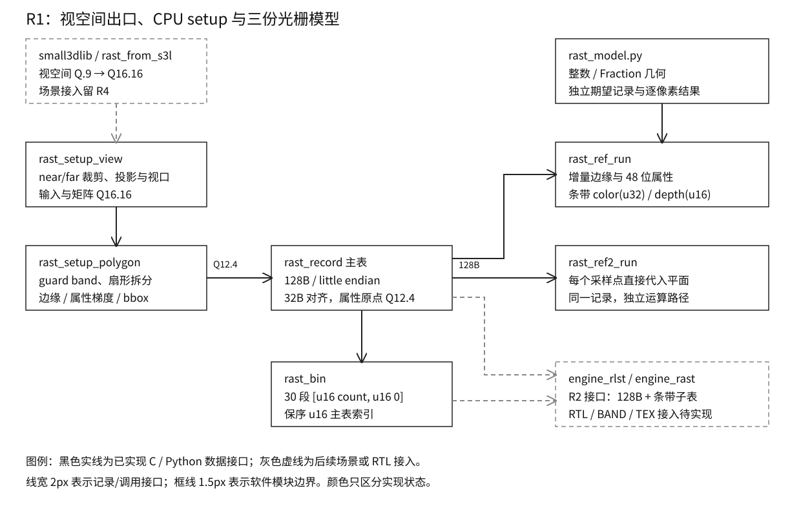

# 16 定点三维数学与参考光栅器

## 一、动机

Ti60F225 工程里的 RISC-V 是 rv32im，没有 FPU。已有软件提供 Q.8 游戏数学和
small3dlib 的整数茶杯演示，但下一步的三维硬件需要自己的逐像素金标准。
金标准在这里指软硬件消费完全相同的 setup 记录，产生逐位相同的颜色与深度。
small3dlib 的取整、近面策略与屏幕映射属于另一套契约，不能直接作为硬件期望。

R 系列在 2026-10-22 定案：CPU 负责几何与三角形 setup，硬件接收边缘方程、
属性梯度与包围盒，按条带增量扫描。setup 要除以面积，放在 CPU 上可复用跨条带结果，
也让 R2 的内环避免除法器。该分工延续既有二维工程的“软件执行器与硬件同输入对拍”方法。
本章完成 R1 的软件基础和可交换向量，硬件光栅仍由 R2 实现，板上对拍由 R3 实现。

## 二、为什么是这几步

首先把数值约定落实到公式、单位、位宽与边界，否则软件之间 CRC 相同也可能共同误读规格。
随后扩展 `fixmath`，让矩阵、透视除法与视口变换在两个编译目标使用同一份整数代码。
几何尾段必须先裁近面再除法，然后裁屏幕 guard band，才可以证明边缘扫描不会溢出。
在此基础上生成 setup 和条带子表，才能验证硬件实际会接收到的字节。

最后提供增量与逐点直接求值两份 C 光栅器，并用独立 Python 模型交叉检查。
几何的第三份模型采用 Fraction 有理数裁剪与重心权重梯度，避免两份 C 仅仅共享了同一个
错误的 setup 结果。手算边界先固定破平和舍入，再用固定种子覆盖大量记录。
正常运行还需要与定向注错配对，确认判据能检出预期缺陷。

完成状态的结构如下，灰色接口保留 R2/R4 接入边界。



图已用无头浏览器渲染并逐框检查，字号、箭头与未来接口没有重叠。

## 三、每一步做了什么

### 3.1 数值复核先修正 ABI 与累加位宽

原稿冻结的是 96B 表，包含三顶点颜色、z/UV 基值和梯度，没有属性的屏幕原点，也没有
RGB 梯度。如果硬件收到三顶点颜色后才归一化插值，仍需面积除法，与 CPU setup 的定案矛盾。
此外，z0=65535 乘 65536 得 4294901760，已经超过有符号 s32。
Q12.4 的 UV raw=16 表示 texel 1，转换到 Q16.16 应乘 4096；原稿乘 65536 会错 16 倍。

实现保留前 96B 所有字段偏移，尾部增加 RGB 六个 s16.16 梯度、顶点 0 的 Q12.4 原点及
保留字，记录扩为 128B。所有属性采用有符号 48 位累加器，C 用 int64；边缘方程仍是 s32。
48 位为 R2 的实现契约，没有据此声称 FPGA 资源已经综合验证。
R2 的主表尺寸、双参数组 64 词预算、原点求值与跨页用例已同步。

当前公式、舍入、范围证明和字节表全部放进
[`Main/doc/三维数值契约.md`](../../../Main/doc/三维数值契约.md)。它是永久规格源，
Main 不引用 Todo 或仓外记忆。传输类型是 128 字节数组，小端读写按 offset 完成；
另一个纯字节 layout proof 仅用于逐字段 offsetof 与 sizeof 静态断言，不映射主表。

初稿投影公式还把近远面深度方向颠倒。实现固定右手视空间 z<0 朝前，标准 OpenGL
近面 NDC=-1、远面=+1，映射到 u16 深度 0/65535。near=1、far=9 的端点可精确手算。
投影系数为负时同样采用半值向正无穷，不能先舍入正数再取负。
采样位置仍按原定案使用整数像素格点，top-left 只借用破平规则，不宣称 API 一致性。
本轮复核读取了 [Direct3D 官方规则](https://learn.microsoft.com/en-us/windows/win32/direct3d11/d3d10-graphics-programming-guide-rasterizer-stage-rules)
与 [OpenGL 4.6 规范](https://registry.khronos.org/OpenGL/specs/gl/glspec46.core.pdf)，
自定义量化位置另在契约中说明。

### 3.2 Q16.16 与已有 Q.8 共存

`sw/lib/core/fixmath.c/h` 新增 `fx16_` 前缀函数，已有 BAM、正弦表、速度和 atan2 的实现未改。
乘法使用 s64 中间量，RISC-V 编译器按 rv32im 生成整数指令；除法使用 48 步长除，
分母为零有明确定义。矩阵是行主序、列向量，每个乘积先舍入和饱和，再以 s64 求和并饱和，
允许输出覆盖输入。投影参数包括 BAM 纵向视角、aspect、near 和 far；视口输出保留 Q12.4。

倒数采用自研的 1024 项 Q1.30 种子表、一次 Newton 和整数余数校正。
`gen_recip_tab.py` 用整数公式生成并核对 `recip_tab.inc`，没有从 libfixmath 移植代码。
libfixmath 在立项材料中只作为可参考算法项目，R1 最终实现没有引入额外许可证依赖。

### 3.3 几何出口、裁剪与条带组织

复核 `small3dlib.h` 的屏幕映射可以直接看到 x/y 都经整数除法得到整数屏幕坐标，
其默认近面策略也不提供本契约的正确裁剪。因此 `rast_from_s3l` 只转换默认 512 单位的
视空间位置：x/y 乘 128、z 反号后乘 128，超出 Q16.16 s32 域则拒绝。
S3L 的场景和模型/视图变换可继续使用；不调用它的投影和平面映射函数。
原有 cup3d 继续使用原软件路径，R1 没有改变其演示语义。

新路径的运算顺序为：

```text
view vertex Q16.16
        |
        v
near/far Sutherland-Hodgman [新]
        |
        v
projection -> perspective divide -> viewport Q12.4 [新]
        |
        v
screen guard band -> fan triangulation [新]
        |
        v
edge / z / UV / RGB gradients -> 128B main table [新]
        |
        v
rast_bin -> 30 ordered strip subtables [新]
```

裁剪交点按对端坐标距离加权后统一舍入，不用“先量化 t，再 lerp”的二次误差。
反向遍历同一条边时交点相同；每次平面裁剪完才量化属性，再进入下一平面。
屏幕上界为 14335/11775 raw，实现原半开 guard 区间的最大 Q12.4 格点。
完整 s16 坐标域可产生超过 s32 的边系数，CPU guard 裁剪是硬约束。
当前保守边缘界小于 2^30，属性界小于 2^41，证明与断言在契约和代码中对应。

`rast_setup_polygon` 接受凸屏幕多边形，先裁剪再按 v0 锚定拆分，逐三角剔除背面/退化/
梯度越界的细条，并统计 backface/sliver/clipped/emitted。
`rast_setup_view` 接上前半段视空间裁剪和投影。输出容量不足时记录和统计均不写入。
主表按 32B 对齐，连续 128B 记录可跨 4KB。`rast_bin` 对每条带写
`[u16 count,u16 0]+u16 index[]`，保持提交顺序；先计总容量，错误时不写半张表。
空帧生成 30 个空头，共 120B。

### 3.4 两份 C 光栅与独立模型

`rast_ref_run` 先检查整批记录和目标，再对 bbox 与条带求交，位置求值后逐像素、逐行增量。
属性初值使用顶点 0 原点和亚像素差，舍入后每整像素加梯度。
z 采用严格 LESS；UV 最近采样后 CLAMP；顶点色关闭时等价白色。
色键比较针对调制前的全 32 位 texel，命中时色与 z 都不写，输出高八位强制为 0。

`lib/test/rast_ref2.c` 每个采样点直接代入平面，有自己的舍入实现，避免复用增量状态。
两者只共用字节读取和输入合法性检查，属性、覆盖和提交计算不共用辅助函数。
`rast_model.py` 使用 Python 整数产生第三份逐点结果；几何另用 Fraction 裁剪和对边重心
系数计算梯度。每个记录字段、每个 bbox 点的 color/z 都比较，包含被覆盖规则、深度或色键
拒绝的点；CRC 只是固定序列摘要。

### 3.5 判据、golden 与双目标入口

`test_rast.c` 接入原 host.mk 的库测试，正常 64 位 ASan/UBSan 与 -m32 执行同一份，输出
逐字比较。其定向向量包括 top/left/right/bottom、共享边、跨条带、z 相等、色键开关、
UV 两端、保留位、容量拒绝、退化、细条和 guard band。
S3L 转换穷举全部有符号 16 位分量，并检查越出 Q16.16 的拒绝分支。

`check_rast.py` 额外对 16/65536/255/65535/131072 五个分母的正负 16 位分子域验证舍入，
并对随机全 s32 乘/除/倒数和参数化投影做独立比较。具名手算向量标出对应契约条款。
几何种子 `313d2026` 覆盖 10000 个三角形，交替直接屏幕与视空间输入；包括反绕序、
退化、近远面交叉、guard 触发与扇形拆分。光栅种子 `72312026` 覆盖 100000 条合法记录，
含随机梯度、负 UV、宽累加器、初始 z 相等/零/clear/随机及八种 FLAGS。

首次三方逐位通过后才冻结 `rast_golden.txt`，正式 acceptance 再读取固定 CRC。
`geometry-vectors.json` 与 `raster-vectors.json` 保存可直接转 RTL 输入的完整小端记录，
后者还包含初始像素、纹理、色键和期望色/z；全部随机流由种子与生成器重建。
`hand-vectors.json` 保存 15 个具名向量。最终证据只归档正式验收这一轮。

`apps/test/rastTest` 使用既有 host.mk/target.mk 完整链接，不绕过分层构建。
应用从视空间三角形出发完成 setup 和条带光栅，宿主使用 dummy SDL 并检查确定位置的颜色/
深度；目标产物用于确认 rv32im 可构建。R1 不部署到板上。
`validate.py` 新增 rast 项并依赖 lib，正常测试同轮去重；范围推导对新库和模型生效，
编排测试验证不会把新增光栅文件映射成旧实例前端的全套回归。

## 四、遇到的问题

### 4.1 一次 Newton 的小除数误差

第一现场：

```text
RAST FAIL reciprocal <=8 raw
RAST directed/math fail 128
```

这些输出来自首个开发构建；当时共有 128 个正负输入超过预设 8 raw 误差。
这表明 1024 项表和一次 Newton 的相对精度不能直接转化为所有 Q16.16 输入的固定 raw 界。

定位先核对表的单位与归一化，没有发现索引或比例错误。问题集中于小除数：
一次 Newton 约给 20 位有效精度，缩放回很大的倒数会放大 raw 误差。
最初假定“一次 Newton 后误差不超过 8 raw”缺乏位宽证明。

修法是在 Newton 后用原整数分母检查 `2^32-q*abs(a)`，向相邻整数商校正，再做最终舍入。
没有增加第二次 Newton 或调用除法器。正负 16 位域与全 s32 随机测试现在要求与精确除法
完全一致。原仓库没有 Q16.16 倒数，自然没有覆盖该域；新增穷举在冻结 golden 前检出了问题。

### 4.2 原始 96B 与 s32 假设不闭合

第一现场（静态代入记录）：

```text
z0=65535: z0*65536=4294901760 > INT32_MAX
u0=16 (Q12.4): expected 65536 (Q16.16), u0*65536=1048576
96B table: no attribute origin, no RGB gradients
```

第一个例子已经否定 s32 深度累加器，第二个例子指出 UV 单位错 16 倍。
最后一行从原字节表逐字段核对得到，说明增量硬件无法仅凭原记录生成 RGB 平面。

定位没有把缺失字段转交给 R2 临时推导，因为那样会重新引入面积除法和不明确的初始位置。
最终按 3.1 扩为 128B 和 48 位属性累加，并将 near/far 符号与所有舍入点重新逐项代入。
原稿只有公式级静态评审，尚未用极值和实际 ABI 消费者闭合，新增手算与字节级比较补齐了判据。

### 4.3 WSL 启动与证据边界

第一现场：

```text
Wsl/Service/CreateInstance/E_ACCESSDENIED
```

该输出来自默认沙箱中的首次工具链检查，发生在 gcc 启动之前，不能判成课程或工程代码失败。
按执行权限流程使用外部 WSL 后确认 gcc、Python 与 RISC-V 工具链均可用，后续真实检查在那里运行，
输出保存在仓内忽略目录。没有修改系统工具配置，也没有用 Windows 编译器结果替代必需的 target.mk。

### 4.4 倒数表未进入续跑输入身份

第一现场（收尾读取清单筛选规则）：

```text
recip_tab.inc: included by fixmath.c
check_run.SOURCE_SUFFIXES: .c/.h/...; .inc absent
```

正常测试中的生成式核对能够检测表内容不符，但续跑复用只看登记的输入身份。
`.inc` 被源文件后缀筛选排除后，改表而不改生成器可能错误复用旧 PASS。

修法在 `check_run.py` 的源后缀集合加入 `.inc`，让所有实际选中该库的消费者都登记它；
新增流程测试确认通配符输入选择确实包含倒数表。原流程只服务已有的 C/header 数据，
未覆盖新引入的整数 initializer 扩展名，因此正常数值测试通过仍不能替代这项证据检查。
初次验收归档退回忽略的开发目录，最终重新完成五项 acceptance 并只保留最后一轮正式证据。
这一轮同时补齐窗口深度 131072 分母、完整映射和可变 16 位分母的舍入检查。

新增流程用例首次执行还得到 `recip_tab.inc not found in []`。这是测试框架 setUp
把 `source_files` 替换成单一临时 fixture 后，集成断言仍读取了该隔离列表。
保留原扫描函数，并仅在这条集成断言的上下文恢复真实扫描后，27 项流程测试独立通过。
生产身份清单中的倒数表登记已实际核对，测试框架问题没有改变数值结果。

### 4.5 guard 之前的坐标保护必须容纳完整视口输出

第一现场（静态极值代入）：

```text
NDC raw=INT32_MAX, viewport width=640
x_raw=167777280 > 2^26
```

早期对外屏幕坐标保护取 ±2^26，足以覆盖普通场景和随机输入，但不足以容纳完整
Q16.16 NDC 的视口输出。这样会在 guard 裁剪之前拒绝有效的超大视空间三角形。

修正为 ±2^28：该范围容纳 640×480 映射的全部饱和 NDC 输出，裁剪中间乘积仍在 s64 内。
新增 near 平面上 x=±INT32_MAX 的端到端 C 向量，要求它经过 guard 后正常发射记录。
该向量随 64/32 位和 sanitizer 执行。原随机分布集中在常用场景尺度，没有覆盖整个
Q16.16 视口极值；新增极值检查将该缺口单列。

## 五、结果

正式范围为 acceptance 的 lib、rast、app、workflow、paths。证据目录：
[`evidence/16-r1-20261022/`](evidence/16-r1-20261022/)，身份与完整命令以其中
`run.json`、`plan.json`、`result.json`、`archive-files.json` 为准。归档由 validate 入口完成，
只保存一次原始日志与交换向量，不重复复制构建目录。

| 实测对象 | 参数 | 结果 |
| --- | --- | --- |
| 几何三方 | 10000 三角形，seed 313d2026 | CRC 均为 da20ff34，逐字段 0 不符 |
| 光栅三方 | 100000 记录，seed 72312026 | CRC 均为 3716d055，逐像素 color/z 0 不符 |
| 具名向量 | 15 个，含四种 E=0/共享边/跨带/色键/LESS/UV/guard | PASS |
| C 定向与数值 | 64 位 sanitizer / -m32，S3L 65536 个分量，倒数正负 16 位域 | PASS，输出逐字相同 |
| 舍入独立模型 | 五个分母，各 65536 个正负分子；另检窗口映射与可变分母 | PASS |
| 全 s32 随机数学 / 参数化投影 | 10000 / 1000 组 | PASS |
| 三类变异 | 全边拥有破平、步长漏乘16、关闭 guard | 各自检出定向 witness，退出 1 |
| rastTest 双目标 | host.mk / target.mk，-Wall -Wextra -Werror | PASS；宿主 fail 0/done；target 链接占用 ram 217952B（含静态区等，不是 BIN 大小） |
| 游戏消费者与流程 | app 64/32 位、编排范围与路径检查 | PASS；workflow 27 项通过；汇总五项全部 PASS |

测量对象是本轮源码与记录流，没有形成 FPGA 资源、硬件吞吐、N_max、Flash 或 HDMI 结论。
原有 `engine_pix.v`、host board 和报告工作目录已有未提交修改，均保留；本章的回归绑定
当前工作树，未把这些既有修改纳入 R1 的开发范围。原二维 Q.8/BAM 行为由库和应用消费者
回归核对，软件扩展不触发二维 RTL 综合或旧 9208 帧板上回放。

## 六、还欠什么

R1 软件范围没有未完成的开发项，正式 acceptance 五项及归档均已通过，Todo 保留待用户验收。
R2 的 128B 主表与子表取数、光栅 RTL、BAND/TEX 新口尚未实现，见
[`R2`](../../Todo/hw/R2-三角列表与光栅核.md)。
R3 负责 B7 集成、生命周期和板上软硬逐像素对拍，见
[`R3`](../../Todo/hw/R3-B7预设集成与板上对拍.md)。
R4 再接 S3L 场景和演示模式；本章没有更改生产默认后端或旧 cup3d。
