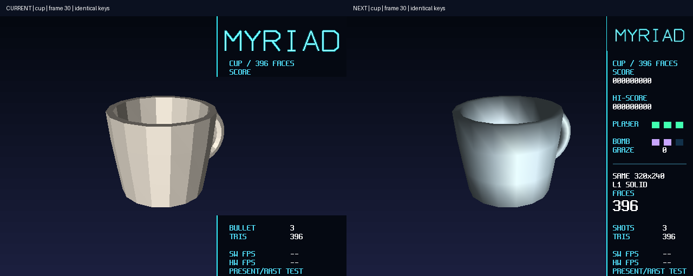

# 17 三维演示模式与同构对照

状态：**已验收（2026-10-29 用户视觉验收）。本批软件画质升级、双端验证与双版本运行包已完成**（2026-10-24）。第6节为上一版的完整记录；
用户检阅后指出棱角、画质与空间感不足，授权本轮开发、双端验证和双版本运行包。
本轮技术、候选取舍与验证见第7节；PC与板端新版及包内面板已实际打开。原版本证据保持原边界。

R4把R1的定点setup、R2光栅核和R3的B7整帧通路接成一个可交互演示。模式4增加世界空间
走廊、门框、飞船、敌机和弹；2D只叠加HUD。L1平涂与L2纹理使用同一B7位流。
另以原207顶点/396面的茶杯实现同视口、同记录、同深度语义的SW/HW对照。
既有MYRIAD和模式1/2/3继续保留；本工作点没有改RTL、默认B0或Flash布局。

## 1 研究给出的边界

最初的1100三角形/6ms预算已在R3研究被推翻。当前通用view→setup在1100条输入上约504ms，
独立分桶约48ms；它不含模型变换或引擎。R4前期研究又在B7上取样：32个小bbox三角形的
CPU约19.232ms、提交到完成约2.201ms；120帧两场呈现全部准点，最大渲染区间21.45422ms。
但16个全屏bbox仅引擎就约51.412ms。三角形数量、条带引用、bbox候选点必须分别记账，
不能把最终307200像素当作全部光栅工作量，不能以四秒合成取样代替60秒完整场景。

原始计划、探针、输入/部署身份、八组CRC、逐帧取样与解释的前期研究及历史快照归档
已按 2026-10-28 证据收编裁决撤销，结论由第6/7节承接。前期研究时的全仓路径编排曾受
交付报告并发改写失效，未作为通过证据。
当时“R3阻塞R4”的旧索引也已按R3验收记录订正。

保留的路线是CPU几何/setup、固定128B记录、CPU保序分桶、片上条带颜色/z、分相HUD、连续写回。
R4用视空间平移直接表达走廊，四边形共用四个投影顶点；不再为每个三角形重复通用模型矩阵。
没有引入近似倒数、改变逐项舍入、压缩z或混入旧S3L屏幕整数出口。

## 2 接手时的断点与订正

zcode会话`session_2fe16ed9f77b6d60c1ca1c56e1577c60`于2026-10-24 02:44被取消。
当时已有子视口、R4RP、L1/L2和模式框架原型；能上板出帧，但三路帧0 CRC不同，
最后停在单帧宿主截图取样，未完成茶杯与正式验收。开发日志仍停在“前期研究完成”。

| 问题 | 机制与处理 |
| --- | --- |
| PC/板上SW/板上HW整帧CRC不同 | HUD包含真实FPS、CPU/RAST耗时和HW/SW路径文字。功能构建将这些明确标为TEST；正常演示继续显示实测值。修后L1的60帧全图CRC一致，随后L2图像和128B主表也一致 |
| 约260ms被称作引擎耗时 | 区间混入1.9MB缓存失效和1.2MB逐帧CRC；RAST只有约1.5ms。将诊断移出渲染计时，性能构建关闭CRC；不再把大区间归因于DDR竞争 |
| 宿主frame0截图全黑 | 第一次present用于建立安全扫描面，并非逻辑帧0。截帧按真实呈现序号区分，逻辑帧以R4CAD编号对账 |
| 板上读样点不可比 | 旧命令入口会先reset halt，动态场景又继续推进。正式判据由程序在帧边界取CRC与记录身份，不靠任意时刻JTAG样点推断帧一致 |
| 首帧与节拍 | 先清非扫描面并present，确认后再清旧前缓冲；预热与清显示统计后才锚定F0。旧代码在这些步骤前取锚点，可能把初始化算成迟到 |
| 模式4内切换无效 | `next==s_mode`不会进入模式更换分支，改为独立的帧边界重进请求 |
| 纹理边缘串区块 | 四块atlas局部UV端点为31 texel，不能用32；全原始ARGB=0为共同透明色，透明片元同时跳过颜色与z |
| 预算处静默截记录 | 取消门框/弹幕拆分后的硬截断，按完整物体选择最近门框；构造错误和容量不足显式拒绝，不present失败帧 |
| 二维Demo背景被复用 | R4原型直接覆盖OFFSCREEN首面，会破坏已预合成的二维Demo。改用尾部独立2MiB，原前三个2MiB槽保持；切换检查逐次核对这6MiB的CRC |
| 软件条带深度旧数据 | 颜色与深度共用1024元素行跨，必须清16×1024个z元素，不能只清640×16 |
| 新子视口的八顶点极值 | 近远裁剪可把8点扩成10点。内部屏幕路径接受10点，仍保持公开多边形入口3～8点；新增凸八边形跨双深度面的独立回归 |

接手前已有的`engine_pix.v`排版、host连续截帧和交付报告改动均保留。
本轮只在相关R4代码继续开发；复用B7前逐字节核对该隔离树与当前RTL，除构型生成头外一致。

收尾轮（同日）追记：板上证据归档之后，上一轮合入精确数学快路与展开走廊构图时被中断——
`fixmath.c`/`r4_scene.c`已写、`r4.h`/`fixmath.h`补丁未执行，合入态未经任何构建，且场景
改动单独存在时构图意图不成立（近缘仍为3m）。收尾轮按验收轮run.json的输入身份将两文件
逐字节还原（a049d899…/c333186a…），快路候选、隔离验证与中断合并脚本曾归档于
19-r4-candidate-fastpath-20261024（按 2026-10-28 证据收编裁决撤销；候选其后经用户
明确要求正式采用并重新验收，见第6节），初版时未采用。本日随后用户明确要求按 HTML 目标改进并上板，正式采用精确快路并进一步
优化分桶与场景，执行新的验收；原隔离候选证据不直接作为新版本的通过结论，详见第6节。

## 3 当前实现与所有权

当前操作与构建说明在[软件登记](../../../Main/sw/README.md)，数值规格在
[三维数值契约](../../../Main/doc/三维数值契约.md)，可执行判据在
[R4验证](../../../Main/sim/engine/r4/README.md)。Main不依赖本章。

### 3.1 世界、输入与录像

`r4_scene`以Q16.16、固定30Hz tick和显式seed推进。走廊墙、可见门框、自机、世界敌机/弹和
自机弹统一经过子视口setup与z测试。飞船为实际三角面，横移带滚转/偏航，纵移带俯仰与引擎焰。
L1不画敌机；L2敌机/敌弹使用色键billboard。逻辑、命中和擦弹不从墙钟取位置。

原串口包只能承载10位，数字4使用既有三个模式位的组合0x380；没有扩展第11位。
先识别组合再识别单键。三维内再按4切走廊/茶杯，Tab或左右和弦切SW/HW，Shift切L1/L2。
软件条带间继续收取系统键，帧边界才生效，避免慢速软件路径丢失短按。

R4RP以新魔数/版本、30Hz、seed、scene、阶梯、素材版本和tick数为32B头，后随小端u32按键。
库负责格式校验；应用核对scene/阶梯/素材身份，拒绝态不会继续解引用未初始化的场景。
检查器实际生成该格式、编入同一应用，并由相同回放入口驱动host/target；没有另写一套判据世界。

### 3.2 渲染与纹理

首版串行submit→wait→present。SHARED起点64KiB主表、其后32KiB子表和32KiB软件条带z由模式4
独占，能承接完整茶杯；它是存储容量，不是30fps数量承诺。进入前清理前端租约，完成前不覆盖
主/子表。每帧仍是完整640×480/30带，走廊视口400×480，HUD使用DDR字库的条带局部y坐标。

3D独占16KiB TEX，四个32×32区块按64词行距交错发布。装载后读回CRC；离开时重新装载并
验证旧2D热集、重登记表面，不能复用被3D覆盖前的`s_tex_ready`。驱动完成码与引擎错误码分别检查，
错误帧不present，复位排空后重登记表面。旧submit负责在新门铃前清TRI_COUNT。

### 3.3 同构茶杯

`r4_cup`直接复用原207顶点/396面索引模型，唯一顶点每帧只变换一次，保持双面着色和杯内壁。
共享的Q16.16变换、近远裁剪、320×240居中视口和128B记录同时供SW与HW使用。
HUD避开茶杯视口，两路视口外背景和16位z完全相同。输入面数与裁剪/退化后的记录数分开显示。

旧`cup3d`的S3L/8位压缩z仍是独立历史路径，不纳入加速比。渲染FPS按实际渲染区间测量，
呈现FPS另记；HUD上另一后端未测显示`--`，只保留当前场景/阶梯最近一次有效值，换模型或阶梯即失效。

## 4 初版判据与证据登记

工作点采用acceptance档。下表保留初版输入的结果，当前视觉版见第6节，不合并两版数字。
quick仅用于开发期流程复核，不作为最终60秒证明。
主检查为r4、r4-board及lib/rast/layers/app/pc/demo/game/stats、workflow/regs。
layers会暂时注错真实源码，独占执行；其余在源码冻结后去重公共正常测试。
正式结果、原始输出和输入身份核对后一次归档，不把早期调试日志合成一个PASS。

| 判据 | 实现的观察点 | 当前证据状态 |
| --- | --- | --- |
| 30fps | 预热31帧后采1800帧：目标场每次+2，实际交换逐帧确认，p50/p99/max、迟到/超预算、3600场/1800交换 | r4-board acceptance PASS（041155轮：p50 22.3ms/p99 25.4ms/max 26.3ms，3600场/1800交换，迟到0） |
| 世界遮挡/透明z | 两个确定世界瞬间：敌机/敌弹在门框两柱后；移除门框后颜色与更远z显现，透明边缘颜色/z保持底层 | 64/32/sanitizer定向判据与板上L2 240帧全过（041155+064646轮归档） |
| 三场景图像 | host与板上L1/L2/完整茶杯各60帧全图CRC和主表CRC；板上SW各2帧同输入复核 | 板上与host L1 60帧/L2 240帧/茶杯60帧全图CRC与主表CRC零失配，板上SW三场景各2帧复核（041155轮归档） |
| 注错/错误恢复 | 真实像素注错必须由采集器见红；沿用R3真实BAD_INDEX、软复位和显示健康组 | 板上像素注错预期见红+R3故障恢复组PASS（041155轮） |
| 旧模式 | 1/2/3/4、SW/HW、L1/L2、走廊/茶杯往返；旧热集CRC和生产HW/TEX 240帧；既有软件消费者全量 | r4-board切换与旧游戏240帧回归PASS；M10切换判据扩展为四模式后0不符（stats消费者含模式4循环进出的再入确定性）；软件消费者12检查acceptance PASS（064646轮归档） |
| 构建/分层 | 同源host/target零告警，64/32、ASan/UBSan、输入包、R4RP、atlas反例和SDK只读 | 064646轮：pack/r4/lib/rast/app/pc/demo/game/stats/layers/workflow/regs全PASS |

本轮复用R3已验收的B7：59623 XLR/187 RAM/26 DSP，core setup/hold +0.762/+0.026ns。
这些是该冻结构建的数字，不是R4重新综合结果。软件工作点没有改RTL，是否仍为同一B7由
当前位流身份、源树比较、CSR和实际部署绑定，不凭历史COM号或一次退出码判断。

## 5 初版检阅与范围

软件侧正式acceptance（acceptance档12检查：pack/r4/lib/rast/app/pc/demo/game/stats/
layers/workflow/regs）全PASS（run 20261024-064646-7ea68e67，归档已按 2026-10-28 证据收编裁决撤销；首轮因RISCV_BIN未配置中止、第二轮暴露stats M10的
三模式假设——R4按规格扩四模式和弦循环后合成按键会循环进入模式4，扩展M10冷启动至
1~4并按各自模式比对后闭合，应用侧无缺陷）。

检阅程序已构建（生产默认：启动模式 2 / HW-TEX、O2/PERF、无帧数上限与 JUDGE）并随
041155 轮同一 B7 位流 JTAG 加载，启动串口与 BIN/BIT 身份的检阅部署归档已按 2026-10-28
证据收编裁决撤销；控制面板与
`board_run.py --forward-input` 均可接管按键。JTAG 加载不等于 Flash 固化；本轮不改
原 Flash 内容。工作点验收待用户完成 HDMI 观感与实体输入检阅后进行，验收时按流程
删条目并归档本章。

## 6 2026-10-24 按目标预览重新审查与修复

初版的数值和节拍通过没有覆盖视觉目标。对照 HTML 与同源宿主帧发现，原墙近缘在3～7m，
走廊只占画面中央；四张长面把纹理拉伸成斜纹，只显示最近一道门框，动态弹量过小，HUD是
诊断文本。此次以400×480世界、240px MYRIAD右栏、连续门框、世界弹幕与三维自机为构图。
浏览器预览的随机粒子、发光叠加与模拟1080余面不是实板指标；实际数据仍由硬件日志给出。

### 6.1 R1–R4 审查结论与实现

- R1保留逐项舍入、饱和、Q12.4子像素、128B记录及原投影/深度语义。乘除快路只替换相同
  商余数的求法，包含s64边界、u32除法、二次幂与有效商位长除，扩充十万组独立数学对拍。
  恒定属性梯度直接写零；分桶先计容与前缀偏移，再按输入顺序追加，输出字节序保持不变。
- R2/R3本轮未改RTL。重新核对门铃快照、LOAD/z-clear屏障、RAST/HUD/FLUSH单一所有权、
  接收事务排空与旧前取数保护；补跑五构型和变异的quick集成复查，实板故障恢复在新
  r4-board acceptance中重跑。B7逐字节核对当前RTL并重新部署，不把B0默认工程当B7使用。
- R4近墙延伸至视口外，四个纵深区间使用暗蓝/紫面板，纹理亮边形成导轨；约70°视角与
  (200,210)消失点，多道青绿/品红门框、菱形敌机、品红敌弹和青色弹列共用z。自机为实际
  三角面及引擎焰，相机固定，横纵移与姿态独立于相机；未操作时自动驾驶，方向键接管。
- 游戏机制一并修复：敌弹与门框在自机所在深度命中，自机弹可击落敌机；炸弹按下沿清弹，
  护盾耗尽后重生。门框位置范围允许正常移动触发碰撞；L1关闭隐藏敌机的逻辑与开火。
  这些行为均增加定向检查，不靠目测或进程退出码判断。
- HUD采用MYRIAD标题、SCORE/HI-SCORE/PLAYER/BOMB/GRAZE、大号实际物体数、弹数、TRIS与
  实测SW/HW FPS。未测后端显示`--`。两张帧缓冲各自持有CMDLIST_A/B，完成后仅重建变化行。
  控制面板补实际场景、L1/L2、三角形数与炸弹入口，三维HW请求归一为真实光栅后端。

相机以`floor(tick*4*65536/30)`推进，世界墙相位每30 tick重复。缓存仅复用投影矩阵、
视口、阶梯和世界相位完全相同的墙记录；门框与动态物体每帧重新setup，进入模式先预热。
缓存与强制无缓存版本跨多个周期的完整记录流对拍，换投影/阶梯时失效；不复用历史板测状态。
R4RP头仍为v1，但场景身份改为`0x52344333`、素材版本改为2，旧场景录像拒绝混用。

### 6.2 性能定位与证据边界

| 调试候选 | 实板观察 | 解释 |
| --- | --- | --- |
| 丰富场景第一版 | 约20fps，120帧渲染p50 41.46ms/max 45.70ms | 几何约22ms、分桶约4ms、HUD约5ms、提交到完成约9ms；不是HDMI错误 |
| HUD复用及常量梯度 | 300帧p50 37.83ms/max 43.48ms，仍迟到 | 仅省HUD构造不足以闭合预算 |
| 墙相位缓存及保序分桶 | 300帧p50 24.66ms/p99 28.90ms/max 29.31ms，600场/300交换，迟到0 | 仅是中间候选短取样；后续玩法修复必须重新跑正式1800帧 |

新正式软件、实板、集成复查、画面与审阅部署分别归档。分层检查会临时注错生产源码，
已在并行源代码检查与板测完成后独占执行，退出后检查所有临时文件清理与原改动保留。

实板 acceptance 为 `20261024-084205-13302cb0`：L1 60帧、L2 240帧、茶杯60帧的主表与
整帧CRC均与当前宿主参考一致，板上软件三场景各2帧同输入复核。真实像素注错预期见红，
模式1/2/3/4、SW/HW、L1/L2、走廊/茶杯往返通过，二维离屏6MiB内容保持，旧HW/TEX游戏
240帧及R3真实BAD_INDEX/复位恢复通过。性能窗口为1800帧/3600场/1800次交换，
p50 **25.01872ms**、p99 **28.87767ms**、max **29.61608ms**，迟到/超预算均0；
ZERO/UNDER/RESPERR均0。这是同一最终场景的实测30fps，不引用预览里的模拟帧率。
证据见板测轮（run 20261024-084205-13302cb0）。

R2/R3 quick复查 `20261024-083747-c287bd16` 四项全过：R3五构型+四类变异、rlst、
RAST/BAND/TEX端口、真实AXI光栅含两种TEX时延与13类变异。它是本轮集成复查，原正式RTL
验收保留原范围（集成轮归档已按证据收编裁决撤销）。
分层独占 acceptance `20261024-085502-ec8dbb0b` 包含真实交叉构建、越层/浮点/同名源文件
注错、头文件依赖与SDK只读，全部通过（分层轮归档已按证据收编裁决撤销）。

软件轮 `20261024-084153-96b62cb8` 的11项（pack/r4/lib/rast/app/pc/demo/game/stats/
workflow/regs）acceptance全部通过，与独立layers合计12项。包含R4的64/32/sanitizer与
缓存/无缓存流对拍、R1十万数学/一万几何/五千视口/十万三参考光栅、应用与PC、完整旧游戏
回放/302秒录像重搜、150次模式切换、36000帧十分钟日志（600行、丢行/截断/串口超额均0）。
最终范围见软件轮（run 20261024-084153-96b62cb8），原始输出归档已按证据收编裁决撤销。
PC第一次无窗进程非零，但两路5412行序列相同；现有脚本退出时删除临时
日志，因此不能从保留的汇总确认失败子项或断言根因。保持同一二进制（摘要前16位
`d8c60b565c5150ad`）独立复测600场/1800帧双回放全部通过；原判据不变，独占正式重跑PC
也通过。不改BSP或阈值来掩盖一次未定位的失败，首轮汇总和完整独立复测另留诊断证据。

### 6.3 当前审阅部署

无限运行版以模式4/L2/HW启动，同一最终B7通过JTAG重新加载，BIN大小190678B；部署
边界、写入字节数、实际R4STAT与源文件身份分开登记。启动采样21行持续30fps；一次可选
帧缓冲调试取样因速度慢而停止，随后重新启动应用建立新节拍锚点，再次采到模式4/L2/HW
稳定30fps。控制面板已打开并连接当前UART，显示真实场景、阶梯、三角形数和帧率；
关闭面板不会停止板上游戏。没有写Flash，也没有把宿主CRC参考图当作HDMI实拍。

画面对照保留“初版宿主/HTML模拟目标/当前宿主参考”三个明确来源；当前图逐张绑定正式
参考的帧号与CRC。HDMI观感、实体键和是否达到期望水平仍交用户审阅，Todo保留待验收。
正式审阅材料（部署与图像索引、三来源画面对照、控制面板截图）已按 2026-10-28 证据收编
裁决撤销；决定性画面以下节 polish 对照图与第6节验收记录为准。源树中原有的RTL排版、宿主BSP、
输入转发改动逐字节差异保持，交付报告临时目录未动；没有自动提交或推送。

## 7 不改RTL的软件视觉升级与双版本运行包

### 7.1 目标、冻结和硬件边界

用户要求尽可能提升已分析的画质与三维效果，本批不改RTL；PC和实板都验证；旧版与新版的
PC/板端产物都放在`Main/bit`并提供可重复启动入口。本轮不写Flash、不切换生产B0默认工程，
旧版bit/BIN保持原样，源码中原有未提交改动保留。

先冻结`Main/bit/board_release_game_current_20261024`，保存EXE、SDL2、素材、B7 bit/BIN、
独立部署工具、cpu0.yaml、源码ZIP、原差异和文件身份。包内入口已实际JTAG恢复，并收到
本次加载边界后的R4STAT；旧PC仍为原来的模式2启动、按4进入三维，旧板端为模式4/L2/HW。
不把不同启动参数称作完全相同构建。本批前后Main/rtl的逐文件身份以旧包manifest.rtl核对，
截至冻结前差异数为0，不能把Git中既有engine_pix.v排版差异算成本轮RTL修改。

### 7.2 为什么改这些内容

“棱角”分为模型轮廓、逐面明暗断层与像素采样台阶。原自机9顶点/8面，茶杯每面统一颜色；
长墙采用简单32x32图案和分段常量颜色，门框是窄前面，敌机是billboard。三维世界400px宽，
右侧固定HUD占240px。继续提高面数或只把窗口放大，不能同时解决这些问题。

本轮利用已有RGB梯度、TEX乘顶点色及深度提交，保持128B ABI、单采样、16位z和640x480物理帧：

| 技术 | 最终机制 | 可见效果与边界 |
| --- | --- | --- |
| 顶点法线和光照 | 整数离线生成共享法线；CPU算漫反射与宽高光，再交给现有RGB插值 | 茶杯明暗连续、自机有体积；轮廓分段仍由原网格决定，不宣称逐像素Phong或抗锯齿 |
| 金属材质与距离明暗 | 16KiB/64x64 atlas v3，低频面板/接缝/亮边/导向灯；墙端点颜色随深度连续变化 | 减少大棋盘斜纹和突然换色；是顶点调制与预烘焙层次，不是新增有色雾或实时阴影单元 |
| 造型与LOD | 八面倒角截面、五段纵深、21面自机；近景8面敌机加发光核心，远景billboard；最近门框增加3个内壁 | 转动/接近时能看见厚度与侧面；不无限增加动态setup，封闭实体剔除背面，薄机翼保留双面 |
| 战斗反馈 | 自机引擎焰、近景敌机倾斜、命中闪白、世界空间6片爆炸碎片 | 反馈和遮挡共用RAST z，不用后贴二维图绕过门框 |
| 构图 | 世界480x480，HUD160px；标题由既有预乘素材在进入时过滤为144x48并写入DDR背景 | 世界面积扩大20%，标题/计分/软硬件FPS保留；没有改Flash素材包和HDMI分辨率 |
| 真实相机视差 | 四秒120姿态小幅xy平移；Q1.14三角函数先转换Q16.16，约±0.0417m/±0.0156m | 近远物体产生不同视差，所有世界对象使用同一投影；不是二维整屏平移，也不是任意跟随镜头 |

相机运动与30tick墙纵深相位的共同周期为120。进入模式预热120种墙记录，缓存键包含基础投影、
视口、阶梯、相位；移动、敌机、门框与弹仍每帧重新setup。缓存按120×144条128B预留，
仅记录区约2.21MB，使用CPU外部DDR程序区，没有增加FPGA RAM块。probe4程序RAM用量为
3,261,680B/4092KiB；最终以发布构建的link map为准。缓存/无缓存记录流逐字节对照，不能靠
省略动态对象或复用错误相机记录换帧率。

### 7.3 为画面留预算的CPU优化

第一轮丰富画面没有达到30fps。耗时主要在CPU几何/setup，而不是显示故障。
本轮采用以下保持数值结果的快路，并用通用/独立路径核对：

1. 同一网格共享顶点只投影一次。茶杯207顶点不再按396个面的每个角重复投影；自机和敌机同样复用。
   在近/远面内才走该路径，越界仍回到通用裁剪；稀疏投影保留每项舍入/饱和，并复用同深度与重复xy结果。
2. `fx16_round_div`合并u64/u31商余数：高32位用硬件u32除法，余数和低32位只展开有效商位，
   按正负半值规则舍入。d=16/65536/131072走精确移位；大正分母保持通用实现。
   不改变Q16.16、裁剪插值、梯度或记录字节语义。
3. 三角形三个顶点均在子视口内时，子视口与guard裁剪为恒等，直接执行原setup；仍先写局部记录，
   容量错误不提交，背面/细长面计数保留。与禁用快路的记录流及独立R1模型对照。
4. 封闭实体不再把背面翻转后重复画；薄机翼确需双面时直接复用投影后的顶点反转，避免再次投影。

应用投影覆盖50000组逐记录对照，数学包含完整16位余数域和100000组s64输入及极值；
R1正式检查另含10000几何、5000子视口、100000光栅的多参考对拍、变异与双目标构建。
曾试过Q40倒数加余数修正，数学一致，但对应整体候选仍超预算，未留在最终生产代码。

| 中间候选 | 取样 | p50/max | 超预算/节拍 | 解释 |
| --- | --- | --- | --- | --- |
| probe1 | 120帧 | 30.3433/34.44678ms | 超预算10，窗口迟到99 | 第一轮画面不能交付 |
| probe2 | 300帧 | 31.79623/36.98974ms | 超预算97，窗口迟到300 | 包含亮面法线修订和倒数候选，不能把两轮差值孤立归因于倒数算法 |
| probe3 | 300帧 | 30.28525/34.89498ms | 超预算23，窗口迟到284 | 合并除法后仍不足 |
| probe4 | 600帧 | 27.42688/31.79516ms | 1200场/600交换，迟到/超预算0 | 背面剔除、拓宽视口与相机缓存的阶段通过；不代替最终1800帧 |

各探针原始串口、BIN与构建日志保留；probe2另有候选源码身份。它们来源/输入/窗口不同，
只解释开发过程，不拼成一个正式通过结果。带`fail 0`的探针也可能超预算。

### 7.4 PC呈现与可运行性

PC提供F11/Alt+Enter桌面全屏、Esc返回、F1/F2/F3窗口大小、可拖拽尺寸、4:3居中与F4最近邻/平滑。
显示键不进入录像，原始640x480帧不变。渲染器重置后重建纹理并恢复过滤方式；Windows使用
per-monitor-v2 DPI。`GFX2D_SCALE_FILTER=linear`与`GFX2D_FULLSCREEN=1`只控制PC呈现。

真实窗口测试发现：系统W键与SDL键盘状态已有按下，但SDL窗口focus flag尚未更新。
Windows host改用自身原生前台HWND隔离输入，避免错误挡键，也防止其他程序按键漏入游戏。
测试先确认自己的前台窗口，再发送扫描码，切到自身另一窗口后验证释放，判断前始终松键。
初版测试漏泵退出事件、GUI断言弹窗及虚拟按键与物理状态不同的失败过程均保留，未降低判据。
最终`pc-window` acceptance已通过12次全屏往返、比例/尺寸、过滤/纹理恢复、真实按下/失焦和退出。
PC实际执行rast_ref，界面固定标记CPU，不把Tab后的软件路径显示成FPGA加速。

### 7.5 最终验证与产物

| 范围 | 本轮运行 | 状态 |
| --- | --- | --- |
| pack/r4/lib/rast/app/pc/demo/game/stats/workflow/regs | `20261024-173917-188abb7f` | acceptance PASS，11项 |
| 原生Windows窗口 | `20261024-170736-690e3edf` | acceptance PASS |
| B7真实板测、自动与脚本各1800帧 | `20261024-192236-f8d2026c` | acceptance PASS |
| 软件分层与注错 | `20261024-194329-2f170490` | acceptance PASS，独占执行并清理临时注错 |

| 输入 | 样本/场/交换 | p50/p99/max | 迟到/超预算 | ZERO/UNDER/RESPERR |
| --- | --- | --- | --- | --- |
| 自动驾驶 | 1800/3600/1800 | 25.96261/30.14533/30.95632ms | 0/0 | 0/0/0 |
| 脚本移动与炸弹 | 1800/3600/1800 | 27.25831/31.30349/32.34376ms | 0/0 | 0/0/0 |

实板还通过L1 60帧、L2 240帧、茶杯60帧及各2帧板上软件对照；像素注错预期见红、
模式/阶梯/后端往返、旧游戏240帧和R3真实故障/复位恢复均完成。三场景原生Windows共360帧
与正式WSL参考的像素/记录CRC一致。发布无限BIN同源但帧数参数不同，另验证真实加载字节数、
pak与R4STAT，不把它冒充有限帧性能验收BIN。最终程序RAM占用3,262,912B/4092KiB（77.87%）。

画面对照来自冻结旧源码与新版软件光栅输出，逻辑输入相同。启动背景也会present，故PNG按
R4CAD的实际交换计数减一映射到截图编号，再逐图与对应帧CRC核对；不能把截图0直接当逻辑帧0。
最终新版9张选图已与正式宿主/板上相同帧CRC核对，软件图不称作HDMI实拍。
旧源/新源各包含走廊6帧、茶杯3帧；固定旧源未变后复用已核对的旧图，并验证复制身份。

两个运行包提供PC EXE/DLL/素材和板端bit/BIN/ELF、独立加载/面板工具及源码快照。
PC入口不需要Efinity或板卡，板端入口自动寻找Efinity和当前C通道UART，校验包内文件后JTAG恢复。
板端依赖已存在Flash中的同一2D素材包，包内保留其副本；本轮没有修改Flash，上电默认内容不变。
正式证据一次归档：软件（run 20261024-173917-188abb7f）、
窗口（run 20261024-170736-690e3edf）、
板测（run 20261024-192236-f8d2026c）、
分层（run 20261024-194329-2f170490）。
画面与原生逐帧核对的检阅图、中间失败与候选的研究取样归档已按 2026-10-28 证据收编
裁决撤销；两张对照图收编如下。

入口实测发现本机Windows PowerShell 5.1不能自动找到Get-FileHash，故启动器改用.NET SHA256，
消除模块依赖。它发生在渲染验收后：原运行的广义输入包含旧package_game.py，原身份不被改写；
单独核对当前C/H、位流、素材和构建输入完全相同，只有打包器差异，并补做PS5.1/PS7篡改反例及
两个包的实际启动。此边界记录在新版verification.json的source_scope_bridge，不能把旧运行说成
包含了后来修过的打包器。旧包仅修校验入口，原游戏负载/source.zip未变，原manifest保留。

旧PC入口、新PC窗口和2560x1600全屏入口均已实际启动；全屏保持4:3黑边。新板端包JTAG恢复后，
COM11持续反馈模式4/L2/HW、30fps、面板connected=true。运行入口与文件身份见Main/bit各包，
PC无须Efinity/WSL，板端无须工程源码。用户检阅前保留两份Todo，不自动删除、提交或推送。
