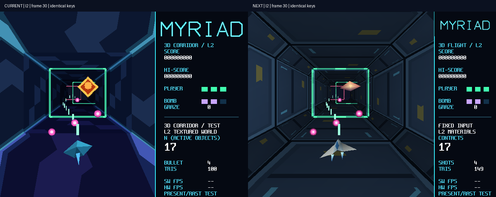

# 17 三维演示模式与同构对照

状态：**已验收（2026-10-29 用户视觉验收）**。本章工作点不改 RTL，默认构型仍为 B0，未写 Flash。

## 一、模式 4 是什么

R4 把 R1 的定点 setup、R2 光栅核和 R3 的 B7 整帧通路接成一个可玩的三维演示。控制台模式 4
进入走廊场景：400×480 世界视口内有多道门框、自机飞船、敌机与弹幕，右侧 160px 是 MYRIAD
风格的 HUD；自机为真实三角面，横移带滚转偏航、纵移带俯仰和引擎焰，敌弹与门框在自机深度
命中，自机弹可击落敌机，炸弹沿纵深清弹，护盾耗尽后重生。Tab 或左右和弦切换软件/硬件两个
渲染后端，Shift 切 L1 平涂与 L2 纹理两档（L1 不画敌机，L2 敌机用色键 billboard），三维内按
4 在走廊与茶杯间切换。旧模式 1/2/3 与 MYRIAD 全部保留。

茶杯是标题里的「同构对照」：原 207 顶点/396 面模型，软件光栅与硬件光栅用同一套 Q16.16
变换、近远裁剪、320×240 居中视口和 128B 记录各画一遍，两路视口外背景与 16 位 z 完全相同，
逐帧 CRC 对拍用来证明硬件与软件逐像素一致。旧 `cup3d` 的 S3L 与 8 位压缩 z 是另一条历史
路径，不参与软硬件加速比。

输入沿用串口 10 位包：数字 4 用既有三个模式位的组合 0x380 表示，先识别组合再识别单键。
录像格式 R4RP 为 32B 头（魔数/版本、30Hz tick、seed、场景、阶梯、素材版本）加小端 u32
按键流；场景身份 `0x52344333`、素材版本 2，旧场景录像拒绝混用。逻辑、命中和擦弹全部由
固定 tick 推进，不从墙钟取位置。

## 二、实现

### 2.1 场景与渲染

场景以 Q16.16、固定 30Hz tick 和显式 seed 推进，视空间平移直接表达走廊，四边形共用四个
投影顶点，保留逐项舍入、饱和、Q12.4 子像素、128B 记录与 R1 的投影/深度语义。每帧完整
640×480/30 带，SHARED 区起点 64KiB 主表、32KiB 子表和 32KiB 软件条带 z 由模式 4 独占——
这是容量，不是帧率承诺。3D 独占 16KiB TEX，四个 32×32 区块按 64 词行距交错发布，装载后
读回 CRC；离开时重装旧 2D 热集并重新登记表面。错误帧不 present，驱动完成码与引擎错误码
分别检查。

### 2.2 画质做了什么

「棱角」拆开是三件事：模型轮廓、逐面明暗断层、像素采样台阶。原自机 9 顶点/8 面、茶杯
每面一色、长墙 32×32 图案、门框窄前面、敌机 billboard——单纯加面数或放大窗口解决不了。

| 技术 | 机制 | 效果 |
| --- | --- | --- |
| 顶点法线光照 | 整数离线生成共享法线，CPU 算漫反射与宽高光，交给现有 RGB 插值 | 茶杯明暗连续、自机有体积；轮廓仍由网格决定，无逐像素 Phong |
| 材质与距离明暗 | 16KiB atlas v3：低频面板/接缝/亮边/导向灯，墙端点颜色随深度连续变化 | 消除大棋盘斜纹和突变换色；是顶点调制加预烘焙，无实时阴影单元 |
| 造型与 LOD | 八面倒角截面、五段纵深、21 面自机；近景 8 面敌机加发光核心，远景 billboard；最近门框加 3 个内壁 | 转动与接近可见厚度侧面；封闭实体剔背面，薄机翼保双面 |
| 战斗反馈 | 引擎焰、近景敌机倾斜、命中闪白、世界空间 6 片爆炸碎片 | 反馈与遮挡共用 RAST z，不用后贴二维图绕过门框 |
| 构图 | 世界 480×480、HUD 160px；标题由既有素材进入时过滤为 144×48 写入 DDR 背景 | 世界面积扩大 20%，标题/计分/FPS 保留；Flash 素材包与 HDMI 分辨率未动 |
| 真实相机视差 | 四秒 120 姿态小幅 xy 平移，Q1.14 三角函数转 Q16.16，约 ±0.0417m/±0.0156m | 近远物体产生不同视差，全部世界对象同一投影 |

### 2.3 为 30fps 留预算的 CPU 快路

耗时大头在 CPU 几何/setup。四个快路全部保持数值结果，并与通用/独立路径对拍：

1. 同一网格共享顶点只投影一次（茶杯 207 顶点不再按 396 面的角重复投影）；仅在近/远面内
   走该路径，越界回通用裁剪，保留每项舍入/饱和。
2. `fx16_round_div` 合并 u64/u31 商余数：高 32 位用硬件 u32 除法，余数和低 32 位只展开
   有效商位再舍入；d=16/65536/131072 走精确移位。
3. 三顶点均在子视口内时裁剪为恒等，直接执行原 setup；仍先写局部记录，容量错误不提交。
4. 封闭实体不再翻转背面重复绘制；薄机翼双面直接复用已投影顶点反转。

配套验证：投影覆盖 50000 组逐记录对照，数学覆盖 16 位余数域全域与 100000 组 s64 输入及
极值；R1 正式检查另有 10000 几何、5000 子视口、100000 光栅的多参考对拍与变异。试过
Q40 倒数加余数修正，数学一致但整体仍超预算，未留在生产代码。

### 2.4 相机与缓存

相机以 `floor(tick*4*65536/30)` 推进，世界墙相位每 30 tick 重复，与相机运动构成 120 tick
公共周期。进入模式预热 120 种墙记录，缓存键含基础投影、视口、阶梯、相位（120×144 条
128B，约 2.21MB，用 CPU 外部 DDR 程序区，未增 FPGA RAM）；门框与动态物体每帧重新 setup。
缓存与强制无缓存版本的完整记录流逐字节对照，换投影/阶梯即失效。

## 三、从接手到定稿

本工作点接手自一个中断的会话：当时已有子视口/L1/L2/模式框架原型，能上板出帧，但三路
帧 CRC 不同，未完成茶杯与正式验收。接手时定位并修复的问题：

| 问题 | 处理 |
| --- | --- |
| PC/板上SW/板上HW 整帧 CRC 不同 | HUD 的 FPS 与路径文字在功能构建标为 TEST；修后 L1 60 帧全图 CRC 一致，L2 图像与 128B 主表随之一致 |
| 约 260ms 被当作引擎耗时 | 区间混入 1.9MB 缓存失效和逐帧 CRC，RAST 实际约 1.5ms；诊断移出渲染计时，性能构建关 CRC |
| 宿主 frame0 截图全黑 | 第一次 present 是建立安全扫描面，不是逻辑帧 0；截帧按真实呈现序号对账 |
| 板上 JTAG 读样点不可比 | 旧入口先 reset halt 且场景继续推进；判据改为程序在帧边界取 CRC 与记录身份 |
| 首帧锚点偏差 | 先清非扫描面并 present，确认后再清旧前缓冲，预热后才锚定 F0 |
| 模式 4 内切换无效 | `next==s_mode` 不进换模式分支，改为帧边界重进请求 |
| 纹理边缘串区块 | atlas 局部 UV 端点为 31 texel；全 0 ARGB 为共同透明色，透明片元同时跳过颜色与 z |
| 预算处静默截记录 | 取消硬截断，按完整物体选最近门框；构造错误与容量不足显式拒绝，不 present 失败帧 |
| 二维 Demo 背景被覆盖 | 改用尾部独立 2MiB，原三个 2MiB 槽保持；切换检查逐次核对这 6MiB 的 CRC |
| 软件条带 z 残留 | 颜色与深度共用 1024 元素行跨，必须清 16×1024 个 z，不能只清 640×16 |
| 子视口八顶点极值 | 近远裁剪可把 8 点扩成 10 点；内部路径接受 10 点，公开入口仍 3~8 点，补凸八边形跨双深度面回归 |

初版在 041155 轮完成 acceptance（板上 p50 22.3ms/max 26.3ms，三场景 CRC 全对）并通过
12 项软件检查，但用户检阅否决了画面：原墙近缘 3~7m、走廊只占画面中央、纹理拉成斜纹、
HUD 是诊断文本。重做构图并采用上述画质与快路后，经历四个探针（p50 41.46→37.83→24.66→
27.43ms，probe4 起迟到归零）才闭合预算；各探针串口与构建日志留存，不合并成一次通过。

## 四、验证与运行包

最终验收四轮（全部 acceptance）：

| 范围 | run | 结果 |
| --- | --- | --- |
| 软件 11 项 pack/r4/lib/rast/app/pc/demo/game/stats/workflow/regs | `20261024-173917-188abb7f` | PASS，含 64/32/sanitizer、缓存对拍、R1 数学/几何/光栅多参考、录像重搜、150 次切换、36000 帧十分钟日志 |
| 原生 Windows 窗口 | `20261024-170736-690e3edf` | PASS，12 次全屏往返、比例/尺寸、过滤/纹理恢复、真实按下/失焦 |
| B7 板测 + 自动/脚本各 1800 帧 | `20261024-192236-f8d2026c` | PASS |
| 软件分层与注错（独占执行） | `20261024-194329-2f170490` | PASS |

| 输入 | 帧/场/交换 | p50/p99/max | 迟到/超预算 | ZERO/UNDER/RESPERR |
| --- | --- | --- | --- | --- |
| 自动驾驶 | 1800/3600/1800 | 25.96/30.15/30.96ms | 0/0 | 0/0/0 |
| 脚本移动与炸弹 | 1800/3600/1800 | 27.26/31.30/32.34ms | 0/0 | 0/0/0 |

板上另通过 L1 60 帧、L2 240 帧、茶杯 60 帧与各 2 帧软件对照的整帧/主表 CRC；像素注错
预期见红，模式/阶梯/后端往返、旧游戏 240 帧、R3 真实 BAD_INDEX 与复位恢复完成；三场景
原生 Windows 共 360 帧与正式 WSL 参考逐像素一致。最终程序 RAM 3,262,912B/4092KiB
（77.87%）。重审轮（构图重做后）的板测数字为 p50 25.02/p99 28.88/max 29.62ms（run
`20261024-084205-13302cb0`），分层轮 `20261024-085502-ec8dbb0b`，与最终轮分列。

双版本运行包在 `Main/bit`：PC（EXE/DLL/素材/启动器）与板端（bit/BIN/ELF/加载与面板工具/
源码快照），旧版冻结于 `board_release_game_current_20261024`。板端入口校验包内文件后
JTAG 恢复，依赖 Flash 中既有 2D 素材包（包内留副本），上电默认内容不变。打包器曾因
PowerShell 5.1 找不到 Get-FileHash 改用 .NET SHA256，补做 PS5.1/PS7 篡改反例与两包实际
启动。新旧对照图（相同输入第 30 帧，左旧右新）：

## 五、边界与遗留

- JTAG 装载不等于 Flash 固化；上电默认内容与生产 B0 默认工程未动。
- 板上截图与宿主参考图为软件光栅输出，不是 HDMI 实拍；HDMI 观感与实体键以用户验收为准。
- HUD 未测后端显示 `--`；PC 端实际执行 rast_ref，界面固定标记 CPU。
- Windows host 用原生前台 HWND 隔离输入，规避 SDL focus flag 滞后导致的误挡键与漏键。
- 快路与缓存的适用条件（共享顶点限近/远面内、缓存键含投影/视口/阶梯/相位）失效时回通用
  路径；性能数字绑定对应 BIT/BIN 身份，不同启动参数不视作同一构建。

## 六、后记：茶杯场景删除（2026-11-02）

用户定案删除产品里的茶杯场景：应用 4 只剩走廊，菜单名改为 3D CORRIDOR，三维内 C 不再切场景。
本章的茶杯 60 帧对照、396 面光照与图 17-r4-polish-cup-compare 保留为历史记录；
此后 r4/r4-board 只核对 L1/L2 走廊，硬件与软件的逐帧对照仍由走廊承担。
`r4_models.h` 里的茶杯法线数据属于 SW19/SW20 冻结的模型身份，保留不引用；`cup3d` 参考程序不在菜单里，保留。
删除后在 B7 上跑 quick r4-board：L1/L2 板上像素与宿主参考一致，CPU 对照与像素注错按预期；
但 120 帧性能取样每帧 43～48ms（预算 33ms，全部迟到），走廊实际只有约 20FPS。
删茶杯前的合并固件 A/B 实测同样约 20FPS，属于 11-01 走廊美术轮带来的既有退化，与本次删除无关，待查。
