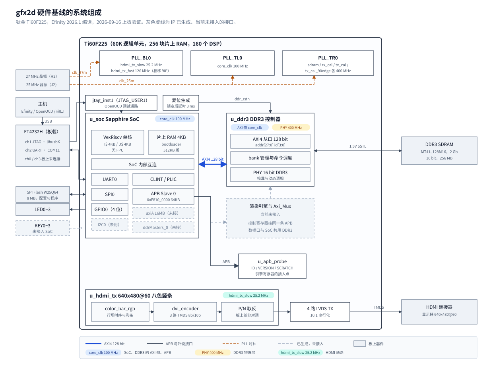

# 01 从零搭起可上板的硬件基线

## 一、动机

要做的东西是一个 2D 图形渲染加速引擎，跑在易灵思钛金 Ti60F225 上。
这是一颗 16nm 的 FPGA，60K 逻辑单元、256 块片上 RAM（合计 2.56 Mbit）、160 个 DSP。
板上配 256MB 的 16 位 DDR3、8MB SPI Flash、HDMI 发送口。
引擎要做的事是：RISC-V 处理器下发渲染命令，引擎经标准总线读写 DDR3，
把图像块拷贝、填充、混合进帧缓冲，再由 HDMI 扫描输出，两块缓冲交替使用以避免撕裂。

引擎的正确性没有办法单独观测。一条渲染命令的结果是显存里的一片像素，
要判断这片像素对不对，需要四样东西同时可用：处理器能把命令写进引擎的寄存器，
DDR3 能存住像素，HDMI 能把它显示出来，串口能把数值打印出来作比对。
四样里缺任何一样，引擎的输出就只是一块无法读取的内存。
所以第一个工作点是这条链本身。

这条链不能靠仿真代替。DDR3 软核控制器以加密 RTL 交付，Sapphire SoC 里也有两个运算模块是加密的，
开源仿真器读不了，整机无法在主机上跑起来；自己写的模块可以单独仿真，
但「CPU 写了一个地址，像素出现在屏幕上」这件事只有板子能回答。
判据必须落在板上，这决定了后面每一步的做法。

> 订正（2026-09-16）：本节原写「DDR3 软核控制器与 Sapphire SoC 都以加密 RTL 交付」。
> 逐文件搜索加密包络后发现，SoC 网表 26860 行里只有 `EfxCPUSp1`、`EfxCPUSp2` 两个模块加密，
> CPU 本体、缓存、总线与外设都是明文。整机无法仿真的结论不变。清单见第 02 章 3.1 节。

资料包里有一个官方工程 `09_Ti60F225_hardjtag_demo`，SoC 加 DDR3 已经接好，
直接改它看起来最省事。它作为主线有三个问题：工程是 Efinity 2025.2 生成的，而这道题的开发
从 2026.1 起步；编译流程绑定在 GUI 上，自动插入的逻辑分析仪在命令行下会让编译中断；
顶层没有 HDMI，APB 从口在顶层悬空。改的量超过重写。
最终的做法是把它留作对照组，另建一个自己的工程，两者共用同一块板、同一套下载命令。

起点是 2026-09-16。在这一天之前，开发机上没有装过 Efinity，板子也没有接过。

## 二、为什么是这几步

引擎对外有三个接口：控制（处理器写它的寄存器）、数据（它读写 DDR3）、
呈现（结果最终要显示）。每个接口都要有一条已经验证过的通路与之对应，
这是三步。三条通路要落在同一个可重复编译的工程里，这是第四步。
引擎将来要被真实程序驱动，程序得有地方存、有办法启动，这是第五步。
引擎的寄存器要有一个确定的接入点，这是第六步。
每次改动都会重新布局布线，要有办法判断有没有退化，这是第七步。

| 步 | 内容 | 少了会怎样 |
| --- | --- | --- |
| 一 | 下载链路：主机到 FPGA | 任何比特流都进不去，后面六步都无从谈起 |
| 二 | 内存通路：处理器到 DDR3 | 引擎搬运的数据没有落点，也无法判断问题出在板子还是自己的代码 |
| 三 | 工程载体：自己的工程，命令行编译 | 改动无法重复编译，资源与时序没有可比的基线 |
| 四 | 显示通路：HDMI 输出 | 渲染结果无法观测 |
| 五 | 启动链路：Flash 与程序区 | 只能靠调试器手工加载，带素材的程序装不下 |
| 六 | 控制通路：APB 寄存器 | 引擎没有控制口，只能靠改 RTL 常量来配置 |
| 七 | 回归判据：仿真、编译、上板三层 | 下一次改动之后无法判断是否退化 |

顺序里有两处不能调换。第二步必须用官方比特流做，在自己的代码进入之前先确认板子、
DDR3 颗粒和下载链路都是好的，否则后面出问题时无法区分是板子还是自己写的逻辑。
第三步必须在第四步之前，因为 HDMI 通路的每一次调整都要重新编译，
编译流程本身不稳定的话，调 PLL 参数会变成猜。

图 1 是这七步完成之后的形态。



**图 1** 2026-09-16 的硬件基线。实线是已经上板验证过的通路，
灰色虚线是 SoC IP 已经生成、当前没有接入的接口。
引擎将来占的位置在图的中部偏右：控制寄存器挂在 `u_apb_probe` 所在的那条 APB 上，
数据口与 SoC 一起共用 DDR3 控制器的 AXI 从口。

## 三、每一步做了什么

### 3.1 下载链路

板上的下载器是一颗 FT4232H，四个通道，USB 上报 VID `0403`、PID `6011`。
接入之后四个通道都被 Windows 的 FTDI 虚拟串口驱动接管，
`ftdi_pgm.bat --scan_usb` 报 `No USB target detected`。

四个通道的板上用途要从原理图（设计说明第 13 页，U5）查，得到的对应关系是：

| 通道 | 串口号 | 板上用途 |
| --- | --- | --- |
| ch0 | COM9 | 八个脚全部悬空 |
| ch1 | COM10 | JTAG：TCK、TDI、TDO、TMS，各串 33Ω |
| ch2 | COM11 | UART：接 `UART_TX_3V3` / `UART_RX_3V3`，各带一个指示灯 |
| ch3 | COM12 | 未连接 |

做法是给 ch1 换上 libusbK 驱动（zadig，生成 `oem300.inf`），其余三个保持 FTDI 驱动。
换完之后 `--scan_usb` 读到器件 ID `0x10660A79`，IR 长度 5，
`--list_usb` 只在通道 1 给出 `ftdi://0x0403:0x6011:0:ff/1`。

这一步顺带确定了一件影响后面第五步的事：**板上没有单独的 SPI 下载通道**。
官方 Ti60F225 开发套件用 ch0 烧 Flash，这块板的 ch0 悬空，
Flash 只能用 JTAG Bridge 模式写，也就是先把 FPGA 配置成一个 Flash 烧写器，再通过它读写。

一次完整的上板操作是这样的：

```
主机                                                          板子
 |
 |  0  zadig 给 Interface 1 换 libusbK               只做一次
 |  1  ftdi_pgm.bat --scan_usb                       读到 0x10660A79
 |  2  ftdi_pgm.bat -m jtag -u <url> <xxx.bit>       3 秒，掉电丢失
 |  3  openocd -c "reset halt"                       PC = 0xF900_0000
 |  4  openocd -c "load_image <xxx.bin> 0x1000 bin"  程序进 DDR3
 |  5  openocd -c "resume 0x1000"
 |                                                   COM11 打印
 v
```

第 2 步要的是 `.bit`，第 5 步之后程序在 DDR3 里，掉电即失。
写进 Flash 的流程不同，在 3.5 节。

### 3.2 内存通路

用官方比特流 `bit/official/ddr_demo_ti60.bit` 加载，再用 OpenOCD 把官方的 `memTest`
加载到 DDR3 的 `0x1000` 运行。COM11 收到：

```
***Starting Memory Test***
Data matched .. Test PASSED
***Succesfully Ran Demo***
```

这一步同时验证了三件事：JTAG 配置链路能把比特流写进 FPGA，DDR3 控制器完成了校准，
COM11 确实是 SoC 的 UART0 且波特率 115200 正确。

`memTest` 的覆盖范围要看清楚：它写的是 `0x10000` 起的 16MB，写入值是字序号
（`userDef.h`），256MB 的其余部分和地址回绕都没有测。
把它当作「DDR3 能用」的证据成立，当作「256MB 都能用」的证据不成立。
后者是实验 E2 的内容。

OpenOCD 的 `debug_ti.cfg` 会从当前目录往上最多找四级 `cpu0.yaml`，
这个文件在 `sdk/` 下，所以命令要在应用目录里启动，或者手工指定路径。

> 订正（2026-09-16）：「在应用目录里启动」只对 `sdk/software/standalone/` 下的官方示例成立。
> 本项目 `sw/` 下的程序往上找不到 `cpu0.yaml`，第 02 章实验时按原写法启动报
> `cpu.yaml not found within 3 levels`。统一改为在 `Main/sdk/bsp` 下启动，见第 02 章 4.1 节。

### 3.3 工程载体

自己的工程从官方工程搬出来，做了三件事。

**脱离 GUI。** 命令行编译的入口是 `efx_run.bat gfx2d_ti60.xml`，
map、interface、pnr、pgm 四步，不需要许可证。
脱离 GUI 的收益是编译可以进回归：同样的命令任何时候都能重跑，
资源与时序报告可以逐次对比，工程文件的改动可以在版本库里看到 diff。
过程中撞到的一个中断见 4.2 节。

**改名与分层。** 顶层从 `ddr3_example_top` 改成 `gfx2d_top`，工程从 `ddr_demo_ti60`
改成 `gfx2d_ti60`，目录按来源分层：

```
<仓库根>/
  rtl/      top/    顶层，本项目
            bus/    APB 从设备，本项目
            hdmi/   HDMI 通路，封装为本项目，编码器取自官方例程
            vendor/ 厂商与第三方代码，原则上不改，改了要在 rtl/README.md 登记
  fpga/     Efinity 工程、接口设计、约束、SoC IP 生成物
  sdk/      SoC IP 生成的 BSP 与官方示例，改动登记在 sdk/README.md
  sw/       自己写的 RISC-V 程序
  sim/      仿真
  bit/      官方比特流与 Flash 整片备份
  doc/      方案、实测记录、准备情况
```

分层的判据是「这个文件被覆盖时谁负责恢复」。`sdk/` 与 `fpga/gfx2d_ti60/ip/soc/`
是 IP 生成物，重新生成 SoC 时会被整个覆盖，所以对它们的每一处修改都要登记成表，
生成之后逐条改回。`vendor/` 是厂商代码，改了之后升级 IP 会冲突，所以默认不改。
其余目录是自己的，可以随便改。

**清死文件。** `memory_test`、`rtl/common`、五个调试残留、
以及一个从来没有被例化过的 `debug_top.v` 都删掉了。
`vendor/ddr3_controller/common/simple_dual_port_ram.v` 在厂商目录里有两份同名文件，
保留了官方工程实际编进比特流的那一份（1565 字节），另一份删除，原文件在 git 历史里。

### 3.4 显示通路

目标是 640x480@60，像素时钟 25.175MHz。HDMI 发送在这块板上没有专用硬核，
走的是四对 LVDS TX（一对时钟、三对数据），每对以 10:1 串行化输出 TMDS 码。

```
hdmi_tx_slow_clk 25.2 MHz
        |
        v
+------------------+        +--------------+        +-----------+
|  color_bar_rgb   | -----> | dvi_encoder  | -----> |  P/N 取反 |
|  行场时序与彩条  |        |  3 x encode  |        +-----------+
+------------------+        +--------------+              |
   de / hs / vs                10 bit x 3                 v
   r / g / b 各 8 bit                            tmds_tx_* : 4 路 LVDS TX
```

三个官方文件（`color_bar_rgb.v`、`dvi_encoder.v`、`encode.v`）取自资料包的
`03_hdmi_tx_demo`，与原件 MD5 一致，没有改动。
本项目写的是外面那层封装 `hdmi_tx.v`：复位同步、行场时序参数化、P/N 取反。

P/N 取反是这块板特有的：四对差分线在 PCB 上 P、N 是对调的，
FPGA 侧要把 10 位码整体按位取反才能得到正确的极性。
设计说明第 22 页记了这一点，同时要求接口设置里勾上 Enable Common Mode Driver。

PLL 参数上有一处推导。Ti60 的 PLL 有两条限制：静态相移的单位是 0.5 个 FPLL 周期，
CLKOUT0 的频率不能超过参考时钟的 4 倍。
串行化需要一个 126MHz 的快时钟且相对像素时钟移相 90°，
以 25MHz 晶振为参考给不出这个组合，所以 HDMI 这一路改用板上的 27MHz 晶振，
由 PLL_BL0 产生 25.2MHz 的像素时钟与 126MHz 的快时钟。
25.2MHz 与标准的 25.175MHz 相差 0.1%，在显示器的容差内。

上板结果是屏幕从左到右出现八条竖条：白、黄、蓝、绿、粉、红、深蓝、黑，
与 `color_bar_rgb` 的白、黄、青、绿、品红、红、蓝、黑逐条对应
（青在这台显示器上偏浅蓝，品红偏粉）。这一条同时证明了 PLL、LVDS 串行化、
TMDS 编码与 P/N 取反四处都对。

### 3.5 启动链路

上电之后的路径是这样的：

```
上电
 |
 v
FPGA 从 Flash 0x000000 读比特流并配置
 |
 v
SoC 复位，PC = 0xF900_0000，即片上 RAM 里的 bootloader（4KB）
 |
 v
bootloader 用单线 SPI 从 Flash 0x380000 读 USER_SOFTWARE_SIZE 字节到 DDR3 0x1000
 |                改前：0x01F000 = 124KB
 |                改后：0x080000 = 512KB
 v
跳转 0x1000，程序开始运行
```

赛题要的是一个带素材的游戏 Demo，124KB 装不下，所以改的是拷贝长度和程序区长度两处：
`bootloaderConfig.h` 里的 `USER_SOFTWARE_SIZE` 从 `0x01F000` 改成 `0x080000`，
链接脚本的程序区从 124K 改成 4092K，并加一条镜像超过 512KB 时链接报错的断言。
改完 bootloader 要重新编译，产物还要同步进 SoC IP 的 8 个片上 RAM 初始文件，
因为 bootloader 是以初始内容的形式烧在比特流里的。

这个改动的麻烦在于判据。程序能跑起来并不能证明 512KB 生效，
因为一个 100KB 的程序在 124KB 的 bootloader 下也能跑。
为此写了 `sw/bootSizeTest`：程序里带一个 300,000 字节的数据块，
第 i 个字是 `i x 2654435761 + 0x5A5A5A5A` 的低 32 位，每个字都随位置变化；
启动后打印整块和最后 4KB 的 CRC32。
关键位置是：数据块起于 `0x1750`，最后 4KB 起于 `0x49B30`，
远在 124KB 的拷贝边界 `0x20000` 之外。
只拷 124KB 时，程序本体和字符串都在前 124KB 里，仍然能正常启动并打印，
但数据块后段是残留内容，两个 CRC 都会错。

上板时先跑对照组（官方 124KB bootloader 的比特流），再跑实验组。
顺序不能反：FPGA 重新配置期间 DDR3 的内容可能保留，
先跑 512KB 版会在数据块尾部留下正确数据，对照组可能假通过。

| 比特流 | bootloader | `crc_all` | `crc_tail` | 结论 |
| --- | --- | --- | --- | --- |
| 官方 | 124KB | `0xca93125f` | `0x3e3489a4` | 两个都不符，符合预期 |
| 本工程 | 512KB | `0x47df83a8` | `0x78c8c48f` | 两个都与主机侧算出的期望一致 |

Flash 这一侧也做了准备：整片读出备份之后才第一次写入。
读到的 JEDEC ID 是 `0xEF6017`，芯片是 Winbond W25Q64，8MiB，4KB 扇区。
出厂内容是资料包里的摄像头转 HDMI 例程（`0x000000`~`0x0C74E2`，
文件头写着 `Ti60f225_sc431hai2hdmi_v3`），其中没有 SoC，
这解释了为什么板子上电之后串口一直没有输出。
整片读取用时 31 到 33 秒，连读两次 SHA256 相同。
`--jtag_bridge_mode` 的默认值是 `all`，即擦除加写入，读 Flash 时必须显式写 `read`。

### 3.6 控制通路

引擎的控制寄存器将来挂在 SoC 的 APB Slave 0 上，CPU 地址 `0xF810_0000`，64KB 窗口。
这条通路在官方工程里生成了但没有接，本工程给它接了一个探针从机 `apb_probe`：
`0x000` 是只读的 ID（字符 `GFX2`），`0x004` 是只读的版本号，`0x008` 是可读写的暂存寄存器，
其余地址读回 0 并置 PSLVERROR。

选探针寄存器而不是直接上引擎，理由是它能在没有任何软件的情况下验证整条通路。
上板之后用 OpenOCD 直接读写这四个地址即可：

```
mdw 0xf8100000 3            读 ID、VERSION、SCRATCH
mww 0xf8100008 0xa5a55a5a   写三种图案再读回
mdw 0xf8108008              读别名地址，确认地址译码
```

得到：

```
0xf8100000: 47465832 00000001 00000000
0xf8100008: a5a55a5a
0xf8100008: ffffffff
0xf8100008: 5a5aa5a5
0xf8108008: 00000000
```

四项判据：ID 与复位值正确、32 位数据通路三种图案往返一致、
16 位地址译码正确（别名地址没有命中 `0x0008`）、模块能被 APB 正常握手。
这条通路上发现的缺陷见 4.4 节。

### 3.7 回归判据

三层，每层的判据都要能在改错时变红。

| 层 | 命令 | 判据 |
| --- | --- | --- |
| 仿真 | `sim/hdmi/run.sh`、`sim/apb_probe/run.sh` | 各 3/3：一个正常用例 PASS，两个注错用例 FAIL |
| 综合 | `efx_run.bat gfx2d_ti60.xml` | 四步 PASS、约束告警 0、无负 slack、资源与基线对比 |
| 上板 | JTAG 加载后用 OpenOCD | APB 探针四项、memTest PASS、HDMI 八色竖条 |

改了 bootloader 或链接脚本时再加一项：`bootSizeTest` 的两个 CRC 与期望值一致。

注错用例是这三层里唯一能保证判据有效的东西。
只有正常用例的测试无法区分「逻辑是对的」和「测试根本没有检查这一项」，
3.6 节那条缺陷正是在没有任何 APB 判据的情况下活了下来。

## 四、遇到的问题

### 4.1 下载器认不到，而文档指的通道是悬空的

**第一现场**

```
ftdi_pgm.bat --scan_usb
No USB target detected
```

**解读** 这条输出只说明没有一个可用的 libusb 器件，没有区分「板子没接」
「驱动不对」「通道不对」三种情况。设备管理器里能看到四个 FTDI 串口设备，
说明 USB 枚举是成功的，问题在驱动层：FTDI 的虚拟串口驱动把接口占住了，
libusb 拿不到它。

**定位** 板子的 USB 描述串是 `Quad RS232-HS`，是 FT4232H 的出厂默认值，
EEPROM 里没有写板名，也没有序列号（设备实例路径 `5&2C0399E&0&9` 是按接入位置生成的）。
这意味着无法靠描述串判断哪个通道是 JTAG，只能查原理图。
查到的结果与官方文档矛盾：设计说明第 87 页让 OpenOCD 配置写 `ftdi channel 0`，
而原理图上通道 A（ch0）的八个脚全部悬空，JTAG 在通道 B。
本仓 `sdk/bsp/efinix/EfxSapphireSoc/openocd/ftdi_ti.cfg` 里写的是 `channel 1`，
与原理图一致。

资料目录里的下载器驱动包也有一处对不上：`XL_YLS_DL_*` 是给外接下载器 YLS_DL 用的，
inf 里写的是 FT2232 的 PID `6010`，板载的 FT4232H 是 `6011`，装了不起作用。

**根因与修法** 根因是 ch1 上挂的是 FTDI 的虚拟串口驱动。
用 zadig 把 Interface 1 换成 libusbK 3.1.0.0，其余三个通道保持原样，
`--scan_usb` 随即读到 `0x10660A79`，与设计说明第 84 页 OpenOCD 日志里的器件 ID 相同。

驱动没有走命令行安装。资料包里的 libusbK 安装包改掉 PID 之后可以用 `dpscat` 加
`dpinst64 /S /F` 静默安装，但 `dpscat` 会生成自签名证书并写入系统的受信任根证书存储，
开发机的权限策略把这一步拦下了，改用 zadig 的图形界面。

原判据为什么没有覆盖到它：这是第一步，当时还没有任何判据。
通道与端口的对照表现在登记在 `doc/开发环境.md` 第 4 节，
换板子或换机器之后要重新确认通道号与串口号，因为串口号会随插拔变化。

### 4.2 命令行编译在 map 之后中断

**第一现场**

```
No such file: ...\work_dbg\debug_top.v
```

**解读** 编译四步的第一步 map 已经完成，中断发生在 map 与 interface 之间，
也就是自动插入调试核的那一步。报错指的文件在 `work_dbg/` 下，
这个目录是编译产物目录，搬工程时没有搬。

**定位** 查 `scripts/efx_run_dbg.py` 第 45 到 47 行，
这个脚本要求 `work_dbg/debug_top.v` 事先存在，它自己不生成。
再查官方工程里的 `work_dbg/run_efinity_auto_dbg.sh`，第一行表明这个文件由
GUI 调用 `python -m efx_dbg.DbgWizard` 生成。也就是说，
只要工程 xml 里的 `auto_instantiation` 是 `on`，命令行编译就必须先开一次 GUI。

顺带查清了一件事：这个工程**从来没有例化过调试核**。
`debug_top.v` 虽然在源文件列表里，顶层却没有它的实例。
自动插入的逻辑分析仪 `la0` 只接了 `cal_done` 和 `ddr_rstn` 两根线。

**根因与修法** 根因是命令行编译流程与 GUI 生成的中间文件存在依赖。
把工程 xml 的 `auto_instantiation` 改成 `off`，这一步不再进入。
代价是失去自动插入的逻辑分析仪，收益是省下 944 个 XLR 与 1 块片上 RAM，
以及一条不依赖 GUI 的编译流程。要用逻辑分析仪时，在 GUI 里生成一次再编译。

原判据为什么没有覆盖到它：官方工程只在 GUI 下编译过，
「能编译」这个判据在两种流程下的含义不同。

### 4.3 程序加载后不运行，而读回的内存是对的

**第一现场** OpenOCD 加载程序后直接 `resume 0x1000`：

```
> reg pc
pc (/32): 0x00000008
```

串口 0 字节。用 `dump_image` 把 `0x1000` 起的内存读回主机，与 bin 文件的 SHA256 一致。

**解读** PC 停在 `0x8`，既不是程序入口 `0x1000`，也不是 bootloader 所在的
`0xF900_0000`。内存内容正确排除了「加载失败」这一类原因，
问题在处理器的取指，而不在数据。

**定位** 先试了把 a0、a1 两个寄存器清零，无效。
再试 `verify_image`，OpenOCD 报 `Target fpga_spinal.cpu0 doesn't support checksum_memory`
并在这一步退出，后面的命令全部不执行，改用 `dump_image` 读回到主机比对。
之后发现加上 `reset halt` 就正常，`reset halt` 之后 PC 为 `0xF900_0000`，
运行 30 秒后停机，PC 为 `0x10a0`，是 `start.S` 里 `main` 返回后的死循环。

**根因与修法** 推测的根因是指令缓存：FPGA 配置完成后 bootloader 已经把 Flash 里的
内容拷到 `0x1000` 执行过一轮，这些旧指令还留在 4KB 的指令缓存里，
而 JTAG 写 DDR3 不经过这个缓存。**这个推断没有做能区分「缓存」与「其他处理器状态」
的实验，只是与现象一致。** IDE 的 launch 配置同样是先复位再加载
（`doFirstReset` / `doSecondReset`），做法与它一致。

修法是加载程序前一律 `reset halt`。
还有一个未查清的现象：未复位时 `step` 之后 PC 从 `0x1000` 变成 `0xc`，
下一条命令报 `Target not halted`，是否同因没有查。需要单步时改用 GDB。

原判据为什么没有覆盖到它：当时判断「程序加载成功」的依据是内存内容一致，
这个判据覆盖的是数据通路，不覆盖取指通路。

### 4.4 APB 的地址和数据被截成 1 位

**第一现场** 重构时把约束告警从 174 条清到 0 条之后，
位宽截断告警（VERI-1330）从背景里显出来，共 26 条，其中几条指向顶层的 APB 信号。

（本节的时间顺序按当时的改动顺序还原。原始记录里保留的是改前改后的告警条数，
不是逐条的发现过程。）

**解读** 顶层例化 SoC 时把 APB 从口的信号连了出来，但没有声明这些信号。
Verilog 的隐式声明规则会把未声明的标识符当作 1 位 wire，于是：

```
改前
  u_soc                                              （APB 上没有从机）
    io_apbSlave_0_PADDR[15:0]  --> apb_paddr    隐式 1 位 wire   [改]
    io_apbSlave_0_PWDATA[31:0] --> apb_pwdata   隐式 1 位 wire   [改]
    io_apbSlave_0_PRDATA[31:0] <-- apb_prdata   隐式 1 位 wire   [改]
    io_apbSlave_0_PREADY       <-- apb_pready   无人驱动         [改]

改后
  u_soc                                     u_apb_probe
    PADDR[15:0]  --- wire [15:0] --->  paddr      [新] 显式声明
    PWDATA[31:0] --- wire [31:0] --->  pwdata     [新]
    PRDATA[31:0] <-- wire [31:0] ---   prdata     [新] 0x000 ID / 0x004 VERSION / 0x008 SCRATCH
    PREADY       <-- wire        ---   pready     [新] 固定一拍完成
    PSLVERROR    <-- wire        ---   pslverr    [新] 未映射地址置位
```

写进去的 32 位数据只有最低位能到达从机，读回的 32 位里只有最低位有效，
16 位地址只剩最低位，整个 64KB 窗口坍缩成两个地址。

**定位** 这条缺陷之所以能活下来，原因有两个。
一是 APB 上原本没有从机，写进去的数据没有接收方，读回的值也没有人比对，
在板上表现为「一切正常」。
二是编译告警里有 174 条约束告警，26 条位宽截断混在里面没有人逐条看。

**根因与修法** 根因是隐式声明。修法是三步：
顶层显式声明所有 APB 信号并标出位宽；接上 `apb_probe` 作为从机；
顶层文件开头加 `` `default_nettype none ``，让后续任何未声明的标识符直接报错。
最后一条要注意，文件结尾必须恢复 `` `default_nettype wire ``，
因为这个工程的综合选项是同一个编译单元（`hdl-compile-unit=1`），
不恢复会影响后面编译的厂商文件。

验证是上板做的，见 3.6 节：三种 32 位图案往返一致，别名地址不命中。
重构前的设计在这两项上必然失败。

原判据为什么没有覆盖到它：当时 APB 上没有任何判据，编译告警也没有被当作判据。
现在的做法是把「约束告警 0、自己的代码位宽截断告警 0」写进第七步的综合层判据里，
自己的代码新增任何一条告警都要当场处理。

### 4.5 给悬空端口接上时钟，被优化掉的逻辑复活

**第一现场** 重构后的一次编译，资源比预期多出 853 个 XLR 与 5 块片上 RAM。

**解读** 多出的部分集中在 SoC 内部，对应 `io_ddrMasters_0` 这条外部主机进 DDR 的通路：
位宽转换、写仲裁和两个队列。这条通路本工程没有使用。

**定位** 改动清单里与它相关的只有一处：顶层给 `io_ddrMasters_0_clk` 接了 `core_clk`。
接时钟的动机是「不要让端口悬空」。

**根因与修法** 端口悬空时，这条通路上的寄存器没有时钟，综合可以整条优化掉；
一旦给了时钟，这些寄存器就成了有效逻辑，全部保留。
修法是不给这个口接时钟，数据输入接常量。彻底删除要重新生成 SoC IP，
记在 `Todo/soc资源裁剪.md` 里搭车做。

这条的一般化说法是：给悬空端口接常量或时钟之前，
要先想清楚会不会让本该被优化掉的逻辑复活。两者的区别在于常量不会激活时钟。

原判据为什么没有覆盖到它：功能判据全部通过，资源占用当时还不是判据。
现在的综合层判据里加了一条「资源与基线逐行对比」，多出的部分要能解释来源。

## 五、结果

### 5.1 编译

Efinity 2026.1，`efx_run.bat gfx2d_ti60.xml`，四步 PASS，用时 77 秒。

| 项 | 用量 | 占比 |
| --- | --: | --: |
| XLR | 14517 / 60800 | 23.9% |
| 片上 RAM 块 | 65 / 256 | 25.4% |
| DSP | 4 / 160 | 2.5% |
| 全局时钟 | 10 / 32 | 31.3% |

分模块的数量级，取自布局报告的层次统计：

| 模块 | XLR | RAM 块 |
| --- | --: | --: |
| `u_soc` | 约 8700 | 43 |
| `u_ddr3` | 约 5400 | 22 |
| `u_hdmi_tx` | 322 | 0 |
| `u_apb_probe` | 54 | 0 |

与官方预编译工程（Efinity 2025.2，没有 HDMI，带 `la0`）对比，XLR 从 15538 降到 14517。
这中间增减两侧都有：

| 项 | XLR | 片上 RAM 块 | 依据 |
| --- | --: | --: | --- |
| 官方预编译工程 | 15538 | 66 | 官方工程的布局报告 |
| 关掉自动插入的逻辑分析仪 `la0` | −944 | −1 | 官方报告里 `la0` 的占用，见 4.2 节 |
| 新增 `u_hdmi_tx` | +322 | 0 | 本工程的层次统计 |
| 新增 `u_apb_probe`，并把 AXI 的 `prot`、`cache`、写响应真正接通 | +107 | 0 | 同上 |
| 其余（死文件清理、外部主机口不接时钟等） | 约 −506 | 0 | **差额反推，没有逐项归因** |
| 本工程 | 14517 | 65 | 本工程的布局报告 |

片上 RAM 只差 1 块，说明外部主机口那 5 块在官方工程里同样被优化掉了。
4.5 节那 853 个 XLR 与 5 块 RAM 是另一件事，量的是本工程给这个口接上时钟与不接的差别。

告警：约束告警从 174 条降到 0 条，位宽截断告警从 26 条降到 2 条，
剩下的 2 条都在厂商加密的 `phy_ctl.v` 里，本项目的代码 0 条。

时序，约束在 `fpga/gfx2d_ti60/sdc/gfx2d_ti60.sdc`：

| 时钟 | 约束（ns） | setup slack | hold slack |
| --- | --: | --: | --: |
| `core_clk` 100MHz | 10.000 | 3.516 | 0.026 |
| `sdram_clk` 400MHz | 2.500 | 0.506 | 0.052 |
| `rx_cal_clk` | 2.500 | 0.489 | 0.032 |
| `tx_cal_clk` | 2.500 | 0.322 | 0.099 |
| `tx_cal_clk_90edge` | 2.500 | 0.458 | 0.072 |
| `hdmi_tx_slow_clk` 25.2MHz | 39.683 | 36.212 | 0.094 |
| `jtag_inst1_TCK` | 100.000 | 94.870 | 0.097 |

没有负 slack，`core_clk` 的 setup 余量还够提到 150MHz 以上。
需要一直盯的是 hold：`core_clk` 只剩 0.026 ns。
官方工程在同一时钟上也是 0.026 ns，说明这是这个设计的常态，
但它意味着以后每加一个模块都要看 hold，只看 setup 不够。

### 5.2 上板

五项判据，全部在 2026-09-16 通过。

| 判据 | 方法 | 结果 |
| --- | --- | --- |
| JTAG 链路 | `ftdi_pgm.bat --scan_usb` | 器件 ID `0x10660A79`，IR 长度 5 |
| 内存 | OpenOCD 加载 `memTest` | 串口打印 `Test PASSED`，覆盖 `0x10000` 起 16MB |
| 显示 | 显示器接板上 HDMI 口 | 八色竖条，顺序与 `color_bar_rgb` 逐条对应 |
| 启动 | `bootSizeTest` 两个 CRC | 与主机侧期望一致，官方 124KB 比特流作对照组不一致 |
| 控制 | OpenOCD 读写 `0xF810_0000` | ID、三种图案往返、别名地址四项全对 |

bootloader 是否进了比特流另有一条：从片上 RAM `0xF9000000` 读回 1842 字节，
SHA256 与 `sdk/tool/bootloader/bootloader_512K.bin` 相同。

### 5.3 测量方法与已知误差

资源与时序的数字来自 Efinity 的布局与时序报告，同一份工程重复编译得到相同结果。
分模块的 XLR 是层次统计值，跨层次优化之后各模块之和与总数不完全相等，只能当数量级看。

上板的五项里，显示这一项是肉眼判读的，
「八条竖条颜色顺序正确」依赖人对颜色的辨认，青与浅蓝、品红与粉在这台显示器上不易分辨。
这一项目前没有自动判据，接入帧缓冲之后会被「同一帧的软硬件 CRC 一致」取代。

单线 SPI 拷贝 512KB 的实际耗时没有测，只知道加载比特流后 10 秒内串口输出已经完整。
这个数是实验 E6 的内容，决定素材包能做多大。

## 六、还欠什么

架构参数上欠两个实验：
E2 要回答 CPU 地址与 DDR3 物理地址是否恒等、
SoC 发出的 AXI ID 会不会超过 4 位，这两处现在是顶层里的有意截断，没有查证；
E4 要回答控制器能接受多长的突发、一次事务的固定开销是多少，
设计文档 3.1 节的全部带宽估算都建立在这两个数上。

> 订正（2026-09-17）：E2、E4 已完成并验收，原先指向的 `Todo/` 文件已按流转规则删除。
> 结论与过程分别见 [第 02 章](02-DDR地址译码与AXI-ID实测.md) 与 [第 03 章](03-DDR3上的第二个主机与突发预算.md)。

资源上欠一次 SoC 裁剪，见 [soc资源裁剪](../../Todo/soc资源裁剪.md)。
其中值得做的是 DDR 跨时钟 FIFO 那 17 块片上 RAM，占全片 6.6%。

功能上，引擎本体、帧缓冲扫描输出、双缓冲都没有开始，
显示通路上跑的仍是硬件内部的彩条发生器。按里程碑，下一步是让扫描输出从 DDR3 取像素，
再把引擎作为第二个 AXI 主机接进来。引擎接入时要动的地方逐条列在下面，
它们现在都已经具备但没有接上：

| 接入点 | 现状 | 接入时要做什么 |
| --- | --- | --- |
| 控制寄存器 | APB 通路已通，从机是 `apb_probe` | 在同一条 APB 上加引擎的寄存器组 |
| 用户中断 | `userInterruptA` 已生成，中断号 16，顶层接 `1'b0` | 改顶层一行，接引擎的中断输出 |
| 访问 DDR3 | `Axi_Mux` 已在 `rtl/vendor/axi_mux/`，尚未加入工程源文件列表 | 见 E4 的第二步 |
| 帧缓冲与扫描输出 | HDMI 显示的是内部彩条 | 替换 `color_bar_rgb`，编码器与 `hdmi_tx` 的对外接口不动 |
| 按键输入 | KEY0~3 的管脚未接进 SoC | 新开 GPIO1 或把 GPIO0 加宽，要重新生成 IP |
| 素材装载 | 规划在 Flash `0x400000` 起 4MB | 装载速度要先测（设计文档 E6） |
| 软件基线 | `memTest`、`bootSizeTest` 可用 | 驱动、软件执行器、游戏都没有开始 |

还有一处没有查清：`apb_probe` 在读未映射地址时会置 PSLVERROR，
而 OpenOCD 的读命令仍然正常返回 0。错误响应有没有传到调试通路没有验证过，
在查清之前驱动不要依赖它。这一条记在 [`../../Bugs/README.md`](../../Bugs/README.md) 里，
确认被吞掉之后再转成正式条目。
