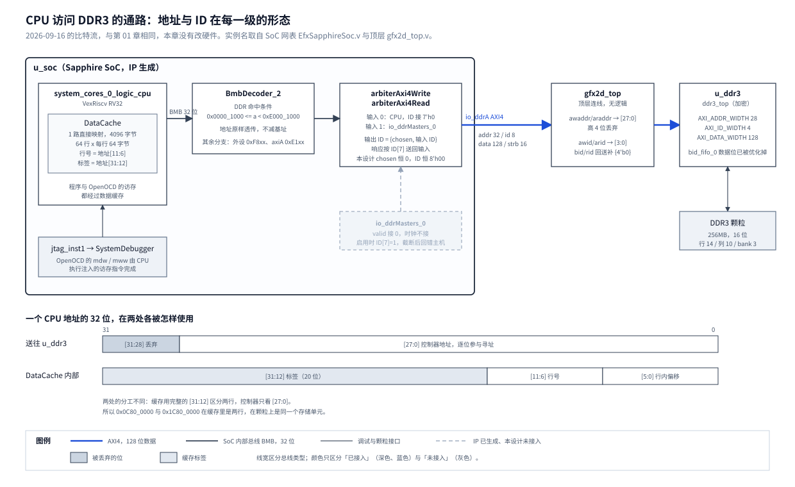

# 02 DDR 地址译码与 AXI ID：先读网表，再上板取样

## 一、动机

第 01 章搭出的基线里，处理器经 AXI4 总线访问板上 256MB 的 DDR3，官方的 `memTest` 在 16MB 范围内通过。
接下来要做的渲染引擎也会作为一个 AXI 主机去读写同一块 DDR3：CPU 把图像和命令写进内存，
把地址告诉引擎，引擎按这个地址去搬像素。这个分工成立的前提是**CPU 看到的地址与引擎送给
DDR3 控制器的地址指向同一个存储单元**。

**AXI4** 是 ARM 定义的片上总线协议，读、写各分地址、数据、响应几个独立通道，每笔事务带一个
**事务 ID**，从机回响应时原样带回，主机据此把响应对到发出的那笔事务上。

顶层 `rtl/top/gfx2d_top.v` 在 SoC 与控制器之间有两处位宽截断，都是照抄官方参考设计：

```
SoC io_ddrA                    u_ddr3（ddr3_top）
  awaddr/araddr [31:0]  -----> s_axi_awaddr/araddr [27:0]    高 4 位丢弃
  awid/arid     [7:0]   -----> s_axi_awid/arid     [3:0]     高 4 位丢弃
  bid/rid       [7:0]   <----- {4'b0, bid/rid[3:0]}          回来时补 0
```

这两处在第 01 章结束时都没有查证，各自留着一个会在接入引擎后才暴露的风险：

- **地址。** CPU 看到的 DDR 窗口有 `0xE000_0000` 字节（约 3.5GB），颗粒只有 256MB。
  超出 256MB 的地址落到哪里、256MB 以内每一位地址是不是都参与了寻址，都不知道。
  如果某一位地址线在控制器内部没有被用上，两个不同的 CPU 地址会落到同一个存储单元，
  这种现象叫**地址别名**。帧缓冲、命令表、素材区要在 256MB 里分区摆放，
  存在未知的别名时，写一块区域可能悄悄改掉另一块。
- **ID。** 如果 SoC 发出的 ID 大于 15，高 4 位被截掉，控制器带回的 ID 与 SoC 发出的对不上，
  SoC 会把响应交给错误的事务。单个主机顺序访问时这种错误不一定出现，
  接入第二个主机后才会变成随机的数据错误，而且很难从现象反推回这里。

这两个问题在设计文档里是实验 E2。开工前的计划把 SoC 和控制器都当黑盒：
写程序测地址，另加一个硬件寄存器在板上记录 ID 的高 4 位有没有出现过 1。
开工后先做的一件事改变了实验方案：Sapphire SoC 的网表绝大部分是明文，地址和 ID
在 SoC 内部怎么产生可以直接读出来。于是这一章的做法是先读代码得出能得出的结论，
再只对读不出来的部分做板上实验，并用读代码时发现的机制来设计实验，避开一个会让实验失效的陷阱。

## 二、为什么是这几步

这个工作点拆成五步：

| 步 | 内容 | 产物 |
| --- | --- | --- |
| 一 | 确认 SoC 网表里哪些部分可读 | 可读与加密部分的清单 |
| 二 | 读地址通路：SoC 送出前有没有改动地址 | 地址在 SoC 内部的变换关系 |
| 三 | 读 ID 通路：ID 由谁产生、取值范围多大 | ID 的取值结论，以及综合结果的旁证 |
| 四 | 读数据缓存：CPU 读写经过什么，会不会影响观测 | 缓存结构，以及实验必须避开的陷阱 |
| 五 | 板上实验：控制器内部的地址译码 | 每一位地址是否参与寻址、回绕周期 |

第一步是其余四步的前提。第二、三步能从代码得出完整结论的，就不再上板测，
因为板上实验只能覆盖跑过的那几个程序，代码结论覆盖所有情况。
第四步必须排在第五步之前：板上实验靠 CPU 读写来观察别名，而 CPU 的读写经过数据缓存，
不先弄清缓存的行为，实验读到的「没有别名」可能只是缓存给出的旧值。
第五步是唯一绕不开的实验，控制器是加密的，它怎样把 28 位地址映射到颗粒上只能在板上取样。

图 1 是这五步读出和测出的结果画在同一条通路上的样子。本章没有改动硬件，
系统组成仍是第 01 章图 1，这张图把其中 CPU 到 DDR3 的那一段展开到模块级。



**图 1** CPU 访问 DDR3 的通路。上半部分是各级模块，框内写的是该级对地址与 ID 做了什么；
下半部分是一个 CPU 地址的 32 位分别在控制器和数据缓存里怎样被使用，两者的分工差异是 3.4 节陷阱的来源。

## 三、每一步做了什么

### 3.1 确认 SoC 网表里哪些部分可读

SoC 由易灵思的生成器产出，网表在 `fpga/gfx2d_ti60/ip/soc/source/hardware/netlist/EfxSapphireSoc.v`，
共 26860 行，文件头写着 `Generator : SpinalHDL`。**SpinalHDL** 是一种基于 Scala 的硬件描述语言，
编译产物是普通的 Verilog，保留原设计里的信号名，读起来比综合后的门级网表容易得多。

对全工程搜索 Verilog 加密包络的标记 `` `pragma protect begin_protected ``，结果分两类：

| 部分 | 加密范围 |
| --- | --- |
| DDR3 控制器 `rtl/vendor/ddr3_controller/` | 15 个 `.v` 里 12 个加密，包括顶层 `ddr3_top.v`、AXI 从口 `axi4_bus_ctl.v` 与 `phy_ctl/` 下全部 7 个文件；明文的只有 `axi_upsizer.v`、`simple_dual_port_ram.v` 与 `common/efx_fifo_v2.3/efx_fifo_wrapper.v` |
| Sapphire SoC `EfxSapphireSoc.v` | 共 78 个模块，只有文件末尾的 `EfxCPUSp1`、`EfxCPUSp2` 两个加密，其余 76 个全部明文，包括 CPU 本体 `VexRiscv`、指令与数据缓存、总线译码器、AXI 仲裁器、UART、SPI、调试模块 |

`EfxCPUSp1` 与 `EfxCPUSp2` 在 `VexRiscv` 的执行级里各例化一次（网表第 16049、16058 行），
端口是两个 32 位操作数、若干控制位和一个 32 位结果，看端口是运算单元，内部看不到。
工程里还有一份 `ip/soc/soc.v`，是同一份网表加上模块名后缀的拷贝，工程实际编译的是它。

这一步订正了第 01 章第一节「Sapphire SoC 以加密 RTL 交付」的说法，订正写在该章原处。
整机仍然无法用开源工具仿真，因为控制器与这两个运算模块读不了，但 SoC 的总线结构是可以读的，
这一章后面的结论都建立在这一点上。

### 3.2 读地址通路

要回答的问题是：CPU 访问地址 `a` 时，SoC 的 `io_ddrA_awaddr` 上出现的是不是 `a`。
DDR 窗口从 `0x1000` 开始，常见的做法有两种，一种原样送出，一种减去基址让从机看到从 0 开始的偏移，
两种都合理，只能看代码。

做法是从端口往回逐级找赋值语句。这是常规做法，用文本搜索即可。路径如下：

```
io_ddrA_aw_payload_addr                              SoC 端口
  <- ..._ddrAToAxi4_ioAw_s2mPipe_m2sPipe_payload_addr     两级流水寄存器，数值不变
  <- system_ddr_ddrLogic_ddrAAxi4_aw_payload_addr
  <- io_output_aw_s2mPipe_m2sPipe_payload_addr            写仲裁器输出的流水
  <- system_ddr_ddrLogic_arbiterAxi4Write                 写仲裁器，地址直通
  <- ...                                                  BMB 转 AXI 的桥
  <- BmbDecoder_2 io_outputs_2_cmd_payload_fragment_address   总线译码器的 DDR 分支
```

**BMB** 是 SpinalHDL 自带的片上总线，CPU 发出的访存先走 BMB，到 DDR 分支再转成 AXI4。
译码器里决定一次访存是否属于 DDR 的两行是：

```
logic_hitsS0_2 = ((32'h00001000 <= io_input_cmd_payload_fragment_address) &&
                  (io_input_cmd_payload_fragment_address < 32'he0001000));
io_outputs_2_cmd_payload_fragment_address = logic_input_payload_fragment_address;
```

第一行是命中判断，窗口 `[0x0000_1000, 0xE000_1000)`，与 `soc.h` 里 `SYSTEM_DDR_BMB = 0x1000`、
`SYSTEM_DDR_BMB_SIZE = 0xe0000000` 一致。第二行说明命中之后地址原样送给 DDR 分支。
为了确认后面几级也没有改动地址，又对全文件搜索地址信号上的加、减与掩码运算，
DDR 通路上没有命中，出现加减的都在 CPU 流水线内部与其它外设分支上。

结论：**CPU 地址按位原样到达 `io_ddrA`**，顶层取低 28 位送给控制器。
读代码回答不了的是控制器怎样使用这 28 位，留给 3.5 节。

### 3.3 读 ID 通路

同样从端口往回找。`io_ddrA_aw_payload_id` 往回经过两级流水，来源是写仲裁器
`system_ddr_ddrLogic_arbiterAxi4Write`，模块是 `Axi4WriteOnlyArbiter`。
**仲裁器**在多个主机争用同一个从机时决定谁先用，并负责把响应送回正确的主机。
这个仲裁器有两个输入，输出 ID 由它自己拼出来：

```
io_output_aw_payload_id = {cmdArbiter_io_chosen, cmdArbiter_io_output_payload_id};   // 1 位 + 7 位
writeRspIndex           = io_output_b_payload_id[7 : 7];                              // 响应按最高位送回
io_inputs_0_b_valid     = (io_output_b_valid && writeRspSels_0);
```

即最高位记录「是哪个输入发的」，低 7 位是该输入自己的 ID，响应回来时看最高位决定交给谁。
这是 AXI 互连里的标准做法。再看仲裁器在 SoC 顶层的例化，两个输入的 ID 来源：

```
.io_inputs_0_aw_payload_id  (7'h0)                                        // 输入 0：CPU
.io_inputs_0_ar_payload_id  (7'h0)
system_ddr_ddrLogic_arbiterAxi4Write_io_inputs_1_aw_payload_id =
    {3'd0, system_ddr_ddrLogic_userAdapters_0_pipelineAxi4_aw_payload_id} // 输入 1：io_ddrMasters_0
```

CPU 这一路的 ID 是常量 0。输入 1 是 IP 额外生成的外部主机口 `io_ddrMasters_0`，
第 01 章 4.5 节为了省资源没有给它接时钟，`valid` 接 `1'b0`，永远不会被选中，
所以 `chosen` 恒为 0。读通路 `Axi4ReadOnlyArbiter` 的结构相同。

结论：**本设计里 SoC 发出的 `awid`、`arid` 恒为 `8'h00`**。截成 4 位不丢信息，
响应回来补 0 后最高位是 0，一定送回 CPU。

这个结论顺带给出一条约束。如果将来启用 `io_ddrMasters_0`，它发出的 ID 最高位是 1，
被顶层截成 4 位之后最高位丢失，控制器的响应会被仲裁器错送给 CPU，发起方收不到。
设计文档计划让引擎经 `Axi_Mux` 接到控制器前面，不走这个口，所以约束与计划不冲突，
但要写在顶层注释里，防止以后有人图省事启用它。

**综合结果的旁证。** 代码结论是「ID 是常量」，如果成立，综合器应当也看得出来并删掉存 ID 的逻辑。
控制器虽然加密，Efinity 的综合报告 `outflow/gfx2d_ti60.map.rpt` 仍按层次列出每个子模块的资源。
其中控制器 AXI 从口里存写响应 ID 的 FIFO 是：

```
Module                                                   FFs   SRLs  ADDs  LUTs   COMB4s  RAMs
+bid_fifo_0:axi_mc_fifo(C_WIDTH=4,C_AWIDTH=3,C_DEPTH=8)  4(4)  0(0)  0(0)  12(12) 0(0)    0(0)
```

参数说明它是 4 位宽、8 级深的 FIFO，要存 32 位数据。实际只剩 4 个触发器、12 个查找表，
没有移位寄存器也没有存储块，4 个触发器只够放读写指针。数据存储被整个删除，
说明综合器在常量传播之后也确认写入 FIFO 的 ID 恒定。两条独立证据得出同一结论。

**另一路将来的主机。** 引擎接入时计划用第三方的 `rtl/vendor/axi_mux/Axi_Mux.v`。
它的 ID 处理方式决定截断在两个主机下是否仍然安全。文件第 412 行起的参数说明：

```
parameter ID_MODE_SEL = "Normal"; //"Normal" "Extend"
  //"Normal"  : Slave的ID和Master的ID宽度一致，通道切换处理按顺序执行
  //"Extend"  : Master的ID为Slave ID加通道号，通道切换按Master提供的通道号
```

默认的 Normal 模式下，它不在 ID 里编码主机号，响应按事务发出的顺序送回各主机（第 1841 行起的 B 通道处理）。
这意味着控制器看到的 ID 就是各主机自己给的 ID，只要引擎也发 0，4 位截断不影响响应路由。
Extend 模式会在 ID 里加通道号，与 4 位截断冲突，不能用。这一条在接入 `Axi_Mux` 时上板确认。

### 3.4 读数据缓存

板上实验的观测手段是 CPU 读写。CPU 核 VexRiscv 带一个数据缓存 `DataCache`，
**缓存**是 CPU 旁边一小块快速存储，保存最近访问过的内存内容的副本，命中时不必再访问 DDR3。
副本的问题在于它不会自己知道原件被别人改过。实验要检测的恰好是「经 A 地址写入，从 B 地址读出」
这种绕开缓存对应关系的访问，所以必须先知道缓存怎样组织，否则实验结果不可信。

缓存结构从网表的存储声明与端口位宽读出：

```
reg [21:0] ways_0_tags_spinal_port0;           // 22 位 = valid 1 + error 1 + 地址标签 20
reg [31:0] ways_0_data_spinal_port0;
input [5:0] io_cpu_flush_payload_lineId;       // 行号 6 位，共 64 行
```

结合 `soc.h` 的 `SYSTEM_CORES_0_DCACHE_SIZE 4096` 与 IP 配置的 `DCACHEWAY = 1`：

- 容量 4096 字节，分 64 行，每行 64 字节；
- **1 路直接映射**：每个地址只能放在一个固定的行里，行号取地址的 `[11:6]`；
- 行里存的标签是地址的 `[31:12]` 共 20 位，读时比较标签，相同算命中。

一次读访问的过程是：取行号，比较标签，命中则直接给出副本；不命中则从 DDR3 装入这 64 字节，
替换掉这一行原来的内容，再给出结果。写访问的行为在代码里不易读清，留给实验观测。

由此推出实验会踩到的陷阱。设 A 与 B 两个地址只在第 28 位不同。它们的行号相同、标签不同，
在缓存里是两个互斥的条目；而控制器只看低 28 位，它们在颗粒上是同一个存储单元。
如果先读 A，A 这一行进了缓存；再写 B，存储单元的内容变了，但缓存里 A 这一行不会更新；
再读 A，命中缓存，读到的是旧值。实验会据此得出「A、B 不是别名」，结论恰好相反。

对策是**驱逐读**，属于针对这个缓存结构的特定手段：每次校验读 A 之前，先读一次
`A ^ 0x2000_0000`。这个地址与 A 行号相同、标签不同，读它会把 A 所在的行替换掉，
随后读 A 必然不命中，从 DDR3 重新装入。代价是每次校验多一次访存，实验里可以忽略。
选第 29 位是因为它在 DDR 窗口内、离程序区远，且按 3.5 节的预期它本身也是 A 的别名，
读它不会碰到窗口外的地址引起总线错误。

同一个机制还否定了开工前计划里的一个旁证。计划原本打算用 OpenOCD 经 JTAG 读回同一地址，
作为「调试器与 CPU 看到同一份数据」的独立证据。但 Sapphire 的调试模块 `SystemDebugger`
自己的总线出口只通向 CPU 的调试寄存器，读内存的方式是让 CPU 执行注入的访存指令，
走的仍然是 CPU 的数据通路和同一个缓存，读到的是 CPU 视角（证据见 4.3 节）。能从另一个角度看 DDR3 的只有另一个 AXI 主机，这一项并入实验 E4，
那里本来就要写一个直接读写 DDR3 的探针主机。

### 3.5 板上实验：控制器内部的地址译码

**要回答的问题。** 控制器的 28 位地址是否每一位都参与寻址；高 4 位被丢弃后回绕的周期是多少。

**方法。** 这是存储器测试里的常规做法，叫**地址线逐位翻转**：
选一个基准地址，把它的第 k 位翻转，得到一个只差一位的地址。
如果第 k 位参与寻址，两个地址是不同的存储单元，分别写入不同的值，各自读回自己的值；
如果第 k 位没有参与寻址，两个地址是同一个存储单元，后写的值会覆盖先写的值。
对每一位做一次，就知道哪几位参与了寻址。

程序是 `Main/sw/ddrAliasTest`，分三组：

```
第 1 组  低 28 位，预期无别名
   写 BASE = 0x5A
   对 k = 0..27：写 BASE ^ (1<<k) = 0x80 + k
   对 k = 0..27：驱逐读后读 BASE ^ (1<<k)，应为 0x80 + k
   驱逐读后读 BASE，应仍为 0x5A          <- 任一位不参与寻址，这里会被覆盖
第 2 组  高 4 位，预期有别名
   对 k = 28..31：写 BASE ^ (1<<k) = 0xC0 + k，驱逐读后读 BASE，应为 0xC0 + k
第 3 组  缓存陷阱，观测项
   写 Q = 0x11；驱逐读后读 Q（Q 所在行进缓存）
   写 Q ^ 0x1000_0000 = 0x22              <- 别名写
   不驱逐直接读 Q，记录读到的值
   驱逐后读 Q，应为 0x22
```

几个设计选择的理由：

- **基准地址 `BASE = 0x0C80_0000`。** 程序与栈占 `0x1000` 起不到 1MB。
  翻转低 28 位得到的地址最小是 `0x0480_0000`（翻转第 27 位），都在程序区之外。
  还要考虑实验假设不成立的情况：如果控制器实际只译码 26 位，`0x0C80_0000` 会落到颗粒的
  `0x0080_0000`，同样在程序区外。基准选得不好时，一次失败的假设会改写程序本身，
  串口输出变成乱码，就分不清是地址问题还是程序跑飞。
- **用字节读写。** 翻转第 0、1 位得到的地址不是 4 的倍数，用字节访问才能覆盖到最低两位。
- **第 2 组是第 1 组的反例。** 第 1 组的预期是「全部读回自己的值」，
  一个什么都检测不到的判据也会给出这个结果。第 2 组预期必然出现别名，
  它读到别名，才能证明这个判据有能力看到别名，第 1 组的阴性结果才有意义。
- **第 3 组不计入失败数。** 它是对 3.4 节推理的直接观测，读到哪个值都是结论。

**操作。** 用第 01 章的比特流加载，OpenOCD 加载程序到 `0x1000` 运行，
同时抓取 COM11 串口。命令的完整形式见 `Main/doc/开发环境.md` 第 6 节。
程序跑完后再用 OpenOCD 读三处内存，作为调试通路的交叉检查。

## 四、遇到的问题

### 4.1 OpenOCD 找不到 `cpu0.yaml`

**第一现场。** 按 `Main/doc/开发环境.md` 第 6 节的写法，在程序目录 `sw/ddrAliasTest` 下启动 OpenOCD：

```
cpu.yaml not found within 3 levels
Info : auto-selecting first available session transport "jtag". To override use 'transport select <transport>'.
Info : set servers polling period to 50ms
Error: cpuConfigFile /cpu0.yaml not found
Error: target 'fpga_spinal.cpu0' init failed
```

**解读。** 第一行来自 `debug_ti.cfg` 自己的查找逻辑，说明往上找了若干级没找到。
最后两行说明 OpenOCD 拿着空路径拼出了 `/cpu0.yaml`，CPU 目标初始化失败，后面的命令都不会执行。
JTAG 传输层本身是好的（`transport "jtag"` 正常选中），问题只在配置文件路径。

**定位。** 读 `sdk/bsp/efinix/EfxSapphireSoc/openocd/debug_ti.cfg` 的查找循环：

```
set max_levels 3
for {set i 0} {$i <= $max_levels} {incr i} {
    set path ".."
    for {set j 0} {$j < $i} {incr j} { append path "/.." }
    set yaml_path "$path/cpu0.yaml"
```

它检查的是 `../cpu0.yaml`、`../../cpu0.yaml`、`../../../cpu0.yaml`、`../../../../cpu0.yaml` 四处，
全部相对当前目录，且从上一级开始。`cpu0.yaml` 在 `Main/sdk/` 下。
官方示例位于 `sdk/software/standalone/<程序>/`，往上三级正好是 `sdk/`，所以在官方示例目录下能找到。
本项目的程序在 `Main/sw/<程序>/`，往上依次是 `sw/`、`Main/`、仓库根、仓库根的上一级，都没有这个文件。

**根因与修法。** 手册第 6 节的示例把官方示例目录的用法套到了 `sw/` 下，这个组合从没真正跑通过。
修法是在 `Main/sdk/bsp/` 下启动 OpenOCD（上一级就是 `sdk/`），程序文件给绝对路径。
手册第 6 节、第 01 章 3.2 节的对应描述已同步订正。
原判据没有覆盖到它，是因为手册里的命令写下之后没有被原样执行过一次。
第 01 章跑 `bootSizeTest` 时实际从哪个目录启动，原始记录里没有留下，只能推测与手册所写不同。

### 4.2 计划里的 sticky 寄存器没有分辨力

**第一现场。** 开工前的计划第三步：在顶层加一个寄存器，把每一拍的 `soc_ddr_awid[7:4]`、
`soc_ddr_arid[7:4]` 按位或进去，从 APB 读出，读到 0 说明 ID 没有越界。
这一步没有实施，问题在读代码时发现，没有板上输出。

**解读。** 3.3 节已经证明 `soc_ddr_awid[7:4]` 在综合时是常量 0，
综合器会沿常量传播把「常量 0 按位或进寄存器」化简成恒 0，寄存器本身也会被删掉。
上板读到的 0 与 ID 实际取值无关，即使 SoC 的 ID 生成逻辑换成别的写法，
只要综合器能把它化简成常量，读到的还是 0。

**定位。** 这个判据的错误在于默认了观测点上的信号是运行时变量。
它只在「ID 由运行时条件决定、综合器无法化简」时有分辨力，而这正是需要先读代码才能知道的事。

**根因与修法。** 取消这一步，ID 的结论由 3.3 节的代码证据与综合报告证据共同支撑。
将来接入 `Axi_Mux` 与引擎后，ID 会来自两个主机，那时 ID 线不再是常量，
如需板上观测再加寄存器才有意义。原判据的问题是写计划时没有检查判据能否注错见红：
如果当时设想过「故意让 ID 越界，这个寄存器能否变红」，就会发现在当前结构下做不到。

### 4.3 JTAG 读回不是独立观测

这一项在 3.4 节已写明，这里按四段补全。

**第一现场。** 计划第一步写的是「用 JTAG 读回同一地址，确认调试通路与 CPU 看到的是同一份数据」，
意图是用它当独立旁证。实验中确实做了，输出见第五节，读回值与程序结果一致。

**解读。** 一致本身没有问题，问题在于它证明不了计划想证明的事。

**定位。** SoC 网表里调试模块 `SystemDebugger` 经 `JtagBridgeNoTap` 接到硬 JTAG。
它确实有一个总线主机口 `io_mem`，但这个口后面接的译码器 `bmbDecoder_4` 只有一个分支：

```
logic_hitsS0_0 = ((io_input_cmd_payload_fragment_address & (~ 32'h00000fff)) == 32'h10b80000);
system_cores_0_debugBmb_slaveModel_arbiterGen_oneToOne_arbiter_cmd_valid = bmbDecoder_4_io_outputs_0_cmd_valid;
```

即只能访问 `0x10B8_0000` 起 4KB 的 CPU 调试寄存器。OpenOCD 的 `mdw`、`mdb` 是经这些寄存器
让停机的 CPU 执行注入的读指令完成的，经过的是 CPU 的数据通路和数据缓存。

**根因与修法。** 读回值只能证明调试通路工作正常，不能作为独立于 CPU 的第二个观测者。
「另一个主机按同一地址读到 CPU 写入的值」这一项移入实验 E4，由 E4 的 `axi_probe_master` 完成。

## 五、结果

### 5.1 代码与综合结论

| 项 | 结论 | 证据 |
| --- | --- | --- |
| SoC 送出的地址 | 与 CPU 地址按位相同，无基址偏移 | `BmbDecoder_2` 命中逻辑与透传赋值，3.2 节 |
| SoC 送出的 ID | `awid`、`arid` 恒为 `8'h00` | 仲裁器输入 0 接 `7'h0`，输入 1 永不被选中，3.3 节 |
| 综合旁证 | `bid_fifo_0` 仅剩 4 FF、12 LUT，数据存储被删除 | `gfx2d_ti60.map.rpt` 层次统计 |
| 数据缓存 | 1 路直接映射，64 行 x 64 字节，行号 `[11:6]`，标签 `[31:12]` | `DataCache` 存储声明与端口位宽 |

### 5.2 板上实验

2026-09-16，比特流为第 01 章 5.1 节的那一版，程序 `ddrAliasTest.bin` 2418 字节（gcc 8.3.0）。
COM11 原始输出：

```
ddrAliasTest
LOW k=0 addr=0x0c800001 expect=80 got=80 ok
LOW k=1 addr=0x0c800002 expect=81 got=81 ok
LOW k=2 addr=0x0c800004 expect=82 got=82 ok
LOW k=3 addr=0x0c800008 expect=83 got=83 ok
LOW k=4 addr=0x0c800010 expect=84 got=84 ok
LOW k=5 addr=0x0c800020 expect=85 got=85 ok
LOW k=6 addr=0x0c800040 expect=86 got=86 ok
LOW k=7 addr=0x0c800080 expect=87 got=87 ok
LOW k=8 addr=0x0c800100 expect=88 got=88 ok
LOW k=9 addr=0x0c800200 expect=89 got=89 ok
LOW k=10 addr=0x0c800400 expect=8a got=8a ok
LOW k=11 addr=0x0c800800 expect=8b got=8b ok
LOW k=12 addr=0x0c801000 expect=8c got=8c ok
LOW k=13 addr=0x0c802000 expect=8d got=8d ok
LOW k=14 addr=0x0c804000 expect=8e got=8e ok
LOW k=15 addr=0x0c808000 expect=8f got=8f ok
LOW k=16 addr=0x0c810000 expect=90 got=90 ok
LOW k=17 addr=0x0c820000 expect=91 got=91 ok
LOW k=18 addr=0x0c840000 expect=92 got=92 ok
LOW k=19 addr=0x0c880000 expect=93 got=93 ok
LOW k=20 addr=0x0c900000 expect=94 got=94 ok
LOW k=21 addr=0x0ca00000 expect=95 got=95 ok
LOW k=22 addr=0x0cc00000 expect=96 got=96 ok
LOW k=23 addr=0x0c000000 expect=97 got=97 ok
LOW k=24 addr=0x0d800000 expect=98 got=98 ok
LOW k=25 addr=0x0e800000 expect=99 got=99 ok
LOW k=26 addr=0x08800000 expect=9a got=9a ok
LOW k=27 addr=0x04800000 expect=9b got=9b ok
LOW k=-1 addr=0x0c800000 expect=5a got=5a ok
HIGH k=28 addr=0x1c800000 expect=dc got=dc ok
HIGH k=29 addr=0x2c800000 expect=dd got=dd ok
HIGH k=30 addr=0x4c800000 expect=de got=de ok
HIGH k=31 addr=0x8c800000 expect=df got=df ok
CACHE_NOEVICT k=0 addr=0x0d000000 expect=11 got=11 ok
CACHE_EVICT k=0 addr=0x0d000000 expect=22 got=22 ok
base 0x0c800000 fail 0
done
```

程序结束后 OpenOCD 的读回：

```
0x0c800000: df
0x2c800000: df
0x0c800004: 82
```

同一比特流、同一程序重新加载运行第二次，输出逐行相同。

逐组解读：

- **第 1 组**：28 个翻转地址各自读回自己的值，`BASE` 仍为 `0x5A`。
  低 28 位每一位都参与寻址，没有任何两个只差一位的地址落到同一存储单元。
  由于每一位都区分存储单元，`[0, 256MB)` 里 CPU 地址到存储单元的映射是一一对应的。
- **第 2 组**：翻转第 28~31 位写入，`BASE` 每次都读到刚写的值。
  高 4 位不参与寻址，**回绕周期是 256MB**，窗口内任意 CPU 地址 `a` 与 `a & 0x0FFF_FFFF` 是同一个存储单元。
  这一组同时证明了判据能看到别名，第 1 组的阴性结果成立。
- **第 3 组**：不驱逐时读到旧值 `0x11`，驱逐后读到新值 `0x22`。
  3.4 节推出的缓存陷阱在板上真实存在，也说明**经不命中的地址写入，不会更新或作废缓存里的另一行**。
  如果第 1、2 组没有做驱逐读，第 2 组会错误地报告「没有别名」。
- **OpenOCD 读回**：`0x0C80_0000` 与 `0x2C80_0000` 都是 `df`，即第 2 组最后一次经 `0x8C80_0000` 写入的值；
  `0x0C80_0004` 是第 1 组 k=2 写入的 `0x82`。与程序结果一致，调试通路正常。

### 5.3 结论落地后的地址规则

| CPU 地址 | 落到的存储单元 | 用法 |
| --- | --- | --- |
| `0x0000_1000`~`0x0FFF_FFFF` | 同值 | 正常使用 |
| `0x1000_0000`~`0x1000_0FFF` | `0x0000_0000`~`0x0000_0FFF` | 颗粒最低 4KB 只能经这段别名访问，设计上不使用 |
| `0x1000_1000`~`0xE000_0FFF` | `a & 0x0FFF_FFFF` | 全部是别名，不使用 |

对引擎的直接含义：驱动下发给引擎的地址可以直接用 C 指针的值，只要指针落在 `0x0000_1000`~`0x0FFF_FFFF` 内，
不需要换算。引擎侧只需 28 位地址。

### 5.4 测量方法与已知误差

- 实验只覆盖**地址译码**，存储单元本身的好坏没有测。每一位只用一个基准地址测了一次，
  256MB 里绝大部分单元没有被读写过。存储单元的覆盖仍然只有 `memTest` 的 16MB。
- 地址一一对应的结论依赖一个假设：控制器的地址译码是按位的线性组合。
  如果存在只在特定地址组合下才出现的别名（例如某一位只在另一位为 1 时生效），逐位翻转测不出来。
  对 DDR3 控制器这类按行、列、bank 分字段的译码，这种情况不常见，但没有排除，按推测处理。
- ID 的结论只对当前 SoC 构型成立。重新生成 SoC IP，或启用 `io_ddrMasters_0`，都要重读 3.3 节的那几行。

## 六、还欠什么

- **另一个主机按同一地址读回。** 已移入 E4 的判据，
  由 `axi_probe_master` 读取 CPU 写过的地址完成，同时上板确认 `Axi_Mux` 的 Normal 模式下响应不串。
  2026-09-17 已完成，两个方向交叉读一致、并发时错误响应为 0，见第 03 章 5.4 节。
- **缓存与引擎的一致性（实验 E3）。** 本章证明了经别名写入不会作废缓存行，
  可以推知引擎写 DDR3 时 CPU 缓存里的副本同样不会失效。
  设计文档 2.1 节「共享区单向使用」的约定因此必须遵守。
  E3 的前提是引擎存在，仍留在设计文档第 7 节。
