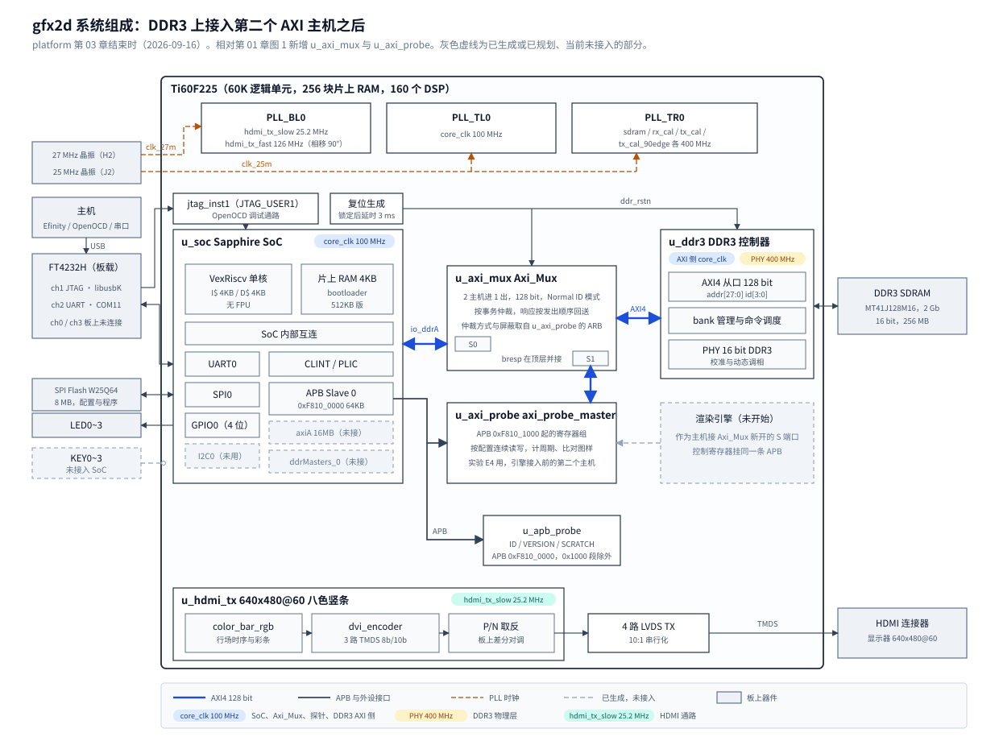

# 03 DDR3 上的第二个主机：接入 Axi_Mux，实测突发上限与事务开销

## 一、动机

这个项目要在钛金 Ti60F225 FPGA 上做一个 2D 渲染加速引擎：处理器下发命令，引擎作为 AXI 主机直接读写
板上 256MB 的 DDR3，把像素搬进帧缓冲。第 01 章搭出的基线里 DDR3 只有一个主机，就是 Sapphire SoC 的
`io_ddrA`；第 02 章查清了 CPU 地址与 DDR3 控制器地址的对应关系。引擎要接进来，还缺两样东西。

第一样是**通路**。一个 AXI 从口同一时刻只能服务一个主机，两个主机共用 DDR3 控制器，中间需要一个
**多路器**（也叫互连）：它在多个主机之间仲裁，把选中主机的请求转给从机，再把响应送回发起者。
本章之前这个多路器不存在，引擎没有地方接。

第二样是**预算**。设计文档 3.1 节用来估算引擎能画多少个精灵的几个数，全是假设值：
一笔 AXI 事务的固定开销 `t_tx` 假设为 20 个时钟周期，控制器每个周期最多传一个 128 位数据拍，
突发长度上限写的是「待测」。这些数决定引擎把一行像素切成多长的突发、同屏上限估到哪个数量级，
估错了，引擎的结构就要返工。

**突发**（burst）是 AXI 的一种传输方式：主机发一次地址，随后连续传若干个数据**拍**（beat），
每拍在这里是 128 位，即 16 字节、4 个 32 位像素。地址握手只做一次，所以突发越长，
分摊到每拍上的固定开销越少。控制器最多接受多长的突发、固定开销到底是多少，
控制器是加密的，手册也没写（3.2 节研究 1），只能从外部测。

这两样东西可以一次解决：先把多路器接上，再在它的第二个口上挂一个专门用来测量的主机。
这个测量主机本身就是「CPU 之外的第二个 DDR 观测者」，第 02 章留下的交叉读验证也由它完成。
这个工作点在设计文档里是实验 E4。

## 二、为什么是这几步

| 步 | 内容 | 产物 |
| --- | --- | --- |
| 一 | 选接入方式 | 用 `Axi_Mux` 常驻在 CPU 与控制器之间 |
| 二 | 前期研究：控制器手册、控制器来历、`Axi_Mux` 源码 | 实测前的先验，`Axi_Mux` 的结构、代价与两处需要处理的问题 |
| 三 | 写测量主机 `axi_probe_master` 并仿真 | 仿真 5/5，含 4 个注错用例 |
| 四 | 接入顶层、编译、回归 | 比特流，与第 01 章基线对比的资源与时序，五项原有功能在板上不退化 |
| 五 | 板上实测 | 交叉读、突发扫描、并发三组数据 |

第一步排在最前，因为接入方式决定后面测的是哪条通路。第二步必须在写代码之前：
`Axi_Mux` 要常驻在 CPU 的访存通路上，而资料包里没有任何官方设计用过它，
它会给 CPU 带来什么代价、有没有缺陷，要先从源码里读出来。
第三步在第四步之前：这块板上的控制器与 SoC 都无法开源仿真，一旦上板出错，
分不清是测量主机、多路器还是控制器的问题，所以自己写的部分和多路器要先在仿真里证明是对的。
第四步的回归不能省：CPU 取指、bootloader 搬程序都要经过新插入的多路器，
任何一项退化都说明通路本身有问题，这时测出来的数不能用。

图 1 是本章结束时的系统组成。



**图 1** 本章结束时的系统组成。相对第 01 章图 1，SoC 的 `io_ddrA` 不再直连 `u_ddr3`，
改经 `u_axi_mux` 的 S0；`u_axi_probe` 占 S1，同时在 APB 上占一段寄存器。
渲染引擎将来作为又一个主机接到 `Axi_Mux` 新开的 S 端口上，图中用灰色虚线标出。

## 三、每一步做了什么

### 3.1 选接入方式

能让第二个主机访问 DDR3 的做法有三种，都在仓库或资料包里现成：

- **SoC 自带的外部主机口 `io_ddrMasters_0`。** IP 生成时就带着，SoC 内部的仲裁器已经把它和 CPU 合在一起。
  问题有三个：它的数据宽度是 32 位，引擎按 128 位搬像素要再升宽；第 01 章 4.5 节实测给它接上时钟会多占
  853 个 XLR 与 5 块片上 RAM；第 02 章 3.3 节读出它发出的事务 ID 最高位是 1，
  而顶层把 ID 截成 4 位，它的响应会被错送给 CPU。
- **tinyml 工程里的 `axi_interconnect_beta`。** 官方用过，但加密，只能黑盒测，出了问题无从下手。
- **hardjtag 工程里的 `Axi_Mux`。** 第三方写的明文多路器，128 位，2~8 个主机口，可以仿真也可以改。
  代价是它要常驻在 CPU 与控制器之间，CPU 的每次访存都多经过一级。

与用户一起选定第三种（设计文档 3.3 节原本也是这个方案）。同时决定把实验 E1
（把 SoC 换成 Lite 版以统一内存时钟、省下 17 块片上 RAM）放到后面：
当前 RAM 预算不紧，而 E1 要重新生成 SoC IP，搭 E4 的车会让两个变量混在一次回归里。

### 3.2 前期研究

#### 研究 1：手册有没有给出突发上限

资料包里的 `ddr3-controller-core-ug-v2.1.pdf` 特性列表写着 "Supports burst length of 8"，
AXI 端口表里 `axi_alen[7:0]` 只说明了位宽。这个「8」容易被读成「AXI 突发最多 8 拍」，
但同一份手册的端口图里，读数据宽度写作 `m = data_width * burst_length`：
颗粒数据宽度 16 位乘以 8 等于 128 位，正好是 AXI 一拍的宽度。所以这个 8 说的是
**一个 AXI 拍对应颗粒上连续 8 个 16 位字**，与工程参数 `BURST_MODE="8"` 是同一件事，
和 AXI 一次事务能有多少拍无关。手册没有给出 AXI 侧的突发上限。

读手册时还要注意一点：手册描述的是 Efinix 自己的 DDR3 核，接口是读写共用一组地址通道
（用 `axi_atype` 区分读写）；板上的 `ddr3_top.v` 文件头署名 Elitestek，读写地址通道是分开的。
两者不是同一个实现，手册里的数字只能当参照，不能直接当作这块板的事实。
设计文档 3.1 节原来引用手册得出「每 10ns 最多一个 128 位拍」，犯的就是这个错，已在该处订正。

手册里还有一段：输入自动校准「从 DDR3 的 0x0000 到 0x1000（4KB）写入并读回校准图样」。
这可能是 SoC 的 DDR 窗口从 `0x1000` 开始的原因，但因为上面说的实现差异，只能当假设，上板结果见 5.5 节。

#### 研究 2：控制器从哪里来

控制器加密，但 Efinity 综合报告按层次列出了它的子模块：

```
axi_mc_aw_channel  axi_mc_cmd_translator  axi_mc_incr_cmd  axi_mc_cmd_fsm
axi_mc_r_channel   axi_mc_w_channel       axi_mc_b_channel axi_mc_fifo
bank_mach          col_mach               arb_mux          round_robin_arbiter
```

这些名字与 Xilinx 7 系列 FPGA 的内存控制器生成器 MIG 的源文件逐个对应，可以判断这个控制器是从 MIG 派生的。
MIG 的 AXI 前端按 AXI4 协议处理突发，`axlen` 是 8 位，能表示 1~256 拍。
由此形成两个先验，都标为推测、留给实测判定：突发上限大概率就是协议上限 256 拍；
AXI 前端把突发拆成逐拍的内部命令，持续吞吐受内部命令流水限制，每拍的周期数应当接近一个常数。

#### 研究 3：`Axi_Mux` 用过没有

在资料包全部 `.v` 文件里搜索 `Axi_Mux` 的例化，没有结果。它只作为文件出现在官方工程目录里，
没有任何一个官方设计把它接进电路。这意味着「官方工程带着它」不能当作「它在这块板上工作过」的证据，
接入前必须自己验证。

#### 研究 4：`Axi_Mux` 的结构与它给 CPU 带来的代价

通读 `rtl/vendor/axi_mux/Axi_Mux.v` 全部 2777 行，结构如下：

```
             +-------------------+   +-----------------+   +-----------------+   +-----------------+
AW 通道 ---->| Axi_Mux_Addr_Ctrl |-->| AW2W 信息 FIFO  |-->| W 选通           |-->| W2B 信息 FIFO   |--> B 选通
             | 仲裁，选出通道号   |   | 深 8            |   | Axi_Mux_Info    |   | 深 8            |
             +-------------------+   +-----------------+   +-----------------+   +-----------------+
             +-------------------+   +-----------------+   +-----------------+
AR 通道 ---->| Axi_Mux_Addr_Ctrl |-->| AR2R 信息 FIFO  |-->| R 选通           |
             +-------------------+   | 深 16           |   | Axi_Mux_Info    |
                                     +-----------------+   +-----------------+
地址字段、wdata、rdata：按上面选出的通道号做组合选择，没有寄存器级
```

读它要回答三个问题。

**它怎样保证响应回到正确的主机。** 一笔写事务在 AW 通道被仲裁选中时，通道号写进 AW2W FIFO；
W 通道从 FIFO 头取出通道号，只放行这个主机的写数据；写数据最后一拍握手时，通道号转进 W2B FIFO；
B 通道按 W2B FIFO 的头把写响应交给对应主机。读方向同理，只有 AR 与 R 两段。
也就是说它**按事务发出的顺序**送回响应，完全不看 AXI ID。
这就是参数 `ID_MODE_SEL = "Normal"` 的含义，它与第 02 章的结论相容：
各主机发出的 ID 原样到达控制器，只要引擎也发 0，控制器侧的 4 位 ID 截断就不会造成错误。
另一个模式 `"Extend"` 会把通道号拼进 ID 高位，与 4 位截断冲突，不能用。

**它给 CPU 的每次访存加了多少延迟。** 仲裁器 `Axi_Mux_Addr_Ctrl` 看到某主机的地址 valid 后，
在下一个时钟沿才把该主机登记为当前通道，出口的 valid 从这时才拉高，所以地址握手至少晚 1 拍；
它的轮询指针如果不在这个主机上，还要多转一拍。写数据要等通道号进了 AW2W FIFO、
再被 `Axi_Mux_Info` 锁存之后才放行，比地址握手再晚至少 2 拍。AXI 协议允许从机让主机这样等，
不违反协议，代价是 CPU 每次从 DDR3 装入缓存行都多几拍。数据通路是组合选择，不增加拍数，
但 128 位数据经过一级选择器，时序上要看编译结果（5.2 节）。

**两个主机抢的时候谁先。** `Cfg_Arb_Type = 0` 时轮询，1 时进入厂商所谓“优先级”模式；
`Cfg_Cnl_Mask` 某位为 0 时对应主机不参加新的授权。仲裁在**地址握手完成后**重新进行，
读写数据阶段按信息 FIFO 里的授权顺序串行。因此长突发仍会让后续数据等待更久，5.4 节的轮询并发实验
验证了这个代价。

> 订正（2026-09-19）：后续 E5 三端口仿真确认“优先级”模式并不是普通的 S0 严格优先；
> 三路持续请求时 S0、S1 交替而 S2 饿死，仅 S1、S2 请求时 S1 独占。原因、固定授权序列和保护方案
> 见 [第 06 章](06-Axi_Mux三端口仲裁与SoC防饿死保护.md)。本报告的板上数据全部来自 X2 轮询模式，
> 因而这一订正不改变 E4 的测量结果。

#### 研究 5：信息 FIFO 的写法看起来是错的

`Info_Fifo_Axi_Mux` 用厂商原语 `EFX_SRL8`（8 级移位寄存器，可按地址取任一级）存通道号，有两处反直觉：

```
if (i==SRL8_NUMBER-1) assign Shift_Data_In[i] = ~Wr_Data;       // 写进去的是取反的数据
assign Out_Sel = (|Data_Num) ? (DATA_DEPTH - Data_Num) : 0;       // 读地址是 深度 - 个数
Rd_Data = Shift_Data_Out[...];                                    // 读出来不再取反
```

按常识，移位寄存器新数据在第 0 级，最早的数据在第 `Data_Num-1` 级，读地址应当是 `Data_Num-1`；
写入取反而读出不取反，数据应当是反的。两处合起来像是一个明显的错误。

判断它是不是错误，要看原语本身的定义。Efinity 安装目录下有原语的仿真模型
`<EFINITY>/sim_models/verilog/efx_srl8.v`：

```
always @(posedge clk_int) if (ce_int) data <= {data[6:0], D};
assign Q  = ~data[~A_net];
```

原语的输出 `Q` 本身是取反的，地址 `A` 也是按位取反后才去选级。代入：写入 `~Wr_Data`，
存进去是 `~Wr_Data`，读出时再取反一次，得到 `Wr_Data`；读地址 `A = 8 - N`，
3 位取反后是 `7 - (8 - N) = N - 1`，正好是最早写入的那一级。两处「错误」互相抵消，FIFO 是对的。

这个结论带出一条约束：**仿真 `Axi_Mux` 必须用厂商的原语模型**。
如果图省事自己写一个「正常」的 8 级移位寄存器代替，仿真会报错，
然后很可能去「修」一个本来没错的 FIFO，改完之后仿真通过、上板出错。

#### 研究 6：`Axi_Mux` 丢掉了写响应码

对照端口表逐个检查 AXI 信号时发现，读方向有 `I_M_R_RESP` 与各主机的 `O_Sn_R_RESP`，
写方向却**没有任何 `B_RESP` 端口**。写响应码告诉主机这笔写是否成功，缺了它，
控制器报告的写错误在多路器这一级就消失了，主机永远看到成功。

修法不需要改 `Axi_Mux` 源码：B 通道的 `bvalid` 只会送给 W2B FIFO 头部那个主机，
其他主机此时看到的 `bvalid` 为 0，响应码对它们没有意义。
所以在顶层把控制器的 `bresp` 直接并接给所有主机即可。
这个修法是否真的把错误送到了主机，在 3.3 节用注错用例 `inject_maxlen` 验证。

另外两处小的接口差异在顶层处理：`Axi_Mux` 的 `AW_LOCK`/`AR_LOCK` 是 AXI3 的 2 位宽，SoC 的是 1 位，补 0；
它不传 `cache`、`prot`、`qos`，控制器这几个输入改接常量 0。
第 01 章 5.1 节曾把 SoC 的 `prot`、`cache` 接给控制器，这次改回常量。
MIG 派生的控制器不使用这几个字段（研究 2 的推测），5.3 节的回归结果与此一致。

### 3.3 写测量主机并仿真

**测量主机 `rtl/bus/axi_probe_master.v`。** 它是一个由 APB 寄存器配置的 AXI4 主机，
CPU 写好起始地址、每笔拍数、笔数、读写方式与数据种子，发一个启动命令，
它就连续发出这么多笔事务，完成后置 DONE。寄存器表在文件头，要点如下。

- **计数。** `CYCLES` 从启动到最后一笔完成的时钟周期数；`LAT_SUM` 每笔从进入发送状态到
  读方向第一个数据拍（写方向为写响应）的周期数之和；`TX_DONE` 完成笔数；`ERRS` 错误响应数与读比对失配拍数。
  时钟就是 100MHz 的 `core_clk`，一个周期 10ns。
- **数据图样。** 地址为 `a` 的那一拍写入 `{v^A5A5A5A5, v^5A5A5A5A, ~v, v}`，其中 `v = SEED + a`。
  图样由地址决定，读回时可以逐拍比对；AXI 是小端，CPU 在地址 `a` 读到的 32 位字就是 `v`，
  CPU 侧也能核对，交叉读两个方向都能做。
- **超时。** 连续若干周期没有任何握手即置 TIMEOUT 并停止计数，但不撤销已经拉高的 valid。
  AXI 规定 valid 拉高后必须保持到握手，撤销会让多路器与控制器进入协议未定义的状态。
  代价是超时后多路器仍被它占着，CPU 也访问不了 DDR，只能用 ABORT 命令或重新加载比特流恢复。
- **寄存器位置。** APB Slave 0 的 `0x1000~0x1FFF`（CPU 地址 `0xF810_1000` 起），其余地址仍给第 01 章的 `apb_probe`。
  第 01 章「读未映射地址返回错误」的上板判据因此不受影响。
- **读比对打一拍。** 收到读数据的那一拍只把数据与期望值存进寄存器，下一拍再比较。
  128 位比较器与 `rvalid` 的判断逻辑不在同一级，避免在 100MHz 下形成长组合路径。

**测试台 `sim/axi_probe/`。** 仓库的规矩是测试台里的从机不能比真从机强，所以从机模型
`axi_ram_model.v` 在每个 ready 与 valid 上随机插入约 3/8 概率的停顿，并能设置突发上限（超限回 SLVERR）。
测试台里两个测量主机分别接 `Axi_Mux` 的 S0 与 S1，`Axi_Mux` 用真实源码加 Efinity 的 `EFX_SRL8` 模型（研究 5），
两个主机真正并发地打同一个从机：

```
对 LEN = 0, 1, 3, 7, ..., 255（每笔 1~256 拍）：
  m0 写 0x0000 起 256 拍，同时 m1 写 0x8000 起 256 拍        检查 DONE、无超时、无错误、笔数对
  m0、m1 同时读比对各自区域                                    失配必须为 0
  m1 用 m0 的种子读 m0 的区域                                  失配必须为 0（第二个观测者读到第一个主机写的数据）
  m1 用错误的种子读 m0 的区域                                  失配必须大于 0（比对判据能分辨）
最后读一拍，检查 RDATA0 与 ID 寄存器
```

「错误种子」这一步是判据的自检。一个永远报「失配 0」的比对器也能通过前面几步，
只有让它在应当失配的地方报出失配，前面的「0」才可信。

除正常用例外有四个注错用例，每个都把一处改错，要求测试台报 FAIL：

| 用例 | 改错了什么 | 应当由哪条判据发现 |
| --- | --- | --- |
| `inject_flip` | 从机把地址 `0x100` 那一拍写入时翻转 1 位 | 读比对失配 |
| `inject_hang` | 从机永不发写响应 | 超时 |
| `inject_maxlen` | 从机突发上限设为 16 拍 | 错误响应计数；同时检验研究 6 的 `bresp` 并接 |
| `inject_timeout` | 超时阈值设为 1 个周期 | 超时 |

### 3.4 接入顶层、编译、回归

顶层 `rtl/top/gfx2d_top.v` 的改动：

```
改动前                                          改动后

u_soc io_ddrA --------------------> u_ddr3      u_soc io_ddrA ------> u_axi_mux S0 --+
                                                                                    +--> u_ddr3
                                                u_axi_probe --------> u_axi_mux S1 --+           [新]
                                                u_ddr3 bresp -------> u_soc、u_axi_probe         [改] 并接

u_soc APB0 -----------------------> u_apb_probe u_soc APB0 --+-- paddr[15:12]!=1 --> u_apb_probe
                                                             +-- paddr[15:12]==1 --> u_axi_probe [新]
```

- `[新]` `u_axi_mux`：`SLAVE_ID_WIDTH=8`、`ID_MODE_SEL="Normal"`、128 位；复位接控制器的 `ddr_rstn`，
  控制器复位期间 CPU 本来也访问不了 DDR；仲裁方式与通道屏蔽来自 `u_axi_probe` 的 ARB 寄存器，复位值为轮询、两路都开。
- `[新]` `u_axi_probe`：复位接 SoC 的系统复位。
- `[改]` 控制器 `bresp` 直接给两个主机（研究 6）；`cache`、`prot` 改接常量。
- 工程源文件列表 `fpga/gfx2d_ti60/gfx2d_ti60.xml` 增加 `axi_probe_master.v` 与 `Axi_Mux.v`。
  `Axi_Mux.v` 开头的 `` `define X2 `` 在单编译单元里对后续文件可见，搜索过其余明文文件，没有同名宏。

编译用第 01 章的命令，常规做法。回归沿用第 01 章的上板判据，加上第 02 章的 `ddrAliasTest`，
因为这几项覆盖了 CPU 经过多路器访问 DDR 的所有方式：bootloader 大块搬运、程序顺序读写、
缓存行装入与别名访问，以及 APB 译码的改动。

### 3.5 板上实测

程序 `sw/apps/probe/ddrBurstProbe`，CPU 通过 APB 驱动测量主机，分四个阶段，每一步先打印再执行，
某一步挂死时串口最后一行就指向它：

```
IDENT  读 ID 与 ARB 复位值
CROSS  CPU 写 -> 探针读 4 处，各读相邻地址作反例；探针写 -> CPU 驱逐缓存后读 4 处
SWEEP  LEN = 0,1,3,...,255，每档固定 4096 拍（65536 字节），先写一轮、再读比对一轮
SHARE  探针单独满负载读；CPU 单独拷贝 1MB；两者同时进行
```

几个设计选择的理由：

- **每档固定总拍数。** 各档搬运的数据量相同，总周期数的差别只来自事务个数与突发长度，便于直接比较。
- **地址按 4KB 对齐。** 起始地址 `0x0D00_0000`，每笔拍数是 2 的幂，256 拍的突发正好覆盖一个 4KB 页。
  AXI4 规定突发不能跨 4KB 边界，这样的布置让所有突发都不跨界，测到的是控制器本身的行为。
- **测量期间 CPU 不访问 DDR。** 启动后 CPU 只在一个轮询 APB 状态寄存器的紧循环里等，
  循环体在指令缓存里，栈不动，不和测量主机争用多路器。
- **拟合。** 设每笔事务周期数 `T(N) = t_tx + k * N`，`N` 为拍数。截距 `t_tx` 是固定开销，
  斜率 `k` 是每拍周期数，`1/k` 是持续吞吐（拍/周期）。

`t_tx` 里包含的不只是控制器：测量主机从上一笔完成到发出下一笔地址有 1 拍状态转换，
多路器仲裁 1~2 拍（研究 4）。这些开销引擎同样会有，所以按引擎视角把它们算进去，不单独扣除。

## 四、遇到的问题

### 4.1 SHARE 第一次的两路负载几乎没有重叠

**第一现场。** 第一次运行的 SHARE 输出：

```
SHARE prb cycles alone=0x000132d7 shared=0x00013d29
SHARE cpu ticks  alone=0x00519e6a shared=0x0052384e
SHARE errs=0x00000000 ok
```

**解读。** 换算成十进制：测量主机单独 78551 周期、并发 81193 周期，慢 3.4%；
CPU 拷贝单独 5348970 个计时单位、并发 5388366，慢 0.74%。CPU 计时用 CLINT，频率 100MHz，
一个单位与 `core_clk` 一个周期相同。数字本身都合法，但两路的时长差了 68 倍：
测量主机 0.79ms 就跑完了，CPU 拷贝要 53.5ms。

**定位。** 并发阶段先启动测量主机、再开始 CPU 拷贝。测量主机跑完之后的 52.7ms 里，
CPU 独占 DDR，所以 CPU 侧的「并发」有 98.5% 的时间其实没有并发，0.74% 的变慢被稀释得看不出来。
测量主机那一侧 3.4% 的变慢是真实的，因为它的全部时间都与 CPU 重叠。
这是实验设计的错误：写程序时只保证了两路同时开始，没有保证两路持续时间相当。

**根因与修法。** 把测量主机的负载从 256 笔加到 16384 笔（每笔 256 拍，约 50ms），
与 CPU 拷贝的 53ms 相当；地址改为固定不递增，否则 16384 x 4KB = 64MB 的地址会越过 256MB 回绕（第 02 章）。
第五节用的是改后第二次运行的数据。原判据的问题在于只检查了「两路都跑完且无错误」，
没有检查重叠时长。重跑时顺带计算了重叠比例（5.4 节），以后的并发实验都应当把重叠比例一起报出来。

### 4.2 把信息 FIFO 当成错误

这一项在 3.2 节研究 5 中已写明，按四段补全。

**第一现场。** 读源码时看到写入 `~Wr_Data`、读地址 `DATA_DEPTH - Data_Num`，没有板上或仿真输出。

**解读。** 按一般移位寄存器的理解，这两处各自都会导致读出错误的数据。

**定位。** 没有据此修改源码，而是去找原语的定义。`EFX_SRL8` 的仿真模型显示输出取反、地址取反，两处抵消。
随后仿真（用厂商模型）通过，从正面证实了这个判断。

**根因与修法。** 源码没有问题，不改。问题在于用通用硬件知识去读依赖厂商原语语义的代码。
记下的约束是：凡是例化了厂商原语的第三方代码，读之前先读原语模型，仿真必须带原语模型。

### 4.3 `Axi_Mux` 没有写响应码

3.2 节研究 6 已写明。补充它为什么没有被官方工程暴露：研究 3 查过，官方设计从没例化过 `Axi_Mux`；
即使接上，正常工作的控制器几乎不回写错误，丢掉写响应码在功能上看不出来。
只有像 `inject_maxlen` 这样故意让从机回错，才能看出主机收不到错误。

## 五、结果

### 5.1 仿真

`EFINITY_HOME=<Efinity 的 WSL 路径> bash sim/axi_probe/run.sh`：

```
normal: RESULT: PASS
inject_flip: RESULT: FAIL (18 errors)
inject_hang: RESULT: FAIL (118 errors)
inject_maxlen: RESULT: FAIL (37 errors)
inject_timeout: RESULT: FAIL (116 errors)
SIM OK: 5/5 cases as expected
```

四个注错用例的第一条报错分别是 `read m0 mismatches 1`、`write m0 timeout`、
`write m0 resp_err count 8`、`write m0 timeout`，都由预期的那条判据发现。
`inject_maxlen` 的「8」是 LEN=31 那一档的 8 笔写事务全部收到错误响应，说明经过 `Axi_Mux` 之后，
靠顶层并接的 `bresp` 确实把写错误送到了主机。
正常用例里，错误种子那一步每一档都报出 256 拍全部失配，判据能分辨。

仿真里也看到了研究 4 的串行行为：LEN=255 时 m0 单独读的 `LAT_SUM` 是 4，
与 m0 同时读的 m1 是 432，m1 的首拍要等 m0 整个 256 拍的突发走完。
原有的 `sim/hdmi`、`sim/apb_probe` 两个仿真重跑，各 3/3。

### 5.2 编译

Efinity 2026.1，四步 PASS，78 秒。与第 01 章 5.1 节对比：

| 项 | 第 01 章 | 本章 |
| --- | --: | --: |
| XLR | 14517 | 16151 |
| 片上 RAM 块 | 65 | 65 |
| DSP | 4 | 4 |

新增的 1634 个 XLR 按层次统计：`u_axi_probe` 737 FF、125 ADD、710 LUT；`u_axi_mux` 39 FF、9 SRL、6 ADD、298 LUT。
测量主机的触发器主要是读比对流水的两个 128 位寄存器和一组 32 位计数器，只服务于实验，
引擎接入后可以删掉或裁掉比对。`u_axi_mux` 本身不到 300 个 LUT，常驻的代价很小。

时序（ns）：

| 时钟 | setup 第 01 章 | setup 本章 | hold 第 01 章 | hold 本章 |
| --- | --: | --: | --: | --: |
| `core_clk` 100MHz | 3.516 | 2.994 | 0.026 | 0.026 |
| `sdram_clk` | 0.506 | 0.487 | 0.052 | 0.084 |
| `rx_cal_clk` | 0.489 | 0.448 | 0.032 | 0.026 |
| `tx_cal_clk` | 0.322 | 0.517 | 0.099 | 0.098 |
| `tx_cal_clk_90edge` | 0.458 | 0.412 | 0.072 | 0.072 |
| `hdmi_tx_slow_clk` | 36.212 | 36.489 | 0.094 | 0.097 |

无负 slack。`core_clk` 的 setup 余量从 3.516 降到 2.994ns，最快频率 142.7MHz，
多出来的路径来自 128 位数据经过 `Axi_Mux` 的组合选择。400MHz 的几个 PHY 时钟余量有升有降，
这些路径与本章改动没有逻辑关系，变化来自重新布局；其中 `rx_cal_clk` 的 hold 降到 0.026ns，
与 `core_clk` 一样成为需要持续盯的项。

新增的位宽截断告警 2 条，都在 `Axi_Mux.v` 第 2277 行：`DATA_DEPTH - Data_Num` 的 32 位结果赋给 4、5 位的 `Out_Sel`，
取值不超过位宽，无害。本项目自己的代码 0 条。

### 5.3 回归

新比特流加载后逐项复跑，2026-09-17：

| 判据 | 结果 |
| --- | --- |
| bootloader 从 Flash 引导 `bootSizeTest` | `crc_all 0x47df83a8`、`crc_tail 0x78c8c48f`，与期望值一致。512KB 程序经多路器搬进 DDR |
| memTest | `Data matched .. Test PASSED` |
| APB 探针 | ID `0x47465832`、VERSION 1、SCRATCH 三种图案往返、`0xF810_8008` 读回 0，与第 01 章一致 |
| 测量主机寄存器 | ID `0x41584950`，ARB 复位值 6，TIMEOUT 复位值 `0x0010_0000` |
| `ddrAliasTest` | 输出与接入多路器之前的记录逐行相同，`fail 0` |
| HDMI 八色竖条 | 用户肉眼确认八条竖条，与第 01 章一致 |

### 5.4 实测

**交叉读**（CROSS）：

```
CROSS cpu->prb addr=0x0c900000 expect=0x50000000 got=0x50000000 ok
CROSS neighbor addr=0x0c900010 got=0x60000000 differs ok
CROSS cpu->prb addr=0x0c901000 expect=0x50000001 got=0x50000001 ok
CROSS neighbor addr=0x0c901010 got=0x60000001 differs ok
CROSS cpu->prb addr=0x0c902000 expect=0x50000002 got=0x50000002 ok
CROSS neighbor addr=0x0c902010 got=0x60000002 differs ok
CROSS cpu->prb addr=0x0c903000 expect=0x50000003 got=0x50000003 ok
CROSS neighbor addr=0x0c903010 got=0x60000003 differs ok
CROSS prb->cpu addr=0x0c908000 expect=0x1fe78000 got=0x1fe78000 ok
CROSS prb->cpu addr=0x0c909000 expect=0x1fe79000 got=0x1fe79000 ok
CROSS prb->cpu addr=0x0c90a000 expect=0x1fe7a000 got=0x1fe7a000 ok
CROSS prb->cpu addr=0x0c90b000 expect=0x1fe7b000 got=0x1fe7b000 ok
```

CPU 在某地址写的值，测量主机用同一个地址读到；相邻地址读到的是 CPU 在那里写的另一个值，
说明读到的不是巧合。反方向，测量主机写的图样，CPU 在同一地址读到 `v`。
这是第 02 章留下的一项：**CPU 地址与另一个 AXI 主机的地址指向同一个存储单元**，
驱动可以把 C 指针直接交给引擎。反方向读之前 CPU 先做了驱逐读，原因见第 02 章 3.4 节。

**突发扫描**（SWEEP），两次运行取平均，每档 4096 拍：

| 每笔拍数 | 笔数 | 写：周期/笔 | 写：延迟/笔 | 读：周期/笔 | 读：首拍延迟/笔 | 两次运行最大差异 |
| --: | --: | --: | --: | --: | --: | --: |
| 1 | 4096 | 8.31 | 7.31 | 29.02 | 28.02 | 0.04% |
| 2 | 2048 | 9.49 | 8.49 | 29.97 | 27.46 | 0.20% |
| 4 | 1024 | 11.66 | 10.65 | 32.18 | 28.17 | 0.10% |
| 8 | 512 | 17.65 | 16.64 | 36.97 | 27.45 | 0.30% |
| 16 | 256 | 26.56 | 25.55 | 44.67 | 27.51 | 0.28% |
| 32 | 128 | 45.81 | 44.80 | 61.75 | 29.08 | 1.77% |
| 64 | 64 | 82.82 | 81.80 | 96.20 | 27.25 | 1.04% |
| 128 | 32 | 156.08 | 155.05 | 164.28 | 27.00 | 0.06% |
| 256 | 16 | 311.16 | 310.09 | 306.84 | 27.97 | 1.07% |

全部 18 轮错误响应 0、读比对失配 0、rlast 位置正确、笔数正确。「延迟」按 3.3 节的定义：
写方向到写响应，所以包含了写数据；读方向到第一个读数据拍。

线性拟合 `T(N) = t_tx + k * N`（最小二乘，9 个点）：

| 方向 | `t_tx`（周期） | `k`（周期/拍） | 持续吞吐（拍/周期） | 最大残差（周期） |
| --- | --: | --: | --: | --: |
| 写 | 7.25 | 1.183 | 0.846 | 2.54 |
| 读 | 27.41 | 1.086 | 0.920 | 2.19 |

读数：

- **突发上限：256 拍，读写都可用**，这是 AXI4 协议允许的最大值。研究 2 的第一个先验成立。
  用 256 拍的突发，读 4KB 一页平均 307 个周期，约 3.07 微秒。
- **读的固定开销约 27 个周期，写约 7 个。** 读方向首拍延迟在 1~256 拍之间几乎不变（27.0~29.1），
  说明这 27 个周期是每笔读事务一次性的代价，与突发长度无关。写方向的延迟随拍数增长，
  因为它包含了写数据的传输，扣掉 `k * N` 后剩下的固定部分约 7 个周期。
  读比写贵这么多的原因控制器内部看不到；**推测**与 DDR3 的读路径有关：
  读命令发到颗粒后要等 CAS 延迟（手册里 CL 为 5~6 个颗粒时钟），数据经 PHY 采样再进读 FIFO，
  而写数据可以先进控制器的缓冲、立即返回。
- **持续吞吐每拍约 1.1~1.2 个周期**，接近「每周期一拍」。研究 2 的第二个先验（每拍周期数接近常数）成立。
- **短突发非常浪费，读尤其如此。** 每笔 1 拍时，读一拍要 29 个周期，是 256 拍突发里每拍 1.2 个周期的 24 倍。
  引擎应当尽量用长突发，读方向尤其要避免逐像素、逐小块地读。

**并发**（SHARE），修正后的第二次运行（4.1 节）：

```
SHARE prb cycles alone=0x004cb546 shared=0x004f4973
SHARE cpu ticks  alone=0x00519e91 shared=0x00781894
SHARE errs=0x00000000 ok
```

| 项 | 单独 | 并发 | 变化 |
| --- | --: | --: | --: |
| 测量主机：16384 笔 x 256 拍，周期 | 5027142 | 5196147 | +3.4% |
| CPU：拷贝 1MB（262144 个字），计时单位 | 5349009 | 7870612 | +47.1% |

测量主机单独时每拍 1.199 个周期，与 SWEEP 的 256 拍档一致。
并发时测量主机先结束，结束之后 CPU 还跑了 7870612 - 5196147 = 2674465 个单位，
按单独时的速度算完成了 50.0% 的工作量，所以前 5196147 个单位（重叠期）只完成了另外 50.0%，
**重叠期内 CPU 的速度降到单独时的 51.5%**，而测量主机只慢了 3.4%。

原因是研究 4 读出的按事务仲裁：测量主机一笔事务 256 拍、约 307 个周期；
CPU 拷贝时的访存是缓存行的装入与写回，每笔只有几拍。轮询之下两边轮流发事务，
CPU 每次缺页都要等测量主机的一整笔长突发走完，而测量主机每次只等 CPU 的一笔短事务。
**在 `Axi_Mux` 的轮询下，发长突发的主机占优势**。

### 5.5 校准区的假设

加载比特流后、程序运行之前，经别名 `0x1000_0000` 读颗粒最低地址：

```
0x10000000: 0000ffff 5555aaaa aaaa5555 66669999 0000ffff 5555aaaa aaaa5555 66669999
0x10000020: 0000ffff 5555aaaa aaaa5555 66669999 0000ffff 5555aaaa aaaa5555 66669999
0x10000040: ff76bbee fbbffbff ef7effbb 6fdfbf7e b33bed1f f293ea2b 7cefb38f f7b7f64c
0x10000f80: 2fcb7ea7 7bcc3ffe 04b3f7df 597d4fff c7fb90ad d6bedfef adfff77b ffa387bf
```

作为对照，从未被写过的 `0x0FF0_0000` 与 `0x1000_0080` 读到的也是无规律的上电残留值。
最低 64 字节是一个 16 字节的图样（按 16 位字看是 `ffff 0000 aaaa 5555 5555 aaaa 9999 6666`）重复 4 次，
这是典型的校准测试图样，之后就是无规律数据。所以**板上的控制器确实在颗粒最低地址写了校准图样，但只用了 64 字节**，
不是手册所说的整个 4KB。SoC 的 DDR 窗口从 `0x1000` 开始、避开整个最低页，足以保护这 64 字节。
颗粒最低 4KB 按第 02 章 5.3 节的规则保留不用，结论不变。

### 5.6 测量方法与已知误差

- 周期数由测量主机自己的计数器给出，时钟与控制器 AXI 侧相同，没有跨时钟误差。
  CPU 侧用 CLINT 计时，频率同为 100MHz，但包含了 CPU 执行拷贝循环本身的时间，只能用作前后比较。
- SWEEP 两次运行的差异在 0.04%~1.77% 之间；差异最大的几档（32、64、256 拍）差的是几十到一百个周期，
  **推测**来自控制器的周期性刷新：DDR3 每隔一段时间必须暂停读写去刷新存储单元，刚好落在某一轮里就会多出一段。
  拟合残差最大 2.5 个周期，与此量级一致。
- `t_tx` 包含测量主机 1 拍状态转换与多路器 1~2 拍仲裁。引擎如果设计得更紧凑，可以省下 1 拍左右，量级不变。
- 所有突发都对齐 4KB 且不跨界。跨 4KB 边界的突发没有测，AXI4 协议禁止，引擎设计上也不产生。
- 并发只测了轮询模式、一种 CPU 负载。优先级模式、扫描输出这类实时负载在实验 E5 里测。
- HDMI 竖条的回归靠人眼判读，没有自动判据，结果写在 5.3 节表中。

## 六、还欠什么

- **把实测数替换进设计文档 3.1 节。** `t_tx` 原假设 20 个周期，实测读 27.4、写 7.3；
  持续吞吐原写「每 10ns 最多一拍」（引用了另一个实现的手册），实测 0.85~0.92 拍/周期。
  已在设计文档 3.1 节更新并注明测量条件。
- **E5：实际授权、防饿死与扫描 FIFO 水位。** 5.4 节表明在轮询下发短事务的一方会被长突发拖慢到一半左右。
  2026-09-19 已确认目标端口为 S0 扫描、S1 引擎、S2 SoC，但不把厂商模式当作严格优先级；
  扫描与引擎每方向最多一笔在途，并由永久 `axi_mux_guard` 保护 SoC。前半方案已定（2026-09-19 已实现并上板，见第 06 章），
  真实 FIFO 水位仍等扫描输出存在后实测。
- **E3：引擎写 DDR 与 CPU 缓存的一致性**，前提是引擎存在，仍在设计文档第 7 节。
- 测量主机在引擎接入后是删除、保留在第三个口，还是裁掉比对逻辑留作诊断，届时决定。
