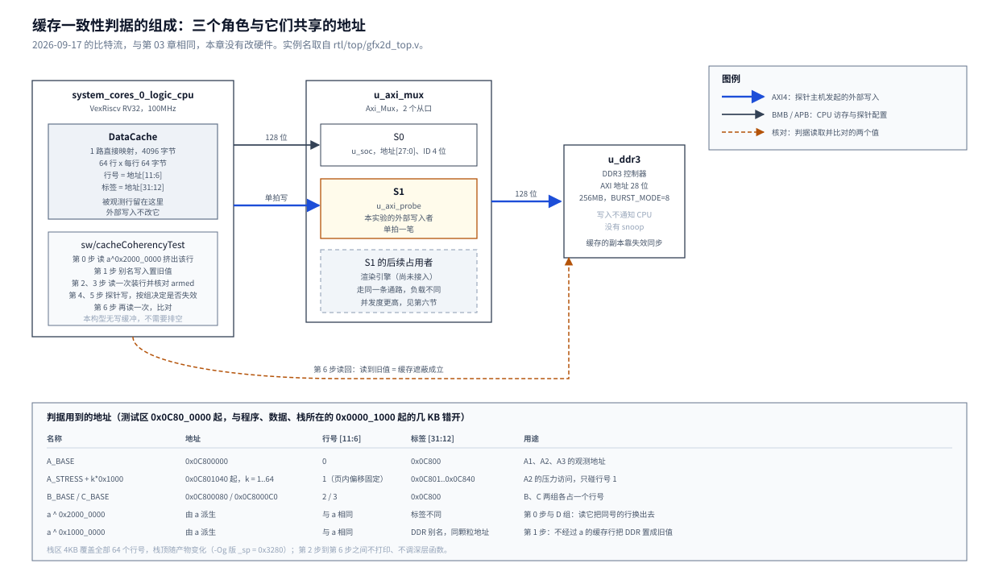

# 05 CPU 数据缓存与第二个主机写入的一致性

## 一、动机

第 03 章在 DDR3 上接入了第二个 AXI 主机，`u_axi_mux` 常驻在 SoC 与控制器之间，
暂由测量主机 `u_axi_probe` 占用从口 S1。将来占用 S1 的是渲染引擎，它会直接改写 DDR 里的
命令表结果与帧缓冲。这一章要回答的是：外部主机改写了 DDR 之后，CPU 再读同一块内存，
读到的是新值，还是 CPU 数据缓存里留着的旧副本。

**数据缓存**是 VexRiscv 处理器内部的一小块 SRAM，存着最近读过的 DDR 内容，
命中时不必走 AXI 去 DDR 取数。第 02 章从网表读出它的形状：1 路直接映射、共 4096 字节。
直接映射的意思是每个地址只可能落在固定的一行上，行号由地址的几位决定，
行里另存一个**标签**（地址的高位）用来判断这一行存的是不是这个地址。

这个问题直接决定驱动怎么写。设计文档 2.1 节靠一条约定绕开它：

> 共享区单向使用：命令表和素材 CPU 只写不读回，帧缓冲 CPU 只在软件渲染模式下写。

这条约定很贵：命令表写完不能读回校验，素材上传完不能复核，调试时不能用 CPU 读帧缓冲。
赛题基础要求里的「软硬件同帧 CRC 对比」恰好要在 CPU 侧读回后缓冲，
如果缓存会给旧值，这条判据必须先失效再读，而且要知道什么时候失效才算数。

第 02 章已经看到一个相关现象：CPU 自己经别名地址（`0x1000_0000` 以上）改写同一块内存之后，
原地址读到旧值。那次改写是 CPU 自己发起的，第 02 章据此推知「引擎写 DDR3 时缓存副本同样不会失效」。
这一章把推论变成用另一个主机做的实测，并回答驱动写法依赖的几件事：
另一个主机写入之后 CPU 是否读到旧值；失效指令能不能让 CPU 读到新值、要花多少周期；
失效的时机有什么要求；判据本身在不同编译档与代码布局下是否稳定。

## 二、为什么是这几步

一个一致性判据要把三件事分开：外部写入真的发生了、CPU 缓存里真的留着旧副本、失效真的起了作用。
少任何一件，观测到的值都可以用别的原因解释。由此拆成六步：

1. 让外部写入可预测：用探针主机按地址派生的图样写，读回任何一个字都能判断是谁写的；
2. 建立「DDR 与缓存里都是旧值」的状态，并在程序里核对它成立；
3. 选地址：被观测行只在需要时被换出，程序自己的访存不碰它；
4. 让判据与代码布局无关，并让注错能自证；
5. 把判据依赖的缓存行为逐条单独测出来（机理实验），包括失效指令的代价；
6. 打通上板链路。

第 2、3、5 步在这一章里都走过弯路。判据先后读到过上电垃圾值、稳定的新值、
第二轮 `armed=0`，每一次都要回头查缓存本身的行为，第四节按时间记了九个问题。
第三节只写定稿的做法。

## 三、每一步做了什么

### 3.1 可预测的外部写入

探针主机 `rtl/bus/axi_probe_master.v` 的写入图样写在文件头与 `pattern()` 函数里：

```verilog
// 数据图样：地址为 a 的那一拍，v = SEED + a[31:0]，
//           拍数据 = {v^A5A5A5A5, v^5A5A5A5A, ~v, v}。
// AXI 是小端，CPU 在地址 a 读到的 32 位字就是 v，在 a+4 读到 ~v，便于 CPU 侧核对。

function [127:0] pattern;
    input [31:0] seed;
    input [31:0] a;
    reg   [31:0] v;
    begin
        v = seed + a;
        pattern = {v ^ 32'hA5A5_A5A5, v ^ 32'h5A5A_5A5A, ~v, v};
    end
endfunction
```

128 位拍的拼接从高位到低位，小端下 CPU 在 `a` 读到最低那个字 `v`，
所以程序里的期望值写成一个函数 `fresh(a) = SEED + a`。`SEED` 取 `0x1357A5C0`，
地址 `0x0C800000` 上的新值就是 `0x1FD7A5C0`，它在串口输出里反复出现。

写一笔事务的寄存器取自同一份文件头：`LEN`（偏移 `0x0C`）送到 `awlen`，`LEN=0` 即单拍；
`COUNT`（`0x10`）是事务数；`MODE`（`0x14`）的 bit0 是 WRITE；`CTRL`（`0x00`）的 bit0 是 START；
`STATUS`（`0x04`）的 bit1 是 DONE。程序 `Main/sw/apps/test/cacheCoherencyTest/src/main.c` 的写法：

```c
static uint32_t probe_write(uint32_t a)
{
    wr32(R_ADDR, a);
    wr32(R_LEN, 0);
    wr32(R_COUNT, 1);
    wr32(R_MODE, MODE_WRITE);
    wr32(R_SEED, SEED);
    wr32(R_CTRL, 1);
    uint32_t st;
    do {
        st = rd(R_STATUS);
    } while (!(st & ST_DONE));
    return st;
}
```

硬件超时会**同时置 DONE 与 TIMEOUT**，只轮询 DONE 会把异常当成成功。
每一笔事务之后调用 `probe_check()` 核对五项：`STATUS` 的 bit2 TIMEOUT、bit3 RESP_ERR、
bit4 LAST_ERR 都不能置位，`TX_DONE`（`0x20`）等于期望事务数，`ERRS`（`0x2C`）全 0。
任一项异常打印 `probe_err` 并计入 `fail`。这一步的来历见 4.6 节。

### 3.2 读数序列

每一条判据都按下面的顺序走。第 0~3 步是 `arm_line()`，三种失效方式共用：

```
   时间
    |
    |  0  (void)*(a ^ 0x2000_0000)           读同行号、不同标签的地址：把 a 所在行换掉
    |  1  *(a ^ 0x1000_0000) = stale        别名写：DDR 里是旧值，标签不同，不经过 a 的行
    |  2  got = *a                          缓存未命中，从 DDR 装进这一行
    |  3  armed = (got == stale)            核对装进去的确实是旧值
    |  4  probe_write(a)                    探针单拍写：外部主机改写同一地址
    |  5  [可选] 失效                        A3、B 失效全部；C 只失效 a 那一行
    |  6  return *a                         紧跟一次读，中间不打印、不调深层函数
    v
   读到 stale  缓存遮蔽了外部写入（A 组要的结果）
   读到 fresh  缓存没有遮蔽（A3、B、C、D 要的结果）
```

```c
static int arm_line(uint32_t a, uint32_t stale)
{
    (void)*(volatile uint32_t *)(a ^ EVICT);        /* 0 挤出 a 所在行 */
    *(volatile uint32_t *)(a ^ ALIAS_BIT) = stale;  /* 1 DDR <- stale */
    uint32_t got = *(volatile uint32_t *)a;         /* 2 装行 */
    return got == stale;                            /* 3 */
}
```

每一步的依据：

- **第 0 步**防的是上一轮留下的缓存内容。A 组连跑两遍，第一遍的 A3 在失效之后读了一次 `a`，
  把探针写的新值装进了缓存；没有第 0 步时，第二遍第 1 步的别名写被这份缓存遮住，
  第 2 步读到 `1fd7a5c0`，`armed=0`。过程见 4.9 节。
  挤出用读访问完成，函数里没有失效指令（原因见 3.4 节）。
- **第 1 步用别名写**，因为 `a ^ 0x1000_0000` 落到同一个颗粒地址（第 02 章：高 4 位被丢弃，
  256MB 回绕），而它的标签与 `a` 不同，写它不改 `a` 那一行的缓存内容。
- **第 1、2 步之间不需要任何排空。** 这个 SoC 没有写缓冲：网表里 CPU 数据总线的桥是
  `dBus_Bridge_withoutWriteBuffer`，BSP 里写缓冲的排空接口 CSR `0x810` 读写都触发非法指令异常（T6），
  去掉任何排空步骤之后 16/16 装行成功（T3）。别名写返回时已经落到 DDR。过程见 4.4 节。
- **第 2 步用读来装行。** 只写不装行，写之后读一次会装行（T2）。本程序用别名写加读，
  是为了让 DDR 里的值与缓存里的值都是旧值，第 4 步之后两者才会分叉。
- **第 3 步的 `armed`** 核对的是第 2 步读到了旧值。有第 0 步保证第 2 步必然未命中，
  `armed=1` 就意味着这一行是从 DDR 刚装进来的旧值。没有第 0 步时，`armed` 可能在命中旧缓存时为 0，
  也可能在别的布局下偶然为 1，4.9 节的两种情形都出现过。

图 1 是这套读数序列涉及的三个角色与它们共享的地址。



**图 1** 判据的三个角色与共享的地址。CPU 先读同行号、不同标签的地址把被观测行换掉，
经别名写把 DDR 置成旧值，读一次装行并核对 `armed`；探针主机从 `Axi_Mux` 的 S1 改写同一地址，
CPU 再读一次，读到旧值即缓存遮蔽成立。图中实例名取自 `rtl/top/gfx2d_top.v`，本章没有改硬件。

组与子项：

```
P  cpu_to_prb         CPU 别名写 V_P，探针读回                     预期 V_P
A1 immediate          第 0~4 步，不失效，第 6 步                    预期旧值
A2 after_loads        第 0~3 步，访问 64 页行号 1 的地址，探针写，读  预期旧值
A3 invalidated_after  第 0~4 步，失效全部，第 6 步                  预期新值
B  invalidate_all     同 A3，地址 0x0C800080                        预期新值
C  invalidate_addr    第 0~4 步，失效 a 那一行，第 6 步              预期新值
D  evicted / word1    第 0~4 步，读 a^0x2000_0000 驱逐，读 a 与 a+4  预期 fresh 与 ~fresh
```

P 组与 D 组共同保证「探针确实写进了同一块 DDR 的同一个地址」：P 组的期望值是 CPU 的常量、
D 组的期望值是探针的图样，方向相反。A 组连跑两遍，第二遍检查反复性，
也检查第一遍留下的缓存状态不会串进来。

### 3.3 地址、缓存行与栈

缓存的行号取地址 `[11:6]`、标签取 `[31:12]`，每行 64 字节。这组位段由机理实验 T4 逐位测出（3.6 节）：
装行、探针写之后读 `a ^ (1 << k)`，`k = 12..31` 时 `a` 被挤出、`k = 0..11` 时不被挤出，
`evict_mask = fffff000`。

```
              地址                          行号        标签
  位  31 ...... 12 | 11 ..... 6 | 5 ....... 0
        标签       |   行号     |  行内偏移
        (20 位)        (6 位)       (6 位)

  0x0C800000  标签 0x0C800  行号 0   A1、A2、A3 的观测地址
  0x0C801040  标签 0x0C801  行号 1   A2 的压力访问起点，之后每页 +0x1000，共 64 页
  0x0C800080  标签 0x0C800  行号 2   B 组
  0x0C8000C0  标签 0x0C800  行号 3   C 组
  0x0C801000  标签 0x0C801  行号 0   D 组（与 A 同行号，不同标签）
  0x0C802000  标签 0x0C802  行号 0   P 组

  a ^ 0x2000_0000   翻转第 29 位：行号不变、标签不同，读它会把 a 那一行换出去
  a ^ 0x1000_0000   翻转第 28 位：DDR 别名，落到同一颗粒地址，标签不同
```

程序自己的访存也走数据缓存。栈、全局变量、`bsp_printf` 读的字符串都在 `0x0000_1000` 起的几 KB 内，
它们落到与被观测行相同的行号上，就会把被观测行挤出去。链接脚本 `default.ld` 给栈留 4KB，
正好覆盖全部 64 个行号。实测栈顶随产物变化：`cacheCoherencyTest` 的 `-Og` 版 `_sp = 0x3280`，
`-O0` 版约 `0x4450`，`cacheMechTest` 是 `0x3b00`（`sp_row = 43`）。
所以读数序列在第 2 步与第 6 步之间不打印、不调用深层函数；`cacheMechTest` 启动时打印 `sp_row`，
并把各组的行号段放在它之外。4.9 节的第二遍 `armed=0` 在旧布局下能过，正是因为打印字符串
碰巧落在第 0 行、把那一行挤了出去。

### 3.4 三种失效方式各占一个函数

失效指令来自 BSP 的 `sdk/software/standalone/driver/vexriscv.h` 第 25~35 行：

```c
//Invalidate the whole data cache
#define data_cache_invalidate_all() asm(".word(0x500F)");

//Invalidate all the data cache ways lines which could store the given address
#define data_cache_invalidate_address(address)     \
({                                             \
    asm volatile(                              \
     ".word ((0x500F) | (regnum_%0 << 15));"   \
     :                                         \
     : "r" (address)                               \
    );                                         \
})
```

`0x500F` 是 VexRiscv 的私有指令。带地址那条把地址所在寄存器的编号叠进 bit[19:15]，
所以落地的编码随编译器选的寄存器变化：本章产物里见过 `0x4500f`（s0）、`0x4d00f`（s1）、`0x7d00f`（a5）。
核对某处失效指令是否存在，要按函数逐条看反汇编，不能按字符串计数（4.8 节）。

机理实验 T10 发现：**紧跟在一条跳走的条件分支后面的失效指令，即使在架构上没有执行，也会清掉数据缓存**，
全清与按地址两种都会；分支与失效指令之间隔一条 `nop` 就不会（3.6、5.3 节）。
一种解释是失效指令进入流水线的某一级就触发了清除，没有等分支结果把它冲刷掉；
这是依据现象的推测，没有读 VexRiscv 源码核实。

对判据的影响是：如果把「不失效 / 失效全部 / 失效单地址」写成同一个函数里的 `if`，
编译器可能把失效指令排在 `bne` 之后，不失效的那条路径就会被误清。
真 `-O0` 编译的旧版程序正是这样在 64 个行号上全部失败（4.7 节）。
定稿把三种方式拆成 `coherency_read_none`、`coherency_read_all`、`coherency_read_addr` 三个函数，
`coherency_read_none` 与 `arm_line` 里没有失效指令：

```c
static uint32_t coherency_read_none(uint32_t a, uint32_t stale, uint32_t *st_out, int *armed)
{
    *armed = arm_line(a, stale);
    *st_out = probe_write(a);
    return *(volatile uint32_t *)a;
}

static uint32_t coherency_read_all(uint32_t a, uint32_t stale, uint32_t *st_out, int *armed)
{
    *armed = arm_line(a, stale);
    *st_out = probe_write(a);
#if !SKIP_INVALIDATE
    data_cache_invalidate_all();
#endif
    return *(volatile uint32_t *)a;
}
```

逐条核对了两种编译档的反汇编：`coherency_read_all` 与 `coherency_read_addr` 里的失效指令前一条都是 `sw`，
不在任何分支之后；`timing()` 里有两处排在循环出口的条件分支之后，最多多清一次，不影响计时。

两个宏都没有 `"memory"` clobber，全清那条连 `volatile` 都没有。编译器在优化档下仍可能把内存访问
移过失效指令。驱动要在读回共享区之前可靠地失效，应当自己包一层带 `"memory"` clobber 的调用，
并避免把它直接放在条件分支之后。

### 3.5 前置自检、注错与注错自检

**注错见红**是这一章判据的核心：失效指令是一句没有返回值的汇编，写错地址、写错寄存器、
被优化掉都不会有编译期提示，只有在它必须生效的地方报 FAIL 才能证明它生效了。

`make INJECT=1` 加 `-DINJECT_NO_INVALIDATE`，去掉 A3、B、C 的失效调用。
预期变红的输出行是 A3 两行（A 组跑两遍）加 B、C，共四行。输出的 `expect=` 一栏在所有编译模式下
都打正常模式的期望值，FAIL 行读起来永远是「期望新值、读到旧值」。
标了 `inject_fail` 的行在注错模式下变红时打 `FAIL (inject)` 且不计入 `fail`；
没变红时打 `NOT_RED (inject)` 并**计入** `fail`：

```c
if (expected_fail) {
    bsp_printf("%s %s expect=%s got=%s %s (inject)\r\n",
               r[i].tag, r[i].sub, e, g, ok ? "NOT_RED" : "FAIL");
    if (ok)
        fail++;
} else {
    bsp_printf("%s %s expect=%s got=%s %s\r\n",
               r[i].tag, r[i].sub, e, g, ok ? "ok" : "FAIL");
    if (!ok)
        fail++;
}
```

这样注错版的 `fail 0` 就等于「四处都红了」。为了证明这一点，`make INJECT=2` 再加 `-DINJECT_REPORT_ONLY`：
输出按注错模式判定，失效调用保留。这一版必须四行 `NOT_RED (inject)`、末尾 `fail 4`。
它模拟的是「注错宏没进编译命令行」，本章在 4.8 节真实遇到过这种情况。

注错宏必须在 makefile 的 include 之前经 `CFLAGS_ARGS` 带进去。`standalone.mk` 第 54 行用
`$(foreach …)$(eval …)` 在解析期固化编译规则，include 之后再 `CFLAGS +=` 不生效（4.8 节）：

```makefile
INJECT ?= 0
ifeq ($(INJECT),1)
    CFLAGS_ARGS += -DINJECT_NO_INVALIDATE
endif
ifeq ($(INJECT),2)
    CFLAGS_ARGS += -DINJECT_NO_INVALIDATE -DINJECT_REPORT_ONLY
endif
```

### 3.6 机理实验 cacheMechTest

一致性判据成立要靠几条关于缓存本身的事实，而这些事实在本章过程中都被猜错过（第四节）。
`Main/sw/apps/probe/cacheMechTest` 把每一条做成一组独立判据，每组开头先失效全部缓存，自带期望值，
不符即计入 `fail`。各组的做法与要回答的问题：

- **T1** 4096 个不同页的地址，各写一个值后立刻读回：CPU 写后读会不会读到别的值。
- **T2** 先读 `a^EVICT` 让行被别的标签占住，再用三种办法各做 16 次（只写、写后读一次、别名写后读一次），
  之后经别名写新值、读 `a`：哪种访问会把行装进缓存。
- **T3** 挤出、别名写旧值、读、探针写、读，中间没有任何排空，16 次：需不需要排空写缓冲。
- **T4** 失效、别名写、读、探针写、读 `a^(1<<k)`、读 `a`，`k = 0..31`：行号与标签取哪几位。
- **T5** 别名写旧值、失效全部、读、探针写、读，8 次：失效早于外部写入时是否有效。
- **T6** 临时把 `mtvec` 指向记录函数，`csrr` 与 `csrw` CSR `0x810`：BSP 的写缓冲接口是否存在。
- **T7** 装行之后做 8 次 APB 读、8 次 APB 写或一次探针写别处，行号 0 与 5 各 8 次：IO 访问会不会挤掉行。
- **T8** 装行的那次读之后紧跟写栈、写别的行、读别的行、写同一行、空转后写栈：紧跟的访问会不会让行作废。
- **T9** 装行与探针写之间、探针写与读之间，插入寄存器空转 10 万次或栈空转 2 万次：与时间长短有没有关系。
- **T10** 汇编 `bnez a0,1f; .word 0x500F; 1: ret`，`a0 = 1`，另有隔 1 条、2 条 `nop` 与按地址失效的变体：
  跳过的失效指令会不会清缓存。
- **T11** 计数只放寄存器的 1000 次循环：空、全清、单地址失效、两次命中读、两次未命中读：
  失效指令本身与重新装行各多少周期。

实测数据在 5.3 节。T10 的汇编辅助函数：

```
skip_all_0:     bnez a0, 1f          skip_all_1nop:  bnez a0, 1f
                .word 0x500F                         nop
            1:  ret                                  .word 0x500F
                                                 1:  ret
```

T6 的 CSR 探测用一个汇编陷阱入口 `trap_rec`：记下 `mcause` 与 `mtval`，`mepc += 4` 后 `mret`，
探测完恢复原来的 `mtvec`。

### 3.7 失效代价的测法

计时用 `clint_getTimeLow(BSP_CLINT)`。`SYSTEM_CLINT_HZ = 100000000`，
`sdk/software/standalone/driver/clint.h` 第 133 行 `mTimePerUsec = hz / 1000000`，
即 100 个 tick 为 1 µs、**1 tick = 10 ns**；`core_clk` 是 100MHz，所以一个 tick 就是一个 CPU 周期。
单条失效指令只有几个到几十个周期，与读计时器本身的开销同量级，不能逐次打点，
所以打点包住 1000 次，再减去同样 1000 次的空循环。

`cacheCoherencyTest` 的 `timing()` 在循环体里写一个 `volatile` 的栈变量 `sink`。
这样测到的「全清」包含了全清之后栈所在那一行重新装入的代价（4.8 节）。
`cacheMechTest` 的 T11 把循环计数放在寄存器里、循环体不访问栈，失效指令与装行才分得开：

```
loop_all:   bltu  a4, a5, exit      计数 a5 在寄存器
            nop
            .word 0x500f            全清
            addi  a5, a5, 1
            j     loop_all

loop_two_misses:                     a 与 a^0x2000_0000 同行号、不同标签，互相挤出
            lw    a5, 0(a0)          未命中
            lw    a5, 0(a0 ^ EVICT)  未命中
```

两套数都保留：前者是「全清之后程序接着跑」的实际开销，后者是拆开的成分。

### 3.8 上板链路

板上 Flash 里是出厂比特流，其中没有本工程的 SoC。每次上电后要先用 JTAG 加载本工程的比特流，
否则 OpenOCD 能认到 TAP 却停不住 CPU，报 `Error: timed out while waiting for target halted`：

```
<EFINITY>\pgm\bin\ftdi_pgm.bat -m jtag -u ftdi://0x0403:0x6011:0:ff/1 fpga\gfx2d_ti60\outflow\gfx2d_ti60.bit
```

串口必须在加载程序之前打开，程序跑完再打开就一个字节都读不到。本机的分工是：
OpenOCD 走 WSL 调 Windows 的 `openocd.exe`，串口由 `Main/tools/serial_capture.ps1` 在 Windows 侧读。

```
主机 (WSL)                                主机 (Windows)                      板子
  |                                            |                                |
  | 1  serial_capture.ps1 后台启动             |                                |
  |    pwsh -File ... -Port COM11              |--- 打开 COM11 ---------------->|
  |                                            |                                |
  | 2  run_openocd.sh                          |                                |
  |    wslpath 把 bin 与 sdk 转成 Windows 路径 |                                |
  |    openocd.exe -c "set ::env(...)" ...     |                                |
  |      reset halt                            |--- JTAG ---------------------->|
  |      load_image {<bin>} 0x1000 bin         |                                |
  |      resume 0x1000                         |                                |
  |                                            |<-- COM11 逐行输出 -------------|
  |                                            |    写进 <日志>                  |
  | 3  读 <日志>                               |                                |
  v                                            v                                v
```

`tools/board_run.py` 在本机需要多设一个环境变量才可用（**订正 2026-09-18**，本章初稿记的是「本机用不了」）：
Efinity 自带的 Python（`<EFINITY>/python311`）的 `python.exe` 在 `bin\` 下、标准库在同级的 `..\Lib`，
Python 推不出 prefix，不设 `PYTHONHOME` 时报 `ModuleNotFoundError: No module named 'encodings'`；
设 `PYTHONHOME=<EFINITY>\python311` 之后它带 pyserial 3.5，`board_run.py --list-ports` 正常。
另有一半在 WSL：WSL 里有 pyserial 3.5，但拿不到 Windows 的 COM 口。
下面这套「WSL 只调 `openocd.exe`、串口由 Windows 侧读」的分工是 E3 当时实际用的链路，
本文记录它的用法与两处坑；它不依赖 `board_run.py`，继续可用。
另有两处要绕：

- WSL 不把自定义环境变量传给 Windows 进程，`tools/openocd/gfx2d_debug.cfg` 第 59 行要的 `workspace_loc`
  设不进去，报 `can't read "::env(workspace_loc)": no such element in array`。
  改用 `-c "set ::env(workspace_loc) {…}"` 在 Tcl 里填；`openocd.exe` 读不了 `/mnt/<盘符>/...`，用 `wslpath` 转换。
  `run_openocd.sh` 按 `EFINITY_IDE_HOME`（或由 `EFINITY_HOME` 推出）找 `openocd.exe`。
- `serial_capture.ps1` 第一版用 `BaseStream.Read`，那是阻塞调用，`ReadTimeout` 对它不生效，
  采集进程不按时退出并一直占着 COM 口，第二次采集报 `Access to the path 'COM11' is denied`。
  改成逐字节 `ReadByte` 并在每次循环里查时钟。

加载前的 `reset halt` 不能省，4.5 节是没有它时的现象。

## 四、遇到的问题

### 4.1 判据第一版：A 组读到上电垃圾值（原因未查清）

**第一现场。** 第一版 A 组的顺序是「CPU 写入旧值、读一次、探针写、CPU 读」，
编译产物 4442 字节，第一次上板：

```
IDENT id=0x41584950 arb=0x00000006 ok
P cpu_to_prb expect=1fd7f5c0 got=1fd7f5c0 ok
A just_loaded expect=c0de0001 got=dbded39e FAIL
A after_loads expect=c0de0001 got=1fd7a5c0 FAIL
A dirty_line expect=c0de0004 got=c0de0004 ok
A read_byte expect=00000003 got=0000009e FAIL
A read_half expect=00000003 got=0000f39e FAIL
A read_word expect=c0de0003 got=dbdef39e FAIL
A word0 expect=c0de0005 got=1fd7d600 FAIL
A word1 expect=3f21fffa got=e02829ff FAIL
B invalidate_all expect=1fd7a5c0 got=1fd7a5c0 ok
C invalidate_addr expect=1fd7a5c0 got=1fd7a5c0 ok
D evicted expect=1fd7a5c0 got=1fd7a5c0 ok
fail 14
```

**解读。** `1fd7a5c0` 是地址 `0x0C800000` 上探针写入的值，探针写入与地址译码是对的。
`dbded39e`、`9e`、`f39e` 不是程序里任何一次写入的值，当时判断是 DDR 加电以来没被写过的内容。
`dirty_line` 读到 CPU 自己写的 `c0de0004`，是唯一符合预期的一项。

**定位。** 当时排除了四个方向：读被优化掉（反汇编里 `0x14f0: lw a5,0(a0)` 在）、
测试地址与程序同行（测试区在 `0x0C80_0000` 起）、探针写到别处与地址译码有问题（P、D 两组对得上）。
当时的判断是「写之后读一次没把行装进缓存」，这个判断后来被机理实验推翻：
T1 在 4096 个地址上写后立刻读回，0 次不符；T2 证明写后读一次会装行（16/16）。

**根因与修法。** 根因未查清。第一版源码没有保留，无法复跑，只能记为原因不明。
它和缓存装行机理无关（T1、T2），更可能是第一版判据本身的地址或顺序问题。
修法是整套换成 3.2 节的读数序列。

原判据为什么没有覆盖到它：第一版没有 `armed` 这类核对，
「读一次就装行」这个前提没有任何一步去证伪；源码没有随日志一起保留，事后也无从复核。

### 4.2 判据第二版：A 组稳定读到新值（推测与 T10 同源）

**第一现场。** 第二版改成「先读一次、写、空转、探针写、读」：

```c
(void)*(volatile uint32_t *)a;   /* 先读一次，让测试行进缓存 */
wr(a, stale);
spin(SPIN);
*st_out = probe_write(a);
return *(volatile uint32_t *)a;
```

```
A just_loaded expect=c0de0001 got=1fd7a5c0 FAIL
A after_loads expect=c0de0001 got=1fd7a5c0 FAIL
A dirty_line expect=c0de0004 got=1fd7b5c0 FAIL
A read_byte expect=00000003 got=000000c0 FAIL
A read_word expect=c0de0003 got=1fd7c5c0 FAIL
A word0 expect=c0de0005 got=1fd7d600 FAIL
A word1 expect=3f21fffa got=e02829ff FAIL
fail 16
```

**解读。** A 组从随机变成稳定读到探针的新值。读进来之后 CPU 又写了一次，
按缓存的正常行为，这一行命中、写入同时更新缓存与 DDR，探针再写 DDR 之后，
CPU 读缓存应当得到自己写的 `c0de0001`。稳定读到新值，说明在探针写之后、最后一次读之前，这一行被清掉了。

**定位。** 当时的解释是「缓存里根本没有旧副本，问题在装行」，于是转去写最小实验（4.3 节）。
事后对照 T10：第二版的 `coherency_read` 是一个函数，用 `if (apply == …)` 选择是否失效，
与 4.7 节在真 `-O0` 下 64 行全部失败的结构相同。如果编译器把失效指令排在了分支之后，
A 组每次都会被误清，输出就是这个样子。第二版源码同样没有保留，这一条是**推测**，未复核。

同一版里还修掉了一处自己写的缺陷：A2 的压力访问原先用 `LINE_ALIAS + (k+1)*PAGE`，
页内偏移为 0，行号都是 0，与测试行同号，等于自己把测试行挤掉。改成固定页内偏移 `0x040`，只落在行号 1。

**根因与修法。** 推测的根因是 T10；定稿的修法是 3.4 节的三函数结构。

原判据为什么没有覆盖到它：判据只看最后一次读的值，没有办法区分「缓存从没装上」与「装上之后被清掉」。
T10 这种由代码布局触发的清除，只有在同一份源码换编译档时才会暴露（4.7 节）。

### 4.3 最小实验 cacheMinTest 的关键对照无效

**第一现场。** 为了把问题限定在缓存本身，新写 `Main/sw/apps/probe/cacheMinTest`，去掉外部主机，只问三件事：
同一地址连读两次、写之后读回、CPU 经别名写入之后原地址读到什么。原始输出（2026-09-18 复跑，与当时相同）：

```
S1 no_ddr_between expect=c0de00a1 got=c0de00a1 ok
S1 other_ddr_between expect=c0de00a1 got=c0de00a1 ok
S1 evicted_same_line expect=c0de00a1 got=c0de00a1 ok
S2 write_then_read expect=c0de00a1 got=c0de00a1 ok
S2 alias_no_evict expect=c0de00a1 got=c0de00a1 ok
S2 alias_then_evict expect=c0de00b2 got=c0de00b2 ok
S3 CACHE_NOEVICT expect=00000011 got=22 FAIL
S3 CACHE_EVICT   expect=00000022 got=22 ok
fail 0
done
```

**解读。** 当时读出两条：S3 与 `sw/apps/probe/ddrAliasTest` 的 `CACHE_NOEVICT` 同手法，那边读到旧值 `11`、这边读到 `22`，
于是认定「写之后读一次不能把行装进缓存」；并据此把正式判据改成「别名写、等写缓冲排空、读一次核对 `armed`」。

**定位。** S3 的序列是：

```c
*q = (uint8_t)V_Q_OLD;                       /* 写 Q */
(void)*(volatile uint8_t *)(Q ^ EVICT);      /* 读同行号、别的标签的地址 */
*(volatile uint8_t *)(Q ^ ALIAS) = V_Q_NEW;  /* 别名写，改 DDR */
uint8_t stale = *q;                          /* 不驱逐，预期旧值 */
```

第二行读 `Q ^ EVICT`，它与 `Q` 行号相同、标签不同，这一步本身就把 `Q` 那一行换掉了，
`stale = *q` 未命中、从 DDR 取回别名写之后的新值 `22`。这个结果与「写有没有装行」无关。
`ddrAliasTest` 的 `rd8_fresh(CACHE_Q)` 同样读 `Q ^ EVICT`，两边的差别只在调用顺序，
也不足以把装行单独隔离出来。这个问题的正确答案由 T2 给出：只写 0/16 装行，写后读一次 16/16。

S1 `evicted_same_line` 与 S2 `alias_no_evict` 两项当时没有结论，曾被怀疑与写缓冲转发有关。
这个 SoC 没有写缓冲（4.4 节），两项的现象本章仍未逐条解释。

**根因与修法。** 根因是用一次本身会驱逐的访问去搭观测的前置条件，而没有任何一步证明前置条件成立。
`cacheMinTest` 降级为「现象可复现」保留，源码注释据此改写（改注释后产物 SHA256 仍是 `ea0556fddb1f214a…`）；
装行规则改由 `cacheMechTest` 的 T2 支撑。

原判据为什么没有覆盖到它：判据只报 FAIL，不检验这个 FAIL 是不是由想测的那个原因造成的。

### 4.4 写缓冲是假设出来的

**第一现场。** 判据第三版在别名写与装行读之间调用 BSP 的 `soc_write_buffer_flush()`
（`vexriscv.h` 第 41 行：写 CSR `0x810` 置 1，再循环读到 0），上板串口停在 `IDENT` 之后，程序挂死。
随后改成空转 `spin(32)`，又改成读一次 APB 寄存器（`wbuf_drain()`，理由写的是「读非 DDR 从设备时 CPU 必须先把排队的 DDR 写发出去」），
两种写法判据都能通过。

**解读。** 当时把挂死解释为「CSR `0x810` 在本构型里没有实现忙位自动清零」，
把后两种写法解释为「经验上能排空写缓冲，但不是架构保证」，并把这条不确定写成报告里的一处保留意见。

**定位。** 复核时查了两处证据。SoC 网表 `fpga/gfx2d_ti60/ip/soc/soc.v` 第 1126 行附近，
CPU 数据总线桥的信号名是 `dBus_Bridge_withoutWriteBuffer_busCmdContext_isWrite`；
T6 实测 CSR `0x810`：

```
T6 csrr_0x810 a0=deadbeef mcause=00000002 mtval=81002573
T6 csrw_0x810 mcause=00000002 mtval=81039073 mtvec_restored=00000000
```

`mcause = 2` 是非法指令异常，`mtval` 是出错的那条 `csrr`/`csrw` 指令本身，`a0` 没有被写。
CSR `0x810` 不存在，BSP 的排空接口一执行就陷入异常，而启动代码没有设陷阱入口（`mtvec = 0`），
表现就是挂死。再看排空这一步有没有作用：T3 去掉任何排空，16 次 `armed` 与 16 次读到旧值全部成立；
把 `cacheCoherencyTest` 的 `wbuf_drain()` 改成空函数，判据同样全过。

**根因与修法。** 这个 SoC 生成时就没有写缓冲，CPU 的写在返回前已经落到 DDR。
读数序列删掉排空步骤，文件头与本章相应的解释全部删除。

原判据为什么没有覆盖到它：判据证明了「加了排空能通过」，从来没有证明「不加排空就不通过」。
一个步骤是否必要，要靠去掉它的对照组来证明。

### 4.5 加载前没有复位，程序静默不跑

**第一现场。** 改动判据之后上板，串口 31 秒收到 0 字节，而 `load_image` 与 `resume` 都报成功：

```
4730 bytes written at address 0x00001000
downloaded 4730 bytes in 0.256142s (18.034 KiB/s)
shutdown command invoked
# COM11 ... total 0 bytes
```

**解读。** 现象与「程序有 bug，一行都不跑」相同。

**定位。** 先在新代码里找了很久（排空、`probe_check`、声明顺序），逐个排除之后，
把此前跑通过的旧二进制用同样方式加载，也是零输出，范围就从新代码缩到加载流程。
差别在于复核时手工敲的命令带 `reset halt`，而 `tools/run_openocd.sh` 没有。
探针主机被前一次实验留在坏状态（挂住总线）时，不复位直接加载运行，程序不能正常起来。
加上 `reset halt` 后同一份旧二进制立刻恢复输出。

**根因与修法。** `run_openocd.sh` 补上 `reset halt`。`Main/doc/开发环境.md` 第 6 节本来就写了加载前必须复位，脚本没有照做。

原判据为什么没有覆盖到它：这是加载流程的问题，程序判据覆盖不到。
改动判据之后输出全空，先用已知可用的二进制确认链路，再怀疑新代码。

### 4.6 探针错误会让判据假通过

**第一现场。** 早期判据每笔探针事务之后只轮询 DONE：

```c
do { st = rd(R_STATUS); } while (!(st & ST_DONE));   /* TIMEOUT 一起置位时也会退出 */
return st;                                            /* 调用方原先不看 TIMEOUT */
```

**解读。** 硬件超时同时置 DONE 与 TIMEOUT，轮询正常退出。一轮事务超时之后 `TX_DONE` 不增加，
判据却只比较读回的数据，极端情况下末尾仍是 `fail 0`，而读到的东西与外部写入无关。

**定位。** 探针文件头写明了另外三项异常标志：`STATUS` 的 RESP_ERR、LAST_ERR，
以及 `ERRS` 的 [15:0] 非 OKAY 响应计数与 [31:16] 读比对失配拍数，判据都没有用。

**根因与修法。** 新增 `probe_check()`，每笔事务之后核对五项，见 3.1 节。
本章所有上板日志里 `probe_err` 一次也没出现。

原判据为什么没有覆盖到它：设计时假设探针事务要么成功、要么挂住，没有想到「超时后正常返回」这个中间态。

### 4.7 真 -O0 编译时判据在 64 个行号上全部失败

**第一现场。** 文档与 makefile 原先都写「用 `DEBUG=yes` 取 `-O0`，保证失效指令按源码执行」。
复核时发现实际编译档是 `-Og`，另加 `DEBUG_OG=no` 编出真正的 `-O0` 版（9290 字节），上板：

```
A armed=1 ok
A immediate expect=c0de00a1 got=1fd7a5c0 FAIL
A after_loads expect=c0de00a1 got=1fd7a5c0 FAIL
A invalidated_after expect=1fd7a5c0 got=1fd7a5c0 ok
A armed=0 FAIL
A immediate expect=c0de00a1 got=1fd7a5c0 FAIL
A after_loads expect=c0de00a1 got=1fd7a5c0 FAIL
A invalidated_after expect=1fd7a5c0 got=1fd7a5c0 ok
B armed=1 ok
B invalidate_all expect=1fd7a640 got=1fd7a640 ok
C armed=1 ok
C invalidate_addr expect=1fd7a680 got=1fd7a680 ok
D evicted expect=1fd7b5c0 got=1fd7b5c0 ok
D word1 expect=e0284a3f got=e0284a3f ok
fail 5
```

同一份源码的 `-O0` 注错版（去掉失效调用）却是 `fail 0`、四行 `FAIL (inject)`。

**解读。** 编译档来自两处：程序 makefile 的 `DEBUG=yes`，与 BSP 的 `sdk/bsp/efinix/EfxSapphireSoc/include/soc.mk`
第 8 行 `DEBUG_OG?=yes`。`riscv64-unknown-elf.mk` 第 39~45 行在两者都成立时加 `-g3 -Og`，
`make -n` 与产物的 `DW_AT_producer`（`GNU C17 8.3.0 -Og`）都证实了这一点。
`-O0` 版里需要读到旧值的 A1、A2 读到新值，需要读到新值的全过；去掉失效指令之后反而全过。

**定位。** 依次排除：

- 行号冲突。把 A 组挪到第 40 行（`A_BASE = 0x0C800A00`），仍然 `fail 5`。
  再写扫描版，对 64 个行号各跑一次不失效的读数序列：`-O0` 版 `stale rows hi=00000000 lo=00000000`
  （0/64 留住旧值，`armed` 64/64），同一份源码的 `-Og` 版 `hi=ffffffff lo=ffffffff`。与行号无关。
- 排空步骤。`-O0` 版去掉 `wbuf_drain()` 仍然 `fail 5`。
- IO 访问与装行之后的普通访问。T7、T8 各种组合都是 8/8 留住。
- 反汇编。`-O0` 版 `coherency_read` 里：

```
25e8:  bne   a4, a5, 25f4       apply != APPLY_ALL 时跳走
25ec:  .word 0x500f             失效全部，A1/A2 路径上在架构上不执行
25f0:  j     2608
```

A1、A2 带 `APPLY_NONE`，分支跳走，失效指令不执行，但它紧跟在分支之后。
用 T10 的汇编直接构造这个情形，分支必跳，结果 0/8 留住；隔两条 `nop`（后来补测一条）就是 8/8。

**根因与修法。** 紧跟在跳走的分支之后的失效指令仍会清缓存（T10）。`-Og` 版碰巧把失效指令放在 `ret` 之后
用 `j` 跳过去，所以没有暴露。修法是 3.4 节的三函数结构，拆开之后 `-O0` 版正常版 `fail 0`、注错版四行变红。
编译档的写法同步订正为 `-Og`。

原判据为什么没有覆盖到它：判据只在一种编译档下跑过，而这个缺陷由指令布局触发。
同一份判据换编译档复跑，是检查「结果与布局无关」的最低成本办法。

### 4.8 输出、注错与计数上的四处错误

**（一）输出格式把注错结果说反了。** 判据第三版第一次在注错版里看到：

```
B invalidate_all  expect=c0de00b1 got=c0de00b1 ok
C invalidate_addr expect=c0de00c1 got=c0de00c1 ok
```

`expect=` 取的是「注错模式的期望值」，被填成旧值，读到旧值于是判成 `ok`，而同一份程序里 A3 报了 FAIL。
改的时候走了两次弯路：把「注错时判定取反」放进公共的 `report_all`，连 P、D 也一起取反，写出 `fail 5`；
改成每条记录一个取反标志，仍把读到旧值当通过的理由。定稿是参考值只留一个（正常模式的期望值），
删掉 `expect_inject` 字段，预期变红的行用 `inject_fail` 标出。

**（二）注错版的 `fail 0` 不能自证。** 上一步定稿后，`inject_fail` 行一律不计 `fail`。
复核时构造「进入注错模式但失效调用保留」的变体，四行都打 `ok (inject)`，末尾仍是 `fail 0`，
与真正注错成功的输出末尾相同。注错宏确实没生效过：第一版 makefile 在 include 之后 `CFLAGS += -DINJECT_NO_INVALIDATE`，
注错版与正常版 SHA256 完全相同（`c1018147a5265efd…`），`$(info)` 打印显示宏在变量里，根因是 `standalone.mk` 第 54 行
在解析期固化规则；第一次验证时还用了 `make clean`，当时 makefile 没有 `clean` 目标，错误被 `2>&1 | tail` 吞掉，
`build_inject/` 里留着正常版的 `.o`，两版又一次「相同」，改成显式 `rm -rf` 才看清。
修法是 3.5 节的 `NOT_RED` 计数与 `INJECT=2` 自检版。另外 A2 的 `inject_fail` 曾被置 1，
它本来就没有失效调用，这个标志只会让它在注错模式下脱离检查，已改回 0；
源码注释里「A2 的压力访问在失效关掉时把它挤出」的说法与输出不符（A2 两种模式下都读到旧值），已删除。

**（三）失效指令用字符串计数。** 曾用「`.word(0x500f)` 由 3 处降到 2 处」证明注错版去掉了失效调用。
带地址那条的编码随寄存器变（`0x4d00f` 等），根本不含 `500f` 这个字符串，3 降到 2 只反映了全清那一条。
改为按函数逐条核对反汇编（3.4 节）。

**（四）文档里的常数与表述。** 复核对着原始日志逐项核对，订正了下面几处：

- 时间单位。原先把一个 tick 当成 `core_clk` 的 10 个周期，把全清写成 13.5 ns、单地址约 5 ns。
  实际 1 tick = 1 个周期 = 10 ns。全清一项差 100 倍（13.5 ns 与 1.35 µs），单地址一项差 10 倍（5 ns 与 50 ns）。
- 单地址失效的 1000 次总量写成 18104，原始值是 `0x46f8` = 18168。
- 「测量分辨率 13 个周期」。13 个周期是空循环本身的开销；打点包住 1000 次再除以 1000，
  计时量化带来的分辨率是 0.001 tick 量级。
- 栈地址写成「实测约 `0x3FEDD0`，行号 27」。链接产物里 `_sp = 0x3280`（行号 9 附近），栈区 4KB 覆盖全部行号（3.3 节）。
- 工具链对比。原先写「同一份源码用 IDE 自带 GCC 13.4.0 重编得 4570 / 4650 字节，空循环差约 8%」。
  那两份产物的反汇编里没有 `probe_check`，日志里多出当前源码不会打印的 `A status` 行，编译的是更早的源码，
  这个对比不成立。相关日志已不在仓库里，本章不再引用。
- 「全清约 135 个周期」包含了全清之后栈那一行重新装入的约 69 个周期，失效指令本身约 67 个周期（T11，5.4 节）。

这几处都是上板判据拦不住的：程序输出是对的，错在对输出的转述。
本章这一轮的做法是原始日志随程序入库（`Main/sw/*/logs/`），正文里的每个数都能在日志里找到。

### 4.9 拆函数之后第二遍 A 组 armed=0

**第一现场。** 按 4.7 节拆成三个函数、删掉排空之后，正常版稳定 `fail 3`，两次运行失败位置完全一致：

```
A armed=1 ok
A immediate expect=c0de00a1 got=c0de00a1 ok
A after_loads expect=c0de00a1 got=c0de00a1 ok
A invalidated_after expect=1fd7a5c0 got=1fd7a5c0 ok
A armed=0 FAIL
A immediate expect=c0de00a1 got=1fd7a5c0 FAIL
A after_loads expect=c0de00a1 got=1fd7a5c0 FAIL
A invalidated_after expect=1fd7a5c0 got=1fd7a5c0 ok
fail 3
```

当时加了一条诊断，在探针写之后用探针读回 DDR：

```
DIAG after_probe a=0c800000 val=1fd7a5c0 stale=c0de00a1
```

**解读。** 第二遍 A1 的第 2 步没有读到旧值，读到了探针的值。诊断读到 DDR 里是探针的值，
当时据此认为「CPU 的别名写没有在装行读之前落到 DDR，与探针上一次写的余波竞争」，
又在装行读之前加了一次丢弃的读去「排空」，没有效果。

**定位。** 那条诊断放在探针写之后，DDR 里是探针的值是必然的，它区分不了「别名写没落地」与「缓存遮蔽」。
把诊断挪到别名写之后、CPU 读之前：

```
DIAG2 a=0c800000 ddr_after_alias=c0de00a1 cpu_read=c0de00a1 stale=c0de00a1
A immediate expect=c0de00a1 got=c0de00a1 ok
...
DIAG2 a=0c800000 ddr_after_alias=c0de00a1 cpu_read=1fd7a5c0 stale=c0de00a1
A armed=0 FAIL
```

第二遍里 DDR 已经是旧值 `c0de00a1`，别名写落地了；CPU 读到的 `1fd7a5c0` 来自缓存。
来源是第一遍的 A3：失效之后第 6 步读 `a`，把探针写的新值装进了缓存。第二遍的别名写不经过这一行，
读 `a` 命中，得到上一遍留下的新值。这就是本章要测的遮蔽现象，被遮住的是 CPU 自己的别名写。
加的「丢弃的读」同样命中这一行，所以没用。

旧布局下第二遍能过，是因为 `report_all` 打印时读的字符串在 `.data` 段 `0x1ff0~0x227a`，
覆盖了第 0 行（`0x2000~0x203F`），打印碰巧把第 0 行挤了出去。4.7 节 `-O0` 版第二遍 `armed=0` 也是同一原因：
那一版的 `.data` 在 `0x3194~0x344a`，不经过第 0 行。

**根因与修法。** 读数序列假定第 2 步必然未命中，而没有任何一步保证它。
修法是 3.2 节的第 0 步：读 `a ^ 0x2000_0000` 把这一行换掉。修改后正常版三次 `fail 0`，
`-O0` 版 `fail 0`，注错版与注错自检版输出符合 3.5 节（5.1、5.2 节）。

原判据为什么没有覆盖到它：`armed` 只核对第 2 步读到的值，没有核对第 2 步前缓存的状态，
它的成立依赖打印字符串恰好挤掉被观测行。诊断的位置决定它能区分哪两个假设，放在分叉点之后的诊断什么也区分不了。

## 五、结果

数据来自 2026-09-18 的上板实测，比特流是第 03 章的 `outflow/gfx2d_ti60.bit`，每次上电先经 JTAG 加载。
串口 115200 8N1、`COM11`；程序经 OpenOCD `reset halt`、`load_image` 到 `0x1000` 后 `resume`。
工具链 xPack riscv-none-embed-gcc 8.3.0。原始日志在各程序的 `logs/` 目录。

| 产物 | 编译 | 大小 | SHA256 前 16 位 | 日志 |
| --- | --- | ---: | --- | --- |
| `sw/apps/test/cacheCoherencyTest` 正常版 | `-Og` | 4850 | `a4c88d7b4f3fd078` | `normal_1.log` ~ `normal_3.log` |
| `sw/apps/test/cacheCoherencyTest` 注错版 | `-Og`，`INJECT=1` | 4986 | `f3170f2da4a4c4a9` | `inject.log` |
| `sw/apps/test/cacheCoherencyTest` 注错自检版 | `-Og`，`INJECT=2` | 4994 | `98287c7a6126d411` | `inject_selftest.log` |
| `sw/apps/test/cacheCoherencyTest` 正常版 | `-O0`，`DEBUG_OG=no` | 9098 | `dfb5b2d3f767e29d` | `o0_normal.log` |
| `sw/apps/test/cacheCoherencyTest` 注错版 | `-O0`，`INJECT=1` | 9146 | `974d605510654c6f` | `o0_inject.log` |
| `sw/apps/probe/cacheMechTest` | `-Og` | 6906 | `21dccb3fd0e8a20b` | `run_1.log`、`run_2.log` |
| `sw/apps/probe/cacheMinTest` | `-Og` | 2690 | `ea0556fddb1f214a` | `run_1.log` |

### 5.1 一致性判据

正常版连跑三次，除计时数字外输出完全相同，三次都是 `fail 0`。`normal_1.log` 全文：

```
cacheCoherencyTest
build=normal
IDENT id=0x41584950 arb=0x00000006 ok
P cpu_to_prb expect=c0de00f1 got=c0de00f1 ok
A immediate armed=1 ok
A after_loads armed=1 ok
A invalidated_after armed=1 ok
A immediate expect=c0de00a1 got=c0de00a1 ok
A after_loads expect=c0de00a1 got=c0de00a1 ok
A invalidated_after expect=1fd7a5c0 got=1fd7a5c0 ok
A immediate armed=1 ok
A after_loads armed=1 ok
A invalidated_after armed=1 ok
A immediate expect=c0de00a1 got=c0de00a1 ok
A after_loads expect=c0de00a1 got=c0de00a1 ok
A invalidated_after expect=1fd7a5c0 got=1fd7a5c0 ok
B invalidate_all armed=1 ok
B invalidate_all expect=1fd7a640 got=1fd7a640 ok
C invalidate_addr armed=1 ok
C invalidate_addr expect=1fd7a680 got=1fd7a680 ok
D evicted expect=1fd7b5c0 got=1fd7b5c0 ok
D word1 expect=e0284a3f got=e0284a3f ok
TIME raw empty=00003322 all=0002424c addr=000046ae ticks
TIME per_call all=00000086 addr=00000005 all_plus_read=0003526b ticks
TIME n=1000 tick=10ns sink=625f81b8
fail 0
done
```

读法：A 组两遍的 A1、A2 都读到 CPU 放进去的旧值 `c0de00a1`，A3 与 B、C 在失效之后读到探针的新值；
`1fd7a5c0`、`1fd7a640`、`1fd7a680`、`1fd7b5c0` 分别是各测试地址上的 `SEED + a`，D 组的 `e0284a3f` 是 `~(SEED + 0x0C801000)`。
`probe_err` 一次也没出现。`-O0` 版（`o0_normal.log`）的判据行与之逐行相同，`fail 0`。

结论：**另一个 AXI 主机改写 DDR 之后，CPU 的数据缓存留住旧副本，CPU 读到旧值；
全清与单地址失效之后都读到新值。** 第 02 章针对 CPU 自身别名写的推论，对第二个主机同样成立。
判据在 `-Og` 与 `-O0` 两种编译档下结果相同。

### 5.2 注错与注错自检

注错版（`inject.log`）末尾 `fail 0`，变红的恰好是四行：

```
A invalidated_after expect=1fd7a5c0 got=c0de00a1 FAIL (inject)
A invalidated_after expect=1fd7a5c0 got=c0de00a1 FAIL (inject)
B invalidate_all expect=1fd7a640 got=c0de00b1 FAIL (inject)
C invalidate_addr expect=1fd7a680 got=c0de00c1 FAIL (inject)
```

A1、A2、D、P 各行与正常版相同。`-O0` 注错版（`o0_inject.log`）同样四行、`fail 0`。

注错自检版（`inject_selftest.log`）末尾 `fail 4`：

```
build=INJECT_REPORT_ONLY
A invalidated_after expect=1fd7a5c0 got=1fd7a5c0 NOT_RED (inject)
A invalidated_after expect=1fd7a5c0 got=1fd7a5c0 NOT_RED (inject)
B invalidate_all expect=1fd7a640 got=1fd7a640 NOT_RED (inject)
C invalidate_addr expect=1fd7a680 got=1fd7a680 NOT_RED (inject)
fail 4
```

读法：失效调用还在，四行读到新值、没有变红，
判据把它们计入 `fail`。注错宏没生效的产物不会再得到 `fail 0`。

### 5.3 机理实验

`cacheMechTest` 两次运行，除 T11 的未命中计数有几十 tick 的差别外输出相同，两次都是 `fail 0`。`run_1.log`：

```
IDENT id=41584950 sp=00003aec sp_row=43
T1 write_then_read n=4096 mismatch=0
T2 stale/16 write_only=0 write_then_read=16 alias_then_read=16
T3 no_drain n=16 armed=16 stale_after_probe=16 probe_bad=0
T4 a=0c850e00 armed_mask=ffffffff evict_mask=fffff000 bad=0
T5 invalidate_before_external_write n=8 stale=8
T7 stale/8 [none io_rd io_wr probe_write_elsewhere] row0: 8 8 8 8  row5: 8 8 8 8
T8 stale/8 [none wr_stack wr_other_row rd_other_row wr_same_line spin_then_wr_stack] 8 8 8 8 8 8
T9 stale/8 [none regspin_before stackspin_before regspin_after stackspin_after] 8 8 8 8 8
T10 stale/8 [none skip_all skip_all_1nop skip_all_2nop skip_addr nop_ctrl] 8 0 8 8 0 8
T11 n=1000 ticks empty=9016 all=76016 addr=13019 two_hits=10082 two_misses=147904
T11 per_call_x1000 all=67000 addr=4003 miss_minus_hit_per_read=68911
T6 csrr_0x810 a0=deadbeef mcause=00000002 mtval=81002573
T6 csrw_0x810 mcause=00000002 mtval=81039073 mtvec_restored=00000000
fail 0
```

（每组后面的 `Tn ok` 行略去。）逐条解读：

- **T1**：写后立刻读回 4096 次，0 次不符。CPU 自己的写读一致，4.1 节的垃圾值与此无关。
- **T2**：行被别的标签占住时，只写之后经别名改 DDR，原地址 0/16 读到旧值，说明写不装行；
  写后读一次、别名写后读一次，16/16 读到旧值，说明读会装行。
- **T3**：没有任何排空步骤，16 次全部 `armed` 且在探针写之后读到旧值。
- **T4**：`evict_mask = fffff000`，第 12~31 位翻转会挤出、第 0~11 位不会，标签是 `[31:12]`；
  结合 4096 字节的总大小与 64 字节的行（第 02 章网表），行号是 `[11:6]`。32 次 `armed` 全部成立，结果不受前一次串扰。
- **T5**：失效之后先读了一次（装行），外部写才发生，8/8 读到旧值。**失效必须晚于外部写入完成。**
- **T6**：CSR `0x810` 读写都是非法指令异常，写缓冲接口不存在。
- **T7**：APB 读、APB 写、探针写别处，行号 0 与行号 5 都 8/8 留住。IO 访问不挤行。
  APB 寄存器 `0xF810_1000` 起的地址行号是 0，结果与行号 5 相同，说明 IO 访问不经过数据缓存的行替换。
- **T8**：装行的读之后紧跟写栈、写别的行、读别的行、写同一行、空转后写栈，都是 8/8。
- **T9**：寄存器空转 10 万次或栈空转 2 万次，放在探针写之前或之后，都是 8/8。遮蔽与时间长短无关。
- **T10**：分支必跳、下一条是全清，0/8；下一条是单地址失效，0/8；中间隔 1 条或 2 条 `nop`，8/8；`nop` 对照 8/8。
  **跳过的失效指令只在紧跟分支的那一个位置上会清缓存。** 这里测的是条件分支；`jal`、`jalr`（含 `ret`）之后的情形没有测。
- **T11**：见 5.4 节。

### 5.4 失效指令的代价

`cacheCoherencyTest` 三次正常版的原始值（1000 次总量，tick）：

```
normal_1  empty=00003322  all=0002424c  addr=000046ae  all_plus_read=0003526b
normal_2  empty=00003330  all=0002429d  addr=000046ae  all_plus_read=00035276
normal_3  empty=00003322  all=000242c4  addr=000046ae  all_plus_read=00035294
```

| 量 | 三次 1000 次总量（tick） | 单次，减空循环后（周期） |
| --- | --- | --- |
| 空循环（循环体写栈上的 `sink`） | 13090 / 13104 / 13090 | 13.1 |
| 全清 + 写 `sink` | 148044 / 148125 / 148164 | 135.0 / 135.0 / 135.1 |
| 单地址失效 + 写 `sink` | 18094 / 18094 / 18094 | 5.0 / 5.0 / 5.0 |
| 全清 + 读 `A_BASE` + 写 `sink` | 217707 / 217718 / 217748 | 204.6 / 204.6 / 204.7 |

`cacheMechTest` T11 两次（循环计数在寄存器、循环体不访问栈）：

| 量 | 两次 1000 次总量（tick） | 单次（周期） |
| --- | --- | --- |
| 空循环（`nop`） | 9016 / 9016 | 9.0 |
| 全清 | 76016 / 76016 | 减空循环 67.0 |
| 单地址失效 | 13019 / 13019 | 减空循环 4.0 |
| 两次命中读 | 10082 / 10082 | 10.1 |
| 两次未命中读 | 147904 / 147970 | 每次读比命中多 68.9 / 68.9 |

两组数对得上：`cacheCoherencyTest` 的「全清 135.0」= 失效指令 67.0 + 全清之后栈所在那一行重新装入约 69；
「全清 + 读 204.6」再加上 `A_BASE` 那一行的装入约 69（67 + 69 + 69 = 205）。
单地址失效不清栈那一行，所以两种测法都约 4~5 个周期。`-O0` 版 `o0_normal.log` 的全清折合 222.7 个周期，
那一版循环体里的栈访问更多，装入的行也更多，本章没有逐行拆解。

对驱动的含义（1 tick = 10 ns）：

- 失效指令本身很便宜：全清约 67 个周期（0.67 µs），单地址约 4 个周期（40 ns）。
  一帧 16.67 ms 是 166.7 万个周期，每帧全清一次占约十万分之四。
- 真正的代价在失效之后：每一行第一次被访问要重新装入，约 69 个周期。全清之后，程序接下来用到的
  栈、数据、共享区各行都要各付一次。
- **估算**：CPU 读回一整帧 640×480 XRGB8888 共 1,228,800 字节、19200 行，即使不失效也几乎都是未命中，
  仅装行就约 19200 × 69 ≈ 132 万个周期（约 13 ms，接近一帧）。同帧 CRC 对比适合作为逐帧调试手段，
  不适合每帧常开。这是按 T11 的单行代价线性外推的数，没有实测整帧读回。

### 5.5 驱动约定与设计文档 2.1 节

设计文档 2.1 节的写法与本章实测：

- 「引擎直接改 DDR，CPU 的数据缓存可能留着旧值」：成立（5.1 节）。
- 「共享区单向使用」：**放宽为「读回前必须失效」**，命令表读回校验、素材复核、调试时读帧缓冲都允许，
  条件是下面三条。
  1. 失效必须在外部主机对这一区域的写入**完成之后**（引擎的完成中断或状态寄存器确认之后）。
     先失效再等引擎写，读到的仍可能是旧值（T5）。读回期间引擎不能再写这一区域。
  2. 失效调用要包成带 `"memory"` clobber 的函数，且不要直接排在条件分支之后。
     排在分支之后只会多清，结果仍正确，但会付出 5.4 节的重新装行代价（T10）。
  3. 共享区大块读回的主要代价是装行，按 5.4 节估算。
- 软件渲染模式下 CPU 写帧缓冲：CPU 的写不装行，写之后读一次会装行（T2），
  切回硬件渲染之前对帧缓冲区失效一次。

### 5.6 测量方法与已知不确定

判据一侧：

- `armed` 核对的是第 2 步从 DDR 读到旧值。有第 0 步保证未命中，它等价于「这一行刚装入旧值」；
  这一等价依赖第 0 步与第 2 步之间没有别的访问挤掉这一行，读数序列在这一段只有一次别名写（T2、T8 支撑）。
- A2 的压力访问落在行号 1，与被观测的行号 0 不竞争。它说明的是「大量访问别的行不影响被观测行」，
  不代表同一行号上的竞争。
- 探针每个方向一次只发一笔事务，DONE 置起之后才返回。遮蔽本身与并发度无关（T9：与时间无关），
  但引擎放开在途事务数之后，「外部写入何时完成」的判断方式会变，第 5.5 节条件 1 要按引擎的完成信号重写。
- T10 的解释（失效在流水线中途生效）是依据现象的推测。

计时一侧：

- 打点包住 1000 次再除以 1000，计时量化对单次的分辨率是 0.001 tick 量级；
  「单次约 4~5 个周期」的不确定主要来自两种循环的指令布局与指令缓存命中情况不同，
  可信的是它远小于全清这一相对结论。
- 计时器只有 32 位，`SYSTEM_CLINT_HZ = 100000000` 时约 42.9 秒回绕；本章单次打点最长 217748 tick（约 2.2 ms），没有做回绕处理。
- 串口输出：各日志行数与内容一致，没有半行或丢字，单次输出不到 1KB。

## 六、还欠什么

- **单地址失效的作用范围**：B 与 C 两组都读到新值，只证明两种失效都有效，没有证明单地址失效只清那一行。
  需要一组「两行都装入、只对其中一行发单地址失效、检查另一行仍在缓存」的判据，可按 T4 的写法做。
- **T10 在无条件跳转之后的情形**：`jal`、`jalr`、`ret` 之后紧跟失效指令是否同样会清缓存，没有测。
- **判据第一版的垃圾值**（4.1 节）与 `cacheMinTest` 的 S1 `evicted_same_line`、S2 `alias_no_evict` 两项现象，原因未查清。
- **引擎接入后复跑**：引擎走同一条 S1 通路但并发度更高，同一套判据要重跑，结论记进引擎系列；
  5.5 节条件 1 的「写入完成」要换成引擎的完成信号。
- **整帧读回的实测**：5.4 节的 13 ms 是估算，要在软件执行器或引擎能出帧之后实测。
- 图 1 画的是本章结束时的形态，引擎接入之后按配图规范在引擎系列另画一张。

E3 条目已于 2026-09-18 验收通过，观察期结束后于 2026-09-19 按
[`../../Todo/README.md`](../../Todo/README.md) 的流转规则删除。
该条目的判据计划、原始输出、每一版判据的失败过程与订正记录，本章都有一份；
上面列的未完成项不单开条目，引擎接入时并进引擎系列。
