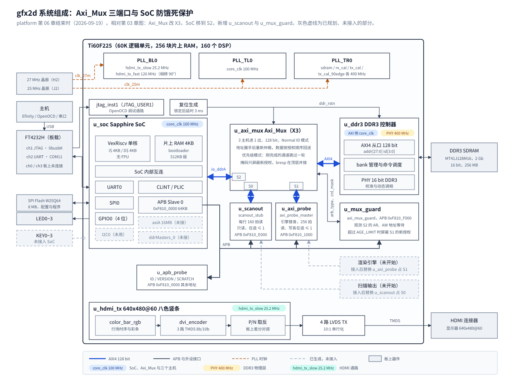

# 06 Axi_Mux 三端口仲裁与 SoC 防饿死保护

## 一、动机

本工程在易灵思钛金 Ti60F225 FPGA 上做一个 2D 渲染加速引擎。片内有一颗 RISC-V 处理器（Sapphire SoC），
帧缓冲放在板上 256MB 的 DDR3 里。第 03 章在 SoC 与 DDR3 控制器之间插入了第三方的 AXI 多路器 `Axi_Mux`，
让第二个主机也能访问 DDR3。将来会有三个主机同时用这条通路：

- **扫描输出**：从 DDR3 的帧缓冲逐行读像素送 HDMI。它是实时流，640×480@60 的一行共 31.7 微秒，
  其中可见的 640 个像素（128 位总线上 160 拍）要在 25.4 微秒里消耗完，中间不能停；
- **渲染引擎**：大块读素材、写帧缓冲，要的是吞吐；
- **CPU**：取指、装缓存行、读写命令表。它被卡住整机就停，串口也不会有任何输出。

第 03 章 5.4 节在轮询仲裁下量过等待的代价：另一个主机持续发 256 拍突发时，CPU 只剩 51.5% 的速度。
三个主机共用一条通路，要先回答三件事：哪个主机接 `Axi_Mux` 的哪个端口；`Axi_Mux` 自带的「优先级模式」
实际按什么顺序授权；引擎全速运行时 CPU 会不会被饿死，饿死了怎么兜底。

这一章做实验 E5 的前三节：端口重分配、两道防饿死措施、用替身主机上板量测。
E5 的第四节（扫描输出自己的 FIFO 最低水位与深度定值）要等真正的扫描输出存在才能做，不在本章。

## 二、为什么是这几步

仲裁器的行为只能从源码和仿真里读出来，板上的 DDR3 控制器是加密的，只能量黑盒结果；
而真正的扫描输出和引擎都还不存在，只能用替身主机。所以拆成六步：

1. 读 `Axi_Mux` 的仲裁源码，直接仿真地址仲裁器，得到实际授权序列；
2. 按实际序列定端口分配和两道防饿死措施：主机侧的在途事务契约（措施一），顶层的老化屏蔽模块 `axi_mux_guard`（措施二）；
3. 搭整条通路的仿真（真厂商 `Axi_Mux` + guard + 三个主机 + 从机模型），读、写两个方向分别定验收口径；
4. 改 RTL：`Axi_Mux` 开第三个端口、顶层重排端口、写 guard 与扫描替身 `scanout_stub`，编译看时序与资源；
5. 上板：用探针主机当引擎、`scanout_stub` 当扫描输出、CPU 做内存拷贝，三方并发量代价，再做注错与反例；
6. 复核：逐条复跑仿真与上板结果，找判据自身的漏洞。

第 1 步决定第 2 步：如果优先级模式是严格按端口号优先，扫描接 S0 就够了，不需要 guard。
第 3 步必须在仿真里做，因为饿死要靠一个「不守契约」的激进主机才能构造，而探针主机一次只发一笔，
在板上复现不出来。第 6 步单列出来，是因为这一章的判据前后被推翻过四次（见第四节），
每一次都来自复跑时发现数字对不上。

## 三、每一步做了什么

### 3.1 读仲裁源码与实际授权序列

`rtl/vendor/axi_mux/Axi_Mux.v` 是明文。`Cfg_Arb_Type = 1` 在注释里叫优先级模式，写着 S0 最高。
仲裁在 `Axi_Mux_Addr_Ctrl`（第 2425 行起）里做，读和写各有一个独立的实例
（写 `Axi_Mux_Wr_Ctrl` 第 1113 行，读 `Axi_Mux_Rd_Ctrl` 第 1231 行），两者接同一个 `Cfg_Cnl_Mask`
（第 1137、1251 行）。仲裁只管地址握手：一个主机拿到通道，等它的地址握手完成就重新仲裁；
读写数据按信息 FIFO 里的授权顺序串行回送（读 AR2R 深 16，写 AW2W 深 8），已经排进去的事务不会被插队。

读源码得出一个与注释不同的细节：选中一个通道时搜索指针复位到 S0；但地址握手后的第一个空闲周期里，
刚完成的通道仍留在 `Act_Cnl_List`，而命中判断 `Act_Cnl_Hit` 显式排除该列表（第 2573~2607 行），
所以刚完成的通道会被跳过一轮。为了确认，测试台直接例化 `Axi_Mux_Addr_Ctrl`，三端口、优先级模式、
下游地址通道恒 ready，数 40 个周期的握手：

| 持续请求的端口 | S0 | S1 | S2 |
| --- | ---: | ---: | ---: |
| S0、S1、S2 | 10 | 10 | 0 |
| S1、S2 | 0 | 19 | 0 |
| S1 每次握手后空 6 个周期，S2 持续 | 0 | 26 | 52 |

三路都持续请求时 S0、S1 交替，S2 一次都拿不到；只有 S1、S2 时 S1 独占。
这个模式是「刚完成者跳过一轮」的轮换，只在两个主机之间成立，排在最后的端口会被饿死。
所以实时性不能从「优先级」这个名字推出来，这两组序列作为固定用例 `grant_sequence` 进了仿真，
序列一旦变化就说明源码、宏或测试台变了。

### 3.2 端口分配与两道措施

端口按下面分配，扫描放 S0，是因为它是唯一永远不会被 guard 屏蔽的实时流入口；引擎放 S1，CPU 放 S2：

```
改动前（`define X2，轮询）        改动后（`define X3，优先级模式）
+--------------+                  +-------------------+
| u_soc        | -> S0            | u_scanout    [新] | -> S0  只读，在途 <= 1
+--------------+                  +-------------------+
| u_axi_probe  | -> S1            | u_axi_probe       | -> S1  读、写各在途 <= 1
+--------------+                  +-------------------+
                                  | u_soc        [改] | -> S2  由 u_mux_guard 兜底
                                  +-------------------+
仲裁配置取自 u_axi_probe 的 ARB    仲裁配置取自 u_mux_guard [新]
```

- `[新] u_scanout`：扫描输出的替身，接入真实扫描输出后被替换；
- `[改] u_soc`：从 S0 挪到 S2，地址、ID 截断不变；
- `[新] u_mux_guard`：永久模块，仲裁方式、三位掩码与防饿死保护都归它，探针的 `ARB` 寄存器不再驱动多路器。

S1 上的主机按 3.1 节的序列可以一直压住 S2，所以要两道措施，分工不同：

**措施一，在途事务契约。** 扫描与引擎每个方向同时最多一笔事务在途：读方向上一笔的 `rlast` 握手之前不发下一笔
`arvalid`，写方向上一笔的写响应 `bvalid` 握手之前不发下一笔 `awvalid`。这样 S1 的 valid 在每笔数据阶段都是低的，
仲裁指针会走到 S2。探针主机本来就这样工作（`axi_probe_master.v` 的 `S_NEXT` 到 `S_WR`/`S_RD`，
`b_fire` 或 `rlast` 之后才回 `S_NEXT`）。代价是引擎放弃地址流水；控制器会不会提前接受下一个地址，
它的总线层 `axi4_bus_ctl.v` 从第 100 行起加密，看不到，这项收益现在没有数，将来要放开必须先量出来并重做本章判据。

**措施二，老化屏蔽 `rtl/bus/axi_mux_guard.v`。** 在顶层观察 S2 的地址通道：

```
每个方向（AR、AW）一个等待计数器
  SoC 的 valid 为高、ready 为低：计数加 1（饱和）
  握手完成或 valid 撤销：计数清零
计数达到 AGE_LIMIT：锁存该方向的 protect，保持到该方向握手完成或 valid 撤销
送进 Axi_Mux 的 Cfg_Cnl_Mask = CHANNEL_MASK & {1, ~(protect_ar | protect_aw), 1}
```

掩码在 `Axi_Mux` 里只参与新通道搜索（第 2491 行 `Effe_S_Val = S_A_Valid & Cfg_Cnl_Mask`），
已经锁存在 `Act_Cnl_List` 的授权不受影响，所以 S1 拉高的 valid 保持不撤，不违反 AXI 协议；
读写两个仲裁器共用一个掩码，所以两个方向的 protect 用「或」合并，先完成的方向不能提前放开 S1；
S0 与 S2 两位恒为 1，guard 不碰扫描。

guard 独占 APB Slave 0 的 `0xF810_F000~0xF810_FFFF`：

| 偏移 | 名称 | 复位值 | 内容 |
| ---: | --- | ---: | --- |
| `0x000` | `ID` | `0x4D555847` | ASCII `MUXG` |
| `0x004` | `VERSION` | 2 | 寄存器接口版本 |
| `0x008` | `CTRL` | 3 | bit0 优先级模式，bit1 `GUARD_EN` |
| `0x00C` | `CHANNEL_MASK` | 7 | 三通道全开 |
| `0x010` | `AGE_LIMIT` | 64 | 触发阈值，单位 `core_clk` 周期 |
| `0x014` | `STATUS` | 0 | bit0 `protect_ar`，bit1 `protect_aw` |
| `0x018` | `GUARD_HITS` | 0 | 两个 protect 的 0 到 1 次数之和，同一拍可加 2 |
| `0x01C`、`0x020` | `S2_MAX_WAIT_AR/AW` | 0 | S2 地址等待的最长连续周期数，每拍更新，含尚未握手的那一笔 |
| `0x024` | `CLEAR` | — | bit0 写 1 清三个统计寄存器 |

`AGE_LIMIT` 只是触发阈值，不是等待上界：掩码撤不掉已经给出的授权，S2 还要等在它前面已授权的事务走完。
两个 MAX 寄存器在版本 1 里只在握手那一拍更新，复核时改成每拍更新，原因见 4.5 节。

### 3.3 整条通路的仿真

`sim/axi_mux_guard/` 用真厂商的 `Axi_Mux`（X3，带 Efinity 的 `EFX_SRL8` 原语模型）、guard 与三个主机：

| 组件 | 做法 |
| --- | --- |
| S0 | 按周期发 160 拍读，最多一笔在途，量首拍等待与整笔时间，地址等待超过 4000 拍记超时 |
| S1 | 读或写满负载（256 拍突发），两种行为：激进（地址握手后下一拍再拉高 valid）或遵守措施一 |
| S2 | 模仿 CPU：4 拍读与单拍写交替，间隔随机；最大地址等待每拍更新，含未握手的那一笔 |
| 从机 | `sim/axi_probe/axi_ram_model.v`：随机反压；`RD_QUEUE`、`WR_QUEUE` 为读、写地址队列深度；`ADDR_STALL_MAX` 限地址通道连续反压；WLAST 与突发长度不符时计 `wlast_err` |
| 协议监视 | S1 的 valid 在握手之前不得撤销；从机的 `wlast_err` 必须为 0 |

全链路用例的从机取 `RD_QUEUE=4`、`ADDR_STALL_MAX=4`，让下游地址通道接近随时可收，这是饿死最容易发生的条件。
写方向另跑 `WR_QUEUE=1`（原从机，一次一笔写）与 `WR_QUEUE=4`（与读方向对等）两组。
每个用例跑 20000 个周期，S2 至少完成 10 笔才算没被饿住。

验收口径按实测定，两条阈值都是回归用的口径，不是形式上界：
遵守措施一时 414（`AGE_LIMIT` 64 + 一笔 256 拍读约 310 + 搜索余量 40），
S1 激进时 700（实测保护开启 590、关闭 889 之间留余量）。

### 3.4 RTL 与编译

- `Axi_Mux.v` 第 43 行 `` `define X2 `` 改 `` `define X3 ``，厂商文件改动登记在 `Main/rtl/README.md`；
  X3 的端口与内部通路是现成的（第 164~199、552~591、911~936、1373~1386 行）；
- 顶层 `rtl/top/gfx2d_top.v`：APB Slave 0 按 `paddr[15:12]` 分四个窗口（`0x1` 探针主机、`0xE` 扫描替身、
  `0xF` guard、其余 `apb_probe`），`mux_arb_mask` 扩到 3 位，端口重排；
- 新写 `rtl/bus/axi_mux_guard.v` 与 `rtl/bus/scanout_stub.v`。扫描替身按 3175 个周期（31.75 微秒）一行、
  525 行一场发 160 拍读，最多一笔在途，上一笔没完成就跳过这一行并计 `SKIP_COUNT`；
  记录首拍等待、整笔时间、相邻 R 拍最大间隙三项的最大值与 12 桶直方图。

编译用 Efinity 2026.1 命令行，四步 PASS，结果见 5.1 节。改动之后的系统组成：



### 3.5 上板量测

板上的替身都遵守措施一，量到的是「正常引擎」下的代价，饿死的情形由 3.3 节的仿真覆盖。
`Main/sw/apps/probe/ddrBurstProbe` 在 E4 的四个阶段后面加了两个：

- `TRI`：扫描替身读帧缓冲 0、探针主机 256 拍满负载（读一轮、写一轮）、CPU 逐字拷贝 256KB，三方同时跑。
  结束后先停扫描、等 1 ms 让在途那一笔走完，再一次性读所有统计，保证 `TXN` 与 `BEAT` 是同一时刻的快照，
  并对账 `BEAT = TXN × 160`；
- `INJECT`：`AGE_LIMIT` 设 1，读、写两个方向的 `GUARD_HITS` 必须增加且探针照常完成（证明 guard 接到了真多路器）；
  设回 64 只记录；最后把 guard 掩码的 S0 位清掉当反例，扫描替身必须停止前进。

`IDENT` 阶段核对 guard 的 ID、VERSION 与上电默认值，加载了旧比特流时这一行报 FAIL。

### 3.6 复核

每一轮都把仿真与上板从头复跑，并逐项对照数字。第四节的 4.3~4.6 都是在复核里发现的：
一处判据被硬编码成必然失败、一处测试台主机把写通路弄死锁、一处统计量看不到卡死的那一笔、一处判据与在途事务竞争。

## 四、遇到的问题

### 4.1 地址等待上界算式不成立

第一现场（整机仿真，保护开启、S1 激进读）：

```
normal: S2 读 40 笔完成，max_ar_wait=499 <= 上界 668，ARREADY 连续为低最大 313
（从机改成流水之后）normal: S2 读 55 笔，max_ar_wait=590；上界 AGE_LIMIT + ADDR_STALL_MAX + 4 = 72
```

解读：规格原写「S2 地址等待不超过 `AGE_LIMIT + ADDR_STALL_MAX + 4`」。590 比 72 大了一个数量级，
而 ARREADY 连续为低 309 拍，远大于 `ADDR_STALL_MAX=4`，说明限制地址通道的是另一样东西。

定位：`Axi_Mux` 的 AR2R 与从机读队列会先收下一批已授权的地址，S2 要等这些排队事务的数据走完，
而已授权的事务不受掩码影响。算式里的 `ADDR_STALL_MAX` 只描述从机单拍反压，描述不了队列。

根因与修法：算式假设「掩码生效之后 S2 下一个就拿到授权」，与掩码只拦新授权的机理矛盾。
改为 3.3 节的两条实测口径，报告里不再声称形式上界；板上的控制器加密，只报告实测最大值。
原判据只在从机一次一笔的条件下算过，那时恰好量不出队列的影响。

### 4.2 整机里复现不出饿死

第一现场：

```
inject_noguard（保护关闭 + 激进 S1，期望 S2 饿死）：S2 读仍完成 25 笔，max_ar_wait=795
normal 与 inflight1 数字完全相同：ar_handshake=41、S2 读 40 笔、max_ar_wait=499
```

解读：保护关了 S2 还能完成 25 笔，说明饿死没有发生；「激进」与「一笔在途」数字完全相同，
说明两种 S1 在地址通道上没有被区分开。

定位：当时的从机在数据阶段一直拉低 ARREADY，地址通道被从机限成一笔在途，S1 想激进也发不出去。
给从机加 `RD_QUEUE` 之后两者分开了（下表），但保护关闭时 S2 仍完成 30 笔。
原因在仲裁器：地址反压给了指针旋转的时间，`Act_Cnl_Hit` 命中会阻止继续旋转（第 2554 行），
指针停在 S2 上时它下一轮必然拿到授权。3.1 节的饿死只在下游恒 ready 时成立。

| 用例 | 保护 | S1 | S2 读完成 | S2 最大读地址等待 |
| --- | --- | --- | ---: | ---: |
| `inflight1` | 关 | 一笔在途 | 197 | 301 |
| `normal` | 开 | 激进 | 55 | 590 |
| `inject_noguard` | 关 | 激进 | 30 | 889 |

根因与修法：「必须饿死」这条期望本身错了。`inject_noguard` 改成对照判据：同一阈值 700 下保护关闭必须不通过；
恒 ready 下的饿死由 `grant_sequence` 逐字复现。上表同时说明措施一是主力：只靠它 S2 的等待是激进时的三分之一。
原判据是从裸仲裁器的现象外推到整条通路的，没有先在整条通路上确认现象存在。

### 4.3 对照用例被硬编码成必然失败

第一现场（`tb_axi_mux_guard.v` 原写法）：保护关闭的分支直接打印 `RESULT: FAIL`，不看任何数字。

解读：`inject_noguard` 期望 FAIL，而它无条件 FAIL，所以把阈值改成 1000 它照样「符合预期」，
判据被削弱也看不出来。

根因与修法：保护开、关改成同一个判据表达式，只差 `CTRL` 的宏。复核时把阈值放宽到 1000，
`inject_noguard` 变成 PASS，`run.sh` 报 `SIM BROKEN`，证明它现在确实在检查数字。
原判据只检查了「期望的字样出现了」，没有检查字样来自计算。

### 4.4 写方向的「CPU 被停住」是测试台自己的错

第一现场（补写方向用例之后，保护开、关各一次）：

```
wr_aggr_guard:   RESULT: FAIL (写方向：S2 写=7 最大等待=610 阈值=700)
wr_aggr_noguard: RESULT: FAIL (写方向：S2 写=7 最大等待=610 阈值=700)
wr_contract:     RESULT: PASS (写方向：S2 写 23 笔，最大等待 312 <= 414)
把仿真拉长到 60000 周期：S2 写仍是 7 笔
```

解读（当时的读法，已推翻）：激进写引擎把 CPU 的写停住，保护开关数字逐项相同，推论为「掩码撤不回已排进 AW2W 的地址，
guard 对写方向无效，措施一是写方向唯一有效的约束」，并据此把两个写用例的期望定成 FAIL。

定位：这组数字有两处不自洽。其一，最大等待 610 小于阈值 700，FAIL 只能来自完成笔数；
其二，20000 与 60000 周期都是 7 笔，饿死会让笔数慢慢涨，一笔不涨是卡死。
挂一个旁路监视器每 1000 周期打印各通道状态：

```
t=5000  cpu:awv=1 awr=0 wait_aw=1051 wr=7 | guard st=10 mask=101 | s1 aw_iss=15 w_srv=15 awv=1 wv=0
        | mux AWnum=2 AWlist=100 Wnum=1 | down awv=1 awr=0 wv=0 wr=1
t=20000 cpu:awv=1 awr=0 wait_aw=16051 wr=7 | ...（其余各项与 t=5000 相同）
```

从 t 约 4400 起状态冻结：多路器已经把 AW 授权给 S2（`AWnum=2`），下游 `awvalid=1` 而从机 `awready` 恒为 0；
W 通路指针停在 S1（`Wnum=1`），但 S1 自认为 15 笔 W 都发完了。两边对 W 拍数的账对不上。
从机日志里每个写用例都有 27~37 条 `MODEL: wlast mismatch`，包括判为 PASS 的 `wr_contract`。

根因与修法：测试台的引擎替身 `master_aggr` 写的是 `wlast <= (wcnt == 255)`，用握手之前的拍号打一拍，
连续握手时最后一拍不带 WLAST、下一笔第 0 拍反而带上。从机按 WLAST 结束一笔，W 错位后写通路死锁，
与 guard 和仲裁无关，所以保护开关的数字当然相同。修法：

- `wvalid`、`wlast` 改成组合逻辑，由当前拍号直接给出；写方向的措施一改为按规格等 `bvalid`
  （原来等的是 W 发完）；
- 从机的 `wlast_err` 进所有全链路判据，新增注错用例 `inject_wlast` 复原打一拍的写法，必须 FAIL 且 `wlast_err` 非零；
- S2 的最大等待改成每拍更新（4.5 节）。

修正后写方向没有饿死，结论见 5.2 节。原判据没有覆盖它有两层原因：从机的协议报警只打印不计错；
等待统计只在握手时更新，卡住的那一笔永远不进统计，报出来的 610 是已完成几笔的最大值，
而那一刻 CPU 已经等了一万六千多拍。

### 4.5 等待统计看不到卡死的那一笔

第一现场：4.4 节里 guard 的 `S2_MAX_WAIT_AW` 读出 609，同一时刻 S2 的 AW 已连续等待 16051 个周期。

解读：guard 版本 1 的两个 MAX 只在握手那一拍取最大值。SoC 真被卡住、永不握手时，寄存器停在上一笔的值上，
而这正是 guard 要诊断的情形：CPU 卡住时串口没有输出，只能靠 OpenOCD 读这个寄存器。

根因与修法：改成每拍比较，等待中的这一拍结束后已等 `wait + 1` 拍，大于 MAX 就更新；计数饱和时不再加一。
一笔等了 N 拍再握手时结果仍是 N，与版本 1 逐拍相同，所以已完成事务的数字不变
（板上 `TRI rd` 的 303 / 477 与版本 1 的上板结果相同）。`VERSION` 升到 2。
`dual_direction` 增加一项：两个方向都未握手时读 MAX 必须已经在涨；用版本 1 的 RTL 跑同一用例读到 0 并报 FAIL，
新判据能区分两个版本。`inject_wlast` 里 guard 的 `S2_MAX_WAIT_AW` 直接报出 20000，与仿真时长一致。

### 4.6 S0 掩码反例的假红

第一现场（VERSION 2 比特流的第一次上板）：

```
INJECT mask_s0 txn 14273 14903 14904 14904 15534 FAIL
fail 1
```

解读：五个数依次是清 S0 位之前两次、清位之后两次、恢复之后一次的扫描完成笔数。清位后 20 ms 内一笔没增加
（14904、14904），恢复后又涨了 630 笔，反例本身成立；FAIL 来自清位前后差了 1 笔（14903 到 14904）。

定位：扫描替身允许一笔在途。清位那一刻如果它刚好有一笔已授权，掩码不撤销已授权事务，这一笔照常完成。
上一轮上板读到 `7800 7800` 是碰巧那一刻没有在途事务。

根因与修法：判据改为清位后最多再完成 1 笔（`t2 - t1 <= 1`），之后的窗口里必须一笔不增（`t3 == t2`）。
改后连跑三轮，一轮是 `14906 14907 14907`，两轮是 `14908 14908 14908` 与 `14902 14902 14902`，都判 ok。
原判据把掩码当成即时生效的开关，没有把在途契约算进去。

### 4.7 其余三处

- `GUARD_HITS` 规格是两个方向 0 到 1 次数之和，RTL 原来同一拍只加 1。改成 `ar_rise + aw_rise`，
  `dual_direction` 增加同拍触发 `HITS=2` 的检查。
- `TRI` 统计原来先读 `TXN`，打印时才读还在增长的 `BEAT`。改成停扫描、等 1 ms、一次性读，并对账 `BEAT = TXN × 160`。
- `tools/board_run.py` 的文件头和开发环境文档都说会先 `reset halt`，脚本实际只发了 `load_image`、`resume`。
  之前能跑是因为前一个会话恰好把 CPU 停住了。补上之后在没有前置会话的条件下单独跑通 `ddrAliasTest`。
  另一个相关现象：`reset halt` 会复位 SoC 系统复位域，把 guard 与扫描替身的配置清回默认值，
  跨两个 OpenOCD 会话「先写使能、后读结果」读到的全是 0，写使能和读结果要在同一个会话里做。

## 五、结果

### 5.1 编译

三次编译都是 Efinity 2026.1 命令行四步 PASS，约束告警 0，Missing Interface Pins 为已知 6 项，
自写代码位宽截断告警 0：

| | E5 之前 | 端口重分配后 | guard VERSION 2 |
| --- | ---: | ---: | ---: |
| XLR | 16151 | 21065 | 21753 |
| 片上 RAM / DSP | 65 / 4 | 65 / 4 | 65 / 4 |
| `core_clk` setup slack（ns） | 2.994 | 3.467 | 3.780 |
| `core_clk` hold slack（ns） | 0.026 | 0.026 | 0.026 |

端口重分配那一次增加 4914 XLR：`u_scanout` 3216、`u_mux_guard` 476、`u_axi_mux` 从 257.5 到 313.5（X3 本身只多 56），
顶层自身从 285.5 到 1514.5（工具跨边界归因，未逐项拆解）。新增告警只有 3 条 EFX-0657，是扫描替身的三个直方图数组被映射成逻辑存储块。

VERSION 2 那一次增加 701 XLR（按 `hier_util.rpt` 与上一版逐模块对比）：唯一改动的 `u_mux_guard` 从 461 到 510（+49）；
RTL 没有改动的 `u_scanout` +414、`u_soc` +173、顶层 +55，属于重新综合与布局的波动。告警分类逐项与上一版相同。
`u_scanout` 是替身，扫描输出接入后会整块替换。

### 5.2 仿真

`sim/axi_mux_guard/run.sh` 全部 17 项符合预期（14 个用例、两项保护开关逐项比对、一项「inject_wlast 的 FAIL 来自 wlast_err」检查），输出 `SIM OK: 17/17`：

| 用例 | 方向 | 条件 | S2 完成 | S2 最大地址等待 | 期望与结果 |
| --- | --- | --- | ---: | ---: | --- |
| `grant_sequence` | — | 裸仲裁器，下游恒 ready | — | — | PASS，10/10/0 与 0/19/0 |
| `dual_direction` | — | guard 单元 | — | — | PASS，含同拍 HITS=2、未握手时 MAX 在涨 |
| `normal` | 读 | 保护开，激进 | 55 | 590 | PASS（阈值 700） |
| `inflight1` | 读 | 保护关，措施一 | 197 | 301 | PASS（阈值 414） |
| `inject_noguard` | 读 | 保护关，激进 | 30 | 889 | FAIL，保护在读方向起作用的对照 |
| `inject_mask_s0` | 读 | 掩码 S0 位也清 | — | — | FAIL，扫描一笔都没完成 |
| `inject_midgrant` | 读 | 已授权后下游持续不 ready | 23 | — | PASS，S1 未撤销 valid |
| `wr_aggr_guard` | 写 | 保护开，激进，`WR_QUEUE=1` | 33 | 607 | PASS（阈值 700） |
| `wr_aggr_noguard` | 写 | 保护关，激进，`WR_QUEUE=1` | 33 | 607 | PASS，与上一行逐项相同 |
| `wr_contract` | 写 | 保护关，措施一，`WR_QUEUE=1` | 65 | 311 | PASS（阈值 414） |
| `wr_q4_aggr_guard` | 写 | 保护开，激进，`WR_QUEUE=4` | 50 | 590 | PASS |
| `wr_q4_aggr_noguard` | 写 | 保护关，激进，`WR_QUEUE=4` | 50 | 590 | PASS，与上一行逐项相同 |
| `wr_q4_contract` | 写 | 保护关，措施一，`WR_QUEUE=4` | 311 | 271 | PASS |
| `inject_wlast` | 写 | 复原打一拍的 WLAST | 0 | 20000 | FAIL，`wlast_err=1` |

表中 S2 的等待由 CPU 替身统计，比 guard 的寄存器多 1 拍（CPU 替身把拉高 valid 的那一拍也算进去）。

写方向的结论：没有饿死；保护开、关结果逐项相同；措施一把最大等待减半（607 到 311、590 到 271）。
为了解释保护为什么在写方向不起作用，在 `WR_QUEUE=4`、激进写、保护开启的用例上用临时监视器
（未入库，观测 `u_guard.protect_aw` 与 `u_mux.AW_Cnl_List`）统计 `protect_aw` 为 1 的 16105 个周期：

| 此时写地址仲裁器的状态 | 周期数 | 占比 |
| --- | ---: | ---: |
| S1 的授权已锁存，等下游收地址 | 10945 | 68% |
| 已授权给 S2，等下游收地址 | 5111 | 32% |
| 处于搜索新通道的状态 | 49 | 0.3% |

掩码只在搜索时起作用，而写方向上 S2 等待期间仲裁器几乎从不处于搜索状态：写数据是 256 拍，
W 通道的吞吐把地址通道压成了「一个授权挂着等下游」，S2 的等待由挂着的那笔 S1 与自己的授权两段组成，
屏蔽 S1 的新授权无从生效。读方向的 AR2R 深 16，数据回送不占地址通道，所以掩码在读方向有机会起作用。
因此写方向的约束只能来自措施一；guard 在写方向只验「接到了真多路器、能触发」，不计为写方向的等待保证。
这条结论依赖从机模型：真 DDR3 控制器在写方向接受多少个地址是黑盒，板上的替身又都守契约，写方向 guard 的有效性在板上没有证据。

改动共用从机之后，`sim/axi_probe` 的五个用例日志与改动前逐字节相同；`hdmi` 3/3、`apb_probe` 3/3、`axi_probe` 5/5。

### 5.3 上板

VERSION 2 比特流经 JTAG 加载（器件 ID `0x10660A79`），调试通路两次会话都 `OK`。
OpenOCD 直接读 guard 窗口：`4D555847 00000002 00000003 00000007 00000040 0 0 0`，
即 MUXG、版本 2、优先级加 guard、三通道全开、`AGE_LIMIT=64`。

`ddrBurstProbe`（6322 字节，sha256 前 16 位 `ac1bcc7b4c04a26d`）连跑三轮，末行都是 `fail 0` 与 `done`。
第 1 轮的后半段原样如下，三轮全文与判据改前的那次假红在 `Main/sw/apps/probe/ddrBurstProbe/logs/`：

```
SHARE prb cycles alone=0x004cb4f8 shared=0x004d1557
SHARE cpu ticks  alone=0x00523922 shared=0x0083e517
SHARE errs=0x00000000 ok
TRI rd cpu ticks=0x008b9653
TRI rd guard max_wait_ar=0x0000012f max_wait_aw=0x000001dd hits=0x0000442c status=0x00000000
TRI rd prb status=0x00000002 scan txn=2881 beat=460960 skip=0 resperr=0
TRI rd scan max_first=78 max_full=244 max_gap=42
TRI rd ok
TRI wr cpu ticks=0x009d9070
TRI wr guard max_wait_ar=0x000001eb max_wait_aw=0x000001f7 hits=0x0000447e status=0x00000000
TRI wr prb status=0x00000002 scan txn=6133 beat=981280 skip=0 resperr=0
TRI wr scan max_first=363 max_full=529 max_gap=44
TRI wr ok
INJECT age1_rd age=1 hits=0x00044009 probe_done
INJECT age1_wr age=1 hits=0x00044008 probe_done
INJECT age64_rd age=64 hits=0x000015e2 probe_done
INJECT age64_wr age=64 hits=0x000015f5 probe_done
INJECT mask_s0 txn 14277 14906 14907 14907 15537 ok
fail 0
done
```

1 tick 为 10 ns，即一个 `core_clk` 周期。三轮换算：

| 项 | 三轮实测 | 说明 |
| --- | --- | --- |
| CPU 拷贝 256KB，单独 | 5388525~5388578 tick（53.9 ms） | 基准 |
| CPU 拷贝，与探针读并发 | 8643863~8643989（86.4 ms） | 1.60 倍；E4 轮询下约 1.94 倍 |
| CPU 拷贝，三方并发，探针读 | 9146704~9149082（91.5 ms） | 1.70 倍 |
| CPU 拷贝，三方并发，探针写 | 10322373~10326128（103.2 ms） | 1.92 倍 |
| guard，三方并发读 | `S2_MAX_WAIT_AR` 303，`_AW` 477，`GUARD_HITS` 17451~17470 | 保护在正常负载下频繁触发 |
| guard，三方并发写 | `_AR` 489~491，`_AW` 503~507，`GUARD_HITS` 17534~17542 | 同上 |
| 扫描，三方并发读 | 首拍最大 78、整笔最大 244、R 拍间隙最大 42 周期；`SKIP` 0 | 单独运行时 63 / 236 / 44 |
| 扫描，三方并发写 | 首拍最大 359~363、整笔最大 525~529、间隙最大 44；`SKIP` 0 | 见下 |
| `AGE_LIMIT=1` | 读 278537、写 278536 次命中，探针完成 | guard 接在真多路器上 |
| S0 掩码反例 | 清位后最多 +1，之后 20 ms 不增，恢复后 +630 | 掩码送进了多路器 |

`BEAT = TXN × 160` 在六次 `TRI` 里都成立（例如 2881 × 160 = 460960）。

读这些数字要注意三点。其一，写方向时扫描的首拍等待从 78 涨到 363，而 `Axi_Mux` 的读写仲裁器是分开的，
这段等待来自 DDR3 控制器内部读写共用一个 DDR 端口，一笔 256 拍写约 300 个周期；363 小于两笔引擎事务（约 600），
按最大值推断直方图里没有「等两笔引擎事务」的样本。其二，扫描一行最坏 529 个周期，行周期 3175、可见段 2540，
这只说明量级有余量，实时性要等 E5 第四节在真实 FIFO 上测最低水位。其三，`GUARD_HITS` 一万七千多次说明
正常负载下 CPU 地址等待超过 64 周期很常见，这时 guard 屏蔽的是 S1 的新授权，对守契约的探针代价很小
（`SHARE` 里探针单独与并发的周期只差 0.5%）。

回归表在同一比特流上全过：memTest `Test PASSED`；APB 探针 ID/VERSION/SCRATCH 三种图案与未映射地址；
`ddrAliasTest` `fail 0`；`cacheCoherencyTest` 正常版 `fail 0`、注错版四行 `FAIL (inject)`、注错自检版 `fail 4` 四行 `NOT_RED`，
三个 bin 的 sha256 前 16 位与登记值一致；`cacheMechTest` `fail 0`，与登记日志逐行相同，只有 T11 的计时差 1~11 tick（1000 次调用的总计）。
HDMI 八色竖条经用户肉眼复核（2026-09-19，同一比特流）。

## 六、还欠什么

- E5 第四节：真实扫描输出的异步 FIFO 最低水位、触底与欠载计数、深度定值，等 display 系列的扫描输出存在后做，
  条目仍是 [`../../Todo/E5-Axi_Mux优先级与扫描FIFO水位.md`](../../Todo/E5-Axi_Mux优先级与扫描FIFO水位.md)。
- 引擎接入时必须遵守措施一（读、写各一笔在途，写方向按 `bvalid` 握手），任何放宽都要重做本章全部判据；
  写方向没有 guard 兜底，这条契约是写方向唯一的约束。
- 写方向 guard 的有效性在板上没有证据，仿真结论依赖从机模型；控制器在写方向接受多少个地址没有测。
- `u_scanout` 的 3216~3637 XLR 与三组直方图属于替身，扫描输出接入时整块替换。
