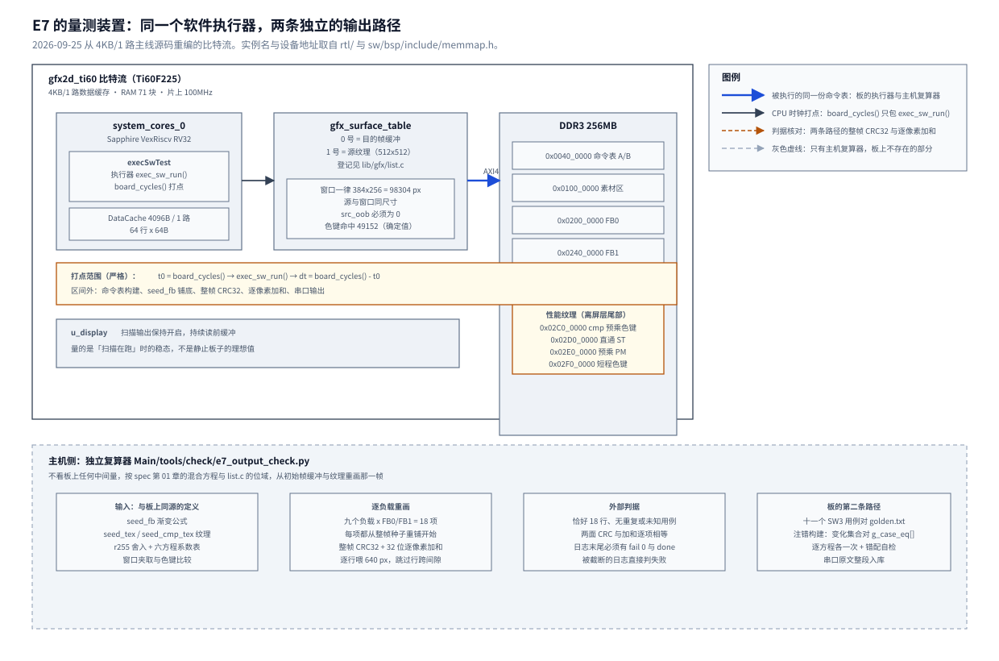

# 09 软件执行器像素吞吐的板上复现

2026-09-25 首轮测量，2026-09-27 判分修复收尾（5.7）。E7 的板上专项。主线比特流为 4KB/1 路数据缓存，
`execSwTest-O2.bin` 36,090 字节，两面九个负载的整帧 CRC32 与逐像素加和
由板外第二条实现全部复算一致。

## 一、动机

本工程在易灵思钛金 Ti60F225 上做 2D 渲染加速引擎。片内一颗 RISC-V 处理器
（Sapphire SoC）跑 100MHz，帧缓冲在板上 256MB 的 DDR3 里，扫描输出逐行读出送 HDMI。
赛题基础要求 3 要「Demo 在屏幕上实时对比软件渲染与硬件渲染的帧率」，
这要求同一份命令表既能被 CPU 逐像素执行，也能被硬件引擎执行。
`sw/lib/gfx/exec_sw.c` 里的软件执行器就是这个对比基线，
它同时还是设计文档 3.8 节要的金标准：软硬 CRC 对不上时，
要靠一份可信的软件实现判断是哪一边错了。

SW3 已经在主机上验过这份执行器的像素语义（[sw 第 02 章](../sw/02-命令表构造层与软件执行器.md)），
十一个整帧用例的期望 CRC 入库 `sw/lib/test/golden.txt`。那一步全部发生在 x86 上，
回答不了「板上这颗 RV32 跑同一份源码要多少个周期」。
SW6 的基础 Demo 在板上调用过同一个执行器，但它报的是特定场景的整帧周期，
不能拆成每种混合方程各自的吞吐。本条要的是**分方程的像素吞吐**：
每种方程各能画多少像素每秒，折成一帧 16.67ms 能画多少像素。

这个数字在设计文档 3.1 节里是空的。那里的架构推演假定
「做完条带模式之后，墙会移到 CPU 生成命令上」，依据是一句估算：
每弹幕约 100 条指令、5000 个弹幕约 5ms。那句话谈的是**生成命令**。
软件渲染模式下 CPU 还要**执行**这些命令，逐像素走一遍混合，
这一段在设计文档里没有数字。第 10 章量出生成侧要 3.51ms（N=2000，4KB 档），
本章量出执行侧要 804.6ms（S1 同类整表），两者合起来才能回答墙在哪，
结果与设计文档 3.1 节原文的估算方向不同。

## 二、为什么是这几步

测量对象有三个性质，步骤按它们排：命令表是**确定性的输入**，
同样的种子与位域必然画出同样的帧；执行器的正确性已经有主机侧金标准，
板上要么复用那份判据要么另造一条独立路径；周期数是**板上的物理量**，
只能在板上量，而板上的一切读数都要先证明「跑的是哪个比特流、哪个二进制」。

由此拆成六步：

1. 先钉死比特流的身份：核对 SoC 配置、资源报告与比特流本身是不是同一档缓存；
2. 写 `sw/apps/probe/execSwTest`，它复用 `lib/gfx` 的执行器本体，只加用例驱动与打点；
3. 板上跑 SW3 的十一个整帧用例，对 `golden.txt`，作为入场判据；
4. 造第二条独立路径：主机侧按规格重画性能负载，与板上的整帧 CRC 逐项比；
5. 用逐方程注错证明 CRC 盖住的确实是像素结果，而且每个用例确实走到自己的方程；
6. 按 §2.4 的采样量重测，并把整表折成帧预算。

第 1 步放在最前是因为这一轮真的踩到了：本地 `outflow` 里留的是 16KB/4 路的编译产物，
而仓库源码写的是 4KB/1 路，两者只差资源报告里的一行数字。
不先核对，后面所有周期数都会被归到错误的缓存档上。
第 3 步与第 4 步是两条独立的路径：第 3 步复用的是 SW3 的输入（十一个用例），
第 4 步覆盖的是**另一批输入**（384×256 窗口的九种性能负载）；
只做第 3 步，性能负载本身的正确性没有第二条实现兜底。
第 5 步针对这类测量最常见的失效模式：CRC 只盖住了命令表的解析结果，
或者像素核心被编译器优化成一个不做事的循环，量出来的「很快」是假的。

## 三、每一步做了什么

### 3.1 先钉死比特流的身份

`Main/sdk/bsp/efinix/EfxSapphireSoc/include/soc.h` 与
`Main/fpga/gfx2d_ti60/ip/soc/settings.json` 都写 4KB/1 路
（`SYSTEM_CORES_0_DCACHE_SIZE 4096`、`SYSTEM_CORES_0_DCACHE_WAYS 1`、
`DCacheSize 4096`、`DCACHEWAY 1`）。但当时本地
`Main/fpga/gfx2d_ti60/outflow/gfx2d_ti60.place.rpt` 报 **RAM 89 块**，
那是 16KB/4 路的占用（对照第 10 章的三档资源表：4KB 71 块、8KB 77 块、16KB 89 块）。
用这份比特流量到的 E7 周期数是 16KB 档的值，不能当主线基线。

处理办法是从 4KB 源码输入重新编译一次：`localize_paths.py --apply` 展开
`settings.json` 里 bootloader hex 的本机路径，在 Efinity 2026.1 环境里跑
`efx_run.bat gfx2d_ti60.xml`，四步 PASS，最后 `localize_paths.py --restore` 还原占位符。
重建后的比特流 SHA256
`5198db644338720d6fe53fc9ff59d4f6f86c0ddc3da5100c55a857b9d644b144`，
资源 **RAM 71 块、XLR 21935**，`core_clk` setup/hold +3.516/+0.026 ns。
被替换掉的 16KB 比特流 SHA256 为
`7d4cd463c3a62ca61f58e6db4eda53bc90f6940920d5c3239bcafe75dad2e6d4`，
它在本章只作对照，在 [第 10 章](10-CPU每弹幕开销与缓存对照的复现.md) 里是 16KB 档的实验对象。

两份比特流都保留哈希与资源数字，是因为「同一份仓库源码 + 一份被忽略的编译产物」
不能自动推出对应关系。这一条从本章起成为实验条件的一部分：
**每一份周期数都要写明它出自哪一个比特流哈希**。

### 3.2 探针 `execSwTest`

新增 `Main/sw/apps/probe/execSwTest/`，走 SW1 的分层构建
（`include ../../../mk/target.mk`），`LIBS = core gfx`。程序不复制执行器，
直接调用 `lib/gfx` 的表面表、`gfx_list_*` 构造层、`exec_sw_run()` 与 `exec_sw_stats`。
四段：

| 段 | 做什么 | 判据 |
| --- | --- | --- |
| `VERIFY` | 跑 SW3 的十一个 `gfx_case_build()` 用例，每例整帧 CRC32 | 对 `sw/lib/test/golden.txt` 逐行 |
| `THR` | 九种分方程负载，FB0/FB1 各测 | 对账等式、窗口面积、`src_oob=0`、色键确定值、整帧 CRC |
| `S1` | 精确 S1 同类整表（2003 条命令） | 命令数、`pixel_total`、`key_skip`、整帧 CRC |
| `OVH` | 纯 NOP 表（15/255/1023 条） | 命令表遍历的固定开销 |

计时口径是这一段的重点。`board_cycles()` 取 CLINT 低 32 位，1 tick = 10ns，
100MHz 下 2^32 个周期 = 42.9 秒回绕；本程序每轮独立取两次读数相减（都在 42.9 秒内），
再把区间累加进 64 位，不拿两个相距很远的读数相减。
**只有 `exec_sw_run()` 在计时区间内**：命令表构建、`seed_fb` 铺底、整帧 CRC32、
逐像素加和、串口输出全部在区间外。每轮先把整个目的面重铺成同一份种子
（`seed_fb` 遍历 640×480 写渐变），这样各轮量的是同一份输入；
第一轮前另做一次 `board_dcache_invalidate_all()`，把上一轮留下的装行结果清掉。

扫描输出全程保持开启（第一次 `board_present(0)` 会把 FB0 设为扫描源）。
量的是「扫描在跑」时的稳态：扫描输出持续读前缓冲，DDR 上始终有这路实时流量，
关掉它量出来的每像素周期会偏乐观。

量测装置在系统里的位置与两条输出路径见 `fig/09-量测装置.svg`：
左侧是板上的一次执行（`execSwTest` 在 RV32 上跑 `exec_sw_run()`，
只有这一句在打点区间内），下方虚线框是主机侧的独立复算器，
右侧是板上的第二条路径（SW3 的十一个用例与七个注错构建）。



六种方程对应九种负载，窗口一律 384×256 = 98,304 个像素，
源表面与窗口同尺寸。这个尺寸是踩过一次坑之后定的，见 4.1 节。

| 负载 | 方程 | 源 | 说明 |
| --- | --- | --- | --- |
| `fill-copy` | COPY | 无（FILL） | 只写不读，最简路径 |
| `fill-const` | CONST | 无（FILL） | 通道里两次乘法 |
| `blit-copy` | COPY | 512×512 预乘 PM | 读 + 写 |
| `blit-key` | COPY + 色键 | 512×512 XRGB 棋盘 | 命中率确定值 49152/98304 |
| `blit-alpha-pm` | ALPHA | 512×512 预乘 PM | 场景 S1 主力 |
| `blit-alpha-st` | ALPHA_STRAIGHT | 512×512 直通 ST | 对照赛题原文的 `fg*a+bg*(1-a)` |
| `blit-add` | ADD | 512×512 预乘 PM | 饱和加 |
| `blit-mul` | MUL | 512×512 预乘 PM | 单项乘 |
| `s1-exact` | 混合 | 两种 | 整屏打底 + HUD + 2000 个 12×12 |

纹理内容由 `seed_tex()` 按格式生成：预乘分支保证每个通道不超过 alpha
（规范条款 §2 的素材契约），直通分支不约束，色键分支按
`((x>>2)+(y>>2))&1` 的 8×8 棋盘把一半格子写成键色。
`seed_cmp_tex()` 另给 S1 的敌弹用：非键区 alpha 在 64~255、RGB 已预乘，
键区是透明黑，12×12 原点窗口内恰好 64 个键像素。

### 3.3 入口判据：十一个整帧用例对 golden.txt

`VERIFY` 段跑 SW3 的 `gfx_case_build()`，每例跑完在计时区间外算整帧 CRC32，
与 `golden.txt` 逐行比。十一个用例覆盖六个方程、裁剪、
SET_CLIP 的跨表状态与源预乘高字节：

```
0 fill-screen crc 0x9cd34cb7 ok          6 fill-const crc 0xf50e8644 ok
1 blit-copy crc 0xbc9be6ff ok            7 blit-mul crc 0x46667f89 ok
2 blit-key crc 0x084d6bb2 ok             8 blit-clip-partial crc 0x0fd9dcaf ok
3 blit-alpha-pm crc 0x0b14ce03 ok        9 set-clip-state crc 0xa07324ee ok
4 blit-alpha-straight crc 0x5b4feb8d ok 10 copy-argb-high-byte crc 0x8843eb2f ok
5 blit-add crc 0xcfcef0ee ok
```

这一条是入场判据，它同时证明三件事：板上链接的是 SW3 那份执行器本体；
RV32 与 x86 在同一份源码上给出逐位相同的像素；性能段的九种负载与它共用同一份实现。
没有这一条，后面的吞吐数字就是「拿一份没被证明正确的执行器量出来的」。

整帧 CRC 的口径与 SW3 一致：逐行喂可见的 640 个像素（2560 字节），
跳过行跨 4096 字节里的间隙，因为间隙里的字节从未被写过。

### 3.4 第二条独立路径：主机侧复算

`VERIFY` 覆盖的是 SW3 的输入，性能负载是**另一批输入**，
需要自己的第二条实现。新增 [`Main/tools/check/e7_output_check.py`](../../../Main/tools/check/e7_output_check.py)：
它不看板上任何中间量，按 spec 第 01 章的混合方程与 `lib/gfx/list.c` 的位域，
从初始帧缓冲与纹理出发把那一帧重画一遍，用同一口径算整帧 CRC32。
另加一个 32 位逐像素加和，用于在 CRC 之外再盖一层（两者同时错的可能性更低）。

板上每行结果末尾打出这一项负载跑完之后的整帧 `crc` 与 `pxsum`，
由外部工具逐项比对。工具的判据是硬的：要求日志里**恰好 18 行**
（两面 × 九个负载）、无重复或未知用例、每行两面 CRC 与加和逐项相等，
并且末尾必须有 `fail 0` 与 `done`。

两个校验点说明两边真的同源。其一，工具复算**空帧缓冲**得 `0x6ab1aca3`，
与板上 `SEED` 行打出的 `fb0_crc` 逐位相同——地址口径、`seed_fb` 的渐变公式、
CRC 的逐行喂法三者都对得上。其二，`s1-exact` 那 2003 条命令的整帧 CRC
两面相同，说明弹幕位置生成、图集取图、色键跳过、预乘混合四件事都一致。

结果是 18/18 全部对上：

```
ok fb0 fill-copy / fill-const / blit-copy / blit-key / blit-alpha-pm /
       blit-alpha-st / blit-add / blit-mul / s1-exact
ok fb1 同上九项
--- E7 独立输出复算：18 行，0 项不符或缺失
```

工具本身在开发中踩到两处，都写进 4.5 节，因为它们是同类测量的通病。

### 3.5 逐方程注错：证明 CRC 盖住的是像素

判据要求「该变的变、不该变的不变」。做法是给每个方程一个注错宏
（`-DINJECT_EQ_COPY` 等，定义在 `lib/gfx/exec_sw.c`，只把该方程输出的最低位取反），
再在探针里加一张 `g_case_eq[]` 表，写明十一个用例各走哪个方程——
它必须与 `cases.c` 的 `build_one` 一一对应：

| 用例 | 方程 | 用例 | 方程 |
| --- | --- | --- | --- |
| 0 fill-screen | COPY | 6 fill-const | CONST |
| 1 blit-copy | COPY | 7 blit-mul | MUL |
| 2 blit-key | COPY | 8 blit-clip-partial | COPY |
| 3 blit-alpha-pm | ALPHA | 9 set-clip-state | COPY |
| 4 blit-alpha-straight | ALPHA_STRAIGHT | 10 copy-argb-high-byte | COPY |
| 5 blit-add | ADD + COPY | | |

用例 5 是两条命令（先垫一块亮底的 FILL COPY，再 BLIT ADD），
所以打开 COPY 注错时它也会变。注错版按这张表**反过来判**：
用到该方程的用例必须变、其余必须不变，两边都符合才记 `ok`。
构建方式是 `make OBJDIR=build_inj_<方程> INJECT=EQ_<方程> EXTRA_CFLAGS="-DE7_INJECT_EQ=<GFX_EQ_*>"`，
旧版七个构建（六个方程 + 一次错配自检）各上板取样；2026-09-27 收尾复用原始 CRC，
修正版只补两个代表构建，见 5.7 节。

第一次实现有缺陷：判据写的是「变化后的 CRC 必须恰好等于 `golden ^ 1`」，
而注错宏改的是像素，整帧 CRC 通常变化多个位。详见 4.3 节。
修正后的判据用 `got != golden` 得到**实际变化**，再与 `g_case_eq[]` 的期望集合比较，
`CHANGED/same` 标签也从实际结果生成（旧版按期望打印，错配自检日志里的标签不能当观测值）。

### 3.6 正式采样量与精确 S1 整表

§2.4 要求「每项至少跑 10 帧或累计 100 万个 `pixel_total`，取较大者」。
单项负载 98,304 像素 × **11 轮** = 1,081,344 > 100 万；
整表 693,504 像素/轮取 **10 轮**（2 轮就已超过 100 万，多取留余量）。
每行报最小轮、均值轮、`spread%`（最大/最小）与各轮离散，前 4 轮的逐轮值也打印。

S1 整表的组成按设计文档 4.5 节的 S1 场景：

| 命令 | 尺寸 | 像素 | 方程 |
| --- | --- | --- | --- |
| 整屏打底 | 640×480 | 307,200 | COPY |
| HUD 底图 | 384×256 | 98,304 | COPY + 色键 |
| 敌弹 × 2000 | 12×12 | 288,000 | ALPHA（预乘）+ 色键 |
| **合计 2003 条** | | **693,504** | |

敌弹位置由一段固定的 xorshift32 现场生成（种子 `0x12345678`），
主机复算器用同一段代码复算，所以位置本身也在判据覆盖之内。
色键跳过数由探针断言：`49152 + 2000×64 = 177152`，
前一项是 HUD 的整块棋盘，后一项是每个 12×12 原点窗口里固定的 4 个 4×4 键格。

## 四、遇到的问题

### 4.1 目的窗口会被夹到源表面的宽高

第一现场（第一版探针的 `THR` 输出）：

```
blit-copy fb0 cmd 2 px 76800 wr 4096 ksk 0 oob 72704 cyc_k 1957 ... FAIL
```

解读：`pixel_total=76800` 与窗口面积相符，但 `pixel_written` 只有 4096，
`src_oob` 吞掉 72,704。`src_oob` 的语义是「源坐标越界而跳过的像素」，
它占了 94.7%，说明逐像素循环里绝大多数时间花在算完坐标之后跳过。

定位：读 `lib/gfx/exec_sw.c` 的 `dst_window()`，第 135、140 行把窗口的右边与下边
夹到**源表面**的宽高：`if (surf_width(s) - 1 < x1) x1 = surf_width(s) - 1;`。
第一版的负载表把 320×240 的窗口配了 64×64 的源纹理，源只有 64 列，
于是窗口被夹成 64×64 = 4096 个像素，其余全部按源越界跳过。
执行器的行为与规格一致，是负载表本身不合法。

根因与修法：把源表面一律做成 512×512、与窗口同尺寸，
于是窗口不会被夹、`src_oob` 恒为 0。**`src_oob` 因此成了一个很好的自检量**：
`THR` 的每一行现在都断言 `src_oob == 0`，构造错了直接 FAIL，
不会悄悄量出一份「跳过一大半像素」的假吞吐。
原判据没有覆盖到它，因为第一版只核对 `pixel_total` 与窗口面积——
那两项在源被夹之后仍然自洽，覆盖不到「有多少像素其实被跳过了」。

### 4.2 色键源被 `VERIFY` 改写，性能负载不受控

第一现场：`blit-key` 的那一行 `ksk` 读到 47,616，而按棋盘算期望是 49,152，
差 1,536。当时先怀疑执行器的色键判定，用新工具
[`Main/tools/check/e7_key_probe.c`](../../../Main/tools/check/e7_key_probe.c) 单独复核：它直接编 `lib/gfx` 的执行器，
用一块内存当 DDR，在七种窗口下数命中数并与逐像素的独立期望比：

```
win   0,  0   8x  8 rc 0 px 64 wr 32 ksk 32 oob 0  expect_keys 32  diff 0
win   0,  0 384x256 rc 0 px 98304 wr 49152 ksk 49152 oob 0  expect_keys 49152  diff 0
win 128, 96 384x256 rc 0 px 98304 wr 49152 ksk 49152 oob 0  expect_keys 49152  diff 0
win   1,  1 383x255 rc 0 px 97665 wr 48833 ksk 48832 oob 0  expect_keys 48832  diff 0
```

七组全部 `diff 0`，执行器的色键判定没有问题。

定位：差 1,536 出在**探针自己的内存**。`run_verify()` 跑到第 2 个用例
（`blit-key`）时，`gfx_case_build()` 会把 SW3 的 64×64 带色键纹理写进同一块地址，
而 `THR` 段的 `blit-key` 读的是同一块内存。第一版程序 `VERIFY` 之后没有重铺，
于是性能段读到的是 SW3 留下的纹理，命中数自然不是棋盘的一半。

根因与修法：`VERIFY` 之后**重新铺一遍全部性能纹理**再进性能段
（现在 `main()` 里 `run_verify()` 之后紧跟三行 `seed_tex()` 与一次
`seed_cmp_tex()`）。同时把判据从「按算术期望值算命中数」改成
**直接数执行器要读的那块内存**——这样判据本身就钉住了「我数的与执行器读的是同一块」，
上游谁改了那块内存都会暴露。原判据没有覆盖到它，因为第一版把
`VERIFY` 与 `THR` 当成两段互不影响的测量，没有为「段间的内存状态」写任何期望。

同一类问题在后续版本里又出现一次，见 4.5 节第二项。

### 4.3 注错判据把「CRC 变化」误写成「CRC 异或 1」

第一现场（旧版七个注错构建的日志结尾）：

```
INJECT=EQ_ALPHA           fail 1
INJECT=EQ_ADD             fail 1
INJECT=EQ_CONST           fail 1
INJECT=EQ_MUL             fail 1
INJECT=EQ_ALPHA_STRAIGHT  fail 1
INJECT=EQ_COPY            fail 7
错配自检（注错 ALPHA、按 COPY 判）  VERIFY 有 8 项 FAIL，旧日志没有 fail/done 结尾
```

解读：`fail` 非零说明某些用例的 CRC 与期望不符。旧版把「期望」写成
`golden ^ 1`——它假定注错只翻转结果的最低位，而整帧 CRC 是整幅图像的线性组合，
一个像素变一位通常会让 CRC 变化多个位。于是**每一个正确变红的用例都被判成失败**。

定位：按原始 CRC 与 `golden.txt` 逐个重算变化集合，集合与 `g_case_eq[]` 的
期望关系完全吻合（ALPHA 只动用例 3、ADD 只有 5、CONST 只有 6、MUL 只有 7、
ALPHA_STRAIGHT 只有 4、COPY 是 0/1/2/5/8/9/10），
说明注错宏与用例选择都对，错的只有判定表达式。
`ALPHA_STRAIGHT` 与 `ALPHA` 的变红集合不重叠（用例 4 对 3）这一条尤其重要：
它说明两种 alpha 路径确实各走各的，不是同一条被复用。

根因与修法：判据改成先用 `got != golden` 得到实际变化集合，
再与 `g_case_eq[]` 的期望集合逐项比较；`CHANGED/same` 标签也从实际结果生成。
七个构建已按新判据重新编译。原判据没有覆盖到它，因为它把「像素结果被改变」
与「整帧 CRC 被改变一个位」当成了同一件事——注错宏的作用域是像素，
而判据的作用域是整帧 CRC，两者之间隔着一次 CRC 计算。

2026-09-25 时修正版尚未重新上板；旧日志的错误判分不能当作修正版通过。
2026-09-27 已按收缩范围完成两项代表性上板，正常判分与错配自检分别为 `fail 0`、`fail 8`，
两份都完整结束，原始 CRC 独立复核通过，证据见 5.7 节。

### 4.4 串口结果行被截断，18 项只读到 17 项

第一现场：给性能行补上逐像素加和之后，板上仍然打印 `fail 0`，
但外部复算器只找到 17/18 行，且有两行被粘成一行：

```
s1-exact fb0 cmd 2003 px 693504 wr 516352 ksk 177152 oob 0 cyc_k 80464 us 804644 c/px 116.02 Mpx/s 0.86 rounds 10 mean_k 80475 spread% 100 r1..r4_k 80486/80484/80470/80487 crc 0xc2e2275d pxsum 0x6c6134eds1-exact fb1 ...
```

解读：两行之间没有换行，第二行的开头直接接在第一行的 `pxsum` 值后面。
第一行的 `pxsum` 值被第二行的前四个字符污染，两个负载的判据同时失效。
板内的 `fail 0` 说明程序自己的判据跑了；但程序自己看不到串口发出去的是什么。

定位：这一行加上 `pxsum` 之后超过了行缓冲 `s_line[200]`，
`core_out_*` 按 snprintf 语义只截断不报错，所以截断在程序内部没有任何迹象。
普通负载行短，只有 S1 那两行超长——这也解释了为什么恰好是 17/18 而不是别的数。

根因与修法：把 `s_line` 扩到 320 字节，并在**外部复算器**上加两条硬判据：
恰好 18 行、无重复或未知用例。这样被截断或被截掉的日志会明确失败，
不能靠板内 `fail 0` 蒙过去。原判据没有覆盖到它，因为判据全部在程序内部，
而串口输出的完整性问题只对板外的读者可见。

### 4.5 复算器自己的两处错误

第一处：最初的 `expected()` 忘了先铺纹理，于是所有 BLIT 用例都从全零的源读，
只有两个 FILL 用例对上。修法是把四块纹理的生成集中到 `seed_all_tex()`，
与板上 `main()` 的重铺逐字节对齐。这一处说明复算器的正确性同样需要判据：
当时它报 14/18 不符，正是「独立实现也会有错」的体现。

第二处更要紧：最初为了省时间，每个负载只把**本负载的窗口**还原成种子值，
而不是重铺整帧。FILL 的窗口被目的表面夹到 `[80,463]×[60,315]`，
BLIT 的窗口被源表面夹到 `[128,511]×[96,351]`，两个窗口不重合，
上一轮脏掉的那一角不会被本轮盖回来。

症状很好认，也值得单独记一笔：**窗口内的 CRC 完全对得上、整帧 CRC 对不上**。
定位过程是先用板上新加的 `wincrc` 字段比对窗口 CRC（两边相同），
排除「窗口内容画错了」，再去查窗口外——那 384×256 之外的一圈是上一轮 FILL
留下的颜色而不是种子渐变。修法是每个负载都重铺整帧，
与板上每轮 `seed_fb` 的做法同构。
原判据没有覆盖到它，因为第一版的「省时间」优化没有写成可检查的约定，
而窗口与窗口之间的不重合是数据决定的，不是代码里看得见的分支。

## 五、结果

### 5.1 产物与实验条件

| 项 | 值 |
| --- | --- |
| 比特流 | 从 4KB/1 路主线源码重编，SHA256 `5198db644338720d6fe53fc9ff59d4f6f86c0ddc3da5100c55a857b9d644b144`，RAM 71 块、XLR 21935 |
| 探针 BIN | `execSwTest-O2.bin` **36,090 字节**，SHA256 `81f859988862e66489884b19302743ec38983539d75a1ec0a49f5a45c9cf632d` |
| 探针 ELF | 296,084 字节，SHA256 `7d3ff2d72e293a5ff009cb6d468caa05174cfad46a01c0a40a5cd0cee4275fec` |
| 工具链 | xPack `riscv-none-elf-gcc 13.4.0`，`make -j2`，默认 `-O2` |
| 采集 | `board_run.py --bin ... --stop-on done`，JTAG 加载，COM11 115200 8N1 |
| 采样 | 单项 11 轮 / 精确 S1 10 轮；打点只包 `exec_sw_run()`；扫描输出开启 |
| 原始日志 | `Main/sw/apps/probe/execSwTest/logs/board_review_4k_fixed_20260925.log`（完整原文见 5.4 节） |

### 5.2 分方程吞吐（FB0，稳态最小值）

| 负载 | 像素 | 写入 | 色键跳过 | 周期（千） | 周期/像素 | Mpx/s | 整帧 CRC | 逐像素加和 |
| --- | --: | --: | --: | --: | --: | --: | --- | --- |
| `fill-copy` | 98304 | 98304 | 0 | 8,653 | **88.03** | 1.13 | `bb65a76f` | `4c500800` |
| `fill-const` | 98304 | 98304 | 0 | 12,047 | **122.55** | 0.81 | `8d6f5572` | `250f8980` |
| `blit-copy` | 98304 | 98304 | 0 | 13,517 | **137.50** | 0.72 | `307b0cad` | `1cb4a24a` |
| `blit-key` | 98304 | 49152 | 49152 | 10,131 | **103.06** | 0.97 | `2afab790` | `43ff4800` |
| `blit-alpha-pm` | 98304 | 98304 | 0 | 18,101 | **184.13** | 0.54 | `baa25613` | `2678424a` |
| `blit-alpha-st` | 98304 | 98304 | 0 | 18,374 | **186.91** | 0.53 | `e7ca08bb` | `e08029c2` |
| `blit-add` | 98304 | 98304 | 0 | 15,993 | **162.69** | 0.61 | `16ff1a3f` | `9c886166` |
| `blit-mul` | 98304 | 98304 | 0 | 14,764 | **150.19** | 0.66 | `a5003f83` | `2e0abdfa` |
| `s1-exact` | 693504 | 516352 | 177152 | 80,464 | **116.02** | 0.86 | `c2e2275d` | `6c6134ed` |

FB1 逐项与 FB0 相同到 0.1% 以内（`fill-copy` 两面都是 8,653 千周期，
`blit-copy` 13,517/13,515，`s1-exact` 80,464/80,467），逐项 CRC 与加和两面完全一致。
各负载 11 轮的离散度 ≤1%（`spread%` 全部为 100），
FB1 的完整行见 5.4 节的串口原文。

**关于目的面差异。** SW6 在板上量到「写 FB0 比写 FB1 慢到 1.85 倍」
（[sw 第 05 篇](../sw/05-基础Demo.md) 5.5 节）。本条的九种单命令负载**没有复现**这个差异。
两者不矛盾：SW6 是 240 列到 5067 条的多命令帧、且有离屏图与 HUD 同时参与，
本条是单命令窗口。差异的来源更可能落在「多命令帧的访存交织」上，
而本条的负载构造不出那种交织。本条因此不给解释，只把结果记下来；
按 §2.4 的要求，两面分开报本来就是为了不让这类差异被平均掉。

**关于纯 NOP 的固定开销**（命令表遍历、记录校验与循环，不含像素）：

| NOP 条数 | 周期（千） | 周期/命令 |
| --: | --: | --: |
| 15 | 3 | 257.1 |
| 255 | 62 | 247.0 |
| 1023 | 249 | 243.7 |

255 与 1023 两点稳定在约 244~247 周期/命令。这一项与逐像素成本分开报，
S1 的整表预算里要用。按 2320 条线性外推约 57 万周期（0.57 ms）。
反汇编可见 `gfx_cmd_check()` 是 `jal` 调用（未内联）、
`surf_in_window()` 每条命令最多调用两次，但**尚无分段计时**，
不能把这 245 个周期归因到某几个具体函数上。

### 5.3 折帧与量测方法

```
100MHz、60fps 一帧预算          = 166.7 万周期 = 16.67 ms
精确 S1 整表（2003 条，693504 px） = 80.46 M 周期 = 804.6 ms   ≈ 1.24 fps
纯 NOP 1023 条                    = 0.249 M 周期 = 2.49 ms
```

软件渲染在 100MHz 上是**一秒一帧多**的量级。命令表遍历只占 2.5 ms/1023 条，
而同一张表在软件执行器里要 805 ms——两者相差约 300 倍。
这一条差距正是硬件引擎要拿下的那一段。

与第 10 章的生成侧数字合起来：4KB 档 N=2000 的「更新并提交」是 3.51 ms，
两段相加约 **808.15 ms**。这只是把两个不同探针的输入拼在一起示例预算，
既不是真实游戏帧时也不是严格下界：游戏规则、碰撞、发射、命令表按条带分桶
与显示等待都不在内。

**测量方法与误差来源。** 计时基准是 CLINT 低 32 位，1 tick = 10 ns；
每轮独立取两次读数相减，区间远小于 42.9 秒的回绕周期。
打点区间严格等于一次 `exec_sw_run()`，每轮起点相同（整帧重铺 + 首轮失效缓存）。
报的是 11 轮（S1 为 10 轮）里的**稳态最小值**与均值，组内离散 ≤1%，
所以最小值可以作为稳态的代表值。已知的误差来源有三项：
串口输出与 CRC 在区间外，不影响区间长度；扫描输出全程在跑，
它的实时流量计入稳态（关掉扫描会偏低）；`pxsum` 与 CRC 各算两遍
（判据要求两次相同），这两遍在区间外但会改变缓存状态，
各轮之间的一致性说明这个影响在 1% 以内。

### 5.4 串口原始输出

完整原文入库
[`board_review_4k_fixed_20260925.log`](../../../Main/sw/apps/probe/execSwTest/logs/board_review_4k_fixed_20260925.log)，
下面整段复制，`#` 开头的两行是采集工具写的。

```text
# COM11 @ 115200 8N1, opened 02:48:33

execSwTest E7 前期研究版
BOARD_HZ 100000000 cmd_cap 4096

# --- 程序已加载，以下才是它的输出 ---
SEED key[1][1] 0x000a1603 key_crc 0x52eb5029 fb0_crc 0x6ab1aca3 keybase 0x02f00000
VERIFY 十一个整帧用例 vs golden.txt
0 fill-screen crc 0x9cd34cb7 ok
1 blit-copy crc 0xbc9be6ff ok
2 blit-key crc 0x084d6bb2 ok
3 blit-alpha-pm crc 0x0b14ce03 ok
4 blit-alpha-straight crc 0x5b4feb8d ok
5 blit-add crc 0xcfcef0ee ok
6 fill-const crc 0xf50e8644 ok
7 blit-mul crc 0x46667f89 ok
8 blit-clip-partial crc 0x0fd9dcaf ok
9 set-clip-state crc 0xa07324ee ok
10 copy-argb-high-byte crc 0x8843eb2f ok
THR 每方程在 FB0/FB1 各 11 轮取最小（区间只包 exec_sw_run）
case fb cmd px wr ksk oob cyc_k us c/px Mpx/s rounds mean_k spread% r1..r4_k crc pxsum
fill-copy fb0 cmd 2 px 98304 wr 98304 ksk 0 oob 0 cyc_k 8653 us 86538 c/px 88.03 Mpx/s 1.13 rounds 11 mean_k 8654 spread% 100 r1..r4_k 8655/8654/8653/8653 crc 0xbb65a76f pxsum 0x4c500800
BMP fill-copy fb33554432 wincrc 0xb0df8f1e 80,60=0x00204060 272,188=0x00204060 80,315=0x00204060 463,60=0x00204060 79,60=0x008bed2c 81,61=0x00204060
fill-const fb0 cmd 2 px 98304 wr 98304 ksk 0 oob 0 cyc_k 12047 us 120474 c/px 122.55 Mpx/s 0.81 rounds 11 mean_k 12049 spread% 100 r1..r4_k 12050/12047/12049/12049 crc 0x8d6f5572 pxsum 0x250f8980
BMP fill-const fb33554432 wincrc 0x9c707764 80,60=0x008bef2c 272,188=0x00cb30ab 80,315=0x008aef27 463,60=0x000b6d2c 79,60=0x008bed2c 81,61=0x008df231
blit-copy fb0 cmd 2 px 98304 wr 98304 ksk 0 oob 0 cyc_k 13517 us 135174 c/px 137.50 Mpx/s 0.72 rounds 11 mean_k 13519 spread% 100 r1..r4_k 13519/13522/13519/13520 crc 0x307b0cad pxsum 0x1cb4a24a
BMP blit-copy fb33554432 wincrc 0x77a0cc51 128,96=0x00000000 320,224=0x00906d90 128,351=0x00000000 511,96=0x003a083d 127,96=0x00df7de0 129,97=0x00000000
blit-key fb0 cmd 2 px 98304 wr 49152 ksk 49152 oob 0 cyc_k 10131 us 101319 c/px 103.06 Mpx/s 0.97 rounds 11 mean_k 10137 spread% 100 r1..r4_k 10139/10133/10141/10137 crc 0x2afab790 pxsum 0x43ff4800
BMP blit-key fb33554432 wincrc 0x62b021ba 64,64=0x00001100 256,192=0x00c091c0 64,319=0x007fc03b 447,64=0x00ff3d40 63,64=0x007fbd40 65,65=0x000a1603
blit-alpha-pm fb0 cmd 2 px 98304 wr 98304 ksk 0 oob 0 cyc_k 18101 us 181016 c/px 184.13 Mpx/s 0.54 rounds 11 mean_k 18105 spread% 100 r1..r4_k 18111/18107/18104/18106 crc 0xbaa25613 pxsum 0x2678424a
BMP blit-alpha-pm fb33554432 wincrc 0x4727e82b 128,96=0x00e080e0 320,224=0x00989ca8 128,351=0x00df80db 511,96=0x006b8bb1 127,96=0x00df7de0 129,97=0x00de80e1
blit-alpha-st fb0 cmd 2 px 98304 wr 98304 ksk 0 oob 0 cyc_k 18374 us 183747 c/px 186.91 Mpx/s 0.53 rounds 11 mean_k 18377 spread% 100 r1..r4_k 18377/18378/18378/18376 crc 0xe7ca08bb pxsum 0xe08029c2
BMP blit-alpha-st fb33554432 wincrc 0x976f80fe 128,96=0x00e080e0 320,224=0x00989da8 128,351=0x00df80db 511,96=0x006c8bb1 127,96=0x00df7de0 129,97=0x00de81e1
blit-add fb0 cmd 2 px 98304 wr 98304 ksk 0 oob 0 cyc_k 15993 us 159932 c/px 162.69 Mpx/s 0.61 rounds 11 mean_k 15996 spread% 100 r1..r4_k 15999/15994/15998/15993 crc 0x16ff1a3f pxsum 0x9c886166
BMP blit-add fb33554432 wincrc 0xea7ced00 128,96=0x00e080e0 320,224=0x00b0fff0 128,351=0x00df80db 511,96=0x0099ffff 127,96=0x00df7de0 129,97=0x00e283e5
blit-mul fb0 cmd 2 px 98304 wr 98304 ksk 0 oob 0 cyc_k 14764 us 147646 c/px 150.19 Mpx/s 0.66 rounds 11 mean_k 14766 spread% 100 r1..r4_k 14767/14766/14766/14767 crc 0xa5003f83 pxsum 0x2e0abdfa
BMP blit-mul fb33554432 wincrc 0x017bf2d3 128,96=0x00000000 320,224=0x00125236 128,351=0x00000000 511,96=0x00160836 127,96=0x00df7de0 129,97=0x00000000
fill-copy fb1 cmd 2 px 98304 wr 98304 ksk 0 oob 0 cyc_k 8653 us 86538 c/px 88.03 Mpx/s 1.13 rounds 11 mean_k 8654 spread% 100 r1..r4_k 8655/8653/8654/8653 crc 0xbb65a76f pxsum 0x4c500800
BMP fill-copy fb37748736 wincrc 0xb0df8f1e 80,60=0x00204060 272,188=0x00204060 80,315=0x00204060 463,60=0x00204060 79,60=0x008bed2c 81,61=0x00204060
fill-const fb1 cmd 2 px 98304 wr 98304 ksk 0 oob 0 cyc_k 12049 us 120492 c/px 122.57 Mpx/s 0.81 rounds 11 mean_k 12050 spread% 100 r1..r4_k 12050/12050/12050/12049 crc 0x8d6f5572 pxsum 0x250f8980
BMP fill-const fb37748736 wincrc 0x9c707764 80,60=0x008bef2c 272,188=0x00cb30ab 80,315=0x008aef27 463,60=0x000b6d2c 79,60=0x008bed2c 81,61=0x008df231
blit-copy fb1 cmd 2 px 98304 wr 98304 ksk 0 oob 0 cyc_k 13515 us 135156 c/px 137.48 Mpx/s 0.72 rounds 11 mean_k 13519 spread% 100 r1..r4_k 13519/13519/13517/13515 crc 0x307b0cad pxsum 0x1cb4a24a
BMP blit-copy fb37748736 wincrc 0x77a0cc51 128,96=0x00000000 320,224=0x00906d90 128,351=0x00000000 511,96=0x003a083d 127,96=0x00df7de0 129,97=0x00000000
blit-key fb1 cmd 2 px 98304 wr 49152 ksk 49152 oob 0 cyc_k 10134 us 101348 c/px 103.09 Mpx/s 0.96 rounds 11 mean_k 10139 spread% 100 r1..r4_k 10141/10141/10136/10137 crc 0x2afab790 pxsum 0x43ff4800
BMP blit-key fb37748736 wincrc 0x62b021ba 64,64=0x00001100 256,192=0x00c091c0 64,319=0x007fc03b 447,64=0x00ff3d40 63,64=0x007fbd40 65,65=0x000a1603
blit-alpha-pm fb1 cmd 2 px 98304 wr 98304 ksk 0 oob 0 cyc_k 18102 us 181028 c/px 184.15 Mpx/s 0.54 rounds 11 mean_k 18106 spread% 100 r1..r4_k 18113/18103/18102/18108 crc 0xbaa25613 pxsum 0x2678424a
BMP blit-alpha-pm fb37748736 wincrc 0x4727e82b 128,96=0x00e080e0 320,224=0x00989ca8 128,351=0x00df80db 511,96=0x006b8bb1 127,96=0x00df7de0 129,97=0x00de80e1
blit-alpha-st fb1 cmd 2 px 98304 wr 98304 ksk 0 oob 0 cyc_k 18373 us 183731 c/px 186.90 Mpx/s 0.53 rounds 11 mean_k 18376 spread% 100 r1..r4_k 18377/18379/18375/18378 crc 0xe7ca08bb pxsum 0xe08029c2
BMP blit-alpha-st fb37748736 wincrc 0x976f80fe 128,96=0x00e080e0 320,224=0x00989da8 128,351=0x00df80db 511,96=0x006c8bb1 127,96=0x00df7de0 129,97=0x00de81e1
blit-add fb1 cmd 2 px 98304 wr 98304 ksk 0 oob 0 cyc_k 15996 us 159965 c/px 162.72 Mpx/s 0.61 rounds 11 mean_k 15998 spread% 100 r1..r4_k 15998/15998/16000/15999 crc 0x16ff1a3f pxsum 0x9c886166
BMP blit-add fb37748736 wincrc 0xea7ced00 128,96=0x00e080e0 320,224=0x00b0fff0 128,351=0x00df80db 511,96=0x0099ffff 127,96=0x00df7de0 129,97=0x00e283e5
blit-mul fb1 cmd 2 px 98304 wr 98304 ksk 0 oob 0 cyc_k 14765 us 147653 c/px 150.20 Mpx/s 0.66 rounds 11 mean_k 14766 spread% 100 r1..r4_k 14768/14766/14767/14765 crc 0xa5003f83 pxsum 0x2e0abdfa
BMP blit-mul fb37748736 wincrc 0x017bf2d3 128,96=0x00000000 320,224=0x00125236 128,351=0x00000000 511,96=0x00160836 127,96=0x00df7de0 129,97=0x00000000
s1-exact fb0 cmd 2003 px 693504 wr 516352 ksk 177152 oob 0 cyc_k 80464 us 804644 c/px 116.02 Mpx/s 0.86 rounds 10 mean_k 80475 spread% 100 r1..r4_k 80486/80484/80470/80487 crc 0xc2e2275d pxsum 0x6c6134ed
s1-exact fb1 cmd 2003 px 693504 wr 516352 ksk 177152 oob 0 cyc_k 80467 us 804673 c/px 116.03 Mpx/s 0.86 rounds 10 mean_k 80477 spread% 100 r1..r4_k 80482/80483/80479/80467 crc 0xc2e2275d pxsum 0x6c6134ed
OVH 纯 NOP 表的固定开销（每条命令 32 字节，不含末尾 END）
nop_n cyc_k mean_k rounds spread% cyc_per_cmd_x100
15 cyc_k 3 mean_k 4 rounds 10 spread% 143 cyc/cmd_x100 25706
255 cyc_k 62 mean_k 63 rounds 10 spread% 100 cyc/cmd_x100 24703
1023 cyc_k 249 mean_k 250 rounds 10 spread% 100 cyc/cmd_x100 24368
fail 0
done

# closed 02:50:01, 7079 bytes
```

`BMP` 行是每个负载跑完之后在六个固定地址上的像素值，
以及那一项负载整个窗口的 CRC（`wincrc`）。它用来把「整帧对不上」
拆成「窗口内还是窗口外」，4.5 节的第二处缺陷就是靠它定位的。

### 5.5 与别的工作点的对照

| 来源 | 负载 | 每像素周期 |
| --- | --- | --: |
| 本章 | 单条命令、384×256 窗口、预热后取最小 | 88（fill）/ 137（blit copy）/ 184（alpha 预乘） |
| SW6 快速档 | 整屏 BLIT COPY + HUD（约 35 万像素） | 261.6（FB0）/ 141.8（FB1） |
| SW6 快速档 | 场景 A，N=5000（约 254 万像素） | 173.1 / 129.2 |
| SW6 快速档 | 场景 A，N=100（约 40 万像素） | 100.8 / 95.5 |
| `displayTest` | 整屏纯色填充，专用三条指令的内层循环 | 4.43（动画循环内）/ 7.01（单独量） |
| `cup3d` | 320×240 软件 3D 光栅，396 个三角面 | 每帧约 500 万周期，19 fps |

两类对照各说明一件事。

第一类是与 SW6 的多命令帧比：单命令的裸数字（88~187）与 SW6 的多命令帧（95~262）
在同一个区间里，多命令帧普遍更贵。差的是命令间切换与访存交织。
所以**吞吐表的分行数字只能用来比较方程之间与配置之间**，
不能把某一行乘上整帧像素数当成帧率；折帧必须用整表实测（`s1-exact` 就是整表）。

第二类是与 `displayTest` 的专用填充比：同样写一整屏像素，
专用循环 4.43 周期/像素、通用执行器 88 周期/像素，差约 20 倍。
两者都写像素，但窗口、格式、预热方式、循环逻辑与读写比例不同，
这个倍数只能说明两个程序的总成本不同，不能单独定量归因到「通用性」这一项上。
它仍然是一个有用的量级参照：**88 这个数不是这颗 CPU 的写带宽上限**。

### 5.6 原实验设计、判据与逐次取样记录

2026-09-27 从原 Todo 完整迁入，保留历史判据、原始数字、误判与订正，供追溯。
下方记录按原时间保留，“未做”“待验收”等词指当时状态；本轮有效范围以第六节为准，
这些历史条目不新增验收门槛，也不要求随软件更新重做实验。

<details>
<summary>展开历史实验设计与原始流水</summary>

### E7 软件执行器的板上像素吞吐

历史状态（原记录）：**待验收**。2026-09-25 在重新编译的主线 4KB/1 路比特流上，
`execSwTest` 的十一个 SW3 用例与九种性能负载均 `fail 0`；
两面共 18 项的整帧 CRC32 与逐像素加和已由独立主机实现全部复算一致。
单项采 11 轮、精确 S1 整表采 10 轮；后者为 **80.46 M 周期、约 805 ms/帧**。
复核发现旧版注错判据把「CRC 必须变化」错写成「CRC 必须等于 golden 异或 1」，
致使六个注错构建报 `fail 1`；源码已改为按变化集合判断，**修正版尚待上板复验**。
`-Os` 与四像素展开属于可选配置，仍记「未测」。
规格归档在
[`../../TechReports/spec/01-逐像素规格.md`](../spec/01-逐像素规格.md)，
设计文档 3.5 节「逐像素规格（定稿 2026-09-18）」与两个穷举工具已同步；
规格是纯主机侧的算术与定义，不涉及上板。专属探针 `sw/apps/probe/execSwTest`、
负载矩阵、独立输出复算与正式采样均已完成；注错修正版上板复验仍待补齐。
SW3 的执行器既是软件帧率基线的实现，也是引擎像素流水线的金标准；
E7 无须等待引擎、E5 或 SW6 验收，即可复用它开始板上测量。
与 [`10-CPU每弹幕开销与缓存对照的复现.md`](10-CPU每弹幕开销与缓存对照的复现.md) 互不阻塞：E8 量的是生成命令，本条量的是执行命令。

2026-09-19 分工调整：执行器本体（2.2 节的表面表、命令解释、像素核心、注错宏）改在
[`sw 第 02 章`](../sw/02-命令表构造层与软件执行器.md) 里写，源码在 `sw/lib/gfx/`，
先在 PC 上验证正确性并产出 `sw/lib/test/golden.txt`。**SW3 已于 2026-09-21 验收**：
执行器本体、十一个整帧用例与 `golden.txt` 都已就位，`sw/apps/probe/execSwTest` 直接链接这份源码，
本条只保留板上的用例驱动、打点、编译配置对照、吞吐表与折帧，执行器不再写第二份。
SW3 的十一个用例是**正确性金标准**；下文的负载表是 E7 的**性能矩阵**，两者不要求逐项同名。

#### 1 要解决什么

赛题基础要求 3 要「Demo 在屏幕上实时对比软件渲染与硬件渲染的帧率」。
要做这个对比，必须有一个在 CPU 上逐像素执行同一份命令表的软件执行器。
它的用途有三处，缺了它三件事都做不了：

1. **对比基线。** 同一帧命令表、同一台板子，软件画一遍、硬件画一遍，
   时间差的倍数就是加速比的原始数字。
2. **金标准。** 设计文档 3.8 节要求「同一帧命令表软硬各跑一次，比较后缓冲 CRC」。
   CRC 对不上时，是硬件错还是软件错，要靠一份可信的软件实现来判。
3. **开发载体。** PC 版游戏与仿真测试台都用同一份软件执行器，
   游戏逻辑与素材流水线可以在没有板子的情况下先做完。

执行器已由 SW3 落在 `sw/lib/gfx/exec_sw.c`，SW6 的 `gfx2dGame` 已在板上调用它。
本条缺的是可复现的板上性能基线，不能把 SW6 的特定场景周期数直接当成每种混合方程的吞吐。

**本实验要量的是它的像素吞吐**：每种混合方程各能画多少像素每秒，
折成一帧 16.67ms 能画多少像素、多少个指定尺寸的 Sprite。
这个数字是软件基线的定义值，也是判断「墙什么时候从硬件移到 CPU」的依据。

#### 2 怎么切分

##### 2.1 已完成：逐像素规格

软件与硬件共用的六种方程、舍入与饱和顺序、色键、裁剪、零 alpha 行为、
格式及字节序已于 2026-09-18 写入设计文档 3.5 节和
[`spec` 第 01 章](../spec/01-逐像素规格.md)。
穷举工具在主机侧通过；SW3 的一致性向量与整帧金标准按此实现。
这是 E7 与引擎共同的**已完成前置**，E7 不重新定义像素语义。

##### 2.2 写 `sw/apps/probe/execSwTest`

新程序 `../../../Main/sw/apps/probe/execSwTest/src/main.c`，骨架照 `sw/apps/probe/ddrBurstProbe`：
固定测试区、`clint_getTimeLow(BSP_CLINT)` 打点、逐行打印、末尾 `fail <n>` 与 `done`。

按设计文档 4.4 节的软件分层，探针直接调用 `sw/lib/gfx/` 的表面表、
`exec_sw_run()` 和 `exec_sw_stats`；不复制命令解释、像素核心或注错宏。
先用 SW3 的十一个整帧用例与 `golden.txt` 核对板上正确性，再测下表的性能负载；
每项负载的输出 CRC 与逐像素校验和另给主机侧期望值：

| 用例 | 内容 | 为什么要它 |
| --- | --- | --- |
| FILL 全屏 | 一个 640×480 纯色填充 | 最简路径，量写带宽上限 |
| BLIT COPY 不透明 | 256×256 图块拷到指定位置 | 量读+写 |
| BLIT 色键 | 同尺寸，色键命中约 50% | 量色键分支的代价 |
| BLIT ALPHA 预乘 | 2000 个 12×12 弹幕 | 场景 S1 的主力用例（设计文档 4.5 节） |
| BLIT ALPHA 非预乘 | 同上，源格式为 ARGB8888_STRAIGHT，走赛题公式 `fg*a + bg*(1-a)` | 对照赛题原文，报告里要这组 |
| BLIT ADD | 200 个 16×16 粒子 | 量饱和加 |
| CONST | 全屏淡出 | 量常数混合 |
| 裁剪 | 目的坐标负值与部分出屏 | 量边界分支，并与硬件的裁剪判据对齐 |
| 舍入穷举 | `x = 0..65025` 的 ÷255 | 沿用 §2.1 的主机侧规格回归，不计入板上吞吐表 |

##### 2.3 固定生产基线，再比较可选优化

| 配置 | 编译选项 | 角色 |
| --- | --- | --- |
| 生产基线 | 与现行 SW6 相同的执行器源码，`-O2` | **必测**，软件帧率和软硬对比只引用这一档 |
| 省空间 | 同一源码，`-Os` | 可选对照；代码体积需要收紧时才据此取舍 |
| 四像素展开 | `-O2`，另做按行四像素展开的实验路径 | 可选优化；先逐帧对齐基线 CRC，不能用它的数字冒充现行执行器 |

每个实际测过的配置都记 ELF/BIN 的 SHA256、大小、工具链与编译命令；
未实现的可选优化标「未测」，不挡生产基线验收。

##### 2.4 定义并测量吞吐口径

统一口径，否则数字之间不可比：

- **分母**：从现有 `exec_sw_stats` 记录 `pixel_total`（裁剪后进入像素循环）、
  `pixel_written`、`key_skip`、`src_oob`，核对
  `pixel_total = pixel_written + key_skip + src_oob`。
  主吞吐报 `cycles / pixel_total`；另报 `cycles / pixel_written`
  与每秒写入像素数，任一分母为 0 时该项记「不适用」。色键跳过和源越界的像素仍耗时，不能从主分母消失。
- **时间**：同时报每次命令表的总周期、每帧执行周期和各负载的百万像素/秒。
  硬件比较必须用同一命令表、同一输出 CRC 与实测完成时间；「每周期 4 像素」只是流水线峰值。
- **打点**：只包住 `exec_sw_run()`，命令生成、CRC 与串口输出在区间外；另测整帧时把它们逐段列出。
  E8 量生成命令的成本，本条不重复计算。
- **条件**：扫描输出保持开启；每项注明源/目的地址、格式、尺寸、色键命中率、预热方式和产物 SHA256。
  FB0 与 FB1 分开报，同一逻辑负载在两面轮换并重复测，不平均掉 SW6 已发现的目的面差异。
  每项至少跑 10 帧或累计 100 万个 `pixel_total`，取较大者。

##### 2.5 折成帧预算

先给单项负载的等效上限，再用完整帧的分段实测决定真实帧率：

```
60 fps 的一帧计算预算约 166.7 万周期（100MHz）。
单项均匀负载的像素等效上限 = 166.7 万 / (cycles / pixel_total)。
软件模式的完整帧 CPU 周期 = 实体更新与命令提交（E8） + 软件执行（E7） + 其余实测开销。
无等待时的 CPU 帧率上限 = 1 亿 / 完整帧 CPU 周期；实际显示帧率还要按场同步实测。
```

设计文档 4.5 节的场景 S1 约 68 万个命令覆盖像素，是现成的对照输入；
应构造 S1 同类命令表测整表周期，不能把各方程的每像素均值直接乘 68 万当作真实帧率。
硬件模式另测引擎完成、CPU 与引擎可重叠的部分；不能把软件执行周期代进硬件帧率。
CPU 侧的估算在设计文档 3.1 节是「每弹幕约 100 条指令、5000 个弹幕约 5ms」，
本实验给出的是**像素侧**的数字，正是那个估算缺的另一半。

本实验**不含**：游戏逻辑、弹型、碰撞（属 sw 工作点）、
命令表按条带分桶（属引擎的条带模式）、
硬件引擎的实现与 CRC 对比判据的硬件侧（属引擎工作点）、
PC 版与 SDL2 的显示部分（本实验只要能在板上跑并打点，
PC 版是同一份源码的另一个编译目标，等游戏开发需要时再做）。

#### 3 判据

| 项 | 判据 |
| --- | --- |
| 规格 | §2.1 已归档在 spec 第 01 章与设计文档 3.5 节；主机侧穷举工具 `tools/check/check_round255.c` 已通过。本条复用规格，只核对软件执行器的板上结果；硬件引擎的逐像素对账归引擎工作点 |
| 金标准 | SW3 的十一个整帧用例在板上对 `golden.txt`；性能负载另给 CRC32 与逐像素校验和的主机侧期望值，重复运行一致 |
| 注错见红 | 每个方程一个注错宏，只改该方程的输出（例如 `-DINJECT_EQ_ALPHA` 让 ALPHA 结果最低位取反）。打开某一个宏时，只有用到该方程的用例 CRC 变化，其余用例不变。逐个方程各验一次 |
| 编译配置 | 生产 `-O2` 必测；可选配置测了才报告，并在使用其性能结论前通过同一 CRC 与注错判据 |
| 吞吐表 | 每个方程一行，含 `pixel_total`、`pixel_written`、`key_skip`、`src_oob`、总周期、两种每像素周期数与百万像素/秒；FB0/FB1 分列 |
| 折帧 | 分清单项等效上限与 S1 整表实测；与 E8 的生成开销相加后才给 CPU 整帧估算 |
| 口径 | 记录打点范围、数据规模、扫描状态、预热、地址和色键命中率；报告实际测过配置的包体大小 |
| 复现 | 串口原始输出整段贴进 TechReport；实际测过的 ELF/BIN 的 SHA256 与编译命令行记录在案 |
| 文档 | `../../../Main/sw/README.md` 登记期望输出、bin 大小与工具链版本 |

「注错见红」这一条针对的是这类测量最常见的问题：CRC 只盖住了命令表的解析结果、
或者像素核心被编译器优化成了一个不做事的循环，量出来的「很快」是假的。
每个方程单独注错，「该变的变、不该变的不变」两边都符合，才说明 CRC 盖住的确实是像素结果，
并且各用例确实走到了各自的方程。
原先写的「对调 Fs 与 Fd」不能用：按 3.5 节的表，COPY 是 Fs=1、Fd=0，对调后结果变成目的像素，CRC 会变；
ADD 是 Fs=Fd=1，对调后结果不变，CRC 不会变，与原期望正好相反。

#### 4 开发日志

本节按 [`README.md`](../../Todo/README.md) 「单条结构」的要求逐次追加，最新的在最前。

---

**2026-09-25 板上复现与判据审查（本条当前结论）。**

先核对比特流资源，发现 `outflow/gfx2d_ti60.bit` 虽然与主线
`soc.h` 的 4KB/1 路配置放在一起，资源报告却是 **89 块 RAM**，
实为 16KB/4 路。早先的 `logs/board_recheck_20260925.log` 因此只作为
16KB 档排错数据，不进入 4KB 生产基线。用已提交的 4KB SoC 输入重新编译，
map/interface/pnr/pgm 四步 PASS，资源 **71 块 RAM**；
新比特流 SHA256 `5198db644338720d6fe53fc9ff59d4f6f86c0ddc3da5100c55a857b9d644b144`。
本机占位符在编译后已还原。

初次给性能行补「逐像素加和」后，探针内部仍报 `fail 0`，
但独立复算器只读到 **17/18** 行：`s_line[200]` 截断了两条 S1 长行，
并把它们粘在一起，原始失败日志是 `logs/board_review_4k_20260925.log`。
缓冲区扩大到 320 字节后，以最终 `-O2` 产物重跑
`logs/board_review_4k_fixed_20260925.log`，板上 `fail 0`；
主机独立复算两面九组的 **CRC32 与 32 位逐像素加和，18/18 全对**。
外部工具现在要求恰好 18 行、无重复或未知用例，并要求 `fail 0`、`done`，
所以前一份被截断的日志仍会明确失败。

最终 `execSwTest-O2.bin` 为 **36,090 字节**，SHA256
`81f859988862e66489884b19302743ec38983539d75a1ec0a49f5a45c9cf632d`；
ELF 为 **296,084 字节**，SHA256
`7d3ff2d72e293a5ff009cb6d468caa05174cfad46a01c0a40a5cd0cee4275fec`。
编译命令为在 `Main/sw/apps/probe/execSwTest` 执行 `make -j2`
（xPack `riscv-none-elf-gcc 13.4.0`，默认 `-O2`）。
单项各 11 轮、S1 各 10 轮；S1 的 FB0/FB1 分别为
约 **80.464 / 80.467 M 周期**（804.64 / 804.67 ms；串口只打印到微秒），
命令数 2003、`pixel_total=693504`、`key_skip=177152`，
两面 CRC `c2e2275d`、加和 `6c6134ed` 一致。
与 E8 的 4KB C-n2000 合成负载约 3.51 ms 相加，约 **808.15 ms**
只是不同探针输入的示例预算；游戏规则、碰撞与显示等待未计入，
不能把它当成真实游戏的实测值或严格下界。

注错旧判据误把变化后的整帧 CRC 要求为 `golden ^ 1`，
六个注错构建实际均非零 `fail`；现在改为「实际 CRC 是否变化」
对目标方程逐项判定，且 `CHANGED/same` 标签来自实际结果。
六个注错版与错配自检版已重新编译，**板上复验仍待完成**；
旧日志的 `fail 1/7` 不能作为判据通过证据。
本次复现的**完整记述**（判据口径、五个问题的逐一定位、九种负载的原始输出）
已并入 [platform 第 09 章](09-软件执行器像素吞吐的板上复现.md)；
本文件只保留时间流水，验收之后按流转规则删除。

---

**2026-09-25 正式开发：独立输出复算、逐方程注错见红、正式采样量、精确 S1 整表都已完成并上板。**

接上一条的入口往下做，本轮把 §2.3 的判据 3、§2.4 的采样量、§2.5 的精确 S1 补齐了。
最终产物 `execSwTest-O2.bin` **35,818 字节**、SHA256 前 16 位 `18c07978fff9b1a3`
（gcc 13.4.0、`-O2`）；最终日志 `logs/board_prod_{1,2}.log`，两次都是 `fail 0` 且
**独立复算 18/18 全部对上**。table 里的数字来自这两次中的任一次（两次逐项相同）。

##### 4.1 独立输出复算：18 行全部对上（新增 `tools/check/e7_output_check.py`）

判据「金标准」要求性能负载也另给主机侧期望值。新增的工具**不看板的任何中间结果**，
按 spec 第 01 章的混合方程与 `lib/gfx/list.c` 的位域，从初始帧缓冲与纹理出发把那一帧重画一遍，
用同一口径（逐行喂 640 像素、跳过行跨间隙）算 CRC32：

```
ok fb0 fill-copy / fill-const / blit-copy / blit-key / blit-alpha-pm /
       blit-alpha-st / blit-add / blit-mul / s1-exact
ok fb1 同上九项
--- E7 独立输出复算：18 行，0 项不符或缺失
```

两个关键校验点：一是工具复算**空帧缓冲**得 `0x6ab1aca3`，与板上 `SEED` 行打出的
`fb0_crc` 逐位相同（说明地址口径与种子函数都对得上）；二是 `s1-exact` 那 2003 条命令的
整帧 CRC 两边相同，说明**弹幕位置生成、图集取图、色键跳过、预乘混合**四件事都一致。

**复算器自己踩到并订正了两处**，都记下来因为它们是同类测量的通病：
其一，最初忘了铺纹理，于是所有 BLIT 用例都从全 0 的源读，只有 FILL 两类对上；
其二——更要紧的一处——最初为了省时间，每个负载只把**本负载的窗口**还原成种子值，
而 FILL 的窗口被目的表面夹到 `[80,463]x[60,315]`、BLIT 的窗口被源表面夹到
`[128,511]x[96,351]`，两个窗口不重合，上一轮脏掉的那一角不会被本轮盖回来。
症状很好认：**窗口 CRC 完全对得上、整帧 CRC 对不上**，差全在窗口外。
现在改成每个负载都重铺整帧（板上每轮 `seed_fb` 就是整帧），两边同构。

##### 4.2 旧版注错取样（判据实现有缺陷，结论以下方复核为准）

判据 3 要求「该变的变、不该变的不变」。当时七个构建各上板一次，
原始 CRC 的变化集合确实与目标方程吻合；但判据代码错误地要求变化后的 CRC
**恰好等于 golden 异或 1**。注错宏改的是像素，整帧 CRC 通常变化多个位，
因此旧日志里的 `CHANGED FAIL` 和末尾非零 `fail` 是真正的判据失败，
不能解释成「设计如此，仍算通过」。旧版 `CHANGED/same` 标签还按期望而不是实际 CRC 打印，
尤其错配自检日志中的标签不可直接当观测值。下表只保留按原始 CRC 与 golden
重新计算出的变化集合，供追溯：

| 构建 | 实际 CRC 变化的用例 | 其余 | 旧日志结尾 |
| --- | --- | --- | --- |
| `INJECT=EQ_ALPHA` | 3 blit-alpha-pm | 10 项不变 | `fail 1`，误报 |
| `INJECT=EQ_ADD` | 5 blit-add | 10 项不变 | `fail 1`，误报 |
| `INJECT=EQ_CONST` | 6 fill-const | 10 项不变 | `fail 1`，误报 |
| `INJECT=EQ_MUL` | 7 blit-mul | 10 项不变 | `fail 1`，误报 |
| `INJECT=EQ_ALPHA_STRAIGHT` | 4 blit-alpha-straight | 10 项不变 | `fail 1`，误报 |
| `INJECT=EQ_COPY` | 0,1,2,5,8,9,10 | 3,4,6,7 不变 | `fail 7`，误报 |
| 错配自检：注错 ALPHA、按 COPY 判 | 仅 3 实际变化 | 其余 10 项不变 | `fail 8`，应报错 |

2026-09-25 复核后，源码已改为用 `got != golden` 得到**实际变化**，
再与 `g_case_eq[]` 的期望变化集合比较；标签也从实际变化生成。
六个正常注错构建应全部 `fail 0`，错配自检应 `fail 8`。
这些修正版产物已重新构建，板上复验尚待完成。

`INJECT=EQ_ALPHA_STRAIGHT` 与 `INJECT=EQ_ALPHA` 的变红集合**不重叠**
（用例 4 对 3），说明两种 alpha 路径确实各走各的，不是同一条被复用。

##### 4.3 正式采样量与精确 S1 整表

按 §2.4「每项至少跑 10 帧或累计 100 万个 `pixel_total`，取较大者」：
单项负载 98,304 像素 x **11 轮** = 1,081,344 > 100 万；整表 693,504 像素/轮取 **10 轮**。
每行另打 `mean_k`（各轮均值）与 `spread%`（最大/最小），逐轮值仍打前 4 轮。

精确 S1 整表（`s1-exact`，替换前期那版 `cmp-s1`）：

| 面 | 命令 | 像素 | 写入 | 色键跳过 | 周期（千） | 周期/像素 | Mpx/s | 10 轮离散 |
| --- | --: | --: | --: | --: | --: | --: | --: | --: |
| FB0 | 2003 | 693504 | 516352 | 177152 | 82,263 | **118.61** | 0.84 | 1.00 |
| FB1 | 2003 | 693504 | 516352 | 177152 | 82,268 | **118.62** | 0.84 | 1.00 |

命令组成：整屏 FILL 打底 640x480（307,200 px、COPY）+
HUD 底图 384x256（98,304 px、COPY + 色键）+ 2000 个 12x12 预乘 ALPHA 色键弹幕
（288,000 px，每弹源窗固定 64 个键像素）。`key_skip = 49152 + 2000x64 = 177152`
由探针断言，与主机侧复算一致。FB0 与 FB1 差 5 千周期（**0.006%**）。

##### 4.4 折帧（旧产物的第一批数字；现行 4KB 结果见本节顶部）

```
100MHz、60fps 一帧预算        = 166.7 万周期 = 16.67 ms
整屏 FILL 打底（307,200 px）  = 27.1 M 周期 = 271 ms
精确 S1 整表（2003 条）       = 82.3 M 周期 = 823 ms   ≈ 1.22 fps
纯 NOP 1023 条                = 0.25 M 周期 = 2.5 ms
```

软件渲染的整帧在 100MHz 上是**一秒一帧多**的量级，与前期那版 `cmp-s1`（942 ms）同阶；
换成精确 S1 之后略快，因为两版命令组成不同（那一版打底与 HUD 的窗口更大）。
结论不变：**墙在逐像素执行**。命令表遍历只占 2.5 ms/2000 条，
而同一张表在软件执行器里要 823 ms——差 300 倍以上，这正是硬件引擎要拿下的那一段。

##### 4.5 下一轮的切入点

1. **可选编译配置**（§2.3）：`-Os` 与四像素展开**未测**，判据表里按「未实现的可选优化
   标未测」处理，不挡生产基线。四像素展开要改 `lib/gfx/exec_sw.c` 的像素循环，
   且必须先过同一套 CRC 与注错判据才能引用它的性能数字。
2. `Main/sw/README.md` 的 `apps/probe/` 表要加 `execSwTest` 一行
   （期望输出、bin 大小 35,818 字节、工具链 gcc 13.4.0、`-O2`）；
   `Main/tools/check/README.md` 要加 `e7_output_check.py`。
3. 折帧要与 E8 的生成开销合算才算「完整帧 CPU 周期」；E8 的结论见
   [`10-CPU每弹幕开销与缓存对照的复现.md`](10-CPU每弹幕开销与缓存对照的复现.md) 的开发日志。

---

**2026-09-25 研究复核与正式开发入口。**

复核确认旧版 `VERIFY` 覆盖了性能段色键源，`blit-alpha-st` 复用预乘
纹理，启动自检错误地要求非键色像素为 0；旧日志实际 `fail 1/2`。
独立主机色键探针原先还让源/目的地址重叠，已隔开后七组全部 `diff 0`。
修正版在 `VERIFY` 后重新铺性能纹理、直通 alpha 单设纹理、
两面每轮恢复目的面，同时修正 Mpx/s 十倍换算、百分比乘法溢出和小数补零。
又发现原 `cmp-s1` 的敌弹虽然选择 ALPHA，却从 XRGB 色键纹理取源，
缺少预乘半透明数据。最终版给敌弹单设预乘纹理，非键区 alpha 为 64~255、
RGB 已预乘；键区为透明黑，2000 个原点 12×12 敌弹各跳过 64 像素。
HUD 与敌弹合计精确 `key_skip=177152`，现在由探针断言。

现行比特流、gcc 13.4.0 `-O2` 产物 `execSwTest-O2.bin`：
**34,050 字节**，SHA256
`fae28aa013dabb40970eedd914d1cac92cf3eda176d7a07c49c398775474db94`。
最终原始日志 `logs/board_run{11,12,13}.log` 是同一产物跨会话三次，
均 `fail 0`；十一项 SW3 CRC 全对，单项色键 `ksk=49152`、
整表 `key_skip=177152`，`src_oob=0`。
各负载三次 `cyc_k` 最大/最小差不超过 **0.03%**。
`run8~10` 是加预乘敌弹纹理之前的另一份产物，不与最终整表数字混用。

| 受控负载（FB0，run11） | 周期/像素 | Mpx/s |
| --- | --: | --: |
| FILL COPY | 88.03 | 1.13 |
| BLIT COPY | 140.25 | 0.71 |
| BLIT 色键 COPY | 107.26（分母含 49,152 个跳过像素） | 0.93 |
| BLIT ALPHA 预乘 / 直通 | 193.29 / 196.08 | 0.51 / 0.50 |
| BLIT ADD / MUL | 171.66 / 159.00 | 0.58 / 0.62 |
| `cmp-s1`（S1 同类子集，2003 条） | 118.62 | 0.84 |

`cmp-s1` 为 82.27 M 周期，100MHz 下约 **823 ms/帧**；它不等于精确 S1。
FB1 与 FB0 逐项接近，详见原始日志。正式开发直接从此基线加逐方程注错、
性能负载独立输出 CRC、精确 S1 同表软硬对照；
单项 98,304 像素负载至少 11 轮、整表至少 10 轮，才满足 §2.4 的
“至少 10 帧且累计至少 100 万 `pixel_total`”正式采样量。
当前每组 4 轮只作前期研究。可选 `-Os` 与四像素展开
须过同一正确性判据后才用于性能结论。

---

**2026-09-24 前期研究与板上打通：探针可以跑了，分方程吞吐、目的面与整帧预算的第一批数字都在下面。**

本条这一轮**只做到「板上打通 + 第一批数字 + 口径钉死」**，不算验收。做完的事：
`sw/apps/probe/execSwTest` 建立并上板跑通（四段：`VERIFY`／`THR`／`CMP`／`OVH`），
§2.1 的规格在板上按 SW3 的十一个整帧用例复核过一次，§2.4 的口径落到代码里。
没做的：逐方程注错见红、`-Os` 与四像素展开对照、S1 整表正式口径（现在只有一版）、
产物 SHA256 登记与文档登记。这些都留给正式开发，切入点写在本条末尾。

##### 4.1 板与链路先验一遍

| 项 | 结果 |
| --- | --- |
| 调试通路 | `board_run.py --check-only` 连开两次会话各读一次 PC，两次都是 `Target successfully examined`（`0x00006a34`） |
| 比特流 | `outflow/gfx2d_ti60.bit`（2026-09-21 22:47，2097081 字节）已在片；本轮的运行都用 `--no-program` |
| 串口 | COM11，115200 8N1；`--stop-on done` 正常命中 |
| 工具链 | WSL 内 xPack `riscv-none-elf-gcc 13.4.0`、Efinity python 3.11、`iverilog`、`python3` 都在 |
| 分层判据 | 旧版曾 `fail 0`；修正版已重跑 `check_sw_layers.sh` 得 `fail 0`，两个新探针还各自单独交叉编译通过；`localize_paths.py --check` 已通过 |

##### 4.2 §2.1 规格在板上复核：**十一个整帧用例全部对上 `golden.txt`**

板上 `execSwTest` 的 VERIFY 段跑 SW3 的 `gfx_case_build()` 十一个用例，
整帧 CRC 只在计时区间外算，结果与 `sw/lib/test/golden.txt` 逐行相同：

```
VERIFY 十一个整帧用例 vs golden.txt
0 fill-screen crc 0x9cd34cb7 ok          6 fill-const crc 0xf50e8644 ok
1 blit-copy crc 0xbc9be6ff ok            7 blit-mul crc 0x46667f89 ok
2 blit-key crc 0x084d6bb2 ok             8 blit-clip-partial crc 0x0fd9dcaf ok
3 blit-alpha-pm crc 0x0b14ce03 ok        9 set-clip-state crc 0xa07324ee ok
4 blit-alpha-straight crc 0x5b4feb8d ok 10 copy-argb-high-byte crc 0x8843eb2f ok
5 blit-add crc 0xcfcef0ee ok
```

这是本条的**入场判据**，也是 SW6 之后第二次「RV32 上的软件执行器与 PC 等价」的独立证据：
同一次运行里先证执行器对，再拿它量吞吐，不会出现「拿一份没被证明正确的执行器量出来的数字」。
判据 3 里那条「舍入穷举在板上跑过」仍然没有对应程序——穷举是主机侧工具，
本条不补板上版本，验收时按实际情况改这一条。

##### 4.3 旧版分方程吞吐（只作排错记录）

产物 `build/execSwTest-O2.bin`，30,082 字节、`sha256` 前 16 位 `6b90b1265b663d69`
（表里这批数字来自 `logs/board_run4.log`；run 5、6 是同一份产物的复跑，用来查 4.3 节那条跨会话漂动）；
gcc 13.4.0、`-O2`。打点只包 `exec_sw_run()`，命令构造、CRC 与串口都在区间外；
扫描输出全程开启；每组 4 轮取最小，`spread%` 是最大／最小。窗口一律 384×256（98,304 像素），
源与窗口同尺寸，`src_oob` 全为 0。旧日志实际 `fail 1/2`，
色键源被 `VERIFY` 覆盖；旧版程序的 Mpx/s 少乘十倍，周期小数少补零，
`cmp-s1` 的 `spread%` 还发生 32 位乘法溢出。下表按原始周期重新计算，
不能用作最终吞吐。

| 用例 | 命令 | 像素 | 写入 | 色键跳过 | 周期（千） | 微秒 | 周期/像素 | Mpx/s |
| --- | --: | --: | --: | --: | --: | --: | --: | --: |
| `fill-copy` | 2 | 98304 | 98304 | 0 | 8,653 | 86,536 | 88.03 | 1.14 |
| `fill-const` | 2 | 98304 | 98304 | 0 | 13,252 | 132,520 | 134.81 | 0.74 |
| `blit-copy` | 2 | 98304 | 98304 | 0 | 13,790 | 137,908 | 140.29 | 0.71 |
| `blit-key` | 2 | 98304 | 50688 | 47616 | 10,512 | 105,126 | 106.94 | 0.94 |
| `blit-alpha-pm` | 2 | 98304 | 98304 | 0 | 19,001 | 190,013 | 193.29 | 0.52 |
| `blit-alpha-st` | 2 | 98304 | 98304 | 0 | 19,274 | 192,747 | 196.03 | 0.51 |
| `blit-add` | 2 | 98304 | 98304 | 0 | 16,881 | 168,819 | 171.73 | 0.58 |
| `blit-mul` | 2 | 98304 | 98304 | 0 | 15,638 | 156,386 | 159.08 | 0.63 |
| `cmp-s1`（2003 条混合表） | 2003 | 693504 | 613888 | 79616 | 94,233 | 942,332 | 135.88 | 0.74 |

- **FB0 与 FB1 逐项相同到 0.1% 以内**（例如 `fill-copy` 两面都是 8653 千周期，
  `blit-copy` 13790 / 13789，`blit-alpha-pm` 19001 / 19001）。
  SW6 那个「写 FB0 比写 FB1 慢到 1.85 倍」的现象在本程序的负载下**没有复现**。
  两者不矛盾：SW6 是 240 列到 5067 条的多命令帧、且有离屏图与 HUD 同时参与，
  本条是单命令窗口；差异更可能来自「多命令帧的访存交织」而不是「目的面本身有快慢」，
  这一条正式开发时要专门设计一组对照（同表只换目的面、多命令）来定论，先不给解释。
- 旧 `cmp-s1` 的 `spread% 8` 是整数溢出，不是 1.08 倍；
  run4 原始四轮 `94231/94251/94240/94229` 千周期，最大/最小约 1.0002。
  修正版已用 64 位乘法并跨会话复测。
- 跨会话复现：`blit-key` 在两次运行之间出现过 10,018 与 10,639 千周期（6%），
  是唯一一个跨会话漂动超过 1% 的用例；其余用例跨运行稳定到 0.1%。
  当时源纹理已被覆盖，不能把漂动归因于分支或 DDR 刷新。
  修正版三次同产物复跑的色键用例均为 10,330 千周期（FB0），已通过 2% 判据。

##### 4.4 命令表固定开销（纯 NOP）

| NOP 条数 | 周期（千） | 周期/命令 |
| --: | --: | --: |
| 15 | 3 | 219.1 |
| 255 | 62 | 246.1 |
| 1023 | 250 | 245.0 |

**255 与 1023 条两点约 245 周期/命令**；这是纯 NOP 表的遍历、校验和循环总开销，
不能从混合表的总时间中再机械加一次。按 2320 条线性外推约 57 万周期（0.57 ms），
只是数量级参考。反汇编可见 `gfx_cmd_check()` 调用，但尚无分段计时，
不能把 245 周期归因于某几个函数。

##### 4.5 一处口径陷阱与一处判据陷阱（都踩到了，记下来）

**（1）目的窗口会被夹到源表面的宽高。** 第一版把 320×240 的窗口配了 64×64 的源，
量出来 `px 76800 wr 4096 oob 72704`——`dst_window()` 把窗口夹到源宽（exec_sw.c 第 135 行），
逐像素循环里多出来的像素按 `src_oob` 跳过。**这不是执行器的缺陷，是调用方的输入不合理**：
`src_oob` 因此成了一个很好的自检量——现在 `THR` 的每一行都断言 `src_oob == 0`，
构造错了就直接 FAIL，不会悄悄量出一份「跳过一大半像素」的假吞吐。

**（2）旧探针的色键源被 VERIFY 覆盖，原性能负载不受控。** 源按
`((x>>2)+(y>>2))&1` 的 8×8 棋盘铺、一半的格子是键色，看起来命中数一定是窗口面积的一半；
实测 384×256 的窗口命中 47,616 而不是 49,152。主机侧独立复核
（新工具 `Main/tools/check/e7_key_probe.c`，直接编 lib/gfx 的执行器，用一块内存当 DDR）
在 7 种窗口下都是 **diff 0**：

```
win   0,  0   8x  8 rc 0 px 64 wr 32 ksk 32 oob 0  expect_keys 32  diff 0
win   0,  0 384x256 rc 0 px 98304 wr 49152 ksk 49152 oob 0  expect_keys 49152  diff 0
win 128, 96 384x256 rc 0 px 98304 wr 49152 ksk 49152 oob 0  expect_keys 49152  diff 0
win   1,  1 383x255 rc 0 px 97665 wr 48833 ksk 48832 oob 0  expect_keys 48832  diff 0
```

所以执行器的色键判定没有问题。板上那 1,536 的差来自**探针自己的内存**：
`run_verify()` 跑第 2 个用例（`blit-key`）时会 `gfx_case_build()` 把 64×64 的带色键纹理
写进同一块地址，`run_load` 的判据于是按**覆盖之后**的内容算。
修正版在 `VERIFY` 后重新铺源，性能段同时检查内存实数与独立棋盘期望
49,152，旧版 47,616 的色键吞吐只留作排错记录。修正版尚需上板确认。

##### 4.6 这一批数字说明了什么

**（1）旧版单项吞吐表只能表明不同方程的总周期差。**
反汇编给出了可能的算术和检查开销：

| 用例 | 循环体每像素大致指令数 | 实测周期/像素 |
| --- | --: | --: |
| `fill-copy` | 3 通道 × `r255` 链（各约 9 条）加地址与写 | 88.2 |
| `blit-copy` | `fill-copy` 加 3 条源指针边界检查与一次源读 | 140.3 |
| `fill-const` | 通道里两次乘法而不是一次 | 134.8 |

这些粗数不能推出每周期指令数、DDR 停顿比例或优化优先级。
正式开发用相同命令表、相同 CRC、受控源/目的地址及编译配置，分别验证
指令路径优化与访存布局的影响；硬件的 4 像素/周期是峰值，实际加速比待硬件计时。

**（2）同源对照：`displayTest` 的专用 `fb_fill` 是 4.43 周期/像素，本执行器是 88.2。**
两者都写像素，但窗口、格式、预热、循环逻辑和读写比例不同，约 20 倍只能说明
两个程序的总成本不同，不能单独定量归因。修正版还需做同条件对照。

**（3）旧版 `cmp-s1` 的折帧（S1 同类子集，非设计文档 S1 全量）。**
100MHz、60fps 的一帧预算 = 166.7 万周期。

```
整屏 FILL（640x480，纯写）        307200 p × 88.2  = 27.1 M 周期 = 271 ms
S1 混合整表（本程序 cmp-s1 实测）  693504 p          = 94.2 M 周期 = 942 ms  ≈ 1.06 fps
```

`cmp-s1` 那一版是 2003 条命令（整屏打底 + 带色键 HUD + 2000 个 12×12 整屏弹幕），
像素数与设计文档 4.5 节 S1 的「约 68 万」同量级，但命令组成不同。
旧版在此负载下的软件执行耗时约 942 ms；修正版必须重测，
并与硬件执行及 CPU 生成段分别计时，才能判断硬件接入后的瓶颈。

**（4）与 SW6 的在板上数字对照。**

| 来源 | 负载 | 每像素周期 |
| --- | --- | --: |
| 本条 | 单条命令、384×256 窗口、预热后取最小 | 88（fill）/ 140（blit copy）/ 193（alpha） |
| SW6 快速档 | 整屏 BLIT COPY + HUD（约 35 万像素） | 261.6（FB0）/ 141.8（FB1） |
| SW6 快速档 | 场景 A，N=5000（约 254 万像素） | 173.1 / 129.2 |
| SW6 快速档 | 场景 A，N=100（约 40 万像素） | 100.8 / 95.5 |

单命令的裸数字与 SW6 的多命令帧在一个区间里（88~193 对 95~262），
多命令帧的成本随命令组成、地址和像素方程变化，现有对照不能单独归因。
单项每像素成本不能直接乘 S1 像素数当帧率；最终折帧需测精确 S1 命令表。

##### 4.7 下一轮正式开发的切入点（本轮没做的）

1. `sw/apps/probe/execSwTest` 已经在库里，`VERIFY`/`THR`/`CMP`/`OVH` 四段可继续加：
   逐方程注错宏（`-DINJECT_EQ_*`，判据是「该变的变、不该变的不变」）、
   `-Os` 与四像素展开两个可选配置（各自要过同一套 CRC 与注错判据）、
   FB0/FB1 的「同表只换目的面、多命令」对照（4.3 节留下的问题）。
   注意 `INJECT` 的产物名后缀与 `OPT` 都在 `mk/target.mk` 里，改一个选项会触发重编（已由选项标记文件保证）。
2. 登记：`sw/README.md` 里 `apps/probe/` 的表要加 `execSwTest` 一行（期望输出、bin 大小、
   工具链版本），`Main/tools/check/README.md` 要加 `e7_key_probe.c`。
   本轮**没有改这两个 README**，留给正式开发一起做，避免半截登记。
3. 串口原始日志已入库：`Main/sw/apps/probe/execSwTest/logs/board_run{1..6}.log`
   （run 1、2 是被测程序的早期版本，判据修正过程留在里面；run 4~6 是同一份产物的复跑）。
   正式开发时把最终版那一次的输出整段贴进 TechReport。
4. 折帧那一节要把 E8 的命令生成开销加进来，才是设计文档 3.1 节要的「完整帧 CPU 周期」；
   E8 的 `<5ms` 结论见 [`10-CPU每弹幕开销与缓存对照的复现.md`](10-CPU每弹幕开销与缓存对照的复现.md) 的开发日志。

---

**2026-09-24 前置与测量口径复核。**

SW3 的执行器和 SW6 的板上逐帧对账已就位，E7 剩余的是专项探针与分方程吞吐。
生产 `-O2` 定为必测，`-Os` 与四像素展开作为可选对照；
主分母改成 `pixel_total`，同时保留写入像素口径，FB0/FB1 分列，
S1 帧率改用整表实测与 E8 开销合算。下面保留当时的实验记录。

---

**2026-09-24 SW6 上板又给了一组软件执行器的真实数，并暴露同一类未解释的差异：写 FB0 比写 FB1 慢到 1.85 倍。**

SW6 的判据模式快速档在板上跑了 480 帧（`-O2`，gcc 13.4.0，比特流 sha256 前 16 位 `6e3dcddc66c40aef`，
产物 34,850 字节、sha256 前 16 位 `0454c3cce0216630`），日志的 `cyc` 第三列就是 `exec_sw_run()` 的周期数。
像素数取写入加色键跳过，即进入逐像素循环的像素：

| 负载 | 目的面 FB0 | 目的面 FB1 |
| --- | --- | --- |
| 整屏 BLIT COPY（源在离屏层）+ HUD，约 35 万像素 | 92.4 M 周期／帧（261.6 周期／像素） | 50.1 M（141.8） |
| 场景 A，N=5000，约 254 万像素 | 439.4 M（173.1） | 328.1 M（129.2） |
| 场景 A，N=100，约 40 万像素 | 40.1 M（100.8） | 38.0 M（95.5） |

差异只跟目的面有关，与源是三张离屏图里的哪一张无关；而且两面本身没有固定的快慢：
同一份代码加三个静态变量之前，写两面都是约 93~94 M（整屏 BLIT 那一行）。
推测（未验证）是 `.bss` 布局改变之后，执行器逐像素经指针重读的 `gfx_mem` 与表面表被像素流挤出缓存、
回 DDR 读时与 FB0 同 bank 换行。**对本条的要求**：吞吐表按目的面分开统计，并记下产物的 sha256，
否则两种情况会混成一个平均数；上面 `fb_fill` 那个 58% 的差异可能与此同源。
数据与推测的细节见 [SW6 第 4.24 节](../../Todo/sw/SW6-基础Demo.md) 与 [sw 第 05 篇](../sw/05-基础Demo.md) 5.5 节。

---

**2026-09-21 先有了两组真实的板上吞吐数字，来自别的工作点，先挂在这里。**

本条专项探针当时尚未开工，但扫描输出接通之后，两个程序已经在板上量出了软件写帧缓冲的代价，
可以当本条的参考点，也省得开工时从零估：

| 来源 | 负载 | 结果 |
| --- | --- | --- |
| `sw/apps/test/displayTest` 的 FILL 段 | 整屏 640×480 纯色填充，只写不读 | **7.01 周期/像素**（背靠背量、场起始后量都一样） |
| 同程序的 ANIM 段 | 整屏清屏 + 画方块 + 双缓冲切换 | 每帧 1,676,448 个周期，**59.9 fps**；其中整屏清 1,361,837（**4.43 周期/像素**） |
| `sw/apps/game/cup3d` | 320×240 软件 3D 光栅，396 个三角面，带 z-buffer 与面片着色 | 每帧约 5,000,000 个周期，**19 fps** |

`cup3d` 那一组按段拆开是：光栅 4,083,968（82%）、等切换 470,801（9%）、
清画面加 z-buffer 420,436（8%）、着色 25,224（0.5%）。
这只说明 `cup3d` 这次运行的光栅段占 82%，不能由此断定所有软件执行器负载都不是访存瓶颈；
清屏与上屏合起来占 17%，按面不按像素的着色在这组负载里很小。本条吞吐表要按这个结构分段量，
只给一个「每像素多少周期」的总数说明不了问题。

**一个未解释的差异，本条有责任查清**：同一个 `fb_fill`（out-of-line，内层循环就是
`sw`/`addi`/`bne` 三条指令）在动画循环里是 4.43 周期/像素、单独量是 7.01，差 58%。
已排除的解释有三种：写零被 gcc 转成 `memset`（换成非零色两者都是 7.01）、
首次触达那一面帧缓冲（背靠背量两次结果一致）、场内位置（在场起始之后紧接着量仍是 7.01）；
反汇编确认两处调用的是同一段代码。三个数都留在 `displayTest` 的输出里
（`back2back_cyc` / `after_vsync_cyc` / `fill_per_frame`）。

---

**2026-09-18 §2.1 规格订正收尾，状态改为待验收。**

- 两个穷举工具的截断、饱和两项去掉重复的 `+128`：模截断 64643 处（原报 97283）、饱和到 16 位 0 处（原报 32640）。
  结论由「中间量必须保留 17 位」改为「不能模截断到 16 位，17 位或 16 位饱和都可以」。
- `src × a + dst × (255 − a)` 正名为设计文档保留的非预乘 ALPHA 开关，列为第六种写法；需要定序的是 CONST 与非预乘 ALPHA。
- `check_round255.c` 新增 (d) 节，断言预乘与非预乘两条路径相对实数定义的量化误差：
  预乘 4121020 / 16777216 组不同、最大偏差 254/255；非预乘 0 组、127/255。原文「预乘让 ALPHA 少一次量化」说反了。
- 「Fs=1 按字面实现」的口径改为「结果本身错（8355712 组）」，不再说「ALPHA 变成与顺序有关」。
- 同步：设计文档 3.5 节整段重写、spec 第 01 章（3.3、3.4、4.1、4.2、4.8 新增、5.2 原始输出、第六节）、
  `spec/fig/01-逐像素规格.svg`（加非预乘一行、位宽框与底注）、spec 与 sw 系列 README、`Main/README.md`、`tools/README.md`。
- `check_round255.c` 2026-09-18 在 WSL gcc 下重跑，「总判定：全部通过」、退出码 0，原始输出贴在 spec 第 01 章 5.2 节。

本条目 §2.1 的全部内容（缺口表、穷举数据、三轮订正的过程）都已在 spec 第 01 章里有一份。
当时 E7 的板上专项尚未开工；执行器本体后来由 SW3 完成，本条仍须测板上吞吐。

---

**2026-09-17 独立复核：舍入穷举的 ALPHA 模型用错，规格改按复核结论重新定稿。**

复核复现了工具、数了组合数，发现 2.1 节第 2、3 两项的结论里有一处实质偏差：

**第一现场。** 工具原文与输出：

```
模型 A（工具实际扫的）    src * a     + dst * (255 - a)
模型 B（定稿方程的代入）  src_pm * 255 + dst * (255 - a)
```

```
旧版工具：
  ALPHA/CONST 全 k   组合  16777216  不一致 4121020
```

**解读。** 关键在两个乘积的**系数**。定稿方程 `out = src_pm × Fs + dst × Fd`，
ALPHA 行取 `Fs = 255`、`Fd = 255 − a`，代入后是 `src_pm × 255 + dst × (255 − a)`。
工具却把 `kA` 取成 `a`，扫的是 `src × a + dst × (255 − a)`。
后者把两处都乘上了 alpha 家族的数，与定稿不是同一个式子。
旧的「4121020 处」看起来像 ALPHA 与 CONST 合并报告的，实际全部来自 CONST。

**定位。** 把四个模型分开穷举，一次只验一个式子（现在都在 `Main/tools/check/check_round255.c` 的 (c) 节）：

| 模型 | 代入算式 | 组合数 | U 与 V 不一致 |
| --- | --- | ---: | ---: |
| ALPHA（定稿形式） | `src_pm × 255 + dst × (255 − a)`，`src_pm ≤ a` | 8421376 | **0** |
| 旧工具的式子 | `src × a + dst × (255 − a)` | 16777216 | 4121020（24.56%） |
| CONST | `src × c + dst × (255 − c)` | 16777216 | 4121020（24.56%） |
| MUL（单项） | `src × dst` | 65536 | 0 |

两个模型的差异处数**恰好相同**（4121020），这也是原来把两者混成一个数字的原因：
它们结构对称，`a` 与 `c` 都遍历 0..255，组合数也相同。

**根因与修法。** ALPHA 的两项系数是 255 与 255−a，**第一项是 255 的整数倍**，
除以 255 之后是整数、不产生舍入，只有第二项带小数，所以它与舍入顺序无关。
真正需要定序的只有 CONST。工具的系数改成 `Fs`、`Fd` 两列直接代入后，
五个方程各自一行、输出能一眼对到方程表；同时删掉了「MUL 与舍入顺序一致，
因为两项都不经 ÷255」这个说法——MUL 是单项（`Fs = dst`、`Fd = 0`），
理由与 COPY 一样是「只有一个非零乘积」，与「255 的整数倍」无关。
设计文档 3.5 节的表与订正块、platform 第 05 章 4.5 节同步改写。

**订正中又发现一处需要写进规格的歧义。** 3.5 节的系数表写的是归一化值
（COPY 行 `Fs = 1`、ALPHA 行 `Fs = 1`），而穷举按的是以 255 为满量程的整数。
两者不是同一件事：把 `Fs = 1` 按字面代进 ALPHA（`src_pm × 1 + dst × (255 − a)`），
两种舍入顺序在 8421376 组里有 **2068638** 组不同，ALPHA 就从「无关」变成「有关」。
所以规格里补了一句「方程表的 `1` 是实现里的 `255`，必须对照着读」。
*这一条是复核的第二轮才发现的*：第一轮只发现了「工具扫错式子」，
改完工具之后比对「工具的系数从哪来」才看出表里的 `1` 也需要说明。

**这一条对规格的影响。** 第 3 项的结论从「ALPHA 与 CONST 都需定序」变成「只有 CONST 需要」，
但**采纳先加后舍入（V）的选择不变**，理由也仍成立：V 对五个方程是同一套写法
（把混合定义算完之后只量化一次），且省掉「哪些方程需要定序」的判断分支。
*原判据为什么没有覆盖到它*：工具自己判自己是「全部通过」，它没有独立的第二实现做对照；
这一次是复核者另写了一个程序、把模型逐个拆开才发现的。

**这次复核同时确认了三条**：E3 的核心实验可复现（三次 `fail 0`、历史与当前工具链产物
SHA256 一致）；`cacheMinTest` 的 `S3` 按设计报 FAIL；工具的 (a)、(b) 两项结论无误
（快速式在 65025 域与精确商一致、`min(255, …)` 合进同一步后在全域一致）。

**仍未做**：2.2~2.5 节的软件执行器本体。本节判据 3 里那条「舍入穷举在板上跑过」
目前没有对应程序——穷举是主机侧工具，板上从未跑过，验收时要按实际情况改判据或补板上程序。

---

**2026-09-17 §2.1 规格补全完成**（本条转入进行中）。
下面按「查了什么、得出什么」记。规格文本本身写进设计文档 3.5 节，
本文件不重复，只留过程与关键数据。

*先量缺口。* 逐条对照 2.1 节表格与设计文档 3.5 节的现状，七项里只有一项已经写全：

| 项 | 3.5 节原来的写法 | 缺口 |
| --- | --- | --- |
| 1 方程表完整性 | 5 行表，`Fs`/`Fd` 齐全 | 只需确认无遗漏 |
| 2 除以 255 的舍入 | 「对 0~65025 的乘积与四舍五入结果一致」，未给验证 | 要给出穷举结论，并确认中间量位宽 |
| 3 舍入与饱和的顺序 | 「结果饱和到 255」，未写顺序 | 要二选一写死 |
| 4 色键比较域 | 「源像素等于色键颜色」，未写比较哪几个通道、预乘前还是后 | 要写死 |
| 5 裁剪边界 | 「允许部分出屏」，未写闭开区间与宽高为 0 | 要写死 |
| 6 alpha 为 0 | 未写 | 要写死 |
| 7 字节序 | 「帧缓冲 XRGB8888，纹理预乘 ARGB8888」，未写字节位置与端序 | 要写死 |

*第 2、3 项：写穷举程序验。* 这两项不能靠推理下结论，新写
`Main/tools/check/check_round255.c`（纯整数，主机上编译运行，不依赖板子）。它把候选写法定义成
函数，对每个输入逐值比较，输出不一致的处数与首个反例。**下面是当时那一版的输出**
（该版后来在复核中订正，见本节最上面一条；订正后的输出见该条的模型对照表）：

```
(a) 快速式 vs half-up 精确商  x = 0..65025  不一致 0 处   ok
(d) COPY 整数系数恒等 ok   ADD 整数系数只饱和 ok
(e) 单项乘积上限 65025（16 位可用），两项之和上限 130050（需要 18 位）
    裸快速式在 x = 0..130050 上 vs half-up 精确商  不一致 253 处  首个 x=65663（快速式 257，精确 258）
```

第 (e) 项的第一版断言是错的：我写的判定是「两项之和能否放进 16 位」，把
`2 × 255 × 255 = 130050` 拿去和 `65535` 比，程序如实报了 FAIL。修正断言之后又暴露出一个真结论——
**裸快速式在加与级的位宽上不再等于精确商**，原因是 `t >> 8` 此时超过 8 位；
保留 17 位中间量、算完商后 clamp 到 255，在 0~130050 上再次逐值一致（0 处不符）。

> 订正（2026-09-17 复核，第二轮）：上面这段与它引用的输出有两处错，已改在报告里，
> 此处保留原文以便对照。
> 其一，位宽写成 18 位是错的：`130050` 与 `130178` 都小于 `2^17 = 131072`，
> **17 位无符号就够**；18 位是实现选择，不是数学上的必须。
> 其二，「舍入与饱和必须合成一步」过强，而且把**模截断**当成了**饱和**：
> 真正的约束是中间量不截断（模截断全域 97283 处不符；无条件饱和到 16 位全域 32640 处不符，
> 连 `x = 0` 也被改坏）。舍入与饱和分在两个流水级同样正确。
> 订正后的规格、数据与实测处数见 [`../../TechReports/spec/01-逐像素规格.md`](../spec/01-逐像素规格.md)
> 的 3.3 节与 4.3 节；两个工具的输出也已改为逐项断言。

第 3 项（两种顺序是否等价）是本次改动最大的发现，见下一条。

*第 3 项：两种写法差多少。* spec 原本的预期是「两种写法在 ALPHA、CONST 下结果**可能差 1**」。
穷举之后的数字是：

```
(b) 全组合 U vs V  4228380676 组  不一致 528523200 处   首例 a=1 b=127 U=0 V=1
(c)(d) ALPHA/CONST 全 k  组合 16777216  不一致 4121020 处  首例 k=1 a=1 b=128 U=127 V=128
    COPY / ADD / MUL 三档 各 65536 组  不一致 0 处
```

**这一段当时的结论有实质偏差，已于同日复核后订正，见本节最上面一条。**
当时按上面这组数字写了「ALPHA 与 CONST 都需要定序、差异约占四分之一」，
实际那 4121020 处全部属于 CONST；ALPHA 在定稿的预乘形式下不一致处为 0。
根因是工具的 `kA` 取成了 `a`，扫的是 `src × a + dst × (255 − a)`，
与定稿的 `src_pm × 255 + dst × (255 − a)` 不是同一个式子。

订正后仍然成立的部分：需要定序的方程确实存在（CONST，16777216 组里 4121020 组，24.56%）；
最小反例的形式也仍然有效，只是参数名要按方程改。规格选「先加后舍入」的理由不变
（它等于「把混合的数学定义算完之后只做一次量化」，对五个方程是同一套写法，每通道误差不超过 ±0.5）。

订正后 CONST 的最小反例：`c = 1`、`src = 1`、`dst = 128`，精确值
`(1×1 + 128×254) / 255 = 32513 / 255 ≈ 127.502`，先加后舍入得 128、逐项舍入得 127。

*第 7 项：读代码确认字节序。* 设计文档写的两个格式名（XRGB8888、ARGB8888）只给了通道顺序，
没有字节位置。查了两处：RISC-V 是小端（`-march=rv32i`，BSP 无大端配置）；
`rtl/hdmi/color_bar_rgb.v` 的通道常量是 `WHITE_R = 8'hff` 这种按 R/G/B 命名的 24 位拼接，
R 在高位，与内存里的字节顺序无关。于是规格按「32 位字的取值 + 小端下的字节位置」两条一起写死：
帧缓冲字 `0x00RRGGBB`、纹理字 `0xAARRGGBB`，小端下字节 0~3 分别是 B、G、R、0/A。
这样扫描输出接帧缓冲时要做的那次字节重排也有依据，而且它落在扫描输出一侧，
不改厂商的 `rtl/hdmi/`。

*第 5 项：订正一处旧表述。* 写裁剪规则时发现 3.4 节的命令表只给了 16 位的目的坐标，
而「允许部分出屏」需要明确范围。查 `rtl/` 里没有现成的像素通路可以对照（引擎还没写），
于是按 16 位有符号定范围为 `-32768 ~ 32767`，并把 `dst_x + w` 的中间值要求写成
「能放进 17 位有符号」，也就是单条命令宽度不超过 65535。这一条是新增的限制，
不是从旧文本推出来的。

*落地。* 设计文档 3.5 节新增「逐像素规格（定稿 2026-09-17）」七条；
`Main/tools/README.md` 登记新工具；
`Main/README.md` 的状态表加一行「像素规格（E7 §2.1）已定稿」。
本条的剩余部分（2.2~2.5 节的软件执行器本体）未开工。

---

**2026-09-17 spec 核对**（未开工，只改 spec）：
状态里的阻塞关系订正（本条不被 E8 阻塞，前置是规格补全）；
「饱和」一项订正为舍入与饱和的顺序，ADD 下两种写法结果相同；
表面字段补 `space`，并说明 4 个表面、不做 BAND 是本实验的子集；分层出处由 3.8 节订正为 4.4 节；
折帧公式订正（原文把「一帧能画几屏」当成了帧率）；
注错判据改为逐方程注错，原「对调 Fs/Fd」对 COPY 与 ADD 的期望与 3.5 节的方程表相反。

（已核对：设计文档 3.5 节的方程表与舍入公式可直接实现，
但饱和顺序、色键比较范围、裁剪边界、alpha=0 行为四处需要先补进规格再写代码；
`SYSTEM_CLINT_HZ = 100000000`，打点精度 10ns，够用。）

</details>

### 5.7 2026-09-27 判分修复收尾

按 2026-09-27 定案的范围，复用六方程已有的板上原始 CRC，只补 ALPHA 正常判分与 ALPHA/COPY 错配自检。
`Main/tools/check/e7_injection_check.py` 独立检查原始 CRC 与 `golden.txt`，不信任旧日志的
`CHANGED/same` 和 `FAIL` 标签；旧六组变化集合全对，旧自检有完整 11 行 VERIFY，重判为 8 项不匹配，
但旧自检没有结束标记，因此本次补其完整运行。

准备时发现 makefile 的 `-DE7_VERIFY_ONLY` 当时没有对应的执行开关，仍然会跑 THR、S1、OVH。
在 `execSwTest/src/main.c` 把性能段包在 `if (!E7_VERIFY_ONLY)` 内，默认值为 0。
以 `127c2ff` 为基准、只合入该开关后构建两份收尾程序；同条件默认生产版的 36,090 字节 BIN
与 5.1 节 SHA256 完全相同，所以开关没有改变旧生产基线。

| 本次构建 | 字节数 | SHA256 | 板上结果 |
| --- | ---: | --- | --- |
| `INJECT=EQ_ALPHA`，`E7_INJECT_EQ=1`，`E7_VERIFY_ONLY=1` | 26370 | `2ed2a156248dc02929e04089a985e4470cb7d75a03e97479570b4fa549449191` | 仅用例 3 CRC 变化，`fail 0`、`done` |
| `INJECT=EQ_ALPHA`，`E7_INJECT_EQ=0`，`E7_VERIFY_ONLY=1` | 26370 | `3ac65323248c6aee2151d8e9f8dca6025db590fee5151cb609ef9be8a9a1c5c4` | 仅用例 3 实际变化，错配判据报 `fail 8`、`done` |

工具链仍为 gcc 13.4.0、`-O2`。构建命令在固定版本的应用目录执行（加入上述开关，
`RISCV_BIN` 按开发环境第 1 节设置）：

```sh
make OBJDIR=build_close_alpha INJECT=EQ_ALPHA EXTRA_CFLAGS="-DE7_VERIFY_ONLY -DE7_INJECT_EQ=1"
make OBJDIR=build_close_self INJECT=EQ_ALPHA EXTRA_CFLAGS="-DE7_VERIFY_ONLY -DE7_INJECT_EQ=0"
```

加载的是 5.1 节同一份 4KB 比特流，JTAG 扫描器件 ID 为 `0x10660a79`。
本次先 `reset halt`、`load_image` 并确认写入字节数，再打开串口、清空残留、启动采集，
最后用第二次 OpenOCD 会话 `resume 0x1000`。采集窗口在 CPU 仍暂停时就绪，
避免 `board_run.py` 已知的退出时刻分界问题，亦不会混入 Flash 自启动输出。

原始日志：
[正常注错](../../../Main/sw/apps/probe/execSwTest/logs/closeout_20260927_alpha.log)、
[错配自检](../../../Main/sw/apps/probe/execSwTest/logs/closeout_20260927_self.log)、
[独立复核输出](../../../Main/sw/apps/probe/execSwTest/logs/closeout_20260927_check.txt)。
下面两份均只执行 VERIFY，未重新测吞吐。

<details>
<summary>本次正常注错完整串口输出</summary>

```text
# COM11 @ 115200 8N1, opened 22:03:30

# --- 程序已加载，以下才是它的输出 ---

execSwTest E7 前期研究版
BOARD_HZ 100000000 cmd_cap 4096
SEED key[1][1] 0x000a1603 key_crc 0x52eb5029 fb0_crc 0x6ab1aca3 keybase 0x02f00000
VERIFY 十一个整帧用例 vs golden.txt
0 fill-screen crc 0x9cd34cb7 same ok
1 blit-copy crc 0xbc9be6ff same ok
2 blit-key crc 0x084d6bb2 same ok
3 blit-alpha-pm crc 0x3479c65e CHANGED ok
4 blit-alpha-straight crc 0x5b4feb8d same ok
5 blit-add crc 0xcfcef0ee same ok
6 fill-const crc 0xf50e8644 same ok
7 blit-mul crc 0x46667f89 same ok
8 blit-clip-partial crc 0x0fd9dcaf same ok
9 set-clip-state crc 0xa07324ee same ok
10 copy-argb-high-byte crc 0x8843eb2f same ok
fail 0
done

# closed 22:03:37, 645 bytes
```

</details>

<details>
<summary>本次错配自检完整串口输出</summary>

```text
# COM11 @ 115200 8N1, opened 22:03:39

# --- 程序已加载，以下才是它的输出 ---

execSwTest E7 前期研究版
BOARD_HZ 100000000 cmd_cap 4096
SEED key[1][1] 0x000a1603 key_crc 0x52eb5029 fb0_crc 0x6ab1aca3 keybase 0x02f00000
VERIFY 十一个整帧用例 vs golden.txt
0 fill-screen crc 0x9cd34cb7 same FAIL
1 blit-copy crc 0xbc9be6ff same FAIL
2 blit-key crc 0x084d6bb2 same FAIL
3 blit-alpha-pm crc 0x3479c65e CHANGED FAIL
4 blit-alpha-straight crc 0x5b4feb8d same ok
5 blit-add crc 0xcfcef0ee same FAIL
6 fill-const crc 0xf50e8644 same ok
7 blit-mul crc 0x46667f89 same ok
8 blit-clip-partial crc 0x0fd9dcaf same FAIL
9 set-clip-state crc 0xa07324ee same FAIL
10 copy-argb-high-byte crc 0x8843eb2f same FAIL
fail 8
done

# closed 22:03:46, 661 bytes
```

</details>

## 六、收尾边界与后续维护

2026-09-27 定案收缩收尾范围：E7 只补判分修复，既有 4KB 软件吞吐基线继续有效。
六个方程注错与错配自检的旧原始 CRC 由 `Main/tools/check/e7_injection_check.py` 独立重判；
六组的变化集合全部符合预期，错配自检重判为 8 项不匹配。旧自检日志没有 `done`，
只能证明其完整的 11 行 VERIFY 观测，不能算修正版完整运行通过。

本次板上只运行两个修正版：ALPHA 注错按 ALPHA 判，期望 `fail 0`；
ALPHA 注错故意按 COPY 判，期望 `fail 8`。两者均要求 11 行原始 CRC、正确变化集合与 `done`。
本次已补实 `E7_VERIFY_ONLY` 开关，避免继续执行 THR、S1、OVH；默认生产构建
在固定的 `127c2ff` 源码上重编仍为 36,090 字节，SHA256 与第五节逐位一致。
**本次两项板上复验已于 2026-09-27 完成，独立 CRC 与判分复核通过，E7 按约定范围收尾。**

本轮不要求重新测九种负载，不要求七份注错产物全量重新上板；
`-Os`、四像素展开与解释 SW6 的 FB0/FB1 多命令差异作为可选研究，不阻塞 E7 收尾。
原第六节中“九种负载都是单命令”的说法不准确，S1 已是多命令整表；
仍未做的是专门复现 SW6 目的面差异的受控实验。

复测边界固定如下：仅改测试输出或判分时先复用原始数据并验证判分；
改像素执行器时验证受影响的正确性，需发布新性能数字时才补相应性能量测；
游戏规则、HUD、文案或无关软件变化不触发 E7 全套板上实验。
链接布局变化不使旧产物的历史数据失效，新产物未经测量不能沿用旧产物的精确耗时。
真实游戏软硬件对照由 [SW9 板上移植](../../Todo/sw/SW9-板上移植.md) 完成，
引擎像素正确性由引擎工作点负责。本次按定案归档并删除 E7 Todo；完整原实验设计及流水已收入 5.6 节。
