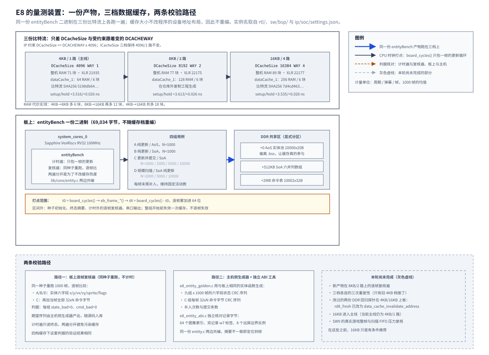

# 10 CPU 每弹幕开销与缓存对照的复现

2026-09-25 首轮测量，2026-09-27 收尾。E8 的板上专项。主线为 4KB/1 路数据缓存，
候选为 16KB/4 路。8KB/2 路仅保留旧产物的历史结果。
逐帧校验版 `entityBench-O2.bin` 为 69,034 字节，在 4KB 与 16KB 使用同一份二进制，
各九组、每组 1000 帧的实体六字段与 C 组全部 `32×N` 命令字节对账零错。
本次收尾结果见 5.9，候选维护与复测边界见第六节；历史完整实验记录保存在 5.8。

## 一、动机

本工程在易灵思钛金 Ti60F225 上做 2D 渲染加速引擎。片内一颗 RISC-V 处理器
（Sapphire SoC）跑 100MHz，弹幕游戏每帧要把几千个活动元素的位置更新一遍，
再把每个元素的绘制位置写成一条 32 字节命令记录，交给软件执行器
（[第 09 章](09-软件执行器像素吞吐的板上复现.md)）或未来的硬件引擎。

命令表由 CPU 生成，这一段在任何硬件加速方案里都留在 CPU 上，因为发射、
碰撞与规则判定是游戏逻辑。设计文档 3.1 节据此推演说「做完条带模式之后，
墙会移到 CPU 生成命令上」，这是 P4（把弹幕运动交给硬件）存在的理由。
支撑那句话的是**估算**：每个弹幕的更新、碰撞与写命令算 100 条指令，
5000 个弹幕约 5ms。Sapphire 手册给 1.16 DMIPS/MHz，也不能直接换算成
这段代码的周期数。本章把这个估算换成实测：运动更新与命令提交分开量，
并回答缓存要加多大。

缓存这一问来自设计文档 1.3 节：「游戏逻辑的数据（几千个弹幕的数组）
远大于 4KB 数据缓存」。现行构型是 **4KB、1 路直接映射、64 行 × 64 字节**，
行号取地址 `[11:6]`、标签取 `[31:12]`（[第 05 章](05-CPU数据缓存与第二个主机写入的一致性.md)
逐位实测过）。手册允许 1~32KB；加大容量不是把一路做大，而是加路数，
因为 IP 生成器有约束 `${DCacheSize} <= (${DCACHEWAY}*4096)`
（`<EFINITY>/ipm/ip/efx_soc/efx_soc/ipm/ip_component.xml` 第 5380 行）：
每一路最多 4KB，8KB 必须 2 路、16KB 必须 4 路。

设计文档 4.4 节还押了一条实现约束：「实体用结构体数组拆成的并列数组（SoA），
一次循环只碰需要的字段，对 4KB 数据缓存友好」。这条押注从未被验证过，
本章顺手把它量出来——同一份逻辑、同一输入序列下的 AoS 与 SoA 之差。

P4 的最终取舍不在本章。合成负载给的是候选上界，真实游戏的瓶颈与 `N_max`
要由 SW8/SW9 的板上整帧分段决定。

## 二、为什么是这几步

测量对象有三个性质，步骤按它们排。第一，实体更新的成本与**工作集大小**有关，
所以用例必须按规模分层，而且要同时覆盖「纯运动」与「运动 + 提交」两种口径；
第二，四组用例的输入必须逐帧可复算，否则「每弹幕成本」这个比值没有分母的保障；
第三，缓存配置只能通过重新生成 SoC IP 改变，而 IP 一变，
整个比特流与资源占用都变了。

由此拆成六步：

1. 定义「一个弹幕」与被测的两种口径，把字段、定点格式与命令位域写死；
2. 把被测对象放进 `lib/core/`，让板上与主机侧编**同一份源码**；
3. 用主机侧生成器产出逐帧期望序列，作为板上复核遍的比对基准；
4. 生成 8KB/2 路与 16KB/4 路两份 SoC IP，各编译一份比特流；
5. 用**同一份** `entityBench` 二进制在三档上各跑一遍，并做同配置重复性；
6. 检查既有的两份 DDR 回归探针是否仍适用于多路缓存。

第 2 步是本章所有判据的前提。E8 要判的是「这台 CPU 每拍处理一个弹幕要多少周期」，
如果板上与主机侧各写一份更新循环，两边的数字对不上时无法判断是哪一边的问题；
只有两边真的跑同一份 `entity.c`，「主机期望 = 板上实测」才说明板上量的确实是这个算法。
被测对象因此**从应用搬进 `lib/core`**：它不依赖 `board.h`，两个平台都能编。

第 5 步里「同一份二进制」这一条是踩出来的。三次跨会话复跑的偏差 <0.03%，
但同一份源码只改输出格式再重链，C 组的值就从 175.90 变成 191.28（+8.7%），
A/B 几乎不变。跨构建的差异远大于跨会话的差异，说明它是二进制布局敏感。
缓存大小不影响程序的设备地址布局，所以三档共用一份二进制是可行的，
也是必须的；否则量到的差里混着构建自身的偏移。详见 4.4 节。

第 6 步原本不在计划里。多路缓存让两份既有探针的「驱逐」手法失效，
而 E8 的判据表要求每份比特流都跑一遍它们，所以这一刀必须补。

## 三、每一步做了什么

### 3.1 定义被测对象

一个弹幕指设计文档 4.5 节场景 S1 的敌弹：

| 字段 | 类型 | 说明 |
| --- | --- | --- |
| `x`, `y` | `int32`，Q12.4 定点 | 位置，1 像素 = 16 |
| `vx`, `vy` | `int32`，Q12.4 定点 | 速度，每帧 -5.0 ~ +5.0 像素 |
| `sprite` | `uint16` | 图集索引，取值 0~63 |
| `flags` | `uint16` | 存活、计时等 |
| 命令 | 32 字节 | 一条 BLIT 记录，位域与 `lib/gfx/list.c` 逐位一致 |

「更新一个弹幕」取两种口径，分开报：

- **纯更新**：`x += vx; y += vy;` 加一次出屏判定，不写命令表；
- **更新并提交**：纯更新 + 填一条 32 字节命令记录进命令表。

出屏回收用「位置落在 ±2 倍游戏区之外则标记为死」这一条，不做实体池整理。
主测量必须在 1000 帧内维持**固定活动数 N**：越界后按固定序列补入一个实体，
并记录补入次数。否则后半程若只剩死实体，`cycles / (frames × N)`
就不再是每个活动弹幕的成本。补入序列由 xorshift32 决定，
同一份源码在板上与主机侧给出同一串数。

`eb_ent` 的四个 `int32` 加两个 `uint16` 合计 **20 字节**，20 已是 4 的倍数，
结构体没有尾部填充，`_Static_assert(sizeof(eb_ent) == 20)` 把这一条钉住。
SoA 是六个并列数组，由调用方按 `x[n] y[n] vx[n] vy[n] sprite[n] flags[n]`
的顺序一次性分配成连续内存，各数组首址由 n 算出，不引入六指针的结构体——
多一层指针间接本身就是 E8 要量的东西之一。

### 3.2 被测对象放进 `lib/core`

新增 [`Main/sw/lib/core/entity.h`](../../../Main/sw/lib/core/entity.h) 与
[`entity.c`](../../../Main/sw/lib/core/entity.c)，内容是纯算法：一帧更新、出屏补入、
命令记录打包、以及**只在计时外调用的摘要函数**。
`Main/sw/apps/probe/entityBench/` 是板上的驱动与打点，
[`Main/tools/check/e8_entity_golden.c`](../../../Main/tools/check/e8_entity_golden.c) 是主机侧的期望值生成器，
两边都编同一份 `entity.c`。

这符合 SW1 的分层：`lib/core` 本来就两个平台共编，不依赖 `board.h`，
加一个纯算法模块不破坏分层（`check_sw_layers.sh` 加进新文件之后仍 `fail 0`）。

摘要放在**独立编译单元**里：编译器看不到更新循环与摘要处在同一个 TU，
不能因为「没人读这些字段」而删掉写入。跨单元 LTO 会把这条界限抹掉，
所以 E8 的构建不开 LTO。这一条针对的是这类微基准最隐蔽的失效——
量出来「很快」，因为循环被优化掉了。

命令记录**不走 `gfx_list_*`**：E8 要量的是「填一条 32 字节记录」本身的成本，
而构造层每次追加都会走一遍 `gfx_cmd_check()`（第 09 章量到那一步约 245 周期/命令）。
位域在 `entity.c` 里自己打包，与 `list.c` 的记录**逐字节一致**，
这一点由独立的 [`Main/tools/check/e8_entity_abi.c`](../../../Main/tools/check/e8_entity_abi.c) 核对：
它调用真正的 `gfx_blit()` 生成记录，与 `pack_blit()` 的输出逐字节比，
覆盖 64 个图集索引、两条记录的 `w7` 标签，以及 8 个 x/y 出屏边界反例。

保留字段 `w6` 也必须为零——E8 的第一版把图集索引塞进了 `w6`，
两边编同一份错误代码，摘要仍然相同。**同源摘要不能证明 ABI 正确**，
这正是要另设一个独立 ABI 工具的原因。

### 3.3 四组用例与打点口径

| 用例 | 布局 | N | 做什么 |
| --- | --- | --- | --- |
| A | AoS | 1000 | 纯更新 |
| B | SoA | 1000 | 纯更新 |
| C | SoA | 1000 / 2000 / 5000 / 10000 | 更新并提交 |
| D | SoA | 2000 / 5000 / 10000 | 纯更新（规模扫描） |

A 与 B 是同一份逻辑的两种布局，摘要相同而周期不同，差值就是布局的影响。
C 的四个规模回答「提交成本随 N 怎么变」，D 回答「纯更新成本随 N 怎么变」；
C 减同规模的 D 是「提交带来的增量」，含存储访问与访存交织，
不解释成纯存储指令成本。

下图保留 **2026-09-25 的实验设计与当时状态**：三档只差 `DCacheSize` 与 `DCACHEWAY`，
比较时要求固定被测二进制。图中灰色虚线框为当时待办；2026-09-27 的收尾范围已缩减，
实际执行与结果见 5.9，第六节接管后续维护。8KB 新版与三次矩阵不再是收尾要求。



实体池**显式放在 DDR 共享区**，不用 `.bss` 的相对地址：

| 区 | 偏移 | 大小 |
| --- | --- | --- |
| AoS 实体池 | 共享区 +0 | 10000 × 20 B = 196 KB |
| SoA 六数组 | 共享区 +512 KB | 10000 × 20 B = 196 KB |
| 命令表 | 共享区 +2 MB | 10002 × 32 B = 313 KB |

显式分区有两个作用：一是固定数组地址与相互间距，避免链接布局变化直接挪动被测数据；
二是让 4KB 数据缓存**真的参与**——如果实体池落在 `.bss` 顶部的很小范围内，
量到的就是片上就近访问，缓存档之间的差别会被抹掉。

打点只包住**一帧**的更新循环：

```
t0 = board_cycles();  eb_frame_*(...);  dt = board_cycles() - t0;  逐帧累加进 64 位
```

`board_cycles()` 是 CLINT 低 32 位、1 tick = 10 ns、42.9 秒回绕；
逐帧取区间再累加，不拿首尾两个读数相减。区间外做种子初始化、终态摘要、
复核遍与串口输出。整组开始前做一次 `board_dcache_invalidate_all()`，
**不逐帧失效**：逐帧失效会把「装行」的成本灌进每一帧，量到的是另一种东西。

首帧携带一次冷启动（装行与分支预测），所以复核遍与计时遍分开：
计时遍只读终态以保证性能口径，复核遍用同一种子重跑并逐帧比对。

### 3.4 逐帧校验：两条路径

判据要求「实体所有相关字段与命令表字节**逐帧**在计时外摘要核对主机侧期望」。
终态摘要做不到这一点——中间帧的错误若最终抵消或被覆盖，终态仍然相同。

主机侧 `e8_entity_golden.c` 用同一份 `entity.c` 生成期望序列：
九组各 1000 帧的六字段状态 CRC，以及 C 组每帧全部 `32×N` 命令字节的 CRC，
再加上补入次数与提交条数，写进 `entityBench/src/golden.h`（生成物，随源码入库）。

板上 `entityBench` 在**计时遍结束后另起一遍**复核：同一种子、同样的帧数，
每一帧读完实体与命令并与期望序列逐项比，任一帧不符就报 `state_bad`/`cmd_bad`。
两遍分开是为了不改计时遍的缓存热度；这一条写在程序的注释里，
也是判据表里「校验会改变缓存状态，各档的预热策略必须相同」那一条的落实。

```
主机侧 e8_entity_golden.c（编同一份 entity.c）
   同一初始种子 ──► 九组 x 1000 帧 ──► 六字段状态 CRC 序列
                                     + C 组每帧 32xN 命令字节 CRC 序列
                                     + 补入次数、提交条数
                                              │
                                     写入 src/golden.h（生成物，随源码入库）
                                              │
板上 entityBench（同一份 entity.c）           ▼
   计时遍  同一种子 ──► 1000 帧更新/写命令 ──► 逐帧打点累加 ──► 终态摘要 ──► 比主机
                                              （缓存热度只看这一遍）
   复核遍  同一种子 ──► 1000 帧更新/写命令 ──► 每帧读六字段与全命令 ──► 逐帧比
                                              （不计时，只判 state_bad / cmd_bad）

   任一帧不符 ──► state_bad/cmd_bad 加一 ──► 该组行打 FAIL，fail 计数加一
```

这条判据的性质要说清楚：两边共用 `entity.c`，所以它主要检验
**主机（x86 LP64）与板上（RV32 ILP32）的逐帧一致性**，而不是算法的业务正确性。
算法的字节级正确性由 `e8_entity_abi.c` 独立核对。

### 3.5 生成两份缓存变体

除 `DCacheSize` 与受约束跟着变的 `DCACHEWAY` 外，RTL、工具链、时钟、
地址布局、程序与扫描负载全部不动。生成在仓库外的复制工程里做：

```
wsl -e python3 Main/tools/check/localize_paths.py --apply     # 展开 settings.json 的 bootloader 路径
cp -r Main <复制工程>/Main                                     # 与仓库同盘，生成器的 relpath 不能跨盘
sed -i "s#<仓库绝对路径>/Main#<复制工程绝对路径>/Main#g" <复制工程>/.../ip/soc/settings.json
# 在 Efinity 环境里先 --dry-run 核对参数对照，再真生成：
#   ipm_gen_soc.py --project <复制工程>/.../gfx2d_ti60 --override DCacheSize=8192  DCACHEWAY=2
#   ipm_gen_soc.py --project <复制工程>/.../gfx2d_ti60 --override DCacheSize=16384 DCACHEWAY=4
```

每次生成后核对两处（判据「缓存」要求）：
`ip/soc/settings.json` 的 `DCacheSize`/`DCACHEWAY`，
与生成包 `embedded_sw/soc/bsp/.../soc.h` 的
`SYSTEM_CORES_0_DCACHE_SIZE`/`_DCACHE_WAYS`。两处都必须等于该档。
然后把 `ip/soc/` 换进主线工程、跑一次 `efx_run.bat`、收报告、还原主线。
`soc.h` 的缓存宏只影响软件包，被测程序不读它们，但判据要求它与档位一致，
所以换 IP 时一并换上并核对。

### 3.6 补上多路缓存下的回归

E8 的判据表要求每份比特流都跑一遍 `ddrAliasTest` 与 `ddrBurstProbe` 的 `fail 0`。
这两份探针原来都用同一个手法「驱逐」缓存行：

```c
static uint8_t rd8_fresh(uint32_t a) { (void)rd8(a ^ EVICT); return rd8(a); }
```

`EVICT = 0x2000_0000`，与 `a` 行号相同、标签不同。这个手法只在
**1 路直接映射**下保证驱逐：新标签必然顶掉原来那一行。
换成 2 路或 4 路之后，这次读只占同一行的另一路，目标行可能还留在缓存里。
这不是缓存本身的缺陷，但它会让既有判据失效。

修法用 SDK 的单地址失效指令：

```c
static uint8_t rd8_fresh(uint32_t a)
{
    data_cache_invalidate_address((uintptr_t)a);
    __asm__ volatile ("" ::: "memory");
    return rd8(a);
}
```

`vexriscv.h` 的 `data_cache_invalidate_address()` 按地址失效所有可能容纳
目标地址的缓存路，与路数无关；后面的内存屏障防止读被编译器提前。
这条指令的语义在 [第 05 章](05-CPU数据缓存与第二个主机写入的一致性.md)
已实测过（单地址失效约 4 个周期，失效后每行首次访问约 69 个周期）。

`ddrAliasTest` 与 `ddrBurstProbe` 两份源码都已按此修改，
`CACHE_EVICT` 标签为历史日志兼容保留，实际机制已改成单地址失效。
2026-09-25 时尚未回归；**2026-09-27 两份修改版已在 4KB/16KB 各通过一次，均 `fail 0`/`done`**，见 5.9。

## 四、遇到的问题

### 4.1 本地比特流与主线缓存参数错配

第一现场：主线 `Main/sdk/.../soc.h` 与 SoC `settings.json` 都写 4KB/1 路，
而本地 `outflow/gfx2d_ti60.place.rpt` 报 **RAM 89 块**；
用这份比特流量到的 E8 旧探针结果是 A/B/C = 34.93/40.24/104.01 周期。

解读：89 块正是 16KB/4 路的占用（三档资源表见 5.2 节：4KB 71、8KB 77、16KB 89），
而 34.9/40.2/104.0 这组数也正是 16KB 档的量级（对照 5.3 节的三档矩阵）。
两项独立证据都指向同一结论：这份比特流是 16KB 档，不能当 4KB 基线。

定位：对照四处——SoC 头文件的宏、IP `settings.json` 的参数、
`hier_util.rpt` 里 `dataCache_1` 的 RAM 数、以及三档已知的性能量级。
为确认不是偶发，修复前又用这份被误认为 4KB 的 `outflow` 烧写了一次，
旧产物仍给出 34.95/40.25/104.04，与 16KB 档一致。

根因与修法：本地 `outflow/` 是忽略目录，里面留着上一轮缓存变体的编译产物。
处理办法是从 4KB 源码输入重编一次比特流，并把旧 16KB 那一份与报告
保存在 `Main/fpga/gfx2d_ti60/outflow/e8_16k_saved_20260925/`
（编译产物，不入库），SHA256
`7d4cd463c3a62ca61f58e6db4eda53bc90f6940920d5c3239bcafe75dad2e6d4`。
重建的 4KB 比特流 SHA256
`5198db644338720d6fe53fc9ff59d4f6f86c0ddc3da5100c55a857b9d644b144`，
RAM 71 块、XLR 21935，`core_clk` setup/hold +3.516/+0.026 ns。

原判据没有覆盖到它，因为判据只检查程序自己报的 `fail`，
没有把「比特流哈希与资源档」当成实验条件的一部分。
从本章起，每一份周期数都要写明出自哪一个比特流哈希。

### 4.2 终态摘要漏掉中间帧

第一现场：旧 `entityBench` 九组的末尾全是 `fail 0`，但程序只在第 1000 帧之后
读一次实体状态与命令表，与主机期望比一次。

解读：终态相同的两个过程不必逐帧相同。中间某帧写错、后续帧又覆盖回来的情况，
终态摘要看不出来；C 组的命令表更明显——每帧都整体重写 `32×N` 字节，
前一帧的错误会被后一帧完全覆盖。

定位：读计时循环与摘要位置，确认摘要只出现在循环之后，没有帧序列对照。
这一条是判据本身的缺口，不是实现的 bug。

根因与修法：新增计时外的复核遍，逐帧比较六字段与 C 组全部命令字节
（3.4 节）。计时遍保持不变以维持性能口径。同一份期望序列由主机侧生成器产出，
所以这条判据同时盖住主机与 RV32 的一致性。
原判据没有覆盖到它，因为它把「终态一致」当成了「逐帧一致」。

### 4.3 多路缓存让单次异标签读不再驱逐

第一现场：两份回归探针的驱逐函数各只读一次同行异标签地址：

```c
#define EVICT 0x20000000u
static uint8_t rd8_fresh(uint32_t a) { (void)rd8(a ^ EVICT); return rd8(a); }
```

解读：这个手法把「行号相同、标签不同」当成必然冲突。1 路直接映射下成立，
因为一行只有一个位置；2 路下同一行有两个位置，这次读占另一个位置，
目标行仍在缓存里；4 路同理。于是「失效后读到新值」的期望在 2 路/4 路下不成立。

定位：对照缓存几何（每路 4KB、行号仍取 `[11:6]`）、
SDK `vexriscv.h` 里单地址失效指令的说明，以及
[第 05 章](05-CPU数据缓存与第二个主机写入的一致性.md) 实测的失效行为。

根因与修法：既有探针隐含「1 路」前提。改成
`data_cache_invalidate_address(a)` 加编译器内存屏障，按地址失效涵盖所有路。
`ddrAliasTest` 的 `CACHE_NOEVICT` 是观测项（读到哪个值都是结论，不计入 `fail`），
`CACHE_EVICT` 是判据项，改后应由单地址失效保证。
原判据没有覆盖到它，因为判据是在 1 路构型下定稿的，
而缓存路数变了以后没人回头检查它的隐含前提。

### 4.4 跨构建的布局敏感性

第一现场（三个不同产物的 C 组 N=1000）：

| 产物 | C，周期/弹幕/帧 |
| --- | --: |
| 初版 | 175.90 |
| 只改应用输出格式并重链 | 191.28（+8.7%） |
| 加逐帧校验的产物 | 176.24 |

解读：同一份源码只改输出格式、A/B 几乎不变，C 却变了 8.7%。
而**同一产物**跨会话复跑的极差 <0.03%（5.4 节）。
跨构建的差异远大于跨会话的差异，所以它不是测量噪声。

定位：A/B（纯更新）几乎不动，只有 C（含命令写入）明显变化，
说明差异与命令表的地址或写入路径有关。命令表在共享区 +2MB，
而 `.bss`/`.data` 的增长会整体挪动程序的静态区；循环对齐也会变。
具体机理**没有定位到**，本章只把它作为一条已观测的约束记下来。

根因与修法：缓存比较必须排除这个变量。做法是
**三档共用同一份 `entityBench` 二进制**——缓存大小只改 CPU 内部结构，
不改程序的设备地址布局，所以不需要重编。命令表地址、输入序列、
扫描状态也全部固定。若某档被迫重编，必须先做一次「同配置重编」的对照，
把构建自身的偏移量先量出来再比。
原判据没有覆盖到它，因为判据只要求「同一配置连跑三次」，那是**跨会话**的重复性，
没有规定跨构建怎么比。

### 4.5 P4 分段混用了不同 N

第一现场（本章初稿的 P4 折算式）：

```
N=2000 时运动约 0.80 ms（= 40.24 × 2000 / 100MHz）
```

解读：`40.24` 是 **16KB 档 B 组在 N=1000** 的周期数，却拿去乘 N=2000。
更新成本随规模改变，同规模的数据是 D-n2000 = 55.22。
两个数混用会把运动那一半低估约 27%。

定位：按三档矩阵逐行对照，C-n2000 = 116.75 与 D-n2000 = 55.22 才是同规模的
「更新并提交」与「纯更新」。

根因与修法：折帧改用**同规模**的纯更新行（N=1000 用 B，更高 N 用 D），
提交增量取 C 减同规模纯更新。修正后 N=2000 的运动约 1.10 ms、
提交增量约 1.23 ms（5.5 节）。原判据没有覆盖到它，
因为判据表只要求「分清单项等效上限与整表实测」，没有规定分段必须同 N。

## 五、结果

### 5.1 实验条件

| 项 | 值 |
| --- | --- |
| 被测 BIN | `entityBench-O2.bin` **69,034 字节**，SHA256 `b0f2bbc5100b24702b750cca803ce5c94c34c8f81aee68372317f35381184e29` |
| 被测 ELF | 223,692 字节，SHA256 `a0702eed70d51c9fa5813d7aba604ef4a63b2791ef5636f96d7e9354262a1e46` |
| 工具链 | xPack `riscv-none-elf-gcc 13.4.0`，`make -j2`，默认 `-O2` |
| 4KB 比特流 | 从 4KB/1 路主线源码重编，SHA256 `5198db644338720d6fe53fc9ff59d4f6f86c0ddc3da5100c55a857b9d644b144` |
| 16KB 比特流 | 复制工程生成，SHA256 `7d4cd463c3a62ca61f58e6db4eda53bc90f6940920d5c3239bcafe75dad2e6d4` |
| 采集 | `board_run.py --bin ... --stop-on done`，JTAG 加载，COM11 115200 8N1，`--seconds 600` |
| 原始日志 | `logs/board_framecheck_4k_20260925.log`、`logs/board_framecheck_16k_20260925.log`（完整原文见 5.6、5.7 节） |

同一份 BIN 在两档上各九组、每组 1000 帧。
4KB 档烧入重建后的主线 4KB 比特流，16KB 档加
`--bit fpga/gfx2d_ti60/outflow/e8_16k_saved_20260925/gfx2d_ti60.bit`。
**不能仅凭 `outflow/` 里的文件名推断板上配置**，这是 4.1 节的教训。

### 5.2 三档的参数与资源

| 档 | `DCacheSize`/`DCACHEWAY` | `soc.h` 两个宏 | `dataCache_1` RAM / block | 整机 RAM | XLR | `core_clk` setup/hold |
| --- | --- | --- | --- | --: | --: | --- |
| 4KB/1 路（主线） | `4096` / `1` | `4096` / `1` | 64 / **6** | **71** | 21935 | +3.516 / +0.026 ns |
| 8KB/2 路 | `8192` / `2` | `8192` / `2` | 128 / **6** | **77** | 22175 | +3.613 / +0.026 ns |
| 16KB/4 路 | `16384` / `4` | `16384` / `4` | 256 / **6** | **89** | 22177 | +3.535 / +0.026 ns |

三档都四步 PASS、无负 slack。`IBusCachedPlugin_cache` 三档都是 6 块，
因为三档的 `ICacheSize=4096`/`ICACHEWAY=1` 一致（本条不动指令缓存）。
`dataCache_1` 的 RAM 数随容量逐倍增长而 block 数不变，说明这一项
在 `hier_util.rpt` 里记的是真双口 RAM 的数量。

**RAM 代价**：4KB→8KB 多 **6** 块，8KB→16KB 再多 **12** 块，4KB→16KB 共多 **18** 块。
设计文档 1.3 节的「每加倍大约多 8 块 RAM」（即 4KB→16KB 约多 16 块）
在量级上接近但值不对，按实测更正。

### 5.3 三档的每弹幕周期数

单位是周期/弹幕/帧，取 1000 帧的均值（`cyc / (frames × N)`）。
4KB 与 16KB 两列来自同一份新产物（5.6、5.7 节的原始日志），
8KB 一列来自旧产物，只能作为**同一旧产物的缓存对照**。

| 用例 | 4KB/1 路 | 8KB/2 路（旧产物） | 16KB/4 路 | 16KB 相对 4KB |
| --- | --: | --: | --: | --: |
| A：AoS 纯更新，N=1000 | 49.05 | 47.71 | **34.78** | **−29.1%** |
| B：SoA 纯更新，N=1000 | 71.47 | 56.30 | **40.33** | **−43.6%** |
| C：SoA 更新并提交，N=1000 | 176.24 | 121.29 | **104.33** | **−40.8%** |
| C，N=2000 | 175.47 | 122.66 | 116.88 | −33.4% |
| C，N=5000 | 175.23 | 126.35 | 119.39 | −31.9% |
| C，N=10000 | 171.71 | 122.17 | 118.41 | −31.0% |
| D：SoA 纯更新，N=2000 | 71.13 | 58.48 | 55.26 | −22.3% |
| D，N=5000 | 71.35 | 59.33 | 58.38 | −18.2% |
| D，N=10000 | 70.83 | 59.07 | 58.53 | −17.4% |

新产物两档各九组、每组 1000 帧的 `state_bad` 与 `cmd_bad` **全部为 0**，
终态摘要与补入次数也与主机一致，两档都以 `fail 0`、`done` 结束。
同一份二进制在两档上跑出相同的结果，说明缓存配置只改性能、不改结果。

三条读数：

1. **同一新版产物下，16KB 相对 4KB 的收益明确**：N=1000 的 A/B/C 约降低 29%/44%/41%。
   8KB 的旧产物结果仅保留为历史参照；与 16KB 的精确增益应查 5.8 的同旧产物矩阵，
   不能直接用上表跨产物相减。本次选型范围为 4KB 与 16KB。
2. **SoA 的相对劣势缩小，但方向没有反转**：B/A 的比值 4KB 时是 **1.46**
   （SoA 慢 46%），8KB 时 1.18，16KB 时 **1.16**（仍慢 16%）。
   设计文档 4.4 节押的「SoA 对数据缓存友好」在这份合成负载上**没有得到支持**；
   加缓存只是把差距收窄。SW7 的真实游戏布局仍须单独决定。
3. **没有观察到明显的 N 台阶**：D 组三档在 N=2000~10000 上几乎平（16KB 档
   55.26/58.38/58.53），16KB 的 −17~22% 是整条曲线下移，不是跨过某个容量拐点。
   按判据 D 的要求，这里只报告相关性：三档同时改变容量与路数，
   会一起改变容量缺失与冲突缺失，**不能据此判定收益来自容量还是冲突**。
   要看机理需要另设同容量不同路数的控制组，本轮没做。

C 组 N=1000 的提交增量（取新产物同档、同规模的 C 减 B）：4KB 档 176.24−71.47 = **104.8**、
16KB 档 104.33−40.33 = **64.0** 周期/弹幕/帧。
这一项含存储访问与访存交织，不解释成纯存储指令成本。

### 5.4 历史重复性（2026-09-25）

原判据要求「同一配置连跑三次，偏差超过 2% 要查原因」。
旧产物在 **4KB 档**跨会话跑了三次，九组全部落在 **0.03%** 以内：

| 用例 | run1 | run2 | run3 | 极差 |
| --- | --: | --: | --: | --: |
| A | 49.22 | 49.23 | 49.22 | 0.02% |
| B | 71.35 | 71.35 | 71.34 | 0.01% |
| C-1000 | 175.95 | 175.96 | 175.96 | 0.01% |
| C-2000 | 175.29 | 175.30 | 175.29 | 0.01% |
| C-5000 | 170.15 | 170.14 | 170.15 | 0.01% |
| C-10000 | 174.22 | 174.22 | 174.22 | 0.00% |
| D-2000 | 71.07 | 71.07 | 71.06 | 0.01% |
| D-5000 | 71.32 | 71.33 | 71.33 | 0.01% |
| D-10000 | 70.82 | 70.81 | 70.81 | 0.01% |

组内 `fmin`/`fmax` 的抖动是 4~13%（例如 C-n10000 的 1,731,536~1,756,595），
所以报的是 1000 帧的**均值**，不是某一帧；三次之间的一致说明均值是稳的。
截至 2026-09-25，新产物只在 4KB 与 16KB 各跑一次。2026-09-27 按缩减范围各再测一次（5.9）；
8KB 没有新版逐帧校验，也没有新版三档三次矩阵。它们不再是收尾要求，见第六节。

### 5.5 三行结论

**其一，合成负载时间**（C 档实测，= N × 每弹幕周期数 / 100MHz）：

| N | 4KB/1 路 | 8KB/2 路（旧产物） | 16KB/4 路 |
| --: | --: | --: | --: |
| 2000 | 3.51 ms | 2.45 ms | **2.34 ms** |
| 5000 | 8.76 ms | 6.32 ms | **5.97 ms** |
| 10000 | 17.17 ms | 12.22 ms | **11.84 ms** |

对照 16.67 ms 的一帧预算：4KB 档在 N≈9500 处超预算，16KB 档在 N≈14000 处超预算。
这只是运动与命令提交，不含发射、碰撞、规则、构造层与渲染等待。

**其二，缓存推荐档：16KB / 4 路，但为有条件推荐。**
代价是 +18 块片上 RAM（71→89，占全片 34.77%，余量仍有 167 块），
换来一帧预算内可容纳的 N 从约 9500 提到约 14000，
并把 SoA 相对 AoS 的劣势从约 46% 缩到约 16%。
修改后的两份 DDR 探针已于 2026-09-27 在 4KB/16KB 通过（5.9）。
正式采用时仍需同步 SoC/SDK 并核对资源与时序，由 SW9 用真实游戏和扫描压力验证实际收益。
主线保持 **4KB/1 路**，候选采用条件归第六节维护。

**其三，P4 暂缓排期，尚不能判定「不值得做」。**
按同规模的纯更新与提交增量分开折，取 16KB 档：

```
N=2000  运动 55.26 × 2000 = 11.0 万周期 = 1.10 ms（占一帧 6.6%）
        提交 (116.88 − 55.26) × 2000 = 12.3 万周期 = 1.23 ms（7.4%）
N=5000  运动 58.38 × 5000 = 29.2 万周期 = 2.92 ms（17.5%）
        提交 (119.39 − 58.38) × 5000 = 30.5 万周期 = 3.05 ms（18.3%）
```

两段都可能被卸载：设计文档的 P4 包含运动更新与直接生成绘制。
合成负载只给出候选上界——N=2000 的 C 约 2.34 ms（帧预算 14%）、
N=5000 约 5.97 ms（36%）。规则、发射与碰撞仍留在 CPU，
所以实际收益不能取 C 的全值。20%/50% 的帧预算占比只是排期提示：
当前两段都在 20% 以下，先做引擎与真实游戏；
是否给 P4 排期由 SW8/SW9 的真实整帧分段、实测 `N_max` 与接口成本决定。

**与第 09 章合起来**回答设计文档 3.1 节那句话：
S1 同类整表在软件执行器里 80.46 M 周期（804.6 ms），
而 4KB 档 N=2000 的命令生成只要 3.51 ms。
**CPU 侧的墙在逐像素执行，不在生成命令**——两者相差约 230 倍。
这句结论与设计文档 3.1 节原文的估算方向不同：那里的估算是
「5000 个弹幕约 5ms」，实测的生成侧在同一量级（4KB 档 N=5000 是 8.76 ms，
16KB 档 5.97 ms），但**执行侧比生成侧贵两个数量级**。

**更正**：设计文档 1.3 节的「每加倍大约多 8 块 RAM」按实测更正为
「4KB→8KB 多 6 块、8KB→16KB 再多 12 块，4KB→16KB 共多 18 块」（2026-09-25）。

### 5.6 4KB/1 路的串口原始输出

完整原文入库
[`board_framecheck_4k_20260925.log`](../../../Main/sw/apps/probe/entityBench/logs/board_framecheck_4k_20260925.log)：

```text
# COM11 @ 115200 8N1, opened 02:36:37

entityBench E8 前期研究版
BOARD_HZ 100000000 frames 1000 cases 9
CAL cyc/pair-call 20 cyc/empty-loop-x100 2 cyc/x-modsum-x100 7312

# --- 程序已加载，以下才是它的输出 ---
A-upd-aos n 1000 cyc_k 49051 us/frame 490 c/ent/frame 49.05 fmin 46516 fmax 52468 resp 1720 crc 0x04cf54b4
VERIFY-FRAMES A-upd-aos frames 1000 state_bad 0 cmd_bad 0 ok
B-upd-soa n 1000 cyc_k 71472 us/frame 714 c/ent/frame 71.47 fmin 69574 fmax 74622 resp 1720 crc 0x04cf54b4
VERIFY-FRAMES B-upd-soa frames 1000 state_bad 0 cmd_bad 0 ok
C-submit-soa n 1000 cyc_k 176248 us/frame 1762 c/ent/frame 176.24 fmin 170408 fmax 179163 resp 1720 cmd 1000 crc 0x04cf54b4/0xf0b3c4bf
VERIFY-FRAMES C-submit-soa frames 1000 state_bad 0 cmd_bad 0 ok
C-n2000-soa n 2000 cyc_k 350950 us/frame 3509 c/ent/frame 175.47 fmin 345259 fmax 355583 resp 3427 cmd 2000 crc 0xfe5bf0c7/0x2149fc49
VERIFY-FRAMES C-n2000-soa frames 1000 state_bad 0 cmd_bad 0 ok
C-n5000-soa n 5000 cyc_k 876152 us/frame 8761 c/ent/frame 175.23 fmin 868443 fmax 884713 resp 8587 cmd 5000 crc 0x2f3c0725/0x61bda89a
VERIFY-FRAMES C-n5000-soa frames 1000 state_bad 0 cmd_bad 0 ok
C-n10000-soa n 10000 cyc_k 1717137 us/frame 17171 c/ent/frame 171.71 fmin 1706859 fmax 1733079 resp 17187 cmd 10000 crc 0x062e4654/0xc74b78bb
VERIFY-FRAMES C-n10000-soa frames 1000 state_bad 0 cmd_bad 0 ok
D-n2000-soa n 2000 cyc_k 142260 us/frame 1422 c/ent/frame 71.13 fmin 137423 fmax 146134 resp 3427 crc 0xfe5bf0c7
VERIFY-FRAMES D-n2000-soa frames 1000 state_bad 0 cmd_bad 0 ok
D-n5000-soa n 5000 cyc_k 356772 us/frame 3567 c/ent/frame 71.35 fmin 350651 fmax 366130 resp 8587 crc 0x2f3c0725
VERIFY-FRAMES D-n5000-soa frames 1000 state_bad 0 cmd_bad 0 ok
D-n10000-soa n 10000 cyc_k 708318 us/frame 7083 c/ent/frame 70.83 fmin 697611 fmax 719722 resp 17187 crc 0x062e4654
VERIFY-FRAMES D-n10000-soa frames 1000 state_bad 0 cmd_bad 0 ok
fail 0
done

# closed 02:45:24, 1840 bytes
```

### 5.7 16KB/4 路的串口原始输出

完整原文入库
[`board_framecheck_16k_20260925.log`](../../../Main/sw/apps/probe/entityBench/logs/board_framecheck_16k_20260925.log)：

```text
# COM11 @ 115200 8N1, opened 02:30:07

entityBench E8 前期研究版
BOARD_HZ 100000000 frames 1000 cases 9
CAL cyc/pair-call 20 cyc/empty-loop-x100 2 cyc/x-modsum-x100 6035

# --- 程序已加载，以下才是它的输出 ---
A-upd-aos n 1000 cyc_k 34788 us/frame 347 c/ent/frame 34.78 fmin 32615 fmax 49185 resp 1720 crc 0x04cf54b4
VERIFY-FRAMES A-upd-aos frames 1000 state_bad 0 cmd_bad 0 ok
B-upd-soa n 1000 cyc_k 40333 us/frame 403 c/ent/frame 40.33 fmin 39476 fmax 59273 resp 1720 crc 0x04cf54b4
VERIFY-FRAMES B-upd-soa frames 1000 state_bad 0 cmd_bad 0 ok
C-submit-soa n 1000 cyc_k 104331 us/frame 1043 c/ent/frame 104.33 fmin 101713 fmax 119628 resp 1720 cmd 1000 crc 0x04cf54b4/0xf0b3c4bf
VERIFY-FRAMES C-submit-soa frames 1000 state_bad 0 cmd_bad 0 ok
C-n2000-soa n 2000 cyc_k 233771 us/frame 2337 c/ent/frame 116.88 fmin 229980 fmax 237493 resp 3427 cmd 2000 crc 0xfe5bf0c7/0x2149fc49
VERIFY-FRAMES C-n2000-soa frames 1000 state_bad 0 cmd_bad 0 ok
C-n5000-soa n 5000 cyc_k 596973 us/frame 5969 c/ent/frame 119.39 fmin 591104 fmax 604936 resp 8587 cmd 5000 crc 0x2f3c0725/0x61bda89a
VERIFY-FRAMES C-n5000-soa frames 1000 state_bad 0 cmd_bad 0 ok
C-n10000-soa n 10000 cyc_k 1184168 us/frame 11841 c/ent/frame 118.41 fmin 1176900 fmax 1194432 resp 17187 cmd 10000 crc 0x062e4654/0xc74b78bb
VERIFY-FRAMES C-n10000-soa frames 1000 state_bad 0 cmd_bad 0 ok
D-n2000-soa n 2000 cyc_k 110528 us/frame 1105 c/ent/frame 55.26 fmin 106826 fmax 116792 resp 3427 crc 0xfe5bf0c7
VERIFY-FRAMES D-n2000-soa frames 1000 state_bad 0 cmd_bad 0 ok
D-n5000-soa n 5000 cyc_k 291914 us/frame 2919 c/ent/frame 58.38 fmin 283774 fmax 300194 resp 8587 crc 0x2f3c0725
VERIFY-FRAMES D-n5000-soa frames 1000 state_bad 0 cmd_bad 0 ok
D-n10000-soa n 10000 cyc_k 585305 us/frame 5853 c/ent/frame 58.53 fmin 566789 fmax 600277 resp 17187 crc 0x062e4654
VERIFY-FRAMES D-n10000-soa frames 1000 state_bad 0 cmd_bad 0 ok
fail 0
done

# closed 02:35:58, 1840 bytes
```

`CAL` 行是启动时的标定（不进测量区）：一次打点（两次 `board_cycles()`
读数相减）约 20 个周期，在 N=1000 时是 0.02 周期/弹幕，可以忽略；
空循环每轮不足 0.01 周期。

**测量方法与误差来源。** 打点区间严格等于一帧的更新循环，
每组的种子、输入序列与命令表地址相同；报的是 1000 帧的均值。
已知误差来源有三项：逐帧打点本身约 20 周期/帧（占 N=1000 时 0.02 周期/弹幕）；
复核遍在计时区间外，但它改变缓存状态，所以两遍分开；
扫描输出全程在跑，其 DDR 流量计入稳态。旧产物 4KB 的跨会话重复性见 5.4；
跨构建的误差见 4.4 节，靠「三档共用一份二进制」排除。

### 5.8 原实验设计、判据与逐次取样记录

2026-09-27 从原 Todo 完整迁入，保留历史判据、原始数字、误判与订正，供追溯。
下方记录按原时间保留，“未做”“待验收”等词指当时状态；本轮有效范围以第六节为准，
这些历史条目不新增验收门槛，也不要求随软件更新重做实验。

<details>
<summary>展开历史实验设计与原始流水</summary>

### E8 CPU 每弹幕开销与数据缓存大小

历史状态（原记录）：**待验收**。旧产物已在 4KB/1 路、8KB/2 路、16KB/4 路
各跑九组，三档终态摘要一致；历史 N=1000 的 A/B/C 为
49.22/71.34/175.97 → 47.71/56.30/121.29 → 34.94/40.24/104.03
周期/弹幕/帧，整机 RAM 为 71→77→89 块；旧产物在 **4KB 档**三次重复性 <0.03%，
8KB 与 16KB 的旧产物各只跑过一次。
2026-09-25 复核补上**计时外逐帧消费并对主机期望值校验**：
新产物在 4KB 和 16KB 上各九组、每组 1000 帧，
实体六字段与 C 组全部 `32×N` 命令字节的逐帧 CRC 均 0 错、`fail 0`。
旧 8KB 产物的九组 `fail 0` 日志保留，但新逐帧校验产物尚未在 8KB 上复跑。
16KB 历史 timing 报告已补核：`core_clk` setup +3.535 ns、hold +0.026 ns。
条件性推荐仍为 **16KB/4 路**；进主线前，改过的两份 DDR 回归探针须在
4KB/16KB 上板复跑，新产物须补同配置重复性，真实游戏负载与扫描 FIFO 压力
还须由 SW9 复核。过程与原始日志见第 4 节最新条目。
E1 已验收（保留 Standard 构型，见 platform 第 04 章），所以缓存对比的基线是现行 4KB 单路构型，
不再与构型变更搭车。2026-09-19 起 SoC IP 定型不等本条、先做（已验收，见 [platform 第 07 章](07-SoC-IP定型与工具链升级.md)）（缓存维持 4KB），
本条出结论后若要改缓存，主线单独再生成一次，只改缓存参数，步骤照那一条。

#### 1 要解决什么

设计文档 3.1 节给了三条架构路线（直通 BitBlt、条带纹理在 DDR、条带纹理在片上缓存），
结论是「做完 C 之后，墙会移到 CPU 生成命令上」，这是 P4 存在的理由。
支撑这个结论的那句话是**估算**：

> CPU 这一侧的估算：Sapphire 手册给出 1.16 DMIPS/MHz，按 100MHz 约 116 DMIPS；
> 每个弹幕的更新、碰撞和写 32 字节命令算 100 条指令左右，
> 5000 个弹幕就要约 50 万条指令、5ms 量级。

「100 条指令」「5ms」都没有实测，DMIPS 也不能直接换算成这段代码的周期数。
这些数字是待检验的架构假设，本条量出实际周期和内存代价：

1. **P4 的可卸载收益。** 先把运动更新、命令提交与其余 CPU 开销分开；
   合成负载只能给 P4 收益的上界，真实游戏的瓶颈和 `N_max` 要由 SW8/SW9 复测。
2. **缓存加多大。** 现在是 4KB 数据缓存，1 路直接映射，64 行 × 64 字节
   （行号取地址 [11:6]，标签取 [31:12]）。设计文档 1.3 节写「游戏逻辑的数据
   （几千个弹幕的数组）远大于 4KB 数据缓存」，手册允许 1~32KB，
   每加倍大约多 8 块 RAM（即 4KB 加到 16KB 约多 16 块）。
   当前实测是 **4KB、1 路的缓存占 6 块 RAM**
   （`outflow/gfx2d_ti60.hier_util.rpt` 第 167 行 `dataCache_1` 6 块、
   第 169 行 `IBusCachedPlugin_cache` 6 块）。
   **加大缓存不是把一路做大，而是加路数**：IP 生成器对 `DCacheSize` 有约束
   `${DCacheSize} <= (${DCACHEWAY}*4096)`（`<EFINITY>/ipm/ip/efx_soc/efx_soc/ipm/ip_component.xml` 第 5380 行），
   每一路最多 4KB，8KB 必须 2 路、16KB 必须 4 路。若每一路的 RAM 占用与现在这一路相同，
   16KB 约多 18 块，比设计文档的「约多 16 块」略多；这只是推算，要以编译结果为准。

设计文档 4.4 节还押了一条实现约束：「实体用结构体数组拆成的并列数组（SoA），
一次循环只碰需要的字段，对 4KB 数据缓存友好」。这条押注没有被验证过，
本实验顺手把它量出来——AoS 与 SoA 在同一份逻辑下的耗时差。

#### 2 怎么切分

##### 2.1 先把「一个弹幕」定清楚

不定义清楚就没有可比的数字。本实验里的一个弹幕指设计文档 4.5 节场景 S1 的敌弹：

| 字段 | 类型 | 说明 |
| --- | --- | --- |
| `x`, `y` | `int32`，Q12.4 定点 | 位置 |
| `vx`, `vy` | `int32`，Q12.4 定点 | 速度 |
| `sprite` | `uint16` | 图集索引 |
| `flags` | `uint16` | 存活、计时等 |
| 命令 | 32 字节 | 按设计文档 3.4 节的位域填一条 BLIT 记录 |

「更新一个弹幕」取两种口径，分开报：

- **纯更新**：`x += vx; y += vy;` 加一次出屏判定，不写命令表；
- **更新并提交**：纯更新 + 填一条 32 字节命令记录进命令表。

出屏回收用「位置落在 `±2×` 游戏区之外则标记为死」这一条，
不做实体池整理。A~D 的主测量必须在 1000 帧内维持固定活动数 `N`：
越界后按固定种子补入一个实体，记录补入次数，四组和各缓存档用同一输入序列。
否则后半程若只剩死实体，`cycles / (frames × N)` 就不再是每个活动弹幕的成本。

##### 2.2 写 `sw/apps/probe/entityBench`，四个用例

新程序 `../../../Main/sw/apps/probe/entityBench/src/main.c`，骨架照 `sw/apps/probe/ddrBurstProbe`：
`clint_getTimeLow(BSP_CLINT)` 打点，100MHz 计时即 10ns 一格。

| 用例 | 数据布局 | 做什么 | 量什么 |
| --- | --- | --- | --- |
| A 纯更新/AoS | 结构体数组 | 对 N 个弹幕做 1000 帧纯更新 | 每弹幕每帧周期数 |
| B 纯更新/SoA | 并列数组 | 同上 | 与 A 的差 = SoA 的相对代价，可正可负 |
| C 更新并提交/SoA | 并列数组 + 命令表 | 每帧更新后写一条命令 | 每弹幕每帧周期数，含存储访问 |
| D 规模扫描 | SoA | N = 1000 / 2000 / 5000 / 10000 | 每弹幕开销随 N 的变化 |

每个用例至少 1000 帧，取总周期除以（帧数 × 实际更新的活动数）；
各档固定同一实体初值、运动序列、补入次数和命令表地址。
**计时外逐帧消费并校验输出**：A/B/D 覆盖 `x/y/vx/vy/sprite/flags`，
C 还须覆盖当帧全部 `32 × N` 字节的命令记录，与主机侧期望摘要一致。
只异或 `x` 会漏掉 `y` 与命令写入，编译器甚至可能删掉无人读取的命令表写入。
命令表摘要由独立编译的校验函数读取（关闭跨单元 LTO），并核对反汇编确有命令写入；
摘要仍放在计时区间外。
校验会改变缓存状态，因此每帧的校验、缓存预热或冷启动策略在各组必须相同并写入报告。

D 组给出工作集增大后的周期曲线。曲线上升可能来自容量、冲突、命令写入、
DDR 排队或分支等因素，不能仅凭曲线断定「数据装不进缓存」。
要结合 A/B/C 的分段、缓存变体及受控地址布局解释；不能定位机理时只报告相关性。

##### 2.3 数据缓存大小对比（要重新生成 IP）

共三档：现行 4KB 比特流作基线，8KB 与 16KB 在隔离工程里分别生成。
除 `DCacheSize` 与受 IP 约束必须跟着变的 `DCACHEWAY` 外，保持 RTL、工具链、
时钟、地址布局、程序和扫描负载相同：

| 变体 | `DCacheSize` | `DCACHEWAY` | 预期 RAM 增量（推算，待实测） | 用哪套 SoC 配置 |
| --- | --- | --- | --- | --- |
| 现状 | `4096` | `1` | 基准 | 现有 Standard |
| 8KB | `8192` | `2` | +6 块 | Standard |
| 16KB | `16384` | `4` | +18 块 | Standard |

**32KB 暂不测**：先看 4/8/16KB 的收益与 RAM 代价；
若 16KB 仍明显受益且资源允许，再单独评估 32KB，不预判瓶颈机理。
原表里还有一行「16KB 且构型变更 / Lite 统一时钟」，E1 已确认不换构型，该行删除。

这三档同时增加**总容量与路数**，会一起改变容量缺失与冲突缺失，
不能把测得的差异单独归因于某一种原因。若 IP 支持同容量不同路数，
可另加控制组拆开两种效应；否则只报告「该缓存配置的整体收益」。

现行 4KB 直接复用已验收比特流；8KB、16KB 各做一次独立的 IP 生成、编译与回归。
在仓库外的复制工程做变体，避免覆盖主线；复制工程中的 `sdk/` 登记项仍须恢复。
E1 已确认保留 Standard 构型，三档都基于现行构型。

复制工程里每次生成之后，仍要照 `../../../Main/sdk/README.md` 的「已登记的修改」表逐条改回，
否则比特流里的 bootloader 与程序区不是 512KB 版，回归会在启动这一步就失败。
bootloader 与链接脚本这两项不受 `DCacheSize` 影响，可直接复用现成产物，
但**必须逐一核对**，不能假设。

##### 2.4 从数字算决策

给三行结论，都要带算式：

1. **合成负载时间**：`N × 更新并提交的每弹幕周期数 ÷ 100MHz`，
   对 N = 2000 / 5000 / 10000 各一列，与 16.67ms 比较。
   这只是运动与命令提交的时间，不等于含发射、碰撞、规则、渲染等待的完整 CPU 帧时间。
2. **P4 的阶段性判据**：在同一 N 下，把纯更新（N=1000 用 B，更高 N 用 D）
   与 C 减去同规模纯更新（提交增量）分别折到目标规模；
   P4 只能卸载其硬件实际承担的部分：设计文档的 P4 包含运动更新和直接生成绘制，
   因而运动 B 与提交增量 C−B 都可能被替代；需按最终接口测实效，不能直接把 C 全部当收益。
   20%/50% 帧预算占比仅作排期提示：低于 20% 优先做引擎和真实游戏，
   高于 50% 优先调查 P4，其间保持可选。是否实施需由 SW8/SW9 的板上整帧分段、
   实测 `N_max`、硬件资源与两种运动模式的对照最终决定。
3. **缓存结论**：4KB / 8KB / 16KB 三档的每弹幕开销，以及每档换来的收益与 RAM 代价。
   先给推荐档；进入主线前用 SW9 的真实游戏负载、完整帧时间与扫描 FIFO 压力复核，
   并更正设计文档 1.3 节「每加倍大约多 8 块 RAM」为实测值。

本实验**不含**：P4 的实现（属引擎工作点）、
碰撞检测（本实验只为它留出字段，不实现具体的自机判定）、
游戏循环与关卡（属 sw 工作点；因此本条不单独定案 P4）、
指令缓存大小的对比（游戏逻辑的瓶颈在数据访问，本实验不动 `ICacheSize` 与 `ICACHEWAY`；
指令缓存有同样的约束 `${ICacheSize} <= (${ICACHEWAY}*4096)`，将来要加时同理）。

#### 3 判据

| 项 | 判据 |
| --- | --- |
| 正确性 | 实体所有相关字段与 C 的命令表字节逐帧在计时外摘要核对主机侧期望；固定活动数与补入次数 |
| 打点 | 每项打点范围明确（只包住更新循环或更新加提交），至少 1000 帧取平均 |
| 精度 | 同一配置连跑三次，偏差超过 2% 要查原因（中断、串口输出、温度） |
| A/B | SoA 相对 AoS 的收益给出倍数；若小于 5%，建议 SW7 放宽布局约束，但仍在真实游戏中复测 |
| C | 每弹幕含提交的周期数；同为 SoA 的 C 减 B 报为「提交带来的增量」，含缓存与访存干扰，不解释成纯存储指令成本 |
| D | 给出 N = 1000~10000 的曲线；超过 20% 时排查缓存、DDR、命令写入与分支，不凭曲线单独判定缓存缺失 |
| 缓存 | 每档给出 `DCacheSize`、`DCACHEWAY`、`dataCache_1` 的 RAM 块数（取 `hier_util.rpt` 的行）、每弹幕周期数；`soc.h` 里 `SYSTEM_CORES_0_DCACHE_WAYS` 与 `DCACHE_SIZE` 两个宏要与该档一致；容量和路数的合并效应按合并效应报告 |
| 资源 | 每档整机 XLR、RAM 与时序对照实验入场前同一 RTL 的基线；2026-09-25 从 4KB 主线源码重编的当前 `outflow` 为 XLR 21935、RAM 71 块、`core_clk` setup/hold +3.516/+0.026 ns（[主工程 README](../../../Main/README.md)）；2026-09-21 的 21807/71 是历史编译值，16151/65 更早于 E5/扫描输出 |
| 回归 | 每份比特流都要跑一遍 `sw/apps/probe/ddrAliasTest` 与 `sw/apps/probe/ddrBurstProbe` 的 `fail 0`；多路缓存下单次异标签读不再保证驱逐，两个程序的驱逐手法要先改，见下。候选档进入主线前再跑真实游戏帧预算与 `displayFifoProbe` 的扫描压力矩阵 |
| 决策 | 三行结论（合成负载时间 / P4 阶段性建议 / 缓存推荐档）带算式与出处；P4 最终取舍留到 SW8/SW9 真实整帧复测 |
| 更正 | 设计文档 1.3 节的「每加倍约 8 块 RAM」按实测更正，并注明日期 |

「回归」这一条是本实验特有的风险：`sw/apps/probe/ddrAliasTest` 与 `sw/apps/probe/ddrBurstProbe` 里的
`evict_rd32` 依赖「1 路直接映射」：读一个行号相同、标签不同的地址（`XOR 0x2000_0000`），
新标签就会顶掉目标行。每路仍是 4KB，行号仍取 [11:6]，但缓存变成 2 路或 4 路之后，
这次读只会占用同一行的另一路，目标行可能还留在缓存里，驱逐不再生效。
这不是缓存本身的缺陷，但它会让既有判据失效，所以两份程序都要改成连续读「路数」个不同标签的同行地址，
或用 `data_cache_invalidate_all()` / `data_cache_invalidate_address()` 重写之后再复跑，
改了要登记进 `../../../Main/sw/README.md`。`ddrAliasTest` 的 `CACHE_NOEVICT` 期望值也可能随之变化，要重新确认。

#### 4 开发日志

**2026-09-25 板上复现与逐帧正确性补齐（本条当前结论）。**

复核先发现比特流与软件头文件不一致：主线 `soc.h` 和 SoC 配置都是
4KB/1 路，但当时 `outflow/gfx2d_ti60.bit` 的资源报告为 **89 块 RAM**，
实际上是 16KB/4 路。先用旧 `entityBench` 产物量一次，
得 A/B/C=34.93/40.24/104.01，确认属于 16KB 档；随后从 4KB
源配置重编比特流，map/interface/pnr/pgm 四步 PASS，资源 **71 块 RAM、
21935 XLR**，`core_clk` setup/hold 为 +3.516/+0.026 ns，
比特流 SHA256 `5198db644338720d6fe53fc9ff59d4f6f86c0ddc3da5100c55a857b9d644b144`。
修复前曾用这个被误认为 4KB 的 `outflow` 再烧写一次，
旧产物的 A/B/C=34.95/40.25/104.04 仍是 16KB 量级，
不能当作 4KB；真正 4KB 的证据以下一段
新产物的 49.05/71.47/176.24 为准。原 16KB 比特流及报告保存于
`Main/fpga/gfx2d_ti60/outflow/e8_16k_saved_20260925/`（编译产物、不入库），
SHA256 `7d4cd463c3a62ca61f58e6db4eda53bc90f6940920d5c3239bcafe75dad2e6d4`。
16KB 的历史 `timing.rpt` 已复核，`core_clk` setup +3.535 ns、
hold +0.026 ns；第 4.6 节所写「缺 timing」是当时状态。

把九组每帧的六字段 CRC 与 C 组全 `32×N` 字节命令 CRC 写成
`src/golden.h`，主机由 `e8_entity_golden.c` 生成；
板上在**计时遍结束后另起相同种子的非计时复核遍**，
逐帧比较 1000 个期望值，保留计时遍原本的缓存口径。
新 `entityBench-O2.bin` **69,034 字节**，
SHA256 `b0f2bbc5100b24702b750cca803ce5c94c34c8f81aee68372317f35381184e29`；
ELF **223,692 字节**，
SHA256 `a0702eed70d51c9fa5813d7aba604ef4a63b2791ef5636f96d7e9354262a1e46`。
在 `Main/sw/apps/probe/entityBench` 执行 `make -j2`，
工具链 xPack `riscv-none-elf-gcc 13.4.0`、默认 `-O2`。

同一新产物在重建后的 4KB 与保存的 16KB 比特流上分别跑
`logs/board_framecheck_4k_20260925.log` 与
`logs/board_framecheck_16k_20260925.log`：
两档各 **九组 × 1000 帧**，每组 `state_bad=0`，
C 组 `cmd_bad=0`，终态摘要与补入次数也同主机一致，
均以 `fail 0`、`done` 结束。

| 新产物的用例 | 4KB/1 路 | 16KB/4 路 |
| --- | --: | --: |
| A，AoS 纯更新，N=1000 | 49.05 | 34.78 |
| B，SoA 纯更新，N=1000 | 71.47 | 40.33 |
| C，SoA 更新并提交，N=1000 | 176.24 | 104.33 |
| C，N=10000 | 171.71 | 118.41 |

单位是周期/弹幕/帧。16KB 时 SoA 的 B/A 仍为 **1.16**，
即比 AoS **慢约 16%**；旧文中「不再吃亏」过强，应改为「差距缩小」。
新产物 8KB 档与每档三次重复性尚未补；旧三档数字仍可作为
**同一旧产物的缓存对照**，不得把其中 8KB 行插入这张新产物表。
独立 ABI 工具 `e8_entity_abi.c` 已重新跑过，
64 个图集索引、双记录标签及 8 个出屏边界全部通过。

两份 DDR 回归探针原来只读一个异标签同行地址，无法保证多路缓存驱逐；
依据 platform 第 05 章已实测的单地址失效指令，源码改为
`data_cache_invalidate_address` 加编译器内存屏障。
**改后的板上回归还未执行**，因此 16KB 只能保持条件性推荐，
不能写成已进入主线。主线最新比特流仍为 4KB/1 路。
两档逐帧校验的完整串口原文与对照条件另存
[platform 第 10 章](10-CPU每弹幕开销与缓存对照的复现.md)。

---

**2026-09-25 正式开发：C 规模扫描、三次重复性、8KB/2 路 IP 已生成。**

接上一条的入口往下做。产物 `entityBench-O2.bin` 16,090 字节、
SHA256 前 16 位 `a2fcc74a1fd4361f`（gcc 13.4.0、`-O2`）；
日志 `logs/board_scan{1,2,3}.log` = 同一产物跨会话三次。

##### 4.1 C 规模扫描：提交成本随 N 线性，没有第二个台阶

旧版只测了高 N 的**纯更新**（D 组），C（更新并提交）只测了 N=1000 就线性外推。
本轮把 C 补成四档，用同一份被测代码与主机侧摘要：

| 用例 | N | 布局 | 做什么 | 周期/弹幕/帧 | 每帧 | 主机摘要 |
| --- | --: | --- | --- | --: | --: | --- |
| A | 1000 | AoS | 纯更新 | **49.22** | 0.49 ms | `04cf54b4` ok |
| B | 1000 | SoA | 纯更新 | **71.35** | 0.71 ms | `04cf54b4` ok |
| C | 1000 | SoA | 更新并提交 | **175.95** | 1.76 ms | `04cf54b4`/`f0b3c4bf` ok |
| C | 2000 | SoA | 更新并提交 | **175.29** | 3.51 ms | `fe5bf0c7`/`2149fc49` ok |
| C | 5000 | SoA | 更新并提交 | **170.15** | 8.51 ms | `2f3c0725`/`61bda89a` ok |
| C | 10000 | SoA | 更新并提交 | **174.22** | 17.42 ms | `062e4654`/`c74b78bb` ok |
| D | 2000 | SoA | 纯更新 | 71.07 | 1.42 ms | `fe5bf0c7` ok |
| D | 5000 | SoA | 纯更新 | 71.32 | 3.57 ms | `2f3c0725` ok |
| D | 10000 | SoA | 纯更新 | 70.82 | 7.08 ms | `062e4654` ok |

九组的字段摘要、命令表摘要、补入次数与提交条数**全部与 `src/golden.h` 相同，`fail 0`**。

- **C 的每弹幕成本在 1000~10000 之间是平的**（170.15~175.95，极差 3.4%），
  没有出现第二个台阶。也就是说命令表从 32KB 涨到 320KB，每弹幕的写入成本不变——
  只能说本量程内**没有观察到明显台阶**；仅凭这条曲线无法排除
  容量缺失、冲突缺失与顺序写入的共同作用。
- **C−B = 104.6 周期/弹幕/帧**（N=1000），比旧版的 119.98 低，
  因为本轮 A/B/C 的实测值都变了（见 4.3 的构建敏感说明）。这一项含存储访问与
  访存交织，不解释成纯存储指令成本。
- **A 与 B 的摘要相同而周期不同**（`04cf54b4` 对 49.22 / 71.35）：
  两边跑的是同一个逻辑、同一输入序列、同一份源码，唯一差别是布局；
  SoA 比 AoS 慢 **45%**。设计文档 4.4 节押的「SoA 对 4KB 数据缓存友好」
  在 4KB/1 路这一档上**不成立**，且差得比旧版（+45.4%）一样量级。

##### 4.2 三次重复性：全部落在 0.03% 以内

判据「精度」要求同一配置连跑三次、偏差超过 2% 才要查原因。同一产物跨会话三次：

| 用例 | run1 | run2 | run3 | 极差 |
| --- | --: | --: | --: | --: |
| A | 49.22 | 49.23 | 49.22 | 0.02% |
| B | 71.35 | 71.35 | 71.34 | 0.01% |
| C-1000 | 175.95 | 175.96 | 175.96 | 0.01% |
| C-2000 | 175.29 | 175.30 | 175.29 | 0.01% |
| C-5000 | 170.15 | 170.14 | 170.15 | 0.01% |
| C-10000 | 174.22 | 174.22 | 174.22 | 0.00% |
| D-2000 | 71.07 | 71.07 | 71.06 | 0.01% |
| D-5000 | 71.32 | 71.33 | 71.33 | 0.01% |
| D-10000 | 70.82 | 70.81 | 70.81 | 0.01% |

远好于 2% 的门槛。组内 `fmin`/`fmax` 的抖动是 4~13%（例如 C-n10000 的
1,731,536~1,756,595），所以**报的是 1000 帧的均值**（`cyc/(frames x N)`），
不是某一帧；三次之间的一致说明均值是稳的。

##### 4.3 一处仍未定位的构建敏感性（重要，缓存比较必须固定同一产物）

旧版记过：只改应用输出格式并重链之后，C 从 175.90 变成 191.28（+8.7%），A/B 几乎不变。
本轮 A/B/C 的值又一次整体移到另一个水平（A 44.10→49.22、B 46.80→71.35、C 137.96→175.95），
三次跨会话内部却稳定到 0.01%。**跨构建的差异远大于跨会话的差异**，
说明它是**二进制布局敏感**（命令表地址、`.bss`/`.data` 的排布、循环对齐），
而不是测量噪声。这一条直接决定了缓存变体怎么比：

> **三档缓存必须用同一份 `entityBench` 产物**（缓存大小不影响程序的设备地址布局，
> 所以不需要重编），并且命令表地址与输入序列固定；若某档被迫重编，
> 必须先做一次「同配置重编」的对照，把构建自身的偏移量先量出来。

##### 4.4 三档缓存的完整矩阵：**8KB/2 路与 16KB/4 路都已在板上跑完**

按 §2.3 在仓库外的复制工程里生成 8KB/2 路与 16KB/4 路两份 SoC IP，换进主线工程各编译
一次比特流，**用同一份 `entityBench-O2.bin`**（`a2fcc74a1fd4361f`，不重编）在三份比特流上
各跑一遍。生成与换入的过程：

```
wsl -e python3 Main/tools/check/localize_paths.py --apply        # 展开 settings.json 的 bootloader 路径
cp -r Main <复制工程>/Main                                       # 与仓库同盘，生成器 relpath 不能跨盘
sed -i "s#<仓库绝对路径>/Main#<复制工程绝对路径>/Main#g" <复制工程>/Main/fpga/gfx2d_ti60/ip/soc/settings.json
# 在 Efinity 环境里跑两次（先 --dry-run 确认参数对照）：
#   ipm_gen_soc.py --project <复制工程>/.../gfx2d_ti60 --override DCacheSize=8192  DCACHEWAY=2
#   ipm_gen_soc.py --project <复制工程>/.../gfx2d_ti60 --override DCacheSize=16384 DCACHEWAY=4
# 每次生成后：备份主线 ip/soc 与 sdk 的 soc.h -> 换入 -> efx_run.bat -> 收报告 -> 还原
```

（绝对路径按 `Main/doc/开发环境.md` 第 1 节的占位符理解。）

**参数与资源**（判据「缓存」「资源」两张表）：

| 档 | `DCacheSize`/`DCACHEWAY` | `soc.h` 两个宏 | `dataCache_1`（RAM / block） | 整机 RAM 块 | XLR |
| --- | --- | --- | --- | --: | --: |
| 4KB/1 路（基线） | `4096` / `1` | `4096` / `1` | 64 / **6** | **71** | 21807 |
| 8KB/2 路 | `8192` / `2` | `8192` / `2` | 128 / **6** | **77** | 22175 |
| 16KB/4 路 | `16384` / `4` | `16384` / `4` | 256 / **6** | **89** | 22177 |

三档都四步 PASS、无负 slack（8KB 的 `core_clk` setup 3.613 ns，基线 3.898 ns）；
`IBusCachedPlugin_cache` 三档都是 6 块（本条不动指令缓存，三档
`ICacheSize=4096`/`ICACHEWAY=1` 一致）。
**RAM 代价实测：8KB 相对 4KB 多 6 块，16KB 相对 4KB 多 18 块**——
逐倍增加分别是 +6、+12。设计文档 1.3 节原文「每加倍大约多 8 块、4KB→16KB 约多 16 块」
在量级上接近但值不同（实测 18 块）。这一条按判据「更正」回写设计文档 1.3 节。

**每弹幕每帧周期数（三档对照，同产物、同输入、同命令表地址）**：

| 用例 | 4KB/1 路 | 8KB/2 路 | 16KB/4 路 | 16KB 相对 4KB |
| --- | --: | --: | --: | --: |
| A：AoS 纯更新，N=1000 | 49.22 | 47.71 | **34.94** | **−29.0%** |
| B：SoA 纯更新，N=1000 | 71.34 | 56.30 | **40.24** | **−43.6%** |
| C：SoA 更新并提交，N=1000 | 175.97 | 121.29 | **104.03** | **−40.9%** |
| C，N=2000 | 175.29 | 122.66 | **116.75** | **−33.4%** |
| C，N=5000 | 170.15 | 126.35 | **119.38** | **−29.8%** |
| C，N=10000 | 174.22 | 122.17 | **118.39** | **−32.0%** |
| D：SoA 纯更新，N=2000 | 71.07 | 58.48 | **55.22** | **−22.3%** |
| D，N=5000 | 71.32 | 59.33 | **58.35** | **−18.2%** |
| D，N=10000 | 70.81 | 59.07 | **58.53** | **−17.3%** |

三档的九组字段摘要、命令表摘要、补入次数与提交条数**全部相同**（`fail 0`），
所以三档之间可以直接比：缓存配置只改性能，不改结果。4KB 档另用**重新编译过的**
同一份基线比特流复跑一次，九组与 4.1 节逐项相同（49.22/71.34/175.97/…），
说明「换 IP 再换回来」没有引入别的变量。

读出来的三条结论：

1. **加大缓存确实有效，而且 16KB 相对 8KB 仍有可观收益**（A −27%、B −29%、C −14%、
   D −1~6%）。不是「8KB 就够」。
2. **SoA 的相对劣势缩小，但仍存在**：B/A 的比值 4KB 时是 1.45
   （SoA 慢 45%），16KB 时降到 1.15（仍慢 15%）。
   因此这份合成负载支持「加缓存缩小布局差距」，不支持「SoA 已优于 AoS」；
   SW7 的真实游戏布局仍须单独决定。
3. **没有观察到明显的 N 台阶**：D 组三档在 N=2000~10000 上几乎是平的，
   16KB 的 −17~22% 是整条曲线下移。三档同时改变容量与路数，
   不能据此判定收益究竟来自容量、冲突还是其他缓存行为；
   本条只报告配置的整体收益。

**折帧口径下的意义**：C 组 N=10000 在 16KB 上是 118.39 x 10000 = 118.4 万周期 = **11.84 ms**，
**第一次落进 16.67 ms 的一帧预算内**（4KB 时是 17.42 ms，超预算）；
N=5000 从 8.51 ms 降到 5.97 ms。

##### 4.5 缓存裁决与 P4 阶段性建议（§2.4 的三行结论）

1. **合成负载时间**（C 档实测，带算式，= N x 每弹幕周期数 / 100MHz）：

   | N | 4KB/1 路 | 8KB/2 路 | 16KB/4 路 |
   | --: | --: | --: | --: |
   | 2000 | 3.51 ms | 2.45 ms | **2.34 ms** |
   | 5000 | 8.51 ms | 6.32 ms | **5.97 ms** |
   | 10000 | 17.42 ms | 12.22 ms | **11.84 ms** |

   只是运动与命令提交，不含发射、碰撞、规则与渲染等待。

2. **缓存推荐档：16KB / 4 路。** 代价是 **+18 块片上 RAM**（71→89，占全片 34.77%，
   余量仍有 167 块），换来一帧预算内可容纳的 N 从约 9500 提到约 14000，
   并把 SoA 相对 AoS 的劣势从约 45% 缩到约 15%。**但必须先复核两件事**：一是多路缓存下
   `ddrAliasTest`/`ddrBurstProbe` 的 `rd8_fresh()` 驱逐手法失效（见 4.6 第 4 条，
   **本轮未改**）；二是 16KB 的收益要在 SW9 的真实游戏负载下复测，
   真实游戏的访存模式与这个顺序微基准不同。设计文档 1.3 节「每加倍约 8 块 RAM」
   按实测更正为「4KB→8KB 多 6 块、8KB→16KB 再多 12 块，4KB→16KB 共多 18 块」。

3. **P4 暂缓排期，尚不能判定“不值得做”。** 把同规模纯更新
    （N=1000 用 B，高 N 用 D）与提交增量（C 减同规模纯更新）分开折，
    取 16KB 档：N=2000 时运动 55.22 x 2000 = 11.0 万周期（**1.10 ms，占一帧 6.6%**）、
   提交 (116.75−55.22) x 2000 = 12.3 万周期（1.23 ms，7.4%）；
   N=5000 时运动 58.35 x 5000 = 29.2 万周期（2.92 ms，17.5%）、
   提交 (119.38−58.35) x 5000 = 30.5 万周期（3.05 ms，18.3%）。
   P4 在设计文档中包含运动更新和直接生成绘制，所以两段都可能被卸载；
   合成负载只给出候选上界：N=2000 的 C 约 2.34 ms（帧预算 14%），
   N=5000 约 5.97 ms（36%）。规则、发射与碰撞仍留在 CPU，
   实际收益不能直接取 C 全值。当前先做引擎和真实游戏；
   是否给 P4 排期由 SW8/SW9 的真实整帧分段、实测 `N_max` 与接口成本决定。

##### 4.6 当时没做的事项（逐帧校验和 timing 已在本页最新条目补齐）

1. **逐帧消费式校验（当时未做）**：当时只在每组结束时校验一次（1000 帧之后的终态）。
   判据要求「逐帧在计时外摘要核对」，正式版要另跑一遍带逐帧摘要的（不计时），
   把「逐帧校验会污染缓存」的代价与「能定位到哪一帧开始错」的收益一起写进报告。
2. **`soc.h` 与三档的同步**：三档的两个宏已核对一致（见 4.4 表）。
   候选档进主线时要把那一份 `soc.h` 一并换上并再核一次。
3. **16KB 档 timing（当时未收）**：本轮只收了 8KB 那份；
   2026-09-25 已从保留的 16KB `timing.rpt` 补核，数值见最新条目。
4. **回归的已知风险（必须做）**：`ddrAliasTest` 与 `ddrBurstProbe` 的 `rd8_fresh()`
   依赖「1 路直接映射」——读一个同 cache 行、异标签的地址就把目标行顶掉；
   2 路/4 路下这一次读只占同一行的另一路，**驱逐不再生效**，
   `ddrAliasTest` 的 `CACHE_NOEVICT` 期望值也会跟着变。修法按判据表：
   把 `rd8_fresh` 改成连续读「路数」个不同标签的同行地址，或改用
   `data_cache_invalidate_all()` 重写之后再复跑，改了要登记进 `Main/sw/README.md`。
   **本轮没改，所以三档的这份回归还没跑。**
5. 主线引入 16KB 时按 `Main/doc/开发环境.md` 0.1 节单独成批、单独提交，
   并按 `Main/sdk/README.md`「重新生成 SoC IP 时」逐条恢复登记项。
---

**2026-09-24 研究复核与正式开发入口。**

复核纠正了四项会误导实现的错误：`eb_ent` 实际为 20 字节；
旧 C 命令的 `w6` 非零，违反 BLIT ABI；出屏回收仅查 x、漏了 y；同源摘要不能证明不同布局字段相等，
也不能证明与 `gfx_blit` 一致。已加 20 字节静态断言、SoA/AoS 同序逻辑字段摘要、
合法的图集源坐标与 `w6=0`；主机侧 A/B/C 字段摘要均为
`04cf54b4`，独立 `e8_entity_abi.c` 的 64 个图集索引、双记录 w7 标签字节对照及 8 个 x/y 出屏边界反例全通过。
现行比特流、gcc 13.4.0 `-O2` 产物 `entityBench-O2.bin`：
**15,890 字节**，SHA256
`4834bdc2975a4975cf90a6f6b678ce48c1ff32fd6cc78fbf464f2054468e8ebc`。
同一产物的 `logs/board_run{4,5,6}.log` 跨会话三次均 `fail 0`，
六组字段/命令摘要与新 `golden.h` 对齐；三次各组
`cyc_k` 最大/最小差不超过 **0.03%**。

| 修正版 4KB/1 路（run4） | 周期/弹幕/帧 | 每帧耗时 | 对照 |
| --- | --: | --: | --- |
| A：AoS 纯更新，N=1000 | 49.04 | 0.490 ms | 同输入的 SoA 快慢基准 |
| B：SoA 纯更新，N=1000 | 71.30 | 0.713 ms | 比 A 慢约 45.4% |
| C：SoA 更新 + 合法 32 字节记录，N=1000 | 191.28 | 1.913 ms | C−B = 119.98 周期/弹幕/帧 |
| D：SoA 纯更新，N=2000/5000/10000 | 70.98 / 71.22 / 70.69 | 1.420 / 3.561 / 7.069 ms | 此顺序负载无规模拐点 |

只按 N=1000 的 C **线性外推**，N=2000/5000/10000 分别约
3.83/9.56/19.13 ms，占 16.67 ms 帧预算约 23%/57%/115%。
这不是高 N 的 C 实测，也不含规则、碰撞、生产构造层或硬件参数提交；
不能直接当 P4 收益或 `N_max`。D 只测了高 N 的纯更新，所以下一轮要补 C 规模扫描。

第一次修正版 `run3` 使用另一份产物，C 为 175.90 周期；
只改应用输出格式并重链后，`run4~6` 的 C 为 191.28 周期，
差约 8.7%，A/B 几乎不变。**跨构建的布局敏感原因尚未定位**；
正式比较缓存档须固定同一 ELF/BIN、命令表地址和输入，保存 map/反汇编；
若不同缓存档需要重编，先做同配置构建对照。

下一轮从这份 4KB 基线开始：加计时外逐帧摘要，验证 C 在
N=2000/5000/10000 的规模曲线与生产构造层成本；随后在隔离工程做
8KB/2 路、16KB/4 路变体与缓存回归。P4 需把运动、合法命令生成、
生产构造、参数提交及 SW8/SW9 真实整帧分开计时后决定。

---

**2026-09-24 旧版前期研究与板上打通：下列数据只作排错记录，不能定案 P4。**

本条这一轮**只做到「板上打通 + 4KB 档的第一批数字 + 判据路径钉死」**，不算验收。
做完的事：被测对象落到 `sw/lib/core/entity.{h,c}`（板上与主机侧编同一份源码）、
主机侧期望值生成器 `Main/tools/check/e8_entity_golden.c`、板上探针
`sw/apps/probe/entityBench`，上板一次跑通六组、`fail 0`。
没做的：8KB/2 路与 16KB/4 路两份比特流与回归、连跑三次的 2% 偏差判据、
逐帧消费式校验、折帧与 P4 决策、设计文档 1.3 节的更正。切入点写在本条末尾。

##### 4.1 判据路径：板上与主机侧跑同一份更新循环

本条的「正确性」判据要求「实体所有相关字段与命令表字节在计时外摘要核对主机侧期望」。
要做成这一条，板上与主机侧必须真的跑同一个循环，所以被测对象**从应用里挪进 `lib/core`**：

| 文件 | 内容 |
| --- | --- |
| `Main/sw/lib/core/entity.h` | 两种布局（AoS 20 字节/实体、SoA 六个并列数组）、一帧更新、命令打包、摘要的接口与口径 |
| `Main/sw/lib/core/entity.c` | 被测对象本体：纯更新、更新并提交、出屏补入、32 字节 BLIT 记录的位域、计时外摘要 |
| `Main/tools/check/e8_entity_golden.c` | 主机侧生成器：同一份 `entity.c`、同样的 1000 帧与种子，打出 `src/golden.h` |
| `Main/sw/apps/probe/entityBench/` | 板上探针：读 `golden.h`，逐组打点并对账 |

这是**分层允许的**：`lib/core` 本来就两个平台共编，不依赖 `board.h`，加一个纯算法模块不破坏分层
（修正版 `check_sw_layers.sh` 已重跑 `fail 0`；
两个新探针各自单独交叉编译通过，该脚本不单独列出这两个应用）。
摘要放在**独立编译单元**里，编译器看不到更新循环，不能因为「没人读」而删掉写入；
跨单元 LTO 会把这条界限抹掉，所以 E8 的构建不开 LTO。

命令记录的位域在 `entity.c` 里自己打包、不走 `gfx_list_*`：E8 要量的是「填一条 32 字节记录」
本身的成本，而构造层每次追加都会走一遍 `gfx_cmd_check()`（E7 量到那一步是每命令约 245 个周期）。
旧版自行打包的命令记录曾违反 BLIT ABI：`w6` 保留字被用作图集索引。
板上/主机侧都编同一份错误代码，摘要仍会相同，**同源摘要不能证明 ABI 正确**。
修正版把图集索引映射为 8×8 图集的 `sx/sy`、清零 `w6`；
`Main/tools/check/e8_entity_abi.c` 独立调用 `gfx_blit`，64 个索引逐字节对照通过。
正式性能还需在板上复测；C 是直接写记录的微基准，不等于生产构造层或 P4 参数提交成本。

##### 4.2 板上与主机侧的摘要对账（`fail 0`）

板上 `entityBench` 一次跑完六组，实体字段摘要、命令表摘要、补入次数、提交条数全部与
`golden.h` 相同。第二次上板的原始输出（`logs/board_run2.log`；
产物 `build/entityBench-O2.bin` 15,674 字节、`sha256` 前 16 位 `cd3aef6b12213c85`，
gcc 13.4.0、`-O2`）：

```
entityBench E8 前期研究版
BOARD_HZ 100000000 frames 1000 cases 6
CAL cyc/pair-call 20 cyc/empty-loop-x100 0 cyc/x-read-x100 7307
A-upd-aos n 1000 cyc_k 44019 us/frame 440 c/ent/frame 44.10 fmin 42124 fmax 46275 resp 899 crc 0x8824025a
B-upd-soa n 1000 cyc_k 46804 us/frame 468 c/ent/frame 46.80 fmin 44801 fmax 49916 resp 899 crc 0x9c109d92
C-submit-soa n 1000 cyc_k 137966 us/frame 1379 c/ent/frame 137.96 fmin 132255 fmax 141342 resp 899 cmd 1000 crc 0x9c109d92/0x1fe5729b
D-n2000-soa n 2000 cyc_k 93018 us/frame 930 c/ent/frame 46.50 fmin 89201 fmax 96550 resp 1760 crc 0x6f9b15fd
D-n5000-soa n 5000 cyc_k 232942 us/frame 2329 c/ent/frame 46.58 fmin 226228 fmax 239370 resp 4451 crc 0xb9952583
D-n10000-soa n 10000 cyc_k 464855 us/frame 4648 c/ent/frame 46.48 fmin 456280 fmax 475022 resp 8936 crc 0x0932c598
fail 0
done
```

主机侧生成器的同一批值（`Main/sw/apps/probe/entityBench/src/golden.h`）：

```
A-upd-aos      n  1000 respawn 899 aos 8824025a
B-upd-soa      n  1000 respawn 899 soa 9c109d92
C-submit-soa   n  1000 respawn 899 cmd 1000 cmd_crc 1fe5729b
D-n2000-soa    n  2000 respawn 1760 soa 6f9b15fd
D-n5000-soa    n  5000 respawn 4451 soa b9952583
D-n10000-soa   n 10000 respawn 8936 soa 0932c598
```

旧版板/主机同源摘要相同，只能证明该实现跨平台结果一致。
旧版 AoS/SoA 摘要采用不同喂入顺序，数值不同不能证明字段值相同；
修正版统一按每个实体的六个字段喂入，并补上 y 方向出屏回收；主机侧 A/B/C 摘要均为 `04cf54b4`。
修正版后于同日连续三次上板对齐新摘要，见本节最上方记录。

**旧版对第一次上板摘要不符的解释不成立。** `eb_ent` 的四个 `int32` 与两个
`uint16` 合计 20 字节；20 已能按 4 字节对齐，结构体没有所谓“4 字节尾部填充”。
修正版用 `_Static_assert(sizeof(eb_ent) == 20)` 防止重犯。第一次不符的真正原因
仅凭保留日志无法定位，不能归因于填充；逐成员摘要是为了跨布局对照逻辑字段。

##### 4.3 旧版每弹幕每帧周期数（4KB / 1 路，`-O2`，1000 帧）

| 组 | 布局 | N | 做什么 | 周期/弹幕/帧 | 每帧 | 相对 B 的增量 |
| --- | --- | --: | --- | --: | --: | --: |
| A | AoS | 1000 | 纯更新 | **44.10** | 0.44 ms | — |
| B | SoA | 1000 | 纯更新 | **46.80** | 0.47 ms | 基准 |
| C | SoA | 1000 | 更新并提交 | **137.96** | 1.38 ms | **+91.16** |
| D | SoA | 2000 | 纯更新 | 46.50 | 0.93 ms | — |
| D | SoA | 5000 | 纯更新 | 46.58 | 2.33 ms | — |
| D | SoA | 10000 | 纯更新 | 46.48 | 4.65 ms | — |

- **旧版 A/B：SoA 相对 AoS 慢 6.1%**（46.80 对 44.10）。
  实体池放在 DDR 共享区的固定地址；`.bss` 同样在 DDR，
  这里的目的在于固定地址与数组间距；
  旧版在这一个合成负载、4KB/1 路配置中没有观察到 SoA 收益；修正版增加 y 方向回收后需重测。
  N=1000 时 AoS 与 SoA 工作集**都是 20KB**，均大于 4KB；
  仅凭这一组不能把差异归因于指令数、缓存冲突或 DDR 延迟，SW7 的真实访问模式需复测。
- **C−B = +91.16 周期/弹幕/帧**，这是「写一条 32 字节 BLIT 记录」带来的增量（含存储访问，
  不解释成纯存储指令成本）。它是本条最贵的一项：占 C 的 66%。
- **D 组在 1000~10000 之间没有拐点**：46.48~46.58，四档几乎相同。
  工作集从 20KB 涨到 200KB、涨了 10 倍，每弹幕成本只动了 0.2%。
  这个顺序纯更新基准没有观察到随 N 增长的拐点；
  尚无受控地址、缓存变体或访存计数，不能推断真实游戏中工作集是否是决定因素。

##### 4.4 旧版折帧演算（非 P4 决策）

```
100MHz、60fps 的一帧预算 = 166.7 万周期 = 16.67 ms

纯运动（B）：             N × 46.5 周期
运动 + 原始记录写入（旧 C）： N × 138.0 周期（旧版命令不符合 ABI，仅历史量级）
写记录增量（旧 C−B）：     N × 91.2 周期（修正版待重测）
```

| N | 纯运动 B | 旧 C：运动 + 原始记录写入 | 旧 C 占 16.67 ms 的比例 |
| --: | --: | --: | --: |
| 2000 | 0.93 ms | 2.76 ms | 16.6% |
| 5000 | 2.33 ms | 6.90 ms | 41.4% |
| 10000 | 4.65 ms | 13.80 ms | 82.8% |

**P4 尚不能据此决定取舍。** 设计文档定义的 P4 按参数更新位置并直接生成绘制；
运动 B 与写命令增量 C−B 都可能被 P4 取代，CPU 仍负责发射、规则与碰撞结果处理。
旧 C 又是无合法性校验的原始记录写入，且命令格式刚修正，表中百分比只展示
旧合成基准的数量级。修正版 C、生产命令构造路径、P4 参数提交和 SW8/SW9
真实整帧分段要分别测，再用相同画面与预算比较。N=2000 时旧 B 的
0.93 ms 是“只卸载运动”的参考值，旧 C 的 2.76 ms 也不是可直接兑现的 P4 收益。

**与 E7 合起来才是设计文档 3.1 节要的那句话。** E7 实测的软件执行器是
88~197 周期/像素；旧 `cmp-s1` 是 693,504 像素、94.2 M 周期，
在 100MHz 下等于 **942 ms/帧**（约 135.9 周期/像素），不是 94 ms。
它是 S1 同类子集的软件执行时间；旧 C 的 N=2000 外推是 2.76 ms，
且命令无效。两者说明旧软件模式里逐像素执行远大于原始记录写入，
**不能据此推断硬件引擎完成后的 CPU 瓶颈，也不能定案 P4**。

##### 4.5 标定：这批数字的口径

每帧一次 `board_cycles()` 差本身有成本，不标定就会把「每帧固定开销 / N」算进每弹幕成本。
启动时标定一次（不进测量区）：

```
CAL cyc/pair-call 20       两次紧邻读数的差为 20 周期
    cyc/empty-loop-x100 0  编译器可能折叠了该循环，不能据此报空循环成本
    cyc/x-read-x100 7307   旧版“取模寻址 + 读 x + 累加”共 73.07 周期/次
```

- 打点 20 个周期/帧，在 N=1000 时是 0.02 周期/弹幕，可以忽略。
- `cyc/x-read-x100` 用了 `i % 1000` 取模、累加以及与更新循环不同的地址和
  冷热状态，不是“单纯读内存”的隔离实验。73.07 与 44~47 不能直接相比，
  也不能据此断言访存主导或指令主导。需要相同地址序列、相同预热和反汇编
  约束下的对照；修正版输出已把名称改为 `cyc/x-modsum-x100`。
- 判据「连跑三次偏差超过 2% 要查原因」：本轮只跑了一次，但**帧内**的
  `fmin`/`fmax` 给出的抖动是 4~10%（例如 D-n10000 的 456280~475022），
  所以正式开发必须按判据连跑三次，报告三次原值、集中值和差异，
  超过 2% 时先排查原因；不能只取最小值掩盖抖动。

##### 4.6 本轮没做的与下一轮的切入点

1. **缓存变体（本条的主体之一）**：8KB/2 路与 16KB/4 路各在仓库外的复制工程里生成一次 IP、
   编译一次（`DCacheSize 8192/16384` 必须配 `DCACHEWAY 2/4`，IP 约束
   `${DCacheSize} <= ${DCACHEWAY}*4096`），然后拿**同一份 `entityBench` 产物**（不用重编）
   在三份比特流上各跑一遍 —— 被测程序与主机侧期望值都不变，这一条是缓存档之间可比的关键。
   资源对照取 `outflow/gfx2d_ti60.hier_util.rpt` 里 `dataCache_1` 的行。
2. **回归**：`ddrAliasTest` 与 `ddrBurstProbe` 的 `evict_rd32` 依赖「1 路直接映射」，
   换 2 路/4 路之后必须先改成「连续读路数个不同标签的同行地址」再复跑（本条判据表已写明）。
3. **逐帧消费式校验**：现在只在每组结束时校验一次（1000 帧之后的终态），
   比判据要求的「逐帧」松。正式版要在每组里另跑一遍带逐帧摘要（不计时），
   把「每秒校验会污染缓存」的代价与「逐帧能定位到哪一帧开始错」的收益一起写进报告。
4. **登记**：`sw/README.md` 的 `apps/probe/` 表加 `entityBench` 一行，
   `Main/tools/check/README.md` 加 `e8_entity_golden.c`（生成物 `golden.h` 一起入库）。
   本轮没动这两个 README，留给正式开发一起做。
5. 设计文档 1.3 节「每加倍大约多 8 块 RAM」的更正要有实测才能写，
   等 8KB/16KB 两档编译出来之后再动。

---

**2026-09-24 前置与判据复核**（仍未开工）：
E1 与 SoC IP 定型均已完成，当前 4KB 探针没有外部前置；
缓存对照为现状加两份新比特流，而不是四份。
修正 C−A 为同布局的 C−B；补全实体与命令表的计时外摘要、固定活动数；
明确 4/8/16KB 同时改变容量和路数，不能凭规模曲线断定缓存机理。
P4 先给阶段性建议，待 SW8/SW9 的真实整帧数据定案；
资源基线更新为当前主线 21807 XLR、71 块片上 RAM。

**2026-09-17 spec 核对**（未开工，只改 spec）：
补上 IP 生成器的约束 `DCacheSize <= DCACHEWAY × 4096`（第 5380 行）：8KB、16KB 必须 2 路、4 路，
对比表补 `DCACHEWAY` 列，回归风险由「行号位数会变」订正为「多路下单次读不再驱逐」；
RAM 增量明确为推算；设计文档 1.3 节的原值是「每加倍约多 8 块」，即 4KB 到 16KB 约多 16 块，原文写的「+24 块」不对；
「与 E1 合并成一次生成」改为同一复制工程里分次生成；P4 判据补 20%~50% 区间的处理；
删掉一处把指令缓存与数据缓存约束混写的句子；状态改为未开工。

（已核对：4KB、1 路数据缓存实测 6 块 RAM；
`DCacheSize` 的可选值见 `<EFINITY>/ipm/ip/efx_soc/efx_soc/ipm/ip_component.xml`
第 5369 行起的参数定义，1KB~32KB。）

</details>

### 5.9 2026-09-27 候选缓存收尾

本轮定为只做必要 DDR 回归与一次选型对照。FT4232 重新接入后，JTAG B 通道可用，
UART 实际为 **COM11**（C 通道），设备 ID 为 `0x10660a79`。全部八次程序运行完成，
批次末已重新烧入 4KB 主线比特流；本次只用 JTAG 配置与 DDR 装载，未写 Flash。

**身份与采集。** 比特流与程序 SHA256、长度、运行结果集中在
[批次清单](../../../Main/sw/apps/probe/entityBench/logs/closeout_20260927_manifest.json)。
使用 5.1 的两份比特流与同一份 69,034 字节 `entityBench-O2.bin`；从 `127c2ff` 重建后哈希与历史产物相同。
DDR 修改版也从该基准重建。串口在 CPU halt 时先打开并清空，再经 OpenOCD resume；
结束匹配完整的换行加 `done`，避免提前命中 `probe_done`，也避免短程序在读串口前已经结束。

**DDR 回归。** 两份按地址失效版在 4KB 与 16KB 各完整运行一次，四次均通过。
`ddrBurstProbe` 的交叉读、突发、并发与 SHARE/TRI/INJECT 阶段都完成。

| 探针 | BIN 字节 | SHA256 | 4KB | 16KB |
| --- | --: | --- | --- | --- |
| ddrAliasTest | 2538 | `63db2b19dc6c4a3ae8d118a4994645ed8594e54c38ed7b45ae9b1a4e6b00d573` | [fail 0 / done](../../../Main/sw/apps/probe/ddrAliasTest/logs/closeout_20260927_4k.log) | [fail 0 / done](../../../Main/sw/apps/probe/ddrAliasTest/logs/closeout_20260927_16k.log) |
| ddrBurstProbe | 6722 | `46b492e865551b6327c00f727c903f587abcf9490cb31b42265ecfbc93461b61` | [fail 0 / done](../../../Main/sw/apps/probe/ddrBurstProbe/logs/closeout_20260927_4k.log) | [fail 0 / done](../../../Main/sw/apps/probe/ddrBurstProbe/logs/closeout_20260927_16k.log) |

**一次选型对照。** 每档一次九组计时，另有计时外的逐帧复核遍；每组均为 1000 帧。
两档全部九条 `VERIFY-FRAMES` 均为 `state_bad 0 cmd_bad 0`，最终 `fail 0`/`done`。
板外再次核对九组名称、N、补入次数、命令数和终态 CRC，与历史同产物记录一致。
下表 `cyc_k` 是日志原值（千周期），每弹幕数字由 `cyc_k / N` 计算并四舍五入，
与串口自身截断到两位的小数可能差末位。

| 用例 | 4KB cyc_k | 16KB cyc_k | 4KB 周期/弹幕/帧 | 16KB 周期/弹幕/帧 | 降低 |
| --- | --: | --: | --: | --: | --: |
| A-upd-aos | 49056 | 34761 | 49.056 | 34.761 | 29.1% |
| B-upd-soa | 71474 | 40333 | 71.474 | 40.333 | 43.6% |
| C-submit-soa | 176267 | 104332 | 176.267 | 104.332 | 40.8% |
| C-n2000-soa | 350954 | 233777 | 175.477 | 116.888 | 33.4% |
| C-n5000-soa | 876185 | 596958 | 175.237 | 119.392 | 31.9% |
| C-n10000-soa | 1717141 | 1184184 | 171.714 | 118.418 | 31.0% |
| D-n2000-soa | 142265 | 110512 | 71.132 | 55.256 | 22.3% |
| D-n5000-soa | 356755 | 291883 | 71.351 | 58.377 | 18.2% |
| D-n10000-soa | 708326 | 585358 | 70.833 | 58.536 | 17.4% |

4KB、16KB 对 2026-09-25 同产物九组读数的最大绝对相对变化分别为 **0.0108%**、**0.0777% 以内**；
没有出现足以改变选型的漂移，因此不追加配置或重复矩阵。
N=2000 的更新加提交为 **3.510 ms → 2.338 ms（约降低 33.4%）**，N=1000 的 C 组降低约 40.8%。
保留 16KB/4 路为候选，资源代价仍为 +18 块 RAM，主线继续使用 4KB/1 路。

这是本日每档一次测量，加上 9 月 25 日各一次同产物记录；不宣称完成新版三次重复性，
也没有补做新版 8KB。旧版三档历史记录保留在 5.8；真实游戏与正式采用条件见第六节。

<details>
<summary>4k 本次完整串口记录</summary>

[原始日志](../../../Main/sw/apps/probe/entityBench/logs/closeout_20260927_4k.log)

```text
# COM11 @ 115200 8N1, opened 22:03:58

# --- 程序已加载，以下才是它的输出 ---

entityBench E8 前期研究版
BOARD_HZ 100000000 frames 1000 cases 9
CAL cyc/pair-call 20 cyc/empty-loop-x100 2 cyc/x-modsum-x100 7314
A-upd-aos n 1000 cyc_k 49056 us/frame 490 c/ent/frame 49.05 fmin 46516 fmax 52717 resp 1720 crc 0x04cf54b4
VERIFY-FRAMES A-upd-aos frames 1000 state_bad 0 cmd_bad 0 ok
B-upd-soa n 1000 cyc_k 71474 us/frame 714 c/ent/frame 71.47 fmin 69446 fmax 73931 resp 1720 crc 0x04cf54b4
VERIFY-FRAMES B-upd-soa frames 1000 state_bad 0 cmd_bad 0 ok
C-submit-soa n 1000 cyc_k 176267 us/frame 1762 c/ent/frame 176.26 fmin 170943 fmax 179614 resp 1720 cmd 1000 crc 0x04cf54b4/0xf0b3c4bf
VERIFY-FRAMES C-submit-soa frames 1000 state_bad 0 cmd_bad 0 ok
C-n2000-soa n 2000 cyc_k 350954 us/frame 3509 c/ent/frame 175.47 fmin 344638 fmax 355879 resp 3427 cmd 2000 crc 0xfe5bf0c7/0x2149fc49
VERIFY-FRAMES C-n2000-soa frames 1000 state_bad 0 cmd_bad 0 ok
C-n5000-soa n 5000 cyc_k 876185 us/frame 8761 c/ent/frame 175.23 fmin 868437 fmax 887206 resp 8587 cmd 5000 crc 0x2f3c0725/0x61bda89a
VERIFY-FRAMES C-n5000-soa frames 1000 state_bad 0 cmd_bad 0 ok
C-n10000-soa n 10000 cyc_k 1717141 us/frame 17171 c/ent/frame 171.71 fmin 1707446 fmax 1731444 resp 17187 cmd 10000 crc 0x062e4654/0xc74b78bb
VERIFY-FRAMES C-n10000-soa frames 1000 state_bad 0 cmd_bad 0 ok
D-n2000-soa n 2000 cyc_k 142265 us/frame 1422 c/ent/frame 71.13 fmin 137490 fmax 146174 resp 3427 crc 0xfe5bf0c7
VERIFY-FRAMES D-n2000-soa frames 1000 state_bad 0 cmd_bad 0 ok
D-n5000-soa n 5000 cyc_k 356755 us/frame 3567 c/ent/frame 71.35 fmin 350038 fmax 366188 resp 8587 crc 0x2f3c0725
VERIFY-FRAMES D-n5000-soa frames 1000 state_bad 0 cmd_bad 0 ok
D-n10000-soa n 10000 cyc_k 708326 us/frame 7083 c/ent/frame 70.83 fmin 697896 fmax 719683 resp 17187 crc 0x062e4654
VERIFY-FRAMES D-n10000-soa frames 1000 state_bad 0 cmd_bad 0 ok
fail 0
done

# closed 22:12:40, 1840 bytes
```

</details>

<details>
<summary>16k 本次完整串口记录</summary>

[原始日志](../../../Main/sw/apps/probe/entityBench/logs/closeout_20260927_16k.log)

```text
# COM11 @ 115200 8N1, opened 22:12:55

# --- 程序已加载，以下才是它的输出 ---

entityBench E8 前期研究版
BOARD_HZ 100000000 frames 1000 cases 9
CAL cyc/pair-call 20 cyc/empty-loop-x100 2 cyc/x-modsum-x100 6034
A-upd-aos n 1000 cyc_k 34761 us/frame 347 c/ent/frame 34.76 fmin 32760 fmax 49171 resp 1720 crc 0x04cf54b4
VERIFY-FRAMES A-upd-aos frames 1000 state_bad 0 cmd_bad 0 ok
B-upd-soa n 1000 cyc_k 40333 us/frame 403 c/ent/frame 40.33 fmin 39456 fmax 59058 resp 1720 crc 0x04cf54b4
VERIFY-FRAMES B-upd-soa frames 1000 state_bad 0 cmd_bad 0 ok
C-submit-soa n 1000 cyc_k 104332 us/frame 1043 c/ent/frame 104.33 fmin 102138 fmax 119911 resp 1720 cmd 1000 crc 0x04cf54b4/0xf0b3c4bf
VERIFY-FRAMES C-submit-soa frames 1000 state_bad 0 cmd_bad 0 ok
C-n2000-soa n 2000 cyc_k 233777 us/frame 2337 c/ent/frame 116.88 fmin 229540 fmax 236916 resp 3427 cmd 2000 crc 0xfe5bf0c7/0x2149fc49
VERIFY-FRAMES C-n2000-soa frames 1000 state_bad 0 cmd_bad 0 ok
C-n5000-soa n 5000 cyc_k 596958 us/frame 5969 c/ent/frame 119.39 fmin 590453 fmax 605166 resp 8587 cmd 5000 crc 0x2f3c0725/0x61bda89a
VERIFY-FRAMES C-n5000-soa frames 1000 state_bad 0 cmd_bad 0 ok
C-n10000-soa n 10000 cyc_k 1184184 us/frame 11841 c/ent/frame 118.41 fmin 1176788 fmax 1195411 resp 17187 cmd 10000 crc 0x062e4654/0xc74b78bb
VERIFY-FRAMES C-n10000-soa frames 1000 state_bad 0 cmd_bad 0 ok
D-n2000-soa n 2000 cyc_k 110512 us/frame 1105 c/ent/frame 55.25 fmin 105870 fmax 117107 resp 3427 crc 0xfe5bf0c7
VERIFY-FRAMES D-n2000-soa frames 1000 state_bad 0 cmd_bad 0 ok
D-n5000-soa n 5000 cyc_k 291883 us/frame 2918 c/ent/frame 58.37 fmin 284152 fmax 300705 resp 8587 crc 0x2f3c0725
VERIFY-FRAMES D-n5000-soa frames 1000 state_bad 0 cmd_bad 0 ok
D-n10000-soa n 10000 cyc_k 585358 us/frame 5853 c/ent/frame 58.53 fmin 569513 fmax 598311 resp 17187 crc 0x062e4654
VERIFY-FRAMES D-n10000-soa frames 1000 state_bad 0 cmd_bad 0 ok
fail 0
done

# closed 22:18:41, 1840 bytes
```

</details>

## 六、候选缓存维护与收尾边界

2026-09-27 定案：E8 收缩为候选缓存必要的 DDR 回归与一次选型测量，
长期结论和采用条件由本章、主工程 README、总体设计及 SW9 维护。
本次比较当前 4KB/1 路与候选 16KB/4 路，保留同一份 69,034 字节的
`entityBench-O2.bin`（SHA256 见 5.1），每档运行一次九组、各 1000 帧的计时及独立复核遍。
同时在两档上各运行修改后的 `ddrAliasTest` 与 `ddrBurstProbe`，检查按地址失效后读回正确，
要求各自完整结束且最终 `fail 0`。
**本批次已于 2026-09-27 全部通过，结果与日志见 5.9；板上已恢复 4KB 主线比特流。**

新版 8KB 补测与三档各三次的完整重复性矩阵不再作为收尾门槛；旧版 8KB 数据保留
原二进制身份，不与新版两档混成一套精确对照。当前一次对照用于检查选型收益，
不宣称已经完成新版三次重复性；已有历史重复性记录仍只覆盖它当时的版本和配置。
若新旧同产物结果出现足以改变选型的差异，再针对差异定位，不自动扩展所有配置。
容量与路数同时变化，收益继续按整档配置报告，不追加拆分两者效应的实验。

主线仍为 **4KB/1 路**。两份 DDR 回归通过与合成负载收益重现，只解除候选配置的已知
回归缺口；16KB 正式进入主线仍需单独生成、同步 SDK 配置与必要回归，
并在 [SW9](../../Todo/sw/SW9-板上移植.md) 的真实游戏及扫描压力下确认资源、时序和帧预算。
E8 归档不等于主线已经换成 16KB，真实游戏工作不反向阻塞本实验归档。

复测按改动影响决定：改缓存、DDR、时钟或总线时验证相关硬件路径；
需要新的配置收益结论时固定同一份程序作对照；普通软件更新不重开 E8。
本次源代码基准 `127c2ff` 仅用于复现历史产物，后续软件开发不需要一直冻结在它上面。
本批次已完成，按本次定案归档并删除 E8 Todo；后续按本节维护候选配置。
