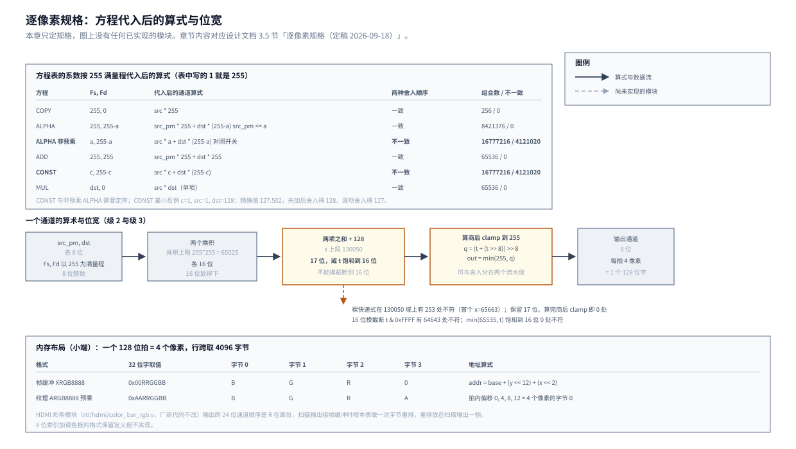

# 01 逐像素规格：方程、舍入与字节序

## 一、动机

赛题基础要求 3 要「Demo 在屏幕上实时对比软件渲染与硬件渲染的帧率」。
最有说服力的对比是同一份命令表、同一台板子，一次交给 C 语言写的软件执行器画，
一次交给硬件引擎画，时间差的倍数就是加速比的原始数字。这个软件执行器还有第二个用途：
它是硬件的金标准（设计文档 3.8 节）。

要让这两者可比，它们必须实现同一份**逐像素规格**。规格差一点，
两边的输出就不同，届时无法判断是谁错：软件执行器算错、硬件流水线算错、
还是规格本身有歧义。设计文档 3.5 节原本只写了混合方程的表、一条除以 255 的公式，
以及「结果饱和到 255」这一句。这些不足以让两边实现出同样的结果：

- 公式里没有说「两项各自舍入再相加」还是「先相加再舍入」，这两种写法在 8 位数据上结果不同；
- 色键没有说比较哪几个通道、在预乘前还是预乘后比较；
- 裁剪只写了「允许部分出屏」，没有说边界取闭区间还是开区间、宽高为 0 怎么办；
- alpha 为 0 的像素是否仍写目的像素没有写，这决定驱动与硬件能不能省一次写；
- 字节序只给了格式名（XRGB8888、ARGB8888），没有说每个字节在内存里的位置。

所以这个工作点要先把规格钉到可以实现的程度，再写软件执行器去量吞吐。
本章只做第一步：把七项逐条写死，其中三项用穷举验证，并把结论写进设计文档 3.5 节。
软件执行器本体与板上吞吐是后续章节。

## 二、为什么是这几步

规格的每一项都要能用一段**可穷举的代码**表达，这是「算得准」的判据：
能用代码表达的歧义才是真歧义，说不清的都可以退回到「那么两边各实现一种，CRC 必然不同」。

七个待钉死的项分成三类，处理方式不同：

| 类 | 项 | 处理方式 | 为什么 |
| --- | --- | --- | --- |
| 能穷举 | 除以 255 的舍入、舍入与饱和的顺序 | 写主机侧程序对每个输入逐值比较 | 输入域小（最多 130050 个值），穷举能给出「一致 / 不一致多少处」的硬结论 |
| 能查证 | 方程表完整性、字节序、裁剪边界、alpha 为 0 | 读代码、读数据手册、把语义写成可执行的分支 | 这些是定义问题，不是算术问题，穷举没有意义，要把话说到没有第二种读法 |
| 要靠对照 | 色键的比较域 | 与「预乘」这一设计前提对齐 | 比较对象必须与实现里真实存在的那个值一致，否则比较的对象都不一样 |

顺序上，**舍入与饱和的顺序必须先定**：它决定了硬件加与舍入级的位宽，
也决定了软件执行器像素核心的写法，后面两项（软件吞吐、硬件流水线）都建立在它上面。

## 三、每一步做了什么

### 3.1 先把缺口量出来

逐条对照 2.1 节的表格与设计文档 3.5 节的现状，七项里只有一项（方程表）已经写全：

| 待钉死的项 | 3.5 节原来的写法 | 缺口 |
| --- | --- | --- |
| 方程表完整性 | 5 行表，`Fs`/`Fd` 齐全 | 只需确认无遗漏 |
| 除以 255 的舍入 | 「对 0~65025 的乘积与四舍五入结果一致」，未给验证 | 要给出穷举结论，并确认中间量位宽 |
| 舍入与饱和的顺序 | 「结果饱和到 255」，未写顺序 | 要二选一写死 |
| 色键比较域 | 「源像素等于色键颜色」，未写比较哪几个通道、预乘前还是后 | 要写死 |
| 裁剪边界 | 「允许部分出屏」，未写闭开区间与宽高为 0 | 要写死 |
| alpha 为 0 | 未写 | 要写死 |
| 字节序 | 「帧缓冲 XRGB8888，纹理预乘 ARGB8888」，未写字节位置与端序 | 要写死 |

「未写」与「写了但没验证」要分开：前者是缺内容，后者是有内容但没有判据，
两类缺口的补法不同。

### 3.2 穷举工具与三个候选写法

新写 `Main/tools/check/check_round255.c`，纯整数，不依赖板子，在主机上编译运行。
它把候选写法定义成函数，对每个输入逐值比较，输出不一致的处数与首个反例。

每个通道的混合算式按设计文档 3.5 节的方程代入系数后是两项之和，
两种舍入顺序分别是：

```
U  两项各自 round(·/255) 舍入之后再相加、饱和
V  两项相加之后一次 round(·/255) 舍入、饱和        <- 设计文档采纳
```

数据域按各方程真实可达的范围取：预乘 alpha 满足 `src_pm <= a`，其余通道取 0..255 全量。

### 3.3 舍入公式本身

设计文档 3.5 节给的快速式是

```
q = (x + 128 + ((x + 128) >> 8)) >> 8
```

工具在 `x = 0..65025` 上逐值与 `round(x / 255)` 的 half-up 精确商比较，**0 处不一致**。
这一项成立。

**但快速式只在乘积域成立。** 两项之和的上限是 `2 × 255 × 255 = 130050`，
已经超出 16 位能表示的上限 65535：

| 量 | 上限 | 需要的最小无符号位宽 |
| --- | --: | --: |
| 单项乘积 `src × 255` | 65025 | 16 位（`2^16 = 65536`） |
| 两项之和 `x = t1 + t2` | 130050 | **17 位**（`2^17 = 131072`） |
| 加 128 之后的 `t = x + 128` | 130178 | **17 位** |

所以约束是**中间量不能模截断到 16 位**：`x` 与 `t` 都要按 17 位算。
用 17 位、18 位，或者把 `t` 饱和到 16 位，**三条路都正确**（饱和那一条见下）。
硬件选哪一条属于实现选择，例如按 DSP 的端口宽度定。

**裸快速式在 17 位域上会失效。** 在 `x = 0..130050` 上逐值比较，
`q = (t + (t >> 8)) >> 8` 与精确商有 **253 处**不符（首个 `x = 65663`，
快速式得 257、精确商 258），原因是 `t >> 8` 此时超过 8 位。
把输出的 clamp 并进来、即取 `min(255, q)` 之后，在同一个域上再次逐值一致（0 处不符）。

中间量压到 16 位有两种做法，结果不同。逐值实测（`check_round255.c` 的 (b) 节）：

| 处理 | `x = 130050`（正确答案 255） | 全域与正确结果不符的处数 |
| --- | --- | --: |
| 保留 17 位 `t`，算商后 clamp 到 255 | 255 | 0（基准） |
| **模截断** `t & 0xFFFF` = 64642，再算商 | 253 | 64643 |
| 把 `t` **饱和**到 16 位（`min(65535, t)`），再算商 | 255 | 0 |

模截断丢掉了进位；饱和把超过上限的输入顶到上限，而 `t ≥ 65408` 时正确答案本来就会被 clamp 到 255，
所以饱和是安全的压窄。

**约束只有一条：中间量不能用 16 位模截断。** 17 位、18 位、16 位饱和都满足；
算完商之后 clamp 到 255，舍入与 clamp 可以分在两个流水级。
这一段先后写错过两次（18 位；饱和也不行），过程见 4.3、4.7 节。

### 3.4 舍入与饱和的顺序：按方程逐个代入

「两种顺序是否等价」不能整个设计一起答，要按方程表的系数代入后逐个穷举。订正后的结果：

| 方程 | Fs、Fd 取值 | 代入后的通道算式 | U 与 V 是否一致 |
| --- | --- | --- | --- |
| COPY | 255, 0 | `src × 255` | 一致（256 组，0 处） |
| ALPHA（预乘，主用） | 255, 255−a | `src_pm × 255 + dst × (255−a)`，`src_pm ≤ a` | **一致**（8421376 组，0 处） |
| ALPHA（非预乘，对照开关） | a, 255−a | `src × a + dst × (255−a)` | **不一致**（16777216 组里 4121020 组，24.56%） |
| ADD | 255, 255 | `src_pm × 255 + dst × 255` | 一致（65536 组，0 处） |
| CONST | c, 255−c | `src × c + dst × (255−c)` | **不一致**（16777216 组里 4121020 组，24.56%） |
| MUL | dst, 0 | `src × dst` | 一致（65536 组，0 处） |

非预乘那一行是**真实存在的方程**：设计文档 3.5 节方程表下保留的
「非预乘开关」，用来演示赛题原文的 `fg*a + bg*(1-a)`，E7 的九个用例里也有
「BLIT ALPHA 非预乘」。它与 CONST 的差异处数恰好相同（4121020），
结构也对称（一项系数是变量、另一项是它的补），这一点容易看混：
第一版穷举工具就把非预乘那一行当成了预乘 ALPHA 的另一种写法，
于是错误地得出「预乘 ALPHA 与顺序有关」。

三点要写清楚，避免误读：

**系数表里的 `1` 是归一化值，实现要用以 255 为满量程的整数。** 预乘 ALPHA 的实现取
`Fs = 255`、`Fd = 255 − a`。如果照字面把 `Fs = 1` 代进去
（`src_pm × 1 + dst × (255 − a)`），源色权重从 255 掉到 1，
8421376 组里有 8355712 组与正确值不同，**结果本身就错**，与舍入顺序无关。

**预乘 ALPHA 与舍入顺序无关**，原因是它的两项系数是 255 与 255−a：第一项是 255 的
整数倍，除以 255 之后是整数、不产生舍入，只有第二项带小数。

**预乘有代价。** 预乘在素材侧要多量化一次（把 `s` 预乘成 `round(s·a/255)` 时
就丢了一次精度），混合时再量化一次，共两次；非预乘路径只量化一次。
以非预乘源色按实数定义混合、再四舍五入为基准，16777216 组里（`check_round255.c` 的 (d) 节，偏差以 1/255 为单位整数比较）：

| 路径 | 量化次数 | 与理想舍入不同的组数 | 最大偏差 |
| --- | --: | --: | --: |
| 预乘 | 素材侧一次 + 混合一次 | 4121020 | 254/255 |
| 非预乘（先加后舍入） | 一次 | 0 | 127/255 |

所以「预乘省一次乘法」成立，但它的代价是素材侧那一次额外量化。
预乘仍然选作主用形式，理由是省乘法、且素材侧只做一次、不在每帧路径上；
换来的偏差要在素材工具里记着。

**需要定序的是 CONST 与非预乘 ALPHA 两档。** CONST 的最小反例：
`c = 1`、`src = 1`、`dst = 128`，精确值 `(1×1 + 128×254) / 255 = 32513 / 255 ≈ 127.502`，
V 得 128、U 得 127。CONST 占真实像素的比例不高，但整屏淡入淡出会让它作用到每一个像素；
非预乘 ALPHA 只在对照演示时用。

本设计选 V，理由是它等于「把混合的数学定义算完之后只做一次量化」：
相对混合的直接输入（`src_pm` 或 `src`、`dst`），每通道误差不超过 ±0.5，且对六种写法是同一套公式。
以非预乘源色为基准时，预乘路径因为素材侧那一次量化，最大偏差到 254/255（上表）。

图 1 把方程代入后的算式、它所在的位宽，以及内存布局画在一起。图上没有任何已实现的模块：
本章只定规格，硬件流水线与软件执行器都还没有写。



**图 1** 本章定下的规格。上半是方程按 255 满量程代入后的通道算式与两种舍入顺序的穷举结果；
下半左是一个通道的算术与位宽（乘积 16 位，两项之和与 `t = x + 128` 需要 17 位，
或者把 `t` 饱和到 16 位，算完商之后 clamp 到 255），右是帧缓冲与纹理在小端下的字节布局。

### 3.5 混合只算 R/G/B，色键按源表面的存储格式比较

**混合只作用于 R、G、B 三个通道。** 源像素的 alpha 有两个用途，都不写进目的像素：
一是作为 ALPHA 方程的系数（预乘之后它已经体现在 `src_pm` 里，`Fs = 255`、`Fd = 255 − a`），
二是参与色键比较。目的像素的 alpha 位不参与运算，也不被写入。

**写入 XRGB8888 帧缓冲时，`[31:24]` 必须强制为 0。** 这一条不能省：
COPY 一个 ARGB 源时，软件如果把整个 32 位字搬过去就会把 alpha 也带上，
而硬件若只写 24 位并把高字节清零，两边的后缓冲逐字节不同，同帧 CRC 直接不一致。
规格写成：

```
dst_word = (dst_word & 0xFF000000) | (r << 16) | (g << 8) | b
其中写帧缓冲时 (dst_word & 0xFF000000) 恒取 0
```

**色键比较的是源表面的存储字，按 32 位整字比较。** 比较对象取源像素在内存里的那个字，
所以 XRGB 源的比较值高字节为 0，ARGB 源的比较值包含 alpha。命令里的色键颜色
（w5）按同一个格式给出，驱动填的时候要与源表面的 `format` 一致。

条件判断写成伪代码，避免「通过之后执行混合」这种正反问都能读的措辞：

```
key_enable = w0[12]
key_word   = w5                      按源表面的 format 解释
src_word   = 源表面 (src_x, src_y) 处的 32 位字

if (key_enable && src_word == key_word)
    skip_write;                      目的像素完全不变，不读也不写
else
    blend_and_write;                 按方程算 R/G/B，写回时高字节按上面的规则处理
```

色键比较的是**当前表面实际存储的那个值**：PREMULT 表面比较预乘字，STRAIGHT 表面比较未预乘字。
同一素材若要对照两条 alpha 路径，素材包显式存两份；硬件不保留第二份像素，也不从方程猜格式。

### 3.6 裁剪

裁剪是**四者求交**：命令的目的矩形、游戏区 `[0,639] × [0,479]`、
目的表面的有效范围 `[0, width−1] × [0, height−1]`，以及 `SET_CLIP` 设定的裁剪框。
后两者原先漏了，而表面表里每个表面都带 `width`/`height`（设计文档 3.4 节），
目的表面可能比屏幕小；`SET_CLIP` 则是命令表里定义过的操作码（w0 的 3）。

坐标与宽高的位宽与符号：

| 字段 | 位宽 | 符号 | 范围 |
| --- | --- | --- | --- |
| 目的 `dst_x`、`dst_y`（w2 两个半字） | 各 16 | 有符号 | `−32768 ~ 32767` |
| 宽 `w`、高 `h`（w3 两个半字） | 各 16 | 无符号 | `0 ~ 65535` |
| 源 `src_x`、`src_y`（w1 两个半字） | 各 16 | 有符号 | `−32768 ~ 32767` |

**中间量一律用 32 位有符号算，不设额外限制。** `dst_x + w` 的最大值是
`32767 + 65535 = 98302`，超出 16 位但远在 32 位内；`dst_x + w − 1` 同理。
所以规格**完整接受命令字段的全部范围**，不需要新增「17 位有符号」之类的约束。
（本章原先写过一条「`dst_x + w` 必须能放进 17 位有符号」的限制，那是错的：
`w ≤ 65535` 推不出 `dst_x + w ≤ 65535`，两者是两回事，已删除。）

执行顺序，**空宽高先判**，避免 `w − 1` 在无符号下溢：

```
1  if (w == 0 || h == 0)            整条命令跳过，不读源也不写目的
2  dx1 = dst_x + w − 1              32 位有符号
   dy1 = dst_y + h − 1
3  x0 = max(0, dst_x, clip_x0, surf_x0)      四者取最大
   y0 = max(0, dst_y, clip_y0, surf_y0)
   x1 = min(639, dx1, clip_x1, surf_x1)      四者取最小
   y1 = min(479, dy1, clip_y1, surf_y1)
4  if (x1 < x0 || y1 < y0)          整条命令跳过
5  for py = y0..y1, px = x0..x1:    闭区间
       sx = src_x + (px − dst_x)     32 位有符号
       sy = src_y + (py − dst_y)
       if (sx < 0 || sx > src_surf_w−1 || sy < 0 || sy > src_surf_h−1)
           continue                  源越界只跳过该像素
       处理该像素
```

目的表面越界由上式的 `surf_x0/surf_x1` 处理（`0` 与 `width−1`）；
它比游戏区更严时以表面为准，比游戏区宽时仍受游戏区限制。

**`SET_CLIP` 的语义（原先未定义，E7 要求实现它，这里补上）：**

| 项 | 规定 |
| --- | --- |
| 矩形来源 | w1 的源 x / 源 y 作左上角，w3 的宽 / 高作尺寸。命令里的表面号与坐标之外的字**必须为 0**（2026-09-20 订正：原文写「忽略」，与 spec 第 02 章规范条款 §3“标成 0 的字段必须为 0，否则 `BAD_FIELD`”冲突，字段合法性以第 02 章为准） |
| 区间 | 闭区间，与上面的裁剪一致 |
| 复位值 | 上电与软复位后为**整个游戏区** `[0,639] × [0,479]`，等价于不裁剪 |
| 生效范围 | **持续生效**，直到下一条 `SET_CLIP` 或软复位；新 `SET_CLIP` **替换**旧框，不与旧框求交，只影响它之后提交的命令 |
| 与游戏区的关系 | `SET_CLIP` 只能把可见范围限制在游戏区内，不能扩到游戏区外；“只能缩小”是相对游戏区，不是相对上一个裁剪框。矩形超出游戏区时按游戏区截断 |
| 空矩形 | 宽或高为 0 表示**全部裁掉**，之后的命令全部跳过，直到下一条非空 `SET_CLIP` |
| 命令表边界 | 一张命令表跨帧使用时，`SET_CLIP` 的状态在帧之间**不自动复位**；驱动若需要每帧从全屏开始，要在表头显式发一条 |

「持续生效」与「不随帧复位」两条要一起读：它意味着同一个 `LIST_BASE` 被两帧复用、
且第二帧的表头没有 `SET_CLIP` 时，第二帧会继承第一帧末尾的裁剪框。
这是有意选择（省一条命令），但驱动必须知道。

**alpha 为 0** 时 ALPHA 方程照常写目的像素，写入值与目的原值相同。
统一走写回路径，硬件与软件都不按 alpha 值做分支，结果的正确性只由公式保证。
读写避让可以做，条件是输出逐像素相同：COPY 且源不透明时跳过读目的、
色键命中时跳过写目的、`a = 0` 时跳过写目的都属于这一类。

### 3.7 字节序

**字节序**按「32 位字的取值 + 小端下的字节位置」两条一起写死。查证了两处：
RISC-V 是小端（实际编译选项是 `-march=rv32im -mabi=ilp32`，BSP 没有大端配置）；`rtl/hdmi/color_bar_rgb.v`
的通道常量（`WHITE_R = 8'hff` 这种按 R/G/B 命名的 24 位拼接）表达的是总线上的通道顺序，
与内存里的字节顺序无关，不能拿来当依据。

| 格式 | 32 位字取值 | 字节 0 | 字节 1 | 字节 2 | 字节 3 |
| --- | --- | --- | --- | --- | --- |
| 帧缓冲 XRGB8888 | `0x00RRGGBB` | B | G | R | 0 |
| 纹理 ARGB8888_PREMULT | `0xAARRGGBB` | B | G | R | A |
| 纹理 ARGB8888_STRAIGHT | `0xAARRGGBB` | B | G | R | A |

一个 128 位拍正好 4 个像素，拍内偏移 0、4、8、12 依次是 4 个像素的字节 0（B 通道）。
行跨取 4096 字节，`addr = base + (y << 12) + (x << 2)`。
**扫描输出接帧缓冲不需要做字节重排。** 上表的字节列说的是字节在内存里的位置，
不是字内的位段，本节开头那句「通道常量与内存字节顺序无关」正是为了防止这两样混起来，
但由此推出「要重排」同样是把两者混为一谈，2026-09-20 复核时订正。
一拍的 `[31:0]` 就是像素字 `0x00RRGGBB`（AXI 与 RISC-V 同为小端），
所以 `[23:16]` 是 R、`[15:8]` 是 G、`[7:0]` 是 B；
而 `rtl/hdmi/hdmi_tx.v` 给编码器的是 `blue_din = vid_rgb[7:0]`、`green_din = vid_rgb[15:8]`、红取 `[23:16]`。
两边位段完全同序，扫描输出只需要把拍内的 4 个像素按低位在前的顺序拆开，不做任何字节交换。
彩条模块是厂商代码（`rtl/hdmi/`），不改；拆像素这一步放扫描输出一侧。
上板图案判据（Todo 的扫描输出条目第 3 节）不是用来裁决这个推导，
而是验证 DDR3 控制器与 upsizer 没有额外搅动字节通道。

8 位索引加调色板的格式本设计保留定义但不实现。

### 3.8 落地

七条写进设计文档 3.5 节的「逐像素规格（定稿 2026-09-18）」，并把工具登记进
[`../../../Main/tools/README.md`](../../../Main/tools/README.md)、
状态登记进 [`../../../Main/README.md`](../../../Main/README.md)。
穷举工具 `Main/tools/check/check_round255.c` 在主机上直接跑。

## 四、遇到的问题

### 4.1 ALPHA 的系数模型用错，把两处差异当成了一个

**第一现场。** 穷举工具第一版的输出：

```
(c)(d) ALPHA/CONST 全 k  组合 16777216  不一致 4121020 处  首例 k=1 a=1 b=128 U=127 V=128
```

据此写下「ALPHA 与 CONST 都要定序，差异占四分之一」。同一天做独立复核时，
复核者把候选式子拆开各验一遍，输出是：

```
模型 1  ALPHA  src_pm*255 + dst*(255-a)   组合 8421376   不一致 0
模型 2  src*a + dst*(255-a)               组合 16777216  不一致 4121020
模型 3  CONST  src*c + dst*(255-c)        组合 16777216  不一致 4121020
```

**解读。** 预乘 ALPHA 在定稿形式下不一致处是 **0**。第一版报的 4121020 来自模型 2，
而模型 2 正是设计文档保留的非预乘 ALPHA 开关（当时把它叫作「错误模型」，后来正名）。
模型 2 与 CONST 的不一致处数**恰好相同**（4121020），这就是把它们混成一个数字的原因：
两者结构对称，`a` 与 `c` 都遍历 0..255，组合数也一样。

**定位。** 工具第一版把系数写成 `kA = a`，扫的是 `src × a + dst × (255 − a)`。
定稿方程 `out = src_pm × Fs + dst × Fd` 的 ALPHA 行取 `Fs = 255`、`Fd = 255 − a`，
代入后是 `src_pm × 255 + dst × (255 − a)`。两者不是同一个式子：
前者把两处都乘上了 alpha 家族的数。这一步是复核者另写一个程序、
把模型逐个拆开才发现的，工具自己判自己是「全部通过」，
它没有独立的第二实现做对照。

**根因与修法。** 工具的系数改成按方程表的 `Fs`、`Fd` 两列直接代入，
六个方程各自一行、输出能一眼对到方程表。同时删掉「MUL 与舍入顺序一致，
因为两项都不经 ÷255」这个说法——MUL 是单项（`Fs = dst`、`Fd = 0`），
理由与 COPY 一样是「只有一个非零乘积」，与「255 的整数倍」无关。
改完工具之后又比对「系数从哪来」，才发现下面的 4.2。

**原判据为什么没有覆盖到它：** 工具的输出只回答「一致还是不一致」，
它不检验自己扫的式子是不是规格里那一个。要覆盖它需要一个独立的第二实现，
或者一条「工具的系数必须从方程表机械代入」的约束。后者已加进工具的结构里。

### 4.2 系数表的归一化写法与实现写法有歧义

**第一现场。** 设计文档 3.5 节的方程表写的是 `COPY 行 Fs = 1`、`ALPHA 行 Fs = 1`，
而穷举按的是以 255 为满量程的整数。把 `Fs = 1` 按字面代进 ALPHA：

```
模型 1b ALPHA  src_pm*1 + dst*(255-a)   组合 8421376   与正确值不同 8355712
```

**解读。** 8421376 组里 8355712 组（99.2%）与正确值不同。按字面实现，源色的权重从 255 掉到 1，
结果首先是错的。复核时还算出这个错误式子下两种舍入顺序有 2068638 组不同，
这个数曾被当成「ALPHA 从与顺序无关变成有关」的证据写进本章；它只说明错误系数下顺序也有差别，
主要问题是结果错，已按这个口径改写。

**定位。** 表里写的 `1` 是归一化值（`src` 占 100%），实现用的是以 255 为满量程的整数
（`src × 255 / 255`）。照字面写成 `src_pm × 1`，混合结果整体偏暗到几乎只剩目的像素。

**根因与修法。** 规格里补一句「方程表的 `1` 是实现里的 `255`，必须对照着读」，
并把「代入后的通道算式」这一列直接写进规格的表里，读者不必自己代。

**原判据为什么没有覆盖到它：** 这是文档表达问题，判据拦不住。
它暴露的是一般性缺陷：**表格里的符号如果不写明单位与量纲，
读的人会按字面实现**。第一轮复核只发现工具扫错式子，
改完工具再看系数的出处才暴露出来。

### 4.3 位宽写成 18 位，并把「饱和」与「截断」混为一谈

**第一现场。** 本章 3.3 节与设计文档 3.5 节原先写：

```
两项之和上限 2 × 255 × 255 = 130050，需要 18 位，16 位放不下
舍入与饱和必须合成一步：先饱和到 16 位再舍入，或先舍入再在 16 位上饱和，都会在 255 附近出错
```

**解读。** 两处都错，但**错的性质不同**，要分开记：

- 「需要 18 位」错在数算大了。`2^17 = 131072`，而 `130050` 与加 128 之后的 `130178`
  都小于它，所以 **17 位无符号就够**；18 位属于实现选择（例如 DSP 端口宽度）。
- 「先饱和到 16 位会出错」这一句，把**模截断**与**饱和**当成了同一种处理。
  复核后：模截断真的会错（64643 处），**饱和到 16 位是对的（0 处）**。
  也就是说这一句把该保留的做法一并否掉了。

**定位。** 逐值实测两种处理：

| 处理 | `x = 130050`（正确答案 255） | 全域与正确结果不符的处数 |
| --- | --: | --: |
| 模截断 `t & 0xFFFF` | 253 | **64643** |
| 饱和到 16 位 `min(65535, t)` | 255 | **0** |

第一行是把进位丢了，会错；第二行是对的。

第二轮复核时这两行的数字一度是 97283 与 32640，并且据此写下「饱和到 16 位不是安全压窄，
连 `x = 0` 也被改坏」——**那一段本身也是错的**，成因是穷举程序把 `+128` 加了两次，
详见 4.7 节。这里保留这段经过，是因为它正好说明：**改对了一处（18→17）不等于改对了全部**，
第二轮把一个正确的做法判成了错的。

**根因与修法。** 第一轮的根因是**把「不截断」的要求写成了「运算必须合并」**。
真正的约束只有一条：中间量不要用 16 位模截断。17 位、18 位、16 位饱和都满足；
「舍入」与「饱和」是两个可以分开的操作，分在两个流水级里同样正确。
正文、设计文档、工具输出与配图已同步改为「17 位或 16 位饱和都可以」。

**原判据为什么没有覆盖到它：** 工具当时只验「两种舍入顺序的差异处数」，
没有验「位宽不够时会发生什么」，也没有一列「与正确值本身差多少」。
修法是补两条逐值比较，各自与正确结果比较并断言处数（模截断 64643、饱和 0），
**并额外断言饱和那一条为 0**——只有「饱和对」这个断言写进去，
才不会再被一个错值糊过去。

顺带记一笔：这条结论的第一版断言我写错过一次。当时的判定是「两项之和能否放进 16 位」，
写法把 `130050` 拿去和 `65535` 比，程序如实报 FAIL。断言错在把「上限能否表示」
当成了「有没有溢出」。它没有产出错的结论，但说明工具的输出必须逐条读，
不能只看末尾的「全部通过」——这也是后来给两个工具补上逐项断言的原因。

### 4.4 裁剪范围推错，`SET_CLIP` 等四项未定义

**第一现场。** 本章 3.6 节原先写：

```
一条与实现有关的限制：dst_x + w 与 dst_y + h 的中间值必须能放进 17 位有符号。
规格不允许落在 17 位之外，也就是单条命令的宽度不超过 65535。
```

**解读。** 推理是错的。`w ≤ 65535` 推不出 `dst_x + w ≤ 65535`：
取 `dst_x = 32767`、`w = 65535`，和是 `98302`，远超 17 位有符号的范围。
这条「限制」既没有实际约束住什么（因为余量是按错误的前提算的），
又白白缩小了合法的命令范围。

**定位。** 把 `dst_x` 与 `w` 的极值代进去就能看出来：`dst_x` 是有符号 16 位、
`w` 是无符号 16 位，两者的和最大 `32767 + 65535 = 98302`。
这个值远在 32 位内，所以**不需要任何额外限制**，只要中间量用 32 位有符号。

同一轮复核还指出裁剪段漏了三件事：没有与**目的表面**的 `width`/`height` 求交、
`SET_CLIP` 的坐标来源与闭开区间未定义、源坐标 `src_x`/`src_y` 的符号与计算位宽未写。
而 `SET_CLIP` 是命令表里定义过的操作码（设计文档 3.4 节 w0 的 3），
E7 要求实现它，语义不写清就无法写软件与 RTL。

**根因与修法。** 裁剪段的写法是从「与游戏区相交」这一个特例推出来的，
没有把「目的表面也有边界」和「还有一条 `SET_CLIP` 状态」纳进来。
修法是：位宽与符号列成表；中间量统一 32 位有符号并**删除那条多余的 17 位限制**；
执行顺序把 `w == 0 || h == 0` 放在最前面（否则 `w − 1` 在无符号下溢）；
交集从两重（游戏区、目的矩形）扩到四重（加目的表面与 `SET_CLIP` 框）；
`SET_CLIP` 的矩形来源、区间、复位值、生效范围、与游戏区的关系、空矩形、
以及「状态不随帧复位」全部写死。

**原判据为什么没有覆盖到它：** 原判据是「定义一个规则并让它自洽」，
没有一条「把字段极值代进去看会不会溢出」的检查。
修法是把极值写进规格的位宽表里，让读者一眼能验。

### 4.5 输出像素的 X/A 通道没有规定

**第一现场。** 方程只写了 R/G/B 的混合，没有说输出字的高 8 位怎么办，
也没有说源 alpha 除了参与系数之外还有没有别的去处。

**解读。** 这一处不写清，软件与硬件会做出不同的选择：COPY 一个 ARGB 源时，
软件若把整个 32 位字搬进帧缓冲就会把 alpha 一起带过去，硬件若只写 24 位并把高字节清零，
两侧的后缓冲逐字节不同，同帧 CRC 直接不一致。这类差异不会有任何编译期提示，
只会在 CRC 比对时报「不一致」，而那时无法判断是谁错。

**定位。** 把「混合只算 R/G/B」与「写入时高字节清零」分开写，缺任何一句都不够：
前者说明 alpha 不进运算，后者说明它也不进目的像素。

**根因与修法。** 规格里补两条：混合只作用于 R/G/B，源 alpha 只用于 ALPHA 系数与色键；
写 XRGB8888 时 `[31:24]` 必须强制为 0，并给出目的字的组装式。
第六节增加一条用例：COPY 一个 ARGB 源，**比对整帧 32 位字**而不是只比 24 位。

**原判据为什么没有覆盖到它：** 原判据只覆盖「混合算得对不对」，
没有覆盖「写回去的那个字长什么样」。后者属于数据格式，与算术是两套判据。

### 4.6 色键的条件措辞有反向歧义

**第一现场。** 原文写「比较对象是……通过之后执行混合，不通过则目的像素完全不变」。

**解读。** 「通过」指的是「比较通过」还是「色键命中」？两种读法都能讲通，
而它们给出相反的行为。规格里出现这种句子，两边实现必然有一边反。

**定位。** 这类措辞问题出在规格的写法上：
用「通过 / 不通过」这种正反都能读的词描述分支，等于没定义。

**根因与修法。** 改成伪代码，并明确 `key_word` 采用源表面的存储格式
（XRGB 源高字节为 0，ARGB 源含 alpha），与 3.5 节的比较域一致：

```
if (key_enable && src_word == key_word)
    skip_write;
else
    blend_and_write;
```

**原判据为什么没有覆盖到它：** 判据是「色键命中时不写目的像素」，
它在正常实现下成立；但规格文本如果用词有歧义，实现者可能写出「命中时写」的反向逻辑，
而那时判据才会报错，且看不出根因在措辞。修法是让规格本身可执行。

### 4.7 复核工具自己把 +128 加了两次

**第一现场。** 第二轮复核为了验「模截断」与「饱和到 16 位」，在工具里写了这样两句：

```c
uint32_t t = x + 128u;                                  /* 先加 128 */
uint32_t a = sat8(round255_fast(t & 0xFFFFu));           /* 又交给 round255_fast */
uint32_t s = t > 65535u ? 65535u : t;
uint32_t b = sat8(round255_fast(s));                     /* 同样的问题 */
```

而 `round255_fast()` 的定义是 `uint32_t t = x + 128u; return (t + (t >> 8)) >> 8;`
——**它内部还会再加一次 128**。于是这两条路径实际算的是 `(t + 128)` 的商，
而不是 `t` 的商。

**解读。** 输出的 `97283` 与 `32640` 都是这个重复加法的产物，不是「模截断」与
「饱和到 16 位」的真实表现。最明显的一处是「`x = 0` 也变成 255」：
`x = 0` 时 `t = 128`，被无条件饱和到 65535，再经快速式得 257 → clamp 255，
而正确答案是 0。这个荒诞的数值本身就是重复加 128 的记号，当时没有抓住。

**定位。** 改为直接对 `t` 算商之后：

```c
uint32_t correct = sat8((t + (t >> 8)) >> 8);            /* 基准 */
uint32_t tt = t & 0xFFFFu;
if (sat8((tt + (tt >> 8)) >> 8) != correct) trunc++;     /* 模截断 */
uint32_t s = t > 65535u ? 65535u : t;
if (sat8((s + (s >> 8)) >> 8) != correct) sat16++;       /* 饱和到 16 位 */
```

得到 **模截断 64643 处、饱和到 16 位 0 处**。

**根因与修法。** 根因是**复用了 `round255_fast()` 却没有看它的定义**：
那个函数的设计输入是「还没加 128 的乘积」，不是「已经加过 128 的中间量」。
两个工具犯了同一个错，于是**用同一个错值互相印证**——正式工具报 97283/32640，
复核程序也报 97283/32640，看起来「两个独立实现一致」，实际上两边共享同一个错误。
这正是本章 4.1 节那个教训的另一面：4.1 是「一个实现自己判自己」，
这里是「两个实现共享同一个错误」；两种情况下「一致」都不构成证据。

**原判据为什么没有覆盖到它：** 判据只检查「两个工具的数字是否一致」，
没有检查「这个数字对应的算式是不是规格里那一个」。修法是：
两个工具都用「已加过 128 的 `t`」直接算商，不再调用会重复加 128 的辅助函数；
同时把「饱和到 16 位必须为 0 处」写成断言，让这个错值不可能再通过。

### 4.8 「预乘让 ALPHA 少一次量化」说反了

**第一现场。** 本章 3.4 节与设计文档 3.5 节原先写：

```
1 路预乘的形式让 ALPHA 比非预乘少一次量化，这是预乘除了省一次乘法之外的第二个好处。
```

**解读。** 这句话的依据是「预乘 ALPHA 的第一项系数是 255 的整数倍，混合时只有第二项带舍入」。
这只比较了混合这一步，漏掉了素材侧把 `s` 预乘成 `src_pm = round(s·a/255)` 的那一次。

**定位。** 以非预乘源色按实数定义混合、再四舍五入为基准，穷举 `a`、`s`、`dst` 全部 16777216 组，
比较两条路径的输出（`check_round255.c` 的 (d) 节）：

```
(d) 预乘与非预乘的量化误差（以非预乘源色的实数混合为基准）
  组合数                                          16777216  ok
  预乘路径 与基准不同的组数               4121020  ok
  预乘路径 最大偏差（x/255）                    254  ok
  非预乘路径 与基准不同的组数                  0  ok
  非预乘路径 最大偏差（x/255）                 127  ok
```

预乘路径共量化两次，有 4121020 组与基准不同，最大偏差 254/255；非预乘路径（V 顺序）只量化一次，与基准逐值相同。

**根因与修法。** 根因是只看了流水线内部的一步，没有把素材侧的预乘算进端到端的误差。
正文改为「预乘有代价」一段并给出两条路径的实测；预乘仍是主用形式，理由改为每帧路径上省一个乘法。
工具加 (d) 节断言，让这两条路径的误差数固定下来。

**原判据为什么没有覆盖到它：** 工具只比较「同一个式子两种舍入顺序」的差异，基准是式子自己，
从来没有和实数定义的理想结果比较过。
与规格外部的定义对照，才能发现规格内部自洽但整体偏离的情形。

## 五、结果

### 5.1 定稿的规格项

| 项 | 结论 | 判据类型 |
| --- | --- | --- |
| 方程表完整性 | 6 行（含非预乘 ALPHA 对照档），无遗漏 | 读表 |
| 除以 255 的舍入 | 快速式在 `x = 0..65025` 上与 half-up 精确商逐值一致（0 处） | 穷举 65026 个值 |
| 中间量位宽 | 单项乘积 16 位够；两项之和与 `x + 128` 需要 17 位。**模截断会错（64643 处），饱和到 16 位正确（0 处）** | 算术推导 + 穷举 |
| 舍入与饱和 | 算完商后 clamp 到 255；两者可以分在两个流水级。裸快速式在 17 位域上有 253 处不符 | 穷举 130051 个值 |
| 定序的适用范围 | CONST 与非预乘 ALPHA 两档（各 4121020 / 16777216，24.56%）；预乘 ALPHA、COPY、ADD、MUL 无关 | 穷举 6 个方程模型 |
| 混合的通道范围 | 只算 R/G/B；源 alpha 只用于 ALPHA 系数与色键，不写目的；写 XRGB8888 时 `[31:24]` 强制为 0 | 定义为可执行分支 |
| 色键比较域 | 源表面的 32 位存储字；XRGB 源高字节为 0，ARGB 源含 alpha；w5 按同一格式给出 | 与预乘前提对齐 |
| 裁剪 | 闭区间；四者求交（目的矩形、游戏区、目的表面、`SET_CLIP` 框）；中间量用 32 位有符号；宽高先判 0 | 定义为可执行分支 |
| `SET_CLIP` | 左上角取 w1、尺寸取 w3；闭区间；复位为全游戏区；持续生效且不随帧复位；新命令替换旧框，最终范围不超出游戏区 | 定义为可执行分支 |
| alpha 为 0 | 照常写目的像素，写入值与目的原值相同；不做 alpha 分支 | 定义为可执行分支 |
| 字节序 | 帧缓冲 `0x00RRGGBB`、两种 ARGB 纹理均为 `0xAARRGGBB`，小端，字节序 B/G/R/0 或 A | 读代码 + 定义 |

原始清单是七项（设计文档 3.5 节），落定时拆成了十一行：
「混合的通道范围」「色键比较域」「裁剪」「`SET_CLIP`」四项都是原先没写、或写了但不够用的部分。

### 5.2 穷举的规模与耗时

| 项 | 组合数 | 说明 |
| --- | --: | --- |
| 快速式 vs 精确商 | 65026 | 单值域 |
| `min(255, …)` vs 精确商 | 130051 | 双项和域 |
| 模截断路径 vs 正确结果 | 130051 | **64643** 处不符 |
| 饱和到 16 位 vs 正确结果 | 130051 | **0** 处不符 |
| 预乘 ALPHA | 8421376 | `a` × `src_pm ≤ a` × `dst` |
| 非预乘 ALPHA | 16777216 | `a` × `src` × `dst`，U/V 不一致 4121020 |
| CONST | 16777216 | `c` × `src` × `dst`，U/V 不一致 4121020 |
| 预乘 ALPHA 按字面 `Fs = 1` | 8421376 | 与正确值差 8355712 组（结果错，非顺序问题） |
| 预乘与非预乘路径 vs 实数定义 | 16777216 | 预乘 4121020 组不同、最大偏差 254/255；非预乘 0 组、127/255 |

订正后工具在主机上跑完输出「总判定：全部通过」，用时在秒级（纯整数运算）。
**预期值全部写成断言**（组合数与差异数逐项核对），任一项不符即非零退出并指出差在哪；
只检查「差异非零」不够——那样差异数从 4121020 变成别的值也会通过。
原始输出如下，可以在任何一台装了 gcc 的机器上重跑得到同样的结果。

`Main/tools/check/check_round255.c`（正式工具，按方程表逐行代入）2026-09-18 的输出：

```
(a) 快速式 vs half-up 精确商
  x = 0..65025 不一致                                    0  ok
  x = 0..130050 且 clamp 后不一致                      0  ok
  裸快速式在 130050 域上不一致                  253  ok
    说明：t = x + 128 的上限 130178 需要 17 位；把 min(255, q) 并进来之后
          与精确商一致。裸快速式因 (t >> 8) 超过 8 位而失效。

(b) 中间量位宽与「截断 / 饱和到 16 位」的区别
    单项乘积上限 65025，16 位（2^16 = 65536）放得下
    两项之和上限 130050，需要 17 位；2^17 = 131072
    t = x + 128 上限 130178，同样 17 位
    模截断 t & 0xFFFF = 64642 -> q = 253
    模截断路径在 x = 130050 上的结果            253  ok
  模截断路径的全域不一致处数               64643  ok
  饱和到 16 位路径的不一致处数                  0  ok
    说明：模截断（丢掉进位）会错 64643 处；饱和到 16 位与正确结果**全域一致**。
          即：中间量不能模截断，但用 17 位或 16 位饱和都可以。
          这条曾因本文件多算了一次 +128 而被误判为「饱和也不行」，见文件头。

(c) 各方程 U（先各自舍入）与 V（先加后舍入）的差异处数
  COPY   255, 0                 组合数                 256  ok
  COPY   255, 0                 不一致                   0  ok
  ALPHA  255, 255-a（pm <= a）  组合数           8421376  ok
  ALPHA  255, 255-a（pm <= a）  不一致                 0  ok
  ALPHA 非预乘 a, 255-a        组合数          16777216  ok
  ALPHA 非预乘 a, 255-a        不一致           4121020  ok
  ALPHA 非预乘首个反例                  a=1 src=1 dst=128  ok
  ALPHA  Fs=1 按字面（结果错） 组合数      8421376  ok
  ALPHA  Fs=1 按字面（结果错） 与正确值不同的组数      8355712  ok
    说明：系数表的 1 是实现里的 255。按字面实现不是「顺序问题」，
          而是源色权重从 255 掉到 1，结果全面错误。
  ADD    255, 255               组合数               65536  ok
  ADD    255, 255               不一致                   0  ok
  CONST  c, 255-c               组合数            16777216  ok
  CONST  c, 255-c               不一致             4121020  ok
  CONST 首个反例                             c=1 src=1 dst=128  ok
  CONST 反例 U 的结果                                127  ok
  CONST 反例 V 的结果                                128  ok
  MUL    dst, 0（单项）         组合数           65536  ok
  MUL    dst, 0（单项）         不一致               0  ok

(d) 预乘与非预乘的量化误差（以非预乘源色的实数混合为基准）
  组合数                                          16777216  ok
  预乘路径 与基准不同的组数               4121020  ok
  预乘路径 最大偏差（x/255）                    254  ok
  非预乘路径 与基准不同的组数                  0  ok
  非预乘路径 最大偏差（x/255）                 127  ok
    说明：预乘在素材侧多量化一次，最大偏差 254/255 约 1.0；
          非预乘只量化一次，最大偏差 127/255 约 0.498，与基准逐值相同。

(e) 结论
    与舍入顺序无关的：COPY、ADD、MUL（单项或 255 的整数倍系数）
    与舍入顺序有关的两档：CONST 与非预乘 ALPHA，各 4121020 / 16777216 = 24.56%
    预乘 ALPHA 与顺序无关（系数 255 与 255-a，第一项是 255 的整数倍，不产生舍入）
    采纳 V（先加后舍入）：把混合定义算完之后只量化一次，对六个方程是同一套写法
    中间量不能模截断；17 位或 16 位饱和都可以，算完商后 clamp 到 255

总判定：全部通过
```

(c) 节里非预乘 ALPHA 与 CONST 的差异处数相同（4121020），是 4.1 节把两者混成一个数字的原因。
(c) 节「按字面」一项是 4.2 节的证据：同一份 `Fs`、`Fd` 表，按字面实现结果本身就错。
(d) 节是 4.8 节的证据。

### 5.3 测量方法与已知不确定

**不确定之处有三条。**

其一，穷举证明的是「这两种写法在这些输入上是否给出相同结果」，
它不证明任何一种写法是**像素学上正确**的那一种。选 V 的理由是
「把混合定义算完之后只量化一次」，这是设计选择，不是穷举结论。

其二，ALPHA 的 8421376 组包含 `src_pm ≤ a` 这个预乘约束。
如果素材工具产出的预乘值与 alpha 不一致（例如舍入方式不同导致 `src_pm > a`），
那一部分输入不在本次穷举的域内。规格要求素材侧的预乘满足 `src_pm ≤ a`，
素材流水线开工时要加一条校验。

其三，CONST 的 4121020 处差异是按「`c` 遍历 0..255、`src`/`dst` 遍历 0..255」算的，
它给的是**最坏情况的比例**。实际画面里 CONST 只用于整屏淡入淡出，
同一帧内 `c` 相同而 `src`/`dst` 各异，命中差异的比例与像素内容有关，
本章没有按真实画面统计。这个统计要等软件执行器能出帧之后才能做。

## 六、还欠什么

**以下是本章定稿时的历史待办（2026-09-18）**。E7 此后已有修正版板上探针与
三次 `fail 0`，当前状态、数据与余项以
[`E7 Todo`](../../Todo/hw/E7-软件执行器像素吞吐.md) 为准；下表保留当时的分工记录：

| 项 | 内容 | 状态 |
| --- | --- | --- |
| `sw/apps/probe/execSwTest` | 表面表（4 个表面）、命令解释（NOP/FILL/BLIT/SET_CLIP/END）、6 个混合方程、PREMULT/STRAIGHT 格式与色键判定 | 未开工 |
| 九个用例 | FILL 全屏、BLIT COPY、BLIT 色键、BLIT ALPHA 预乘、BLIT ALPHA 非预乘、BLIT ADD、CONST、裁剪、舍入穷举 | 未开工 |
| 三种编译配置 | 基线 `-O2`、省空间 `-Os`、按行处理；三份 ELF 的 SHA256 与 bin 大小登记 | 未开工 |
| 吞吐口径 | `pixel_total` 与 `pixel_written`、`cycles / pixel_written`、打点范围、数据规模 | 未开工 |
| 折帧公式 | `P = 166.7 万 ÷ 每像素周期数`；整屏等效帧率 `P ÷ 307200 × 60`；场景 S1 帧率 `1 亿 ÷ (加权每像素周期数 × 68 万)` | 未开工 |
| CRC 注错 | 每个方程一个注错宏，只有用到该方程的用例 CRC 变化 | 未开工 |
| `SET_CLIP` 用例 | 本章新定义了它的语义（3.6 节），九个用例里原有一个「裁剪」，应拆成一条 BLIT 裁剪 + 一条 `SET_CLIP` 状态机（含跨帧继承） | 未开工 |
| 通道范围用例 | 校验软件与硬件在 XRGB 输出上 `[31:24]` 都为 0：COPY 一个 ARGB 源，比对整帧 32 位字而不是只比 24 位 | 未开工 |

两处判据需要重写，**不要照旧验收**：

1. 「舍入的穷举用例在板上跑过并通过」——穷举是纯整数运算、与板子无关，
   实际只在主机侧跑过。板上要验的是软件执行器与硬件各自按这份规格实现，
   见上表的「九个用例」与「CRC 注错」。
2. 「三种编译配置各给出数字」——`sw/apps/probe/execSwTest` 不存在，没有任何吞吐数字。

规格本身留下的账只有一条：素材流水线的预乘校验（5.3 节第二条），
它属于素材工具，不在本实验范围内。

另外两处**实现时要落实、但不需要新判据**的点：

- 中间量不能模截断到 16 位，算完商后 clamp 到 255（3.3 节）。17 位、18 位、DSP 原生端口或 16 位饱和
  都满足，属于实现选择；软件侧在 C 里用 `uint32_t` 自然满足。
- 裁剪的中间量用 32 位有符号（3.6 节）。`dst_x + w` 最大 98302，16 位会溢出。
- 预乘路径相对非预乘源色的最大偏差 254/255（3.4 节）。软件执行器与硬件实现同一条路径时 CRC 不受影响，
  但「非预乘开关」与预乘主路径的画面会有 1 级以内的差别，演示对照时要知道。
