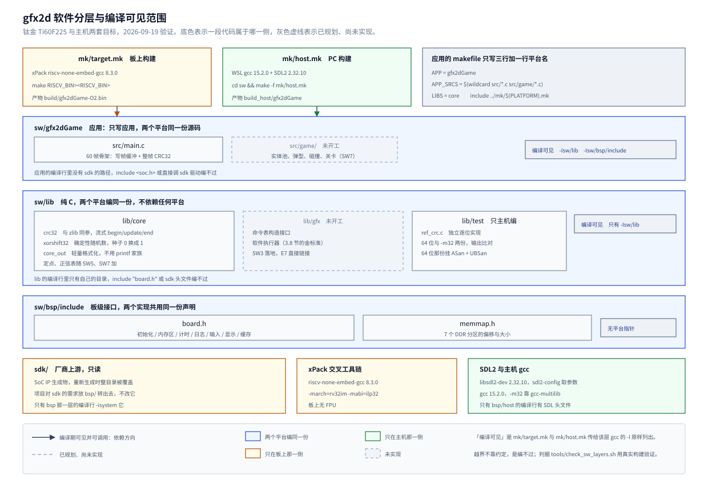
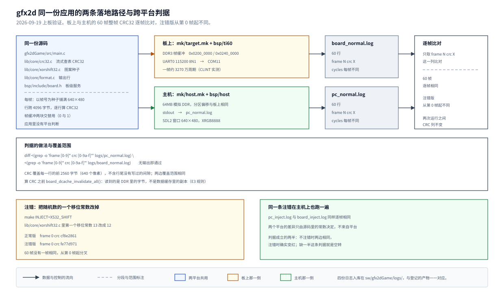

# 01 软件平台分层与双目标构建：先读 sdk 的构建片段，再写编译规则

## 一、动机

要做的东西是一个 2D 图形渲染加速引擎，跑在易灵思钛金 Ti60F225 上，板载 256MB DDR3 与
HDMI 输出。引擎做的事是：RISC-V 处理器把渲染命令写进内存，引擎经 AXI4 读命令与像素，
把图像块拷贝、填充、混合进帧缓冲，再由扫描输出送到显示器。

引擎本身是硬件，但驱动它、验证它、在它上面跑游戏的程序都在处理器那一侧。
按里程碑，软件一侧要交付四样东西：能驱动引擎与扫描输出的板级代码、
按 spec 逐像素执行命令表的软件执行器（它同时是硬件的金标准）、
从 Flash 装入 DDR 的素材流水线、以及一个几千个弹幕的游戏 Demo。
这四样都要跑在同一颗没有 FPU、没有操作系统、数据缓存只有 4KB 的 VexRiscv 上。

`Main/sw/` 下原有的六个程序是这条路的起点，它们都是诊断程序：
检查 bootloader 拷贝长度的 `bootSizeTest`、查 DDR 地址译码的 `ddrAliasTest`、
量 AXI 突发预算的 `ddrBurstProbe`、查缓存一致性的 `cacheCoherencyTest` 与 `cacheMechTest`、
以及一个早期的最小实验 `cacheMinTest`。每个程序都是「应用加直接调 sdk 驱动」，
计时、串口输出、缓存失效各写各的。接下来至少有三个程序要共用同一批代码：
游戏 `gfx2dGame`、E7 的软件执行器吞吐实验 `execSwTest`、E8 的每弹幕开销实验 `entityBench`。
再加上 PC 版要让游戏、软件执行器与算法在开发机上跑起来，不依赖板子。

这里挡着一个具体的约束。处理器那一侧的板级支持包 `sdk/` 是 Sapphire SoC IP 的生成物，
在 IP Manager 里重新生成 SoC 时整个目录会被覆盖，项目代码放进去就会丢
（[`../../../Main/sdk/README.md`](../../../Main/sdk/README.md)）。
生成物里已经有一整套驱动：UART、CLINT、GPIO、SPI、缓存失效指令，
但这些是「能操作寄存器」的层次，项目需要的是「这块板子上的板级服务」：
按分区拿到 DDR 指针、按场节拍计时、按 E3 的规则失效缓存。

于是这一条要建的是**一层属于项目、叠在 sdk 之上的板级层**，并且回答一个方法问题：
这层怎么保证不被绕过。原稿的做法是把平台层放在应用目录里（`sw/apps/game/gfx2dGame/src/hal/`），
分层靠人工遵守加 grep 检查。用户审核时指出两点：`sw/` 下应当只放应用，
平台层混在应用目录里不符合裸机工程的分层；而分层如果只靠 grep，
注错用例（在应用里 include 一个 SDL 头文件，看板上构建会不会失败）必然变红，证明不了任何事。
所以这一条的目标定为：**分层由编译结构保证**——每一层只看得到自己该看得到的头文件，
越界就编不过。图 1 是这一条结束时的形态。



**图 1** 三层代码与两套构建的关系。蓝底是两个平台编同一份的代码，
金底与绿底分别是只出现在板上与只出现在主机的部分，
灰色虚线是已经规划、这一条还没有实现的部分。
每个代码层的右侧写着它在编译时的可见范围，也就是构建系统实际传给 gcc 的 `-I`；
这些路径只给该层看，是分层的实现手段。

前几章留下的两条前提决定了这一条的做法。

**缓存规则先于这一条定下。** E3 实验（[platform 第 05 章](../platform/05-CPU数据缓存与第二个主机写入的一致性.md)）
实测了数据缓存的装行与失效行为：只写不装行，读一次装整行 64 字节，
外部主机改写 DDR 之后 CPU 读到的是缓存里的旧值，本构型没有写缓冲。
规则定为「读回共享区之前必须失效一次」，并且失效调用要包成带 `"memory"` clobber 的函数。
板级层是这条规则的落点，接口形状由它决定。

**像素与命令的接口已经定稿，命令语义还没有。** 设计文档 3.4 节定死了 32 字节的命令记录、
表面表与 APB 寄存器布局，3.5 节与 [spec 第 01 章](../spec/01-逐像素规格.md) 定稿了逐像素算术
（2026-09-18 用户确认）。剩下「FILL 是否混合、着色与非预乘开关怎么编码、重叠与错误行为」
这几处还没有写，归 SW2。这一条的判据不需要它们，所以可以并行开工。

## 二、为什么是这几步

这一条的产物是「后面所有程序站上去的地基」，拆成七步。
每一步的判据都要能自己成立，因为后面写游戏与执行器时，出问题的地方往往就在这一层。

| 步 | 内容 | 少了会怎样 |
| --- | --- | --- |
| 一 | 冻接口：`board.h`、`memmap.h` | 两套构建与三个应用各自长出一套接口，后面全部返工 |
| 二 | 纯算法层 `lib/core` 加主机侧测试 `lib/test` | 两个平台没有共用的算法与黄金值，跨平台判据无从谈起 |
| 三 | 板上构建 `mk/target.mk` 与 `bsp/ti60` | 板级代码只能靠复制粘贴，sdk 重新生成时要手工恢复 |
| 四 | PC 构建 `mk/host.mk` 与 `bsp/host` | 游戏与执行器必须等板子，开发速度被硬件卡住 |
| 五 | 项目链接脚本 `bsp/ti60/linker/gfx2d.ld` | 栈只有 4K，程序区与镜像上限只能吃 sdk 的缺省值 |
| 六 | 最小应用与 60 帧跨平台判据 | 两套构建各自「能编过」，但没有一条判据证明它们算得一样 |
| 七 | 结构判据脚本 `tools/check_sw_layers.sh` | 分层与「sdk 只读」只写在文档里，改动之后没人拦 |

顺序上有三处不能调换。

第一步必须在第三、四步之前：接口先定，两套构建才有共同的目标；
如果先写某一边的构建，另一边会照着它的头文件去凑，接口就变成了实现的副产品。

第二步必须在第六步之前：60 帧 CRC 的黄金值来自 `lib/core` 的算法，
算法本身要先在主机上验证过（含一个独立实现的对照），
否则跨平台判据证明的只是「两边的同一个 bug 表现一致」。

第七步只能放最后：它要用真实的板上构建去验证分层，
而真实构建要先存在。第三、四步之间没有依赖，可以并行。

## 三、每一步做了什么

### 3.1 前期研究：sdk 的构建片段与头文件

改别人的构建体系之前先读它。这一节记录读到的原文与由它推出的决定，
四个结论直接决定了第三步怎么写。

**一、官方规则用 `notdir` 生成目标文件名。** 原文在
`sdk/software/standalone/common/standalone.mk` 第 19 到 25 行：

```make
OBJS := $(SRCS)
OBJS := $(notdir $(OBJS))
OBJS := $(OBJS:.c=.o)
...
OBJS := $(addprefix $(OBJDIR)/obj_files/,$(OBJS))
```

`notdir` 丢掉目录信息，所有源文件的目标文件都落在同一个 `build/obj_files/` 下，
文件名只由基本名决定。单目录时没有问题，多个目录之后不同目录的同名 `.c` 会争同一个 `.o`。

这一条没有停在推断上，用官方 makefile 做了一次最小复现：
建两个目录各放一个 `x.c`（分别定义 `from_a` 与 `from_b`），
一个 `main.c` 同时调用两者，照官方写法组织 `SRCS`：

```
$ make BSP=efinix/EfxSapphireSoc RISCV_BIN=<RISCV_BIN> OBJDIR=build
standalone.mk:54: warning: overriding recipe for target 'build/obj_files/x.o'
standalone.mk:54: warning: ignoring old recipe for target 'build/obj_files/x.o'
CC src/b/x.c
CC src/main.c
CC <sdk>/common/start.S
LD notdirTest
<工具链>/ld: build/obj_files/main.o: in function `main':
src/main.c:2: undefined reference to `from_a'
collect2: error: ld returned 1 exit status
make: *** [standalone.mk:31: build/notdirTest.elf] Error 1

$ <RISCV_BIN>nm build/obj_files/x.o
00000000 T from_b
```

两处关键：make 先把 `x.o` 的规则覆盖了一次（两条 warning），
实际编出来的是 `src/b/x.c`；`src/a/x.c` 从头到尾没有被编译过，
`nm` 里只有 `from_b`。失败发生在链接阶段，报的是「找不到 `from_a`」，
与真正的原因（两个源文件被当成了一个目标）隔了好几层。
**官方 makefile 的编译规则不能复用。**

**二、sdk 驱动头文件在文件作用域写裸 `asm`。** `sdk/software/standalone/driver/riscv.h`
第 261 行起有 67 行这样的语句：

```c
asm(".set regnum_x0  ,  0");
asm(".set regnum_x1  ,  1");
```

严格的 `-std=c11` 不认识 `asm` 关键字，`-std=gnu11` 才把它当 GCC 扩展接受。
两边统一用 `-std=gnu11`，这不是偏好，是编译这套 BSP 的必要条件。

**三、默认链接脚本的栈只有 4K，而它本身是 sdk 的已登记修改项。**
`sdk/bsp/efinix/EfxSapphireSoc/linker/default.ld` 第 17 行：

```ld
  __stack_size = DEFINED(__stack_size) ? __stack_size : 4K;
```

同一个文件第 146 到 148 行是本项目早先登记的改动，程序区从官方的 124K 改成 4092K，
并加了一条镜像超过 512KB 就报错的断言：

```ld
  /* bootloader 只从 Flash 拷 USER_SOFTWARE_SIZE 字节，镜像更大会被静默截断 */
  __app_image_max = DEFINED(__app_image_max) ? __app_image_max : 512K;
  ASSERT(_edata - ORIGIN(ram) <= __app_image_max, "application image exceeds bootloader USER_SOFTWARE_SIZE")
```

这个文件在 `sdk/README.md` 的「已登记的修改」表里。游戏与执行器要用几百字节的调用深度
加上整帧的临时缓冲，4K 不够；而直接改这个文件意味着每次重新生成 IP 之后都要手工改回。
项目要自己的一份链接脚本，栈的大小在那里定。

**四、优化级别有缺省值，而缺省值是 `-Og`。**
`sdk/bsp/efinix/EfxSapphireSoc/include/soc.mk` 第 7、8 行：

```make
DEBUG?=yes
DEBUG_OG?=yes
```

配合 `riscv64-unknown-elf.mk` 第 39 到 53 行的分支，`DEBUG=yes` 加 `DEBUG_OG=yes` 给 `-Og`，
`DEBUG=no` 给 `-Os`。同一个程序用哪一档优化编出来的性能差很多，
所以优化级别要由项目显式指定，并出现在产物名里，
不能让它取决于两个上游变量的缺省值。

**这一条还要定接口，所以同时读了接口要服务的东西。** 设计文档 2.1 节给出 DDR 分区表与
帧缓冲的行跨（4096 字节，一行的读写正好是一次突发，且永不跨 4KB 边界，地址计算只剩移位）；
3.4 节给出 32 字节命令记录与 APB 寄存器表；3.5 节给出逐像素规格；
3.8 节说明软件执行器是硬件的金标准；4.5 节给出场景 S1 的规模（约 2320 个 Sprite、68 万像素）。
这些决定了板级层要提供什么：分区指针、字节级计时、整帧的读写通路，
而不需要提供任何与像素运算有关的东西——那属于 `lib/gfx`，两个平台共用。

**环境也核对了一遍**，因为两套构建依赖不同的工具：
WSL 是 Ubuntu 26.04，主机 gcc 15.2.0、make 4.4.1、`pkg-config` 报 SDL2 2.32.10、
`gcc -m32` 可用（`gcc-multilib` 已装）、python3 3.14.4 带 Pillow 12.2.0；
WSLg 的 `DISPLAY=:0`、`WAYLAND_DISPLAY=wayland-0` 都在，PC 版能开窗口；
交叉工具链是 xPack `riscv-none-embed-gcc 8.3.0`，与 `sw/README.md` 里既有的程序一致。

### 3.2 分层与依赖方向

`sdk/` 只读，项目自己的一侧分三层，`sw/` 下只放应用与这两套构建规则：

```
Main/sw/
  mk/target.mk   板上构建：复用 sdk 的 bsp.mk 与 riscv64-unknown-elf.mk，编译规则自己写
  mk/host.mk     PC 构建：WSL gcc 加 SDL2
  bsp/           项目板级层，叠在只读的 sdk 之上
    include/board.h    板级接口，两个实现共用一份声明
    include/memmap.h   DDR 分区的偏移与大小，不含平台指针
    memmap.c           分区表本体，两个平台共用一份
    ti60/              板上实现，另含 linker/gfx2d.ld
    host/              PC 实现：SDL2 窗口与键盘，DDR 用一块内存模拟
  lib/           纯 C，两个平台编同一份
    core/              crc32、xorshift32、core_out
    gfx/               命令表构造与软件执行器（SW3）
    test/              主机侧单元测试与独立参考实现
  gfx2dGame/     应用：main.c 与 game/
```

依赖方向只有一个：

```
  gfx2dGame 等应用 ──> lib/core、lib/gfx
        │
        └──────────> bsp/include/board.h
                          │
               ┌──────────┴──────────┐
          bsp/ti60                bsp/host
               │                     │
          sdk（只读）              SDL2
```

`lib/` 不依赖任何平台，`bsp/` 不依赖 `lib/` 与应用，只有应用把三者接起来。
这条约束是可判定的：`lib/` 的编译行里只有 `-Ilib`，
应用的编译行里只有 `lib` 与 `bsp/include`，两个平台的实现都不会出现在对方的编译行里。

PC 在这一套结构里的位置是「另一块板子」。板级层有两个实现这件事，
与 Zephyr 的 `native_sim`、FreeRTOS 的 POSIX 移植是同一种做法：
应用与算法里不出现平台判断，两个平台跑的是同一份源码。
这一点在第六步的 60 帧判据上兑现——两个平台必须算出逐帧相同的 CRC。

### 3.3 板级接口 `board.h` 与 `memmap.h`

接口只放与硬件有关、两个实现都能提供的服务，分七组：
初始化、内存区、计时、日志、输入、显示、缓存。每组的形状都有一条具体理由。

**内存区。** PC 上没有固定的物理地址，应用只能拿到区域指针，
所以接口是 `board_region(REGION_x)` 返回「指针加大小」，
而不是让应用自己拿基址加偏移：

```c
typedef struct { void *ptr; uint32_t size; } board_mem;
board_mem board_region(board_region_id id);
```

分区偏移写在 `memmap.h`，两个平台的实现各自加基址。
板上加的是 0：CPU 的 DDR 窗口从 `0x0000_1000` 起，而分区起点都大于等于 `0x0040_0000`，
在 `0x0000_1000` 到 `0x0FFF_FFFF` 之内 CPU 地址就等于控制器地址（实验 E2 实测，
[platform 第 02 章](../platform/02-DDR地址译码与AXI-ID实测.md)）。
`memmap.h` 里只写偏移与大小，这个「偏移即 CPU 地址」的前提写在 `bsp/ti60` 一侧。

分区表在 `bsp/memmap.c`，两个平台共用一份，避免同一张表写两遍：

| 区 | 偏移 | 大小 |
| --- | --- | --- |
| `REGION_CMDLIST_A` / `_B` | `0x0040_0000` / `0x0050_0000` | 1MB 各一张，32768 条命令 |
| `REGION_SHARED` | `0x0060_0000` | 10MB |
| `REGION_ASSET` | `0x0100_0000` | 16MB |
| `REGION_FB0` / `REGION_FB1` | `0x0200_0000` / `0x0240_0000` | 各 4MB，实际用 480×4096 字节 |
| `REGION_OFFSCREEN` | `0x0280_0000` | 8MB |

`memmap.h` 另外放了帧缓冲的几何常量：`FB_WIDTH` 640、`FB_HEIGHT` 480、
`FB_STRIDE_LOG2` 12。行跨取 4096 字节是设计文档 2.1 节的定稿结论，
两个平台必须一致，否则同一个像素在两边的偏移不同，跨平台判据立刻失效。

**计时。** `board_cycles()` 返回自初始化起累加的周期数，另给一个 `BOARD_HZ` 常量。
板上是 CLINT 的 `clint_getTimeLow`，一个 tick 10ns；PC 上是 SDL 的性能计数器折算。
PC 的数字只用于观察，不作性能结论（[总览](../../Todo/SW1-SW9总览.md)约束 5）。

**日志。** 只有一个 `board_puts`，没有 `printf`。
板上的 printf 家族会链进浮点与一大票格式化逻辑，而这一层的作用之一就是把它们挡在外面；
数值格式化由 `lib/core` 的 `core_out` 负责，两个平台编同一份，输出逐字节相同。

**输入。** `board_keys()` 返回本帧的按键位图，位分配写在 `board.h` 里。
板上这一条返回 0（KEY0~3 接进 GPIO 之后由 SW9 补），PC 上已经接了 SDL 键盘。
位分配写在接口上，因为它是两个实现必须一致的约定，
放在各自的 `.c` 里就会分叉。

**缓存。** 两个函数，按 E3 的规则包成带 `"memory"` clobber 的形式：

```c
void board_dcache_invalidate_all(void);
void board_dcache_invalidate_range(const void *addr, uint32_t bytes);
```

sdk 的宏本身没有 clobber，`bsp/ti60` 里在宏后面紧跟一条空的 volatile asm 屏障，
保证相邻的访存不会被重排到失效之前；PC 上两个都是空操作。
区间失效按 64 字节的缓存行逐个做——这个行宽来自 E3 的 T4 逐位实测，
不是从手册抄的。

接口里**不放**的东西同样是有意的：素材按编号查找属于 `lib/core` 解析素材包，
录像回放属于 `lib/core` 处理一段按键缓冲，文件读写才归 `bsp/host`。
把「应用层的事」和「硬件服务」分开，是这套接口能用两个实现的前提。

### 3.4 板上构建 `mk/target.mk`

应用的 makefile 只写应用本身，平台由一行变量选：

```make
APP      = gfx2dGame
APP_SRCS = $(wildcard src/*.c src/game/*.c)
LIBS     = core

PLATFORM ?= target
include ../mk/$(PLATFORM).mk
```

`mk/target.mk` 复用 sdk 的 `bsp.mk` 与 `riscv64-unknown-elf.mk`
（`-march=rv32im -mabi=ilp32`、工具链前缀、sdk 头文件路径都从那里来），
**不引入 `standalone.mk`**——3.1 节复现的 `notdir` 冲突就在它里面。
编译规则按源文件的相对路径落目标文件：

```
官方的写法（撞车）                    本工程的写法（不撞车）
SRCS  src/a/x.c  src/b/x.c           SRCS  ../lib/core/x.c  ../bsp/ti60/x.c
        |                                       |
        v  notdir                               v  保留相对路径
OBJS  build/obj_files/x.o            OBJS  build/lib/core/x.o
      build/obj_files/x.o                  build/bsp/ti60/x.o
        |                                       |
        v  后一条规则覆盖前一条                  v  两份都在
      只编出一个 x.o                          x.o 与 x.o 各自成立
```

链接参数照抄 `standalone.mk` 的那一行
（`-specs=nosys.specs -nostartfiles -ffreestanding -lc -lgcc -lm`），
只把链接脚本换成项目自己那份，并链上 sdk 的 `start.S`。四处细节必须踩准：

**`LDSCRIPT` 要在 `bsp.mk` 之前定下。** `bsp.mk` 第 10 行是
`LDSCRIPT ?= ${BSP_PATH}/linker/default.ld`。这一句写在 `include bsp.mk` 之后就晚了，
`?=` 看到已经有值不会覆盖。踩到的过程在 4.2 节。

**优化级别由项目指定。** 先把 `DEBUG` 定成 `no`，再把上游加进来的
`-Os -O0 -Og -O3 -g3` 全滤掉，然后加自己的 `-O$(OPT)`，默认 `-O2`。
产物名带上优化级别与注错标记：`gfx2dGame-O2.bin`、`gfx2dGame-Os.bin`、
`gfx2dGame-O2-inject.bin`。哪个 bin 是什么配置，从文件名能直接读出来。

**统一 `-std=gnu11`**，理由见 3.1 节第二条。

**sdk 的头文件按系统头引入，而且只给 `bsp/` 那一层。** `uart.h` 与 `clint.h` 里
各自定义了一批用不到的 `static` 函数，`-Wall -Wextra -Werror` 会把它们当错误。
这些是上游代码，项目的「零告警」判据只管项目自己的代码，
所以 sdk 的路径写成 `-isystem`。关键是这组路径只出现在 `bsp/` 的目标规则里：
第一版把它们加在全局 `CFLAGS` 上，应用的编译行里也有 sdk 的路径，
「越界就编不过」在真实构建里并不成立，见 4.6 节。

三条规则产出的编译行如下（用 `make -Bn` 取，路径按仓库相对写出）：

```
应用    -I../lib -I../bsp/include
lib     -I../lib
bsp     -isystem <sdk>/bsp/.../include -isystem <sdk>/standalone/include
        -isystem <sdk>/standalone/driver -I../bsp/include
start.S （无 -I）
```

**头文件依赖要显式建。** make 默认只让目标文件依赖源文件，
改一个头文件不会触发重编，旧的目标文件被悄悄链进产物——
把 `memmap.h` 里的 `FB_HEIGHT` 从 480 改成 240，bin 与改之前一模一样。
编译时加 `-MMD -MP`，gcc 会为每个目标文件写一份同名的 `.d`，
把源文件包含过的头文件列成依赖，makefile 末尾再 `-include` 进来。
两处细节写在 4.8 节：`.d` 里带着目标文件自己的目标名，
如果 `-include` 放在 `all:` 之前，默认目标会被它抢走，`make` 只重编目标文件而不链接。

`EXTRA_CFLAGS` 是留给一次性实验的口子（例如 `-DFRAMES=12000` 做长跑），
它参与编译选项标记的比较，改它同样会触发重编。

### 3.5 PC 构建 `mk/host.mk`

PC 侧用同一套三变量接口，`PLATFORM=host` 切过来。差异集中在四处。

编译选项用 `-std=gnu11 -Wall -Wextra -Werror`，
并额外加 `-Werror=double-promotion -Werror=float-conversion`：
板上没有 FPU，PC 上有，浮点误差与隐式类型转换在 PC 上不会报错、到板上变成软件浮点库调用。
把这两条提到错误级别，等于让主机编译替板子挡住这类代码。
SDL2 的头文件按系统头引入（`-isystem`），它们是第三方代码，
不该因为它们的告警打断构建。

构建目录默认值与板上不同（`build_host` 对 `build`），
这样同一个应用目录下两套目标可以并存，`make` 与 `make PLATFORM=host` 交替跑不会互相踩。

主机侧测试另编两份。`make test` 把 `lib/core` 与 `lib/test` 编成一个 64 位程序
（挂 ASan 与 UBSan）和一个 `-m32` 程序（16 位 ASan 运行库不一定装，这一份不挂），
各跑一遍再 `diff` 两份输出。两份输出逐字节相同，是 LP64 与 ILP32 差异的第一道闸。

PC 侧的链接是 `gcc ... -lSDL2`，窗口与键盘在 `bsp/host/board.c` 里，
它的编译行里才有 SDL 的路径，应用那一层没有。

### 3.6 项目链接脚本 `gfx2d.ld`

`bsp/ti60/linker/gfx2d.ld` 以 sdk 当前的 `default.ld` 为底本，
差异只有两处：`__stack_size` 的缺省值从 4K 改成 64K，文件头写明底本与差异。
文件里其余内容（分区、段顺序、`__global_pointer$`、512KB 的镜像断言、各 PROVIDE 符号）
与底本逐行相同。

为什么复制一份而不是改底本：底本是 `sdk/README.md` 登记过的修改项，
重新生成 IP 之后要按登记表逐条恢复；放在项目自己这一侧就不会被碰。
代价是今后 sdk 升级底本时这份要跟着核对，所以文件头明确写了来源。

判据落在 `.map` 上：

```
$ grep -m1 "__stack_size = DEFINED" build/gfx2dGame-O2.map
    0x0000000000010000    __stack_size = DEFINED (__stack_size)?__stack_size:0x10000

$ grep -m1 "^\.stack" build/gfx2dGame-O2.map
.stack  0x0000000000001d80    0x10000
    0x0000000000010000    . = __stack_size
 *fill* 0x0000000000001d80    0x10000
    0x0000000000011d80    PROVIDE (_sp = .)
```

栈是 0x10000 字节，`_sp` 落在 `0x11d80`。这一段为什么能抓出问题，见 4.2 节。

### 3.7 `lib/core`：跨平台共用的三样东西

这一条只做三样，其余（定点、正弦表、素材包解析）随 SW5、SW7 按需加。

**`crc32.c`。** 反射多项式 `0xEDB88320`，初值与结果都取反，与 zlib 同参，
也与 `sw/apps/test/bootSizeTest` 里那份逐位实现同参——后者是早先为了验证 bootloader 拷贝长度写的，
两处的期望值可以直接对照。接口是流式的：

```c
void     crc32_begin(crc32_ctx *ctx);
void     crc32_update(crc32_ctx *ctx, const void *data, uint32_t len);
uint32_t crc32_end(const crc32_ctx *ctx);
```

流式不是为了通用，是因为整帧 CRC 只能这么做：帧缓冲每行占 4096 字节，
像素只占前 2560 字节，行尾的间隙没有写过，不能算进去。
256 项的查表在第一次使用时生成，不放 1KB 的 `.rodata`：
生成一次 256 项约两千个周期，比长期占着片上 RAM 划算，生成过程是确定性的，两个平台得到同一张表。

**`xorshift32.c`。** 确定性（[总览](../../Todo/SW1-SW9总览.md)约束 3）要求逻辑按固定步长推进，
随机数自带、不读墙钟。经典 32 位 xorshift：`x ^= x << 13; x ^= x >> 17; x ^= x << 5`。
种子为 0 时内部改成 1——全零是 xorshift 的不动点，会把随机数卡死在 0。
三个移位常数集中定义在文件开头，第六步的注错就改这里的第一个常数。

**`format.c`。** 应用里不出现 `printf`，日志要么是固定字符串，要么是这里拼出来的。
这组接口是按类型追加的函数，没有变参：

```c
void core_out_init(core_out *o, char *buf, uint32_t cap);
void core_out_ch(core_out *o, char c);
void core_out_str(core_out *o, const char *s);
void core_out_u32(core_out *o, uint32_t v);
void core_out_u32_pad(core_out *o, uint32_t v, uint32_t width);
void core_out_hex32(core_out *o, uint32_t v);
uint32_t core_out_len(const core_out *o);
```

写成这样而不是 printf 风格，是因为两个平台上 `uint32_t` 不是同一个类型。
过程写在 4.1 节。缓冲区在每次追加之后都保持以 `'\0'` 结尾，
截断语义与 `snprintf` 一致：`core_out_len` 返回本应写入的长度。

### 3.8 `lib/test`：主机侧测试与独立参考实现

测试不依赖板子、不依赖 SDL，只编 `lib/core` 与 `lib/test` 自己。
五组，每组都要能变红：

| 组 | 内容 |
| --- | --- |
| T1 | CRC32 的四个标准检验值（空串 0、`"a"`、`"abc"`、`"123456789"`） |
| T2 | 查表版与逐位参考实现在 4096 字节伪随机数据上相等 |
| T3 | 带行跨的整帧 CRC 锁在黄金值上，且分段方式不影响结果 |
| T4 | xorshift32 两个种子的前 8 个值与黄金序列一致，种子 0 等价于种子 1 |
| T5 | `core_out` 的拼接、补零、宽度、截断与 cap 为 0 的边界 |

黄金值的来源是**另一个实现**：T3 的整帧 CRC 与 T4 的随机数序列先用 Python 的 `zlib.crc32`
与一段独立的 xorshift 实现算出来，再写进测试。这样测试锁住的是算法的定义，
而不是「上一次跑出来的数」。T3 另有一个「逐位照定义抄」的参考实现 `ref_crc.c` 参与对照，
理由与 [spec 第 01 章](../spec/01-逐像素规格.md) 第四节的教训相同：
只有一个实现时，模型写错了也看不出来。

结构体宽度用编译期断言卡住，两个平台编同一份都必须过：

```c
_Static_assert(sizeof(uint32_t) == 4, "uint32_t 必须是 4 字节");
_Static_assert(sizeof(crc32_ctx) == 4, "crc32_ctx 在两个平台上都必须是 4 字节");
_Static_assert(sizeof(xs32) == 4, "xs32 在两个平台上都必须是 4 字节");
```

### 3.9 最小应用与 60 帧跨平台判据

`gfx2dGame` 这一条还不是游戏。`board_init` 之后跑 60 帧，
每帧用帧号当种子（加 1，避开 0）由 xorshift32 铺满 640×480，
按 4096 字节的行跨写入，然后逐行算整帧 CRC32，经 `board_puts` 打印帧号、CRC 与耗时，
最后打印 `frames 60` 与 `done`。PC 上同时把帧缓冲显示在窗口里。

算 CRC 之前先失效一次数据缓存。本构型没有写缓冲，CPU 的写返回时已经落到 DDR，
写完之后直接读回也能读到正确值，这一次失效在当下不改变结果。
把它写进程序的理由是口径：读回共享区之前先失效，是 E3 定下的规则，
SW9 的同帧软硬件 CRC 判据要建立在同一条规则上。
现在养成习惯，到时候不必再改一遍读回路径。

板上的三个变体，工具链 xPack `riscv-none-embed-gcc 8.3.0`：

| 变体 | 编译 | bin 字节 | SHA256 前 16 位 |
| --- | --- | --: | --- |
| 默认 `-O2` | `make` | 2442 | `98fb37c9dc9bc060` |
| 省空间 `-Os` | `make OPT=s` | 2210 | `8699eb87f4130ce5` |
| 注错 | `make INJECT=XS32_SHIFT` | 2442 | `577cacb50a0b29bd` |

（这三个数是第四章三轮修复之后的最终形态。修复前的对应值是 2426 / 2202 / 2426，
差在 `bsp/ti60/board.c` 里那段缓存行折算上。）

这 60 个 CRC 是第一条同时覆盖两个平台的判据。它们只取决于 `lib/core` 的算法、
帧缓冲布局与类型宽度，与平台无关；两个平台必须逐帧相同。
图 2 是这条判据的形态与它的注错。



**图 2** 同一份源码在两个平台上的落地路径与比对点。左侧是共用代码，
中间两条路径分别经过 `bsp/ti60` 与 `bsp/host`，右侧两份日志只取 `frame N crc X` 这一列比对。
下半部分是判据的覆盖范围与注错：把 `xorshift32` 的第一个移位常数从 13 改成 12，
两个平台都必须从第 0 帧起分叉。

### 3.10 结构判据脚本 `tools/check_sw_layers.sh`

分层、同名目标文件、软浮点、头文件依赖、缓存行折算、`sdk/` 只读这几类要求集中在一个脚本里，
提交前跑。第 1 项用主机 gcc 就够（它要的是「`lib/` 不依赖除自己以外的任何东西」），
第 2、3、4、6 项用**真实的板上构建**——xPack 交叉工具链加 `mk/target.mk`，
产物落临时目录。这一点是有代价换来的，第一版用主机 gcc 加手写的 `-I` 去模拟，
结果判据通过而真实构建里分层没有生效，见 4.6 节。

第 2 项另有一个对照组：合法的 `#include "board.h"` 与 `lib` 头文件必须编得过。
没有它的话，注入文件的失败可能只是路径写错，判据照样报「通过」。
第 3 项要同时检查两份 `.o` 存在与 ELF 里两个符号都在。
第 4 项扫的是板上目标文件里的软浮点符号（`__mulsf3`、`__adddf3` 之类），
`lib/` 与应用里出现任何一个都说明有浮点运算漏进了那条路径。

第 6 项查头文件依赖：先建一次，`touch` 一下 `bsp/include/memmap.h` 再建，
必须重编到 `main.c`；紧接着再建一次，没有改动时不该重编。
后一半是对照，没有它的话「每次全编」也能让前一半通过。

第 7 项查缓存行区间折算。那几行是纯算术，但它在 `bsp/ti60/board.c` 里，
带 sdk 头文件、编不了主机。把它放进 `bsp/include/dcache_line.h` 的
`static inline`，判据脚本就能用主机 gcc 编译一个探针跑算例，
测的是**真实的这一段代码**（`lib/` 不能看 `bsp/`，所以它进不了 `lib/test`）。
八个算例里第一个就是从缺陷里来的：`0x3F` 起 2 字节要覆盖 `0x00` 与 `0x40` 两行。

脚本退出时（含中途失败）删掉所有注入文件，编译产物落在临时目录，
不动 `gfx2dGame/build/`。

### 3.11 上板与比对

板上不上屏（扫描输出属于 display 系列），画面以整帧 CRC 的形式从串口输出。
上板用 `tools/board_run.py`，它把烧比特流、先开串口、加载程序、回收输出合成一条命令：

```
<EFINITY>/python311/bin/python.exe tools/board_run.py --repo <仓库根> \
    --bin Main/sw/apps/game/gfx2dGame/build/gfx2dGame-O2.bin \
    --efinity <EFINITY> --openocd <IDE>/openocd/bin/openocd.exe \
    --stop-on done --log Main/sw/apps/game/gfx2dGame/logs/board_normal.log
```

注错版换 `--bin .../gfx2dGame-O2-inject.bin`，日志写 `board_inject.log`。
程序没有写进 Flash，走的是 JTAG 加载（`load_image ... 0x1000 bin` 加 `resume`），掉电即失。
板上实测约 3270 万周期一帧，大部分花在 1.2MB 帧缓冲的缓存行装入与 CRC 查表上。

`board_run.py` 在复核时修过一处：烧写这一步原先只看 `ftdi_pgm.bat` 的退出码，
而它在内部出错（跳过 `setup.bat` 之后 python 起不来）时仍然返回 0，
脚本据退出码把烧写当成功，接着用 FPGA 里原有的比特流跑，串口输出看不出异常。
现在这一步把 Efinity 的环境变量从子进程里去掉、让厂商脚本自己配好，
并且要求输出里出现成功标记 `finished with JTAG programming` 才算通过。

## 四、遇到的问题

### 4.1 板上 `uint32_t` 是 `unsigned long`，变参格式化两端不同型

**第一现场** 第一版 `lib/core/format.c` 写的是 printf 风格的
`core_fmt(char *out, uint32_t cap, const char *fmt, ...)`，并挂了 gcc 的
`format(printf)` 属性做编译期检查。板上构建的输出是：

```
src/main.c: In function 'main':
src/main.c:92:26: error: format '%u' expects argument of type 'unsigned int',
                  but argument 4 has type 'uint32_t' {aka 'long unsigned int'} [-Werror=format=]
                  "frame %u crc %08x cycles %u\r\n", f, crc, cycles);
                         ~^                          ~
                         %lu
src/main.c:92:35: error: format '%x' expects argument of type 'unsigned int',
                  but argument 5 has type 'uint32_t' {aka 'long unsigned int'} [-Werror=format=]
src/main.c:92:45: error: format '%u' expects argument of type 'unsigned int',
                  but argument 6 has type 'uint32_t' {aka 'long unsigned int'} [-Werror=format=]
```

**解读** 报错不在 `format.c`，而在调用点：编译器认为第 4、5、6 个实参的类型
是 `long unsigned int`，`%u` 要的是 `unsigned int`。
`{aka 'long unsigned int'}` 是关键——这颗 xPack `riscv-none-embed-gcc 8.3.0`
在 `-mabi=ilp32` 下把 `uint32_t` 定义成 `unsigned long`。
主机这一侧（LP64 的 glibc）`uint32_t` 是 `unsigned int`。
两个平台上 `uint32_t` 宽度相同而类型不同。

**定位** 先确认这不是 `-Werror` 的把戏：把 `-Werror` 去掉之后程序能编过并跑对，
说明不是数据错，是类型身份不同。再确认变参这一侧的问题：
`va_arg(ap, unsigned int)` 在板上读的是 `unsigned long` 传进来的实参。
ILP32 下两者都是 32 位、传参方式相同，读出来碰巧是对的，
但这是「碰巧」——编译器检查不了任何调用点，
而 `printf` 风格接口的调用点正是最容易写错类型的地方。

**根因与修法** 根因是把「32 位无符号整数」当成了一个跨平台同一的类型。
修法是不要变参：`lib/core/format.c` 改成一组按类型追加的函数
（`core_out_u32`、`core_out_hex32`、`core_out_str`……），
每个函数的参数类型与实现里的用法都由编译器检查，两个平台各自成立。
代价是拼一行日志要写多句，换来的是一整类错误在这个接口上消失。

**原判据为什么没有覆盖到它** 当时没有任何判据能发现它，
因为主机编译通过、主机运行正确——出问题的只有板上构建，
而板上构建在那之前还没有跑过。这一条也说明「两个平台编同一份源码」
这句话里藏着类型身份这一层，光靠共用源码并不自动成立。

### 4.2 `bsp.mk` 把项目的链接脚本盖掉，栈还是 4K

**第一现场** 第一次完整编译通过，`--print-memory-usage` 也正常，
但 `.map` 里是这样的：

```
$ grep -m1 "__stack_size = DEFINED" build/gfx2dGame-O2.map
    0x0000000000001000    __stack_size = DEFINED (__stack_size)?__stack_size:0x1000

$ grep -A1 "^\.stack" build/gfx2dGame-O2.map
.stack  0x0000000000001d80    0x1000
 *fill* 0x0000000000001d80    0x1000
    0x0000000000002d80    PROVIDE (_sp = .)
```

`__stack_size` 是 `0x1000` 而不是 `0x10000`，`.stack` 也是 4KB。
项目链接脚本里写的是 64K，文件确实被改过。

**解读** 编译能过、程序能跑，说明链接脚本是可用的；
但它的栈大小是本工程没有写过的那个值。
`__stack_size = DEFINED(__stack_size)?__stack_size:0x1000` 里的 `0x1000`
正是 sdk 的 `default.ld` 里的缺省值，指向「用的是底本，不是项目这一份」。

**定位** 查 `mk/target.mk` 里这件事的写法，只有一句：

```make
LDSCRIPT ?= $(SW)bsp/ti60/linker/gfx2d.ld
include $(STANDALONE)/common/bsp.mk
```

`bsp.mk` 第 10 行是 `LDSCRIPT ?= ${BSP_PATH}/linker/default.ld`。
`?=` 只在变量还没有值时赋值，`bsp.mk` 先执行就把值定成了官方链接脚本，
后面这一句 `?=` 什么也没做。这不是 make 的怪癖，
`?=` 的语义就是「若未定义则赋值」，写在这一句后面本来就晚了一步。

**根因与修法** 根因是赋值的先后顺序，与链接脚本的内容无关。
把 `LDSCRIPT ?=` 挪到 `include bsp.mk` 之前即可，
仍然用 `?=`，保留命令行覆盖的能力。
复核的证据是 `.map` 里的三行：`__stack_size` 变成 `0x10000`，
`.stack` 的 size 是 `0x10000`，`_sp` 落到 `0x11d80`。

**原判据为什么没有覆盖到它** 当时的判据只有「编译通过、零告警、bin 小于 512KB」，
这三条在这个错误下全部成立——4K 的栈照样能编、能跑、能过链接断言。
栈的大小只在 `.map` 里，而 `.map` 没有被检查。
这一条给这一节的判据补上了「`.map` 里 `.stack` 为 64KB」，
它也是这一条里唯一一条不靠功能就能发现配置错的判据。

### 4.3 `make INJECT=` 只重链不重编，注错版与正常版逐位一样

**第一现场** 跨平台判据的注错版按计划做了：`make INJECT=XS32_SHIFT`
把 `xorshift32` 的第一个移位常数从 13 改成 12。
主机上跑注错版与正常版，前两行是：

```
# 正常版
frame 0 crc cf8e2861 cycles 376749
# 注错版
frame 0 crc cf8e2861 cycles 319970
```

CRC 一模一样。回看构建输出：

```
$ make INJECT=XS32_SHIFT
LD build/gfx2dGame-O2-inject.elf
```

只有 `LD`，没有一行 `CC`。

**解读** 产物名换了（`-inject` 后缀生效），所以 `INJECT` 变量确实传进去了；
但一个源文件都没有重编，说明 make 认为目标文件都是最新的。
make 判断「要不要重编」的依据是文件时间戳与规则，
命令行变量的变化不在它的判断里——`BASE` 或 `CFLAGS` 变了它不知道。

**定位** 复现路径很短：先不带 `INJECT` 编一次，再带 `INJECT` 在同一个 `OBJDIR` 里编，
第二次就只重链。这也解释了两份 CRC 为什么逐位一样：
链接进去的是同一批、没有 `-DINJECT_XS32_SHIFT` 的目标文件，
只有最终链接的那一行命令不同（产物路径不同）。

**根因与修法** 根因是构建系统没有把「编译选项」当成依赖。
修法是在 `OBJDIR` 下放一个 `.cflags` 标记文件，
每次解析 makefile 时比较当前选项与文件内容，不一致就先删掉这一轮的目标文件。
两个平台文件与链接脚本路径都参与比较，换 `OPT`、改链接脚本同样会触发重编。

这一条的一般化说法是：**注错用例必须同时证明「不注错时是通过的」和「注错时确实会红」。**
只有前者时，一个静默失效的开关会伪装成「判据通过」；
这一条如果没有在注错版上跑一遍并比对，就会以「注错版的 CRC 也一致」这个假结论收尾。

**原判据为什么没有覆盖到它** 判据写的是「注错后从第 0 帧起不同」，
这条判据本身没有问题，问题是它当时只在主机上跑过一半——
看到 CRC 相同应该立刻怀疑注错是否生效，而当时的处理是继续往下跑别的项。
判据的执行方式（比对注错版与正常版的输出差异）比判据的文字更重要。

### 4.4 判据 5 与 2.6 节自相矛盾：`Main/sdk/README.md` 算不算 sdk 的改动

**第一现场** 按 2.6 节把 `sdk/README.md` 补上「sdk 只读，项目对 sdk 的需求放 `sw/bsp/` 覆盖」
之后重跑结构判据：

```
1 lib/ 只有 -Ilib 编过（5 个文件） ok
2a 注错 lib 里 include board.h 编不过 ok
2b 注错 应用里 include soc.h 编不过 ok
4 正常构建里没有软浮点符号 ok
4i 注错 放了 float 之后被扫出来 ok
3 同名 x.c 两份符号都在（2 个） ok
5 sdk/ 无改动 FAIL
     Main/sdk/README.md | 6 +++++-
     1 file changed, 5 insertions(+), 1 deletion(-)
fail 1
```

**解读** 前六项全过，第 5 项报红的对象是本条自己刚改的文档。
判据 5 的原文是 `git diff --quiet HEAD -- Main/sdk`，
而 2.6 节要求回改 `sdk/README.md`——两条一起执行时必然有一方不成立。
这是 spec 自身的不一致，不是实现错了。

**定位** 回到判据的用途：`sdk/` 是 IP 生成器的输出，重新生成时整个目录被覆盖，
任何没有登记在 `sdk/README.md`「已登记的修改」表里的改动都会静默丢失，
提交前要确认没有这种东西。要拦的是**生成物被动过**。
而 `sdk/README.md` 本身不是生成物，它是登记那张清单的文件，
项目往 `sw/bsp/` 放东西之后本来就要在这里说明。

**根因与修法** 根因是判据把范围划得比它的本意大。修法是在路径规格里排除这一个文件：

```
git -C <仓库根> diff --quiet HEAD -- Main/sdk ':(exclude)Main/sdk/README.md'
```

spec 2.5 节第 5 条同步改成「sdk 的**生成物**无改动」，并写明放行这一个文件的理由。
判据把范围划得比本意大时，报红是好事——它逼着把「到底要拦什么」写清楚，
而不是让人去绕过它。

**原判据为什么没有覆盖到它** 这不是覆盖不到，是判据与文档在同一个提交里互相否定。
它暴露的是一类更容易被忽略的问题：一条判据如果和它的配套文档冲突，
往往说明判据的边界没有想清楚，而不是文档写错了。

### 4.5 注错文件与真实构建互相干扰

**第一现场** 结构判据脚本的第一版里，第 2 项用主机 gcc 编译一个临时文件，
第 3 项要跑一次真实的板上构建。一次运行中出现的是这样一条失败：

```
make: *** [../mk/target.mk:119: /tmp/injbuild/lib/core/_inject_board.o] Error 1
```

报错的对象是第 2 项留下的注入文件，而失败发生在第 3 项的构建里。

**解读** 第 2 项往 `lib/core` 放了一个 `#include "board.h"` 的文件，
第 3 项的构建用通配符收集 `lib/core/*.c`，把这个注入文件一起收了进去，
于是构建在编到它的时候停下来。
失败原因与被测对象（同名目标文件）无关。

**定位** 脚本里注入文件的路径与真实构建的源文件集合是同一个集合，
这一点在写的时候没有意识到。三个注入点（`lib/core`、`gfx2dGame/src`、`bsp/ti60`）
全部落在通配符范围里，任何一次构建都会把它们带上。

**根因与修法** 根因是判据的「测试夹具」与「被测系统」共用同一片目录。
修法是两条：每个注入文件用完立刻删除（不依赖退出时的 trap 兜底），
并把顺序固定为「正常构建 → 浮点注错 → 同名注错」，
让需要干净源码的构建排在注入之前。trap 仍然保留，
用于中途失败与人为中断的场合。

**原判据为什么没有覆盖到它** 这一类问题不属于被测逻辑，
而是判据脚本自身的组织问题，只能靠「脚本跑一遍看结果是否与预期一致」发现。
它说明注错用例的设计要连夹具的生命周期一起设计。

### 4.6 分层判据通过了，而真实构建里分层没有生效

**第一现场** 第 2 项用主机 gcc 加手写的 `-I` 检查越界，一直是通过的。
把同样的越界内容放进真实的应用目录，用真实的板上构建编一次：

```
$ printf '#include <soc.h>\nint inject_probe(void){ return (int)SYSTEM_CLINT_CTRL; }\n' \
      > gfx2dGame/src/_inject_soc.c
$ cd gfx2dGame && make RISCV_BIN=<RISCV_BIN> OBJDIR=/tmp/injapp
CC <sdk>/common/start.S
LD /tmp/injapp/gfx2dGame-O2.elf
Memory region         Used Size  Region Size  %age Used
             ram:       69008 B      4092 KB      1.65%
$ ls /tmp/injapp/app/src/
_inject_soc.o  main.o
```

构建成功。应用里 include 了 sdk 的头文件，还把它编成了目标文件并链接进 ELF。

**解读** `_inject_soc.o` 的存在是关键：这不是「头文件恰好被找到但没用上」，
是应用层真的看见了 sdk 的接口并成功调用了 `SYSTEM_CLINT_CTRL`。
分层的说法是「应用看不到 sdk，越界就编不过」，
这一条在真实构建里不成立，而判据说它成立。

**定位** 查 `mk/target.mk` 里 include 路径的加法。
第一版是把 sdk 的一整组路径加在全局 `CFLAGS` 上：

```make
CFLAGS += -isystem $(BSP_PATH)/include -isystem $(BSP_PATH)/app
CFLAGS += -isystem $(STANDALONE)/include -isystem $(STANDALONE)/driver
```

所有目标规则都用 `$(CFLAGS)`，所以 `lib/` 与应用的编译行里也有这四条。
判据那边用的是主机 gcc 加手写的 `-Isw/lib -Isw/bsp/include`，
两边根本不是同一组参数。判据测的是「按我理解的规则编译会失败」，
真实构建用的是「按实际规则编译」，两者在这里分叉。

**根因与修法** 根因是判据与实现用了两套参数。修法有两条，缺一不可。

一是把 sdk 的路径从全局 `CFLAGS` 里拿出来，只加到 `bsp/` 那一层的规则上：

```make
CFLAGS  := $(filter-out -I$(BSP_PATH)/include -I$(BSP_PATH)/app,$(CFLAGS))
SDK_INC := $(addprefix -isystem ,$(BSP_PATH)/include $(BSP_PATH)/app \
                                $(STANDALONE)/include $(STANDALONE)/driver)
# 只有这一条规则用 SDK_INC
$(OBJDIR)/bsp/%.o: $(SW)bsp/%.c
	@$(RISCV_CC) -c $(CFLAGS) $(SDK_INC) -I$(SW)bsp/include -o $@ $<
```

改完之后三层的编译行是：应用 `-I../lib -I../bsp/include`、
lib `-I../lib`、bsp 才有那四条 `-isystem`。

二是把判据本身改成跑真实构建：把注入文件放进真实目录，
用 `make -C gfx2dGame` 加临时 `OBJDIR` 编一次，期望失败，
并且要求失败信息里出现注入文件的名字——随便是哪种失败都算通过的话，
判据又回到了「测的是别的东西」。另外补一个对照组（2c）：
合法的 `#include "board.h"` 与 `lib` 头文件必须编得过，
否则「编不过」可能是路径写错造成的。

改完之后的判据输出（当时只有第 1、2、3、4、5 项，第 6、7 项是第四章后半补的）：

```
1 lib/ 只有 -Ilib 编过（5 个文件） ok
2a 注错 lib 里 include board.h 编不过 ok
2b 注错 应用里 include soc.h 编不过 ok
2c 对照 应用里 include board.h 与 lib 编得过 ok
4 正常构建里没有软浮点符号 ok
4i 注错 放了 float 之后被扫出来（__adddf3 __mulsf3 ） ok
3 同名 x.c 两份符号都在（两份 .o、2 个符号） ok
5 sdk/ 无改动（README 除外） ok
fail 0
```

**原判据为什么没有覆盖到它** 判据用的是「我认为构建长什么样」而不是构建本身。
这一类问题的通用形态是：判据在一个与真实系统不同的环境里验证同一件事，
两边只要有一处参数不同，判据的结论就不成立。
凡是「结构由构建配置保证」的判据，都必须用真实的构建去验证，
这也是本节第 2、3、4 项改用交叉工具链的原因。

### 4.7 板上日志开头混进了 Flash 里旧程序的输出

**第一现场** 上板采集到的日志，开头几行是：

```
# COM11 @ 115200 8N1, opened 04:35:01
bootSizeTest
image 301884 bytes, old copy size 126976 bytes
blob 0x00001750 size 300000, tail 0x00049b30
gfx2dGame SW1
frame 0 crc cf8e2861 cycles 32704057
```

**解读** `gfx2dGame SW1` 之前的几行属于 `bootSizeTest`，
那是板子 Flash 里上一次实验留下的程序，与本次加载的程序无关。
`board_run.py` 的顺序是先开串口、再烧比特流、再 `reset halt`，
从 FPGA 复位到 OpenOCD 把 CPU 停住之间有一小段窗口，
板上跑的是 Flash 里的程序，它的串口输出落进了同一份日志。

**定位** 时间戳印证了这个顺序：日志头写 `opened 04:35:01`，
`# closed 04:35:22`，中间是烧比特流与加载程序的约 20 秒。
另一条旁证是本工程从来没有写过 Flash——上板走的是 JTAG 加载，掉电即失，
所以 Flash 里的内容必然是更早的实验留下的。

**根因与修法** 根因是采集窗口比被测程序的运行窗口大，这是有意为之：
先开串口是硬要求（串口没打开期间板子发出的数据会被驱动丢掉），
而要在开串口之后再复位的顺序也改不了。
修法是比对时只取被测的那一列：

```
$ diff <(grep -o 'frame [0-9]* crc [0-9a-f]*' logs/pc_normal.log) \
       <(grep -o 'frame [0-9]* crc [0-9a-f]*' logs/board_normal.log)
（无输出）
```

原始日志整份保留，不做裁剪——它是采集现场的证据，
把前面的行删掉反而看不出这段窗口存在。

**原判据为什么没有覆盖到它** 判据比较的是 CRC 列，本来就不受影响；
这一条记下来是因为「日志里出现了不属于本次运行的内容」很容易被当成程序 bug
（尤其 `image 301884 bytes` 这种看起来像自己程序的输出）。
它是采集流程的固有现象，写进 `sw/README.md` 与本节，避免下次重新排查一遍。

### 4.8 改了头文件不重编，而第一个修法又让 make 不链接

这一条与下一条（4.10）是这一章交付之后由用户复核发现的，不在首次实现的判据里。
两条都属于构建平台本身的缺陷，后面每一条软件工作点都会踩到，所以放在这一章修。

**第一现场** 把 `bsp/include/memmap.h` 里的 `FB_HEIGHT` 从 480 改成 240，
再编一次，产物逐位不变：

```
$ make -s RISCV_BIN=<RISCV_BIN> OBJDIR=/tmp/hdrtest          # 先建一次
$ sha256sum /tmp/hdrtest/gfx2dGame-O2.bin
98fb37c9dc9bc060 ...

$ sed -i 's/FB_HEIGHT           480u/FB_HEIGHT           240u/' bsp/include/memmap.h
$ make RISCV_BIN=<RISCV_BIN> OBJDIR=/tmp/hdrtest
$ sha256sum /tmp/hdrtest/gfx2dGame-O2.bin
98fb37c9dc9bc060 ...
```

第二次 make 没有输出 `CC`，也没有输出 `LD`。

**解读** 改的是头文件里的一个常量，它决定填帧的循环上界与整帧 CRC 的覆盖行数，
编译进去之后 bin 必须变。bin 逐位不变说明旧的目标文件被链进了新产物。
比编译失败更麻烦：构建报成功、程序照跑，只是跑的是改之前的逻辑。

**定位** 查 `mk/target.mk` 里目标文件的依赖关系，只有模式规则一条：

```make
$(OBJDIR)/app/%.o: $(APP_SRCDIR)/%.c
```

即目标文件只依赖源文件。make 的判断依据是文件时间戳与规则声明的依赖，
头文件不在依赖里，改它 make 不知道。当时已经有一个「编译选项标记文件」的机制，
但它比较的是 `CFLAGS` 这类字符串，头文件内容不在其中。

**根因与修法** 根因是构建系统没有把头文件记成依赖。修法是编译时加 `-MMD -MP`，
gcc 会为每个目标文件写一份同名的 `.d`，里面列出这个源文件包含过的所有头文件，
makefile 末尾再 `-include` 进来。两个平台文件都要加。

**这一修又带出第二个缺陷：产物还是不更新。** 加完 `-MMD` 之后再跑同一个实验：

```
$ make RISCV_BIN=<RISCV_BIN> OBJDIR=/tmp/hdrtest
CC src/main.c
$ sha256sum /tmp/hdrtest/gfx2dGame-O2.bin
98fb37c9dc9bc060 ...          ← 还是没变
```

**第一现场（第二次）** `main.c` 重编了，说明 `.d` 依赖生效；
但输出里没有 `LD`，说明链接没有发生。目标文件比 ELF 新，make 本来就该重链。
用 `make --debug=v` 看判定过程：

```
Considering target file '/tmp/hdrtest/app/src/main.o'.
...
Prerequisite '../bsp/include/memmap.h' is newer than target '/tmp/hdrtest/app/src/main.o'.
Must remake target '/tmp/hdrtest/app/src/main.o'.
Successfully remade target file '/tmp/hdrtest/app/src/main.o'.
```

整个输出里没有一行提到 `.elf`——make 根本没有考虑过它。

**解读** `.d` 文件里的第一行是
`build/app/src/main.o: src/main.c ../bsp/include/board.h …`，
也就是一条以目标文件为目标的规则。make 的默认目标是它读到的**第一个**目标，
而 `-include $(DEPS)` 当时放在 `all:` 之前，于是 `.d` 里的目标文件成了默认目标：
`make` 只把那个目标文件编出来就收工，链接规则不在这次调用的目标链上。

**定位** 两次失败的产物完全一样（bin 不变），原因却不同：
第一次是依赖缺失，第二次是默认目标跑偏。只看「bin 变没变」区分不出这两种原因，
所以定位时要把 make 的实际输出打开（`CC` 有没有、`LD` 有没有），
`--debug=v` 则直接给出「哪些目标被考虑过」。

**根因与修法** 根因是 `-include` 的位置决定了默认目标。修法两条一起做：
在 `all:` 之前显式写 `.DEFAULT_GOAL := all`，并把 `-include $(DEPS)` 挪到文件末尾。
前者让默认目标不再取决于 include 的顺序，后者让第一个被读到的目标仍然是 `all`。

改完之后的完整实验：

```
$ make RISCV_BIN=<RISCV_BIN> OBJDIR=/tmp/hdrtest
CC src/main.c
CC bsp/memmap.c
CC bsp/ti60/board.c
LD /tmp/hdrtest/gfx2dGame-O2.elf
bin 1c43193b1c6cac0a            ← 变了

$ sed -i 's/FB_HEIGHT           240u/FB_HEIGHT           480u/' bsp/include/memmap.h
$ make … && sha256sum /tmp/hdrtest/gfx2dGame-O2.bin
98fb37c9dc9bc060                ← 还原后回到基线
```

`memmap.c` 与 `board.c` 一起重编是顺带的：它们也包含了 `memmap.h`，
`.d` 文件记的是每个源文件自己的头文件集合，各编各的。

**原判据为什么没有覆盖到它** 当时与构建有关的判据只有三条：
编译零告警、bin 小于 512KB、`.map` 里 `.stack` 为 64KB。三条在依赖缺失时全部成立。
现在补了第 6 项，并且它查两件事：`touch` 头文件之后必须同时看到 `CC main.c` 与 `LD`。
只查 `CC` 会漏掉第二次那个缺陷——重编了但不链接，产物照样是旧的。
另有一半对照：没有任何改动时两者都不该发生，否则「每次全编」也能让这一项通过。

### 4.9 `board_dcache_invalidate_range` 漏掉末尾那一行

**第一现场** 用户给出的算例：起始地址 `0x3F`、长度 2 字节。
这两个字节是 `0x3F` 与 `0x40`，分别落在 `0x00` 与 `0x40` 两行缓存里
（行宽 64 字节，来自 E3 机理实验 T4 的实测）。第一版的循环是：

```c
for (uint32_t off = 0; off < bytes; off += DCACHE_LINE_BYTES)
    data_cache_invalidate_address((uintptr_t)(p + off));
```

代入 `p = 0x3F`、`bytes = 2`：

```
off = 0   失效含 0x3F 的行（行首 0x00）
off = 64  ≥ bytes，循环结束
```

`0x40` 那一行没有被失效。

**解读** 「从起始地址起每隔一行失效一次」在起始地址按行对齐时才与
「覆盖区间触及的每一行」等价。起始地址没有对齐时，区间的最后一行与第一行不同，
而循环的终止条件只看**长度**，看不到这一行。

**定位** 这个函数在本条里没有调用者：SW1 的程序只用 `board_dcache_invalidate_all()`，
所以它在板上从来没有被执行过，缺陷是从代码读出来的，不是跑出来的。
这也决定了它没有板上判据——见本节末尾。

**根因与修法** 根因是把行遍历写成了按长度推进。修法是先折算成行区间再遍历：
起始地址向下对齐到行首，把**最后一个字节**（`addr + bytes - 1`）也向下对齐，
两者之间的每一行都要失效。折算放在 `bsp/include/dcache_line.h` 的一个
`static inline` 里：

```c
s.first = addr & ~(line_bytes - 1u);
s.last  = (addr + bytes - 1u) & ~(line_bytes - 1u);
```

`board_dcache_invalidate_range` 用它拿到首末两行，从 `first` 走到 `last`（闭区间）。

放在头文件里而不是 `board.c` 里，是为了让它可判：这几行是纯算术，
但 `board.c` 带 sdk 头文件、编不了主机，而 `lib/` 按分层又不能看 `bsp/`。
放进 `bsp/include/` 之后，判据脚本能用主机 gcc 编一个探针、
包含**真实的这一段代码**跑算例（第 7 项，八个算例，第一个就是 `0x3F` + 2）。
代价是 `bsp/include` 下多了一个只有实现才用得到的头。

**原判据为什么没有覆盖到它** 本条的判据只覆盖被用到的路径，
这个函数在 SW1 里没有调用者，所以既没有板上判据也没有主机判据。
补上的第 7 项只覆盖它的算术，**真正的判据要等 SW9**：
用引擎或探针主机改写一段不对齐的区间，失效之后读回，读到的必须是新值
（与 E3 的失效判据同形）。在那之前这个函数的状态是「算术已验证、通路未验证」，
写在这里以免被当成已验收。

### 4.10 PC 上的周期换算在 184.5 秒后溢出

**第一现场** 用户给出的分析：本机 SDL 的计数器频率是 1e9，
第一版的换算是

```c
return (uint32_t)(((now - s_perf_base) * (uint64_t)BOARD_HZ) / s_perf_freq);
```

`dt × 1e8` 在 `dt ≈ 1.845e11` 时达到 2^64，对应 `1.845e11 / 1e9 = 184.5` 秒。
越过之后返回值不再是有意义的周期数。

**解读** 中间乘积越界与最终的 32 位截断是两件事。函数的返回值本来就是 32 位、
100MHz 下每 42.9 秒回绕一次，这是设计的一部分（板上是 CLINT 的低 32 位，
契约写在 `board.h` 里，调用方取两次读数相减）。但**中间乘积越界**之后，
返回值连「周期数模 2^32」都不是了，两个读数相减也不再是区间长度。
所以症状出现在 184.5 秒而不是 42.9 秒，且表现为乱跳而不是规规矩矩的回绕。

**定位** 把换算拆开成整秒与余数就能避开：

```c
uint64_t whole = dt / s_perf_freq;
uint64_t part  = dt % s_perf_freq;
return (uint32_t)(whole * BOARD_HZ + (part * BOARD_HZ) / s_perf_freq);
```

`whole × BOARD_HZ` 要跑几千年才到 2^64，`part × BOARD_HZ` 的上限是 1e17。
两条都在 64 位里安全。

**验证** 为了让它可复现，`bsp/host/board.c` 留了一个注错开关
`-DINJECT_HOST_CYCLES_NAIVE`（走第一版那条直接相乘的式子），
再用 `EXTRA_CFLAGS=-DFRAMES=12000` 把帧数从 60 提到 12000（约 200 秒），
固定版与注错版各跑一遍，判据是「每帧打印的 cycles 不应超过 5,000,000」
（本机正常值约 3×10⁵，阈值留了十几倍余量）：

```
固定版开始 05:23:50   结束 05:27:10
  帧数 12000  最大 cycles 762100      超 5000000 的帧数 0  首个 无

注错版开始 05:27:34   结束 05:30:54
  帧数 12000  最大 cycles 3028353532  超 5000000 的帧数 1  首个 11068
     frame 11068 cycles 3028353532
```

两处吻合值得记下来。第一，首次越界的帧号 11068，按 60 帧每秒折算约 184.5 秒，
与 `dt × 1e8` 到达 2^64 的时间对上。第二，越界之后**只有一个**样本异常，不是持续乱跳：
`(dt × 1e8) mod 2^64` 对 `dt` 仍然是斜率为 1e8 的锯齿，
每 184.5 秒向下跳 `2^64`，折算到 100MHz 并截成 32 位之后，这个跳变等于减去 1,266,874,889；
程序打印的是每帧的区间长度，只有跨过跳变的那一帧会带上这个偏移，
`300000 − 1266874889 (mod 2^32) = 3028392407`，与实测的 3028353532 同量级。
所以这个缺陷的表现是**每 184.5 秒出现一个约 3×10⁹ 的采样**，
落在统计里像一次异常的卡顿，不容易联想到计时换算。

（上面的数字在本次会话里实测填入，见 5.4 节。）

**根因与修法** 根因是先乘后除在 64 位里放不下。修法是先拆整秒与余数再乘，
并把 32 位回绕的契约在 `board.h` 里写清楚：一次区间必须在 42.9 秒以内，
要统计更长的总时长要逐段累加，不要拿两个相距很远的读数相减。
`board_cycles` 的返回类型保持 32 位不变：板上它就是 CLINT 的低 32 位，
改成 64 位会让两个平台的类型与打印路径一起改，而这一条要解决的是中间量越界。

**原判据为什么没有覆盖到它** SW1 的程序只跑 60 帧约 1 秒，走不到 184.5 秒。
用户的复核意见里点明了这一点：「SW1 只跑 1 秒碰不到，SW4 以后游戏一玩几分钟就会碰到」。
这一条没有进 `check_sw_layers.sh`（跑一次要 200 秒，不适合放在提交前检查里），
它是开发期的一次性实验；SW4 做统计埋点时要把「连续运行超过 200 秒的计时正确性」
变成正式判据。

### 4.11 两处注释与实现不符

**第一现场** 一处是应用 makefile 的头注释：

```
#   make                    板上（xPack riscv-none-embed-gcc，产物 build/gfx2dGame.bin）
```

实际产物名是 `build/gfx2dGame-O2.bin`，优化级别写在名字里（3.4 节）。
另一处是 `lib/core/crc32.c` 的头注释：

```
*         表在第一次使用时生成，不放 1KB 的 .rodata：生成一次 256 项只要
*         约两千个周期，比占片上 RAM 划算。
```

**解读** 第一处的注释是加「产物名带优化级别」这条规则之前写的，改代码时没有回头改注释。
第二处的理由不成立：这个程序的 `.rodata` 与 `.bss` 都在 DDR 里，
片上 RAM 只有 4KB、装的是 bootloader，没有「用片上 RAM 放查表」这个选项，
所以那句话在与一个不存在的东西比较。查表放 `.bss` 真正省下的是
bootloader 从 Flash 拷贝的镜像量（`_edata` 内的 1KB），代价是首次使用时约两千个周期。

**定位** 两处都是读代码时对不上：第一处按注释里的路径找不到文件，
第二处顺着「片上 RAM」去查片上 RAM 的预算表（设计文档 2.3 节），
发现应用根本不在那里面。

**根因与修法** 根因是注释里的结论没有跟着实现走，而注释里的**理由**
会被后来的人当成事实读。修法是两处都改：makefile 的注释写清产物名的构成，
并把 `OPT`、`INJECT`、`EXTRA_CFLAGS` 三个开关列出来；
`crc32.c` 的理由改成镜像拷贝量，并注明原话为什么不对（订正留在注释里，
下一个读到的人不必再推一遍）。

**原判据为什么没有覆盖到它** 注释不参与编译，任何判据都覆盖不到。
能拦住它的只有一条习惯：改实现时顺手读一遍改动涉及的注释。

## 五、结果

### 5.1 两套构建

板上构建用 xPack `riscv-none-embed-gcc 8.3.0`，
PC 构建用 WSL 的 gcc 15.2.0，两边都带 `-Wall -Wextra -Werror`，
所以「零告警」由编译是否通过体现，不需要人去看日志。三个变体的产物见 3.9 节的表，
片上 RAM 占用（`--print-memory-usage`，含 64KB 栈的 fill）：

```
Memory region         Used Size  Region Size  %age Used
             ram:       69008 B      4092 KB      1.65%
```

`.text` 与 `.data` 远在链接脚本那条 512KB 的镜像断言之内。
`.map` 里 `__stack_size` 是 `0x10000`、`.stack` 的 size 是 `0x10000`、`_sp` 落在 `0x11d90`。
PC 版开一个 640×480 窗口，stdout 63 行（表头、60 帧、`frames 60`、`done`），退出码 0。

### 5.2 判据

结构判据七项全过，其中的注错（2a、2b、3、4i）各自报红，另有两处对照（2c、6b）成立。
最终形态的完整输出：

```
1 lib/ 只有 -Ilib 编过（5 个文件） ok
2a 注错 lib 里 include board.h 编不过 ok
2b 注错 应用里 include soc.h 编不过 ok
2c 对照 应用里 include board.h 与 lib 编得过 ok
4 正常构建里没有软浮点符号 ok
4i 注错 放了 float 之后被扫出来（__adddf3 __mulsf3 ） ok
3 同名 x.c 两份符号都在（两份 .o、2 个符号） ok
6 改头文件触发重编并重链（touch bsp/include/memmap.h 后 main.c 重编、elf 重链） ok
6b 对照 没有改动时不重编也不重链 ok
7 缓存行区间折算（8 个算例，含 0x3F +2 -> 0x00..0x40） ok
5 sdk/ 无改动（README 除外） ok
fail 0
done
```

第 4 项的注错在板上目标文件里扫到的符号是：

```
$ <RISCV_BIN>nm /tmp/fpbuild/lib/core/_inject_float.o | grep " U "
         U __adddf3
         U __mulsf3
```

软浮点符号确实出现在 `lib/` 的目标文件里，这一项不是空转。
正常构建扫不到任何这类符号；同一份源码在主机上编译也不产生软浮点调用
（主机有硬件浮点，这一项在主机上是查不出来的，必须用交叉编译器扫目标文件）。

主机侧单元测试的末尾：

```
libTest crc32/xorshift32/format
...
T3 strided golden expect=61a39581 got=61a39581 ok
...
libTest 64/32 identical ok
fail 0
done
```

64 位那份挂 ASan 与 UBSan，`-m32` 那份不挂；两份输出逐字节相同。

### 5.3 上板

板子在线（`ftdi_pgm.bat --scan_usb` 读到器件 ID `0x10660A79`，IR 长度 5）。
上板用的是 `Main/fpga/gfx2d_ti60/outflow/gfx2d_ti60.bit`，
2026-09-19 这一份的 SHA256 前 16 位是 `d8af4ce13c416834`，2,052,291 字节；
这个比特流里只有 SoC 与 DDR3，渲染引擎与扫描输出都还没有接进去。
加载本工程的比特流与程序后，串口打出 60 帧加 `frames 60` 与 `done`。
跨平台判据的两种形态都成立：正常版的 60 个 CRC 与 PC 逐帧相同，
注错版在 PC 与板上也逐帧相同，而与正常版从第 0 帧起就不同：

| 版本 | `frame 0` 的 crc | 与 PC 比对 |
| --- | --- | --- |
| 正常 | `cf8e2861` | 60 帧逐帧相同 |
| 注错（`INJECT=XS32_SHIFT`） | `fe77d971` | 60 帧逐帧相同 |

第二行的两件事一起读才有意义：两个平台的注错版彼此一致，
说明它们跑的是同一份算法；注错版与正常版从第 0 帧起分叉，
说明这条判据对源码里的常数敏感，不是恒等成立。

四份日志入库在 `Main/sw/apps/game/gfx2dGame/logs/`：`pc_normal.log`、`pc_inject.log`
是主机 stdout 的期望值，`board_normal.log`、`board_inject.log` 是串口原始输出，
与 3.9 节登记的产物一一对应。

### 5.4 测量方法与已知误差

资源数字来自链接器的 `--print-memory-usage` 与 `.map`，同一份源码重复编译结果相同。
bin 的 SHA256 与字节数在 3.9 节登记，重编之后逐位一致（三个变体都复核过两次）。

帧耗时不作性能结论。主机那一列是把 `SDL_GetPerformanceCounter` 折算成 100MHz 的周期数，
只用于观察每一步大概多重；板上那一列是 CLINT 的真实周期数，
本机测得约 3270 万周期一帧，量级上对得上「1.2MB 帧缓冲的缓存行装入加查表 CRC」这个解释，
但没有做过能区分「装入」与「查表」各占多少的实验，两者各自多少未查。
两次运行的耗时列有约 0.1% 的抖动，CRC 列则逐帧相同，这也是判据只比 CRC 的原因。

PC 的 `cycles` 一列受主机负载影响，同一份程序两次运行可能相差一倍；
它出现在日志里是为了让两个平台的日志格式一致，不参与任何比较。

`board_cycles` 在 PC 上的长时间正确性单独做过一次 12000 帧（约 200 秒）的对照，
结果与越界点的推算见 4.10 节。它没有进提交前检查：跑一次要 200 秒。

板上日志开头有几行属于 Flash 里旧程序的输出，原因与处理见 4.7 节。

第四章后半的三轮修复（4.8 的构建依赖、4.9 的缓存行、4.10 的计时换算）改动了
`bsp/ti60/board.c`，板上产物因此从 2426 字节变成 2442 字节（SHA256 见 3.9 节）。
**上板结论是在修复之后重跑的一遍**：60 帧 CRC 与 PC 逐帧相同、注错版从第 0 帧起分叉，
四份日志与最终产物一一对应。帧内容没有变（4.9 与 4.10 只影响这条程序没有走到的路径），
`frame 0` 的 CRC 与修复前仍然是 `cf8e2861`，这一条本身也是个旁证。

## 六、还欠什么

**这一条只做到最小可用，两个平台的板级层都还有一半。**

`bsp/host` 缺 PC 平台层剩下的三件事：双缓冲语义（`SWAP_REQ` 与掉帧计数）、
整数倍缩放、录像与回放，归 SW4。
`bsp/ti60` 缺按键输入（`board_keys` 现在恒为 0）与上屏（`board_present` 是空操作），
前者要先把 KEY0~3 接进 GPIO，后者要等 display 系列的扫描输出，都归 SW9。
引擎驱动按设计文档 3.4 节的寄存器表先写，引擎本体出来之前板上只走软件执行器。

**结构判据只覆盖 `gfx2dGame` 这一个应用。** 脚本里应用目录是写死的，
SW3 的 `execSwTest`、SW7 的游戏、E8 的 `entityBench` 建起来之后要一并纳入，
否则新应用可以绕过分层而判据看不出来。

**两处修复只验到了算术，通路还没验。**

`board_dcache_invalidate_range` 在第 7 项里过了八个算例，覆盖的是行区间折算，
**没有覆盖真机上失效之后能不能读到新值**。SW1 没有任何代码用它，
判据也就无从建起；SW9 的驱动开始用它时必须补一条板上判据：
用引擎或探针主机写一段**起始地址不对齐**的区间，失效之后读回，读到的必须是新值
（与 E3 的失效判据同形，注错是「把末尾那一行漏掉」，读回必须是旧值）。

`board_cycles` 的长时间正确性只做过一次 200 秒的一次性实验（4.10 节），
没有进提交前检查。SW4 做统计埋点时会连续运行几分钟，
届时把「连续运行超过 200 秒之后每帧区间仍在本机正常量级」做成正式判据，
并把注错开关 `INJECT=HOST_CYCLES_NAIVE` 挂进那条判据。

**`lib/core` 只有三样东西。** 定点、正弦表、整数平方根随 SW7 加，
素材包解析与录像缓冲随 SW5、SW4 加，加的时候要保持「不依赖任何平台」这一条。

**六个诊断程序没有迁到新构建。** 它们仍沿用官方 makefile，
等下次要改它们时顺手迁移；在那之前 `sw/` 下有新旧两套构建方式并存，
`sw/README.md` 里分别写明了。

**bootloader 的配置头文件仍在 `sdk/` 里。** 它用引号引入，头文件路径盖不掉，
要让 `sdk/` 完全保持官方原样，需要把 bootloader 的源文件复制到 `sw/` 下单独构建。
这件事与这一条无关但会互相影响（重新生成 IP 时它仍是登记项），另开条目。

**这一条的 60 帧判据会被替换。** 现在每帧的图案是骨架，直接写像素；
游戏正式的画面一律经命令表（[总览](../../Todo/SW1-SW9总览.md)约束 4）。
SW3 落地之后，跨平台判据应当改成「同一份命令表在两个平台上的后缓冲 CRC 相同」，
届时 60 帧图案的作用只剩「两套构建通不通」这一项。
