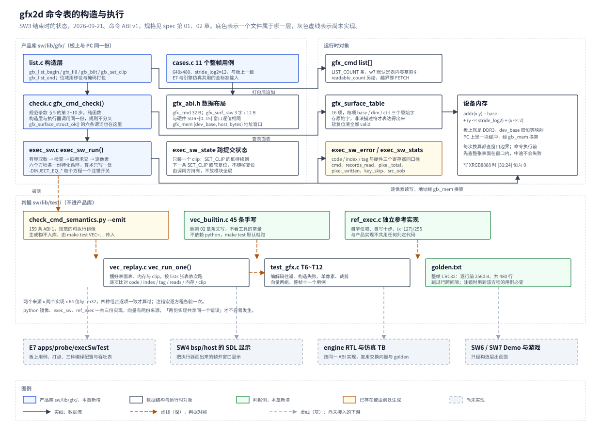

# 02 命令表构造层与软件执行器

## 一、动机

赛题基础要求 3 要「Demo 在屏幕上实时对比软件渲染与硬件渲染的帧率」，
设计文档 3.8 节还要求「同一帧命令表软硬各跑一次，比较后缓冲 CRC」。
这两件事都要同一个东西：一个在 CPU 上逐像素执行命令表的软件执行器。
它有三个用途，缺了它三件事都做不了——对比基线、硬件的金标准、
PC 上先把游戏与素材做完的载体。

规格这一层已经备齐。[spec 第 01 章](../spec/01-逐像素规格.md) 把「一个像素怎么算」
定到整数位宽、舍入、饱和、色键与裁剪边界；[spec 第 02 章](../spec/02-命令语义.md)
把「一条 32 字节记录是否合法、引用哪个表面、何时停止、错了之后留下什么」
定到每个合法输入只有一个结果、每个非法输入只有一个首错，
并留下 159 条带字面期望值的一致性向量。

缺的是产品代码：`sw/lib/gfx/` 一行都没有。本章记录把这两章规格变成
两个平台上同一份 C 实现的过程，以及为此动了规格的哪三处。

## 二、为什么是这几步

规格是文字与一份 python 镜像，产品是 C。把文字翻成 C 的风险不在算术——
算术已经被 `check_round255.c` 穷举过；风险在**接口**：
一个表达不出某类输入的接口，会让对应的判据永远跑不到，而表面上全绿。
所以第一步不写代码，先拿 159 条向量反向演练接口草案，逐条问「这条能不能表达出来」。

接着才是实现，分四步，每一步都对着一个具体的失败模式：

1. **检查只写一份。** 构造层与执行器都要判一条记录合不合法。写两份，
   两份迟早不一样；而规范条款 §5 的十步里有九步与命令表状态无关，
   正好能做成一个纯函数。
2. **执行器的状态显式化。** SET_CLIP 的框跨提交存活，它既不属于某一次提交，
   也不能放模块全局（§7.1 明确禁止），只能由调用方持有。
3. **独立的第二实现。** spec 第 01 章第四节有两条教训：一个实现自己判自己不算证据，
   两个实现共享同一个错误同样不算。所以参考实现要连位域解析和除法算式都另写一遍。
4. **两份向量来源。** 工具导出的 159 条是规范的可执行镜像；再按第 02 章条文
   手写一组，不看工具的常量。两个来源交叉，才排除得掉「向量与实现共享同一个错误」。

最后把十一个整帧用例定死并产出 `golden.txt`：E7 的板上测量与引擎仿真都要拿它当期望值，
定在别处会各解释一次。

图 1 是本章结束时的状态。



**图 1** 上半是产品库与运行时对象，下半是判据。三份实现（python 镜像、`exec_sw`、`ref_exec`）
与两份向量来源交叉；灰色虚线的四个框是按同一 ABI 接下去的下游，本章不做。

## 三、每一步做了什么

### 3.1 前期研究：拿向量反向演练接口

开工前先跑通基线：`check_cmd_semantics.py` 在本机重跑，159 条向量、
10 个描述符失败位点、18 个方程×源格式组合、6 项注错全部见红，`fail 0`；
`--emit` 的产物与 spec 第 02 章 5.3 节登记的 SHA256 一致，说明工具与文档没有漂移。

然后统计向量的结构，用来定 C 侧的内存模型：

| 项 | 值 | 用途 |
| --- | --- | --- |
| `lists=1` 的向量 | 157 条 | 单次提交 |
| `lists=2` 的向量 | 2 条 | 跨提交状态，决定执行器要不要显式状态对象 |
| 表面 `base` 的范围 | `0x0000_1000` ~ `0x0000_E000` | 决定模拟设备内存的大小 |
| `[mem]`/`[exp]` 触及的最高地址 | `0x0000_D0xx` | 同上 |
| 故意溢出 32 位的非法 `base` | `0xFFFF_FFF0`，1 条 | 它在表面结构检查就被拒，不会被访问 |

据此定 PC 侧模拟设备内存取 64 KiB、`dev_base = 0`，一块放得下全部向量。

接着逐条演练 SW3 草案里的 C 签名，三处表达不出来，详见 4.1 节。
结论是改三处接口、补四处口径，七条一并列在这里：

| 编号 | 项 | 原草案 | 定下来的 |
| --- | --- | --- | --- |
| A | 执行器的跨提交状态 | `exec_sw_run()` 只收表与计数 | 加调用方持有的 `exec_sw_state`，装 `clip`；软复位是它上面的一次显式复位 |
| B | 表面表的存储形态 | `gfx_surface_set()` 暗示存解码后的结构 | 存 ABI 原始三个字，布局与硬件 `SURF[0..15]` 逐位相同；结构化 setter 只是合法路径的便利入口 |
| C | 设备地址如何落到主机内存 | 未定义 | 加显式地址窗口 `gfx_mem{dev_base, host, bytes}`，每次换算查边界；板上恒等映射 |
| D | `CMD` 计数口径 | 未定义 | 成功执行完的记录数，含 NOP 与 SET_CLIP，**不含** END，**不含**出错那条 |
| E | 取数次数 | 未定义 | 另设 `records_read`：含 END、含出错那条、含取数失败那次，对应向量的 `reads` |
| F | `PIXEL` 与对账等式 | 等式里有个 `SRC_OOB` | `pixel_total` 是裁剪后窗口面积之和；等式 `pixel_total == pixel_written + key_skip + src_oob`；`src_oob` 是软件侧附加项，硬件不要求实现 |
| G | 整帧 CRC 的口径 | 未定义 | 逐行取前 `width × 4` 字节、共 `height` 行，跳过行跨间隙 |

A、B、C 属于 ABI 的软件交接约定，已同步订正进 spec 第 02 章规范条款 §7.1。
D 与 E 必须分成两个数：**它们在「出错那条算不算」上正好相反**——
`CMD` 数的是干成了几条，`records_read` 数的是读了几条，合成一个数就对不上向量的 `reads`。
F 里的 `SRC_OOB` 原本写在 SW3 的判据表里，但它不在设计文档 3.4 节末的硬件计数器清单上；
本章把它标成软件侧附加项，硬件不实现时对账退化成 `pixel_total − key_skip`。

### 3.2 ABI 与只写一份的检查

`gfx_abi.h` 只描述数据的样子，不含行为：命令记录的位域、表面表的三个字、
错误码、游戏区尺寸。三个 `_Static_assert` 把布局钉死：

```c
_Static_assert(sizeof(gfx_cmd) == 32, "命令记录必须是 32 字节");
_Static_assert(sizeof(gfx_surf_raw) == 12, "表面表每项必须是 12 字节");
_Static_assert(sizeof(gfx_surface_table) == 12u * GFX_SURF_N, "表面表布局必须连续");
```

表面表存**原始三个字**而不是解码后的结构，这条是 4.1 节逼出来的，
顺带换来一个好处：它与硬件 `SURF[0..15]` 寄存器窗口逐位相同，驱动写两边是同一份代码。

检查写成一个纯函数 `gfx_cmd_check()`，规范条款 §5 十步里的第二到第十步都在里面；
第一步「取记录」与命令表状态有关，留在执行器。构造层打包完立刻调用它，
执行器取到记录后再调用它，两处同一份：

```
取记录 ── 执行器的有界取数（第 1 步）
   │
   └─→ gfx_cmd_check()（第 2~10 步，纯函数）
          opcode → 未用字段 → equation → src surface → dst surface
          → space(src,dst) → format(src,dst) → FILL premult → BLIT overlap
```

顺序本身就是规格：一条同时有两处错的记录只能报一个码，报哪个由这个先后决定。
`space` 与 `format` 各算一步、各自源在前，所以「源格式非法 + 目的 space 非 DDR」报
`BAD_SPACE`——这是第 02 章 4.2 节专门定过的一处分叉。

### 3.3 构造层

```c
int  gfx_surface_set(gfx_surface_table *t, int id, const gfx_surface *s);
void gfx_surface_set_raw(gfx_surface_table *t, int id,
                         uint32_t base, uint32_t dim, uint32_t ctrl);
void gfx_surface_reset(gfx_surface_table *t);         /* 软复位：清全部 valid */
void gfx_list_begin(gfx_list *l, gfx_cmd *buf, uint32_t cap,
                    const gfx_surface_table *t);
int  gfx_nop(gfx_list *l);
int  gfx_fill(gfx_list *l, int dst, gfx_rect r, uint32_t argb, int eq, uint8_t c);
int  gfx_blit(gfx_list *l, int src, int sx, int sy, int dst, int dx, int dy,
              int w, int h, int eq, uint8_t c, int key_en, uint32_t key);
int  gfx_set_clip(gfx_list *l, gfx_rect r);
int  gfx_list_end(gfx_list *l);
uint32_t gfx_cmd_decode(const gfx_cmd *c, char *buf, uint32_t cap);
```

`list.c` 的五个追加函数返回同一套口径：0 已追加，正值是 spec 错误码，
`GFX_BUILD_*` 是构造层自己的错误。三类失败的先后是定过的：

```
gfx_fill() / gfx_blit() / gfx_set_clip() / gfx_nop() / gfx_list_end()
   │
   ├─ 参数不能无损编码 ──────────→ GFX_BUILD_BAD_ARG（不截断、不追加）
   ├─ 已经 END ─────────────────→ GFX_BUILD_CLOSED
   ├─ 表满 ─────────────────────→ GFX_BUILD_FULL，overflow++
   ├─ gfx_cmd_check() 不过 ─────→ spec 错误码，rejected++
   └─ 通过 ─────────────────────→ 写入 buf[used]，w7 = used，used++
```

「能不能放」先于「内容对不对」：`CLOSED` 与 `FULL` 与记录本身无关，
先答能不能放，再答内容合不合法。被拒绝的调用不写缓冲区也不占记录索引，
所以后面成功记录的 `w7` 仍然等于它在表里的零基索引——这一条有专门的判据
（`T7 tag is table index`）。

`gfx_list` 里存 sticky 首错、`rejected`、`overflow` 与 `ended`：
即使上层暂时不逐次检查返回值，帧末也能报出首错与计数，不会静默丢命令。

表面表有两个入口。`gfx_surface_set()` 走合法路径，校验结构、最后置 `valid`，
结构不合法时**把槽位原样退回**，不留下一个半登记的槽位；
`gfx_surface_set_raw()` 按三个字原样写入、不做校验，用来构造非法描述符的测试输入
与重放外部向量——十个描述符失败位点里有五个只能这样构造。

### 3.4 执行器

定下来的签名（与 4.1 节那份草案对照着看）：

```c
void exec_sw_reset(exec_sw_state *es);                /* 软复位：clip 回到整个游戏区 */
int  exec_sw_run(exec_sw_state *es, const gfx_surface_table *t, const gfx_mem *m,
                 const gfx_cmd *list, uint32_t list_count, uint32_t readable_count,
                 exec_sw_stats *st, exec_sw_error *err);
```

多出来的三个参数正是 3.1 节 A、B、C 三条：状态对象、表面表（内容形态变了、类型名没变）、地址窗口。
`st` 累加而不清零，所以连着几次提交可以接着统计；`err` 每次覆盖；两者都可以传 NULL。

`exec_sw_run()` 的结构是：有界取数 → `gfx_cmd_check()` → 四者求交 → 逐像素。
一个像素只有三种结局，顺序照 spec 第 01 章 3.6 节第 5 步，先判源越界再判色键：

```
for py, px in 裁剪后的闭区间窗口:
        pixel_total++
        源越界 ──────→ src_oob++,   continue      （只跳过该像素）
        色键命中 ────→ key_skip++,  continue      （目的不读不写）
        否则 ────────→ blend_px() 写回, pixel_written++
```

对账等式 `pixel_total == pixel_written + key_skip + src_oob` 因此恒成立，
每条向量与每个整帧用例都验一次。

混合的算术只写一份 `blend_px()`，六个方程的循环由宏各生成一份特化：
调用点的 `eq` 是编译期常量，函数里的 `switch` 在 `-O2` 下被折叠掉。
这样「外层按方程选一次、内层不按像素切换方程」与「方程系数只有一处定义」同时成立——
写六份循环体就会有六处可以抄错的系数表。

注错开关每个方程一个（`-DINJECT_EQ_COPY` 等），只把该方程输出的最低位取反。

所有访存经 `gfx_mem` 窗口换算。窗口检查不在像素循环里做：
命令执行前先确认本条用到的表面**整张**落在窗口内，地址随 x、y 单调增，
首尾两点在窗口内就够。这样中途不会失败，「失败命令无副作用」不被破坏。
这一条不属于 ABI 的十步，它是软件执行器的宿主约束，板上恒等映射时走不到。

### 3.5 独立参考实现与两份向量

`ref_exec.c` 的「独立」落到三处：自己解命令的位域，不用 `gfx_abi.h` 的取字段函数；
自己写一份十步校验，不调用 `gfx_cmd_check()`；除以 255 用另一个算式。
产品实现走 spec 定稿的移位式，参考实现用整数除法：

```
产品   t = x + 128;  q = (t + (t >> 8)) >> 8;  out = min(255, q)
参考   q = (x + 127) / 255;                    out = min(255, q)
```

两条路在 `x = 0..130050` 上必须给出同样的值。这是本文件存在的意义：
spec 第 01 章 4.7 节记过一次「两个工具用同一个错值互相印证」，
共享算式就会重演那一幕。

向量有两个来源。工具导出的 159 条由 `vec_replay.c` 按交换格式解析后重放；
`vec_builtin.c` 另写 45 条，输入按第 02 章条文构造、期望值手算后写成字面量，
不看工具里的常量，也不调用任何执行器去算期望。45 条按九组分布：

| 组 | 条数 | 覆盖 |
| --- | --: | --- |
| 01 合法操作码与方程 | 7 | NOP / END / SET_CLIP、COPY、ADD 饱和、MUL、BLIT 坐标映射 |
| 02 必须为 0 的字段 | 9 | rsvd、tint、FILL 的 key 与 src、BLIT 的 w4、SET_CLIP 的 w2、END 的 eq、非 CONST 的 c |
| 03 表面、space 与 format | 8 | 未登记、基址不对齐、stride 过小、控制字保留位、space=TEX、INDEX8、两条方程与源格式错配 |
| 04 FILL 的常量与预乘 | 3 | a=255、RGB > A、a=0 照常写回 |
| 05 重叠、零面积、色键、源越界 | 6 | 半开区间相邻、1 像素重叠、零宽、零宽加格式非法、色键全命中、源越界逐像素跳过 |
| 06 COUNT、END 与取数失败 | 3 | count=0、耗尽无 END、短表 FETCH |
| 07 相邻两步的优先级 | 4 | opcode>field、field>equation、equation>surface、space>format |
| 08 首错停止与错误定位 | 2 | 前序写入不回滚、标签与索引分离 |
| 09 SET_CLIP 的状态 | 3 | 跨提交继承、空矩形全裁、后发的框能扩大 |

两个来源 × 两个实现 × 64 位与 `-m32`，四种组合逐项一致才算过。

### 3.6 整帧用例与 golden.txt

spec 第 01 章第六节原写「九个用例」，同一节又要求把裁剪那条拆成两条、
另加一条通道范围用例，实际是十一条，而 E7 那边没有定死的清单。
本章把它定在 `lib/gfx/cases.c` 里，E7 与引擎仿真直接引用：

| 编号 | 名称 | 覆盖 |
| --: | --- | --- |
| 1 | `fill-screen` | FILL COPY 铺满整屏 |
| 2 | `blit-copy` | BLIT COPY，XRGB 源 |
| 3 | `blit-key` | 色键，棋盘格让命中与不命中各占一半 |
| 4 | `blit-alpha-pm` | ALPHA，PREMULT 源 |
| 5 | `blit-alpha-straight` | ALPHA_STRAIGHT，STRAIGHT 源 |
| 6 | `blit-add` | ADD，先垫一块亮底让它饱和 |
| 7 | `fill-const` | CONST，`c = 1` 是第 01 章的最小反例 |
| 8 | `blit-mul` | MUL |
| 9 | `blit-clip-partial` | 负坐标、右下出屏、源矩形比纹理大 |
| 10 | `set-clip-state` | 两张表：设框、跨表继承、空框全裁、后发的框扩大 |
| 11 | `copy-argb-high-byte` | COPY 一个高字节非 0 的源，验写回时 `[31:24]` 为 0 |

帧缓冲取 640×480、`stride_log2 = 12`，与板上一致。整帧 CRC 的口径定为
**逐行取前 `width × 4` 字节、共 `height` 行，跳过行跨的间隙**，
与 `lib/core/crc32.h` 的流式接口逐行 `update` 一致。这个口径不能换成
`ref_crc32_strided()`，原因见 4.3 节。

### 3.7 落地

`mk/host.mk` 的 `test` 目标从 `lib/core` 扩到 `lib/core lib/gfx`，
加了三个开关：`VEC=<file>` 传入导出向量（不给就跳过那一组，其余照跑），
`INJECT=EQ_*` 打开注错，`gen-golden` 重新生成期望 CRC。
导出向量是生成物、不入库，所以它不能是默认判据的前置。

`tools/check/check_sw_layers.sh` 的第 1 项（`lib/` 只有 `-Ilib` 编得过）
自动覆盖到新增的四个文件，13 个文件全过。

## 四、遇到的问题

### 4.1 原接口重放不了 SW2 自己的向量，三处

**第一现场（SW3 条目 2.1~2.2 节的草案签名）**

```c
int exec_sw_run(const gfx_surface_table *t, const gfx_cmd *list,
                uint32_t list_count, uint32_t readable_count,
                exec_sw_stats *st, exec_sw_error *err);
int gfx_surface_set(gfx_surface_table *t, int id, const gfx_surface *s);
```

**解读** 逐条拿 159 条向量去套这两个签名，三类输入表达不出来：

- **跨提交的 clip。** `clip-inherits-across-lists` 与
  `error-in-second-list-keeps-local-index` 都是 `lists=2`：第一张表发 `SET_CLIP`，
  第二张表依赖继承下来的框（两条的期望 `clip` 都是 `0,0,1,1`）。
  `exec_sw_run()` 没有 clip 的入口与出口，两次调用之间这个状态无处安放。
  剩下的路只有模块全局变量，而规范条款 §7.1 明确禁止。
- **非法描述符。** 十个描述符失败位点里，`fill-dst-ctrl-rsvd-5/10/16`、
  `fill-dst-stride1`、`fill-dst-overflow` 这五条非法的地方只存在于**原始控制字**里。
  `gfx_surface_set()` 收一个结构化的 `gfx_surface`，控制字由它拼出来，
  保留位永远是 0、`stride_log2` 永远是校验过的值，这五条的输入根本构造不出来。
- **设备地址。** 描述符的 `base` 是 32 位设备地址。板上可以直接解引用，
  PC 上不能，而草案里没有任何一处提到这层换算。向量里 `base = 0x0000_1000`
  在 PC 上无处安放。

**定位** 三条的共同点是：草案是照着「板上怎么用」写的，
没有拿「判据怎么跑」去核对一遍。SW2 交接时写下的四条约束
（显式 `list_count` 与 `readable_count`、显式绑定表面表、追加函数返回状态、
不可编码参数不截断）都对，但它们是从**构造层**那一侧想出来的，
执行器这一侧的状态与地址两件事没人问。

**根因与修法** 接口改三处：

| 项 | 改法 |
| --- | --- |
| 跨提交状态 | 加 `exec_sw_state`，目前只装一个 `clip`；由调用方持有，`exec_sw_reset()` 就是软复位 |
| 表面表 | 存 ABI 的原始三个字；`gfx_surface_set()` 仍是合法路径的便利入口，另加不校验的 `gfx_surface_set_raw()` |
| 设备地址 | 加 `gfx_mem {dev_base, host, bytes}` 窗口，每次换算查边界；板上设成恒等映射 |

三条都写进 spec 第 02 章规范条款 §7.1（2026-09-21 补）。表面表改成存原始字之后，
它与硬件 `SURF` 窗口逐位相同，这是顺带的收获，不是目的。

**原判据为什么没有覆盖到它：** SW2 的判据是「159 条向量在 python 上各得一个唯一结果」，
它证明的是规格无歧义，不证明规格能被目标语言的接口表达。
第 02 章 4.5 节已经做过一次这种演练（用 SW3 草案的 C 签名去表达短表与两张表面表），
当时发现了八处并修掉；这三处是那次演练**没覆盖到的部分**——
上次演练的是构造层与取数，没演练执行器的状态与访存。
修法是把「拿向量反向演练接口」固定成开工前的第一步，而不是只做一次。

### 4.2 交换格式导不出「这条不判内存」，7 条假失败

**第一现场（C 侧重放 159 条的输出）**

```text
  eq1-fmt1 FAIL   mem[00001000] got=000080ff expect=00004080
  eq2-fmt0 FAIL   mem[00001000] got=000080ff expect=00004080
  eq2-fmt1 FAIL   mem[00001000] got=000080ff expect=00004080
  eq2-fmt2 FAIL   mem[00001000] got=000080ff expect=00004080
  eq4-fmt0 FAIL   mem[00001000] got=00001040 expect=00004080
  eq4-fmt1 FAIL   mem[00001000] got=00001040 expect=00004080
  eq4-fmt2 FAIL   mem[00001000] got=00001040 expect=00004080
```

**解读** 七条都是合法向量（`code=0`），两个独立的 C 实现给出同一个值，
与手算一致：`eq2-fmt0` 是 ADD，源与目的都是种子 `0x00004080`，
B 通道 `128×255 + 128×255 = 65280`，算完商 256、clamp 到 255，所以是 `0x000080FF`。
错的是期望值，不是实现。

**定位** 这 18 条「方程×源格式」向量在工具里带 `check_mem=False`，
只负责证明 18 个组合各自的错误码，像素由第一、四、五组覆盖。
但 `emit()` 没有看这个标志，照写 `[exp]`，写出去的是**没有执行过**的初始内存。
工具自己跑时 `vector_ok()` 会跳过内存比较，所以一直是绿的。
18 条里有 11 条的期望恰好正确（`BAD_FORMAT` 不改内存，
或 COPY / `a=255` 的 ALPHA 输出恰好等于种子），剩下 7 条才暴露出来。

**根因与修法** 根因是**标志只作用在工具的内部校验上，没有进入对外的证据载体**。
`[vector]` 行补一位 `mem=0/1`，`mem=0` 时不写 `[exp]`。
两件事都要做：不写 `[exp]` 让老实的读取方不会误比，`mem=` 让读取方能分清
「这条不判内存」与「这条该判而漏写了」。改完 `--emit` 从 3064 行降到 2777 行，
向量条数仍是 159，语义没动。spec 第 02 章的规范条款 §7.2、4.7 节与 5.3 节的指纹已同步。

**原判据为什么没有覆盖到它：** 第 02 章第 (H) 节的交换格式审计只回读
vector / list / cmd 三层的**结构**，原文就写着「逐字内容由 C/RTL 的独立读取器在 SW3 再验」。
这条缺陷正落在那句话让出去的范围里，由本章按计划撞上并补回。
它也是第 02 章 4.5 节的续集：能通过工具自己的校验，不等于能被别人安全重放。

### 4.3 整帧 CRC 差点用上一个超限就返回 0 的函数

**第一现场（`lib/test/ref_crc.c`，SW1 留下的实现）**

```c
uint32_t ref_crc32_strided(const uint8_t *base, uint32_t rows,
                           uint32_t stride_bytes, uint32_t row_bytes)
{
    static uint8_t flat[8192];
    ...
    if (rows * row_bytes > (uint32_t)sizeof flat)
        return 0u;      /* 测试用的规模远小于这个上限，超了说明参数写错 */
```

**解读** 整帧 CRC 的口径正是「逐行取前 `width × 4` 字节、跳过行跨间隙」，
与这个函数的语义完全对上，所以第一版的 `frame_crc()` 就调用了它。
但 640×480 的一帧是 `480 × 2560 = 1228800` 字节，远超 8192：
**十一个用例会全部得到 0**。更坏的是注错之后仍然是 0，
「用到该方程的用例 CRC 必须变」这条判据会永远通过——
判据全绿，而它什么也没验。0 是合法的 CRC 取值，从结果上分辨不出来。

**定位** 提交前读这个函数的实现时发现的，没有跑到板上，也没有写进 `golden.txt`。
注释里那句「测试用的规模远小于这个上限」是 SW1 当时的事实
（那时最大的用例是 60 帧的小块），SW3 把这个前提打破了，而注释还在。

**根因与修法** 根因是**一个失败路径返回了看着像结果的值**。
两处都改：`frame_crc()` 改用 `lib/core/crc32.h` 的流式接口逐行 `update`；
`ref_crc32_strided()` 超限时改成 `abort()`，并把这段经过写进它的注释。
不再返回 0 是关键——静默失败比崩溃难查得多。

**原判据为什么没有覆盖到它：** 没有任何判据要求「CRC 必须非 0」，
也不该有这种判据（0 是合法取值）。真正能挡住它的是
「注错之后 CRC 必须变」——而这条判据本身就建立在 CRC 算对的前提上，
循环依赖。挡住它的只能是读实现时的边界检查，
以及让失败路径不要伪装成成功。

### 4.4 手写向量里有一条永远跑不到

**第一现场（`vec_builtin.c` 第一版的分派）**

```c
    case 42:
        reset(v, "09", "b-clip-inherits-across-lists");
        ...
    default:
        if (idx == 43u - 1u) {                  /* 43 - 1 == 42 */
            reset(v, "09", "b-clip-empty-skips-following");
            ...
        }
        return 0;
```

**解读** `43u - 1u` 就是 42，而 `case 42` 在前面已经把 42 接走了，
`default` 分支里那条 `b-clip-empty-skips-following` 永远不可达。
计数函数报 43 条，实际能跑的是 42 条，且报告里看不出少了哪一条。

**定位** 写完第 43 条时顺手用 `43 - 1` 当索引，没有回头看 `case` 标号已经排到 42。
改成显式的 `case 43`、`case 44`，并把总数提到 45。

**根因与修法** 根因是**用算式当分派索引**。改法是每条向量一个显式 `case`，
总数与最后一个 `case` 号一起改。

**原判据为什么没有覆盖到它：** 判据是「45 条全过」，
不可达的那条既不会失败也不会被计数，所以照样全绿。
spec 第 02 章 4.4 节记过同一类问题（`clip-inherits-across-lists` 当时
把两次提交写成一张表，END 之后的命令不可达），那次是向量内部不可达，
这次是向量集的分派不可达，成因相同：**向量存在不等于向量被执行到**。
要真正挡住它，得让「条数」与「实际跑过的条数」是同一个来源——
本章暂时靠显式 `case` 加人工核对，留给 SW6 之后再做成结构断言。

## 五、结果

### 5.1 测量方法

2026-09-21 在 WSL（Ubuntu 26.04、gcc 15.2.0）上运行。
不依赖板卡、不依赖 SDL；交叉编译那一项用 xPack riscv-none-elf-gcc 13.4.0。

```text
# 导出向量（生成物，不入库）
wsl -e bash -c 'cd <REPO> && python3 Main/tools/check/check_cmd_semantics.py --emit <VEC>'

# 主机侧全套：64 位挂 ASan+UBSan，-m32 另编一份，两边输出必须逐字节相同
wsl -e bash -c 'cd <REPO>/Main/sw && make -f mk/host.mk test VEC=<VEC>'

# 逐方程注错
wsl -e bash -c 'cd <REPO>/Main/sw && make -f mk/host.mk test INJECT=EQ_COPY'

# 交叉编译：同一份 lib/gfx 用板上工具链编一遍
wsl -e bash -c 'cd <REPO>/Main/sw && make -f mk/target.mk LIBS="core gfx" RISCV_BIN=<RISCV_BIN>'

# 分层结构判据
wsl -e bash -c 'cd <REPO> && RISCV_BIN=<RISCV_BIN> bash Main/tools/check/check_sw_layers.sh'
```

本节能证明的是软件执行器与构造层在主机上按规格实现、两个实现逐项一致、
判据会因注错而变红，以及同一份源码能被板上工具链零告警编过。
**不能**证明的是板上的行为与吞吐——那是 E7 的账，本章没有跑过板子。

### 5.2 覆盖结果

| 测量项 | 本轮前 | 本轮后 |
| --- | ---: | ---: |
| `sw/lib/gfx/` 产品代码 | 0 行 | 1565 行（4 个 .c、2 个 .h） |
| `sw/lib/test/` 判据代码 | 3 个文件 | 12 个文件（新增 ref_exec、vec_builtin、vec_replay、test_gfx 四对 .c/.h 与 golden.txt） |
| 主机侧断言项 | 32 | 78 |
| 一致性向量（工具导出） | 0 条重放 | 159 条 × 2 个实现 × 2 个位宽 |
| 一致性向量（C 侧手写） | 0 | 45 条 × 2 个实现 × 2 个位宽 |
| 整帧用例 | 0 | 11 个，CRC 入库 `golden.txt` |
| 逐方程注错 | 0 | 6/6 各自见红 |
| 64 位与 `-m32` 输出 | 逐字节相同 | 逐字节相同 |
| ASan + UBSan | 无报告 | 无报告 |
| 板上工具链编译 | 不适用 | 零告警通过 |
| 分层结构判据 | 9 个文件 | 13 个文件，7 项全过 |

注错的作用范围逐条列出来，它同时也是「哪个用例用到哪个方程」的对照表：

| 注错开关 | 变红的整帧用例 | 条数 |
| --- | --- | --: |
| `INJECT_EQ_COPY` | fill-screen、blit-copy、blit-key、blit-add、blit-clip-partial、set-clip-state、copy-argb-high-byte | 7 |
| `INJECT_EQ_ALPHA` | blit-alpha-pm | 1 |
| `INJECT_EQ_ADD` | blit-add | 1 |
| `INJECT_EQ_CONST` | fill-const | 1 |
| `INJECT_EQ_MUL` | blit-mul | 1 |
| `INJECT_EQ_ALPHA_STRAIGHT` | blit-alpha-straight | 1 |

`blit-add` 在 COPY 与 ADD 两个开关下都变红，因为它先用一条 FILL COPY 垫亮底再做 ADD；
其余每个方程各自只命中用到它的那一个用例，没有互相串。

开工时定下的九条判据逐条对照：

| 判据 | 结果 |
| --- | --- |
| 单元测试在 64 位与 `-m32` 下全过且输出相同，ASan + UBSan 无报告 | 过。78 项断言，两份输出 `diff` 为空 |
| 构造接口：无模块全局表面状态；非法调用/表满/已结束三类都返回非零且不写缓冲区，sticky 首错与计数可在帧末读取 | 过。`T7` 一组共 17 项，含两张表面表交叉构造那一条 |
| 两个实现一致：整帧十一个用例的 CRC32 相同 | 过。11/11 |
| ABI 一致（重放）：159 条在 64 位、`-m32`、`exec_sw`、`ref_exec` 四种组合下逐项一致 | 过。逐项指 code / 表内索引 / 标签 / `reads` / 内存 / clip |
| ABI 一致（内建）：C 侧手写那组同样四种组合，且不依赖 python | 过。45 条 |
| 注错见红：逐个打开方程注错宏，用到该方程的用例 CRC 变、其余不变 | 过。6/6，作用范围见上表 |
| 统计对账：每个用例 `pixel_total == pixel_written + key_skip + src_oob`，且 `records_read` 等于向量的 `reads` | 过。两者都在 `vec_run_one()` 里逐条验 |
| 跨平台：同一份 `sw/lib/gfx/` 用 riscv-none-elf-gcc 13.4.0 零告警编过 | 过。`-Wall -Wextra -Werror` |
| 跨平台：板上十一个用例的 CRC 与 `golden.txt` 一致 | **未做**，按原计划在 E7 里验 |

### 5.3 原始输出

`make -f mk/host.mk test VEC=…` 的尾部（完整输出 78 行断言，此处保留 gfx 这一段的关键行）：

```text
libTest gfx: list/exec_sw/ref_exec
T6 roundtrip fields ok
T6 roundtrip count ok
T7 set surface a ok
T7 no cross-table state ok
T7 rejected counted ok
T7 sticky first error ok
T7 bad descriptor ok
T7 slot untouched ok
T7 coord out of range ok
T7 surface id out of range ok
T7 nothing appended ok
T7 full ok
T7 overflow counted ok
T7 closed ok
T7 tag is table index ok
T7 decode has sign ok
T7 decode truncates ok
T8 const c1 s1 d128 expect=00808080 got=00808080 ok
T8 copy expect=00112233 got=00112233 ok
T8 copy argb high byte expect=00112233 got=00112233 ok
T8 add saturate expect=00ffffff got=00ffffff ok
T8 mul half expect=00404040 got=00404040 ok
T8 alpha premult expect=00404050 got=00404050 ok
T8 alpha a0 expect=00123456 got=00123456 ok
T8 alpha straight expect=00807f00 got=00807f00 ok
T8 xrgb alpha is 255 expect=00102030 got=00102030 ok
T9 negative origin clipped ok
T9 surface bound clipped ok
T9 zero width no pixels ok
T10 builtin vectors n=45 ok
T11 emitted vectors n=159 ok
T12 fill-screen crc 9cd34cb7 ok
T12 blit-copy crc bc9be6ff ok
T12 blit-key crc 084d6bb2 ok
T12 blit-alpha-pm crc 0b14ce03 ok
T12 blit-alpha-straight crc 5b4feb8d ok
T12 blit-add crc cfcef0ee ok
T12 fill-const crc f50e8644 ok
T12 blit-mul crc 46667f89 ok
T12 blit-clip-partial crc 0fd9dcaf ok
T12 set-clip-state crc a07324ee ok
T12 copy-argb-high-byte crc 8843eb2f ok
fail 0
done
== lib/test 32-bit ==
== 两份输出比对 ==
libTest 64/32 identical ok
```

T8 那一组的期望值是手算的，逐条对得上 spec 第 01 章：
`T8 const c1 s1 d128` 是 3.4 节的最小反例（精确值 `32513/255 ≈ 127.502`，
V 顺序得 128，U 顺序会得 127）；`T8 alpha premult` 是
`a=128`、`src_pm=(64,32,16)`、`dst=(0,64,128)` 按 `src_pm × 255 + dst × (255−a)` 代入的结果。

交叉编译与分层判据：

```text
LD /tmp/gfxbuild/gfx2dGame-O2.elf
Memory region         Used Size  Region Size  %age Used
             ram:       81472 B      4092 KB      1.94%

1 lib/ 只有 -Ilib 编过（13 个文件） ok
...
fail 0
done
```

### 5.4 已知误差与不确定

三条。

其一，本章**没有上板**。板上工具链只验到「编得过、零告警」，
板上的 CRC 与主机是否逐位相同要等 E7 用 `golden.txt` 对；
这条判据已经写进 SW3 的跨平台一栏，由 E7 执行。

其二，手写的 45 条向量的期望值仍然是人写的，可能有人为错误。
降低风险的办法是三份实现加两份来源交叉：一条手写期望若写错，
`exec_sw` 与 `ref_exec` 会一起报不一致（除非两个实现同时错成那个样子）。
但它不是证明，只是让错误更难藏。

其三，`exec_sw` 的性能没有测。六份特化循环是按「常量传播之后 switch 会被折叠」
写的，这个假设在 `-O2` 下成立与否没有查反汇编，
也没有量每像素周期数——那是 E7 的口径与任务。

## 六、还欠什么

本章的账全部指向别的条目，自己没有未完成项：

- **E7**（[`../../Todo/hw/E7-软件执行器像素吞吐.md`](../../Todo/hw/E7-软件执行器像素吞吐.md)）：
  板上用例驱动、打点、三种编译配置、吞吐表与折帧公式。执行器本体与十一个用例已经在这里做完，
  E7 直接链接 `sw/lib/gfx/`，并用 `sw/lib/test/golden.txt` 当期望值。
- **SW4**（PC 平台层）：把执行器画出来的帧用 SDL 开窗口显示。
- **SW6 / SW7**：Demo 与游戏，只经构造层出画面。
- **engine**（尚无条目）：RTL 按同一 ABI 实现，复用本章的交换向量与 `golden.txt`。
  「两份实现共享同一个错误」那一条对它同样成立——引擎的 TB 不要复用 `exec_sw` 的代码。

另有一条留给以后的判据改进，写在 4.4 节末：
向量集的「条数」与「实际跑过的条数」目前是两个来源，
靠显式 `case` 加人工核对，还没有做成结构断言。
