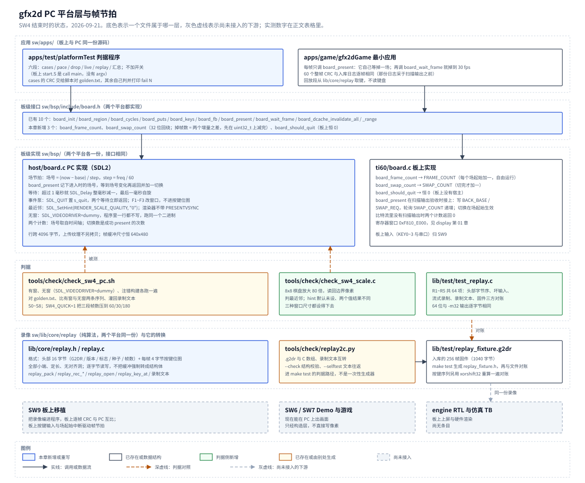

# 03 PC 平台层与帧节拍

## 一、动机

本章的板卡是易灵思钛金 Ti60F225：一颗带 RISC-V 硬核（Sapphire SoC，100 MHz）的 FPGA，
DDR3 256 MB，HDMI 输出 640×480@60。软件一侧的代码分三层：`sw/bsp/` 是项目板级层，
`sw/lib/` 是与平台无关的纯算法，`sw/apps/` 是应用；同一份应用源码要在两个平台上编得出来，
**PC 在这套结构里就是「另一块板子」**，由 `bsp/host` 用 SDL2 实现同一个板级接口。

[第 01 篇](01-软件平台分层与双目标构建.md) 把这三层与两套构建搭起来时，`bsp/host` 只有最小可用：
开窗、按 4096 字节行跨上传纹理、按键位图、计时。缺的是**语义**：这一层的像素通路已经能用，
两个接口在板上是什么意思还没有对上。
第 01 篇的 `board_present` 上传完纹理立刻返回，节拍另由 `board_wait_frame` 提供；
而板上这两个接口的含义在**扫描输出**验收（[display 第 01 章](../display/01-从DDR3帧缓冲到HDMI的扫描输出.md)）
之后已经被硬件钉死了：

| 接口 | 板上行为 |
| --- | --- |
| `board_present(i)` | 写 `BACK_BASE` = 帧缓冲 i、`SWAP_REQ` = 1，轮询 `SWAP_COUNT` 递增之后才返回；切换在下一个场起始生效 |
| `board_wait_frame()` | 轮询 `FRAME_COUNT` 递增，它由像素域时序发生器自由计数，与使能无关 |

「场」是这里的核心名词：像素侧时序发生器每 1/60 秒发出一个场起始，
`FRAME_COUNT` 每个场起始加一，`SWAP_REQ` 是一个粘滞请求位，在紧接的那个场起始锁存并清零。
PC 侧如果照第 01 篇的写法（present 不阻塞、节拍另算），**在 PC 上正确的帧切换逻辑落到板上就会错**
——两个平台上的「一帧」不是同一个量，SW9 的逐帧 CRC 比对也就失去意义。

还有两件事等着 PC 侧提供。其一，板上没有文件系统，SW9 要把 PC 上录的一段按键序列编进程序，
在板上跑同样的帧数、逐帧比对后缓冲 CRC，这是 ILP32 与 LP64 之间行为差异的判据；
录像的格式必须一步能转成 C 数组，且两个位宽解出同一串按键。
其二，判据要能在没有显示的环境里跑完（CI、没起 WSLg 的终端），
而有窗与无窗必须是**同一条执行路径**，否则无窗跑出来的 CRC 序列证明不了有窗那一条。

本章记录把这份最小实现补成完整平台层的过程：场节拍模型、三个新服务、缩放与退出、
录像格式与它的转换脚本、以及把这些串起来的判据程序与检查脚本。

## 二、为什么是这几步

这一条的风险不在功能在**模型**。PC 上能跑通的最小实现第 01 篇已经有了；
难的是让「场数、切换数、掉帧数、每次 present 返回的时刻」这几个量在两边是同一个量。
差一场，掉的帧算错一场；差一个调用，帧率差一倍。所以顺序是：

**第一步先取样，不写代码。** 板上语义只能从 RTL 读，PC 侧的行为只能实测：
SDL2 的等待粒度是多少、缩放质量默认是什么、无窗时落到哪个驱动。
这些事一旦猜错，后面所有代码与判据都建在沙子上。第 01 篇留下的等待实现
正好是这一步的现成反例——它测出来不能用（4.1 节）。

**第二步把接口补齐，再动实现。** 两个平台都真实存在的量只有场数与切换数，
第 01 篇的接口里一个都没有。三个服务（`board_frame_count`、`board_swap_count`、
`board_should_quit`）先定义契约、两个 bsp 各自实现，PC 侧才有东西可写。

**第三步是 PC 实现，四件事各自独立可验。** 场节拍（模型）、缩放（最近邻与窗口尺寸）、
退出（关窗之后不再等）、无窗（换驱动，不加代码）。

**第四步是录像格式与转换脚本。** 格式定成定长、无对齐洞、显式小端；
回放一律读编译进程序的 C 数组，录制结果就是日志，由脚本收成二进制或数组。
这样 `bsp` 不需要文件接口，`board.h` 不新增只有一边有的服务。

**第五步把判据串起来。** 有几条判据要跑多次再比（有窗对无窗、同一段录像回放两遍、
注错构建必须见红），应用自己判不了，需要脚本；另有一条判据（放大用的是不是最近邻）
在应用里根本看不出来，需要主机侧探针。

九条判据的量化形式写在 5.2 节。图 1 是本章结束时的状态。



**图 1** 上半是两个应用与它们经 `board.h` 拿到的服务，中间是 `bsp/` 的两个实现，
下半是录像与判据。灰色虚线的两个框是按同一份录像接下去的下游，本章不做。

## 三、每一步做了什么

### 3.1 前期研究：环境取样与场节拍模型

开工前不动产品代码，做四件事：读既有代码与扫描输出的 RTL、把本机 SDL2 的环境事实取下来、
用探针对比两种场节拍模型、把结论落成取舍与量化判据。探针是一次性的、没有入库，
数据是它的原始输出。

**环境事实**（WSL Ubuntu 26.04）：

```text
gcc 15.2.0   sdl2-config 2.32.10   python3 3.14.4
SDL runtime 2.32.10 / compiled 2.32.10
SDL_GetPerformanceFrequency = 1000000000
DISPLAY=:0   WAYLAND_DISPLAY=wayland-0     驱动 in use = x11
display 0 = 2560x1600 @ 60 Hz
video drivers: x11 / wayland / KMSDRM / offscreen / dummy / evdev
hint SDL_HINT_RENDER_SCALE_QUALITY 默认 = (null)      即未设
gcc -m32 编得过（gcc-multilib 在）
SDL_Delay(1) 200 次：min=1058 us avg=1092 us max=1149 us
```

两件事直接决定写法。性能计数器的频率是 1e9，`step = freq / 60 = 16666666`，
折算出的场频是 60.0000024 Hz，每天差 0.014 秒，可以忽略。
`SDL_Delay` 的最小粒度约 1 毫秒且稳定超出 60~150 微秒，所以等场不能用纯睡眠。

**两种场节拍模型的对比。** 探针把 600 帧空渲染跑一遍，第 100 帧人为延 20 毫秒造一次掉帧，
三种后端各跑一次：

```text
old_grid(SW1) x11     n=600 min=1112 us avg=16642 us max=21144 us
                      frames=600 swaps=600 delta_frame=599 delta_swap=600
old_grid(SW1) dummy   n=600 min= 204 us avg=16640 us max=20383 us
old_grid(SW1) novideo n=600 min=   4 us avg=16639 us max=20124 us

hybrid(delay+spin) x11     min=16201 avg=16694 max_ok=17131   注错帧 33333 us (2.000 场)
                           delta_frame=601 delta_swap=600 extra_missed=0
hybrid(delay+spin) dummy   min=16495 avg=16694 max_ok=16903   注错帧 33333 us
hybrid(delay+spin) novideo min=16589 avg=16694 max_ok=16727   注错帧 33410 us
spin_only          x11     min=15148 avg=16694 max_ok=18185   注错帧 33333 us
```

旧算法是第 01 篇的 `s_next_frame += step` 加一个「落后就对齐到当前时刻」的兜底。
它的最小间隔 1112 微秒（dummy 与 novideo 下 204 与 4 微秒）说明落后之后会连续几帧立即返回；
`delta_frame=599` 小于 `delta_swap=600` 说明场数已经不再与场节拍同源，
掉帧减法算出的是回绕值。它只能保证平均节拍。

新模型的注错帧在三种后端下都正好是 **2.000 场**，掉帧减法得 1，
正常帧的间隔落在 16.20~17.13 毫秒。纯自旋与混合等待的差别只在 15.15~18.19 与 16.20~17.13 之间，
混合写法还省 CPU，所以取混合。

**板上语义的原文核对**（RTL 逐行）：

- `rtl/display/display_fetch.v` 第 344~357 行：`swap_req_sh` 是粘滞请求位，
  软件写 1 后由场起始锁存并清零，请求不会漏、不会攒账，所以「等下一个场边界」成立。
- 同文件第 411 行：`frame_count` 在 `fs_event` 上无条件加一，与状态机、使能都无关，
  所以它是自由运行的场计数。
- 同文件第 389~393 行：`swap_count` 在场起始之后的第六步（`S_WAIT`）里加一，
  所以板上 present 的返回时刻比场起始晚几十个 `core_clk`。这是本章唯一的建模误差，写在 5.5 节。
- `sdk/software/standalone/common/start.S:81` 是 `call main`，板上没有 argc/argv；
  现有十个应用的入口全是 `int main(void)` 或 `void main(void)`。

### 3.2 开工前定下的十项取舍（D1~D10）

每一项给出结论与代价。D1、D3、D4 有实测支撑，见 3.1 节与 4 节。

| 项 | 结论 | 依据与代价 |
| --- | --- | --- |
| **D1 场节拍怎么建模** | 场数定义成自由运行的 `(now − base) / step`；present 进入时记下场号 `f0`，**等到场号大于 `f0` 再返回**，返回时切换数加一 | 板上 `SWAP_REQ` 的锁存语义，见 3.1 节；旧网格实测不能用，见 4.1 节 |
| **D2 掉帧数归谁** | 应用做减法 `Δ场 − Δ切换`，平台层只提供两个只读查询 | `FRAME_DROP` 是引擎的性能计数器，扫描输出的寄存器表里没有它，PC 上更没有引擎（2026-09-26 订正：引擎 P1 定为不设这个计数器，两种后端的掉帧都只由这个减法给出，见设计文档 3.4 节的计数器清单；结论不变） |
| **D3 无窗口怎么做** | 在 `SDL_Init` 之前把 `SDL_VIDEODRIVER` 置成 `dummy`，程序里一行都不写 | 三个候选里只有它在 init 之后没有任何分支；其余两个实测数据见 3.5 节 |
| **D4 缩放与像素采样** | 显式设 `SDL_HINT_RENDER_SCALE_QUALITY` 为 `"0"`（最近邻）；渲染器不带 `PRESENTVSYNC` | hint 的默认值是未设；场节拍由性能计数器的网格给，交给显示器刷新率之后高刷屏上就不是 60 |
| **D5 运行模式怎么选** | 共享的应用不用 argv、也不读环境变量；判据程序一次跑完全部场景 | 板上是 `call main`，没有 argc/argv；headless 靠 shell 给环境变量，不算应用的开关 |
| **D6 录像格式** | 头部 16 字节（魔数 `G2DR`、版本、标志、种子、帧数）+ 每帧 4 字节按键位图，全部小端、定长、无对齐洞 | 要一步转成 C 数组，且 LP64 与 ILP32 解出同一串按键；逐字节读写，不把缓冲强制转成结构体 |
| **D7 录像数据怎么进程序** | 回放一律读编译进程序的 C 数组；录制结果就是日志，由 `tools/check/replay2c.py` 收成二进制或数组 | `bsp` 不需要文件接口，`board.h` 不新增只有一边有的服务 |
| **D8 CRC 口径** | 逐行取前 `width × 4` 字节、共 `height` 行，跳过行跨间隙，用 `lib/core/crc32.h` 的流式接口 | 沿用 SW3 的口径；行跨 4096 与可见 2560 之间有 1536 字节空隙，算进去会与板上 DDR 的上电残值对不上 |
| **D9 分层落点** | `sw/lib/core/replay` 是录像的唯一真源；`bsp` 不认「帧」，应用决定按键从哪来 | 判断标准用第 01 篇的：`board.h` 只放与硬件有关、两边都能实现的服务 |
| **D10 哪些判据在 PC 上不成立** | 前缓冲在一场内没有被改写、切换不撕裂留在 SW9 与引擎；PC 侧判的是调用序列与计数 | PC 上帧缓冲只有应用一个写者，拿去判是自证 |

### 3.3 板级接口新增的三个服务

`board.h` 只加三个函数，都是两个平台都实现得出来的：

```c
/* 都按 32 位回绕，与 board_cycles 同一约定：取两次读数相减。 */
uint32_t   board_frame_count(void);   /* 板上读 FRAME_COUNT；PC 上是 60Hz 节拍计数 */
uint32_t   board_swap_count(void);    /* 板上读 SWAP_COUNT；PC 上是成功 present 的次数 */
int        board_should_quit(void);   /* 宿主是否要求结束；板上恒为 0 */
```

两个口径写在头文件里，因为它们是契约的一部分。
第一，`board_frame_count` 在任何时刻都可以读，与有没有 present 过无关
（板上 `FRAME_COUNT` 由像素域时序发生器计数，PC 上由时间轴给）；
`board_swap_count` 只在 present 返回之后才增加；两者的差就是这段时间里错过的场数。
第二，**减法要先用 `uint32_t` 减完，再往更宽的类型上累加**：

```c
uint32_t d = (uint32_t)(f1 - f0) - (uint32_t)(s1 - s0);   /* 这一段错过的场数 */
total += d;                                               /* 累加放宽类型里 */
```

先提升再减会把一次回绕放大成天文数字。第 01 篇的掉帧实现不需要这个减法，
SW8 的统计埋点要按秒累加掉帧数，踩到一次整列作废，所以把写法写进契约。

`board_should_quit` 是回读代码时补的（4.3 节）：关窗之后 `board_present` 与
`board_wait_frame` 都立即返回，不再等场边界，否则退出前每一帧还要各挂一场。
退出不是游戏输入，**不进按键位图**：进了位图就会被录进录像，回放时凭空多出一个按键。

板上这一侧的实现是直读寄存器，本层不另做影子计数，做了反而会与硬件漂移：

```c
uint32_t board_frame_count(void);   /* disp_present_in_bitstream() ? disp_rd(DISP_FRAME_COUNT) : 0 */
uint32_t board_swap_count(void);    /* 同上，读 SWAP_COUNT */
int      board_should_quit(void);   /* 返回 0：板上没有「宿主」，按键与复位都来自板上 */
```

比特流里没有扫描输出时两个计数都返回 0，与 `board_present` 退回空操作是同一件事。

### 3.4 PC 侧的场节拍与退出

场是一根自由运行的时间轴，`base` 在 `board_init` 取一次：

```text
step       = freq / 60                     /* freq = SDL_GetPerformanceFrequency */
场号(now)  = (now − base) / step
等一场     = 等到「场号(now) > 进入时的场号」

board_present(i)   = 上传纹理、刷新窗口 → 记 f0 = 场号(now) → 等一场 → 切换数加一
board_wait_frame() = 记 f0 = 场号(now) → 等一场
```

ASCII 图 1 是这两种调用在时间轴上的落点。上面一排是正常帧，下面一排是渲染超过一场的帧。

```text
正常帧（渲染 10 ms）                超时帧（渲染 20 ms）

场起始  k        k+1       k+2      场起始  k        k+1       k+2
        |         |         |               |         |         |
  画图──┤         │         │        画图────┼───20ms──┤         │
        └─present─┘         │               │         └─present─┘
          Δ场=1 Δ切换=1     │                         Δ场=2 Δ切换=1
                 画图──present          [改] 掉帧数 = 1
```

[改] 与第 01 篇的差别只有一处：等待从 `board_wait_frame` 搬进了 `board_present`。
**每帧的标准序列是「画后缓冲 → `board_present(back)`」，不再另调 `board_wait_frame()`**，
两个都调会让帧率掉到 30。

等待本身用「超过 1 毫秒就 `SDL_Delay` 掉整毫秒减一，最后一毫秒自旋」的混合写法，
本机 `SDL_Delay(1)` 实测 1058~1149 微秒，指望它精确到微秒会把每一帧都睡过头。

退出按 3.3 节的契约实现：present 入口先看 `s_quit`，刷新完窗口泵一次事件，
如果这次泵到了 `SDL_QUIT` 就立刻返回（这一帧的场数增量是 0），否则才等场边界。
`board_keys()` 里也泵一次事件，这样只读按键、不常 present 的应用也能看到关窗。
帧缓冲号越界与板上同处理：直接返回，不等场也不计切换。

### 3.5 缩放、最近邻与无窗

**缩放。** F1~F3 切 1×、2×、3×，只改窗口尺寸与 `SDL_RenderCopy` 的目标矩形，
帧缓冲恒为 640×480。最近邻由显式 hint 保证，探针实测（8×8 棋盘放大 80 倍、读回第 40 行）：

```text
hint 0 (最近邻): x=79:0x000000 x=80:0xffffff x=81:0xffffff x=159:0xffffff x=160:0x000000
hint 1 (线性)  : x=79:0x7e7e7e x=80:0x7f7f7f x=81:0x828282 x=159:0x808080 x=160:0x7f7f7f
```

一个源像素正好铺满 80 个屏幕像素，所以最近邻下 79/80 是黑白硬边，线性下两侧都是插值值。

**缩放键不进按键位图。** 窗口大小是宿主的事，进了位图就会被录进录像、改变回放的按键序列。
`board_keys()` 里没有 F1~F3，它们在事件泵里被吃掉（4.5 节的探针验的只是渲染这一半，
「键没漏进位图」要靠人按着看，见 5.5 节）。

**无窗。** 三个候选的实测：

```text
SDL_VIDEODRIVER=dummy   驱动 in use = dummy
                        CreateRenderer(ACCELERATED) = Couldn't find matching render driver
                        CreateRenderer(SOFTWARE)    = ok
                        纹理、上传、节拍都照常，注错帧仍 33333 us
SDL_Init(0)             驱动 = (null)，视频子系统没起；节拍一致
                        但窗口、渲染器、纹理三处都要判空
去掉 DISPLAY / WAYLAND_DISPLAY / XDG_RUNTIME_DIR 后按原样跑
                        驱动 in use = offscreen（SDL 自己挑的）
                        SDL_Init(VIDEO) 与 CreateRenderer(ACCELERATED) 都成功
```

最后一条推翻了开工前写在 spec 里的说法。原稿写「无显示环境下 `board_init` 会直接退出」，
实测不成立：SDL 自己落到 `offscreen` 驱动，一切都成功。真实的问题是不指定后端时
落到哪个驱动由环境决定、不受控，三个后端的渲染器实现与阻塞行为各不相同，
那样的「无窗」与有窗不是同一个执行路径，第 8 条判据也就不成立。
所以取 dummy：`SDL_Init` 之后一行分支都不加，有窗与无窗跑的是同一个二进制。

### 3.6 录像格式与转换脚本

格式定在 `sw/lib/core/replay.h`，纯算法，两个平台编同一份：

```text
偏移  长度  内容
0     4     魔数 'G','2','D','R'（小端读作 0x52443247）
4     2     版本号，当前 1
6     2     标志位，当前必须是 0
8     4     随机种子
12    4     帧数 N
16    4N    每帧一个 32 位按键位图，位分配同 board.h 的 BOARD_KEY_*
```

总长 `16 + 4N`，全是 4 字节对齐的量，两边结构体都不会插洞；解析仍逐字节按小端读写，
不把文件缓冲强制转成结构体，对齐、别名与端序三件事一件都不用赌。接口分三组：
一次打包 `replay_pack()`、流式录制 `replay_rec_*()`、读取 `replay_open()` 与 `replay_key_at()`，
另有把录制结果打成文本的两行格式化函数。

**录制结果就是日志。** 应用把打包好的字节按下面两种行经 `board_puts` 打出，
板上打出来就是串口日志，PC 上重定向成文件，`Main/tools/check/replay2c.py` 再把它收回去：

```text
g2dr 1 <seed> <frames>          头一行
key <frame> <8 位十六进制>       之后每帧一行
```

转换脚本只用标准库，五种用法：二进制转 C 数组（`--in` + `--out *.h`）、
录制文本收成二进制（`--from-text`）、二进制打成文本（`--to-text`）、
合成固件（`--gen-test`，按键序列用与 `lib/core` 相同的 xorshift32）、
以及 `--check` 与 `--selftest` 两条自检。

脚本**进判据路径，不是一次性生成器**：`make -f mk/host.mk test` 每次都用它把入库的
`lib/test/replay_fixture.g2dr`（256 帧、种子 7、1040 字节）转成 C 数组，
主机测试再核对「文件解析」与「C 数组解析」两条路给出的按键序列逐帧相同。
固件那一段还按头部记的种子用 `lib/core` 的 xorshift32 重算一遍再打包，
要求与固件逐字节相同——**这一条同时把脚本里的 xorshift32 与 C 那份对上了**。

### 3.7 判据程序与检查脚本

**判据程序 `sw/apps/test/platformTest`** 一次跑完六个场景，不加开关（D5）：

| 场景 | 内容 | 自己判什么 |
| --- | --- | --- |
| `cases` | 十一个整帧用例经软件执行器画进帧缓冲 0，逐帧打 CRC | 不打分，CRC 交给脚本对 `golden.txt` |
| `pace` | 连续 600 帧空渲染 | 每一帧的场数增量都是 1；Δ场 = Δ切换 = 600；挂钟间隔的数量级 |
| `drop` | 某一帧人为占住 20 毫秒 | 该帧 Δ场 = 2、Δ切换 = 1，减法得 1 |
| `live` | 300 帧实时段，逐帧打场号、场数增量与按键位图 | 看到退出时，那一帧的场数增量必须是 0 |
| `replay` | 合成 30 秒录像 → 打成文本 → 回放两遍 | 两遍逐帧相同；按键列与录像逐帧相同 |
| 汇总 | `fail N` 与 `done` | — |

用例的设备地址落点由 `gfx.h` 给（帧缓冲 `0x1000`、纹理 `0x20_0000`），
窗口的 `dev_base` 取 `0x1000`，于是用例的帧缓冲正好落在 `REGION_FB0` 的起点：
画完直接 present 出来看的就是它本身。回放段用 `board_region` 拿到的两块分区各建一个窗口，
帧缓冲 0 与 1 交替，CRC 算在刚画完的那一块上。

`INJECT_REPLAY_CLOCK` 是这一段的注错：打开之后画面依赖 `board_cycles()`，
两次回放的 CRC 序列必须出现不同，用来证明「两次相同」那条判据不是空转。

**检查脚本 `Main/tools/check/check_sw4_pc.sh`** 把要跑多次再比的几条串起来：
跑一遍有窗、一遍无窗（`SDL_VIDEODRIVER=dummy` 且去掉显示相关变量）、
一遍注错构建，比对用例 CRC 与 `golden.txt`、比对有窗与无窗的两条序列、
把应用打出的录制文本灌回 `.g2dr`、跑缩放探针与转换脚本自检。
全量一次约四分钟，`SW4_QUICK=1` 把三段帧数压到 60/30/180。

**主机侧探针 `Main/tools/check/check_sw4_scale.c`** 判「放大用的是最近邻」：
应用只拿到帧缓冲指针，采样方式在 `bsp/host` 建的纹理上，在应用里看不出来。
探针把 8×8 棋盘放大 80 倍再读回边界像素，同时确认 hint 默认未设、设 `"0"` 与设 `"1"` 结果不同。

### 3.8 受影响的既有代码与落地

改动落在四个已有文件、`lib/core` 与 `lib/test` 各一处新增、两个新脚本与三处登记上：

| 文件 | 改动 |
| --- | --- |
| `sw/bsp/include/board.h` | 三个服务的声明与契约（含 32 位减法那一条） |
| `sw/bsp/host/board.c` | 场节拍重写、两个计数、关窗退出、缩放键与窗口尺寸、最近邻 hint |
| `sw/bsp/ti60/board.c` | 三个查询的实现（前两个读寄存器，`board_should_quit` 恒 0） |
| `sw/apps/game/gfx2dGame/src/main.c` | 删掉多出来的一次 `board_wait_frame()` |
| `sw/lib/core/replay.{h,c}` | 新增，录像格式的唯一真源 |
| `sw/lib/test/test_replay.{c,h}` + `replay_fixture.g2dr` | 新增，录像格式的 m32/m64 用例与固件 |
| `sw/lib/gfx/gfx.h` | 导出用例的三个设备地址常量，主机测试与判据程序共用一份 |
| `Main/tools/check/replay2c.py`、`check_sw4_pc.sh`、`check_sw4_scale.c` | 新增 |
| `sw/apps/test/platformTest/` | 新增，判据程序 |
| `sw/mk/host.mk` | `test` 目标先生成 C 数组；`gen-golden` 同步 |
| `sw/README.md`、`doc/开发环境.md`、`tools/check/README.md` | 登记 |

`gfx2dGame` 的板上日志（`logs/board_normal.log`）是 2026-09-19 采的，那份比特流里没有扫描输出，
`board_present` 与 `board_wait_frame` 当时都是空操作，所以 60 个 CRC 仍然有效、不必重采；
本轮改的只是应用里的调用序列，重跑之后 60 个 CRC 与入库日志逐帧相同。

## 四、遇到的问题

八处。4.1、4.2、4.4、4.6 是运行判据时暴露的，4.3 是回读代码时推演出来的，
4.5 是探针自身的缺陷，4.7 在上板时暴露，4.8 编译期就报。每处按第一现场、解读、定位、
根因与修法四段写，末段回答原判据为什么没有覆盖到它。

### 4.1 第 01 篇留下的等待网格不能复用：落后之后连续几帧立即返回

**第一现场（探针，600 帧空渲染，第 100 帧注错 20 毫秒）**

```text
old_grid(SW1) x11     n=600 min=1112 us avg=16642 us max=21144 us
                      frames=600 swaps=600 delta_frame=599 delta_swap=600
old_grid(SW1) dummy   n=600 min= 204 us
old_grid(SW1) novideo n=600 min=   4 us
```

**解读** 最小间隔 1112 微秒，dummy 与 novideo 下只有 204 与 4 微秒：
这说明落后之后它连续几帧根本不等。`delta_frame=599` 小于 `delta_swap=600` 是关键——
掉帧数按契约在 32 位上算出来是 `599 − 600 = 2^32−1`。
平均间隔 16642 微秒看着正常，掩盖了逐帧的错误。

**定位** 第 01 篇的写法是 `s_next_frame += step`，再等到这个网格点，
末尾加一句「落后超过一场就把网格对齐到当前时刻」。它把场节拍表达成
「每次推进一个 step」，而板上是「锁存在紧接的那一个场起始」。
两者的差别只在落后的时候显出来：网格会攒账，攒够了就连续几帧立即返回。

**根因与修法** 场数改成自由运行的时间轴，present 记下进入时的场号、等到场号变化再返回。
这个模型在三种后端下的注错帧都正好是 2.000 场，掉帧减法得 1（3.1 节）。
**原判据为什么没有覆盖到它：** 第 01 篇的判据是「60 帧的整帧 CRC 逐帧相同」，
它判的是画面内容，与节拍无关；本节这一条是本条第一次给节拍建判据。

### 4.2 帧节拍的挂钟上下界在编译同时跑时会红，而场数增量一次都没错过

**第一现场（全量跑检查脚本）**

```text
S4 有窗运行的 fail 不为 0 FAIL
    28:chk P6 最长间隔不超过 18 毫秒 FAIL
```

**解读** 同时在跑板上构建（gcc 在同一个 WSL 里编），单独看这一帧的间隔超过了 18 毫秒。
同一份输出里 `missed=0`、`dfield=600`、`dswap=600`，模型一条都没错。

**定位** 重复跑六轮、每轮同时在后台编一次 `gfx2dGame`，量到的上下界是
16.5~16.8（空载）、15.3~18.0、15.7~17.6 毫秒（有编译负载）。尾巴是宿主调度给的。

**根因与修法** 把挂钟那两条从结构性判据降成数量级检查（下界 10 毫秒、上界 25 毫秒），
结构判据归「每一帧的场数增量都是 1」：**「立即返回」会让某帧的增量变成 0，
「等两场」会变成 2**，两种坏法都被它挡住，而它只看计数器、与调度无关。
**原判据为什么没有覆盖到它：** 上下界是照探针的空载数字（16.20~17.13）写死的，
而探针跑的时候机器是空的。

### 4.3 中途关窗让两串没跑完的回放互比，得出「相同」

**第一现场（回读代码时的推演）**

```text
live 段中途关窗 → s_quit = 1
play1: 第一帧就 break，后面的 crc1[i] 还是上一轮的零
play2: 同样 break
比对 1800 帧：0 == 0，diff=0
判据输出：chk R3 两次回放逐帧相同 ok
```

**解读** 一个真实的提前退出会伪装成判据通过。`live` 段是唯一会被人关窗的地方，
它之后就是回放段。

**定位** 两串数组都是静态的、初值为 0，没跑到的位置互相相等；
`play_pass` 不返回跑了多少帧，比对那一步无从知道序列被截断过。
同一处还有第二个问题：`main` 不管有没有关过窗，一律按顺序跑完所有场景。

**根因与修法** `play_pass` 返回真正跑完的帧数，两遍都跑满才比对，否则报
`chk R3 两次回放都跑满 FAIL`；`main` 在每一段之后看一次 `board_should_quit()`，
关过窗就把剩下的场景明说没跑（`quit：关窗之后剩下的场景没有跑`），不留半截结果当结论。
**原判据为什么没有覆盖到它：** 判据只管「两次相同」，没管「两次都跑完了」；
这类「判据自己被绕过」的缺陷，人工推演比跑一遍更容易发现。

### 4.4 `lib/test/` 要能在只有 `-Ilib` 时编过，而录像判据要一个生成的头文件

**第一现场（分层结构判据第 1 项）**

```text
    编不过：lib/test/test_replay.c
    lib/test/test_replay.c:24:10: fatal error: replay_fixture.h: No such file or directory
1 lib/ 只有 -Ilib 编过 FAIL
```

**解读** 第 7 条判据要求「录像经脚本变成 C 数组之后」两份位宽解析一致，
所以测试要拿到那个数组；数组是生成物、落在 `$(OBJDIR)/test/` 里、不入库。
而结构判据要求 `lib/` 每个文件在只有 `-Ilib` 时也编得过。
两个要求本身不冲突，冲突的是「无条件 include 一个生成的头文件」。

**定位** 先想在 `lib/test/` 里提交这个头（违反「生成物不入库」），
再想把第 1 项排除 `lib/test/`（那是把判据改松）。最后用了 `__has_include`。

**根因与修法** 缺头文件时仍然编得过，**缺了就在运行里报 FAIL**，不静默跳过：

```c
#if defined(__has_include)
#  if __has_include("replay_fixture.h")
#    include "replay_fixture.h"
#    define HAVE_REPLAY_FIXTURE 1
#  endif
#endif
```

验证：手工按「只有 `-Ilib`」编一份不带生成头的 libTest 跑，输出是
`R5 没有 replay_fixture.h（先跑 make -f mk/host.mk test 生成它） FAIL` 与 `fail 1`；
`make -f mk/host.mk test` 生成了头，R5 全部 `ok`。
**原判据为什么没有覆盖到它：** 第 1 项只编 `lib/` 自己的文件，
而录像那一组是新加的，加进来之前没有文件依赖生成物。

### 4.5 缩放探针的采样下标写错，判据报红而打印出来的像素是对的

**第一现场（第一版探针）**

```text
hint 0 (最近邻): x=79:0x000000 x=80:0x000000 x=81:0x000000 x=159:0x000000 x=160:0x000000
S2 hint 0 边界是硬边 FAIL
```

**解读** `x=80` 应当是白的，采样全是 0，看着像「最近邻没生效」；
但同时 `hint 1` 那一行给的是 0x2b2b2b，与 3.5 节的 0x7f 也对不上。

**定位** 加一段调试打印，把 `sample_row` 内部读回的 `dst` 打出来，
发现内部是对的（`row40 x79=0x000000 x80=0xffffff`）。错在往 `out[]` 里搬的时候用了
`dst[row * 640 + x]`——`x` 是 0~4 的循环下标，读成了第 0~4 列，
而探针要的是 79/80/81/159/160 这几列。

**根因与修法** `sample_row` 改成收一个列号数组，`out[x] = dst[row * 640 + xs[x]]`。
改完 x11 与 dummy 两支驱动下都是 `fail 0`。
**原判据为什么没有覆盖到它：** 这是判据程序自己的缺陷，它报的 FAIL 指向的却是被测量的对象；
只有把「内部读到的值」打出来才能把这两件事分开。

### 4.6 日志行尾是 `\r\n`，`diff` 把 11 行全报成不同

**第一现场**

```text
1,11c1,11
< fill-screen 9cd34cb7
---
> fill-screen 9cd34cb7
```

**解读** 两边看着一模一样，`diff` 却说全不同。应用走 `board_puts`，
行尾是 `\r\n`（与板上 UART 逐字节相同的约定），`golden.txt` 是 `\n`。

**根因与修法** 检查脚本里比对前一律先 `tr -d '\r'` 归一。
**原判据为什么没有覆盖到它：** 这条对账是新加的，之前没有哪一步把两边的行尾放在一起比过。

### 4.7 `board_run.py` 拿 Flash 里旧程序的输出当了本次的证据

**第一现场（第一次上板）**

```text
board_run.py --stop-on done   →  当场命中，退出码 0
日志里却是 Flash 里上一次固化的 bootSizeTest 的输出，
要跑的 platformTest 一行都还没输出。
```

**解读** 工具头部本来就写着「必须先开串口再加载程序」，因为串口没打开期间板子发出的数据会被丢弃。
代价是串口打开之后、程序加载之前，板子会从 Flash 自启动跑上一次固化的程序，
那份程序照样打 `done`、`fail 0`。两段输出在同一条串口上，匹配不区分它们。

**定位** 对照工具头第 1 条坑与日志的前几行，确认命中的是自启动那一段。
这不是判据程序的问题，任何一次上板判据只要 `--stop-on` 取的是常见标记，都会变成假绿。

**根因与修法** 加一个 `armed` 事件：`load_image` + `resume` 之后才开始匹配 `stop_on`，
加载前的内容照样进日志但不作数，日志里插一行 `# --- 程序已加载，以下才是它的输出 ---` 作分界。
代价写在工具头部：resume 到 OpenOCD 退出之间（不到一秒）的输出也落在窗口外，
所以 `--stop-on` 要取程序末尾的标记。修完之后带烧写重跑，跳过了 `bootSizeTest` 那一段，
停在 `platformTest` 自己的 `done`。
**原判据为什么没有覆盖到它：** 工具那条坑只写了「串口要先开」，
没有写「先开之后会读到上一个程序」；它的自检（`--stop-on` 的文本不出现时退出码 1）
对「文本出现过、但不是这个程序打的」这一类无效。

### 4.8 `lib/core/replay.c` 用了 `NULL` 却没包含 `<stddef.h>`

主机侧一编就报 `'NULL' undeclared`。`lib/` 走的是 freestanding 那套，
头文件包含要自己写全，不靠别的头捎带。

## 五、结果

### 5.1 测量方法

2026-09-21 在 WSL（Ubuntu 26.04、gcc 15.2.0、SDL 2.32.10）上跑主机侧，
交叉编译与上板用 xPack riscv-none-elf-gcc 13.4.0 与 `Main/fpga/gfx2d_ti60/outflow/gfx2d_ti60.bit`
（2026-09-20 23:53 编，含扫描输出）。

```text
# PC 侧全部判据（有窗、无窗、注错各跑一遍，约四分钟）
wsl -e bash -c 'bash Main/tools/check/check_sw4_pc.sh'
wsl -e bash -c 'SW4_QUICK=1 bash Main/tools/check/check_sw4_pc.sh'     少跑几帧

# 主机侧单元测试（含录像格式那一组，64 位与 -m32 输出必须逐字节相同）
wsl -e bash -c 'cd Main/sw && make -f mk/host.mk test'

# 分层结构判据
wsl -e bash -c 'RISCV_BIN=<RISCV_BIN> bash Main/tools/check/check_sw_layers.sh'

# 板上：判据程序的板上产物，停在自己的 done
wsl -e bash -c 'cd Main/sw/apps/test/platformTest && \
    make PLATFORM=target RISCV_BIN=<RISCV_BIN> EXTRA_CFLAGS="-DREPLAY_FRAMES=60 -DLIVE_FRAMES=30"'
wsl -e bash -c 'python3 Main/tools/board/board_run.py --stop-on "fail ="'
```

**这一节能证明的**：PC 侧九条判据全过，注错构建会变红，有窗与无窗逐行相同，
板上三个查询与掉帧减法在真硬件上成立。**不能证明的**：关窗退出与缩放键不进位图
这两条要人动手按一次（5.5 节），以及撕裂与「前缓冲在一场内没有被改写」
——那是扫描输出与引擎的性质，按 D10 不归本条。

### 5.2 PC 侧判据

PC 侧三道关卡在收口时又原样重跑了一遍，数字与第一次逐项对上，没有一条要改：

| 跑什么 | 结果 |
| --- | --- |
| `check_sw4_pc.sh` 全量 | `fail 0`，S0~S8 九条全 ok；二进制 `sha256:e19e1a473812d0b7`、有窗与无窗 5412 行、录制 1800 帧 |
| `make -f mk/host.mk test` | `fail 0`，`libTest 64/32 identical ok`；固件转出 `replay_fixture_bytes[1040] frames=256` |
| `check_sw_layers.sh` | `fail 0`，十一项含两组注错全 ok |

检查脚本全量跑一次的输出（S1~S8）：

| 项 | 结果 |
| --- | --- |
| S0 两次跑的是同一个二进制 | `sha256:e19e1a473812d0b7` |
| S1 十一个用例 CRC 对 `golden.txt` | 逐行相同（11/11） |
| S2 有窗与无窗 | 5412 行序列逐行相同 |
| S3/S4 两次回放与 `fail =0` | `played=1800`、`diff=0`，`fail =0`、`done` |
| S5/S6 录制文本与脚本自检 | 1800 帧文本收成 `.g2dr` 通过结构校验；`--selftest` 全过 |
| S7 缩放探针 | 最近邻硬边、两个 hint 结果不同、三种窗口尺寸都成立 |
| S8 注错构建 | `INJECT_REPLAY_CLOCK` 之后两次回放出现不同，`fail =0` |

判据程序自己那几段（PC、x11、空载）：

```text
case 0..10                    十一行 crc 与 golden.txt 逐行相同
pace frames=600 dfield=600 dswap=600 min_us=16516 max_us=16816 missed=0
drop cycles=2000000 dfield=2 dswap=1
live <帧> field <场号> df 1 keys 00000000      300 帧没有人关窗
replay frames=1800 played=1800 diff=0
fail =0
done
```

开工时定下的九条判据逐条对照：

| 判据 | 结果 |
| --- | --- |
| 显示：十一个用例 CRC 命中 `golden.txt`，目测没错位 | CRC 11/11；目测在按 F1~F3 时一并看（5.5 节） |
| 缩放：三种窗口下同一帧 CRC 相同，缩放键不进位图 | 最近邻与窗口尺寸由探针判过；按键泄漏要人按 |
| 帧节拍：600 帧每帧恰一场，两个增量都是 600 | 过。PC 与板上都过 |
| 掉帧：一帧耗时 20 ms，Δ场 2、Δ切换 1，减法加一 | 过。PC 与板上都过 |
| 输入：所有键位打位图逐键核对；回放段位图列与录像逐帧相同 | 回放那一半由应用自判（`chk play1/play2`），实时那一半要人按 |
| 确定性：1800 帧回放两遍逐帧相同；注错则必须出现不同 | 过。`diff=0`，注错版 `diff>0` |
| 录像格式：`-m32` 与 `-m64` 解析出的按键序列逐帧相同 | 过。64 位与 `-m32` 输出逐字节相同，R5 三方对账全过 |
| 无窗口回放：与有窗逐行相同，退出码 0 | 过。5412 行逐行相同，同一个二进制 |
| 退出：关窗当帧立即返回，位图不变 | **未做**，要人点一次窗口的关闭按钮（5.5 节） |

### 5.3 板上一次完整运行

板上产物：`REPLAY_FRAMES=60`、`LIVE_FRAMES=30`，bin 20706 字节，
`--print-memory-usage` 的 ram 占用 88256 字节（默认 1800 帧时是 20770 字节与 116160 字节）。
`board_run.py --stop-on "fail ="` 跑完，退出码 0：

```text
case 0..10                     十一个 CRC 与 golden.txt 逐行相同
pace frames=600 dfield=600 dswap=600 min_us=16664 max_us=16665 missed=0
drop cycles=2000000 dfield=2 dswap=1
live 0..29                     df 恒 1，keys 恒 0（板上输入归 SW9）
replay frames=60 played=60 diff=0
fail =0
```

整份日志零 FAIL。三件事因此钉死：

1. **两个计数在板上成立。** 600 帧里场数与切换数的增量都是 600，
   每一帧的场数增量都是 1，掉帧减法得 0。
2. **掉帧减法在板上成立。** 人为占住 20 毫秒之后场数增量 2、切换增量 1，差为 1。
3. **板上的节拍比 PC 稳两个数量级。** 板上 `min_us`/`max_us` 是 16664/16665，抖动 1~2 微秒；
   PC 上同一段是 16516/16816，抖动约 300 微秒。板上等的是像素域时序发生器数出来的场起始，
   PC 上等的是宿主调度下的时间轴——这正是 4.2 节把挂钟那两条降成数量级检查、
   把结构判据放在「每帧恰一场」上的理由，现在有了两边的数字对照。

白赚一条：**十一个整帧用例的 CRC 在 RV32 上与主机逐位相同**。
它是 E7 与 SW9 的账（软件执行器的板上验证），本条只是跑到了，记在这里备查，不算验收。

### 5.4 产物与覆盖

| 测量项 | 本轮前 | 本轮后 |
| --- | ---: | ---: |
| `lib/core/replay` | 0 行 | 1 对 .c/.h，格式、打包解包、流式录制、逐帧取键、录制文本 |
| 主机侧录像判据 | 0 项 | 64 项（R1~R5），含 64 位与 `-m32` 的对账 |
| 板级服务 | 10 个 | 13 个（加三个查询） |
| 判据程序场景 | 0 | 6 段 |
| 检查脚本 | 0 | 1 个（S0~S8，含一次注错构建）+ 1 支主机侧探针 |
| `gfx2dGame` 板上产物 | 2810 字节 | 4210 字节 |
| `platformTest` 板上产物 | — | 20770 字节（bin）/ 116160 字节（ram） |
| 分层结构判据 | 13 个文件 | 15 个文件，11 项全过 |

`gfx2dGame` 的 4210 字节里，80 字节是板上那三个查询，1320 字节是 `LIBS = core`
一起链进来的 `replay.o`（`target.mk` 与 `host.mk` 按目录取库，没有按符号裁剪）。
实测方法：另起一个空 `OBJDIR` 各编一次，`displayTest` 无 `replay.c` 5226 字节、有 6546 字节，
差 1320；`cup3d` 同样 +1408。`-g3` 的调试信息不进 bin，这 1320 是代码。
**本条不改**，两条可选修法与理由写在 6 节。

### 5.5 已知误差与不确定

四条。

其一，**PC 侧的 present 比板上早约 2 微秒返回**。板上 present 在「场起始 + 六步清空」
（排空在途读、复位 FIFO、等复位落下）之后才加 `SWAP_COUNT`，PC 侧在时间轴上等于场起始。
这个误差只影响「一帧刚好压在 16.667 毫秒上」这一条边界；判据里的注错帧用 20 毫秒，离边界很远。

其二，**挂钟间隔的尾巴不可控**。空载 16.5~16.8 毫秒、同时跑一次编译时到过 15.3~18.0 毫秒，
所以判据的上下界放到 10~25 毫秒，只挡「等两场」（约 33 毫秒）这一档数量级错误。
逐帧的场数增量与两个计数的增量不受调度影响，是真正的结构判据。

其三，**两条判据没有自动化**。关窗退出（`chk L1` 与 `live quit_df=0`）与
「缩放键不进位图」都要人操作一次：判据程序把每帧的场号、场数增量与位图打出来，
点一次关闭按钮看那一帧的增量是不是 0，按几次 F1~F3 看位图那一列有没有变。
自动化跑到的只是「没有人关窗」那个分支。程序里已经为这两条留好了出口：
关过窗就把剩下的场景明说没跑，不会拿半截结果当结论。

其四，**`--stop-on` 的匹配窗口有代价**。加载完成到 OpenOCD 退出之间（不到一秒）
新程序的输出落在匹配窗口外，所以 `--stop-on` 只能取程序末尾的标记；
取开头的横幅会永远等不到。这条写在 `tools/board/README.md` 里。

## 六、还欠什么

**两条要人动手的判据。** 关窗退出与缩放键不进位图，做法在 5.5 节第三条，
跑一次 `sw/apps/test/platformTest` 点一次、按几次即可，不需要改代码。

**录像的第二个用途还没有落地。** 本条的录像只在 PC 上回放，
板上那一段（把录像编进程序、逐帧比对 CRC）归
[SW9](../../Todo/sw/SW9-板上移植.md)：它已经在本条的上板运行里拿到了「十一个用例的 CRC
在 RV32 上与主机逐位相同」这一条旁证，但 `platformTest` 的 `replay` 段在板上只跑了 60 帧，
真正的 1800 帧逐帧比对要等 SW9 把录像放进程序里做。

**`LIBS = core` 的应用都会链进 `replay.o`。** 第 5.4 节量到的 1320 字节。
当前最大应用 22 KB、bootloader 上限 512 KB，占比 0.3%，本条不改。
要改有两条路：两套 mk 加 `-ffunction-sections -fdata-sections` 与 `-Wl,--gc-sections`
（会动所有已登记的产物大小，还要核对 `bsp/ti60/linker/gfx2d.ld` 的 KEEP），
或者把录像挪成自己的库目录 `lib/replay/`、由应用显式 `LIBS = core replay`
（与 D9 定的 `lib/core/replay` 冲突，要改本章的取舍）。两条都留到有实际资源压力时再评估。

**`platformTest` 只在 PC 上有意义。** 它按分层规则也能编出板上产物（本轮就是这么上板的），
但帧节拍与退出那几条在板上没有对照物：板上 `board_present` 等的是真场起始，
判据里的挂钟上下界对它没有意义。真正的板上节拍判据是 SW9 的帧率与逐帧 CRC。

**下游两条。** SW6（基础 Demo）与 SW7（游戏本体）现在可以在 PC 上出画面了，
它们只经 `lib/gfx` 的构造层出画面；[第 02 篇](02-命令表构造层与软件执行器.md) 末尾
列的「把执行器画出来的帧用 SDL 开窗口显示」这一条由本章落地。
