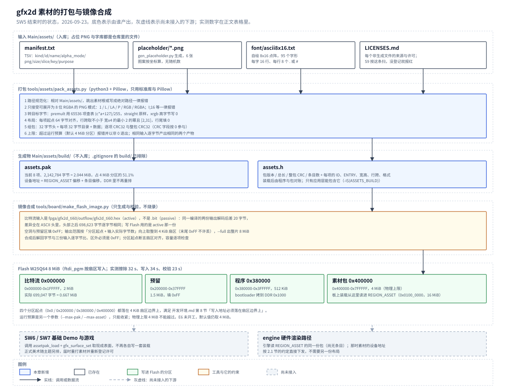
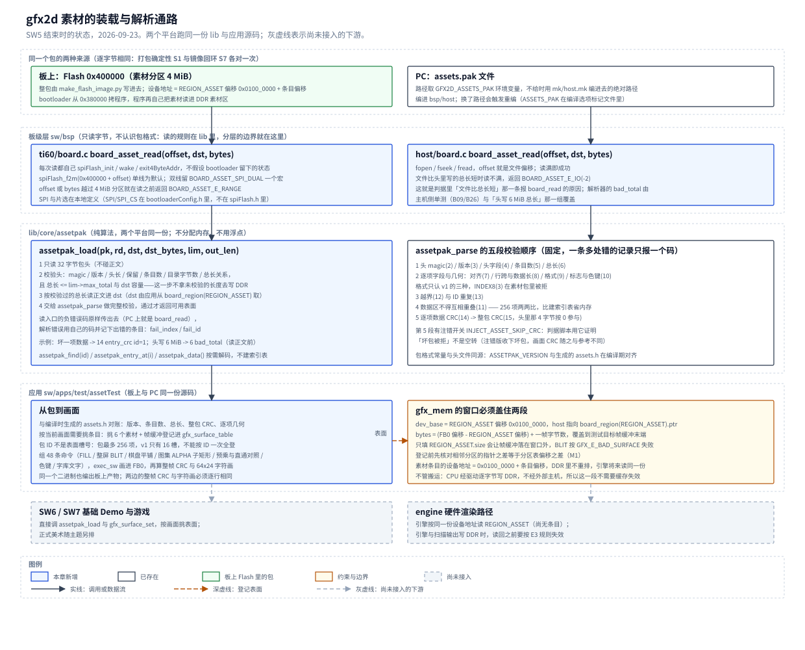

# 04 素材流水线

## 一、动机

本章的板卡是易灵思钛金 Ti60F225：一颗带 RISC-V 硬核（Sapphire SoC，100 MHz）的 FPGA，
板载 DDR3 256 MB，HDMI 输出 640×480@60，板上 Flash 是 Winbond W25Q64，容量 8 MiB。
「素材流水线」指的是把美术资源从原始图片变成屏幕上的像素这条通路：
图片在 PC 上打包成一个素材包，包写进 Flash，板上启动时读进 DDR3，程序按编号取出来当绘图表面用。

[第 02 篇](02-命令表构造层与软件执行器.md) 已经把「一条 32 字节命令怎么画进一个表面」做完了，
[第 03 篇](03-PC平台层与帧节拍.md) 把 PC 侧的场节拍补齐，两边的画面可以用整帧 CRC 逐帧比对。
那些画面里的像素都是程序算出来的：第 02 篇的金标准用例有一张 64×64 的纹理，
内容在 `cases.c` 里现算。按这个办法做游戏，角色、弹幕、背景与 HUD 字库都要写成 C 数组，
改一张图就要重编程序，而且有一件事没有地方交代。

那件事是**预乘的量化偏差**。主路径纹理用 ARGB8888 预乘格式存放，alpha 与颜色在存进去之前
先乘过一次；spec 第 01 章把端到端的偏差算出来过：以非预乘源色的实数混合为基准，
预乘路径在 16777216 组里有 4121020 组不同，最大偏差 254/255。这一章留下一句话，
「换来的偏差要在素材工具里记着」。素材工具指的就是本章要做的东西：
它是唯一知道「这一项是从哪张图、按哪种 alpha 口径转来的」的地方，
统计不出来就没法回答「画面与预期的差是不是预乘造成的」。

这条通路上有三个下游。`SW6` 的基础 Demo 与 `SW7` 的游戏要从这里取图；
`SW9` 的板上移植要把同一份包放到板上并且逐帧 CRC 与 PC 相同；
再往后渲染引擎要按同一份设备地址读这些纹理。三者共用同一个包，
所以包的格式、装载入口与解析规则只能有一份。

做这一步要同时满足几件互相牵制的事：

| 约束 | 来源 | 它排除了什么 |
| --- | --- | --- |
| 绘图表面的行跨必须是 2 的幂 | `gfx_surface_struct_ok()`（第 02 篇） | 按紧凑像素算容量。640×480 的紧凑像素是 1,228,800 字节，按行跨 4096 存放要 1,966,080 字节 |
| Flash 素材分区 4 MiB | 设计文档 2.2 节 | 放 3~4 张独立的全屏整图 |
| 表面表 16 槽 | `gfx_abi.h` 的 `GFX_SURF_N` | 「一个素材一个表面」。包最多 256 项，表面槽只有 16 个 |
| `sdk/` 只读、分层由编译结构保证 | 第 01 篇 | 把包格式与装载逻辑塞进 sdk 驱动，或者让板级层去依赖 `lib/` |
| 不写绝对路径 | 仓库根 README | 把工具安装位置或包路径写进源码与文档 |

这几条决定了工具、解析器与装载入口的形状。本章记录把它们做出来的过程，
包括开工之前先做的一轮实测——那一轮的两个结论（预乘不能用 Pillow 的现成函数、
镜像的比特流输入要用 `.hex` 而不是 `.bit`）如果在实现之后才发现，返工的面积会大得多。

## 二、为什么是这几步

这个工作点拆成八步，顺序由依赖关系定死：

**第一步是取样，不写代码。** 素材是从 PNG 转过来的，转换的每一步都依赖 Pillow 的具体行为：
同一个 PNG 模式读回来是什么、`convert("RGBA")` 对 16 位灰度是缩放还是截断、
有没有现成的预乘函数。这些问题的答案决定工具怎么写，猜错的代价是「打包工具与规格口径
悄悄不一致」——它在 PC 上看不出来，要等到板上同帧 CRC 比对不上才发现。
同样在这一步做的还有容量与装载时间的实算，以及镜像输入到底是哪一份文件。

**第二步把包格式冻住。** 包是工具、解析器与应用三方的接口。它一改，
打包工具与两平台的解析就要同时改，已经写进 Flash 的镜像也要重做。
所以格式连同校验顺序一起定死，并且用**两份独立实现**互相验证：
打包工具写包，校验工具解包并自己从 PNG 重算每一项的像素字节。
只有一份实现时，打包与解包会一起错过去。

**第三步写解析器，放在 `lib/core`。** 它要在两个平台上跑，
所以不能包含任何平台头文件，也不能分配内存（PC 上有 malloc，板上没有）。
放在 `lib/core` 还有一个具体后果：`mk/*.mk` 的库源文件是按 `lib/<库名>/*.c` 一层取的，
它必须是文件而不是子目录，否则既不会被编、也不会被结构判据扫到。

**第四步写打包工具，它是唯一的写入方。** 预乘、色键、行跨、对齐、CRC 都只在这里做一次；
工具还负责把「这一项是从哪张图来的、改动过多少像素」记下来，回答第一节说的那个问题。

**第五步把装载拆成两半。** 板级层会读字节（板上走 SPI Flash，PC 走文件），
但它不认识包格式；解析器认识包格式，但它不认识平台。
第 01 篇给的分层是「bsp 不依赖 lib、lib 不依赖 bsp，只有应用把三者接起来」，
而 2 节又要求「装载入口在读正文之前先校验包头总长」——这条规则属于包格式，
只能在 lib 里。两半的分界线因此落在「读字节」与「决定读多少」之间。

**第六步做镜像合成。** 板上真正跑的那条路是 Flash 启动：bootloader 从 `0x380000`
把程序拷进 DDR 再跳过去，程序自己从 `0x400000` 读素材。
只把程序经 JTAG 写进 DDR 会把这一段绕过去，所以需要一个把比特流、程序与素材
按分区合成一个镜像的工具，写进 Flash 才算验过。

**第七步接进构建。** 生成的 `assets.h` 要能被应用包含，而它不能进 `lib/` 与 `bsp/`：
前者编的时候只有 `-Isw/lib`，后者根本不该知道本项目的素材编号。
两个 `mk` 只给应用那一层的编译规则加一个包含路径，分层不变。

**第八步是判据与注错。** 每一类失败都要有一条能见红的用例：
改一项数据要报出那一项的 ID，改头或目录要按结构错误拒，超预算要退出非 0，
镜像要能解回来逐字节比，许可台账要覆盖每一个非生成文件。
判据本身也要证明不是空转——所以另有一个注错构建，
把两轮 CRC 关掉之后同一个坏包必须被收下。

少一步都不成立：没有第二步，打包与解包互相证明；没有第五步的分界，分层会被打破；
没有第六步，板上那条路径从未被走过；没有第八步的注错，判据可能一直在空转。

八步的量化结果写在第五节。图 1 与图 2 是本章结束时的状态：
前者是打包、生成物与写进 Flash 的分区，后者是板上与 PC 上同一份包的装载、解析与去处。



**图 1** 上半是输入与打包工具：manifest、占位 PNG、自绘字库文本进去，
`assets.pak` 与 `assets.h` 出来。中间是镜像合成的三条输入与它的约束。
下半是 Flash 的四个分区，绿色的是会被写进去的三段，灰色虚线框是还没有接入的下游。



**图 2** 上半是同一个包的两种来源（Flash 与 PC 文件）；中间两层是本章新增的装载与解析，
板级层只读字节、解析器只认识包格式；下半是应用把挑出来的条目登记成表面并画进帧缓冲。
灰色虚线框是还没有接入的下游：`SW6`/`SW7` 的游戏与引擎。

## 三、每一步做了什么

### 3.1 前期研究：取样环境与 PNG 的行为

环境在 2026-09-19 已经记过一次，本步复测并补了两条这次才用到的：

```
$ wsl -e bash -c 'python3 -VV; python3 -c "import PIL,zlib;print(PIL.__version__, zlib.ZLIB_RUNTIME_VERSION)"'
Python 3.14.4 (main, Aug 20 2026, 10:41:58) [GCC 15.2.0]
12.2.0 1.3.1
```

`numpy 2.4.6` 在环境里，但没有用它：打包工具只依赖标准库与 Pillow，
多一个依赖就多一处版本漂移，而 3.2 节的实测说明不需要。另一条是
`Image.getdata()` 在 Pillow 12.2 已弃用（14 移除），工具改用 `tobytes()` 与 `frombytes()`。

把各模式的图存成 PNG 再读回，走真实的解码路径，看 `Image.open(f).convert("RGBA")`：

| PNG 模式 | 读回模式 | 转 RGBA 的结果 |
| --- | --- | --- |
| `1`（二值） | `1` | 黑白，alpha 全 255 |
| `L`（8 位灰度） | `L` | 灰度复制到三个通道，alpha 全 255 |
| `LA` | `LA` | 灰度与 alpha，alpha 保留 |
| `P`（调色板） | `P` | 调色板展开，alpha 全 255 |
| `P` + `tRNS` | `P` | `info["transparency"]` 保留，透明索引的 alpha 为 0 |
| `RGB` | `RGB` | 原样，alpha 全 255 |
| `RGBA` | `RGBA` | 原样，RGBA 逐字节不变 |
| `I;16`（16 位灰度） | `I;16` | **截断到 255**：`[0, 255, 1000, 65535]` 的 R 通道变成 `[0, 255, 255, 255]` |

最后一行是关键。16 位灰度的图不止一张会这样：`I;16` 的 `convert("RGBA")`
既不做缩放也不报错，1000 与 65535 都变成 255，产出一张近全白的图。
这种错在打包环节看不出来（包是合法的、CRC 是对的），要到画面上才发现。
所以工具只接受上表前七种可展开为 8 位 RGBA 的模式，其余一律报错退出。

### 3.2 前期研究：预乘的口径

预乘的口径在 spec 第 01 章定死了：各通道用整数式 `(c × a + 127) / 255` 取整。
先试 Pillow 有没有现成的路径，把 `ImageChops.multiply` 对 65536 组 `(c, a)` 逐一比对：

```
ImageChops.multiply(L,L) 取 65536 组 (c,a)
与 floor(c*a/255) 不同: 0 处
与 round((c*a+127)/255) 不同: 31770 处，首个 (1, 128, 0, 1)
```

它是 `floor(c × a / 255)`，与规格口径在 65536 组里有 31770 组不同，占 48.5%。
最小反例是 `c=1, a=128`：floor 给 0，规格给 1。用它打包，包里的像素值会与
spec 第 01 章的穷举结果、与板上硬件的实现全面对不上。

改用 65536 项查表（索引 `(c << 8) | a`），按 4 字节一组处理 RGBA：

```
640x480 = 307200 像素，纯 python 预乘 0.047 s（660.23 万像素/秒）
违反 c_pm <= a 的像素: 0
```

一张 640×480 只要 47 毫秒，图集的构建时间可以忽略，所以不需要为此引入 numpy。
表本身与 C 侧逐字节对过账：

| 量 | C 侧 `(c*a+127)/255` | python 侧 |
| --- | --- | --- |
| 65536 项表的 CRC32 | `71CE34F8` | `71CE34F8` |
| `c=1, a=128` | 1 | 1 |
| 65536 字节逐字节 | 相同 | |

`round` 口径下 `c_pm > a` 的组合数是 0，与 spec 第 01 章「素材侧的预乘要满足 `src_pm ≤ a`」
自洽（可证：`c ≤ 255` 时 `(255a + 127) / 255` 向下取整仍是 `a`）。
这条校验在打包工具里跑一次，把每张图的改动像素数与最大偏差打进构建日志。

### 3.3 前期研究：包要生成的表面参数能不能被现有代码收下

打包工具产出的每一项最终要经 `gfx_surface_set()` 登记成表面，所以先用手写的 C 探针
把将要生成的那一组参数喂给它，读返回值与 `gfx_surface_struct_ok()`：

| 条目 | 宽×高 | `stride_log2` | 格式 | 结果 |
| --- | --- | --- | --- | --- |
| 背景整图 | 640×480 | 12 | XRGB8888 | `rc=0` |
| 图集 | 128×96 | 9 | ARGB8888_PM | `rc=0` |
| 字库图集 | 128×96 | 9 | XRGB8888 | `rc=0` |
| 弹幕 | 32×32 | 7 | ARGB8888_PM | `rc=0` |
| 直通对照 | 64×64 | 8 | ARGB8888_ST | `rc=0` |
| 最小图块 | 1×1 | 2 | XRGB8888 | `rc=0` |

边界也逐条试过。`stride_log2` 太小（640 宽用 2^11）、`base` 未按 4 字节对齐、
`stride_log2` 低于 2，三种都返回 `GFX_BUILD_BAD_ARG`（-3）。
`INDEX8`（格式 3）在 `gfx_surface_set()` 这一层是收的，但 `gfx_cmd_check()` 的格式匹配
只让 XRGB 与两种 ARGB 当 BLIT 源，用它做纹理会报 `GFX_E_BAD_FORMAT`，
所以 v1 的包不产出格式 3，manifest 写 `index8` 直接报错。

图集的做法也在这一步验过。把一张 128×96 的图集登记成**一个**表面，
再用 `gfx_blit()` 的源坐标取里面的子矩形：

```
图集登记 128x96 ARGB8888_PM sl=9      rc=0
帧缓冲登记 640x480 XRGB8888 sl=12      rc=0
BLIT 子矩形 16x16 COPY                rc=0
BLIT 子矩形 16x16 ALPHA(预乘)          rc=0
BLIT 子矩形 16x16 带色键               rc=0
BLIT ALPHA_STRAIGHT 源是预乘           rc=6（GFX_E_BAD_FORMAT，符合预期）
```

48 个 16×16 的小图共用图集这一个槽，这就是 16 个表面槽够用的原因。
反过来也定下一条：**目录是一项对一个表面**，图集成员不各占一个条目。
成员与图集共用同一段数据区，各成条目时 `[offset, offset+length)` 必然互相重叠，
而校验规则要求把重叠当结构错误拒掉，两处要求会互相打架。

### 3.4 前期研究：容量、装载时间与镜像输入

按行跨规则实算三组配置（头 32 字节 + 每项 32 字节目录 + 每项起点 64 字节对齐）：

| 配置 | 内容 | 合计 | 占 4 MiB |
| --- | --- | --- | --- |
| A | 2 张 640×480 整图 + 图集 + 字库 + 两种弹幕 | 4,035,840 = 3.849 MiB | 96.2% |
| B | 1 张 640×480 整图 + 图集 + 字库 + 两种弹幕 | 2,069,696 = 1.974 MiB | 49.3% |
| C | 256×256 图集 + 字库 + 弹幕 + 粒子 | 316,864 = 0.302 MiB | 7.6% |

一张 640×480 的整图占 `480 × 4096` = 1,966,080 字节 = 1.875 MiB，
4 MiB 分区最多放两张，且放两张就吃掉 96% 的预算。这一组数把「3~4 张独立整图」
排除掉了，首版按 B 配置。目录开销是 32 + 256 × 32 = 8,224 字节。

装载时间只能推算，因为测速的实验（E6）还没开工。按手册给的「124 KB 约 300 ms」
（0.41 MB/s）与单线纯搬移的理论上限 2.1 MB/s 两个口径算：

| 包大小 | 按 0.41 MB/s | 按 2.1 MB/s |
| --- | --- | --- |
| 4 MiB（物理上限） | 约 10.2 s | 约 2.0 s |
| B 配置 1.974 MiB | 约 5.0 s | 约 0.99 s |
| C 配置 0.302 MiB | 约 0.77 s | 约 0.15 s |

两个口径差五倍，真值要等 E6。这里要定下的是**两件事分开**：
4 MiB 是「能放多少」的物理上限，固定在工具里；「运行预算」是另一个参数，
默认取物理上限，E6 出数之后再收紧。判据里「定下更小预算后同样拒绝超预算包」
这一句就是为它留的口子。

镜像的输入是这一步查出来的另一件事。Efinity 编译后 `outflow/` 下同时有 `.bit` 与 `.hex`，
两者都是「每字节一行十六进制」的文本。一开始用按行比对的办法看它们，
得到「最佳偏移 20、632,541 行不同 / 699,027 行」，像是两份不同的比特流。
换成最长公共前缀与后缀再看，结论完全不同：

```
len(bit)=699027 len(hex)=699047 diff=20
LCP=156 LCS=698623  差异窗口: bit[156:404] (248 字节)  hex[156:424] (268 字节)
窗口之后逐字节相同: True（698623 字节）
bit 头: '...Mode: passive\nDie Name: Ti60_MP\nPADDED_BITS: 0...'
hex 头: '...Mode: active \nDie Name: Ti60_MP\n4Byte: 0\nPADDED_BITS: 0...'
```

差别全部在那 248/268 字节的 ASCII 头里：`.bit` 写 `Mode: passive`，是 JTAG 加载用的；
`.hex` 写 `Mode: active` 并多一行 `4Byte: 0`，是写 Flash 用的。
官方那一对 `ddr_demo_ti60.bit/.hex` 是同一个形状。镜像合成要用 `.hex`，
不能从 `.bit` 推出来。当前 `.hex` 解码 699,047 字节 = 0.667 MiB，
2 MiB 的比特流分区还剩 1,398,105 字节。

### 3.5 开工前定下的结论

前期研究落成十八条结论，它们分布在下面各节里，落点是：工具与解析器放在哪个目录
（`tools/` 按用途分三类，素材打包不属于任何一类，另开 `tools/assets/` 并登记；
解析器是文件不是目录，见 3.7、3.8），预乘必须查表并与 C 侧对账（3.2），
输入只收 8 位模式（3.1），色键只与 xrgb 搭配、v1 不产出 INDEX8（3.3、3.7），
`stride_log2` 落在 `[2, 31]`、目录一项对一个表面（3.3、3.6），
物理上限与运行预算分开、镜像输入是 `.hex`、扇区对齐与输出范围（3.4、3.10），
装载入口拆成两半（3.8、4.11），生成的头只给应用层加包含路径（3.11），
字库自绘（3.9），判据脚本（3.12）。

### 3.6 素材包格式

包的结构：

```
偏移            段     内容                                                    长度
+0x000  32 字节  头     magic "G2DP" / 版本 / 头长 / 条目数                      32
                       总长 / 整包 CRC32 / 目录字节数 / 保留
+0x020  目录      每项 32 字节，条目数 x 32 字节，紧跟头                        条目数x32
        ┌ 每项：ID(4) 偏移(4) 长度(4) 宽(2) 高(2) stride_log2(1) 格式(1)
        │       标志(2) 色键字(4) 数据 CRC32(4) 保留(4)
        └ 标志 bit0 = 启用色键，其余位必须为 0；未启用时色键字必须为 0
...(64 字节对齐)  数据  第 0 项：height x (1 << stride_log2) 字节，行尾填 0    长度不定
...(64 字节对齐)  数据  第 1 项：同上
                  ...
```

所有多字节字段固定小端，逐字节拼装，不把缓冲强制转成结构体——两个位宽解出的值必须一样。
未使用的间隙填 0。v1 最多 256 项。CRC32 与 `lib/core/crc32.h` 同参（同 zlib.crc32）：
每项覆盖它完整的数据区，整包覆盖「总长」字节，计算整包 CRC 时把头里那 4 个字节当作 0。

每一项允许的数据形状由几何关系卡死：`width > 0`、`height > 0`、
`stride_log2 ∈ [2, 31]`、`width × 4 ≤ 1 << stride_log2`、`length = height << stride_log2`、
起点按 64 字节对齐且不落在头或目录里、`offset + length` 不越过总长。
标志里只有 bit 0（启用色键）允许为 1；未启用色键时色键字必须为 0；
色键只允许出现在 XRGB 条目上（理由见 3.7 节）。这两层都要查：
打包工具在 manifest 那一层拒绝，解析器在包那一层再拒一次，
因为包可以不经打包工具产生。校验的顺序固定，一条同时有几处错的包只报一个码：

```
assetpak_parse()
   │
   ├─ 1 头：magic(2) / 版本(3) / 头长与保留(4) / 条目数(5) / 目录字节数(4) / 总长(6)
   │      总长还要 ≤ 调用方给的预算（16 MiB DDR 边界或更小的运行预算）
   ├─ 2 逐项字段与几何：偏移对齐(7) / 行跨与数据长(8) / 格式(9) / 标志与色键(10，含色键只配 XRGB)
   ├─ 3 越界(12) 与 ID 重复(13)
   ├─ 4 数据区互相重叠(11)
   ├─ 5 逐项数据 CRC(14) ──→ 报出出问题的那一项：fail_index / fail_id
   └─ 6 整包 CRC(15)
        任一失败都不返回可用于绘图的表面
```

先结构后内容、先逐项后整包，是为了让报错指向正确的地方：数据被改坏时报条目的 ID，
头或目录坏掉时报结构错误。解析器不建索引表，256 项按需解码；
ID 重复与重叠都是两两比较（最多 32640 次），比在栈上放一张 7 KB 的表省。

### 3.7 打包工具

`Main/tools/assets/pack_assets.py`，输入 `Main/assets/manifest.txt`（UTF-8 的 TSV），
输出 `Main/assets/build/assets.pak` 与 `assets.h`。manifest 的每一行是一个素材：
类型（`surf` 一张 PNG 一项表面 / `atlas` 一张 PNG 按网格切 / `font` 点阵字库文本）、
显式 ID、名字、alpha 口径、PNG 路径、期望尺寸、网格单元、色键、用途。

工具做六件事：路径规范化（相对素材根，跳出或写成绝对路径一律报错）、
模式白名单、按 alpha 口径转目标字节、按 64 字节对齐布局、算两级 CRC、
生成头文件。三条实现上的约定：

- 预乘用查表，不能用 Pillow 的现成乘法（3.2 节）。
- 色键只与 `xrgb` 搭配。色键比较的是源表面在内存里的 32 位存储字（spec 第 01 章 3.5 节），
  预乘与直通条目的存储字已经被改过，配上色键语义会漂；manifest 里给这两种口径配色键直接报错。
- 相同输入逐字节产出相同的包与头文件：条目顺序就是 manifest 顺序，产物里没有时间戳、
  没有绝对路径、没有随机数。判据脚本的 S1 就是打两次比逐字节。
- 超过运行预算时报错并返回非 0，预算只能收紧，物理上限 4 MiB 不能越过。

入口上有三条边界，写成最小反例进判据（S1b、S1c，见 3.12 节）：

- **文件名不算数，内容才算数。** 只看 Pillow 解码出来的模式不够：把 JPEG 命名成 `.png`
  一样会被读进来。工具同时要求 `Image.format == "PNG"`。
- **字库的注释行限定为「`#` 后跟空白」。** 起初把所有 `#` 开头的行都当注释，
  于是 `#.......` 这种合法的像素行会被吞掉，字库少一行、字形整体错位。
  改成「`#` 单独一行或 `#` 后跟空白」才算注释，行首像素可以正常打包。
- **宏名也要查重。** 素材名只查原字符串唯一时，`foo` 与 `FOO` 都合法，
  但生成的 C 宏都是 `ASSET_FOO`，头文件里会撞成宏重定义。改成按最终的大写宏名查重。

`assets.h` 里是包版本、总长、整包 CRC、条目数，以及每一项的 ID、包内序号、宽高、
行跨、格式、长度与图集的网格参数。装载之后程序用它跟包对账，
防止单独更新 Flash 素材区之后程序仍按旧的编号解释新包。

### 3.8 解析器与两段式装载

解析器 `sw/lib/core/assetpak.{c,h}` 是上一节那套规则与校验顺序的实现，
另有四个接口：`assetpak_entry_at()`、`assetpak_find()`、`assetpak_data()`、`assetpak_stride()`。
它不分配内存、不用浮点、不包含任何平台头文件。

装载规则放在这里，读字节的能力放在板级层。两半接起来的形状：

```
         应用（唯一同时看得到两边的地方）
           │
           ├─ board_mem m = board_region(REGION_ASSET);        ← 分区的指针与大小
           └─ assetpak_load(&pak, board_asset_read, m.ptr, m.size, &lim, &len)
                    │
        lib/core    │  1 读 32 字节包头 → 校验头与总长 ≤ 预算、≤ dst 容量
                    │  2 按校验过的总长读正文进 dst → assetpak_parse 完整校验
                    │
        bsp         └─ board_asset_read(offset, dst, bytes)   ← 只读字节，不认识包格式
                         ti60：spiFlash_f2m(0x400000 + offset)
                         host：fopen / fseek / fread，路径取 GFX2D_ASSETS_PAK
```

板级层的接口是 `board.h` 里的 `int board_asset_read(uint32_t offset, void *dst, uint32_t bytes)`，
offset 相对素材分区起点（板上再加 Flash 的 `0x400000`），
越过分区返回 `BOARD_ASSET_E_RANGE`。ti60 的实现每次读都自己走一遍
`spiFlash_init / wake / exit4ByteAddr`，不假设 bootloader 跑完之后外设还保持着它留下的状态；
默认单线，双线留一个编译期宏。

顺序上有一件事是硬的：**先读包头、校验过总长，才按总长读正文**。
它保证不会拿一个未经校验的长度去写 DDR3。

应用这一侧还有一个边界容易写错：软件执行器的 `gfx_mem` 窗口要同时盖住素材区与目标帧缓冲。

```
dev_base = REGION_ASSET 偏移 0x0100_0000，host 指向 board_region(REGION_ASSET).ptr
   0x0100_0000 ┌──────────────────────────┐ ← 素材条目的设备地址落在这里
               │  素材包（≤ 4 MiB）        │
   0x0200_0000 ├──────────────────────────┤ ← 帧缓冲 0，BLIT 的目标
               │  一帧 480 x 4096 字节     │
               └──────────────────────────┘
   bytes = (FB0 偏移 - REGION_ASSET 偏移) + 一帧字节数 = 18,743,296

   只填 REGION_ASSET.size（16 MiB）时帧缓冲落在窗口外，BLIT 按 GFX_E_BAD_SURFACE 失败
```

登记的素材表面用 `0x0100_0000 + 条目偏移` 当设备地址，DDR 里不重排，
将来引擎读的是同一份地址。

这段搬运由 CPU 自己经 SPI 驱动逐字节写 DDR3，没有外部主机参与，
所以 [platform 第 05 章](../platform/05-CPU数据缓存与第二个主机写入的一致性.md) 的
「读回共享区之前必须失效」在这一段不适用：本构型没有写缓冲，CPU 的写返回前已经落到 DDR，
写完立刻读回也不会读到旧值（那一章的 T1、T3、T6）。这条路径因此不加失效调用——
追加一次 16 MiB 的逐行失效按 T11 的单行代价算是百万级周期，而收益为零。
将来若改成由引擎用 DMA 预取素材，那时必须按同一章的条件把失效加回来。

### 3.9 占位素材与字库

`Main/tools/assets/gen_placeholder.py` 生成六张占位图：棋盘小块（128×128）、
渐变背景（640×480）、图集（128×96，48 个 16×16 格子）、圆形弹幕（32×32）、
色键图（32×32，只有 alpha 0 与 255 两种）、8×8 小块。图案全部按坐标算出来，
没有随机数，同一个 Pillow 版本产出逐字节相同的 PNG。这些 PNG 入库，
打包不必先跑生成器；生成物与手工素材一起受许可台账管，但生成物不登记。
`--check` 用同一份绘制代码重算六张图的逐像素内容与入库文件比对，
参数用严格解析：拼错一个开关就报错退出，不会静默转成生成模式（S1c）。

字库是自绘的 8×16 点阵，95 个字形（ASCII `0x20`~`0x7E`）。
来源查过：本仓 `Main/` 下没有点阵或矢量字库，7 GB 的厂商资料包里也没有 `.ttf`/`.bdf`/`.fnt`。
选外部 CC0 字库要额外核对许可、还要保证离线可得，自绘把这两件事一起去掉。
字形以文本形式入库 `Main/assets/font/ascii8x16.txt`：每个字形 16 行、
每行 8 个 `.` 或 `#`，最左的字符是最高位；打包工具把它渲染成 128×96 的图集
（16 列 × 6 行 = 96 格，用 95 格）。字库不是流水线的关键路径——占位图块就能验完整条通路——
但 `SW6` 的 HUD 要用它。

### 3.10 Flash 镜像合成

`Main/tools/board/make_flash_image.py` 把三段合成一个镜像：

| 分区 | 地址范围 | 大小 | 内容 |
| --- | --- | --- | --- |
| 比特流 | `0x000000`–`0x1FFFFF` | 2 MiB | `outflow/gfx2d_ti60.hex` 解码后的字节（含它自己的 ASCII 头） |
| 预留 | `0x200000`–`0x37FFFF` | 1.5 MiB | 填 `0xFF`，不计入素材容量 |
| 程序 | `0x380000`–`0x3FFFFF` | 512 KiB | 应用的 bin，bootloader 从这里拷到 DDR `0x1000` |
| 素材包 | `0x400000`–`0x7FFFFF` | 4 MiB | `assetpak` 包 |

四个起点都断言落在 4 KiB 扇区边界上。输出是 Programmer 接受的每字节一行十六进制文本，
范围按「分区起点 + 输入实际字节数」向上取整到扇区，**不按最后一个非 `0xFF` 字节截断**：
有效输入本身可以以 `0xFF` 结尾，按内容截断会把那个字节丢掉。`--full` 出整片 8 MiB。
合成后解回字节与三份输入逐字节比，并检查区外全是 `0xFF`。
工具只生成与校验，不烧录。

输入一侧另有三条防呆：`--app` 必填（防止出一个程序区全是 `0xFF` 的镜像）、
输出路径不许与任一输入相同（防止覆盖掉刚读进来的文件）、
以及**检查比特流头部写着 `Mode: active`**——`.bit` 与 `.hex` 都是同样格式的十六进制文本，
只是头部一行不同，按行解码时两者都能读进来，只有查这一行才能发现拿错了文件（S8d）。

### 3.11 构建集成

`assets.h` 落在 `Main/assets/build/`（`.gitignore` 的 `build/` 模式已排除它）。
两个 `mk/*.mk` 给**应用**那一层的编译规则加 `-I$(ASSETS_BUILD)`，
`lib/` 与 `bsp/` 那一层不加，第 01 篇的分层不变。
`lib/core/assetpak.h` 只放通用格式与解析器，本项目的素材编号只在 `assets.h` 里。

PC 的包路径由 `mk/host.mk` 编进 `bsp/host`，运行时可以用 `GFX2D_ASSETS_PAK` 覆盖，
判据脚本用它喂坏包。这里有两处必须一起做对：编进去的路径取绝对路径，
而且 `ASSETS_PAK` 要进编译选项标记文件（4.8、4.9 节）。

### 3.12 判据程序与检查脚本

判据程序 `sw/apps/test/assetTest/` 一份源码编两个平台。它跑完整条通路：
经板级读入口把包装进 DDR 素材区、完整校验、与 `assets.h` 对账、
**按当前画面需要挑** 6 个素材加帧缓冲登记进表面表（包 ID 不是表面槽号）、
组 48 条命令画一整帧、算整帧 CRC 与一个 64×64 窗口的 CRC，
最后打印一张 64×24 的字符画。字符画是从帧缓冲按固定步长采样得到的，
两个平台逐字节相同，是留档的那张可以目视核对的图。

判据脚本 `Main/tools/check/check_sw5_assets.sh` 把它与其余几条串起来，
另有 `check_sw5_pak.py` 做包的独立实现：它自己按字节格式解头与目录、
自己按 manifest 从 PNG（含预乘、直通、色键三种口径）与字库文本重算每一项的像素字节，
再与包逐字节比。它输出与 C 侧同格式的逐项行，脚本把两边 diff 一次。

坏包的七种注错各有一条用例，都基于正式产物改一处：

| 注错 | 期望 |
| --- | --- |
| 第 0 项数据翻一位 | `14 entry_crc id=1`，报出条目 ID |
| magic 被改 | `2 bad_magic` |
| 目录里的行跨被改 | `8 bad_geom id=1` |
| 文件比头里写的总长短 | `2 board_read`（读入口读不满声明的长度） |
| 两项数据区重叠 | `11 overlap id=2` |
| 条目起点越出包末端 | `12 out_of_bounds id=1` |
| 头里写 6 MiB 总长、文件只有 32 字节 | `6 bad_total`，必须在读正文之前拒 |

最后一条是这条判据的价值所在：它同时验了「超预算被拒」与「拒绝发生在读正文之前」。
如果实现先信总长再去读，报的会是读入口的错误，或者更糟——按 6 MiB 去写 DDR。

判据要能见红，所以另有一个注错构建 `INJECT=ASSET_SKIP_CRC`：解析器跳过两轮 CRC 校验。
同一个坏包在正常构建里报 `entry_crc`，在注错构建里被收下、画面 CRC 随之与参考不同。
没有这一条，前面的七种注错可能一直是空转。

除坏包之外还有三类入口反例：打包工具的输入边界（字库行首是 `#` 的像素行、
扩展名伪装成 `.png` 的 JPEG、只差大小写的两个素材名，S1b）、
占位图生成器与入库 PNG 的逐像素一致（S1c）、
镜像工具拿到 passive `.bit` 时必须报错（S8d）。
解析器自己在主机侧单测里有 26 处注错，逐条报出指定的错误码；
它与判据脚本的分工是：单测覆盖「同一份实现的所有规则」，
脚本覆盖「真产物走完整条通路」。

### 3.13 板上验收

板上的路径要真的走一遍 Flash 启动。为此给 `tools/board/board_run.py` 加了一个模式
`--flash-boot`：先开串口、再烧比特流，SoC 复位后 bootloader 自己从 `0x380000`
把程序拷进 DDR 并运行。`--bin` 那条路会把程序经 JTAG 直接写进 DDR，
把要验的 Flash 启动段绕过去。这一模式不用 OpenOCD——配置完 FPGA 的那一刻
SoC 就复位并开始打印，晚开串口就会丢掉开头。

流程是：整片读出 Flash 备份 → 合成镜像 → `ftdi_pgm` 写进 Flash → `--flash-boot` 采集串口。
破坏素材那一组单独写素材分区（`--address 0x400000`），写完再启动；复核完把好包写回去。

## 四、遇到的问题

### 4.1 包头预检拿 32 字节去比头里的总长，必然失败

**第一现场。** 主机侧单测第一次跑，`probe_header` 那一组：

```
A1 probe_header 合法包 expect=ok got=bad_total FAIL
A1 probe 总长与条目数 FAIL
A2 parse 合法包 expect=ok got=ok ok
```

**解读。** 同一个包交给 `parse` 通过、交给 `probe_header` 报 `bad_total`。
`bad_total` 只有两个来源：`total > len`（调用方给的可读字节数不够）与
`total > lim->max_total`（超过预算）。这一组的 `max_total` 是 16 MiB，
包只有 196 字节，所以只能是第一个。而 `probe_header` 的调用者手里**只有** 32 字节包头——
它存在的意义就是「正文还没读，先判断要不要读」，所以这个比较永远不成立。

**定位。** 两个入口共用一段头校验（这是有意的：规则不能在两边漂移），
而「总长与可读长度比」这一条只对拿到完整缓冲的 `parse` 成立。
把 `len` 参数的含义在两种调用里当成同一个，是这个 bug 的来源。

**根因与修法。** `check_header()` 加一个 `have_body` 参数：
`probe_header` 传 0，只校验头字段自洽与「总长不超过预算」；
`parse` 传 1，才比较 `total` 与 `len`。原判据没有覆盖到它，是因为
写判据时只想着「解析一个完整缓冲」，没有单测预检这一步——
后来补的 A1 与 B28 两条就是补这个缺口，B09/B26 覆盖 `parse` 那一侧。

### 4.2 单测自己把「传入长度」传成了头里写的总长

**第一现场。** 修完 4.1 之后，注错循环里的一条：

```
B09 总长超过传入长度 expect=bad_total got=pack_crc FAIL
```

**解读。** 这一条注错把头里的总长改成比缓冲还大的数（576 > 512），
本意是「调用方手里没有那么多字节」。但测试把 `len` 也传成了头里那个 576，
于是长度检查通过、目录也通过，最后倒在第 6 段的整包 CRC 上——
`build()` 在总长超出缓冲时会跳过 CRC 计算，那个字段留着 0，当然对不上。

**定位。** 判据写错与实现写错一样会误导人：`got=pack_crc` 看起来像
「整包 CRC 算错了」，而实际是输入构造得不合法。

**根因与修法。** `len` 取「调用方手里最多有多少字节」，也就是 `min(total, BUF_BYTES)`；
这样 576 那一组就落在「总长超过传入长度」上。这条判据现在同时覆盖两种情形：
头里的总长比实际可读的多（B09），与传入长度比头里的总长少一个字节（B26）。
原判据没有覆盖到它，是因为它自己就是判据的一部分——
教训是构造坏输入时也要把「这个输入坏在哪一处」想清楚。

### 4.3 `need()` 的消息是立即求值的

**第一现场。** 打包工具第一次跑完整 manifest：

```
Traceback (most recent call last):
  File ".../pack_assets.py", line 441, in main
    "name %s 重复（id %d 与 %d）" % (it.name, seen_name.get(it.name), it.id))
TypeError: %d format: a real number is required, not NoneType
```

**解读。** `need(cond, msg)` 的两个参数在调用前都会求值，
所以即使 `cond` 为真、这次没有重复，消息里的 `seen_name.get(it.name)`
仍然会执行并返回 `None`，格式化直接抛异常。报错发生在「一切正常」的那一次运行里。

**定位。** 重复检查的两处——ID 与名字——都用了同一个写法。
其余 `need()` 调用里的消息不依赖尚未建立的状态，所以只有这两处炸。

**根因与修法。** 这两处改成显式 `if`，把取表值放进真正要报错的分支里。
原判据没有覆盖到它：打包工具自己的错误路径当时还没有判据，
这一次是主流程跑通的第一步就暴露了。

### 4.4 字库图集的第 96 格没有字形，alpha 留在 0

**第一现场。** 打包报：

```
ERROR: 无色键的 xrgb 要求 alpha 全 255，(120,80) 是 0
```

**解读。** `(120,80)` 落在字库图集的最后一格。图集是 16 列 × 6 行 = 96 格，
而 ASCII 可打印字符只有 95 个，最后一格空着。渲染字库时只给 95 个字形写了像素，
空着的那一格保持着缓冲区的初值——alpha 0。而这一项的 alpha 口径是 xrgb 且没有色键，
规则要求这种条目的 alpha 全 255，于是越界检查把它抓住了。

**定位。** 报错位置精确到像素，指向的就是唯一没有字形的那一格。
这一条也说明校验有用：如果规则写成「不检查 alpha」，空格子的 alpha 0
会在 BLIT 时被当成透明像素，字库背景上会出现一个看不见的洞。

**根因与修法。** 整个图集按不透明的黑 `(0,0,0,255)` 初始化，
再往上画字形；未用到的格子也是不透明的黑，绘图时靠色键 `0x00000000` 跳过。
原判据没有覆盖到它——这一条正是判据抓出来的，属于新加规则生效的第一次。

### 4.5 独立校验工具自己把 xrgb 的高字节算成了 0xFF

**第一现场。** `check_sw5_pak.py` 对正式产物报：

```
FAIL 第 3 项像素字节与独立重算不符，首个不同在偏移 3（包 00 期望 FF）
```

**解读。** 第 3 项是字库图集。偏移 3 是第一个像素的第 4 个字节，也就是 alpha 位置。
包里的值是 `00`，校验工具期望 `FF`。字库的来源图 alpha 是 255，
但 2.1 节写死了「xrgb 的最后那一字节写 0」，所以包里的 `00` 是对的。

**定位。** 打包工具的中间表示（RGBA）与落盘表示（BGRA，xrgb 时高字节 0）在
校验工具里被混成了一层：它一边按规格写 B、G、R，一边把来源的 alpha 255 写进了第 4 个字节。

**根因与修法。** 校验工具的 xrgb 分支只在有可见像素时写前三个字节，
第 4 个字节保持初值 0。这一条的价值在于它演示了为什么要两份实现：
错的这一份先被另一份抓住，而两份都由同一个人写也会犯不同的错。
原判据没有覆盖到它——它本身就是判据，是被测代码与判据之间的分歧暴露了它。

### 4.6 `assetTest` 的一条自检恒不相等

**第一现场。** 判据程序第一次跑：

```
chk C1 全部命令都被构造层接受 FAIL
list used/cap=48 32768
```

**解读。** 48 条命令都进了表、`used=48`，执行器也没有报错，命令显然是全被接受的，
可这条自检失败了。写法是把每个 `gfx_fill`/`gfx_blit` 的返回值累加起来，
再与 `list.used` 比较——而成功的返回值全是 0，累加结果是 0。

**定位。** 自检的意图是「有没有哪次追加被拒」，实现却写成了「返回值的和等于表里的条数」。
判据脚本里 `fail 0` 会掩盖这种错误吗？不会——它直接让 `fail` 变成 1，
只是原因指向了错的地方。

**根因与修法。** 改成统计返回码非 0 的调用次数，再与构造层自己的 `rejected` 一起判断。
原判据没有覆盖到它：这条自检是新写的，第一次运行就暴露了。

### 4.7 判据脚本对「文件比总长短」期望的码写错

**第一现场。**

```
S5d 截断到 100 字节 期望错误码 6，实际：pak err 2 board_read id=0 FAIL
```

**解读。** 期望的是解析器的 `bad_total`(6)，实际报的是板级读错误 `board_read`(-2)。
两种都有道理：文件只有 100 字节而头里写着 2 MiB，`board_asset_read` 读不满声明的长度，
返回 `BOARD_ASSET_E_IO`；解析器根本没有机会看到不完整的缓冲，
因为装载是按校验过的总长去读的。

**定位。** 这条判据想覆盖的是「截断」，而截断在 PC 上表现成读失败、
在板上表现成读到 `0xFF` 填充（Flash 分区总是有那么长）之后整包 CRC 不符。
解析器自己的 `bad_total` 在装载路径上不可达，它由主机侧单测与
「头写 6 MiB 总长」那一组覆盖。

**根因与修法。** 期望改成 `2 board_read`，并在脚本注释与正文里写明分工。
原判据没有覆盖到它——这一条是期望值写错，不是实现错；
判据脚本自己也属于「要写对」的部分。

### 4.8 host 的默认包路径是相对路径，换个目录跑就找不到包

**第一现场。** 判据脚本从仓库根跑判据程序：

```
$ cd <REPO> && SDL_VIDEODRIVER=dummy Main/sw/apps/test/assetTest/build_host/assetTest
assetTest SW5
pak err 2 board_read id=0
fail 1
```

**解读。** 同样的二进制在应用目录下跑是好的，换到仓库根就报读失败。
`board_read` 是板级读入口的错误，说明文件没打开或没读满。
路径是编译期编进 `bsp/host` 的，所以差异只能来自「那个路径字符串是相对的」。

**定位。** `mk/host.mk` 里写的是 `$(SW)../assets/build`。`$(SW)` 由
`MK_DIR`（最后一个 makefile 的路径）推出：应用在自己的目录里 include `../../../mk/host.mk` 时，
它展开成 `../../../../assets/build`——相对于**当次构建的当前目录**成立，
编进二进制之后却要相对于**运行时的当前目录**成立。

**根因与修法。** 编进去的默认路径取 `$(abspath ...)`。
原判据没有覆盖到它：判据脚本自己是从仓库根调用的，
而手工验证时都在应用目录下跑，两边都没有交叉过。

### 4.9 换包路径不会触发重编，`board.o` 留着上一个路径

**第一现场。** 修 4.8 时改完 `mk/host.mk` 再跑，行为没变。

**解读。** `host.mk` 的编译选项标记文件里只记了 `$(BASE)`（警告与优化选项），
`ASSETS_PAK` 不在里面。改这个变量既不触发清理、也不触发重编，
`bsp/host/board.o` 是上一次编的，里面还是旧路径。

**定位。** 这个坑仓库里踩过一次（第 01 篇 4.8：`make INJECT=...` 只重链不重编），
当时的修法是「记住上一轮的编译选项」，而后来新增的、用 `-D` 传进 C 代码的变量
没有跟着进标记串。

**根因与修法。** 标记串改成 `$(BASE) $(ASSETS_PAK)`。
原判据没有覆盖到它：第 01 篇的判据只查「改头文件要重编并重链」，
它用的是头文件时间戳，与本条无关。

### 4.10 sdk 的 `spiFlash.h` 里有三个声明了却没定义的 static 函数

**第一现场。** 板上构建：

```
../../../bsp/ti60/board.c:71:19: error: 'SPI' undeclared (first use in this function)
../../../bsp/ti60/board.c:91:18: error: 'SPI' undeclared (first use in this function)
In file included from ../../../bsp/ti60/board.c:25:
../../../../sdk/software/standalone/driver/spiFlash.h:93:13: error: 'spiFlash_init_mode' declared 'static' but never defined [-Werror=unused-function]
../../../../sdk/software/standalone/driver/spiFlash.h:111:13: error: 'spiFlash_enable_quad_access' declared 'static' but never defined [-Werror=unused-function]
```

**解读。** 两组错。第一组是 `SPI` 与 `SPI_CS` 未定义——它们定义在 bootloader 的配置头
`bootloaderConfig.h` 里，`spiFlash.h` 自己没有；照抄 bootloader 的调用顺序时把这两处一起抄漏了。
第二组来自 sdk 的头文件：`spiFlash_init_mode` 与 `spiFlash_enable_quad_access` 只有声明，
定义在 `#if defined(MX25_FLASH)` 之类的分支里，本构型一个分支都不走。

**定位。** sdk 头文件是按 `-isystem` 引入的，第 01 篇的约定是
「上游头文件里用不到的 static 函数不该打断项目的零告警判据」。
可这一条诊断没有按系统头被压住。试过两种常规办法：把 include 包在
`#pragma GCC diagnostic push/ignored/pop` 里——无效。
原因是「声明了 static 却从未定义」是在翻译单元结束时按**当时**的 pragma 状态发出的，
包住 include 的那段状态已经弹回去了。

**根因与修法。** 两处分别处理：`SPI`/`SPI_CS` 在 `bsp/ti60/board.c` 里按自己的名字
（`ASSET_SPI`、`ASSET_SPI_CS`）本地定义，不包含 bootloader 的配置头；
`-Wunused-function` 对整个文件关掉，并在文件里写明为什么只能这样、代价是什么
（这个文件里的 static 都被用到）。sdk 是只读的，不能去补它的头文件。
原判据没有覆盖到它：板上构建的判据第 02 项查的是「应用 include sdk 头文件要编不过」，
方向相反，管不到 bsp 这一层包含 sdk 头文件的告警。

### 4.11 按开工前定的签名写装载入口会破坏分层

**第一现场。** 这一条没有错误输出，它是在写代码之前画接口时发现的。按 2 节定的
`int board_asset_load(uint32_t *out_len)`，这个函数要放在 `bsp/` 里，
而它必须先读 32 字节包头、再按校验过的总长读正文。
「校验总长」这条规则属于包格式，实现在 `lib/core/assetpak` 里。

**解读。** 两条约束撞在一起：第 01 篇的分层是「`bsp/` 不依赖 `lib/`、
`lib/` 不依赖 `bsp/`，只有应用把三者接起来」（分层由头文件路径保证，
给 `bsp/` 加 `-Isw/lib` 就破了它）；而步骤要求「读正文之前先校验总长」。
按原签名实现，要么让 `bsp/` 包含 `lib/` 的头文件，要么在 `bsp/` 里再写一份头校验——
后者会让同一条规则存在两份，正是第 01 篇反复强调要避免的。

**定位。** 把「装载」拆开看：它由「决定读多少」与「把字节读出来」两件事组成。
前者需要认识包格式，后者只需要一个偏移与长度。按这个缝切下去，
两半各自落在正确的一层，而应用本来就同时看得到两边。

**根因与修法。** 定成 `assetpak_load(pk, rd, dst, dst_bytes, lim, out_len)` 加
`board_asset_read(offset, dst, bytes)`，`dst` 由应用从 `board_region()` 取——
应用经这个接口拿分区，代码里不出现物理地址。判据一个字没变：
仍然是「先读 32 字节包头、校验过总长才读正文」，第 3.12 节的 S5g 就是它。
原判据没有覆盖到它：这是接口形状的取舍，判据覆盖的是行为。

### 4.12 `--flash-boot` 插在了 `--dry-run` 之前

**第一现场。** 加完新模式之后用 `--flash-boot --dry-run` 试，它直接去烧板子了。

**解读。** `board_run.py` 的流程是「先处理 `--dry-run` 打印计划并返回」，
新的分支被插在它前面，`--dry-run` 那条路径被跳过。
这类工具一旦「本该只打印却真的动了板子」，代价是几分钟和一次 Flash 写入。

**定位。** 插入位置选在了 `load_cmds` 之后、`if args.dry_run:` 之前。
新分支条件里没有排除 dry-run。

**根因与修法。** 分支条件加 `and not args.dry_run`，让它落到下面原来的打印里，
并用 `--flash-boot --dry-run` 验过一遍。原判据没有覆盖到它：
`board_run.py` 属于工具，进提交前检查的是它的使用者（判据脚本），
工具自身的参数组合没有判据——这一条是按「这个工具会动硬件」的经验补的。

### 4.13 字库解析把所有 `#` 开头的行都当注释

**第一现场。** 最小反例是把第二个字形的首行改成 `#.......`（合法像素行）再打包。
把工具在副本里退回修正前的写法重跑，输出是：

```
ERROR: font/_tmp2_hash.txt 有 1519 行数据，应为 1520（95 个字形 × 16 行）
```

**解读。** 报错落在「行数不对」上：那一行被当成注释吃掉，总量从 1520 变成 1519。
规则本身挡住了它，所以后果是拒绝打包。这里值得注意的是挡住它的那条检查
（数据行数必须正好是 95 × 16）与真正的缺陷无关——如果当时写的是「至少 95 个字形」
或者按顺序取前 95 组，字库就会整体错位一行，每个字形的像素都跑到上一个字形里去。

**定位。** 注释的判定写成「以 `#` 开头」，而字库的像素字符集恰好是 `.` 与 `#`，
行首出现 `#` 是合法的。判据（S1b）用这一条反例把它逼出来。

**根因与修法。** 注释限定为「`#` 单独一行，或 `#` 后跟空白」，行首像素照常解析。
原判据没有覆盖到它：判据只验过正常字库能打包，没有构造过行首是 `#` 的合法字形。

### 4.14 PNG 入口只看解码后的模式，扩展名伪装的 JPEG 被接受

**第一现场。** 把一张 8×8 的 JPEG 命名成 `.png` 放进 `placeholder/`，
manifest 指向它，退回修正前的写法重跑：

```
rc=0  pack_assets: 8 项，2142784 字节 = 2.044 MiB，占 4 MiB 分区的 51.1%
      pak crc32 0x0A62AD22
```

**解读。** 打包成功。Pillow 按内容识别格式，JPEG 一样能解成 `RGB`，
模式白名单放行，这张图的像素就进了包。它本身还不是灾难（图确实是一张图），
但「素材目录里的文件到底是什么格式」从此不可控：一张 16 位或 `CMYK` 的图
换个扩展名也能进来，3.1 节那些关于模式的结论随之落空。

**定位。** 检查只看了 `im.mode`，没有看 `im.format`。判据（S1b）用这一条反例逼出来。

**根因与修法。** 同时要求 `Image.format == "PNG"`，独立校验工具用同一约束。
原判据没有覆盖到它：判据里的素材都是自己生成的 PNG，
没有「内容与扩展名不一致」这一类的用例。

### 4.15 素材名只查原字符串唯一，`foo` 与 `FOO` 生成同名宏

**第一现场。** manifest 里放两行只差大小写的素材名，退回修正前的写法重跑：

```
rc=0  pack_assets: 9 项，2143040 字节 = 2.044 MiB
      pak crc32 0xA94880F4
生成的宏名重复行数：14（前两行：#define ASSET_FOO_ID 8u | #define ASSET_FOO_ENTRY 7u）
```

**解读。** 打包成功，但生成的头文件里 `ASSET_FOO_*` 各出现两次、值不同
（一次指向第 8 项，一次指向第 9 项）。宏名是 `name.upper()`，
而查重比的是原始字符串。这个错会在**应用构建**时才暴露：同一个宏在同一个翻译单元里
被重定义，project 又是 `-Werror`，于是报错的位置离原因很远。

**定位。** 查重与生成用了两套名字。判据（S1b）用这一对名字逼出来。

**根因与修法。** 查重按最终的大写宏名做。原判据没有覆盖到它：
判据里的名字都是手写的，本来就不重复。

### 4.16 镜像工具不查比特流的模式，passive `.bit` 被当成 active `.hex` 接受

**第一现场。** 把 `outflow/gfx2d_ti60.bit` 当 `--bit` 输入，退回修正前的写法重跑：

```
rc=0  make_flash_image: 输出 flash_old.hex
      镜像 6340608 字节 = 6.047 MiB
```

**解读。** 合成成功，回环校验也通过——回环比的是「输出与输入」，
输入本身是 passive 流它并不知道。写进 Flash 的会是一份 passive 镜像，
板子上电后大概率不启动，而现象与「Flash 坏了」难以区分。

**定位。** `.bit` 与 `.hex` 是同一种十六进制文本，逐行解码时两者都能读进来，
唯一的区别是头部的 `Mode:` 一行。3.4 节把这条结论写进了文档，
工具里却没有对应的检查。判据（S8d）用 `.bit` 当输入把它逼出来。

**根因与修法。** 合成前检查头部前 512 字节里有一行 `Mode: active`，不是就报错退出；
同时把 `--app` 改成必填、并禁止输出覆盖任一输入。
原判据没有覆盖到它：判据一直喂的是正确的 `.hex`，从没喂过 `.bit`。

### 4.17 解析器没有限制色键只能用于 XRGB

**第一现场（按复核记录还原）。** 单测里为这一条新加的注错，
把一个预乘条目的标志位设成「启用色键」并给它一个键值：

```
B12a 预乘条目不能带色键 expect=bad_flags got=bad_flags ok
```

修正之前这一个用例得到的是 `ok`（不该拒绝的拒了、该拒的没拒）。

**解读。** 解析器原来只查了两件事：标志位不许越界、没有标志时键值必须为 0。
「有标志、也有键值、而格式是预乘」这一种漏了。理由在 3.7 节：
色键比的是源表面的 32 位存储字，预乘条目的字已经被改过，配上色键语义会漂。

**定位。** 打包工具那一层早就拒绝这种组合，所以缺口只在「包不经打包工具产生」
这条路径上——而校验这类包正是解析器存在的理由。

**根因与修法。** 字段检查加一条：启用色键必须是 XRGB 格式。
原判据没有覆盖到它：单测原有 25 条注错覆盖了标志与键值的组合，
漏了「格式」这一维；这一条是复核时按规格条款反推出来的。

### 4.18 `assetTest` 用两个不同对象的指针相减

**第一现场（按复核记录还原）。** 复核读到的是这一段：

```c
(uint32_t)((const uint8_t *)fb0.ptr - (const uint8_t *)asset.ptr) == fb_dev - asset_dev
```

**解读。** `fb0.ptr` 与 `asset.ptr` 指向同一块模拟 DDR 里的两个区域，是两个不同的对象。
C 标准只允许同一对象内部的两个指针相减，跨对象相减是未定义行为。
当前编译器上它给出期望的差值，换成别的优化级别或目标就没有保证；
它出现在判据程序的自检里，一旦被优化掉这条自检就失去意义。

**定位。** 复核按「这不是同一个对象的指针差」发现。地址之差本来要表达的是
「两个分区的相对位置」，那个量应该用无符号整数表示。

**根因与修法。** 两边先转 `uintptr_t` 再相减。原判据没有覆盖到它：
判据在 PC 上用 `-O2` 编，这个写法当时的表现是对的。

### 4.19 占位图生成器忽略未知参数

**第一现场（按复核记录还原）。** 参数处理原来写成
`check_only = "--check" in sys.argv[1:]`。把 `--check` 拼成 `--checkk` 时，
脚本既不报错也不进校验分支，直接走生成分支并返回 0。

**解读。** 判据脚本里这一条会「通过」，而实际发生的是重写入库的 PNG。
这是「工具静默做了另一件事」的典型：调用方以为在校验，工具在生成。

**定位。** 复核逐条读工具的入口参数处理时发现。

**根因与修法。** 换成 `argparse`，未知参数由它报错退出；
判据（S1c）把「未知参数必须被拒」也列成一条。原判据没有覆盖到它：
判据调用生成器时参数都是对的。

### 4.20 `assetTest/Makefile` 的板上构建示例漏写 `PLATFORM=target`

**第一现场（按复核记录还原）。** makefile 注释里的板上构建命令写成
`make RISCV_BIN=<RISCV_BIN>`，而这个应用的 `PLATFORM ?= host`，
照抄只会再构建一次 PC 版，产物落在 `build_host/` 而不是 `build/`。

**解读。** 这类错误没有运行期症状：命令返回 0，产物是新的、只有优化级别的名字一样，
只是它不是板上产物。判据脚本用的是显式的 `make PLATFORM=target`，
所以判据一直是过的，错的只有给人看的示例。

**定位。** 复核照着注释里的命令走了一遍，发现产物目录不对。

**根因与修法。** 示例改成 `make PLATFORM=target RISCV_BIN=<RISCV_BIN>`。
原判据没有覆盖到它：判据不看 makefile 的注释。

这八条都是复核阶段用最小反例逼出来的。4.13~4.16 的第一现场是把修正退回副本之后
重跑采集的（改动只在 `/tmp` 的副本里，仓库里的工具没有回退过），
4.17~4.20 按复核记录还原。修正之后主机侧单测的 64/32 位输出一致，
`check_sw5_assets.sh`（含新增的 S1b、S1c、S8d）与 `check_sw_layers.sh` 都是 `fail 0`。

## 五、结果

### 5.1 测量方法

软件侧一条命令（不需要板子与交叉工具链）：

```
wsl -e bash -c 'bash Main/tools/check/check_sw5_assets.sh'
cd Main/sw && make -f mk/host.mk test
RISCV_BIN=<RISCV_BIN> bash Main/tools/check/check_sw_layers.sh
```

板上三条（写 Flash 之前先整片备份）：

```
python3 Main/tools/board/make_flash_image.py --app <应用.bin> --out <镜像.hex>
<ftdi_pgm> -m jtag_bridge --jtag_bridge_mode all --verify_method hostx1 --address 0x0 -u <JTAG> <镜像.hex>
<EFINITY>\python311\bin\python.exe tools\board\board_run.py --flash-boot --stop-on done
```

### 5.2 软件侧判据

`check_sw5_assets.sh` 九项，末尾 `fail 0` 与 `done`：

| 项 | 内容 | 实测 |
| --- | --- | --- |
| S1 | 打包确定性 | 两次打包与正式产物逐字节相同；包 2,142,784 字节 = 2.044 MiB，占 4 MiB 分区 51.1%；含 S1b（三个入口反例）与 S1c（占位 PNG 逐像素重算、未知参数被拒） |
| S2 | 独立实现对账 | 8 项全过（自己解包 + 自己从 PNG 与字库重算像素字节） |
| S3 | 装载解析 | `assetTest` 退出码 0、`fail 0`；21 条自检全过；C 侧 8 行逐项 CRC 与独立实现逐行相同 |
| S4 | 画面 | `frame crc=e530fc2c`、`win crc=223df92a`、24 行字符画与入库参考日志逐行相同 |
| S5 | 坏包注错 | 七种各报指定的码（见 3.12 的表） |
| S6 | 注错构建 | 关掉两轮 CRC 后同一个坏包被收下，`frame crc=b17637ae` 与参考不同 |
| S7 | 镜像回环 | 合成 6,340,608 字节，解回后三个分区逐字节一致、区外全 `0xFF` |
| S8 | 镜像边界 | 末尾补两个 `0xFF` 的输入完整保留；超预算与越过 4 MiB 上限都报错退出；S8d 验 passive `.bit` 被拒 |
| S9 | 许可台账 | `LICENSES.md` 覆盖 `Main/assets/` 下三个非生成文件 |

另外两条：主机侧单测在 64 位与 `-m32` 下输出逐字节相同、`fail 0`，
其中素材包那一组是手写一个包加 26 处注错；分层结构判据 `fail 0`（17 个 `lib/` 文件），
「应用 include `<soc.h>` 必须编不过」在加了 `-I$(ASSETS_BUILD)` 之后仍然见红，
`git diff --quiet HEAD -- Main/sdk` 通过。

### 5.3 板上一次完整运行

当前 25,770 字节程序组成的镜像为 6.047 MiB，写进 Flash 时擦除 33 秒、写入 36 秒、
读回校验 23 秒，末尾 `Flash verify successful`。
随后从 Flash 启动，串口收到 3003 字节：

```
assetTest SW5
pak bytes/entries= 2142784 8
pak crc=fc13ee10
chk P1 版本与 assets.h 一致 ok
...
chk C1 全部命令都被构造层接受 ok
list used/cap=48 32768
chk X1 命令表执行无错 ok
exec cmd/pixel= 48 710506
frame crc=e530fc2c
win crc=223df92a
thumb 64x24
（24 行字符画）
fail 0
done
```

逐项 CRC、整帧 CRC、窗口 CRC 与 24 行字符画与 PC 侧逐行相同——
同一个包、同一份源码、两个平台出来的画面一致。

破坏素材那一组：把包的第 0 项数据偏移 325 的一个字节从 `0x00` 翻成 `0xFF`，
写进 `0x400000`（2092 KiB，擦除 12 秒、写入 13 秒、校验 7 秒），再启动：

```
assetTest SW5
pak err 14 entry_crc id=1
fail 1
done
```

报出了条目的 ID 并拒绝使用。随后把好包写回去，再启动复核 `fail 0`。

这两条板上判据与最后的好包恢复复核都使用第四节 4.13~4.20 修正后的当前产物：
25,770 字节，sha256 前 16 位 `397a8827203610f7`。`logs/board_normal.log` 对应恢复好包后的
最终一次 `fail 0`，`logs/board_broken.log` 对应坏包的 `entry_crc id=1`。

### 5.4 产物与覆盖

| 产物 | 大小 | 说明 |
| --- | --- | --- |
| `Main/assets/build/assets.pak` | 2,142,784 字节 | 8 项：背景整图 640×480、棋盘小块 128×128、图集 128×96、字库 128×96、预乘与直通弹幕各 32×32、色键图 32×32、8×8 小块 |
| `Main/assets/build/assets.h` | — | 包版本 1、总长、整包 CRC `FC13EE10`、8 项几何 |
| `assetTest-O2.bin`（板上） | 25,770 字节 | sha256 前 16 位 `397a8827203610f7`；5.3 节的三次板上回归都使用这一版 |

写进 Flash 的镜像（6,340,608 字节）由比特流 699,047 + 程序 25,770 + 素材包 2,142,784 组成，
其余填 `0xFF`；三个输入在合成后均逐字节回环一致。

### 5.5 已知误差与不确定

装载时间是推算，不是实测：E6 还没开工，板上装载的等待时间没有单独打点。
从串口的时序看（配置完 FPGA 到最后一行 `done`）约 5 秒，其中包含读包、解析、
画一帧与等 30 场（约 0.5 秒），所以读包与解析的量级在几秒。真值要等 E6。

单线是默认的读法。双线在这块板上只接好了线（`data_0/1`），没有被任何实验验证过，
所以代码里没有默认打开它；E6 测完只需要改一个宏。

镜像合成工具里那个素材分区的 CRC32（`AEB427A2`）与包内记录的整包 CRC（`FC13EE10`）不同，
这是口径差：包内那一个是把头里的 CRC 字段当作 0 算出来的，
镜像工具算的是文件原始字节。两者都对，判据里分开比对。

写 Flash 的两条判据（正常与破坏后拒绝）各跑了一次，不是多次取中位数；
擦除与写入的秒数随镜像大小变化，不是精确指标。

第四节那八处修正之后，板上产物从 25,754 字节变成 25,770 字节。当前产物已重做镜像、
重写 Flash 并重跑：正常包 `fail 0`，坏包报 `entry_crc id=1`，恢复好包后再次 `fail 0`。
因此修正不改变画面构图与判据程序自检结论已由实测确认，不再只是推断。

## 六、还欠什么

**E6 的实测数**（[`../../Todo/hw/E6-SPI装载速度.md`](../../Todo/hw/E6-SPI装载速度.md)）：
单线与双线的装载速度、启动拷贝时间。它决定运行预算的默认值，
现在这个默认值取物理上限 4 MiB，工具与判据都做成了参数。

**SW6 的 HUD 判据**（[`../../Todo/sw/SW6-基础Demo.md`](../../Todo/sw/SW6-基础Demo.md)）：
本章只证明字库能被打包、登记与 BLIT，字形本身逐个像素的正确性归 HUD 那一条。
95 个字形是自绘的，做过「打印出来能辨认」的人工检查，没有逐像素比对。

**正式美术**（[`../../Todo/sw/SW7-游戏本体.md`](../../Todo/sw/SW7-游戏本体.md)）：
包里的八项都是占位素材。正式角色、弹幕与背景随主题选择另排，
加进来的每一个非生成文件都要先在 `Main/assets/LICENSES.md` 登记。

**`.bit` 与 `.hex` 的关系**：只在两台机器、两次编译上验过（同一编译的两份输出差 20 字节，
差异全在 ASCII 头里）。换 Efinity 版本之后重跑一次镜像判据（S7）就能重新确认。

**引擎读素材**（engine 系列，尚无条目）：引擎将来按同一份设备地址读 `REGION_ASSET`，
那时素材的布局不需要改；引擎与扫描输出写 DDR 之后 CPU 读回之前要按
[platform 第 05 章](../platform/05-CPU数据缓存与第二个主机写入的一致性.md) 的规则失效。
