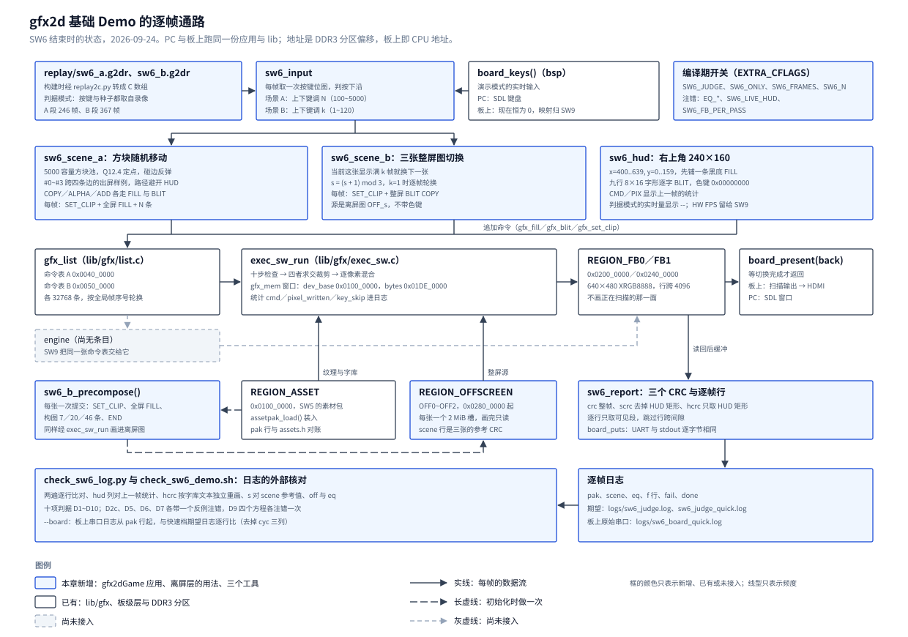

# 05 基础 Demo

## 一、动机

本章的板卡是易灵思钛金 Ti60F225：一颗带 RISC-V 硬核（Sapphire SoC，100 MHz）的 FPGA，
板载 DDR3 256 MB，HDMI 输出 640×480@60。赛题二要在这块板上做一个 2D 渲染加速引擎：
RISC-V 跑游戏逻辑、生成绘图命令，FPGA 里的引擎按命令把图像块搬进帧缓冲。
赛题基础要求 3 的第 2 条原文是（从选题指南第 8 页抽出）：

> 提供一个基础测试 Demo（例如：大量方块的随机移动、多张大图的快速切换），并能在屏幕上实时对比显示"纯软件 CPU 渲染"与"硬件加速渲染"的帧率差异。

前四篇已经备好了这条要求需要的零件。[第 02 篇](02-命令表构造层与软件执行器.md) 做了命令表的构造层与
**软件执行器**（按规格逐像素执行一张命令表的 C 程序，PC 上的渲染器、板上的软件渲染模式与引擎的金标准都是它）；
[第 03 篇](03-PC平台层与帧节拍.md) 做了 PC 侧的场节拍、双缓冲呈现与录像格式；
[第 04 篇](04-素材流水线.md) 做了素材包，背景、图集、弹幕与 8×16 字库可以按编号取出来当绘图表面用。
缺的是把它们串起来的那个应用：每帧更新场景、生成一张命令表、交给执行者画进后缓冲、呈现、再把能测到的计数显示出来。
这个应用同时是 `SW9` 软硬件帧率对比的负载——硬件引擎接上之后，同一张命令表交给引擎，
软件与硬件画出来的每一帧要逐位相同，两种帧率才是同一份工作量的比较。

所以本章要交付的是一个**确定性的**基础 Demo：同一份输入序列在 PC、板上与将来的引擎上跑出逐帧相同的画面。
几个约束决定了它的形状：

| 约束 | 来源 | 它排除了什么 |
| --- | --- | --- |
| 「例如」是原文里的措辞 | 选题指南第 8 页 | 把方块移动与大图切换当成两道必须各自达标的门槛；两者是本项目的选择 |
| 软硬件帧率同屏对比要有硬件那条路径 | 引擎尚未开工 | 在 PC 上给出硬件帧率。本章只把 `HW FPS` 的位置留出来，显示 `--` |
| 逻辑固定步长、随机数自带种子、不读墙钟 | SW1-SW9 总览约束 3 | 把实测帧率、耗时画进判据比对的画面；两次运行就不可能逐帧相同 |
| Flash 素材分区 4 MiB，一张 640×480 整图按行跨 4096 存放占 1,966,080 字节 | 第 04 篇 | 为「多张大图」往素材包里再加两三张整图 |
| 板上没有 `argv` | `sw/` 分层的六个应用都是 `int main(void)` | 用运行时参数切换演示与判据 |
| 表面表 16 槽 | `gfx_abi.h` 的 `GFX_SURF_N` | 每张图、每个缓冲各占一槽之外再随意登记 |

## 二、为什么是这几步

这个工作点拆成九步。前两步只读源码与文档、不写产品代码，后七步是实现、判据与上板：

**第一步是前期研究。** 四个问题：赛题原文要什么、本条与 `SW7`（游戏）`SW8`（模式与统计）`SW9`（板上移植）的界线画在哪；
「每帧一张命令表」这份契约能不能完全落在已有接口上；三个场景能不能只用现有 8 项素材做出来；
每条判据在 PC 上怎么从外部核对。跳过这一步，接口缺口要到写代码时才发现，那时返工的面积更大。

**第二步是开工前复核。** 把第一步写下的每个数字、接口名、文件路径与交叉引用对照源码再核一遍，
找出照原样实现会出错、会误报或判据会空转的地方。这一步改掉了十九处，并把场景 B 的做法换成了离屏预合成（3.5 节）。

**第三步写逐帧契约与主循环**，四到六步分别写场景 A、场景 B 与 HUD。它们都只调 `lib/gfx` 的构造接口，
不直接写帧缓冲、不直接碰 SDL 或寄存器；主循环负责选执行者与呈现。这条边界是 `SW9` 能把同一张命令表交给引擎的前提。

**第七步是判据模式。** 判据要求两次运行逐帧相同，所以输入只能来自录像；板上没有文件系统，
录像要编进程序；板上没有 `argv`，模式只能在编译期切换；日志格式要能被外部脚本解析。

**第八步是外部核对工具与检查脚本。** 应用只打日志，判定由脚本做，每条判据配一个会让它见红的注错。
[spec 第 01 章](../spec/01-逐像素规格.md) 4.1、4.7 两节记过同一类教训：被测程序给自己出的结论不能当证据。

**第九步是上板对账。** PC 与板上一个是 64 位、一个是 32 位，编译器也不同，素材一边从文件读、一边从 SPI Flash 读。
只在 PC 上验过，等于没有验过 `SW9` 要依赖的那条「板上与 PC 逐帧相同」。

图 1 是本章结束时的状态。



**图 1** 第一行是输入：录像（判据模式）或键盘（演示模式）经 `sw6_input` 判按下沿；
第二行是三个组帧模块，它们只往 `gfx_list` 里追加命令；第三行是每帧的主干：命令表交给 `exec_sw_run`，
画进 FB0 或 FB1，再由 `board_present` 呈现。灰虚线框是尚未开工的引擎，`SW9` 让它接替执行器的位置。
第四行左边三个框是初始化时做一次的事：素材包装入 `REGION_ASSET`，三张整屏图预合成进 `REGION_OFFSCREEN`；
右边的 `sw6_report` 在呈现之前读回后缓冲算三个 CRC。第五行是日志与外部核对。

## 三、每一步做了什么

### 3.1 前期研究：赛题原文与边界

逐字抽出选题指南第 8 页，确认「例如」在原文里（引文见第一节）。两个结论：

1. 方块移动与大图切换是示例，本项目选择都做，并有意把两段的负载特征拉开：
   场景 A 是大量小命令加四边裁剪，瓶颈在命令数；场景 B 是整屏图轮换，瓶颈在访存带宽。
2. 「实时对比软硬件帧率」要求两个数字同屏，只有板上才成立。本条只留 HUD 上的位置与口径，
   真实的 `HW FPS` 由 `SW9` 填；完整的每秒统计 CSV 归 `SW8`。

### 3.2 前期研究：逐帧契约对到现有接口上

逐帧契约写成六条：初始化时取分区、装载素材、登记表面；每帧只取一次输入；选目的面并开始新表，
先恢复全屏裁剪、再用一条写满可见像素的命令打底；执行、计时、算 CRC；只呈现一次；场景代码只调构造接口。
逐条对照 `lib/gfx/{gfx.h,gfx_abi.h,exec_sw.c}`、`bsp/include/{board.h,memmap.h}` 与 `lib/core` 的头文件，
每一句都落在已有接口上，没有需要新造的。读的过程中钉死了几处照直觉写会出错的细节：

- **`gfx_blit()` 不支持缩放。** 签名里只有一组宽高，源矩形与目的矩形同尺寸（spec 第 02 章 §3.4.3 两个半开区间都是 `+w`／`+h`）。
  所以方块尺寸只对 FILL 能随机；走 BLIT 的方块尺寸必须等于源格子（图集 16，棋盘子块 32）。
- **ALPHA 的 FILL 常量必须预乘。** `gfx_cmd_check()` 的第九步单独检查常量字，R／G／B 任一大于 A 就报 `GFX_E_BAD_PREMULT`，
  与面积是否为 0 无关，构造层在追加时就拦下。
- **BLIT 的 ALPHA 配 XRGB 源等于不透明**（有效 alpha 取 255，spec 第 02 章 §3.2），要看到混合必须用预乘源。
- **`gfx_mem` 窗口要同时覆盖素材与目的表面。** 执行器把设备地址换算成主机指针时，表面要整个落在窗口内，
  否则按 `BAD_SURFACE` 停住；只填素材区大小会让帧缓冲落在窗口外（`assetTest` 与第 04 篇踩过同一个坑）。
- **统计是累加的**，每帧执行前要清零；`st.cmd` 不含 END，而命令表的 `used` 含 END。
- **`board_present()` 自己等掉一场**，之后不能再补一次 `board_wait_frame()`，否则掉到 30 fps（第 03 篇 3.4 节）。
- **整帧 CRC 逐行只取前 640×4 字节**，跳过行跨 4096 与可见 2560 之间的间隙（第 03 篇的口径）。

### 3.3 前期研究：画面、容量与命令数

现有素材包的 8 项是：`BG_GRAD` 640×480、`CHECKER_TILE` 128×128、`TILE_ATLAS` 128×96（16×16 格子 48 个，预乘）、
`FONT8X16` 128×96、`BULLET_PM`／`BULLET_ST` 各 32×32、`KEY_DEMO` 32×32（色键 `0x00FF00FF`）、`SOLID8` 8×8。
读 `pack_assets.py` 的 `load_font_rgba()` 确认字库的格序：从 ASCII `0x20` 起逐格填，16 列 × 6 行，用 95 格；
xrgb 格式下背景存成 `0x00000000`、前景 `0x00FFFFFF`。所以取字形是 `gi = c - 0x20`、`sx = (gi % 16) × 8`、`sy = (gi / 16) × 16`，
画的时候色键取 `0x00000000`。

容量按第 04 篇的实数算：包 2,142,784 字节，占 4 MiB 分区的 51.1%；一张整屏图 1,966,080 字节，三张就超过分区。
命令数按每张命令表 32768 条（1 MiB ÷ 32 字节）算，上界如下，HUD 按矩形能容纳的 9 行 × 30 字计：

| 场景 | 每帧命令数上界 | 占每表容量 |
| --- | --- | --: |
| A，N=5000 | SET_CLIP 1 + 打底 FILL 1 + 方块 5000 + HUD 底色 1 + 字 270 + END 1 = 5274 | 16.1% |
| B | SET_CLIP 1 + 整屏 BLIT 1 + HUD 底色 1 + 字 270 + END 1 = 274 | 0.8% |

这两行是估算；实测见第五节（N=5000 时 5067 条，B 段 58~63 条）。

### 3.4 前期研究：判据怎么从外部核对

应用只打日志，判定由脚本做。三件事要在开工前想清楚：

**两次运行怎么比。** 判据模式按录像把 A、B 两段各回放两遍，脚本逐行比较两遍（去掉计时列）；
另外同一个二进制在有窗与无窗（`SDL_VIDEODRIVER=dummy`）下各跑一遍，日志也要逐字节相同。
两遍比较要有一个会让它见红的反例，参照第 03 篇的 `INJECT_REPLAY_CLOCK`：把实测时间混进画面，两遍必须不同。

**HUD 怎么对账。** HUD 的底色定成纯黑、字形前景是白色，HUD 矩形里就只有两种像素。
脚本拿日志里这一帧的字段（N、k、上一帧的命令数与像素数）拼出九行文字，按字库文本独立重画整块矩形再算 CRC，
与应用算的 `hcrc` 比。这一条同时验了字形、位置与数字内容。

**方程是否真的落到可见像素上。** 应用可以数自己追加了多少条 ALPHA、ADD，但那只是构造侧的计数：
一条 ALPHA 的方块若被后画的命令完全盖住，计数照样非 0。所以用 `lib/gfx` 现成的逐方程注错
（`-DINJECT_EQ_<方程>` 把该方程输出的最低位取反），每个方程单独注一次，要求日志至少一行变化。

### 3.5 开工前的复核：十九处订正与场景 B 的改法

复核把第一轮写下的东西逐条对照源码，改掉十九处。其中会让实现出错或让判据误报、空转的是这几类：

- **直接调用 `mk` 会链接失败。** `mk/host.mk`、`mk/target.mk` 在没有应用 makefile 时走一段默认块，
  里面写死 `LIBS := core`；README 里写的 `make -f mk/host.mk` 在应用改用 `lib/gfx` 之后会找不到 `gfx_*`。默认块同步改。
- **干净克隆上 `check_sw_layers.sh` 会失败。** 它真实地编一遍 gfx2dGame，而 gfx2dGame 从本条起包含生成物 `assets.h`；
  这个脚本不打包。开头加一步打包。
- **按原计划的计数判据会误报。** 原先场景 B 的三个构图里没有 ADD，「三种方程计数都非 0」对 B 段天然不成立；
  「每帧至少 4 条出屏命令」对 B 段也不成立。计数改成只查场景 A 与预合成，出屏只查 A 帧。
- **日志里缺场景号**，脚本查不出 k=1 时是否真的逐帧切换；缺「第几遍」，两遍无从分组。两列都补上。
- **字形对账原本没有落进检查脚本**，且按字符打的 `glyph <字符>` 行遇到空格会让解析错位。改成整块 HUD 矩形的 `hcrc`。
- **录像形状没有停留段。** 按「按 1 帧、松 1 帧」连续走，k=1 只停约 2 帧，看不到三张图各轮一次。补上停留段（3.10 节）。
- **两处事实写错。** 素材包占比原写 49.3%（那是第 04 篇早期 B 组的估算），实为 51.1%；
  「板上只编译不运行」的理由（板上 `board_keys()` 恒为 0）不成立，判据模式根本不读按键，改成上板对账。

复核还查出一个判据的盲区，写在这里是因为它决定了 D3 的比法：**整帧 CRC 看不到四边越界的写入。**
执行器若不裁剪，四条边多写的像素分别落在：右边 `x ≥ 640` 落在本行 2560~4095 字节的行跨间隙；
左边 `x < 0` 落在上一行间隙的末尾；下边 `y ≥ 480` 落在帧缓冲分区 1,966,080 字节之后的余量；
上边 `y < 0` 落在前一个分区的尾部。这些都不在可见像素里。所以裁剪的正确性只能由第 02 篇的整帧用例 `blit-clip-partial`
与 159 条一致性向量保证；本条能抓的是回归——执行器统计的 `pixel_written` 是裁剪之后的计数，裁剪一坏它就变，
因此 D3 比较日志的**全部非计时列**，而不只是 CRC 列。

**场景 B 改为离屏预合成。** 第一轮的做法是三个静态构图每帧现场组帧（7、20、46 条命令）。复核时看到三点：
第一轮只算了 Flash 的容量，DDR 里的离屏层（`REGION_OFFSCREEN`，`0x0280_0000` 起 8 MiB）一直空着，
而设计文档 2.1 节与 `memmap.h` 给它定的用途就是「背景预合成」；赛题原文写的是「多张大图的快速切换」；
原方案第三个构图的 46 条里 30 条是只写不读的 FILL，对硬件是轻负载，A、B 两段在 `SW9` 的对比里区分不开。
改法是初始化时把三张整屏图各画进一张离屏图，每帧只做一次 640×480 的 BLIT COPY。
容量：三张共 5,898,240 字节，按 2 MiB 一槽摆放，第四槽留给离屏层的另一个用途「调试抓帧」；
`gfx_mem` 窗口扩到第三张的末端，`0x02C0_0000 + 0x001E_0000 − 0x0100_0000 = 0x01DE_0000`（29.875 MiB），
仍在 PC 模拟 DDR 的 64 MiB 以内；表面槽用 13 个。代价是初始化多三次提交，只发生一次。

### 3.6 逐帧契约与主循环

`Main/sw/apps/game/gfx2dGame/src/main.c` 把 SW1 的 60 帧骨架换掉。初始化四步：

1. **地址窗口。** `dev_base` 取素材区起点，`bytes` 取到第三张离屏图的末端，两者都在运行时由分区表与 `FB_BYTES` 算出，
   代码里不写常量；同时核对相邻分区的指针差等于分区表的偏移差，不一致打 `win err`。
2. **装载素材。** `assetpak_load()` 经 `board_asset_read()` 读包，装载后把包头的总长与整包 CRC 打成 `pak` 行，
   并与 `assets.h` 的 `ASSET_PAK_TOTAL_LEN`、`ASSET_PAK_CRC32` 对账，不一致计一次 fail。
   入库的期望日志因此钉住了它依赖的那一版素材。
3. **登记表面。** 槽 0、1 是 FB0、FB1；2~9 是素材 8 项；10~12 是三张离屏图。
4. **预合成**（3.8 节），打三行 `scene` 与一行 `eq P`。

每帧的顺序是：取输入并更新场景（计时一段），组帧（计时一段），清零统计后执行（计时一段），
读回后缓冲算三个 CRC、打一行日志，呈现。三段计时都是 `board_cycles()` 的差值；它是 32 位回绕的，
单段区间要短于 42.9 秒，长时间的累计按帧累加到 64 位。

**目的面与命令表按全局帧序号的奇偶轮换**，每呈现一次加一，不随每段每遍的帧号归零；
每帧开头核对目的面不是上一次交给 `board_present()` 的那一面，违反就打 `fb err` 并计 fail。
这条规则是上板复核时补上的，来由见 4.9 节。

### 3.7 场景 A：方块随机移动

`src/game/sw6_scene_a.c`。方块池固定 5000 个，每个 40 字节（位置、速度、往返范围、尺寸、绘制方式、格子号、颜色），
不用 `malloc`、不用浮点。位置与速度用 **Q12.4**（整数部分 12 位、小数 4 位的定点数，1 像素 = 16），
每帧推进一步，越界按闭区间镜像反弹。整个池在每段开始时按录像头里的种子用 `xorshift32` 一次初始化完；
活动数 N 只决定本帧更新与绘制前多少个。上下键按下沿各增减 100，限制在 100~5000。

绘制方式按随机数分十档：五档 FILL COPY，FILL ALPHA、FILL ADD、图集 BLIT ALPHA、图集 BLIT ADD、棋盘 BLIT COPY 各一档。
FILL 的尺寸在 8~32 之间随机；BLIT 的尺寸等于源格子。FILL ALPHA 的常量先定 alpha，再让三个颜色通道各取 `[0, alpha]`，保证预乘约束。

方块 #0~#3 是四个固定出屏样例，坐标是常量，各跨一条边、只沿那条边往返：
#0 在 `y=-4`、x 在 0~384 之间；#1 在 `y=468`（底边到 483）；#2 在 `x=-4`；#3 在 `x=628`、y 在 160~464 之间。
#0 与 #3 的范围避开 HUD 矩形，裁剪在屏幕上始终看得见。组帧时每条场景命令按方程计数（打底与 HUD 不计），
目的矩形不完全在屏内就把 `off` 加一。

### 3.8 场景 B：三张整屏图的预合成与切换

`src/game/sw6_scene_b.c`。初始化时三张图各一次提交：`SET_CLIP` 全屏、全屏 FILL 打底、构图命令、END。

| 离屏图 | 构图 | 构图命令数 |
| --- | --- | --: |
| OFF0 渐变 | `BG_GRAD` 整屏 BLIT COPY；4 个图集 ALPHA 格子；2 个 `KEY_DEMO`（COPY 加色键） | 7 |
| OFF1 棋盘 | `CHECKER_TILE` 5 列 × 4 行 BLIT COPY 平铺，第 4 行的 384+128 = 512 越过 480，由游戏区裁掉 | 20 |
| OFF2 色带 | 30 条 640×16 的程序生成 FILL；12 个图集 ALPHA 格子；预乘与直通弹幕各 2 个 | 46 |

用到 ALPHA 与 ALPHA_STRAIGHT 的元素都放在 HUD 矩形以外，否则上屏后被 HUD 盖住，逐方程注错看不出来。
画完对每张图按场景区的口径算一个 CRC，打成 `scene` 行，作为 B 段每一帧的参考值。

每帧命令是 `SET_CLIP`、一条从 `OFF_s` 到后缓冲的整屏 BLIT COPY（不带色键）、HUD、END。
整屏 BLIT 写满可见像素，所以不再另加打底 FILL。切换规则：当前这张已显示满 k 帧就换下一张，`s = (s + 1) mod 3`；
k 在显示中途变小时，下一帧即按新 k 判。k=1 时逐帧 0→1→2→0 轮换。

### 3.9 HUD

`src/game/sw6_hud.c`。右上角 `x=400..639, y=0..159`，先一条黑底 FILL，再用字库逐字 BLIT 加色键。
九行自 `y=0` 起每行 16 像素，第 10 行留空：

```
行 0  SW FPS <呈现次数>        行 5  PIX <上一帧写入像素数>
行 1  HW FPS --                行 6  LOG <输入更新的周期数>
行 2  N <活动数>（B 段为 0）   行 7  BLD <组帧的周期数>
行 3  K <k>（A 段为 0）        行 8  EXE <执行的周期数>
行 4  CMD <上一帧命令数>
```

每行按实际文字逐字画，不补空格；行内的空格也画一条 BLIT（整格命中色键、不写像素），命令数与像素数只有一套口径。
CMD 与 PIX 显示上一帧最终的执行统计（含上一帧 HUD 自己），避免本帧 HUD 显示画完之后才知道的数；每遍首帧显示 `--`。

`SW FPS` 是最近一个完整一秒内完成的呈现次数：逐帧把整帧周期累加到 64 位，满 `BOARD_HZ` 结算一次并保留余数；
第一个完整的一秒结算之前显示 `--`。**判据模式下 SW FPS 与三段耗时一律显示 `--`**，
实测值进了画面，同一份输入两次就跑不出相同的 CRC。

### 3.10 判据模式、录像与构建集成

两段录像由 `Main/tools/check/gen_sw6_replay.py` 生成，按键序列写在脚本里，每步「按 1 帧、松 1 帧」给一个按下沿：

| 段 | 按键序列 | 帧数 | 字节 |
| --- | --- | --: | --: |
| A | 停 10 帧；上键 49 次把 N 升到 5000；停 30 帧；下键 49 次回到 100；停 10 帧 | 246 | 1000 |
| B | k=30 停 31 帧；下键 29 次降到 1；停 30 帧；上键 119 次升到 120；停 10 帧 | 367 | 1484 |

生成器只按 `lib/core/replay.h` 的格式写字节，与 `replay2c.py` 是两份独立实现；入库的是 `.g2dr`。
构建时两个 `mk` 的新规则调 `replay2c.py` 把它转成 C 数组，落到 `$(OBJDIR)/replay/`，应用 `#include "sw6_a.h"` 取用。
两个 `mk` 都要有这条规则，判据与演示才走同一条路径；直接调用时的默认块也把 `LIBS` 写成 `core gfx` 并补上录像。

模式用编译期开关切换，经 `EXTRA_CFLAGS` 传入（它进编译选项标记文件，换开关必然重编）：

- 不给开关是演示模式：实时输入，A／B 每 600 帧轮换，HUD 显示实测值。
- `-DSW6_JUDGE=1` 是判据模式：先打 `pak`、三行 `scene`、`eq P`，再按「A 第 1 遍、A 第 2 遍、B 第 1 遍、B 第 2 遍」逐帧打日志。
- `-DSW6_ONLY=1`／`2` 只跑一段，`-DSW6_FRAMES=n` 限制每段每遍的帧数（快速档取 120），`-DSW6_N=n` 改起始活动数。

反例注错沿用 `INJECT=<名字>`：`lib/gfx` 现有的四个方程开关，以及应用里新增的两个——
`SW6_LIVE_HUD`（判据模式下 HUD 照样显示实测值）与 `SW6_FB_PER_PASS`（退回按每遍帧号选目的面）。

### 3.11 日志格式

逐行以 `\r\n` 结尾，与 UART 逐字节相同：

```text
pak <总长> <整包CRC>
scene <i> scrc <8位>
eq <P|A> <copy> <alpha> <add> <straight>
f <帧号> <A|B> p <遍> s <场景号|-> keys <按键位图> n <N> k <k> cmd <n> pix <n> ksk <n> hud <上一帧cmd|-> <上一帧pix|-> off <n> cyc <输入> <组帧> <执行> crc <8位> scrc <8位> hcrc <8位>
```

`cmd`、`pix`、`ksk` 是执行器统计的命令数（不含 END）、写入像素数与色键跳过的像素数；`hud` 是这一帧 HUD 实际画出来的两个数；
`cyc` 三列比对前去掉。三个 CRC 都逐行喂、只取可见段：`crc` 是整帧，`scrc` 去掉 HUD 矩形
（第 0~159 行只取左边 400 像素），`hcrc` 只取 HUD 矩形。行里不出现字符本身，按空白切分就能解析。
只在失败路径出现的行有六种：`win err`、`pak err`、`surf err`、`exec err`、`replay err`、`fb err`，出现任何一种时 `fail` 必然非 0。

### 3.12 外部核对工具与检查脚本

`Main/tools/check/check_sw6_log.py` 是日志格式的外部实现，只用 Python 标准库（`zlib.crc32` 与 `lib/core/crc32` 同参），七种模式：
`--compare`（两份日志去掉计时列逐行比，报第一个不同的字段）、`--pair`（同一段两遍逐行比）、
`--hud`（`hud` 列对上一帧统计；`hcrc` 对按字库文本独立重画的整块矩形）、`--scene`（三个参考值两两不同；
每个 B 帧的 `scrc` 等于本帧 `s` 那张图的参考值；k=1 停留段内逐帧轮换且三张都轮到）、
`--counts`（A 帧 `off ≥ 4`；`eq A` 的 copy、alpha、add 与 `eq P` 的 copy、alpha、straight 非 0；`eq` 行必须存在）、
`--quick-prefix`（快速档的逐帧行按段、按遍是全量档的前缀）、`--board`（板上串口日志从 `pak` 行起对期望日志，3.13 节）。
字库解析照 `pack_assets.py` 的规则：`#` 后跟空白才是注释，`########` 是像素行（第 04 篇 4.13 节踩过）。

`Main/tools/check/check_sw6_demo.sh` 把它们串成十项：D1 录像可重生成；D2 判据模式编过跑通，
另含 D2b（演示模式编过并冒烟）与 D2c（双缓冲不变量的反例）；D3 对入库期望日志；D4 有窗与无窗；
D5 两遍一致；D6 HUD；D7 场景 B；D8 计数；D9 逐方程注错；D10 Sanitizer 与两种板上构建。
反例与判据的对应是：`SW6_FB_PER_PASS` 对 D2c，`SW6_LIVE_HUD` 对 D5，`EQ_COPY` 同时对 D6 与 D7，
四个方程开关各跑一次对 D9。反例不红，说明那条判据在空转。

### 3.13 上板对账

判据模式的快速档编成板上产物，用 `tools/board/board_run.py --bin` 经 JTAG 写进 DDR 运行；
素材包照样由程序从 Flash 素材分区读，`pak` 行核对它与 `assets.h` 是同一版。
不用 `--flash-boot`：它只会跑 Flash 应用区里固化的那个程序（当前是第 04 篇的 `assetTest`），要换成本产物得先重写整片镜像。

串口日志里除了本程序的输出还有三样东西：`board_run.py` 自己的 `#` 标记行；加载之前 Flash 里旧程序在
`reset halt` 之前打的几行；以及本程序的横幅，它常常抢在「程序已加载」标记之前出现（程序一恢复就打印，标记写得晚）。
`--board` 去掉 `#` 行与空行，取最后一个本程序横幅之后、从 `pak` 行起的部分，与期望日志逐行比（去掉 `cyc` 三列）。

## 四、遇到的问题

### 4.1 包含保护撞了常量宏名

**第一现场**（按当时的记录还原）：

```
src/main.c: error: unknown type name 'sw6_hud_in'
```

**解读**：`sw6_hud_in` 在 `sw6_hud.h` 里定义，报「未知类型」说明编译 `main.c` 时这份头文件的内容没有进来，
而文件本身是找得到的（没有 `No such file` 报错）。

**定位**：`sw6_hud.h` 第一版用 `SW6_HUD_H` 作包含保护，而 `sw6_cfg.h` 里 `SW6_HUD_H` 是 HUD 的高度 160。
`main.c` 先包含 `sw6_cfg.h` 再包含 `sw6_hud.h`，后者的 `#ifndef SW6_HUD_H` 为假，整份被跳过。

**根因与修法**：宏只有一个命名空间，包含保护与常量同名。包含保护改成 `SW6_HUD_DECL_H`。
第 04 篇 4.15 节的大小写宏碰撞是同一类问题。判据没有覆盖它，因为它是编译错误，第一次编译就暴露。

### 4.2 `src/game/` 里的头文件写成了 `"game/xxx.h"`

**第一现场**（按当时的描述还原）：编译 `src/game/sw6_report.c` 时报找不到 `game/sw6_cfg.h`。

**解读**：引号包含先在包含者所在的目录里找。`src/game/sw6_report.h` 里的 `"game/sw6_cfg.h"`
会先找 `src/game/game/sw6_cfg.h`，应用层的 `-I` 里也没有 `src/`。

**定位与修法**：同一目录内的互相包含统一写 `"sw6_xxx.h"`，只有 `src/main.c` 用 `"game/…"`。
这是一次性的编译错误，没有判据需要覆盖。

### 4.3 预合成的方程计数减到了下溢

**第一现场**（按当时的描述还原）：`eq P` 的 copy 列打出 4.29e9 量级的数。

**解读**：`uint32_t` 从 0 减 1 回绕成 4294967295，说明某处在计数没有加过的情况下减了一次。

**定位**：打底的 `SET_CLIP` 与全屏 FILL 不该计入 `eq`，第一版的写法是照常计入、再手动 `eq[0]--`。
这两条追加一旦被构造层拒绝，计数没有加过，减一就下溢。

**根因与修法**：先加再减依赖「加过」这个前提。记账函数改成带一个方程下标参数，
传 `SW6_EQ_NONE` 表示这条只记命令数与失败数、不进 `eq`。D8 只查计数非 0，下溢之后照样非 0，覆盖不到它；
它是自测时看日志发现的，修正后由 D3 的期望日志把正确的计数钉住。

### 4.4 编译期开关让 `-Werror` 拦了三次

**第一现场**（按当时的描述还原）三条：`-Werror=type-limits`（无符号数与 0 比较恒真）、
`-Werror=unused-function`（`run_judge` 或 `run_demo` 没人调用）、`-Werror=unused-parameter`（记账函数的命令表参数没用上）。

**解读**：三条都是编译期开关带来的：不给 `-DSW6_FRAMES` 时帧数上限是 0，`if (上限 != 0 && total >= 上限)`
的后半句对编译器是恒真比较；两个入口只有一个会被 `main` 调用；记账函数的一个参数在所有调用点都已经算好了。

**修法**：帧数上限改成 `#if` 的编译期分支；两个入口各自包进 `#if SW6_MODE_JUDGE`／`#else`；去掉多余的参数。
两套构建都用 `-Wall -Wextra -Werror`，所以「零告警」是编得过就成立，这三处都在第一次编译时暴露。

### 4.5 演示模式加 `-DSW6_FRAMES` 编不过，十项判据当时盖不住

**第一现场**（按当时的记录还原）：

```
error: missing binary operator before token "("
```

**解读**：这是预处理器在求 `#if` 表达式时报的错。`#if` 在预处理阶段求值，只认整数常量与运算符，不认类型转换。

**定位**：帧数上限的宏第一版写成 `((uint32_t)(SW6_FRAMES))`，演示模式的主循环里有一句 `#if SW6_FRAMES_MAX != 0`。
不给开关时宏是 `0`，`#if` 能算；判据模式走的是另一个分支，那一句在预处理时被整段跳过。
所以判据模式的十项全过，演示模式加这个开关就编不过。发现方式是自己跑了一次演示模式的冒烟。

**根因与修法**：宏改成不带转型的整数常量，使用点写 `(uint32_t)SW6_FRAMES_MAX`。
检查脚本补 D2b：演示模式加 `-DSW6_STAGE_FRAMES=60 -DSW6_FRAMES=200` 编过并冒烟，日志里 A、B 两段都要出现。
原判据全部在判据模式下构建，演示模式那一半从未被编过。

### 4.6 k=1 的轮换判据跨了两遍

**第一现场**：

```
chk scene k=1 逐帧轮换 FAIL 第 32 帧起不符：[2, 0, 1, 2, 0, 1, 2, 0]
```

**解读**：打印的前 8 个值本身是逐帧 +1 模 3 的，问题出在第 32 个位置：它是第一遍 k=1 段的末尾与第二遍 k=1 段的开头的接缝。

**定位与修法**：脚本第一版把整份日志里所有 k=1 的 B 帧收成一条序列再查，两遍之间本来就不连续。
改成按（段，遍）分组各判一次，并加一条「三张图都要轮到」。这是判据自己写错，应用没有问题。

### 4.7 快速档的 `eq A` 与全量档天然不同

**第一现场**：前缀核对报「非逐帧行不一致」，差异在 `eq A` 行：快速档 190864，全量档 393878（copy 列）。

**解读与修法**：`eq A` 累计的是这一遍实际跑过的帧的场景命令数，帧数限到 120 之后必然不同。
前缀核对里跳过 `eq A`，它的判据在 `--counts` 里。

### 4.8 `sed -i` 在 `/mnt/e` 上改不了文件

**第一现场**：

```
sed: cannot rename ./sedXXXXXX: Permission denied
```

**解读与处理**：WSL 挂载的 Windows 盘（drvfs）上，`sed -i` 先写临时文件再改名，改名被拒。
这是开发环境的限制，与产品无关；机械替换改用别的工具。

### 4.9 双缓冲在两遍交界处画到了正在扫描的那一面

**第一现场**：在每帧开头加上「目的面不是上一次呈现的那一面」的核对、先不改选面方式，跑全量判据模式：

```
f 366 B p 1 s 1 keys 00000000 n 0 k 120 cmd 63 pix 346599 ...
fb err frame/dst=0 0
...
fail 1
```

**解读**：`fb err` 紧跟在 B 段第 1 遍最后一帧（第 366 帧）之后，是第 2 遍第 0 帧报的，目的面号 0，也就是 FB0。
上一帧呈现的也是 FB0。

**定位**：主循环按每遍的帧号 `frame & 1` 选目的面，帧号每遍从 0 起。B 段一遍 367 帧是奇数，
第 1 遍最后一帧画 FB0 并呈现，第 2 遍第 0 帧又画 FB0。`board_present()` 等切换完成才返回，
所以此时 FB0 正在被扫描输出读；板上 HDMI 会撕裂，而防撕裂正是赛题基础要求 3 的一条。
PC 上 `board_present()` 是把缓冲拷成纹理，看不出任何现象。快速档每遍 120 帧、演示模式一段 600 帧都是偶数，恰好躲过去。

**根因与修法**：选面用的是会归零的计数。目的面与命令表都改按全局帧序号轮换，每呈现一次加一；
那条核对留在代码里。每帧第一条命令写满可见像素，帧内容与画在哪一面无关，
所以修正后全量 1236 行仍与入库期望日志逐行相同，期望日志不用重生成。
新增反例 `INJECT=SW6_FB_PER_PASS` 与 D2c：每遍 121 帧时见红 3 次，正好是 A1→A2、A2→B1、B1→B2 三个交界。
原判据没有覆盖它：所有判据都比较画面内容，而内容在两面上一样；是否画到了正在扫描的那一面，只有「上一次呈现的是哪一面」这个状态知道。

### 4.10 「本机没有交叉工具链」的误判

**第一现场**（实现那一轮的检查脚本输出）：

```
没有 riscv-none-elf-gcc，跳过板上目标构建（板上对账见 SW6 第 3 节，验收时补）
装上 xPack riscv-none-elf-gcc 13.4.0 后：RISCV_BIN=riscv-none-elf- bash ...
```

**解读**：脚本拿 `${RISCV_BIN}gcc` 去 PATH 里找，没传 `RISCV_BIN` 时默认前缀是 `riscv-none-elf-`。
这行输出只说明 PATH 里没有它。

**定位**：`Main/doc/开发环境.md` 第 11 节写着 `<RISCV_BIN>` 的取值：工具链装在 WSL 的用户目录下，不在 PATH 上；
按那个前缀调用，`riscv-none-elf-gcc --version` 报 13.4.0。实现那一轮据这行输出得出「本机没有工具链」，
板上构建与板上对账因此都没做。

**根因与修法**：提示语把「没传」说成了「没装」。改成先提示检查是否漏传 `RISCV_BIN`、指向开发环境文档，并写明跳过不算通过。
带上 `RISCV_BIN` 之后，D10 的两种板上构建都零告警编过。

### 4.11 板上串口日志没法用 `--compare` 对账

**第一现场**（冒烟档的串口日志开头）：

```
# COM11 @ 115200 8N1, opened 00:11:58
assetTest SW5
gfx2dGame SW6

# --- 程序已加载，以下才是它的输出 ---
pak 2142784 fc13ee10
```

**解读**：第 1、4 行是 `board_run.py` 的标记；`assetTest SW5` 是 Flash 里旧程序在 `reset halt` 之前打的；
本程序的横幅 `gfx2dGame SW6` 落在「程序已加载」标记之前——程序一恢复就开始打印，标记写得比它晚。

**定位与修法**：`--compare` 要求两份日志行数相同，这些行会让它直接失败。新增 `--board`：去掉 `#` 行与空行，
取最后一个本程序横幅之后、从 `pak` 行起的部分比。正反三例：冒烟日志对同一组开关的 PC 日志，25 行相同；
对快速档期望日志，报行数 489 对 25；篡改一个 `hcrc`，报第 6 行第 33 个字段不同。

### 4.12 `--counts` 在没有 `eq` 行时空转

**第一现场**：读代码发现，没有实际运行修正前的版本。按原实现推出的输出是：删掉日志里所有 `eq` 行后跑 `--counts`，
只打出 `off` 那一条 ok，末尾 `fail 0`。

**解读与修法**：原实现逐行遍历，遇到 `eq` 行才检查，一行都没有时什么也不报。
改成先数：`eq P` 必须恰好 1 行，`eq A` 至少 1 行。同样的输入现在报两条 FAIL。

### 4.13 逐方程注错的首个差异被读错

**第一现场**（实现那一轮）：`EQ_ADD` 那一行的报错只有截断成 70 个字符的行首，两边看起来一样，被记成「从第 0 帧的 `pix` 起变」。

**解读**：逐方程注错只把输出最低位取反，不改任何计数，`pix` 不可能变。

**定位与修法**：`--compare` 改报第一个不同的字段。修正后同一次运行报的是「第 7 行第 29 个字段起不同」，
即第 0 帧的 `crc`。记录跟着改正。

### 4.14 演示模式每次切换阶段后的第一秒显示 `SW FPS 0`

**第一现场**：读代码发现：每次 A／B 切换时 `stage_begin()` 把帧率窗口清零，第一个完整的一秒结算之前 HUD 显示 0。

**解读**：3.9 节的口径是「最近一个完整一秒」，切换后的第一秒还没有完整的一秒，显示 0 与口径不符，每 600 帧闪一次。

**修法与核对**：加一个有效位，结算之前显示 `--`。演示模式的 HUD 每一行都能由日志推出来
（三段耗时是上一帧的 `cyc`，CMD／PIX 是上一帧的 `cmd`／`pix`），用 `check_sw6_log.py` 的重画函数逐帧比 `hcrc`：
150 帧全部对上，第 0~60 帧是 `--`，第 61 帧起是 `61`；按旧代码第 0 帧就会是 `0`。
判据模式这一行本来就显示 `--`，期望日志不变。原判据不覆盖演示模式的 HUD 内容，这一次是专门写了一个一次性脚本来核对的。

## 五、结果

### 5.1 测量方法

```
wsl -e bash -c 'RISCV_BIN=<RISCV_BIN> bash Main/tools/check/check_sw6_demo.sh'
wsl -e bash -c 'RISCV_BIN=<RISCV_BIN> SW6_QUICK=1 bash Main/tools/check/check_sw6_demo.sh'
wsl -e bash -c 'RISCV_BIN=<RISCV_BIN> bash Main/tools/check/check_sw_layers.sh'
```

板上：

```
wsl -e bash -c 'cd Main/sw/apps/game/gfx2dGame && make RISCV_BIN=<RISCV_BIN> OBJDIR=build_board_quick EXTRA_CFLAGS="-DSW6_JUDGE=1 -DSW6_FRAMES=120"'
<EFINITY>\python311\bin\python.exe Main\tools\board\board_run.py --bin Main\sw\apps\game\gfx2dGame\build_board_quick\gfx2dGame-O2.bin --stop-on done --seconds 2700 --log <串口日志>
wsl -e python3 Main/tools/check/check_sw6_log.py --board <串口日志> Main/sw/apps/game/gfx2dGame/logs/sw6_judge_quick.log
```

### 5.2 PC 侧判据

全量 162 秒、快速档 130 秒，两次都是 `fail 0`：

| 项 | 实测 |
| --- | --- |
| D1 | 两份录像重生成后与入库逐字节相同（1000 字节 246 帧、1484 字节 367 帧），`replay2c.py --check` 独立解析通过 |
| D2 | 判据模式二进制 sha256 前 16 位 `58033848722596b9`，1236 行、退出码 0、`fail 0`；D2b 演示模式 200 帧里 A 段 120 帧、B 段 80 帧；D2c 反例见红 3 次 |
| D3 | 去掉 `cyc` 后与 `logs/sw6_judge.log` 全部 1236 行相同；快速档的逐帧行按段按遍是全量档的前缀（4 组） |
| D4 | 有窗与无窗去掉 `cyc` 后逐字节相同 |
| D5 | A 段 246 帧、B 段 367 帧两遍逐行相同；反例 `SW6_LIVE_HUD` 见红 |
| D6 | 1226 帧的 `hud` 列都对上上一帧统计，`hcrc` 都对上 Python 侧独立重画；反例 `EQ_COPY` 见红 |
| D7 | 三个参考值 `d90fb7b2`／`70fd3e3d`／`0211c146` 两两不同；734 个 B 帧的 `scrc` 都等于本帧 `s` 那张图；k=1 段两遍各 32 帧逐帧轮换，三张都轮到；反例 `EQ_COPY` 见红 |
| D8 | 492 个 A 帧的 `off` 都 ≥ 4；`eq A 393878 132138 125784 0`；`eq P 53 18 0 2` |
| D9 | 四个方程各至少改变一行：`EQ_COPY` 与 `EQ_ALPHA` 从 `scene 0` 起、`EQ_ALPHA_STRAIGHT` 从 `scene 2` 起、`EQ_ADD` 从第 0 帧的 `crc` 起 |
| D10 | `SAN=1` 无 ASan／UBSan 报告；板上判据构建 34,850 字节、演示构建 31,890 字节，零告警 |

同一次回归里：`check_sw_layers.sh` `fail 0`（打包先跑，第 2、3、4、6 项的注错都见红，链进 `lib/gfx` 之后仍没有软浮点符号）；
`make -f mk/host.mk`、`make -f mk/target.mk` 直接调用都编过；主机侧单元测试 64／32 位输出逐字节相同；
第 03、04 篇的检查脚本 `check_sw4_pc.sh`（快速档）、`check_sw5_assets.sh` 都是 `fail 0`。

每帧的命令数与像素数（取自期望日志）：A 段 N=100 时 159~164 条、391,135~391,298 像素；
N=5000 时 5067 条（每表容量的 15.5%）、约 253 万像素；B 段 58~63 条、346,445~346,642 像素。

### 5.3 板上对账

| 项 | 值 |
| --- | --- |
| 比特流 | `Main/fpga/gfx2d_ti60/outflow/gfx2d_ti60.bit`（2026-09-21 编，扫描输出修复之后），sha256 前 16 位 `6e3dcddc66c40aef` |
| 产物 | 判据模式快速档，xPack gcc 13.4.0，`-O2`，34,850 字节，sha256 前 16 位 `0454c3cce0216630`；`load_image` 写入 34,850 字节 |
| 运行 | 16 分 6 秒，串口 75,501 字节；A、B 各 240 帧；`fail 0`、`done`；`pak 2142784 fc13ee10` 与 PC 相同 |
| 对账 | 从 `pak` 行起 489 行，去掉 `cyc` 后与 `logs/sw6_judge_quick.log` 逐行相同，覆盖 A 段 N=5000 的 14 帧与 B 段 k=1 的停留段 |

修正之前用旧代码跑过一次每遍 4 帧的冒烟档（34,666 字节，sha256 前 16 位 `6ac757440baa75f1`），
25 行同样与 PC 逐行相同。两次合起来说明 RV32 上的软件执行器、SPI Flash 装载与整条组帧路径与 PC 逐位等价，
双缓冲的修正没有改变任何一帧的内容。

板上每帧的执行周期数（`cyc` 第三列，100 MHz；像素数取写入加色键跳过，即进入逐像素循环的像素）：

| 负载 | 帧数 | 平均 | 目的面 FB0 | 目的面 FB1 | 平均周期／像素 |
| --- | --: | --: | --: | --: | --: |
| A，N=100（约 40 万像素） | 20 | 39.1 M | 40.1 M | 38.0 M | 98.2 |
| A，N=5000（约 254 万像素） | 28 | 383.8 M | 439.4 M | 328.1 M | 151.2 |
| B，整屏 BLIT 与 HUD（约 35 万像素） | 240 | 71.2 M | 92.4 M | 50.1 M | 201.7 |

N=5000 时组帧另花约 940 万周期。

### 5.4 产物

| 产物 | 大小 | 说明 |
| --- | --: | --- |
| `replay/sw6_a.g2dr`、`sw6_b.g2dr` | 1000、1484 字节 | 入库的录像源数据，种子 `0x5E6A0001`、`0x5E6B0002` |
| `logs/sw6_judge.log` | 183,439 字节，1236 行 | 判据模式全量的期望日志 |
| `logs/sw6_judge_quick.log` | 72,000 字节，490 行 | 快速档的期望日志 |
| `logs/sw6_board_quick.log` | 75,625 字节，496 行 | 板上快速档的串口原始输出，含 `board_run.py` 的标记行 |
| `gfx2dGame-O2.bin`（板上判据快速档） | 34,850 字节 | sha256 前 16 位 `0454c3cce0216630`，5.3 节用的就是它 |

### 5.5 已知误差与不确定

**板上周期数只作参考。** 吞吐结论归 E7；本表是判据模式下的一次运行，没有取多次中位数。
PC 上的时间数字一律不作结论。

**写 FB0 比写 FB1 慢，原因未查。** 5.3 节的表里，B 段写 FB0 比写 FB1 慢 1.85 倍，且与源图是哪一张无关。
两面本身没有固定的快慢：修正之前的冒烟产物写两面都是约 93~94 M 周期（B 段），加了三个静态变量之后才出现快的那一种，
看起来与 `.bss` 的布局有关。推测（未验证）：执行器逐像素经指针读 `gfx_mem` 与表面表（写 `*p` 之后编译器必须重读），
这些结构被像素流挤出缓存时要回 DDR 取；若程序区与 FB0 落在同一个 bank（两者地址的第 22~24 位都是 0，FB1 的第 22 位是 1），
每次重读都要换行。本仓没有实测过 DDR 的 bank 映射，所以这里只记数据。它不影响任何一条判据（三个 CRC 逐位相同）。

**板上只跑了快速档。** 每遍 120 帧已覆盖 N=5000 与 k=1 的停留段；全量档按本次每帧耗时估要半小时以上，没有跑。

**PC 上 SW FPS 被场节拍封顶。** `board_present()` 每帧等一场，PC 上的 SW FPS 最多 60，只说明呈现节拍正常，
不代表执行器的吞吐。

## 六、还欠什么

**演示模式在板上的样子**（[`../../Todo/sw/SW9-板上移植.md`](../../Todo/sw/SW9-板上移植.md)）：HDMI 画面、目视无撕裂、
软硬件帧率同屏对比都要引擎接上之后做。板上用软件执行器时一帧要 1~5 秒（执行之外还要算三遍 CRC、打一行串口），
演示模式按 600 帧换一次场景，一段要十分钟以上；`SW9` 要改成按时间或按键轮换，与 `SW8` 的模式切换一起定。

**写 FB0 比写 FB1 慢的原因**（[`../../Todo/hw/E7-软件执行器像素吞吐.md`](../../Todo/hw/E7-软件执行器像素吞吐.md)）：
E7 量吞吐表时要按目的面分开统计，并记下产物的 sha256；已在 E7 的开发日志里挂了一条。

**E6 的运行预算**（[`../../Todo/hw/E6-SPI装载速度.md`](../../Todo/hw/E6-SPI装载速度.md)）：素材包装载在板上约 5 秒，
本条按 4 MiB 物理上限处理；E6 出数后只改默认值。
