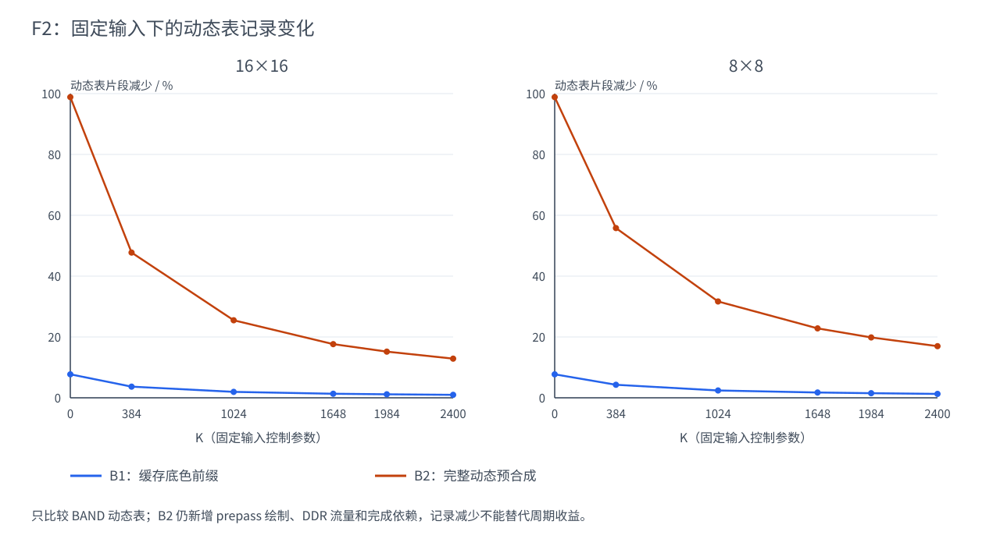
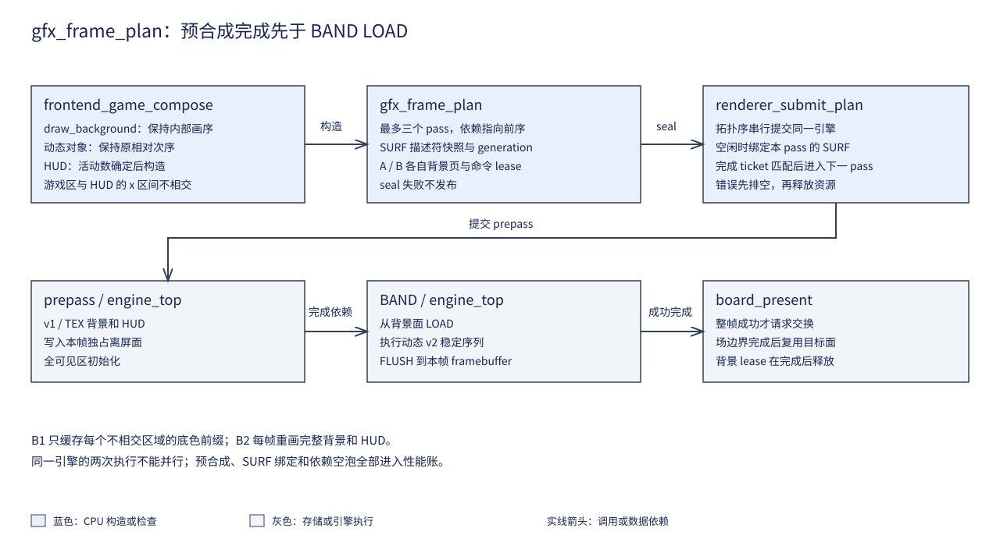

# 09 背景面与绘制阶段

## 一、动机

易灵思 Ti60F225 的 2D 引擎已经支持从 DDR3 背景面把一条带载入片上 RAM，
在片上按原序绘制后再写回。原游戏仍把背景和 HUD 拆成普通矩形，复制进
30 个空间桶。F1 的零敌弹状态已有 778 个条带片段，说明固定绘制本身值得
独立研究。

背景随每帧更新，HUD 又读取本帧活动数与帧率。直接缓存某张画面会改变游戏，
而把背景内部的静态竖线提前到横线之前会改变交叉处的像素。F2 因此分别
验证底色前缀缓存与每帧动态预合成，并把资源复用与完成依赖一同实现。

## 二、为什么是这几步

先核对绘制顺序，再确定可以移动的连续区间。底色、横线、竖线和星点依次
绘制，后两者不能以“静态”为理由跳到前面。HUD 位于 x=400～639，游戏区
位于 x=0～399；这一不相交性质允许在动态计数确定后构造 HUD，再与背景
一起预合成。通用重叠 overlay 仍留在动态序列末尾。

随后定义通用 pass。**Pass** 是一次有目标、读写资源与完成依赖的绘制阶段。
它需要保存描述符快照，否则下一帧修改槽 15 后，前一帧可能读取错误的物理页。

再为每个在途帧分配背景、命令和完成票据，最后接入保留跨帧重叠的调度器。正确性先
通过独立像素、生命周期反例和完整宿主回放；收益随后按 CPU、预合成、
BAND 与扫描争用一起判断。

## 三、每一步做了什么

### 3.1 从生产画序确定两种候选

`stg_draw.c` 的背景顺序为底色 FILL、动态横线、静态竖线、星点。底色是
整个区域的连续前缀，允许缓存；竖线位于横线之后，保持原位置。

B1 在每个背景页首次使用时写入游戏区与 HUD 的底色，后续 BAND LOAD 从
该页取得初值，原序列只省去两个底色 FILL。`stg_game_compose_layers`
仍把它们计入逻辑 `by_eq`，以保持原统计对象；物理命令与逻辑绘制分开登记。
缓存只有两块底色，横线、竖线、星点、HUD 内容和后置效果都照常更新。



曲线由 17 个固定状态的实际生产构造导出，绘出两型六个 K 档；它只比较
BAND 动态表。零敌弹时 B2 从 778 条降至 9 条，16×16 K1984 从 5187 条
降至 4400 条，8×8 同 K 从 3964 条降至 3177 条。B1 每帧只少 60 条
片段，符合两块底色各跨 30 桶。B2 仍要执行 prepass，因而这些比例不能
直接解释为总 CPU、GPU 或 DDR 工作的同比减少。

B2 每帧把完整背景与 HUD 生成 v1/TEX prepass，动态对象、banner 和 flash
进入 v2。HUD 仍在活动数确定之后构造；它的物理执行被移到动态区域之前，
成立条件来自两个 x 区间不相交。`test_pixels.c` 还保留有重叠的后置 overlay，
用独立直通输出确认它没有被错误提前。

来源复核沿 F1：LVGL v8.3 的绘制完成通知约束用于检查缓冲复用，未移植
其渲染代码或用它的性能替代本板测量。原方案的 D67、D72、D73 保持。

### 3.2 通用计划与资源租约

新增 `sw/lib/gfx/frame.h/.c`。`gfx_frame_arena` 登记资源的物理 base、范围、
generation 和 owner；generation 表示该资源描述的代次，owner 是当前票据。
登记时拒绝重叠、回卷、未对齐和零长度。

`gfx_frame_begin` 原子取得 mask 指定的租约，任一页仍被占用时整次失败。
票据零值保留，回卷时跳过仍在用的票据。计划保存 `frame_id`、pass 数组、
首错、封表、发布、完成数与排空状态。

`gfx_frame_add_pass` 接受目标、LOAD 初值、读取/写入集合、描述符快照、
draw 范围和前序依赖。最多三个 pass，依赖只能指向较小编号。
`gfx_frame_seal` 检查命令已 END、planned 已 seal、无构造错误、描述符未
漂移及交叉阶段的读写依赖。未初始化的 LOAD 必须有前序依赖。

```text
begin -> add_pass -> seal -> publish -> complete pass 0 -> complete pass 1
   |        |         |         |              |                 |
   +--------+---------+         +--------------+-----------------+
      失败时不发布                 成功完成或错误排空后 release
```

封表后计划只读，资源保持到引擎成功完成或错误排空。超时未证明排空时继续
保留租约，阻止下一帧覆盖。切模式与切后端先 flush，再检查所有页已释放；
重新登记时增加 generation，并保留票据序列。

### 3.3 应用适配与内存分配

新增 `frontend_game.c/.h`，游戏名称与背景规则只出现在这一层。通用库不
认识弹种、K、网格或 HUD。A/B 两个命令区分别对应离屏区内的两张 2 MiB
背景页；每张的可见数据为 `480×4096` B。prepass 命令区位于共享区的
两个 64 KiB 范围，和 F3 双工作区、TEX 影子及素材区互不重叠。

槽 15 仅存在于本帧的构造表与 pass 快照中，基础 Demo 的全局表不被改写。
`renderer_list_begin` 依据命令 A/B 选择页，`frontend_game_compose` 保持
原逻辑绘制函数，把阶段发往不同命令表。B1/B2 交替时使静态底色缓存失效，
切模式时重建租约与代次，避免复用基础 Demo 覆盖过的离屏内容。



### 3.4 完成调度与缓存一致性

串行诊断的 `renderer_submit_plan` 先发布经封表的整帧票据，再按拓扑序提交同一引擎。
每个 pass 都在空闲状态下绑定自己的 SURF 快照；前序完成票据必须匹配，
才允许提交依赖它的 BAND。GPU 墙钟、各 pass 的耗时和 PERF_BUSY 分开记录。

CPU 的命令写入沿既有写穿透、无写缓冲契约发布。GPU 写入后，只有诊断
路径在 CPU 读回前做失效；生产性能路径不增加每帧 CRC。CPU 可复用的计划
与显示前后缓冲的所有权分别由帧租约和既有 `board_present` 协议管理。

正式 PERF 路径先在 CPU 构造下一帧的两个范围，再收尾并呈现上一 BAND。
随后同步执行本帧 prepass，异步提交 BAND。整帧租约保留到 BAND 成功完成
或错误排空，CPU 构造另一个上下文时不会覆盖正在读取的背景或命令。
`pending_finish` 合并 prepass 与 BAND 的 PERF，交换只发生在整帧成功之后。
帧预算补入本次同步 pass 与发布耗时，仍排除上一帧的等场时间；实际 FPS
继续由场数和交换数计算，统计频率不变。

任何构造、seal、prepass 或 BAND 错误都从当前帧立即返回，不请求交换。
已发布后没有静默软件回退。错误后的再次提交还检查目标是否仍为扫描前台，
避免只跳过失败帧却在下一帧写到前台。prepass 与 BAND 在同一引擎串行，
BAND 与 CPU 下一帧构造的重叠保持。

### 3.5 正确性与反例

`test_frame.c` 检查相交页、地址回卷、占用页再次申请、旧 generation、
未初始化初值、依赖未完成、提前释放及错误未排空。`INJECT_FRAME_REUSE`
移除占用检查时，消费者在第二次申请处报告失败。

`test_pixels.c` 用独立直通软件执行器作为参考，运行 10000 张非游戏场景，
覆盖六方程、变化源位置、裁剪与越界、不同 H/高度、后置 overlay；每行
4096 B 连同 padding 一起比较。B1、B2 和 B2+F3 组合又分别完整回放 9208 帧，
逐行状态与 CRC 均与直通一致。来源格式按方程分别使用预乘与直通 ARGB，
不让构造首错把本应执行的像素试验变成空表。

板端 B2 从第 0 帧开始推进同一录像，每 600 帧及末帧执行一次，共 17 帧。
[`prepass_samples_board.log`](../../../Main/sim/engine/frontend/logs/prepass_samples_board.log)
与宿主直通完全一致；第 9000 帧有 2659 颗可见敌弹，CLEAR 在第 9027 帧，
末帧 9207 回到 READY，最终 `end frames 9208 hits 4 over 0`、`fail 0`。
该采样的“推进 9208 帧”与“硬件执行 17 帧”分别登记。

最终通用入口又在 `all_outputs_4k.log` 验证 17 个固定状态、十种配置、三次
重复，共 510 组。每组在计时之外重定向到独立离屏影子，对比全部可见像素
和 padding，并核对硬件 CMD、PIXEL、KEY_SKIP 与软件统计；B2 的 prepass
还单独对账。全部错误为零，扫描最低水位 348，zero/under/faults 均为零。
这份诊断使用每组一次的计量配置，其周期不进入性能表。

### 3.6 完整依赖下的成本与流量

同程序快照 `candidates_final_4k.log` 的每配置三次各 1000 帧，保持扫描和
实际执行。该轮 F3 尚为初版几何探针，最终模板成本由 F3 的同 BIN 缓存
矩阵复测；下表 B0/B1/B2 均未启用模板。该轮是初版整帧串行路径，表中不含
游戏推进与每秒日志，只记录研究快照；正式跨帧流水的结论以生产复测为准。

| 状态 | 路径 | CPU 构造周期 | 执行墙钟周期 | 按调度得到的周期预算 |
| --- | --- | ---: | ---: | ---: |
| 零敌弹 | TEX | 409303 | 310280 | 409303 |
| 零敌弹 | B0 条带 | 954221 | 474028 | 954221 |
| 零敌弹 | B1 底色 | 956671 | 392258 | 1348929 |
| 零敌弹 | B2 预合成 | 442320 | 524975 | 967295 |
| 16×16 K1984 | TEX | 874010 | 1854491 | 1854491 |
| 16×16 K1984 | B0 条带 | 2934160 | 1182841 | 2934160 |
| 16×16 K1984 | B1 底色 | 2580879 | 1100677 | 3681556 |
| 16×16 K1984 | B2 预合成 | 2043749 | 1234755 | 3278504 |
| 8×8 K1984 | TEX | 869054 | 1073827 | 1073827 |
| 8×8 K1984 | B0 条带 | 3468275 | 791494 | 3468275 |
| 8×8 K1984 | B1 底色 | 2456570 | 709036 | 3165606 |
| 8×8 K1984 | B2 预合成 | 1919639 | 842761 | 2762400 |

TEX/B0 的预算取 CPU 与 GPU 最大值，是原流水的理想下界；B1/B2 初版串行
调度取和，prepass 与 BAND 的依赖包含在执行墙钟内。B2 的高负载 CPU
下降没有抵消这一依赖：16×16 预算比 TEX 大约 76.8%，8×8 大约 157.3%。
8×8 相对 B0 仍有局部下降，不能推广为两型均超过 TEX。零敌弹 B2 与 B0
只差约 1.4%，低于 2% 门槛，不据此宣称局部收益。

独立诊断还记录每 pass 的总线原值。以下取三次中的第零次，字节为硬件
128 位 beat 数乘 16，包含引擎命令与像素事务，不包含 CPU 或扫描主机。

| 状态与 pass | GPU CMD | GPU PIXEL | DDR 读字节 | DDR 写字节 |
| --- | ---: | ---: | ---: | ---: |
| 零敌弹 prepass | 204 | 357534 | 241696 | 1512896 |
| 零敌弹 BAND | 9 | 10240 | 1270176 | 1228800 |
| 16×16 K1984 prepass | 213 | 359838 | 251200 | 1523648 |
| 16×16 K1984 BAND | 4400 | 580784 | 1410688 | 1228800 |
| 8×8 K1984 prepass | 213 | 359838 | 251200 | 1523648 |
| 8×8 K1984 BAND | 3177 | 152872 | 1371552 | 1228800 |

两型高负载的 B2 均增加约 1.52 MB prepass 写入，随后仍有 1.2288 MB
BAND 写回；动态表记录减少时，这笔流量没有消失。预合成与 BAND 的像素
计数之和仍对应完整绘制，状态命令和 END 的计数口径分别按原 ABI 保持。

B1 的 51 次诊断重建每次写 1228800 B，CPU 周期均值 3034131，范围
3033551～3034526。稳态测量预热排除这一次性工作，模式切换与页面内容
失效时仍必须重新支付它。候选的生产帧统计另行登记，未由上述预算推算
新的 N_max。

### 3.7 正式流水生产对账

初版整帧串行调度随后改为：CPU 构造下一帧与上一帧 BAND 重叠，收尾和呈现
上一帧后同步完成本帧 prepass，再异步提交本帧 BAND。整帧 PERF 累加两个
pass，CPU 普查沿原频率合并两段；帧资源直到 BAND 完成或错误排空才释放。
32 位实际 renderer 的异步设备模型覆盖 64 帧、A/B 所有权、ticket 回卷、
单 pass 缓存路径、整帧统计、错误不呈现及错误后的前台保护；提前释放变异见红。

最终板测为 `perf_pipeline_tex/strip/prepass.log`，各完成 1200 帧。三者均为
模式 3、16×16 K1984、1200 步预推进，保留真实扫描与原生产统计频率。
`check_frontend.py --production` 检查部署边界、列数、帧数、正常结束、
零溢出和扫描/故障指标，汇总到 `logs/production_results.json`。
下表去掉每份日志开头两行统计窗口后取均值，单位为周期/帧。

| 路径 | 可见敌弹均值 | CPU 逻辑 | CPU 构造 | CPU 帧工作 | 执行观测墙钟 | GPU busy | 实际 fps | FIFO 最低 |
| --- | ---: | ---: | ---: | ---: | ---: | ---: | ---: | ---: |
| TEX | 2309.46 | 363885 | 1297722 | 1692486 | 1909133 | 1906826 | 30 | 337 |
| B0 即时条带 | 2309.74 | 377863 | 3351222 | 3725226 | 3787253 | 1191456 | 20 | 346 |
| B2 动态 prepass | 2309.74 | 382327 | 2885701 | 3268349 | 3644948 | 1220842 | 20 | 347 |

执行观测墙钟包含 CPU 与 GPU 重叠期间的等待关系，不等于独立 GPU 服务时间，
也不能再次与 CPU 帧工作相加。B2 相比 B0 构造下降约 13.9%，CPU 帧工作
下降约 12.3%，执行观测墙钟下降约 3.8%，GPU busy 增加约 2.5%；实际仍占
三场一帧。TEX 占两场一帧。三组正常运行的 zero/under/faults/swap_retry
均为零，说明正常扫描未恶化；不能由此把 20 fps 记作 60 Hz 零掉帧通过。

本轮生产结果每后端只有一次，且游戏随帧率推进，不能视为三次冻结状态 A/B
或新的 N_max 确认。冻结状态三次对照仍使用 3.6 的研究矩阵。现有证据足以
拒绝本轮候选转正，不足以宣称所有负载都没有局部收益。

`switch_uart.log` 在正常 UART 入口覆盖模式 1/2/3 和 sw/hw/hw-tex/hw-strip，
正常结束，FIFO 最低 323、zero/under/faults 均零。`surface_guard_4k.log`
验证 GPU 忙时拒绝 SURF 修改，完成并排空后允许恢复。
故意非法 prepass 操作码的 `prepass_failure_pipeline.log` 完成 60 帧，17 场
全部登记为掉场、交换零次。该注错日志有预期执行错误与扫描欠载，是错误不
呈现的反例，不进入正常性能统计，也不算正常扫描通过。

GNU size 的同一采样配置下，B0 的 text/rodata、data、bss 为
90168/44974/978156 B；B1/B2 为 90336/44974/978540 B，增量为
168/0/384 B。另需 A/B 各一张 1228800 B 背景页，按 2 MiB 间距分配，
预合成命令区位于现有共享区；这些显式映射不反映在 bss 中。
原值见 `logs/code_sizes.json`，不能仅报 ELF 增量而省略离屏页。

## 四、遇到的问题

### 4.1 动态预合成覆盖了静态缓存页

**第一现场。**

```text
B1 -> B2 -> B1
static_ready[index] == 1
```

**解读。** B2 会把动态横线、星点与 HUD 写进同一背景页；第三步若继续按
“纯底色已缓存”处理，LOAD 会带入上一次动态内容。

**定位。** 单独运行 B1/B2 的完整回放均通过，交替执行候选时检查页内容与
`static_ready` 的关系才发现该生命周期缺口。

**根因与修法。** 按页记录上一背景模式，模式改变时清除静态有效标记；
切应用模式还要重建 generation。原判据只有单一候选的长跑，未覆盖共享页
在两个候选之间被改写。

### 4.2 失败的构造仍可能进入执行路径

**第一现场。**

```text
if (compose(...) != 0) say_err(...);
renderer_run(...);
```

**解读。** 只记录错误还会继续提交部分表；多阶段路径可能因此跳过未完成
的 prepass，直接读背景页。

**定位。** 检查 seal 与错误排空出口，再沿 `stg_modes.c` 和 `stg_main.c`
追到执行与交换入口，发现原单阶段的记录错误方式不足以约束多阶段调度。

**根因与修法。** 构造或列表错误立即结束当前帧；执行失败同样在 CRC 与
交换之前返回，输出状态预先初始化。原成功画面判据不能证明失败路径没有
产生 doorbell 或交换。

## 五、结果

通用帧计划、两个背景候选、游戏绘制阶段和跨帧流水已经实现。独立像素、
资源生命周期、完整宿主回放、同帧 CRC/PERF/padding、正常 UART 切换和
错误不呈现通过。正式生产复测中 B2 相比 B0 降低构造成本但仍为 20 fps，
未超过同轮 30 fps 的 TEX；本阶段完成，候选保持默认关闭，不更新作品性能数字。

## 六、还欠什么

F2 保持已有 v1/v2 和 LOAD 能力，未增加 CLEAR/DONT_CARE、递归依赖或硬件
overlay。尚未执行候选完整硬件 9208 帧对拍、两型自动 N_max 搜索与最终
3600 场零掉帧确认；本阶段不采用候选，不继续启动这些采用验证。
HDMI 现场目视、实体按键观察与 Flash 自启动也未由本章验证。
