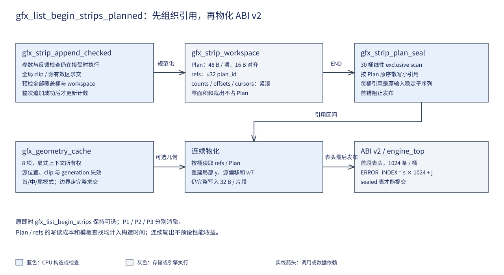

# 10 保序分桶与模板复用

## 一、动机

易灵思 Ti60F225 的 CPU 以 ABI v2 把全局矩形拆成条带内记录，硬件按每桶
原序执行混合。F1 实测显示这种构造明显贵于直通；连续的 32 B 记录在构造
过程中会跨相距 32 KiB 的桶写入。F3 验证是否可以先组织小引用，再连续
生成最终记录，并把重复几何计算作为另一项独立候选。

最终提交的 ABI 不变，每桶 1024 条、表头占首段、错误索引仍为
`strip×1024+slot`。CPU 的游戏逻辑和绘制顺序不进入优化边界。

## 二、为什么是这几步

首先保留原即时分桶作参考。错误优先级、逐次调用原子性和源反馈检查已经
被其它层使用，访存组织变化不能顺便更改它们。

其次在接受 draw 时保存完成裁剪的规范化 Plan，再通过计数前缀和组织稳定
引用。直接按桶重扫全部输入会变成 O(U×S)，既增加读取，也模糊了候选边界。

然后按桶读取引用并物化完整记录，表头最后发布。几何缓存独立开关，单测
源位置、描述符、裁剪框与相位失效。最后分别对照 P0 原路径、P1 planned、
P2 模板、P3 组合的字节、像素、错误与板上周期。

## 三、每一步做了什么

### 3.1 接受时保持原检查和原子性

`gfx_list_begin_strips_planned` 显式接收调用方独占的
`gfx_strip_workspace`。旧 `gfx_list_begin_strips` 继续立即写桶；新入口的
表只有成功 END/seal 后才可消费。地址/长度、Plan 16 B 对齐、refs 4 B
对齐以及工作区、表与上下文之间的重叠，在首次写入前检查。

`list.c` 的标量与批量入口仍处理参数、CLOSED、FULL 和共同字段检查。
`gfx_strip_append_checked` 仍拒绝源/目的 DDR backing 区间相交，吸收
SET_CLIP，并求目的、表面、裁剪框与源有效区的交集。

零面积和完全裁出不生成 Plan；NOP 进入桶 0。每次追加先检查全部覆盖桶
和 workspace 容量，任何一项不足都不增加该次的 Plan、引用、计数或 used。
拒绝不占索引，后续合法调用保留原记账。

### 3.2 紧凑引用与连续物化

`gfx_strip_plan_item` 固定为 48 B：32 B 全局规范化命令、两个 u16 的首末
条带、逻辑序号和两个保留字。全局裁剪已经写入目的坐标、尺寸和源偏移。

封表依次执行 30 桶线性 exclusive scan、按 Plan 原序散写 u32 plan_id、
按桶读取引用并写完整 32 B 记录。物化重建局部 y、尾片高度、源 y 和 w7。
总复杂度 O(U+M+S)，同桶引用保持原输入相对次序。

```text
旧路径：draw -> 校验/求交 -> 预检全部桶 -> 向多个 32 KiB 桶写完整记录

新路径：draw -> 校验/求交 -> 预检全部桶与工作区 -> Plan / counts [新]
                                                    |
END -> 前缀和 -> 稳定 u32 refs -> 桶内连续物化 -> 表头发布 [新]
```

上限 Plan 为 1.5 MiB，refs 为 120 KiB；游戏 A/B 各使用共享区内独立的
1.75 MiB 分配范围，起点避开 TEX 影子，终点早于 F2 prepass 命令区。
GPU 实际只消费最终 v2 表。refs 与 Plan 的额外写读仍完整计入 CPU 构造，
没有用输出连续性推定净收益。



### 3.3 可单独启用的几何缓存

`gfx_geometry_cache` 有 8 项，按键散列直接映射，冲突替换。键保存公共
绘制字段、源坐标、尺寸、源/目的描述符、完整 clip 和 `dy mod H`。
缓存每张表显式清空，不跨帧隐式复用；`gfx_list_geometry_generation` 在
描述符代次改变时清空有效项，作为整个缓存的 generation 键前缀。构造期间
描述符变化还会通过原始三个描述字进入新键。

仅完全处于源、目的和 clip 内的矩形允许命中；负坐标、越界和边界仍走
完整求交。miss 保存 leading/interior/trailing 的行数与片段数；即时物化命中
后按当前桶位置复用这组三段模式，planned 的接受阶段复用全包含裁剪，最终
物化继续从规范化 Plan 生成局部片段。两种路径最终仍完整写八个字。源位置
或 clip 改变必须 miss，测试把这项作为明确的缓存不变量。

该模板保留共享字段检查，不替代 `gfx_cmd_check`。首次试验发现默认路径
仍进入可选函数，调用方改为先检查 `l->geometry`，未启用时不增加函数调用。
模板查找、全包含判断和 miss 成本都进入 P2/P3 的构造时间。

### 3.4 发布、执行与应用接入

有 sticky 首错的 planned END 保持旧返回与 ended 语义，但不发布可消费
表头，workspace 的 sealed 保持为零。renderer 同时检查构造记账、END
和 sealed，错误表不能提交。成功封表后再次追加沿 CLOSED 记账，不修改
已经物化的表。

应用只在既有 STRIP 后端选择 `GFX_FRONTEND_PLAN` 与
`GFX_FRONTEND_TEMPLATE`；弹种表、运动和图形内容没有优化分支。其它三个
后端与 v1 字节接口保持。A/B 依据命令缓冲选择独立工作区，切后端先 flush。

### 3.5 独立判据与完整回放

`test_planned.c` 前 10000 张场景要求成功 seal，另 1000 张测试错误。
原即时、planned、模板和组合四条路径分别比较返回、used、首错、rejected、
overflow、ended；有效 seal 后比较整张 1 MiB v2 表，包括未使用空间。
输入覆盖非游戏尺寸、六方程、源位置/stride、动态 clip、负坐标、源越界、
NOP、零面积、关闭状态和别名。

定向容量试验先填满中间桶，再追加横跨前、中、后三桶的矩形，确认整次
追加无部分写入。后续合法矩形的索引仍与即时路径一致。另测源位置与 clip
变化强制 miss，封表前计数表必须保持未发布状态。

实际生产变异包括引用倒序、尾片源偏移加一、提前发布、模板键漏源位置、
漏 clip、输出 w7 不写和关闭反馈检查；消费者分别在完整表字节、封表边界、
缓存失效或明确错误码处报告失败。共享页复用变异由 F2 生命周期消费者识别。

独立直通软件执行器又对 10000 张非游戏场景逐像素比较，包括六方程和
padding。planned、模板与组合分别完整运行 9208 帧宿主游戏回放，与原直通
逐行一致。字节一致证明构造兼容，像素与板端验证单独登记。

## 四、遇到的问题

### 4.1 成功封表后的 CLOSED 错误

**第一现场。**

```text
FAIL error unpublished scene=4336
```

**解读。** 该场景先成功 END，再追加，首错是 CLOSED；此前已经成功发布
过表，因此“只要最终 first_error 非零就从未 sealed”的断言过强。

**定位。** 对照旧列表 END 后的 sticky 记账，区分封表前错误与封表后拒绝。

**根因与修法。** 成功 seal 的表继续检查完整字节；封表前已有错误的表检查
未发布。renderer 对两种最终错误都拒绝提交。原断言把两个发生时间不同的
状态合并，导致合法 CLOSED 行为被误判。

### 4.2 随机检查覆盖不足

**第一现场。**

```text
PASS: 10000 planned/template scenes; valid seals=3
```

**解读。** 大量错误场景虽然记账相同，却没有进入最终表字节消费者。

**定位。** 增加成功 seal 计数，检查反馈别名、提前 END 和第六方程的源格式。

**根因与修法。** 拆成一万张必须成功的随机场景与一千张错误场景，源格式
按方程分别设置。完整经过字节消费者的场景数成为硬判据，原循环次数保留
为输入数量，二者分别报告。

## 五、结果

计划/引用/连续物化与实际几何模式均已实现，ABI v2 保序、错误记账和像素
语义通过独立验证，三种候选完整宿主回放一致，硬件各 17 帧采样匹配直通。
最终同一 140022 B BIN 在 4KB/1 路和 16KB/4 路各完成 45 次 1000 帧
构造，原值见 `logs/f3_cpu_4k.json` 与 `f3_cpu_16k.json`。
最大重复偏差分别为 0.00721% 和 0.01568%，各组均完整结束、错误零。
当前源码 PERF=0 重建仍与该镜像全字节一致，见 `f3_source_reproduction.json`。

| 状态 | 路径 | 4KB 周期/帧 | 16KB 周期/帧 |
| --- | --- | ---: | ---: |
| 零敌弹 | TEX | 372146 | 330278 |
| 零敌弹 | P0 即时条带 | 753309 | 685854 |
| 零敌弹 | P1 planned | 755400 | 666528 |
| 零敌弹 | P2 几何模式 | 1488272 | 1392678 |
| 零敌弹 | P3 组合 | 1515740 | 1425344 |
| 16×16 K1984 | TEX | 831878 | 749159 |
| 16×16 K1984 | P0 | 2387997 | 2274028 |
| 16×16 K1984 | P1 | 3801734 | 3537541 |
| 16×16 K1984 | P2 | 9028651 | 7841757 |
| 16×16 K1984 | P3 | 10843248 | 9695992 |
| 8×8 K1984 | TEX | 826400 | 743079 |
| 8×8 K1984 | P0 | 2238998 | 2127015 |
| 8×8 K1984 | P1 | 3466359 | 3256277 |
| 8×8 K1984 | P2 | 8930258 | 7749161 |
| 8×8 K1984 | P3 | 10628696 | 9505486 |

几何模式在三个状态的命中/未命中为 54/150、1320/1036、1343/1060，说明
它实际复用了首/中/尾模式，而非只测 miss。完整键构造、查找和缓存失效检查
仍比原轻量几何贵。planned 又增加规范化 Plan、refs 写读和物化访问；连续
目的写不足以抵消额外工作。16KB 零负载 P1 相比 P0 下降约 2.8%，两型
高负载均退化，不能依据这一局部结果采用。缓存容量与路数共同变化，也不能
将两配置差异单独解释为容量收益。

同一采样配置的 GNU size 原值见 `logs/code_sizes.json`：

| 构建 | text/rodata B | data B | bss B | 相对 P0 的三项增量 B |
| --- | ---: | ---: | ---: | --- |
| P0 | 90168 | 44974 | 978156 | 0 / 0 / 0 |
| P1 | 90344 | 44974 | 978980 | 176 / 0 / 824 |
| P2 | 90196 | 44978 | 979532 | 28 / 4 / 1376 |
| P3 | 90364 | 44978 | 980356 | 196 / 4 / 2200 |
| P3+B2 | 90556 | 44978 | 980740 | 388 / 4 / 2584 |

Plan/ref 最大双工作区约 3.234 MiB，应用按两个 1.75 MiB 槽分配，另有命令
区和背景页。这些共享区映射未计入 bss。源码 wildcard 与 gc-sections 决定
哪些函数进入各 ELF，因此代码增量只对应这些配置，不是所有链接方式的上界。

软件研究与实现阶段完成。P1/P2/P3 均不转正，原即时 P0 保持默认；本轮没有
消除条带路径相对 TEX 的整机退化，也不宣称新的 N_max。

## 六、还欠什么

本批保持完整记录物化，不做跨帧旧记录的局部改写。硬件实例和引用执行
继续由 F4/F5 处理；本章不把它们记作已实现。未通过采用门槛的候选保持
显式研究开关，原即时路径继续可用。候选完整硬件 9208 帧和两型最终 N_max
采用确认尚未执行；没有净收益时不为候选继续扩大采用验证。
