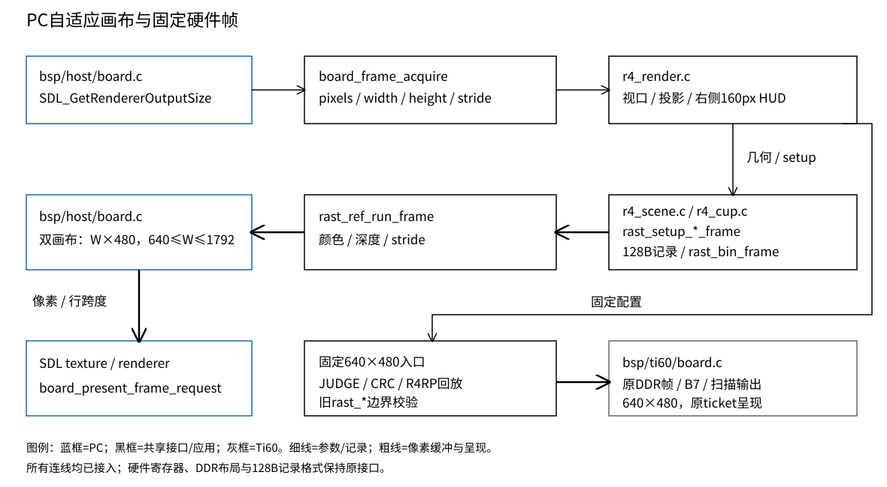
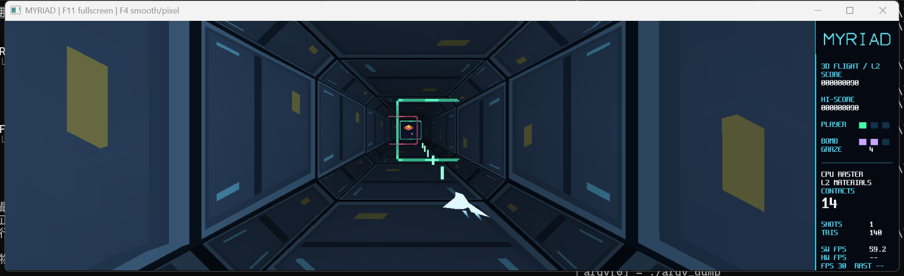
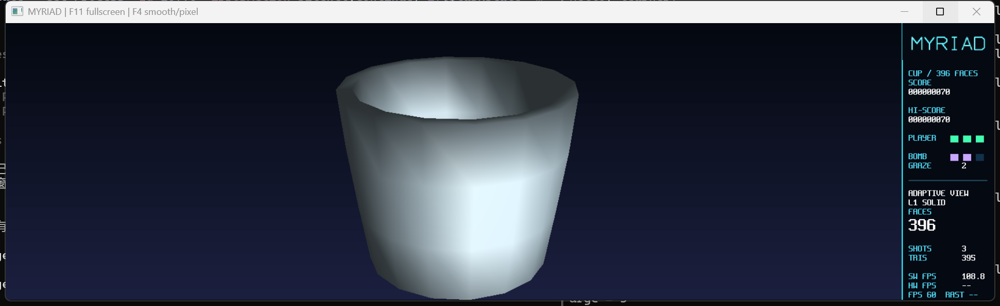
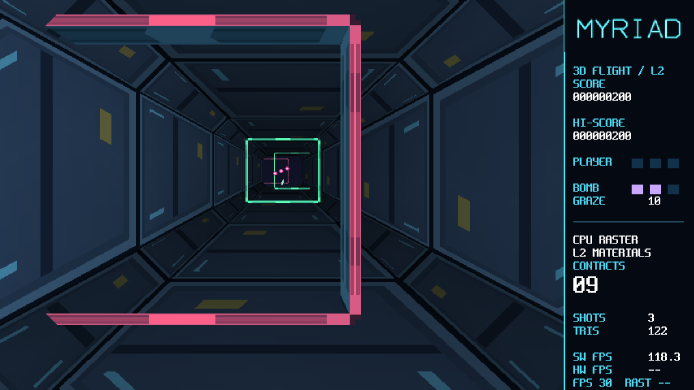

# 11 PC宽屏自适应与跨屏呈现

状态：**已验收（2026-10-29 用户验收）。实现与本轮选定验证完成**（2026-10-25）。本章记录用户检阅R4时提出的全屏黑边问题；
15项acceptance检查、固定路径差分与运行包实测已完成，范围和证据见第五节。

## 一、动机

上一轮R4和PC全屏工作保留640×480整帧、左480×480世界和右160像素HUD。
SDL全屏仍使用固定逻辑尺寸，因此1920×1080屏按4:3放大后左右各约240像素留黑。
用户要求正常拓宽并支持换显示器，随后授权修复和记录TechReport。

原有帧不仅是一个SDL纹理，还绑定DDR分区/行跨度、30条16行条带、R1裁剪与128B记录及硬件能力。
直接改显示缩放会拉伸形状，直接把全局640改成屏幕宽又会改变硬件契约及内存边界。
本轮把可变的PC呈现画布与固定的PC/FPGA对照帧区分为明确接口，共用世界状态和定点语义。

## 二、为什么是这几步

1. 保存实际工作树基线和三场景各60帧的像素/记录CRC；已有未提交的R4和Windows功能必须保留。
2. 先扩展软件setup/记录校验/分桶/执行器的显式画布边界，旧API继续使用640×480。
3. BSP按实际绘制像素获取目标画布并持有双缓冲；应用不引用SDL，不把显示器参数带进玩法。
4. R4用新世界视口和aspect重新投影，将原HUD搬到右侧；尺寸改变时失效相关投影/墙缓存。
5. 数值、原生窗口、固定路径对照和共享路径板测分别验证，最后冻结独立运行包并交用户检阅。

内部高度保留480，宽度为`round(output_w*480/output_h)`，限制在640～1792。
常见宽屏增加真正的横向视野；4K同16:9的内部工作量相同，不随物理像素成倍增长。
过窄或超出上限时保持比例留边；整数画布允许不足一个内部像素的比例取整余边。

## 三、每一步做了什么

### 3.1 显式软件画布与固定ABI

`lib/gfx/rast_setup.h/.c`增加`rast_frame`及带`_frame`的setup、记录校验和分桶入口；
`rast_ref.c`按显式画布校验整批记录后执行。旧入口委托640×480默认边界，宽屏记录仍被旧校验拒绝。
记录布局、逐项舍入、top-left、LESS、UV/颜色量化与色/z原子提交保持原定义。

扩展视口先裁到画布内，再建立包围盒和属性。1792上限使guard右界32767仍可用s16原点表示；
实际可见原点x上界28671，属性仍用s64中间量。边值的保守求和上界1,728,053,248小于2^31。
完整范围和算式写入`Main/doc/三维数值契约.md`第2.2节。条带头仍为30个，硬件寄存器和DDR布局未扩展。

### 3.2 呈现目标归BSP持有

`board_frame_acquire`提供指针、宽高和像素行跨度，`board_present_frame_request`在已有ticket节拍上呈现。
PC按`SDL_GetRendererOutputSize`读实际像素，按需调整自己的两个画布；只有获得的合法缓冲才能呈现。
Ti60实现返回原帧和固定尺寸，并委托原呈现接口。原DDR模拟与物理帧未更换布局。
最大额外PC颜色双缓冲6,881,280B、单条带深度57,344B；这些是尺寸计算，不是板上RAM占用。

窗口/全屏保持等比缩放，纹理重置保留当前尺寸与过滤。断屏事件和退出全屏会核对保存的位置是否
还能露出可操作标题栏；失效位置回到现有屏。每帧查询实际输出，使跨屏/DPI变化无需依赖旧尺寸缓存。
使用的SDL行为依据为[绘制像素尺寸](https://wiki.libsdl.org/SDL2/SDL_GetRendererOutputSize)、
[窗口事件](https://wiki.libsdl.org/SDL2/SDL_WindowEventID)及
[桌面全屏/纹理重置](https://wiki.libsdl.org/SDL2/SDL_SetWindowFullscreen)。



### 3.3 R4布局与玩法边界

`r4_render.c`在帧开始取得画布，世界宽度为`canvas_w-160`，垂直FOV固定，aspect取世界宽高比。
`r4_scene.c`所有普通/缓存几何出口和`r4_cup.c`使用相应显式边界。HUD仍由原2D命令绘制，
在PC宽屏画布右侧复制完整160×480区域，保留原字体、计分与更新机制。
宽屏茶杯使用整个世界视口；固定模式保留320×240同构对照视口。

```text
固定帧 640x480                  PC自适应帧 Wx480
+-----------------+------+      +--------------------------+------+
| 世界 480x480    | HUD  |      | 世界 (W-160)x480          | HUD  |
| 固定投影       | 160  |      | 固定垂直FOV，重算aspect   | 160  |
+-----------------+------+      +--------------------------+------+
```

输入、世界tick、碰撞、移动边界和录像格式均不取画布尺寸。JUDGE/CRC、R4RP回放与Ti60始终取固定帧。
`GFX2D_ASPECT=fixed`保留交互兼容入口；新包`Run-PC.ps1 -FixedAspect`显式选择它。
旧运行包不覆盖。模式1/2/3仍按各自原有固定画面呈现，本轮真实宽屏范围是R4。

## 四、遇到的问题

### 4.1 进程存在但桌面没有游戏

第一现场：`MainWindowHandle`初次非零、`Responding=True`，用户却看不到任务栏中的游戏。
后续进程返回窗口句柄0，桌面名为`CodexSandboxDesktop-*`，正常桌面名为`Default`。

解读：进程响应只表示消息队列未挂起；同一SessionId也不能证明位于用户桌面。
定位时同时检查进程、窗口站和线程桌面，发现首次启动属于工具隔离桌面。
修法是关闭该实例，从正常用户桌面启动，并核对前台窗口和真实游戏截图。
原有启动确认没有检查桌面身份，不能作为实际可见的证明。

### 4.2 部分缓存几何仍走640宽度入口

第一现场：`WIDE CHECK FAIL wide world emission`，640/768画布通过，854画布的场景发射失败。
解读：解析矩形已能覆盖新增区域，失败限定在真实场景几何出口。
定位发现敌机实体、自机顶点缓存与机翼反面路径绕过普通polygon辅助函数，继续调用旧入口。
统一这些出口的画布边界后，各尺寸世界/茶杯记录通过，渲染前后世界状态保持一致。
旧判据只使用640×480视口，没有让这些缓存路径遇到超出旧帧的合法新视口。

### 4.3 环境变量接口与变异检查的订正

第一现场：Windows自适应尺寸正确，但切`fixed`后断言`fixed.width==640`失败。
测试写入使用`SDL_setenv`，读取混用C运行库`getenv`；统一为`SDL_getenv`后固定/自动切换通过。
原有环境变量都在进程启动前设置，没有覆盖运行中写入后再读取的情况。

变异初次因`frame`参数未使用而编译失败；这不是覆盖判据见红。孤立变异副本补显式未使用标记后，
又被较早的硬件记录拒绝断言捕获。保留全部正常判据、将该断言移到解析覆盖检查之后，
最终要求原640宽度钳位明确在`depth coverage`见红，不把任意编译/运行错误当成功。

### 4.4 窗口矩形不代表截图中显示的是它

一次双屏取样时，第二屏游戏窗口被其他应用遮挡；该次结果改记INCOMPLETE，遮挡截图未收入证据。
之后在截图前恢复窗口、核对自身前台HWND，再取样。两屏实际游戏均已目检，新增世界和完整HUD可见。
原有脚本只核对矩形，缺少前台窗口身份检查。

### 4.5 PC堆分支误引入裸机系统调用

第一现场：板端R4构建产生`_close/_lseek/_read/_write is not implemented and will always fail`告警。
解读：C编译成功并不符合零告警判据，检查入口在部署前拒绝；没有进入该轮物理板测。
定位到`r4_render.c`的PC宽画布`realloc/free`引用仍出现在裸机链接输入中，虽然Ti60运行时只返回固定画布。
将PC深度缓冲的分配/释放在编译期隔离，裸机遇到不支持的宽画布直接拒绝；不添加伪系统调用也不压告警。
同时中断已有软件轮，修改后建立新冻结轮，不复用输入已变化的通过记录。旧固定源码构建没有堆引用，
原有检查正是在本轮真实目标构建时覆盖到了这个问题。

### 4.6 图像一致但固定路径余量下降

第一现场：压力输入`R4PERF 1800 2797360 3221484 3323981 1085 715 0 3601 1800`。
虽然单帧渲染未超过预算，实际多出一场，后续相对既定场锚点持续迟到；`fail 0`不能覆盖节拍判据失败。

按相同输入的`R4TIME`定位：原版/首候选几何中位数为1,533,542/1,609,679周期，约增加0.76ms；
分桶165,724/165,783、提交965,600/965,874、RAST640,883/640,587周期基本相当。
因此没有把问题归因于DDR或光栅硬件，而是收敛到扩展后的CPU几何出口。

`r4_geometry.h`增加编译期选择的薄适配：RISC-V直接连接原固定尺寸setup入口，PC连接显式画布入口。
这保留固定热点的常量边界及调用形态，不让PC宽屏能力改变板端的几何热路径。
正常图像、失败轮原始输出和后续独立压力探针分开登记；探针不能代替完整`r4-board`验收。
原固定尺寸CRC判据能确认图像语义，不能证明性能余量，本次60秒真实节拍检查覆盖到了该差异。

## 五、结果

定向quick：软件宽屏正常64/32、ASan/UBSan、解析矩形/深度、stride哨兵、原子拒绝、分桶独立画序、
投影方块比例、世界状态不变及固定宽度变异通过。原生窗口的全屏往返、窗口比例、两屏移动、
固定入口、过滤/纹理恢复、失焦释放和模拟断屏恢复通过。

| 显示输出 | PC画布 | 世界 | 证据类型 |
| --- | --- | --- | --- |
| 1024×768 | 640×480 | 480×480 | 策略/数值 |
| 2560×1600 | 768×480 | 608×480 | 实际Windows全屏，144 DPI / 150% |
| 1920×1080 | 853×480 | 693×480 | 实际Windows全屏，96 DPI / 100% |
| 3840×2160 | 853×480 | 693×480 | 策略尺寸；非4K实屏 |
| 3440×1440 | 1147×480 | 987×480 | 策略尺寸；非超宽实屏 |
| 5120×1440 | 1707×480 | 1547×480 | 策略/数值；非32:9实屏 |

| 范围 | 最终轮/对象 | 状态与证据 |
| --- | --- | --- |
| pack/lib/rast/pc-wide/r4/app/pc/demo/game/stats/workflow/regs | `20261025-184831-32bbc76c` | 12项acceptance PASS；[软件汇总](evidence/11-pc-wide-20261025/software/result.json)，不复用此前中断轮 |
| Windows窗口 | `20261025-181352-816b121f` | acceptance PASS；其所选BSP/窗口输入未再变化；[窗口证据](evidence/11-pc-wide-20261025/window/result.json) |
| B7完整实板 | `20261025-184825-fcfcb370` | acceptance PASS；13个实板分组；[板测汇总](evidence/11-pc-wide-20261025/board/logs/r4-board/result.json) |
| 固定路径修复前后 | 最终源码，L1/L2/茶杯各60帧 | 全180帧像素和128B记录CRC零差异；[差分](evidence/11-pc-wide-20261025/review/fixed-release/comparison.json) |
| 原生Windows固定路径 | 最终MinGW构建，三场景各60帧 | 全180帧与修复前WSL基线一致；[原生对照](evidence/11-pc-wide-20261025/review/native-fixed-result.json) |
| 实际宽屏/跨屏/DPI | 同一最终Windows EXE | 32:9比例窗口的L2/L1与茶杯取样、两块144/96 DPI屏全屏；[身份与尺寸](evidence/11-pc-wide-20261025/review/pc-live/runtime.json) |
| 分层与构建注错 | `20261025-193950-f258c38d`，独立冻结源树 | acceptance PASS；1143文件复制校验，原树未变；[隔离证明](evidence/11-pc-wide-20261025/layers/isolation.json) |

软件正式范围包含完整通关录像重搜与9208帧双回放、150次模式切换和36000帧日志长跑。
长跑共600行，`lines_dropped=0`、无截断、发送额度超限0次/0字节；这是日志判据，
不将PC墙钟导致的呈现迟到混写成硬件性能结论。分层检查在逐字节核对的独立Git副本中注错，
复制前后核对主树全部1143文件，避免影响并行的冻结统计轮。

完整板测包含L1 60帧、L2 240帧、茶杯60帧的像素/记录对照，各场景板上软件各2帧对照，
真实像素注错、模式/后端/阶梯往返、录像、旧游戏240帧和R3故障恢复。两组节拍均为预热后1800帧：

| 输入（固定640×480、B7） | p50 / p99 / max | 迟到 / 超预算 | 场 / 交换 | ZERO / UNDER / RESPERR |
| --- | --- | --- | --- | --- |
| 自动驾驶 | 26.40245 / 30.67610 / 31.44405 ms | 0 / 0 | 3600 / 1800 | 0 / 0 / 0 |
| 脚本移动与炸弹 | 26.62054 / 30.58801 / 31.70006 ms | 0 / 0 | 3600 / 1800 | 0 / 0 / 0 |

以上是最终实板有限帧构建，不能移作PC宽屏性能或无限发布BIN的同构建证明。
本轮未改RTL，复用经当前RTL身份核对的B7位流；59623 XLR / 187 RAM / 26 DSP和
core setup/hold +0.762/+0.026ns属于该位流的既有综合证据，本轮没有重新综合。
无限发布程序另行零告警构建，RAM 3,264,320B / 4092KiB（77.90%），只描述这一构建。

板测结束后已用同一B7重新JTAG加载无限程序，真实加载200454B，实时状态为模式4/L2/HW/走廊、30FPS。
启动边界、加载字节数与BIN/bit身份见[无限程序启动](evidence/11-pc-wide-20261025/delivery/board-startup/result.json)。
Flash未改，未新增人工HDMI验收声明。

独立新包为`Main/bit/board_release_game_wide_20261025/`，历史包未覆盖。
`Run-PC.cmd`/`Run-PC-Fullscreen.cmd`默认自适应，`Run-PC.ps1 -FixedAspect`保留对照。
PS7固定入口、PS5.1自适应入口均实际启动；两版本对改动EXE的反例均在启动前拒绝。
最终自适应包已在正常用户桌面打开并留在1920×1080屏的全屏模式，
EXE与包清单在取样前后核对未变；[入口与身份](evidence/11-pc-wide-20261025/delivery/entries/result.json)。
软件归档沿用原WSL工具链参数；Windows空参数归档请求曾被保护检查拒绝，未改运行状态或跳过核对。







这些是Windows应用截图，不是HDMI实拍。原始采样/基线、失败与独立探针各自保留，
字节复制核对见[取样清单](evidence/11-pc-wide-20261025/review/manifest.json)。
两屏分辨率与100%/150% DPI已实测；其他DPI档位及物理拔插不据此推定。

收尾的路径检查与空白差异检查通过，新TechReport/Todo的本地链接、运行包25个文件身份均已核对。
还逐段对照开工前diff，确认已有`engine_pix.v`、游戏`main.c`、atlas与TechReports总README改动未被改变；
见[收尾核对](evidence/11-pc-wide-20261025/final-check/result.json)。本轮不提交或推送已有工作树。

## 六、还欠什么

代码、本轮选定验证、证据归档和运行包已完成，仍需用户检阅实际画面。
物理拔插及非100%/150%的DPI档位未现场操作；窄于4:3或超出宽度上限时保比例留边，
模式1/2/3与板端仍为各自固定显示路径。本轮没有把这些边界登记为已测试或已拓宽。
对应PC宽屏自适应Todo已于 2026-10-29 用户验收后删除，记录以本章为准。
