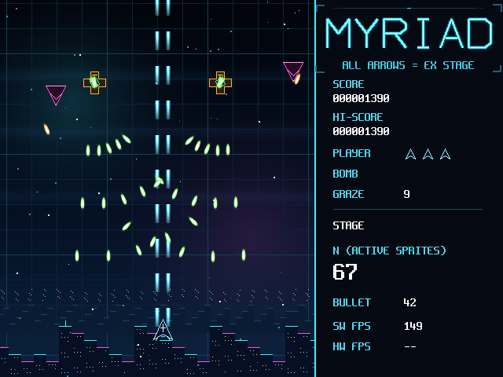
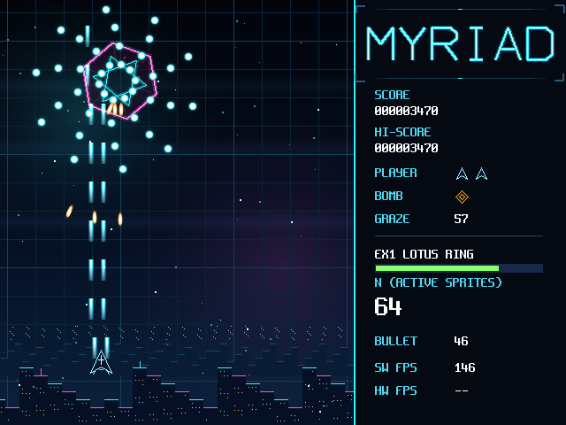

# 12 玩法与审美升级

状态：**已验收（2026-10-25）**。spec 在 [`Main/doc/软件升级-玩法与审美.md`](../../../Main/doc/软件升级-玩法与审美.md)，
判据并入 [`tools/check/check_sw7_game.sh`](../../../Main/tools/check/check_sw7_game.sh)（G13x/G14 扩展）。
范围：只动软件与素材，B7 位流（59623 XLR，sha256 2bd49db6…）逐字节未动。

## 1 要解决什么

老师评审的四条意见收敛成两个维度：美术资产无统一约束、玩法编排普通。
前期的产品化调研（摄像头/RTOS/外设/AI）明确全部缓行，本轮只做画面审美与玩法，
并且受一条硬约束圈定：`stg_game_step` 的确定性契约被三样东西消费——两遍运行逐字节相同的
判据日志（G10/G15）、按键脚本、通关录像 `replay/stg_clear.g2dr`（G16b 重搜逐字节相同）。
所以仿真规则层（池/发射/碰撞/规则步）一字未动，扩展全部走"绘制层 + 常量表 + 附加路线"。

## 2 素材升级

`tools/assets/gen_stg_neon.py` 重绘 12 张既有 PNG（几何全部冻结：格子尺寸、行数、帧数、
文件名不变，游戏代码零改动），新增背景合图一张，共 13 张：

- 弹三类：白心更亮、双层光晕（内环亮/外环淡），米弹加彗尾（尾部拉伸剖面）；
- ships/boss：线框改暗色填充+亮描边（剪影可读），boss 加六辐条与渐变填充；
- title：四角括号、上饰线、暗色投影，**底部烘入 8x16 点阵提示行
  「ALL ARROWS = EX STAGE」**（见 §4.3，提示不能走每帧逐字文本）；
- **新增 `bg_layers.png`（512x608，槽 15）**：天空 400x480（三段渐变+两团星云+三条极光带）
  + 远景剪影带 512x56 + 城市剪影带 512x72。表面 ID 在命令记录里是 4 位（gfx_abi.h
  `gfx_src/gfx_dst` 取 4 位、engine `surf_ra_id` 也是 4 位），16 张是硬上限，槽 15 是最后一张；
  合图宽取 512 使 stride 恰为 2 的幂，素材包 4 085 504 字节 < 4 MiB Flash 分区上限。

色板收紧：底 `#02040A`、青 `#35F2FF`、品红 `#FF4FD8`、琥珀 `#FFB23E`、绿 `#8DFF6A`、
自机 `#A8FBFF`；背景新增深蓝过渡带。`--check` 基线更新，G14 张数 12→13。

## 3 绘制层（stg_draw）

命令表形状（V2 断言同步改）：`SET_CLIP` → 天空两笔 200 宽列切片 BLIT(COPY)
（`STG_BG_SKY_BLITS=2`）→ 28 条网格 FILL（`STG_BG_FILLS=28`，无底色 FILL——天空底图替代）
→ 剪影带（各 4 笔 256 宽切片，横向循环视差）→ 星点 → 实体 → 特效 → 横幅 → 闪白 → HUD → END。
类别恒等式扩展：`ADD = 自机弹 + 粒子 + fx_graze`（判据入口 stg_main.c 的同一恒等式同步）；
`ALPHA = 敌弹 + Boss + 标题`、`CONST = 闪白` 不变，扣残机帧的闪白改红色。

- **震屏**：`shake` 剩余帧数放进 stg_game，第 7 步由 ev 位派生（受击/炸弹/破符给拍、逐帧衰减），
  不消耗随机数；绘制时只偏移装饰层（剪影带/网格/星点），天空不动保证整帧覆盖。
- **Boss 血条**：HUD 段名下外框+内芯 FILL，颜色按剩余比例绿→琥珀→品红，只读仿真状态。
- **擦弹特效**：本帧擦到弹就在自机四角放四粒 ADD 火花，计入 `fx_graze`。
- CLEAR 画面维持单词级文字（§4.3 的教训），得分看 HUD。

## 4 板上问题记录（第四章体例：都是上板实测逼出来的）

4.1 **`--flash-boot` 会把 outflow 位流写进 Flash 0x0。** 主工程的
`fpga/gfx2d_ti60/outflow/gfx2d_ti60.bit` 是 **B0 基线**（36 894 XLR，无 TEX/三维），
连跑三次 `--flash-boot` 之后 Flash 里的位流已是 B0，游戏照常跑但 CAPS 无 TEX 位，
`s_backend>=2 && !s_tex_ready` 静默回退 HW/DDR（main.c 的既有逻辑），标题 2 fps。
恢复用 `make_flash_image.py --bit <B7 的 Efinity hex> --app --asset` 合成整镜像一次写回，
之后 `board_run.py --bit <发行包 B7.bit> --flash-boot` 指定位流启动。教训：outflow 位流
身份（B0 基线）与生产位流（B7）不同，flash-boot 的默认 `--bit` 对生产板是错的。

4.2 **后端 2（硬件/TEX）才是生产口径。** 第一轮板上验证用 `-DGFX2D_START_BACKEND=1`
（硬件/DDR），标题 2 fps、ft_max 28.2M 周期而 cyc_exec 只有 45 万——等待发生在
build/exec 之外。11-pc-wide 证据里的 legacy 日志显示生产构建是 `hw-tex` 且标题 60 fps，
照抄后端 2 后（注意 target.mk 的 FLAGS_STAMP 只对 flags 变化清对象，
`EXTRA_CFLAGS` 变化是会被处理的，但 make 输出里看不出来，别靠猜）恢复 60 fps。

4.3 **域内逐字文本是 HW 条带流水线的悬崖。** 标题的 38 字提示行走
`stg_text_draw`（38 笔 8x16 COPY+KEY 小 BLIT，画在游戏区裁剪框内）把标题帧拖到
282 ms；删掉这一行立即 60 fps，游戏内（几百颗弹的 ALPHA/ADD/KEY 命令）反而全程 60 fps。
二分排除了剪影带、宽源切片、色键、后端之后才定位到它。删行后连续多次上电稳定 60 fps；
期间出现过一次同二进制重启即恢复 60 fps 的孤例（未复现，不排除引导期状态差异），
机制未深究（怀疑与条带规划器对域内小命令的分 bin 成本有关）。本轮的处置是规矩化：**游戏区内的文字只允许单词级
（CLEAR），行级提示烘进标题图资产**，这条写进了 spec §3 与 gen_stg_neon.py 的 title() 注释。

4.4 **HW/TEX 的条带流水线按条带切片暂存源矩形进 16 KiB 片上 TEX 窗口**
（check.c：TEX 空间表面 `base + height×2^stride ≤ 0x4000`），单笔 BLIT 的源宽
w×16×4 ≤ 16384，即 **源宽 ≤ 256 px**。400 宽的天空与 512 宽的剪影带超限
（legacy 最大键控 blit 只有 32 宽、标题图 240 宽贴着线内）。处置：宽源一律按
`STG_BG_SLICE_W=256` 列切片（天空 200+200、剪影带 256+256×2 份）。
4.3 的悬崖与 4.4 的窗口是两回事：切片修完源宽之后 4.3 仍在，删提示行才恢复。

4.5 **E 组前缀撞车。** app 测试的发射器组（test_stg_emit.c）已经用 E1~E4 编号，
EX 关卡的测试改名 L 组（L1 经典纯度、L2 触发与表切换、L3 确定性、L4 表契约，12 行），
check_sw7_game.sh 的 G13x 计数 12 行。

4.6 生成器把城市楼体填充写错行（`px[x, y]` 少加 `BG_CITY_Y`，楼体写进图集顶部，
被天空 BLIT 原样画在屏幕顶端）——PC 截帧目检当场抓住；同轮 xrgb 色键图里
alpha∈(0,255) 的像素被 pack_assets 正确拒绝（半透明星点/窗点改全不透明）。

4.7 **打包预算是物理上限。** 素材包 4 MiB 上限来自 Flash 素材分区；560 宽合图会被
stride 垫到 1024（多 1.16 MB），超预算；宽改 512 后 4 085 504 字节过线。

## 5 玩法：EX 关卡

入口=标题→开局过渡帧上四方向键同按（判据按键脚本与录像搜索器不产生这种输入，
经典路线逐字节不变，G16a/c 在改动后原样通过）；另有编译钩子 `-DGFX2D_START_EX=1`
供演示与截帧。内容=只换常量表：EX 杂兵事件表（七波，含两条高速斜飞新移动表）、
EX 发射器组（快狙双发/12 向旋转环/对狙扇/20 向环）、4 张重构符卡
（EX1 LOTUS RING 旋转对称、EX2 TWIN FAN 双侧夹击、EX3 STORM RAIN 混合雨、
EX4 OVERLOAD+ 终符超载）。`stg_game` 只是把 `stg_stage_set` 指针在过渡帧上切换，
关卡集打包经典与 EX 两份常量表（stg_stage.h/c）。

## 6 判据与验收

- app 测试：V2/V3 更新到新命令表形状（天空切片数与 FILL 条数用导出常量断言）；
  新增 L 组 12 行；全量 `fail 0 / done`（64 位 ASan/UBSan 与 -m32 逐字节相同）。
- check_sw7_game.sh：G13x（L 组 12 行）、G14（13 张）扩展；G10/G15（经典判据两遍
  逐字节相同、九行 seg 齐）、G16a/b/c（通关录像复核、重搜 300 秒与入库逐字节相同、回放摘要逐行相同）、G17（S1 规模）
  全部在改动后的代码上原样通过；quick 与 acceptance 两档均 VALIDATION PASS（acceptance not_applicable=0）。

- PC 视觉验收：`GFX2D_SNAPSHOT` 截帧（标题/杂兵/SPIRAL 符卡/EX LOTUS），逐帧目检。
- 板上快照收编（按 2026-10-28 证据收编裁决，原视觉快照归档已撤销，四帧取二入库）：

  

  
- 板上：B7 + 新程序 + 新素材三分区写入并回环校验，flash-boot 实测
  标题/杂兵/Boss 全程 60 fps（hw-tex，drop=0，bottleneck=cpu）；
  按键脚本注入四向同按，清弹-归零点从经典 t≈28 s 推移到 t≈34.3 s
  （EX 事件表 CLEAR@2060 帧），第 6/7 波密集弹 60 fps 零溢出——EX 路线板上确认。

## 7 遗留与边界

- （已闭合）G16b 重搜已补跑：300 秒重搜与入库录像逐字节相同，经典路线确定性在全部改动后完整成立。

- 标题 2 fps 的根因（4.3）定位到了触发面但未深挖条带规划器内因；
  已把"域内文字只允许单词级"写成规矩，后续若要放开需要先给规划器立判据。
- 3D 模式（R4 茶杯）本轮未动：r4-board 三场景 CRC 证据链绑定其视觉，收益不配成本。
- 工作区里 `sw/bsp/ti60/board.c` 的 15 行 `board_frame_acquire` 增补是既有的待拍板项
  （宿主截图功能），本轮构建继承了它，与本办法无关。
