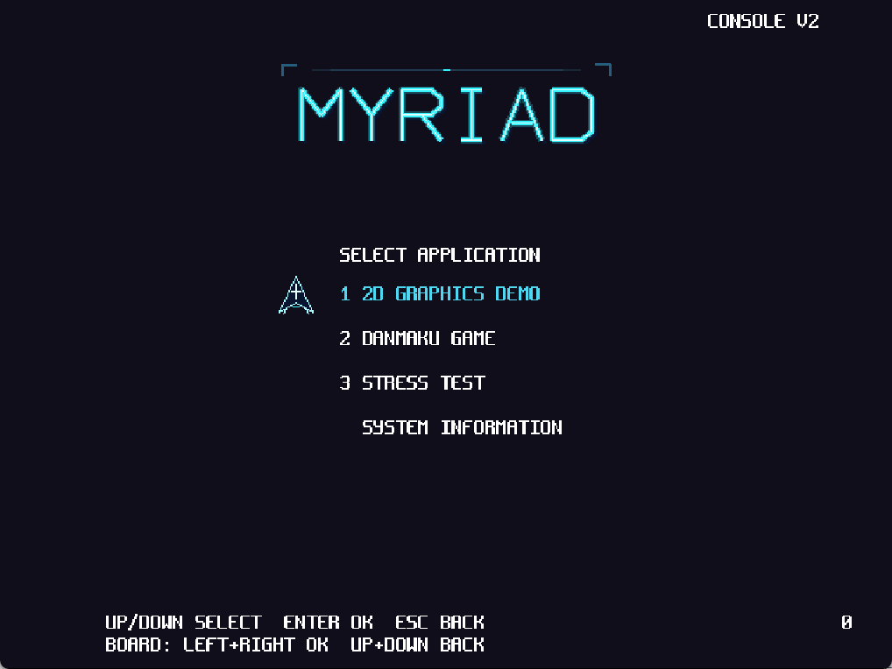
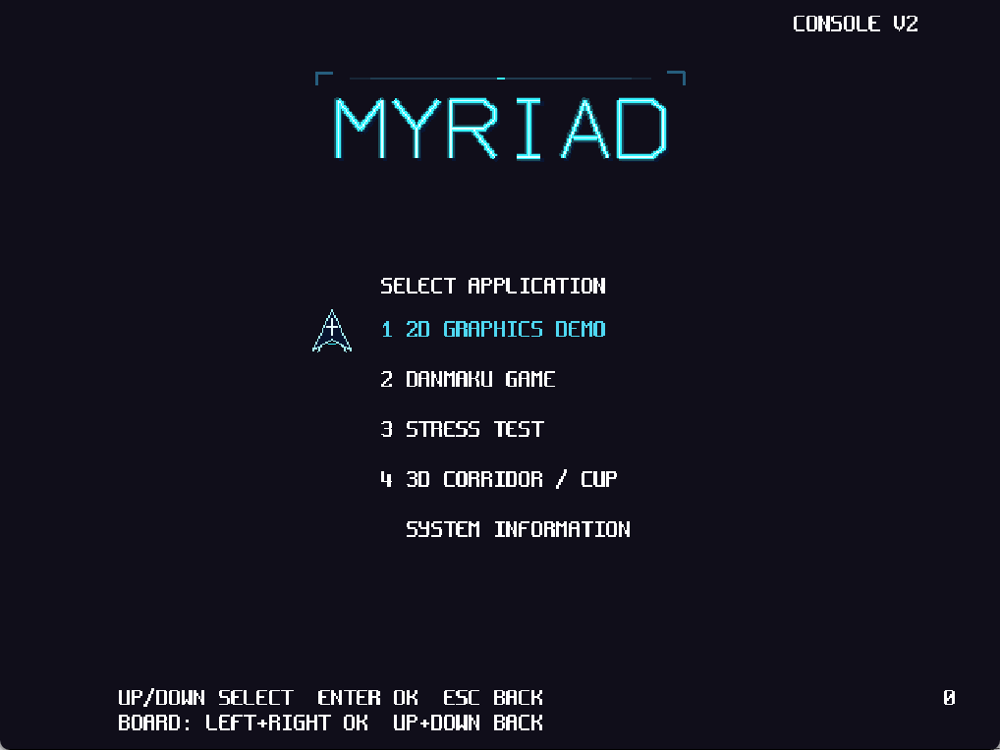

# 17 可选应用集合与快照固件

状态：**实现与本轮选定验证完成，待用户试玩验收（2026-10-30）**。八项软件 acceptance、
原生 Windows 两版本、四档快照 JTAG 和交付包核对通过；未写 Flash。结果与证据在第 5 节。

## 1 问题与开工边界

用户希望在 PC 上逐轮打磨画面与玩法，并指出 B0/B3/B5 只能运行当前前三个 2D 应用，
要求提供不含三维内容的 BIN，同时允许未来 2D/3D 应用数量变化。

开工时四快照都随附同一份 236982 字节 console BIN，菜单通过特判 ID4 拒绝无 RAST
设备上的 R4，但仍列出 UNAVAILABLE。makefile 无条件编入 R4；启动器、菜单、面板
和验证器分别维护四应用假设，PC 参数还限制 ID≤5。

硬件能力按位判断：B0=0x040f、B3=0x146f、B5=0x346f、B7=0xd46f。PB 与 RAST 互斥，
B7 不是 B5 的完整超集。图形分类也不等于硬件要求：CPU 绘制的三维内容可以声明与 R4
不同的能力。本轮不改 RTL、SDK、素材像素、Flash 布局或生产默认绘制后端。

## 2 设计取舍

保留已有通用 appfw 管理器和固定周期的内容逻辑。产品目录 `catalog.json` 是 ID、名称、
分类、快捷键、模块依赖和硬件要求的唯一真源；`2d` 选择 demo/stg/press，`full` 加 R4，
about 为系统内容。显式 APPS 支持自定义集合，数量不由宏或编号范围决定。

生成器在活动 OBJDIR/catalog 下生成 ID/文本常量、注册元数据、源文件列表和 content.json。
所选目录摘要进入构建 stamp 与运行遥测；A/B/A 切换必须清除原对象，防止目录更新但程序
仍混入旧内容。默认输出按配置区分，显式共享 OBJDIR 仍受 stamp 保护。

R4 模块移出 2D 编译输入；共享启动运行时只在启用其内容时包含 R4 表面、atlas 和钩子。
旧开发/判据入口默认保留原内容。无消费者的 R4 回放与光栅纯库同步移出 2D 链接。
裁剪单位为模块依赖：当前三个 2D 内容复用 myriad2d，公共菜单也使用其字体/素材接线。
自定义 APPS 控制入口与模块集合，不承诺把一个共享模块内部的所有未选适配函数逐个剥离。
后续独立游戏可声明独立模块；公共素材包作为当前固件的公共资源，R4 atlas 随模块内嵌。

运行时过滤的是已编入目录；菜单、全局快捷键和进入边界复用同一个能力判断。ID 与
位置分离；菜单使用可见索引与有限视口，处理空目录、环绕、滚动和恢复选择。PC 支持
按 ID/名称启动及只读列目录，非法入口在显示/资源初始化前拒绝。

## 3 资源与协议

不增加每个游戏对应的输入位。上下、确认、返回组成完整导航，1～4 作为可选快捷别名。
启动输出版本化目录，状态绑定目录摘要和实际 CAPS；面板显示目录中的应用，未知应用
保留名称，而不是强制归入旧四模式。冻结包携带同一目录，避免 PC 与板端内容错配。

本轮素材仍为 4085504 字节，距 4 MiB 上限剩 108800 字节；新增游戏不能无限追加贴图。
程序镜像上限 512 KiB、程序 RAM 4092 KiB，构建分别检查；表面槽为活动内容的 16 槽，
游戏切换沿用现有资源排空与登记机制。本轮没有重做通用资源分配器。

## 4 开发中的检查与订正

- 第一版 2D 交叉构建为 174130 字节；ELF 无 r4_/rast_/replay_r4_ 与 g_app_r4 符号。
  该数字只说明早期构建，最终交付身份以第 5 节为准。
- 扩展用例采用二十个稀疏 ID 内容，其中含多个与 R4 无依赖的三维分类，用真实生成与
  菜单编译验证，不把对原四模式的另一份模拟实现当扩展性证明。
- quick 诊断轮 `20261030-012724-67b0c9db` 的 pack/console 单项通过，随后为补齐面板
  通用重开、打包身份和板测编排主动停止；该轮不作为完整通过。正式轮显式登记交叉工具链。
- 分层注错改在独立源码副本内执行，避免与本轮板端构建竞争生产源码。原仓 SDK 差分另行
  核对为零。此变化暴露了已有归档器的路径假设：它枚举运行目录下任意深度的 logs，却只
  复制顶层 logs。软件归档核对时报 `FileNotFoundError`，缺项为隔离树的 object-isolation
  日志，不是功能测试失败。重新 COLLECT 核对冻结输入后，以原 archive-files 清单补齐
  10 份日志，164 份原始日志全部逐字节验证；保留原相对路径，未复制构建二进制。
  [补齐程序](evidence/17-content-20261030/finish_nested_archive.py) 与 archive.json 记录过程，
  归档内局部 .gitignore 确保嵌套原始日志不会被全仓 build/ 忽略规则吞掉。
- 首次后台启动未取得桌面前台，未把进程存在当可见证据；恢复窗口并核对前台后，以 DPI
  正确的客户区截图目检两个真实菜单。最终保留 2D PC 进程，完整菜单样本另存。

## 5 验证与交付

### 5.1 软件与扩展性

正式轮 `20261030-014120-259b9a00`，acceptance，八项全部 PASS：pack、console、
console-profiles、platform-sdk、layers、r4、workflow、app。
[汇总](evidence/17-content-20261030/software/result.json)、
[输入及产物身份](evidence/17-content-20261030/software/run.json)、
[原始日志清单](evidence/17-content-20261030/software/archive-files.json)。

- 生命周期故障/恢复、16384 个输入快照、64/32 位与 sanitizer、真实菜单及完整应用回归。
- 2d/full 实际构建与 R4/rast/replay_r4 符号裁剪；同一 OBJDIR 的 2d→full→2d 不混入旧目录。
- 目录重复/未知项、非法能力/分类与修改后的内容身份被拒绝；0/1/3/多页游标、能力替代用例。
- 二十个额外条目的真实菜单滚动后进入 extra13（ID133），完成 13 帧/13 次呈现、errors0；
  CLI 直接进入 ID42。多个 3D 标签按各自能力判断，不依赖全局 ID4。
- R4 数值/缓存/参考回归通过，所选场景样本为 L1 60、L2 240、cup 60；未更换数值契约。

### 5.2 四档实板

正式轮 `20261030-014306-a1081dbe`，acceptance，当前 FT4232H C UART 为 COM11。
[汇总](evidence/17-content-20261030/board/result.json)、
[逐档部署身份](evidence/17-content-20261030/board/logs/console-profiles-board/deployments.json)。

| 快照 | 内容 | BIN 字节 | 结论 |
|---|---|---:|---|
| B0 | 2d | 174402 | 菜单/前三应用/about 出帧、未编入入口不可绕过、时钟和后台进展 PASS |
| B3 | 2d | 174402 | 同上，实际 CAPS=0x146f |
| B5 | 2d | 174402 | 同上，实际 CAPS=0x346f |
| B7 | full | 253806 | 加入 R4 走廊/茶杯切换与真实呈现，实际 CAPS=0xd46f |

所有选定状态样本的 errors/dropped/faults 为零，核对真实 1kHz tick 和显示计数。
各档均绑定精确加载边界、写入字节数、位流/BIN/素材和原始串口摘要。四个位流与开工
快照摘要逐字节一致，不产生新的 RTL 综合结论，不把 B5 的 PB 当成 B7 的子集。
当前 2D 默认仍用既有 HW/DDR 路径，本轮未采用新的绘制候选或改默认后端。

### 5.3 原生 Windows 与交付

原生 EXE 的两套内容均通过有限帧菜单/应用切换，退出0、无应用错误；目录摘要与目标 BIN
一致。2D/完整菜单的实际客户区如下，系统信息不计入游戏数量：

四个 `Main/bit/snapshots/<档>/` 已更新 BIN，并分别登记 content.json、firmware.json 与
verification.json。硬件 source_commit 不冒充新软件版本；软件保留 source_dirty 和构建身份。

独立包位于 `Main/bit/board_release_console_2d_20261030/` 与
`Main/bit/board_release_console_full_20261030/`。前者的配套位流为 B0，后者为 B7；
B3/B5 使用各自快照位流和同一 2D BIN。两包都含 PC EXE、SDL2/许可、素材、目标
BIN/ELF/MAP、位流、工具、冻结源码与验证摘要。文件校验、Windows PowerShell 5.1
和 PowerShell 7 的 Run-Board.ps1 -CheckOnly 全部通过。
另对两套冻结包各执行一次真实 Run-Board.ps1 -NoPanel：2D包正确加载B0，完整包正确
加载B7，两者均确认包内工具/SDK路径、精确加载字节数和实时目录/CAPS状态，最终恢复B7。
Windows PowerShell 5.1 的 Run-PC.ps1 已实际启动冻结2D EXE，进程响应且字节身份匹配；
最终窗口已打开，系统当前前台属于其他窗口，用户可从任务栏选择 MYRIAD。

真实输入的三种打包反例通过：PC/板端集合不一致、full 固件配 B0、修改内容清单却沿用
旧摘要，均在产生发布目录前拒绝。交付与桌面检查详见
[交付核对记录](evidence/17-content-20261030/delivery/delivery.json)。

### 5.4 范围与后续增加应用

新增内容登记独立稳定 ID/名称、分类、模块、要求和可选快捷键，再选入产品配置。
菜单、CLI、能力目录和打包无需按游戏数量改分支；新游戏自身仍需定义玩法/渲染判据。
数量受 512 KiB 镜像、4092 KiB 程序区、4 MiB 素材等实际预算限制，不表示无限存储。
本轮沿用单活动应用及已有排空/表面/TEX切换契约，不引入动态下载或并发多应用。

未执行 Flash 写入/上电启动、新 RTL 综合、完整 N_max/9208帧硬件回放、实体控制器与
人工 HDMI 观察；这几项不属于本次应用集合改造的通过声明。用户试玩验收仍待明确回复。
