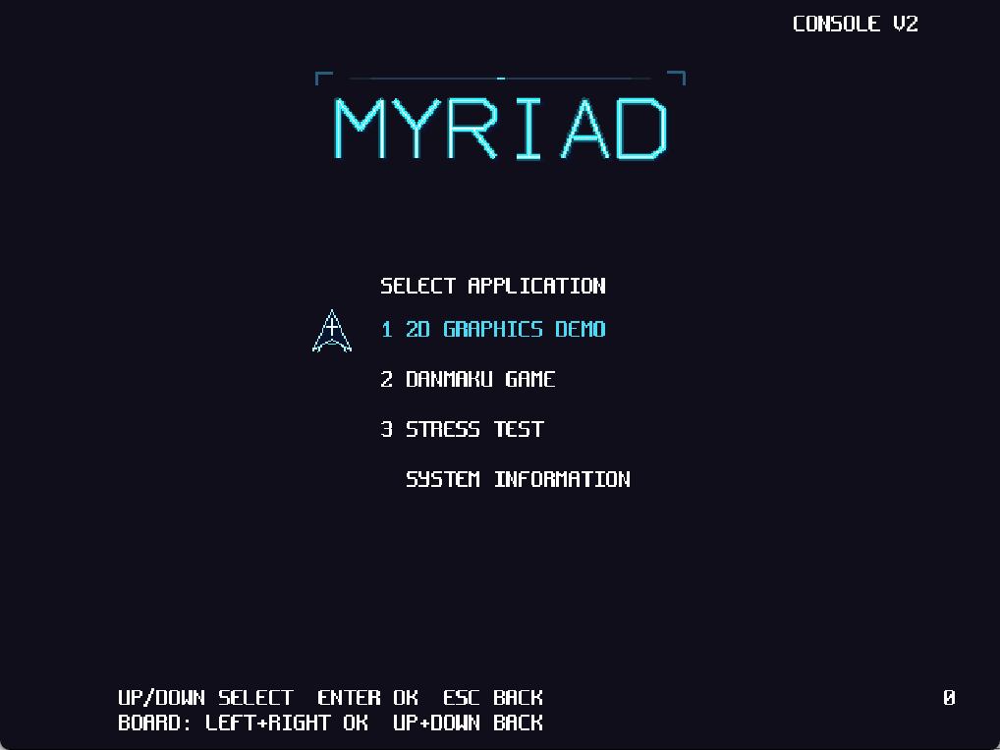
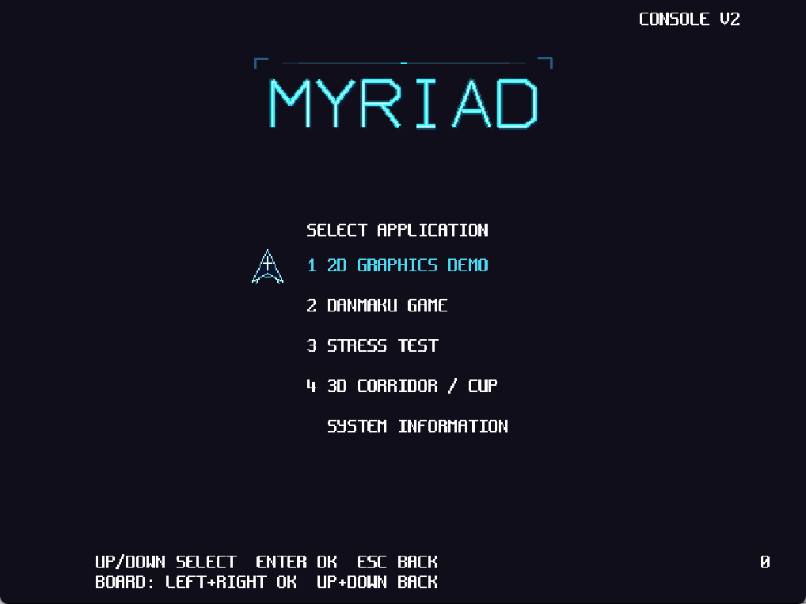

# 17 固件裁剪与能力协商

状态：**实现与本轮选定验证完成，待用户验收（2026-10-30）**。八项软件 acceptance、
原生 Windows 两版本、四档快照 JTAG 和交付包核对通过；未写 Flash。结果与证据在第 5 节。

## 1 问题与开工边界

用户希望在 PC 上逐轮打磨画面与玩法，并指出 B0/B3/B5 只能运行当前前三个 2D 应用，
要求提供不含三维内容的 BIN，同时允许未来 2D/3D 应用数量变化。

开工时四快照都随附同一份 236982 字节 console BIN，菜单通过特判 ID4 拒绝无 RAST
设备上的 R4，但仍列出 UNAVAILABLE。makefile 无条件编入 R4；启动器、菜单、面板
和验证器分别维护四应用假设，PC 参数还限制 ID≤5。

硬件能力按位判断：B0=0x040f、B3=0x146f、B5=0x346f、B7=0xd46f。PB 与 RAST 互斥，
B7 不是 B5 的完整超集。图形分类也不等于硬件要求：CPU 绘制的三维内容可以声明与 R4
不同的能力。本轮不改 RTL、SDK、素材像素、Flash 布局或生产默认绘制后端。

## 2 设计取舍

保留已有通用 appfw 管理器和固定周期的内容逻辑。产品目录 `catalog.json` 是 ID、名称、
分类、快捷键、模块依赖和硬件要求的唯一真源；`2d` 选择 demo/stg/press，`full` 加 R4，
about 为系统内容。显式 APPS 支持自定义集合，数量不由宏或编号范围决定。

生成器在活动 OBJDIR/catalog 下生成 ID/文本常量、注册元数据、源文件列表和 content.json。
所选目录摘要进入构建 stamp 与运行遥测；A/B/A 切换必须清除原对象，防止目录更新但程序
仍混入旧内容。默认输出按配置区分，显式共享 OBJDIR 仍受 stamp 保护。

R4 模块移出 2D 编译输入；共享启动运行时只在启用其内容时包含 R4 表面、atlas 和钩子。
旧开发/判据入口默认保留原内容。无消费者的 R4 回放与光栅纯库同步移出 2D 链接。
裁剪单位为模块依赖：当前三个 2D 内容复用 myriad2d，公共菜单也使用其字体/素材接线。
自定义 APPS 控制入口与模块集合，不承诺把一个共享模块内部的所有未选适配函数逐个剥离。
后续独立游戏可声明独立模块；公共素材包作为当前固件的公共资源，R4 atlas 随模块内嵌。

运行时过滤的是已编入目录；菜单、全局快捷键和进入边界复用同一个能力判断。ID 与
位置分离；菜单使用可见索引与有限视口，处理空目录、环绕、滚动和恢复选择。PC 支持
按 ID/名称启动及只读列目录，非法入口在显示/资源初始化前拒绝。

## 3 资源与协议

不增加每个游戏对应的输入位。上下、确认、返回组成完整导航，1～4 作为可选快捷别名。
启动输出版本化目录，状态绑定目录摘要和实际 CAPS；面板显示目录中的应用，未知应用
保留名称，而不是强制归入旧四模式。冻结包携带同一目录，避免 PC 与板端内容错配。

本轮素材仍为 4085504 字节，距 4 MiB 上限剩 108800 字节；新增游戏不能无限追加贴图。
程序镜像上限 512 KiB、程序 RAM 4092 KiB，构建分别检查；表面槽为活动内容的 16 槽，
游戏切换沿用现有资源排空与登记机制。本轮没有重做通用资源分配器。

## 4 构建与能力检查

- 第一版 2D 交叉构建为 174130 字节；ELF 无 r4_/rast_/replay_r4_ 与 g_app_r4 符号。
  该数字只说明早期构建，最终交付身份以第 5 节为准。
- 扩展用例采用二十个稀疏 ID 内容，其中含多个与 R4 无依赖的三维分类，用真实生成与
  菜单编译验证，不把对原四模式的另一份模拟实现当扩展性证明。
- quick 诊断轮 `20261030-012724-67b0c9db` 的 pack/console 单项通过，随后为补齐面板
  通用重开、打包身份和板测编排主动停止；该轮不作为完整通过。正式轮显式登记交叉工具链。
## 5 验证与交付

### 5.1 软件与扩展性

正式轮 `20261030-014120-259b9a00`，acceptance，八项全部 PASS：pack、console、
console-profiles、platform-sdk、layers、r4、workflow、app。
console-profiles 的真实目录反例共 12 组，额外扩展条目为 20 个；以下为该轮结果摘录。

- 生命周期故障/恢复、16384 个输入快照、64/32 位与 sanitizer、真实菜单及完整应用回归。
- 2d/full 实际构建与 R4/rast/replay_r4 符号裁剪；同一 OBJDIR 的 2d→full→2d 不混入旧目录。
- 目录重复/未知项、非法能力/分类与修改后的内容身份被拒绝；0/1/3/多页游标、能力替代用例。
- 二十个额外条目的真实菜单滚动后进入 extra13（ID133），完成 13 帧/13 次呈现、errors0；
  CLI 直接进入 ID42。多个 3D 标签按各自能力判断，不依赖全局 ID4。
- R4 数值/缓存/参考回归通过，所选场景样本为 L1 60、L2 240、cup 60；未更换数值契约。

### 5.2 四档实板

正式轮 `20261030-014306-a1081dbe`，acceptance，当前 FT4232H C UART 为 COM11。

| 快照 | 内容 | CAPS | BIN 字节 | 状态样本数 | 完成的应用/入口 | 结果 |
| --- | --- | --- | --- | --- | --- | --- |
| B0 | 2d | 0x0000040F | 174402 | 66 | about、demo、menu、press、stg | PASS |
| B3 | 2d | 0x0000146F | 174402 | 65 | about、demo、menu、press、stg | PASS |
| B5 | 2d | 0x0000346F | 174402 | 65 | about、demo、menu、press、stg | PASS |
| B7 | full | 0x0000D46F | 253806 | 86 | about、demo、menu、press、r4、stg | PASS |

B7 还覆盖 R4 走廊/茶杯切换与实际呈现；B0/B3/B5 核对未编入入口不可绕过。

<details>
<summary>逐档装载对象 SHA256（2026-10-30 历史身份）</summary>

```text
B0 / BIT 86138e9b1b5d82ecfb1f86ad555b31ef5e172aee27eaf56f3229d4a4ea337330 / BIN 17824d185390347ed347a650a3333c878a73a136f6f421946c093a30f78ae744 / 素材 d7db2e0ac008760a30cc08088ab43c4bbfbafce5a9faba8e52025d9dc17f2119
B3 / BIT f88b5430455c84c99e9d69602f1376d78e96173836d99d2fa7ae184b426f385f / BIN 17824d185390347ed347a650a3333c878a73a136f6f421946c093a30f78ae744 / 素材 d7db2e0ac008760a30cc08088ab43c4bbfbafce5a9faba8e52025d9dc17f2119
B5 / BIT c4f5a82118602d031ba652491cf63741b1ceb6e35f90f9706823b6ef1153c1cc / BIN 17824d185390347ed347a650a3333c878a73a136f6f421946c093a30f78ae744 / 素材 d7db2e0ac008760a30cc08088ab43c4bbfbafce5a9faba8e52025d9dc17f2119
B7 / BIT 4703e94ccd6746eb0fb774f4b1bf005fbeb9b2ee783e751b98c4fd40291d38b9 / BIN 507e2c1551a6491898ee2b75fa16a707c29424415fdc1fa4a5e2989a5ec94a7f / 素材 d7db2e0ac008760a30cc08088ab43c4bbfbafce5a9faba8e52025d9dc17f2119
```

</details>

所有选定状态样本的 errors/dropped/faults 为零，核对真实 1kHz tick 和显示计数。
各档均绑定精确加载边界、写入字节数及位流/BIN/素材身份。四个位流与开工
快照摘要逐字节一致，不产生新的 RTL 综合结论，不把 B5 的 PB 当成 B7 的子集。
当前 2D 默认仍用既有 HW/DDR 路径，本轮未采用新的绘制候选或改默认后端。

### 5.3 原生 Windows 与交付

原生 EXE 的两套内容均通过有限帧菜单/应用切换，退出0、无应用错误；目录摘要与目标 BIN
一致。2D/完整菜单的实际客户区如下，系统信息不计入游戏数量：





四个 `Main/bit/snapshots/<档>/` 已更新 BIN，并分别登记 content.json、firmware.json 与
verification.json。硬件 source_commit 不冒充新软件版本；软件保留 source_dirty 和构建身份。

当时核对的独立包名为 `board_release_console_2d_20261030` 与
`board_release_console_full_20261030`；以下记录对应当时冻结对象。前者的配套位流为 B0，后者为 B7；
B3/B5 使用各自快照位流和同一 2D BIN。两包都含 PC EXE、SDL2/许可、素材、目标
BIN/ELF/MAP、位流、工具、冻结源码与验证摘要。文件校验、Windows PowerShell 5.1
和 PowerShell 7 的 Run-Board.ps1 -CheckOnly 全部通过。
另对两套冻结包各执行一次真实 Run-Board.ps1 -NoPanel：2D包正确加载B0，完整包正确
加载B7，两者均确认包内工具/SDK路径、精确加载字节数和实时目录/CAPS状态，最终恢复B7。
Windows PowerShell 5.1 的 Run-PC.ps1 已实际启动冻结2D EXE，进程响应且字节身份匹配；
该次启动检查只证明当时冻结 EXE 可运行。

真实输入的三种打包反例通过：PC/板端集合不一致、full 固件配 B0、修改内容清单却沿用
旧摘要，均在产生发布目录前拒绝。两套包的实际启动结果摘录如下；帧数为短启动样本，
不作为稳定帧率结论。

| 内容 | 载荷文件 | 启动 | 应用/ID | 完成/呈现 | errors/dropped/faults | PowerShell CheckOnly |
| --- | --- | --- | --- | --- | --- | --- |
| 2d | 28 | PASS | menu/0 | 46/46 | 0/0/0 | 5.1 PASS、7 PASS |
| full | 28 | PASS | menu/0 | 43/43 | 0/0/0 | 5.1 PASS、7 PASS |

<details>
<summary>构建、PC 与板端共用的内容身份</summary>

```text
2d 内容 SHA256 b0fee621601f852c838298a343841032d219859bd1c488063034d89bbd8b1bf0
full 内容 SHA256 6343402609dd598f167d85096ae67d2a7c7d96245cece8e4ba8f1820cae77175
```

</details>

### 5.4 范围与后续增加应用

新增内容登记独立稳定 ID/名称、分类、模块、要求和可选快捷键，再选入产品配置。
菜单、CLI、能力目录和打包无需按游戏数量改分支；新游戏自身仍需定义玩法/渲染判据。
数量受 512 KiB 镜像、4092 KiB 程序区、4 MiB 素材等实际预算限制，不表示无限存储。
本轮沿用单活动应用及已有排空/表面/TEX切换契约，不引入动态下载或并发多应用。

未执行 Flash 写入/上电启动、新 RTL 综合、完整 N_max/9208帧硬件回放、实体控制器与
人工 HDMI 观察；这几项不属于本次应用集合改造的通过声明。用户验收仍待明确回复。

## 冻结硬件上的软件验证

默认基线改为Main/bit/snapshots/B7。身份读取支持：快照的config/caps/bit_sha256/bit_bytes、
历史包的files清单，以及新包显式board_bit。拒绝错误构型、错误字节数/摘要、歧义条目、
缺失位流和越出包目录的路径；旧格式兼容不代表仍保留旧目录依赖。

当前B7位流SHA256为`4703e94ccd6746eb0fb774f4b1bf005fbeb9b2ee783e751b98c4fd40291d38b9`，
配套ppa-after4综合树的位流摘要相同，布局/时序/告警
报告完整。旧current包的2bd49db6位流不再是默认目标。源码检查保留两种边界：
r4-frozen-board允许当前RTL不同，只验收显式冻结硬件上的软件；普通r4-board仍核对RTL。
缺少同一位流的树/配置/报告属于INCOMPLETE，不默选另一份B7，也不因此自动发起综合。
本轮只读取已有报告，未改RTL/SDK/游戏代码或重建位流。
重新执行冻结硬件验收时仍须提供该位流对应的完整综合树与报告；
下面的历史摘要不能替代检查器要求的原始输入，也不表示当前 RTL 已综合。

2026-10-30的frozen-baseline/workflow专项quick共14项身份与拒绝反例通过；
同一B7上的r4-frozen-board完成三场景CRC、模式往返、旧二维负载和短节拍检查。
该入口允许软件变化而硬件显式冻结，普通r4-board仍核对当前RTL，缺匹配报告为INCOMPLETE。
该轮读取的既有B7报告为59551 XLR、187 RAM、26 DSP，core setup/hold为+0.706/+0.027ns。
这些是匹配冻结位流的旧报告，不是该轮或当前RTL新综合所得。

<details>
<summary>匹配冻结 B7 位流的 STA 输出摘录（ns）</summary>

报告来源为 `ppa-after4` 的 B7 构建；2026-10-30 只读核对。

| 起点时钟 | 终点时钟 | 类型 | 余量 |
| --- | --- | --- | --- |
| core_clk | core_clk | setup | +0.706 |
| sdram_clk | sdram_clk | setup | +0.244 |
| rx_cal_clk | rx_cal_clk | setup | +0.253 |
| tx_cal_clk | tx_cal_clk | setup | +0.230 |
| tx_cal_clk_90edge | tx_cal_clk_90edge | setup | +0.294 |
| hdmi_tx_slow_clk | hdmi_tx_slow_clk | setup | +32.548 |
| jtag_inst1_TCK | jtag_inst1_TCK | setup | +95.497 |
| jtag_inst1_TCK | jtag_inst1_TCK | setup | +48.317 |
| core_clk | core_clk | hold | +0.027 |
| sdram_clk | sdram_clk | hold | +0.043 |
| rx_cal_clk | rx_cal_clk | hold | +0.026 |
| tx_cal_clk | tx_cal_clk | hold | +0.044 |
| tx_cal_clk_90edge | tx_cal_clk_90edge | hold | +0.072 |
| hdmi_tx_slow_clk | hdmi_tx_slow_clk | hold | +0.091 |
| jtag_inst1_TCK | jtag_inst1_TCK | hold | +0.097 |
| jtag_inst1_TCK | jtag_inst1_TCK | hold | +48.724 |

</details>
