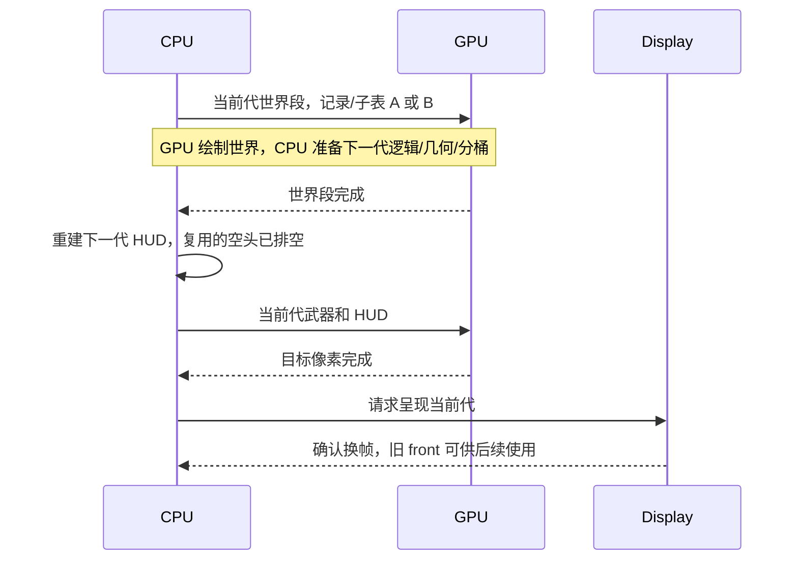

# 凝时纯软件性能优化(SW23)

2026-11-06 修复收尾：独立复核发现的 P3 范围回填、P4 记录寻址及提前呈现三项缺陷已修复，
正式软件与 B7 板端 acceptance 通过，当前为待用户试玩验收，详见第 4.2 节。
正确流水固定视角 19.900 FPS、活动窗口 16.777 FPS，仍未稳定 30Hz；输入至显示多一代，
逻辑快照到换帧确认均值分别为 100/118ms。人工 HDMI/实体输入体验尚未验收。
第 1、3 节保留初次交付的历史取样，不能替代修复版本的数据；第 4.1 节保留撤回完成结论
的复核过程。[SW23 登记单](../../Todo/sw/SW23-凝时纯软件性能优化.md) 保留待验收。
基线为 [SW22 第 26 章](26-凝时切面建模与精确单色setup.md) 的冻结交付:
固定视角/移动射击 1800 帧窗口平均 12.000/16.298 FPS。本轮不改 RTL、SoC、寄存器/记录 ABI
语义、素材包与玩法;所有新路径与通用路径逐字节对照,几何 CRC 与基线一致。

## 1 目标与结果概要

| 指标(1800 帧窗口) | SW22 基线 | SW23 初次交付，含缺陷 |
| --- | ---: | ---: |
| 固定视角平均 FPS / p50 / p99 / max | 12.000 / 71.0 / 74.7 / 75.3 ms | 19.985 / 49.3 / 50.4 / 62.2 ms |
| 活动窗口平均 FPS / p99 / max | 16.298 / 178.6 / 208.2 ms | 18.441 / 126.7 / 160.9 ms |
| geometry 阶段(固定视角) | 41.6 ms | 33.8 ms |
| 帧内 CPU 串行等待 | 光栅 16.6 ms 全额暴露 | 世界段光栅与 CPU 准备重叠(收尾等待 0.02 ms) |

固定视角 p50≈p99(49.3/50.4) 是缺陷版本的节拍观测，不能证明完整正确帧的长尾改善。稳定 30 FPS 未达成;
按登记单"不预先承诺达到"如实记录,剩余瓶颈在第 5 节。

## 2 实现

### 2.1 扩展精确 setup(`sh_flat_setup`/`sh_flat_fan`)

- 逐顶点颜色:单色限制放开为"零 UV 即可",混色面按记录序 G,B,R 计算六个通道梯度,
  与 `setup_one` 的 `gradient()` 同值同舍入(`fx16_round_div`,半值向 +∞),走同一条
  `sh_gradient20` 精确 n·2^20/d 阶梯。敌人地面阴影三角从通用路径(~152 µs/个)进入快路径。
- 扇形扩展(`sh_flat_fan`):房间/家具/弹道等单色或逐顶点色、零 UV 的多边形,按
  `(v0,vi,vi+1)` 扇形拆分逐三角形快跑。整面先做严格视口内预检(通用路径此时裁剪为
  恒等);背面扇形三角与 `setup_one` 同样跳过并计数,翻绕重试次序与通用路径一致;
  任一三角不符即整体退回通用路径,记录提交前先落在局部缓冲,容量原子性保持。
- 字直写:记录 128 字节按 32 个字直接写入目标记录,跳过 memset+逐字段写+整块拷贝;
  全部可能拒绝的判据(视口内、色度域、梯度域、空 bbox)先于任何写发生,失败不留残迹。
  目标地址恒为字对齐:网格/多边形路径写池内记录,扇形路径写字对齐联合体。
- 屏幕顶点翻绕重试(P2):`sh_poly` 首试已投影的面被背面剔除时,直接交换已投影屏幕
  顶点重试 `gfx_setup_polygon`,不再重走视图裁剪+投影;逐顶点投影是确定性的,翻绕后
  投影等于投影后翻绕。
- 网格投影/变换矩阵局部化:每网格绘制把视图/投影矩阵复制到栈上局部,顶点循环经
  `sh_transform_m`/`sh_project_vertex_m` 使用局部副本,算术与记录字节不变。

### 2.2 条带范围缓存分桶(P3)

`rast_bin_frame_cache(records,count,ranges,out,cap,frame)` 新增于共享库 `rast_setup.c`:
`ranges` 每记录两字节 {首条带,末条带},0xFF 对表示新面孔——照常校验记录体并回填;
其余条目是生产方已校验记录的既有范围,直接复用不再读 128 字节记录体。输出字节与
`rast_bin_frame` 完全一致,容量/非法记录/空帧空头判据不放松;受污染的可信条目按错误
处理(单测覆盖)。范围表由场景层维护(只有场景知道哪些切片来自缓存):房间/敌人/武器
缓存各自携带范围切片,命中时随记录一起拷回,重新发射的切片保持 0xFF。

2026-11-06 订正：上述是设计意图。缓存槽在分桶回填之前保存范围，缺少回填后的写回，
下一帧命中仍复制 `0xFF`；库 API 可用，但跨帧复用未实现，见第 4.1 节。
同日修复：在全部分桶成功后调用 `sh_world_ranges_commit` 回填对应缓存切片；先检查
全部待发布范围再写任一缓存，部分分桶或容量拒绝不发布，见第 4.2.3 节。

### 2.3 CPU/FPGA 跨帧流水(P4)

`r4_mode_frame_pipe`(scene 3、硬件路径、判据构建之外自动启用):

- 双缓冲:第二套记录窗口(2048×128B,借用凝时缓存池尾,武器缓存槽 16→12 后池缩至
  768KiB)与第二套世界/武器子表(各 32KiB,实际用量几 KiB)位于世界中间面之后、
  2D arena 之前,静态断言约束互不重叠;条带范围表随缓冲各备一份。
- 时序：提交已备代的世界段，CPU 准备下一代逻辑/几何/分桶，收世界段后重建下一代 HUD，
  再提交并完成已备代的武器/HUD，最后请求呈现并等待确认。首调只准备，随后显示上一输入代。
- 所有权:在途帧的记录/子表在提交完成前不可复用(双缓冲轮换保证);HUD 列表本就随
  帧序奇偶分区域;退出与错误路径排空在途命令(`gfx_engine_wait`)后释放。
  2026-11-06 修复：提交显式使用当前记录窗口，世界/武器共享同一代；空 HUD 头直到世界
  排空才复用。返回 `presented_fb`，首调返回 -1，不把待绘目标当成已显示面。
- 判据：常规 CRC 路径保持同步；`SH_PIPE_CAPTURE` 强制真实生产调度参与板上软件参考
  对照。仅冻结逻辑 tick 并增加读回/代际日志，记录构造与两段提交使用生产实现。

## 3 开发与取样

- 细分剖析(SHCPU,板端):SW22 基线 geometry 41.6ms 中,网格绘制 ~32ms(投影 9.9、
  逐面颜色 3.4、精确 setup 16.3——其中梯度 2.7、记录写出 0.5,其余为字段构建),
  通用多边形 ~7.8ms(36 个敌人阴影三角,~152µs/个),房间缓存命中 memcpy 0.05ms。
  剖析还发现原网格 setup 计数器写错槽位(写入 sh_poly 的元素),已修正。
- 板端微基准:DIVU 43 周期、精确梯度 79 周期、顺序 memcpy ~1GB/s——排除"除法或
  内存病态"假说,差距在每操作有效周期数与上下文开销。
- 逐项取样(板上固定视角 geometry):基线 41.6ms → P1~P3 44.2ms 量级不变(房间
  缓存命中使 P1 收益后移到活动窗口;P3 省 0.3ms)→ 混色/字直写/矩阵局部化 38ms →
  直写 34.9ms → 流水后 33.8ms。固定视角平均 FPS:14.7(同步基线复测)→ 流水 19.5 →
  直写+挂号提前 20.4。
- 事故与处置:含 SH_PROFILE 剖析的调试固件在菜单对串口输入失灵(代码体积越界,
  生产构建不受影响);调试基准一律退回生产构建验证。剖析计数器槽位错位一并修正。
- 命中率事实:固定视角下房间缓存恒命中、敌人缓存恒失效(每帧位移)、武器缓存命中;
  活动窗口房间逐帧重发射,由 P1 扇形快路径承接。

## 4 正式验证

最终软件:sh=`20261106-034042-f9324bee`、r4-current-consumers=`20261106-034042-cd9c3630`,
实际为 quick 全部 PASS（原文误标为 acceptance；本轮已另补正式范围）
(64/32 位、ASan/UBSan、泛型(双缓存禁用)与缓存路径记录逐字节一致、变异全见红;当前 R4
消费者在共享库改动后照常通过,场景 CRC 591840a9 不变；原“三场景”表述订正为实际 L1/L2 检查)。sh 几何确定性 CRC `8c6858ca` 与
SW22 基线逐字节相同,新增 2 万扇形/混色用例与分桶缓存对照。

原板端直接专项:`20261106-040447-bc518025`，长窗口与像素结果如下。
其归档 `board-run.json` 的 `checks={}`，缺少计划/最终汇总及完整像素原始输出，
不能按唯一验证流程认定为完整 acceptance 归档；本轮另补正式运行。

| 窗口 | R4PERF 帧 | 平均 FPS | p50/p99/max ms | late/exact/over |
| --- | ---: | ---: | --- | --- |
| 固定视角、敌人自然行动 | 1784 | 19.985 | 49.286/50.417/62.183 | 1784/0/1784 |
| 连续移动/转身/射击 | 1778 | 18.441 | 48.598/126.652/160.912 | 1040/738/1139 |
| 走廊直接消费者 | 34 | 19.615 | 48.353/49.199/49.199 | 34/0/34 |

活动窗口 738 帧准时到达(基线 0 帧):朝向空处时 CPU 准备缩短,流水把节拍送进 33.3ms
门限;长尾 p99/max 较基线下降 29%/23%。三组 ZERO/UNDER/RESPERR 均 0,无应用错误、
fault 或串口日志丢失;硬软像素、贴墙开火装填、注错见红全部通过(采集构建走同步路径)。

冻结生产 BIN 479658 字节(SHA256 前缀 beb623625cd5cbea,与验收构建逐字节同源);本轮无 RTL
修改,不重新综合。Flash 交付:烧写前整片备份 `Main/bit/flash-backup-20261106-before-sw23.hex`
(8MiB,烧前程序分区 425930 字节=SW21 首轮固件,与在案口径一致),经 JTAG2SPI 烧写程序分区
0x380000 并 hostx1 校验通过,位流/素材分区未动;Flash 自启动核对:注入快捷键 6 进凝时,
R4STAT 20 FPS、errors 0。固定视角仍晚点(几何 33.8ms+分桶 5.5ms+武器段串行),30Hz 差距
如实保留。

### 4.1 2026-11-06 独立复核与完成状态订正

核对提交 `59c359ba` 与原登记单，当前生产相关 833 份输入和原板端身份逐字节一致；
重新构建的生产 BIN 仍为 479658 字节、SHA256 前缀 `beb623625cd5cbea`。

| 本轮检查 | 档位与结果 | 覆盖范围 |
| --- | --- | --- |
| pack、sh、r4-current-consumers | acceptance PASS，`20261106-161226-09d3e715` | 32/64 位、sanitizer、记录/像素、定向变异；R4 L1 60 帧、L2 240 帧 |
| lib、rast | acceptance PASS，`20261106-162307-5cbf0f7e` | 库正常/变异、1万几何、5000视口、10万光栅、宿主与目标构建 |
| sh-board | acceptance PASS，`20261106-161357-202219a9` | B7 同步像素、贴墙开火/装填、像素注错、生产双长窗口、走廊恢复 |
| P3 场景缓存独立诊断 | 缺陷复现 | 513 项分桶回填后，房间缓存及下一次同视角发射的可信范围仍为 0 |
| P4 生产 APB 取样及控制流审查 | 缺陷确认 | B 子表 `0x009E0000` 配 A 记录 `0x00600000`；呈现请求早于目标绘制 |

本轮固定视角 `R4PERF` 1784 帧，19.981 FPS，p50/p99/max 为 49.352/50.364/62.078ms；
活动窗口 1795 帧，16.718 FPS，49.625/132.204/153.091ms。应用分别完成至少 1800 帧，
PERF 计数扣除预热并受统计输出时点影响。显示 ZERO/UNDER/RESPERR 均为 0，应用 errors/faults 为 0。
活动统计受实际时间输入与游戏演化影响，不是与原记录逐帧相同的回放；本轮数字用于复核现状。

确认的缺陷分别登记为：

- [第二套记录未提交](#421-记录寻址与代际)：提交 helper 固定 `R4_REC_OFF`，
  B 帧子表与 A 记录混用，并可能与下一轮 CPU 写 A 冲突；实板 APB 已确认。
- [绘制前请求呈现](#422-呈现与命令表所有权)：写 SWAP_REQ 后还需准备下一帧及
  完成武器/HUD，显示端没有渲染完成栅栏；静态确认，实际 HDMI 现象未人工观察。
- [条带范围缓存未回填](#423-范围回填与真实缓存命中)：API 字节一致性通过，但真实缓存
  命中后所有项仍是新记录，P3 预期收益未落实。

现有标准检查通过仍不能认定工作点完成：像素固件自动禁用流水，生产长窗缺少基址、
代际与像素完成条件；范围缓存测试也未验证下一次场景发射的命中效果。
应先修复三项、补相应反例和直接生产流水像素对照、输入延迟及退出/切换所有权判据，
然后重建性能基线。稳定 30Hz 和用户试玩继续保留。
本轮使用 JTAG，Flash 写入属于原交付历史声明；本轮未重验其烧写身份。
诊断结束后重新加载同身份生产 BIN，串口确认 `console enter menu`，调试采样已结束。
本轮文档/证据的链接、空白及机器路径单独检查；全仓已登记文件路径扫描另有 17 处历史命中，
位于第 18、24 章旧证据，本轮保留其原状，未将全仓路径检查报告为通过。

### 4.2 2026-11-06 修复、正式验收与交付

用户在独立复核后要求“帮我修复”。修复保持 B7 位流、RTL、SoC、素材及 128B 记录 ABI，
只改凝时场景缓存、可信适配运行时/应用接线及对应判据。帧缓冲、记录、子表和 HUD 的所有权
留在运行时，玩法层提供范围缓存切片和逻辑状态，不接触驱动寄存器。
P3 影响 PC/Ti60 共用缓存路径；P4 缺陷限于目标端凝时硬件生产流水，原宿主及普通同步 CRC
路径不受该寻址/呈现问题影响，因此需要新增直接流水判据。

#### 4.2.1 记录寻址与代际

第一现场是未修改的旧生产 BIN（479658 字节，SHA256 前缀 `beb623625cd5cbea`）在 B7 上：

```text
SW23PROBE 10 1 00600000 007c0000 00600000 009e0000 376 3 00800000 02400000 02400000 00000001
```

依次为采样号、cur、记录 A/B、TRI_BASE、SUB_BASE、TRI_COUNT、目标槽、目标基址、
front、back、STATUS。STATUS=1 时 B 世界子表 `0x009E0000` 配了 A 记录 `0x00600000`，
应取 `0x007C0000`。指针和子表轮换已生效，排除未分配 B 的解释；根因是提交 helper
仍硬编码 `R4_REC_OFF`，导致跨帧混用，并可能与 CPU 下一轮写 A 冲突。

`submit_hw_part_async` 现显式接收 `rec_off`：同步调用用 A，流水按 cur 选 A/B，世界与
武器两段均沿用该基址并叠加本代的 first；B 子表传实际 32KiB 容量。每个缓冲保存 generation、
keys、采样时间、score/shield/ticks 和目标面，呈现时使用当前代快照。准备代与呈现代间隔为 1。

原宿主测试只比较生成的记录；原板上 CRC 又自动禁用流水，因此合法的错误地址可在
errors=0 时逃过检查。新 `test_pipeline.c` 直接包含目标端生产调度函数，以独立的延迟
引擎模型检查实际传给驱动的地址、A/B 内容/子表稳定性和三态提交。重新硬编码 A 或覆盖
在途记录都必须运行失败。实板再以八个不同输入代比较流水、同步硬件和板上软件参考。

#### 4.2.2 呈现与命令表所有权

旧顺序为“写 SWAP_REQ → 世界中间面 → 准备下一帧 → 武器/HUD 写目标 → 等待换帧”。
`board_present_frame_request` 直接写 BACK_BASE/SWAP_REQ；display 在场界锁存并换 front，
没有引擎完成栅栏。固定视角准备约 40ms，而换帧可在下一场发生，因此末尾等待不能阻止
显示未完成目标。仅世界分支的注释虽说先绘后挂号，实际请求同样早于分支。
这是静态确认的顺序缺陷；原 APB 暂停采样未捕获 `BUSY && dst==front`，也未人工观察 HDMI
撕裂，引擎完成后看到目标是 front 本身是合法状态，原始材料见复核归档。

修复后的顺序是：



原世界段借用“下一代”的命令表空头；若在世界尚未完成时重建 HUD，快速准备路径仍会改到
在途头部。因此 HUD 重建也移到世界 wait 之后。首调只准备、不计实际呈现；
`r4_out.presented_fb=-1`，后续返回实际显示的旧代面，`app_sh` 据此更新 shown。
退出丢弃未提交的预备代并排空在途命令后才释放缓存；准备失败、引擎错误/超时不呈现失败帧，
引擎失败先软复位再登记表面。正常/无世界/无武器、准备失败排空、引擎失败与模式恢复均有检查。

新模型在 present 时独立断言目标已完成、无在途命令且不是 front，提交后继续检查记录/子表/
头部在 wait 前稳定。提前请求、跳过退出 drain 的变异必须失败。原显示健康判据只检查
欠载和总线响应，无法判定像素完整；新板测直接比较真实流水像素，并检查首调及输入代际。

#### 4.2.3 范围回填与真实缓存命中

第一现场来自直接包含生产场景的独立宿主诊断：
绑定 `SH_CACHE_BYTES` 缓存池，同一投影、640×480 视口和世界状态连续发射两次，
中间只分桶，不推进 tick 或相机。

```text
SW23_RANGE_PROBE records=513 bin_bytes=2786 warm_after_bin=513 room_records=148 room_cached_warm=0 next_emit_warm=0 room_hit=1 records_equal=1
REPRODUCED: scene cache discards every validated strip range
```

分桶器已填满当前表，记录字节一致、房间版本未变，说明确实命中；但发射函数在分桶前把
`0xFF` 保存到缓存，分桶后无写回。下一帧又复制 `0xFF`，房间、敌人与武器的范围复用均未生效。

现在发射层登记最多“房间 + 三敌人 + 武器”五个待回填切片；世界和武器全部分桶成功后，
运行时调用 `sh_world_ranges_commit(count)`。它先检查所有切片的范围有效，再一次性写回；
失败或部分分桶不发布，下一次发射仍以新记录验证。冷缓存命中但尚未回填的情况也会重新登记。
相机/姿态/投影/viewport 依赖保持原失效规则。

新增真实场景连续发射测试：稳定视角第二次发射的可复用项必须存在，并与全校验路径子表
逐字节一致；转相机使世界失效而武器仍可复用，投影/视口变化使对应切片重新验证；覆盖部分
分桶和容量拒绝的非发布状态。遗漏写回变异必须失败。原测试只验证“当前已回填表再分桶”，
不会要求下一次场景发射恢复有效范围，故可在每帧全校验时通过。

#### 4.2.4 正式范围、性能与剩余边界

| 检查 | 档位、运行号与结果 |
| --- | --- |
| pack、sh、r4-current-consumers、lib、rast、console | acceptance PASS，`20261106-170036-cc0efc5e` |
| sh-board | acceptance PASS，`20261106-170209-a35cfbb1` |

sh 的 64/32 位、ASan/UBSan、泛型/缓存记录、真实 PC 运行与 12 项定向变异通过；
其中 1 项范围发布、4 项生产流水所有权变异直接覆盖此次缺陷。几何 CRC 仍为 `8c6858ca`，
R4 消费者 CRC 仍为 `591840a9`。共享 rast 完成 1 万几何、5000 视口、10 万光栅、
独立参考及宿主/目标构建，前端完成生命周期/输入/实际应用/故障回归。

板上八个输入代的流水、同步硬件、软件参考记录及像素逐帧一致；流水像素注错见红；
贴墙/开火/装填的四帧流水也与两条参考一致。SHPIPE 检查 A/B 交替、generation、keys
和呈现目标，首调不输出伪呈现。长窗口改为等待实际 presents 达标，不以函数调用数代替。

| 生产窗口 | 实际呈现数 | PERF帧 | FPS | p50/p99/max ms | late/exact/over |
| --- | ---: | ---: | ---: | --- | --- |
| 固定视角 | 1822 | 1791 | 19.900 | 41.626/43.527/43.726 | 1791/0/1791 |
| 移动/转身/射击 | 1827 | 1796 | 16.777 | 38.737/127.921/143.569 | 1390/406/1379 |

PERF 帧数扣除 31 帧预热；p50/p99/max 是函数内渲染工作耗时，不含等待显示场界，FPS 则来自
实际换帧数/场号，不能用渲染分位数直接倒算实际 FPS。ZERO/UNDER/RESPERR、应用 errors/faults
均为 0。走廊直接消费者完成 79 次实际呈现、健康检查及返回菜单；此短窗用于恢复功能检查。
活动输入依墙钟轮换，游戏演化与旧轮并非逐帧锁定，数值保留本轮负载边界。

| 输入快照到显示确认 | 样本数 | min/avg/max ms | 额外预备代 |
| --- | ---: | --- | ---: |
| 固定视角 | 1822 | 93/100/150 | 1 |
| 活动窗口 | 1827 | 58/118/299 | 1 |

SHLAG 从逻辑输入取样计至实际换帧确认，不含串口/实体输入传输和显示器响应；CRC 功能固件
有读回开销，其 SHPIPE 中延迟只作代际诊断，不混入上述生产性能与延迟。原“输入延迟与同步
相同”声明撤回，当前实现保留并登记一代预备间隔，人工手感仍待用户验收。

最终生产 BIN 480434 字节，RAM 静态 text/data/bss 合计 3922690 字节（4092KiB 预算内），
完整文件身份见本轮 board/run.json；B7 沿用原位流。本轮只 JTAG，Flash 仍保留原交付，
没有重写持久镜像。最后生产固件返回菜单并释放串口。三个 Bugs 的原始现象、定位、修法与
判据缺口已并入本节，当前条目移除；SW23 Todo 保留“待用户试玩验收”，稳定 30Hz 未达。

## 5 剩余瓶颈与 30Hz 差距

2026-11-06 订正：以下预算来自缺陷版本，仅保留为后续定位线索；先修复第 4.1 节的
正确性与缓存集成，再重新测量，不能据此保证修复后的 FPS 或优化收益。

流水后固定视角帧周期 ≈ CPU 准备 40ms(几何 33.8 + 分桶 5.5 + 逻辑/HUD 0.4)+
武器段串行 ~2-4ms + 调用层开销;30Hz 需要准备 ≤31ms,即几何再降 ~9ms。已知未用
手段:网格逐顶点投影在板上的有效开销仍 3 倍于微基准外推(疑似指令缓存/上下文),
近景裁剪面的通用路径(视口边缘影子三角不满足严格内检)与敌影重发射。三者均不改
外观难再压;30Hz 维持为未达目标登记。

## 6 证据

- 修复后：[软件正式归档](evidence/27-sh-swperf-repair-20261106/software/result.json)、
  [板端正式归档](evidence/27-sh-swperf-repair-20261106/board/result.json)、
  [流水像素与输入代际](evidence/27-sh-swperf-repair-20261106/board/logs/sh-board/pipeline.json)、
  [八帧像素与注错](evidence/27-sh-swperf-repair-20261106/board/logs/sh-board/pixels.json)、
  [贴墙动作](evidence/27-sh-swperf-repair-20261106/board/logs/sh-board/wall-pixels.json)、
  [生产性能/延迟](evidence/27-sh-swperf-repair-20261106/board/logs/sh-board/timing.json)、
  [最终源码字节及预算复核](evidence/27-sh-swperf-repair-20261106/final-review.json)。
- 本轮复核：[正式软件归档](evidence/27-sh-swperf-audit-20261106/software/result.json)、
  [共享 rast 归档](evidence/27-sh-swperf-audit-20261106/rast/result.json)、
  [正式板端归档](evidence/27-sh-swperf-audit-20261106/board/result.json)、
  [独立诊断及身份](evidence/27-sh-swperf-audit-20261106/diagnostics/manifest.json)。
- [最终软件验收 sh](evidence/27-sh-swperf-20261106/software-run.json)、
  [r4-current-consumers](evidence/27-sh-swperf-20261106/consumers-run.json)。
- [最终板端验收](evidence/27-sh-swperf-20261106/board-run.json)、
  [硬软像素](evidence/27-sh-swperf-20261106/board/logs/sh-board/pixels.json)、
  [贴墙动作像素](evidence/27-sh-swperf-20261106/board/logs/sh-board/wall-pixels.json)、
  [长窗口指标](evidence/27-sh-swperf-20261106/board/logs/sh-board/timing.json)。
- 板端取样过程(逐项收益与流水迭代):[基线复测](evidence/27-sh-swperf-20261106/board/logs/baseline-fixed.log)、
  [细分剖析](evidence/27-sh-swperf-20261106/board/logs/prof2-fixed.log)、
  [直写后](evidence/27-sh-swperf-20261106/board/logs/prodpipe4-fixed.log)、
  [微基准](evidence/27-sh-swperf-20261106/board/logs/bench2.log)。
- 剩余瓶颈、30Hz 差距与调试构建串口输入失灵事故的处置见第 3、5 节;SW22 的用户试玩
  验收继续保留,不因本轮视为完成。
